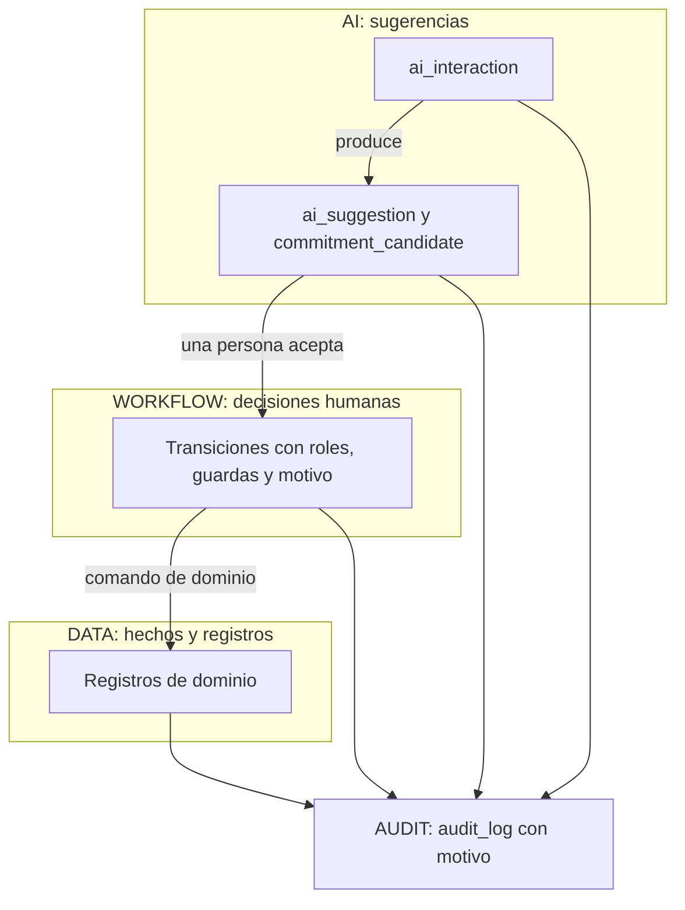
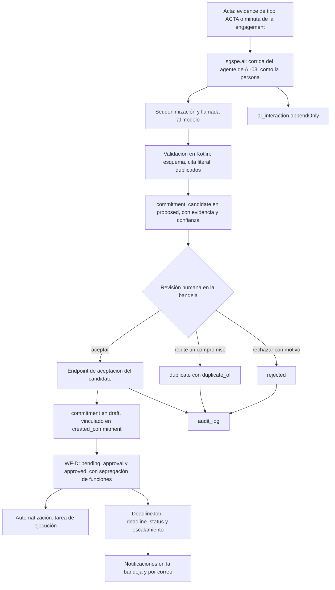
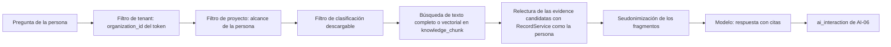

# Arquitectura de IA de SGSPE

Sistema de Gestión Social para Proyectos Extractivos · Fase 0 (descubrimiento) · versión 1.0 · 2026-10-07

Este documento fija cómo usa SGSPE la inteligencia artificial: qué hace cada caso de uso del prompt (AI-01 a AI-08), con qué
mecanismo, qué registra, cómo protege los datos personales y cómo se prueba. Deriva del
[análisis de requisitos](requirements-analysis.md), del [glosario](glossary.md) y del [modelo de dominio](domain-model.md), que
son la fuente de verdad: los IDs (RF, RNF, RN, RQ, CON, GAP, ASM, UPS) se definen solo en el análisis y aquí solo se citan; los
valores de catálogo están solo en [§10 del análisis](requirements-analysis.md#10-catálogos). Ningún ejemplo usa nombres de
personas reales [USR-07].

## 1. Alcance y fuentes

- La IA llega en F7, dentro de la Release 3 (Fase 3 de producto) [USR-05] (ASM-044). La única pieza anterior es el candidato a
  compromiso registrado por una persona, que existe desde F3 (RF-COM-010).
- Cubre los casos AI-01 a AI-08 [PRM-01 §9], la capa de abstracción de proveedores y el registro de cada interacción
  [PRM-01 §10], las pruebas de IA [PRM-01 §21] y las reglas 5 y 6 para el desarrollo, que prohíben acoplar el dominio al
  proveedor de IA y que un agente modifique datos críticos [PRM-01 §26].
- Toma la intención de los bocetos del usuario:
  - DATA, WORKFLOW y AI convergen en AUDIT [ARQ-01];
  - el acta pasa por la IA a un candidato con evidencia y confianza, que una persona revisa antes de crear el compromiso
    [ARQ-02];
  - el boceto de capas pone pgvector desde el inicio, lo que el prompt no permite sin justificación: se difiere (CON-035)
    [ARQ-03].
- Se apoya en wasichai-agent, un asistente de solo lectura sobre Embabel que actúa como la persona que pregunta
  [WAS-ADR-0014] [WAS-ADR-0015] [WAS-DOC modules/agent.md].
- No reemplaza a otros documentos:
  - las transiciones, los roles y las guardas por transición de WF-K están en `workflows.md`;
  - qué roles usan la IA y aceptan sugerencias, en `security.md`;
  - los campos completos de `ai_suggestion`, `commitment_candidate`, `ai_interaction` y de la tabla fija `knowledge_chunk`, en
    `database-model.md`;
  - el contrato de los endpoints, en `api.md`;
  - las decisiones, en ADR-0003 (Abstracción de IA sobre wasichai-agent), ADR-0004 (La sugerencia de IA no es un comando de
    dominio) y ADR-0005 (RAG en F7 y pgvector solo con justificación medida).

## 2. Principios

| # | Principio | Consecuencia en el diseño | Fuente |
|---|---|---|---|
| P1 | La IA complementa y no reemplaza las decisiones de negocio | Toda salida es una sugerencia; aceptar, aprobar, verificar, confirmar y cerrar son decisiones humanas | [PRM-01 §9] OBJ-09, RQ-AI-001, RQ-AI-003 |
| P2 | Ningún agente escribe datos | Los agentes solo tienen herramientas de lectura. Devuelven datos estructurados, y el código de `sgspe.ai` (no el agente) los valida y los guarda como `ai_suggestion` o `commitment_candidate`, aparte de los registros de dominio | [PRM-01 §9, §26] [WAS-ADR-0014] RQ-AI-001, CON-044 |
| P3 | La sugerencia se separa del comando de dominio | Una persona acepta mediante un endpoint que ejecuta el comando con su autorización, en una sola transacción y con auditoría | [PRM-01 §9] [ARQ-02] RQ-AI-003, RQ-AUD-012 |
| P4 | Ninguna IA confirma un conflicto | La IA puede detectar señales, resumir evidencia y proponer una clasificación; confirmar o descartar una alerta es humano | [PRM-01 §5] RN-EWS-001 |
| P5 | La IA ve lo que ve quien pide | Las herramientas leen con `RecordService` como la persona; la recuperación documental filtra por tenant, proyecto, clasificación y permisos | [WAS-ADR-0014] RQ-AI-008 |
| P6 | Todo queda registrado | Cada llamada a un modelo es una `ai_interaction` inmutable y cada decisión humana es una transición auditada | [ARQ-01] [PRM-01 §10] RF-AIK-009, RQ-AUD-003, RQ-AUD-012 |
| P7 | Toda salida trae su evidencia | Se muestran resultado, evidencia (cita o fragmento), confianza y modelo | [PRM-01 §9] RQ-AI-004 |
| P8 | El proveedor es intercambiable | El dominio no conoce al proveedor: Embabel y sus starters de proveedor lo aíslan | [PRM-01 §10, §26] RQ-AI-005 [WAS-ADR-0015] |
| P9 | Privacidad por defecto | La IA viene desactivada hasta que la organización la activa; los agentes propios seudonimizan antes de cada llamada (también los resultados de las herramientas del asistente AI-05, §8); las sugerencias guardan marcadores y no datos restringidos; ni secretos ni datos personales en registros técnicos | [USR-07] RQ-AI-009, ASM-015 |
| P10 | Los documentos son datos | Nada de lo que trae un documento se ejecuta como instrucción, y las salidas se validan antes de guardarse | RQ-AI-011, ASM-052 |
| P11 | Corrección antes que sofisticación | Lo que se puede decidir con reglas se hace en Kotlin (validación, catálogos, conteos, duplicados exactos); el modelo solo hace lo que exige leer lenguaje natural | [PRM-01 §28] |

## 3. Datos, workflow e IA convergen en la auditoría

El boceto ARQ-01 separa tres planos que terminan en la auditoría. En SGSPE cada plano tiene su mecanismo:

| Plano | Qué guarda | Quién escribe | Dónde vive |
|---|---|---|---|
| DATA | Hechos y registros del dominio | Personas por la API de wasichai o los endpoints `/api/sgspe/**`; trabajos programados, solo campos derivados y altas (§8.3 del modelo de dominio) | Los 90 objetos del catálogo |
| WORKFLOW | Decisiones humanas | La persona con el rol de la transición, con motivo cuando se exige | `workflow_state` de cada objeto con workflow [WAS-ADR-0013] |
| AI | Sugerencias automáticas y su registro | El código de `sgspe.ai`, nunca el agente | `ai_suggestion`, `commitment_candidate`, `ai_interaction` |
| AUDIT | Quién, qué, cuándo, por qué, desde y hacia | wasichai, en cada escritura y transición | `audit_log`, más `export_log` [WAS-ADR-0040] [WAS-ADR-0041] |

## 4. Casos de uso AI-01 a AI-08

### 4.1 Mecanismo por caso

AI-05 usa el asistente de solo lectura de wasichai-agent; los demás casos son agentes Embabel propios del paquete `sgspe.ai`
(§6), cuya salida guarda el código de SGSPE (P2).

| Caso | Qué hace | Mecanismo | Entrada | Salida que guarda SGSPE | Decisión humana | Requisitos |
|---|---|---|---|---|---|---|
| AI-01 | Extrae de un documento grupos de interés, compromisos, fechas, responsabilidades, entidades, lugares, temas y acuerdos | Agente propio en `sgspe.ai` | `evidence` con texto (acta, convenio, informe, estudio) o `engagement.minutes` | Una `ai_suggestion` de tipo EXTRACCION por hallazgo de la lista permitida (§4.2); los compromisos salen como `commitment_candidate` (AI-03) | Aceptar ejecuta el comando que la lista permite para ese hallazgo; rechazar con motivo | RF-AIK-001, RQ-AI-001, RQ-AI-004, RQ-AI-014 |
| AI-02 | Redacta el borrador del acta de una interacción | Agente propio | `engagement` con participantes, preguntas, temas y notas | `ai_suggestion` BORRADOR DE ACTA con destino la `engagement` | La persona copia o edita el texto en `minutes`; el acta sigue WF-C | RF-AIK-002, RF-ENG-005 |
| AI-03 | Detecta posibles compromisos en un acta: "possible commitment", nunca "commitment automatically created" | Agente propio (§6.1) | Acta: `evidence` de tipo ACTA o la minuta de la `engagement` | `commitment_candidate` en `proposed`, con `ai_generated`, `evidence_quote`, `confidence`, `source_evidence` y `ai_interaction` | Aceptar crea el `commitment` en `draft`; rechazar; marcar duplicado | RF-AIK-003, RF-COM-010, RQ-AI-003 |
| AI-04 | Resume un proyecto y redacta borradores de secciones narrativas de entregables | Agente propio que lee los indicadores de `sgspe.dashboard` y los registros del proyecto | Proyecto y periodo; para una sección, la `deliverable_section` y el tipo de entregable | `ai_suggestion` RESUMEN EJECUTIVO (destino `project`, F7) o BORRADOR DE SECCION (destino `deliverable_section`, F8, cuando ese objeto existe) | El texto solo entra a un entregable si una persona lo copia o lo edita en la sección, con motivo | RF-AIK-004, RQ-AI-012 |
| AI-05 | Responde preguntas sobre los datos del sistema | Asistente de solo lectura de wasichai-agent, llamado en proceso (§8) | Pregunta en lenguaje natural | La respuesta con las herramientas usadas; solo se registra la `ai_interaction` | No hay decisión: la respuesta informa y no cambia datos | RF-AIK-005, RQ-AI-001 |
| AI-06 | Responde con citas desde actas, convenios, informes, estudios, documentos internos y evidencias | Agente propio de recuperación documental sobre `knowledge_chunk` (§13) | Pregunta y alcance (proyecto) | La respuesta con citas; solo se registra la `ai_interaction` | No hay decisión | RF-AIK-006, RQ-AI-008 |
| AI-07 | Detecta posibles duplicados de grupos de interés, organizaciones, QCS y compromisos | Reglas deterministas en Kotlin (nombres normalizados, `alternative_names`, mismo proyecto, fecha y localidad) más un agente propio que compara solo los pares candidatos | Registros del tenant que la persona puede leer | Una `ai_suggestion` DUPLICADO por par, con las razones | Aceptar registra el vínculo que el modelo permite (§4.2); nunca fusiona solo | RF-AIK-007, RQ-AI-015, ASM-053, CON-004 |
| AI-08 | Clasifica de forma asistida: categoría de una QCS, tema, tono de un texto y prioridad sugerida | Agente propio | Un registro con texto: QCS, `engagement_question`, `media_mention` | `ai_suggestion` CLASIFICACION con un valor de su catálogo de §10 (o un `topic` existente), solo para los campos de la lista permitida (§4.2) | Aceptar escribe el valor en el campo, con motivo si el objeto lo exige | RF-AIK-008, CON-031 |

- El "sentimiento" del prompt solo se aplica a textos: el tono de una `media_mention` (catálogo "Tono de la mención"), nunca la
  postura de un grupo de interés, que sale de sus evaluaciones (CON-031, RF-STK-005).
- Ningún caso propone un valor para un campo derivado (§4.6 del modelo de dominio): `stakeholder.stance`, por ejemplo, solo
  cambia con una evaluación nueva.

### 4.2 Qué ejecuta cada aceptación

Las sugerencias se aceptan con `POST /api/sgspe/ai-suggestions/{id}/accept` (paquete `sgspe.ai`) y los candidatos con
`POST /api/sgspe/commitment-candidates/{id}/accept` (paquete `sgspe.commitment`), los dos fijados por el modelo de dominio
(§7.2). La petición lleva los valores que la persona revisó, que puede corregir, y el motivo.

La tabla es la **lista permitida**, y es cerrada: cada fila fija un tipo de salida, el objeto destino (`target_object`), el
único campo o comando que la aceptación puede ejecutar, lo que se exige a quien acepta y la forma de `suggested_value`. Aceptar
lleva la sugerencia de `proposed` a `accepted` en WF-K. La excepción es RESUMEN EJECUTIVO: mientras solo informa no se acepta, y
pasa a `accepted` solo cuando una persona lo usa en una `deliverable_section` (F8).

| Salida | `target_object` | Campo o comando permitido | Lo que exige a quien acepta | Forma de `suggested_value` |
|---|---|---|---|---|
| `commitment_candidate` (de IA o humano) | El propio candidato | Crea el `commitment` en `draft` con los valores revisados y lo vincula en `created_commitment` | CREATE sobre `commitment` y el rol de la transición hacia `accepted` | Los campos del candidato: `proposed_text`, `beneficiaries_text`, `suggested_owner_user_email`, `suggested_due_date`. En un candidato de IA, `suggested_owner_user_email` va vacío, porque el modelo solo ve `[CORREO]` (§12.2): quien acepta elige al responsable (`owner_user_id`, `owner_user_email` del compromiso) |
| EXTRACCION de un actor: organización | `organization` | Crea la `organization` (`name`, `organization_type`, `locality`) o usa la existente que nombra `target_record_id`. Si quien acepta lo pide, crea además su `stakeholder` del proyecto en `identified` (`stakeholder_type`) | CREATE sobre `organization` al crearla; CREATE sobre `stakeholder` si pide el grupo de interés | `{"item": "actor", "kind": "organization", "name": "…", "organization_type": "…", "locality": "<id>", "stakeholder": {"stakeholder_type": "…"}}`; `stakeholder` es opcional |
| EXTRACCION de un actor: persona | `person` | Crea la `person` (`given_names`, `surnames`, `sex`, `residence_locality`) o usa la existente que nombra `target_record_id`. Si quien acepta lo pide, crea además su `stakeholder` del proyecto en `identified` (`stakeholder_type`). Los nombres y el sexo los escribe quien acepta: la sugerencia solo guarda el marcador | CREATE sobre `person` y escritura de `given_names` y `surnames` (restringidos, `security.md` §7.9) al crearla; CREATE sobre `stakeholder` si pide el grupo de interés | `{"item": "actor", "kind": "person", "name": "[PERSONA]", "residence_locality": "<id>", "stakeholder": {"stakeholder_type": "…"}}`; una persona registrada lleva `"name": "[PERSONA:<id>]"` (§12.2); `stakeholder` es opcional |
| EXTRACCION de un tema | `engagement` | Vincula un `topic` existente por la M2M `engagement_topic` | UPDATE sobre `engagement` | `{"item": "topic", "topic": "<id>"}` |
| EXTRACCION de un lugar | `engagement` | `locality` o `community`, que apuntan a un registro existente | UPDATE sobre `engagement` | `{"item": "place", "field": "locality", "value": "<id>"}` |
| EXTRACCION de una fecha | `agreement` | `signed_date`, `effective_date` o `expiry_date` | UPDATE sobre `agreement`, con motivo (`requiresReason`) | `{"item": "date", "field": "expiry_date", "value": "2027-03-31"}` |
| EXTRACCION de un acuerdo | `agreement` | Crea una `agreement_clause` (`clause_number`, `clause_text`, `creates_commitment`) | CREATE sobre `agreement_clause` | `{"item": "clause", "clause_number": "5", "clause_text": "…", "creates_commitment": true}` |
| BORRADOR DE ACTA | `engagement` | `minutes`; la persona sigue con las transiciones de WF-C | UPDATE sobre `engagement` | Markdown sin HTML |
| RESUMEN EJECUTIVO | `project` | Ninguno mientras solo informa. Si una persona lo usa en una `deliverable_section`, el comando de BORRADOR DE SECCION | UPDATE sobre `deliverable_section`, al usarlo | Markdown sin HTML |
| BORRADOR DE SECCION (F8) | `deliverable_section` | `content`, con `content_origin` ASISTIDO POR IA y el vínculo `ai_suggestion` (`DeliverableSections.adopt`); convierte `[PERSONA:<id>]` en `[[person:<id>]]` (sin id, `422 UNRESOLVED_PSEUDONYM`) y la sección no vuelve a HUMANO en la revisión (`422 AI_ORIGIN_LOCKED`, ASM-137) | UPDATE sobre `deliverable_section`, con motivo (`DeliverableWriteGuard`) | Markdown sin HTML |
| CLASIFICACION | `grievance`, `inquiry`, `stakeholder_request` | `category`, `priority` o `topic` | UPDATE sobre el objeto, con motivo (`requiresReason`) | `{"field": "category", "value": "AGUA Y MEDIO AMBIENTE"}` |
| CLASIFICACION | `engagement_question` | `topic` | UPDATE sobre `engagement_question` | `{"field": "topic", "value": "<id>"}` |
| CLASIFICACION | `media_mention` | `tone` o `topic` | UPDATE sobre `media_mention` | `{"field": "tone", "value": "NEGATIVO"}` |
| DUPLICADO | `grievance` | `duplicate_of` | UPDATE sobre `grievance`, con motivo | `{"other_record_id": "<id>", "reasons": ["…"]}` |
| DUPLICADO | `organization` | Agrega el nombre del otro registro a `alternative_names` del que se conserva | UPDATE sobre `organization` | Igual que el anterior |
| DUPLICADO | `person`, `stakeholder`, `commitment`, `inquiry`, `stakeholder_request` | Ninguno: no tienen vínculo de duplicado, así que solo se registra la decisión, y la persona corrige con las operaciones normales (p. ej. cancela con motivo el compromiso repetido) | El rol de la transición hacia `accepted` | Igual que el anterior |

Reglas de toda aceptación:

- El endpoint rechaza todo par de tipo, objeto y campo que no esté en la lista permitida. También rechaza todo campo derivado
  (§4.6 del modelo de dominio), `workflow_state` y todo objeto `apiOnly`, salvo por el comando de su paquete. Así la marca
  `SgspeWrite` del endpoint nunca abre un campo que la lista no nombra.
- `item` y `kind` son claves internas del JSON de `suggested_value`. Sus valores en inglés (`actor`, `topic`, `place`, `date`,
  `clause`; `organization`, `person`) solo eligen la fila de la lista: no son valores de catálogo y la interfaz no los muestra.
- Los valores de catálogo se validan contra §10, y los identificadores, contra un registro existente que la persona puede leer.
- La aceptación escribe los valores que la persona revisó en la petición, no los guardados en la sugerencia: así ningún marcador
  de seudonimización (§12.2) llega a un registro de dominio.
- El endpoint ejecuta el comando, el vínculo y la transición de WF-K en una sola transacción con `TransactionalOperator`; si algo
  falla, nada queda escrito [WAS-ADR-0038].
- Las escrituras corren como la persona, con la marca `SgspeWrite` (§4.5 del modelo de dominio), así que las guardas del objeto
  destino se aplican igual que en cualquier otra escritura [WAS-ADR-0040].
- Una guarda verifica que `target_record_id` exista y que la persona pueda leerlo (§6.18 del modelo de dominio). Solo va vacío,
  y entonces no hay nada que verificar, cuando la sugerencia propone un actor nuevo. `CommandTransitionGuard` impide llegar a
  `accepted` por otra ruta (§7.3 del modelo de dominio).
- La auditoría guarda a la persona, el comando y el motivo, con el origen "IA aceptada" codificado en el motivo hasta que exista
  UPS-03 (RQ-AUD-007, RQ-AUD-012, ASM-051).
- La autorización para aceptar es el rol de la transición hacia `accepted` de WF-K (`workflows.md`), más los permisos del comando
  destino. RQ-AI-003 admite también una acción declarada; no hace falta mientras el rol de la transición separe a quien acepta.
- Rechazar es la transición de WF-K hacia `rejected`, con motivo (RQ-AUD-002). Ninguna sugerencia se acepta sola, cualquiera sea
  su confianza.

## 5. Flujo del acta al compromiso (ARQ-02)

El boceto ARQ-02 dibuja la cadena acta → Spring AI → Embabel → candidato → evidencia y confianza → revisión humana → aprobación →
compromiso → workflow → tareas, plazos y notificaciones. En SGSPE "Approve" son dos decisiones humanas: aceptar el candidato
(es un compromiso real) y aprobar el compromiso en WF-D con segregación de funciones (RN-COM-005, ASM-008).

| Paso de ARQ-02 | En SGSPE | Requisitos |
|---|---|---|
| Acta | `evidence` de tipo ACTA (el acta firmada) o la minuta de la interacción (`engagement.minutes`) | RF-ENG-005, RF-DOC-001 |
| Spring AI y Embabel | Corrida del agente de AI-03 en `sgspe.ai`, sobre Embabel con el proveedor configurado | RQ-AI-014 [WAS-ADR-0015] |
| CommitmentCandidate | `commitment_candidate` en `proposed`, que guarda el código de `sgspe.ai` | RF-COM-010, RQ-AI-001 |
| Evidencia y confianza | `evidence_quote` verificada contra el fragmento seudonimizado que recibió el modelo (§6.1) y guardada con marcadores (§12.2), `source_evidence`, `confidence` y la `ai_interaction` | RQ-AI-004 |
| Revisión humana | Bandeja de revisión del proyecto (§9.3) | RQ-AI-003 |
| Approve y Create Commitment | Aceptar el candidato (`commitment` en `draft`) y, después, la aprobación interna de WF-D | RF-COM-002, RN-COM-005 |
| Workflow | WF-D: `pending_approval` → `approved` → `in_progress` → `fulfilled` → `verified` → `closed` | RF-COM-002 |
| Tasks, SLA y notificaciones | Tarea de ejecución creada por automatización al llegar a `approved` (§7.3 del modelo de dominio); `deadline_status` y escalamiento por `DeadlineJob`; avisos de `sgspe.notification` | RF-WFL-001, RF-WFL-004, RF-NTF-001, RN-WFL-001 |

## 6. Agentes Embabel en `sgspe.ai`

### 6.1 Composición del flujo agéntico

El prompt pide flujos agénticos explícitos y da una cadena de ejemplo [PRM-01 §9] (RQ-AI-014). En Embabel cada paso es una acción
con tipos de entrada y salida, y el agente encadena acciones hasta su meta [WAS-ADR-0015]. La meta de cada agente es una salida
estructurada ya validada; guardarla es trabajo del código de SGSPE, después de la corrida (P2).

| Paso del prompt | En `sgspe.ai` | ¿Usa el modelo? | Salida |
|---|---|---|---|
| Document | Lectura de la `evidence` o de la minuta como la persona, con el control de descarga por clasificación de `sgspe.evidence` (RF-DOC-003) | No | Texto fuente con su referencia |
| DocumentExtractionAgent | Extracción del texto (PDF o DOCX con texto, con `TextExtraction` y sin OCR, ASM-132) y segmentación | No | Fragmentos numerados |
| (seudonimización) | `Pseudonymizer` (§12.2) | No | Fragmentos seudonimizados; la tabla de equivalencias queda en memoria |
| EntityExtractionAgent | Acción de extracción de entidades con salida estructurada | Sí | Actores, fechas, lugares, temas, acuerdos y responsables, cada uno con su cita |
| CommitmentCandidateAgent | Acción que propone compromisos con salida estructurada | Sí | Propuestas con texto, cita, beneficiarios y fecha sugeridos, y confianza; el responsable lo elige quien acepta (§4.2) |
| ValidationAgent | Validación determinista en Kotlin: esquema, valores de catálogo, cita literal en el fragmento seudonimizado, duplicados frente a los compromisos y candidatos del proyecto | No | Propuestas válidas, o descartadas con su motivo |
| HumanApproval | WF-K en la bandeja de revisión | — | Decisión humana |
| DomainCommand | Endpoint de aceptación (§4.2) | — | Registro de dominio auditado |

- La validación no la hace un modelo: es código puro y probado (P11).
- Las salidas estructuradas son clases de datos de Kotlin, del mismo modo que Embabel deriva los esquemas de las herramientas de
  sus firmas [WAS-ADR-0015]; un campo ENUM solo admite valores de §10.
- Una cita que no aparece literalmente en el fragmento seudonimizado que recibió el modelo descarta la propuesta antes de
  guardarla: así no hay evidencia inventada. La comparación usa los marcadores de la llamada, y la cita se guarda con los
  marcadores estables de §12.2.

### 6.2 Contexto de ejecución y límites

- Los casos interactivos corren dentro de la petición de la persona y como ella: la caja de herramientas se arma por petición y
  cierra sobre el contexto de quien llama, y cada herramienta lee con `RecordService` [WAS-ADR-0014] [WAS-ADR-0015].
- La llamada al modelo bloquea, así que corre en `Dispatchers.IO`, como en wasichai-agent [WAS-ADR-0014].
- Sin clave del proveedor, el caso se informa no disponible y el resto de SGSPE sigue funcionando: `EmbabelGate` deja fuera del
  contexto las autoconfiguraciones de Embabel, y `sgspe.ai` obtiene la plataforma de agentes de forma opcional
  [WAS-ADR-0014] [WAS-DOC modules/agent.md].
- `sgspe.ai` es, como `sgspe.dashboard`, un paquete de salida (BC-18 junto a BC-15 en el mapa de contextos). Solo `sgspe.ai`
  depende de los paquetes de dominio, a través de sus comandos y de los indicadores, y ningún paquete de dominio depende de
  `sgspe.ai`; una prueba de arquitectura lo verifica (§8.2 del modelo de dominio).
- El servidor fija los límites de cada corrida (`sgspe.ai.limits.*`, ASM-131): tamaño del texto de entrada (200 000
  caracteres por defecto), tokens de salida y acciones por corrida. Embabel limita además a 20 las vueltas de
  herramientas [WAS-ADR-0015], y no reintenta una acción fallida dentro de la petición
  (`embabel.agent.platform.action-qos.default.max-attempts: 1`, plan 7.2a). Una entrada más grande responde
  `422 AI_INPUT_TOO_LARGE` antes de llamar al modelo, y una corrida que se queda sin margen responde
  `502 AI_RUN_TRUNCATED`: ninguna de las dos guarda sugerencias ni candidatos, y la `ai_interaction` de cada llamada
  hecha queda registrada (P6).
- La llamada al modelo pasa por un puerto propio, `StructuredModel`: recibe el prompt ya seudonimizado, la versión del
  prompt, el modelo y los límites, y devuelve la salida tipada con el uso de tokens. `EmbabelStructuredModel` lo
  implementa sobre la plataforma de agentes, y las pruebas lo sustituyen (§15).
- La versión de Embabel es la del BOM de wasichai 1.2.0 (1.5.3) [WAS-ADR-0015]; SGSPE no fija otra (RNF-MNT-001). El
  starter `wasichai-spring-boot-starter-agent` se agrega en F7.
- Ningún perfil de Spring se llama `test`: Embabel registra sus agentes con un postprocesador marcado `@Profile("!test")`
  [WAS-ADR-0015] [WAS-DOC modules/testing.md].

## 7. Herramientas de los agentes

Todas las herramientas son de lectura y corren como la persona. Como en wasichai-agent, el análisis de los argumentos va aparte
de la ejecución, los límites se fijan en el servidor y un rechazo de un servicio vuelve al modelo como error de herramienta
[WAS-ADR-0014]. Sus resultados pasan por el `Pseudonymizer` antes de llegar al modelo (§12.2).

| Herramienta del prompt | Implementación en SGSPE | Tipo | Requisitos |
|---|---|---|---|
| `searchStakeholders()` | Lista `stakeholder` con su `person` u `organization`, por proyecto, texto, localidad y grupo de influencia | Lectura con `RecordService` | RQ-AI-013 |
| `searchCommitments()` | Lista `commitment` por proyecto, estado, responsable, territorio y texto | Lectura con `RecordService` | RQ-AI-013 |
| `searchProject()` | Lee el `project` con sus `project_party` y `exploration_campaign` | Lectura con `RecordService` | RQ-AI-013 |
| `searchTerritory()` | Lee `locality`, `community`, `administrative_unit` y `area_of_influence` con sus miembros; desde F6, las consultas espaciales de `sgspe.territory` detrás de su compuerta de permisos | Lectura con `RecordService` y endpoints de `sgspe.territory` | RQ-AI-013, RQ-GIS-017 |
| `findOverdueCommitments()` | Compromisos pendientes de cumplimiento con `deadline_status` VENCIDO: la misma definición que KPI-COM-03 de [dashboards.md](dashboards.md) | Lectura con `RecordService` | RQ-AI-013, RN-WFL-001 |
| `retrieveDocument()` | Metadatos y texto de una `evidence`, con el control de descarga por clasificación | Lectura con `sgspe.evidence` | RQ-AI-013, RF-DOC-003 |
| `createDraftCommitment()` | No es una herramienta: es la salida estructurada del agente de AI-03, que el escritor de sugerencias de `sgspe.ai` (`SuggestionWriter`) valida y guarda como `commitment_candidate` | Salida que escribe el código de SGSPE | RQ-AI-013, CON-044 |
| `createDraftMeetingSummary()` | No es una herramienta: es la salida estructurada del agente de AI-02, que `SuggestionWriter` guarda como `ai_suggestion` BORRADOR DE ACTA | Salida que escribe el código de SGSPE | RQ-AI-013, CON-044 |

AI-05 usa además las nueve herramientas de solo lectura de wasichai-agent: objetos, definiciones de objeto, consultas y conteos de
registros, un registro, relaciones y registros relacionados, historial de un registro y transiciones disponibles [WAS-ADR-0014].

## 8. El asistente de solo lectura (AI-05)

Lo que aporta wasichai-agent [WAS-DOC modules/agent.md] [WAS-ADR-0014] [WAS-ADR-0015]:

- Responde en lenguaje natural sobre los objetos, registros y geometrías del tenant, con nueve herramientas de solo lectura y sin
  ninguna de escritura.
- Corre como la persona que pregunta: una definición de objeto llega filtrada para ella, así que el agente nunca ve un campo que
  la persona no pueda leer.
- Cada respuesta trae las herramientas con que se construyó, y la interfaz las muestra.
- Está disponible solo con el módulo activado y una clave de proveedor: `wasichai.agent.enabled`, `wasichai.agent.api-key`
  (tomada por defecto de `ANTHROPIC_API_KEY`), `wasichai.agent.model` (por defecto `claude-haiku-4-5`),
  `wasichai.agent.max-tokens` (acotado a 1024–64000) y `wasichai.agent.max-iterations` (acotado a 1–16).
- Rutas `GET /api/agent/status` y `POST /api/agent/ask`.

Los ejemplos del prompt ("¿Qué compromisos están vencidos en la Comunidad X?", "¿Qué stakeholders tuvieron reuniones durante los
últimos 90 días?") se responden con esas consultas y conteos [PRM-01 §9]. SGSPE lo integra con los cuatro puntos de
extensión de wasichai-agent, que resuelven UPS-14 (WAS-ADR-0056; en wasichai 1.2.0) (ASM-130):

1. La pantalla de asistente del portal pregunta por `POST /api/sgspe/ai/assistant/questions`. `AssistantQuestions`
   comprueba que la organización tenga la IA activada (§12.1), abre la pregunta (`AssistantRun`: una tabla de
   equivalencias nueva, `PseudonymTable`, y el diccionario de nombres de quien pregunta), seudonimiza la pregunta, la
   arma con el prompt versionado de AI-05 (§10) y llama en proceso a `AgentService.ask` con la pregunta en la
   autenticación del contexto de Reactor (`QuestionAuthentication`): wasichai-agent corre las herramientas y los
   filtros con un contexto nuevo que solo lleva la autenticación que capturó, así que un elemento del contexto de la
   corrutina no llegaría (plan 7.2a). Devuelve la respuesta ya restaurada, con sus pasos también restaurados y la
   marca de truncado; la respuesta de una corrida truncada, en español.
2. **`AiAgentAccess`** (`AgentAccessPolicy`) responde `Denied` si la organización no está activada o si la persona no
   tiene CREATE sobre `ai_interaction`. El alcance lo da el permiso, no una lista de roles ni un literal de rol: con la
   matriz de `security.md` §7.8 quedan fuera, entre otros, `READ_ONLY`, `AUDITOR` y `PROJECT_ADMIN`. Así
   `GET /api/agent/status` también dice `enabled=false` a quien no puede usarlo.
3. **`PseudonymizingResultFilter`** (`AgentResultFilter`) seudonimiza cada resultado de herramienta y el resumen de cada
   paso con la tabla de la pregunta y, para el objeto que la herramienta leyó (el `relatedObject` o el `object` del
   resultado o, si no trae ninguno, el `object` de la entrada), reemplaza el valor de todo campo restringido de
   RQ-SEC-010 por su marcador tipado. La lista de campos
   restringidos sale de una sola fuente, `RestrictedFields`, la misma de los agentes propios, y una prueba la compara
   con `security.md` §7.9. El texto que no es JSON solo se seudonimiza. Sin pregunta en curso, el filtro falla
   cerrado: lanza y nada sale hacia el modelo.
4. **`RestoringAnswerFilter`** (`AgentAnswerFilter`) restaura los marcadores de la respuesta final con la tabla de la
   pregunta. Los de los campos restringidos enmascarados no se restauran: su marcador queda en la respuesta. La tabla no
   se guarda ni se registra.
5. **`InteractionRunListener`** (`AgentRunListener`) escribe la `ai_interaction` de AI-05 con el modelo y los tokens de
   `AgentUsage`, la latencia y el SHA-256 de la pregunta como `input_reference`, también en las corridas truncadas o
   fallidas.
6. **`AgentHttpGate`**, un `WebFilter` de `sgspe.ai`, responde 403 a `POST /api/agent/ask` cuando llega por HTTP, de
   modo que toda pregunta pasa por la activación, la seudonimización y el registro; `GET /api/agent/status` queda
   abierto. `/admin` no registra `agentModule()`.
7. El alcance por proyecto del asistente lo da `ProjectReadScope`, que incluye al agente entre las rutas de lectura
   (RQ-SEC-006, ADR-0029).

El diccionario de nombres es el de quien pregunta: si la persona no puede leer los nombres de `person`, las
herramientas ya no los devuelven, y por eso AI-05, a diferencia de `runs` y `knowledge/questions`, no exige leerlos. El
riesgo residual son los nombres escritos en textos libres que no están registrados como `person`, como en minutas y
descripciones (RQ-REP-033, §12.2). El modelo del asistente es `wasichai.agent.model`, con el criterio de ASM-129 (§11).

## 9. Registros: sugerencias, candidatos e interacciones

### 9.1 `ai_suggestion` y `commitment_candidate`

- Campos (detalle en §6.5 y §6.18 del modelo de dominio):
  - `ai_suggestion`: `suggestion_kind` (catálogo "Tipo de sugerencia de IA"), `target_object`, `target_record_id`,
    `suggested_value`, `evidence_quote`, `confidence`, `model`; M2O `project` y `ai_interaction` (requerido);
  - `commitment_candidate`: `proposed_text`, `evidence_quote`, `beneficiaries_text`, `suggested_owner_user_email`,
    `suggested_due_date`, `confidence`, `ai_generated`; M2O `project`, `engagement`, `source_evidence`, `ai_interaction`,
    `created_commitment` y `duplicate_of`.
- Los dos son `apiOnly`: la API genérica rechaza sus altas, cambios y bajas con 403 [WAS-ADR-0040]. Tienen WF-K, un workflow por
  objeto con la misma forma: `proposed` (inicial) → `accepted`, `rejected` o `duplicate` (finales). Como `apiOnly` no rechaza
  transiciones, `CommandTransitionGuard` protege la llegada a `accepted` (§7.3 del modelo de dominio).
- `suggested_value` guarda:
  - en EXTRACCION, CLASIFICACION y DUPLICADO, un texto JSON con la forma que fija la lista permitida de §4.2, validado antes de
    guardar, porque wasichai no tiene tipo JSON (§4.2 del modelo de dominio);
  - en BORRADOR DE ACTA, RESUMEN EJECUTIVO y BORRADOR DE SECCION, Markdown sin HTML.
- `evidence_quote` es el fragmento de la fuente que respalda la salida. Antes de guardar se comprueba que aparece literalmente
  en el fragmento seudonimizado que recibió el modelo (§6.1), y se guarda con marcadores (§12.2).
- Ni `suggested_value` ni `evidence_quote` guardan valores restringidos: llevan marcadores o referencias (§12.2). Lo mismo vale
  para `proposed_text`, `evidence_quote` y `beneficiaries_text` del candidato.
  - La API genérica devuelve solo los marcadores.
  - La interfaz re-identifica al mostrar, solo para quien puede leer esos campos.
  - La cita solo se muestra, y se re-identifica, a quien además puede abrir la fuente: descargar la `evidence` (RF-DOC-003)
    o, si la fuente es la minuta, leer `minutes` de la `engagement`. La oculta además un permiso de campo, también en la API
    genérica, a los roles sin `DOWNLOAD_RESTRICTED` sobre `evidence` (`security.md` §7.9).
- `confidence` va de 0 a 1. La informa el modelo y no está calibrada: ordena la bandeja y nunca acepta nada por sí sola.
- `model` nombra el modelo que produjo la salida (RQ-AI-004).
- Las escribe `SuggestionWriter`, el escritor de sugerencias de `sgspe.ai`, con `RecordService` como la persona que pidió la
  corrida y con la marca `SgspeWrite`, después de validar la salida (§6.1). Los candidatos humanos llegan desde F3 por
  `POST /api/sgspe/commitment-candidates` (RF-COM-010).
- Usar la IA exige poder crear `ai_interaction` y el objeto de salida del caso y, salvo en AI-05, leer los nombres de `person`
  (§12.2). Esos permisos son la llave de la IA; `security.md` decide qué roles los tienen (§7.8).

### 9.2 `ai_interaction`

Registro `appendOnly` y `apiOnly` de cada llamada a un modelo (RQ-AUD-003) [WAS-ADR-0040]:

- por la API genérica, toda escritura responde 403 (`apiOnly`), también para `ADMIN`;
- dentro del proceso, editarlo o borrarlo responde 409 (`appendOnly`).

Correspondencia con lo que pide el prompt [PRM-01 §10]:

| Dato del prompt | Campo | Cómo se llena |
|---|---|---|
| provider | `provider` | Proveedor configurado (p. ej. `anthropic`) |
| model | `model`, `model_version` | Modelo usado y su versión, si el proveedor la informa |
| promptVersion | `prompt_version` | `<id>@<versión>` del prompt (§10) |
| timestamp | `started_at` | Inicio de la llamada |
| inputReference | `input_reference` | Una referencia, nunca el contenido: `evidence:<id>` con su `sha256`, `engagement:<id>` con su `updated_at`, o el SHA-256 de una pregunta |
| output | `output_summary` | Resumen sin datos personales: tipo y número de sugerencias creadas, herramientas usadas o fragmentos citados; nunca la tabla de seudonimización |
| tokens | `input_tokens`, `output_tokens` | Los que informa el proveedor; en AI-05, los de `AgentUsage`, que recibe `InteractionRunListener` (§8) |
| latency | `latency_ms` | Medida por `sgspe.ai` |
| confidence | `confidence` | Confianza global de la salida, cuando el caso la produce |
| humanValidation, accepted/rejected | — | Se lee del estado de la `ai_suggestion` o del `commitment_candidate` que apunta a la interacción, y de su transición auditada (persona, fecha y motivo): una fila `appendOnly` no se actualiza después de la decisión (§6.18 del modelo de dominio) |

- Lleva además `use_case` (AI-01 a AI-08), su `project`, y `requested_by_user_id` y `requested_by_user_email` (ASM-023).
  - Los dos últimos quedan vacíos cuando la llamada la hace un trabajo como la plataforma (JOB-07), y el campo derivado
    `run_by_platform` lo marca.
  - `UserReferenceGuard` valida el par solo cuando tiene valor (§7.1 del modelo de dominio).
- Hay una fila por llamada al modelo. Una corrida con varias llamadas deja varias filas con la misma `input_reference`, y cada
  sugerencia apunta a la llamada que la produjo.
- En AI-05 y AI-06 no hay validación humana: la respuesta informa y no cambia datos.

### 9.3 Bandeja de revisión

- Pantalla del portal por proyecto con los `commitment_candidate` y las `ai_suggestion` en `proposed`, ordenados por confianza y
  fecha.
- Cada tarjeta muestra el resultado, la evidencia, la confianza y el modelo (RQ-AI-004).
  - La cita y el enlace a la fuente solo aparecen si la persona puede abrirla: descargar la `evidence` (RF-DOC-003) o, si la
    fuente es la minuta, leer `minutes` de la `engagement`.
  - Los marcadores se re-identifican al mostrar, solo para quien puede leer los campos (§12.2).
- Acciones: aceptar, con corrección y motivo; rechazar, con motivo; marcar como duplicado.
- No aparece una sugerencia cuyo destino la persona no pueda leer.
- RESUMEN EJECUTIVO y BORRADOR DE SECCION se muestran donde se usan (ficha del proyecto y editor de secciones), no en la bandeja.

## 10. Prompts versionados

- Cada versión de un prompt es un archivo de recursos del repositorio `sgspe`: `src/main/resources/sgspe/ai/prompts/<id>/<versión>.md`,
  con una cabecera que declara `id`, `version`, `use_case`, la clase de salida esperada y el idioma (`es`).
- Una versión publicada no cambia: una prueba compara el SHA-256 de cada versión con un manifiesto versionado, y editar una
  versión publicada rompe la compilación. Un cambio es una versión nueva (RQ-AI-006).
- La versión en uso por caso es configuración (`sgspe.ai.prompts.<caso>`), así que volver atrás es un cambio de configuración.
- Cada `ai_interaction` guarda `prompt_version` como `<id>@<versión>`.
- Los prompts nunca llevan secretos ni datos reales; sus ejemplos son ficticios (RQ-SEC-018).
- Los prompts se escriben en español; las claves de las salidas estructuradas usan los nombres técnicos en inglés del modelo
  (RNF-MNT-004).
- El contenido de los documentos entra en bloques delimitados (§12.3).

## 11. Proveedores de modelos

- **Abstracción:** Embabel.
  - `wasichai-agent` depende solo de `embabel-agent-starter`; `wasichai-spring-boot-starter-agent` agrega Anthropic como
    proveedor por defecto, y una app puede excluirlo y depender de otro starter de proveedor de Embabel
    [WAS-DOC modules/agent.md].
  - Cambiar de modelo o de proveedor es configuración [WAS-ADR-0015]. El dominio no depende del proveedor (RQ-AI-005)
    [PRM-01 §10, §26].
- **Proveedor decidido.** La API de Anthropic, el proveedor por defecto de `wasichai-spring-boot-starter-agent`
  (GAP-015,
  decisión del usuario del 2026-10-12). Un solo proveedor por despliegue: los agentes de `sgspe.ai` comparten la
  plataforma de agentes y la configuración del proveedor con wasichai-agent.
- **Modelo por caso (ASM-129).** `sgspe.ai.models.<caso>`, con valor por defecto en `application.yml`:
  `claude-haiku-4-5`
  para AI-07 y AI-08, y el modelo más capaz que reconozca el catálogo de Embabel para AI-01 a AI-06 (en AI-05, el
  `wasichai.agent.model` del asistente, con el mismo criterio). El plan 7.2a anota el modelo elegido.
- **Catálogo de modelos.** La versión de Embabel es la del BOM de wasichai 1.2.0 (1.5.3), y su catálogo no conoce los
  modelos Claude 5: si una versión nueva los suma, se cambian por configuración [WAS-ADR-0015].
- **Residencia de datos.** Los datos seudonimizados se procesan en la infraestructura de Anthropic, fuera del Perú: es
  una consecuencia aceptada de la decisión del usuario, y sin fuente normativa ninguna regla se presenta como obligación
  legal (GAP-001). Lo que llega al proveedor es lo que la persona puede leer, sin campos restringidos y con los nombres
  registrados reemplazados (§12.2); por eso la IA viene desactivada y se activa por organización (§12.1).
- **Secretos.** La clave llega solo por la variable de entorno `ANTHROPIC_API_KEY` y nunca se guarda en la base, en
  `ai_interaction`, en los prompts, en los logs ni en un archivo del repositorio (RQ-AI-006, RQ-AI-009).
- **Disponibilidad.** El proveedor es una dependencia externa: si falta o falla, el caso se informa no disponible y ninguna
  operación del dominio se bloquea [WAS-ADR-0014].

## 12. Privacidad y seguridad

### 12.1 Activación por organización

- La IA viene desactivada y se activa por organización (ASM-015, RQ-AI-009).
- **Decidido (ASM-128, ADR-0003):** el mecanismo es una lista de organizaciones habilitadas en la configuración del
  despliegue
  (`sgspe.ai.enabled-organizations`), que mantiene el operador de la plataforma junto con la clave del proveedor.
  - Es configuración y no un dato del tenant porque el modelo de dominio no tiene un objeto de ajustes de la organización y
    porque activarla depende del contrato con el proveedor (GAP-015).
    - Si se quiere activar desde la aplicación, el modelo de dominio necesita ese objeto.
  - Activar o desactivar una organización pide redesplegar la configuración.
- `GET /api/sgspe/ai/status` le dice al portal si la organización tiene la IA activada, si el proveedor está disponible y qué casos
  se ofrecen; responde siempre. La regla vale para todos los casos, AI-05 incluido (§8).
- Solo los endpoints que llaman a un modelo responden `503 AI_UNAVAILABLE` si la organización no tiene la IA activada o
  no hay proveedor,
  como el asistente de wasichai sin clave: `POST /api/sgspe/ai/runs`, `POST /api/sgspe/ai/assistant/questions` y
  `POST /api/sgspe/ai/knowledge/questions` (`api.md`).
- Aceptar, rechazar o marcar como duplicada una sugerencia ya guardada no depende del proveedor y sigue funcionando.

### 12.2 Seudonimización

El `Pseudonymizer` de `sgspe.ai` corre antes de cada llamada a un modelo: prompts, resultados de las herramientas de los agentes
propios y del asistente AI-05 (§8), fragmentos recuperados para AI-06 y texto que se vaya a vectorizar (RQ-AI-009).

- **Qué reemplaza.** Dentro de la corrida usa marcadores estables por llamada (`[PERSONA_1]`, `[TELEFONO_1]`) para:
  - los nombres de las `person` del tenant que aparecen en el texto;
  - los valores de los campos restringidos de RQ-SEC-010: número de documento, teléfono, correo y nombres de participantes y
    beneficiarios;
  - los formatos de documento de identidad, teléfono y correo, aunque no estén registrados.
- **De dónde salen los nombres.** El diccionario de nombres sale de las `person` del tenant que lee, con `RecordService`, quien
  pide la corrida: dentro de una petición no se puede leer como la plataforma [WAS-ADR-0039].
  - Por eso los casos de `POST /api/sgspe/ai/runs` y AI-06 exigen que esa persona pueda leer los nombres de `person`
    (`security.md`). Si no puede, la petición se rechaza con 403 antes de llamar al modelo.
  - En la etapa 2, JOB-07 corre como la plataforma, así que su diccionario tiene todas las `person` del tenant.
- **Qué se guarda.** La tabla de equivalencias de la llamada vive solo en memoria y no se registra. Al guardar la salida
  (`SuggestionWriter`), `evidence_quote` incluida, cada dato seudonimizado queda con un marcador estable (`security.md` §7.8):
  - una `person` registrada, a una referencia (`[PERSONA:<id>]`);
  - los nombres de participantes y beneficiarios, y los de personas no registradas que la salida estructurada señala como
    personas, a un marcador tipado sin id (`[PERSONA]`). No queda diccionario que los resuelva;
  - lo detectado por formato, a un marcador sin valor (`[DOCUMENTO]`, `[TELEFONO]`, `[CORREO]`).

  Ni `ai_suggestion`, ni `commitment_candidate`, ni `ai_interaction` guardan un valor restringido, y la API genérica devuelve
  solo los marcadores.
- **Re-identificación al mostrar.** La interfaz re-identifica al mostrar, nunca al guardar:
  - resuelve cada `[PERSONA:<id>]` leyendo la `person` con los permisos de quien mira, así que quien no puede leer el nombre ve
    su cargo, si puede leerlo, o solo "persona";
  - los marcadores sin id ni valor (`[PERSONA]`, `[DOCUMENTO]`, `[TELEFONO]`, `[CORREO]`) no se re-identifican: quien puede
    abrir la fuente lee allí el dato;
  - la cita (`evidence_quote`) solo se muestra, y se re-identifica, a quien además puede abrir la fuente: descargar la
    `evidence` (RF-DOC-003) o, si la fuente es la minuta, leer `minutes` de la `engagement`. La oculta además un permiso de
    campo, también en la API genérica, a los roles sin `DOWNLOAD_RESTRICTED` sobre `evidence` (`security.md` §7.9).
- **Endurecimiento.** El `Pseudonymizer` reconoce también las variantes parciales de un nombre registrado y los
  nombres con apóstrofo o guion. Los valores restringidos se buscan como secuencias de palabras y dentro de formatos
  más largos, con marcadores que nunca se restauran. El texto de entrada con forma de marcador se neutraliza, todo se
  normaliza a NFC y las etiquetas `<pregunta>` de la pregunta se neutralizan. `ToolResults` falla cerrado ante un JSON
  ilegible y deja los decimales tal cual; la restauración nunca devuelve un valor reservado.
- **Aceptación.** Escribe los valores que la persona revisó (§4.2): un actor nuevo solo lleva nombre si quien acepta puede
  escribirlo, y el responsable de un compromiso lo elige quien acepta.
- Las opiniones políticas, la religión, el proceso electoral y la postura de una persona no forman parte de las herramientas de
  los agentes propios, salvo como agregados de indicadores. Esos agregados también exigen que la persona pueda leer el campo; si
  no puede, el indicador llega como "no disponible" (RQ-SEC-010, [dashboards.md](dashboards.md) §8).
- Es un esfuerzo razonable, no una garantía: un nombre escrito en un texto libre que no está registrado como `person`
  puede pasar. Por eso la IA viene desactivada, el proveedor quedó decidido antes de F7 (GAP-015) y solo se envían los
  fragmentos necesarios. Además, un marcador guardado no revela el valor, pero sí que en ese lugar había un dato
  restringido (`security.md` §7.8).

### 12.3 Inyección de prompts

El contenido de documentos y textos es dato, nunca instrucción (RQ-AI-011, ASM-052):

- Los documentos entran en bloques delimitados, y las instrucciones del sistema dicen que su contenido no se obedece.
- Los agentes solo tienen herramientas de lectura que corren como la persona: una instrucción inyectada no puede escribir (P2) ni
  leer más de lo que la persona lee [WAS-ADR-0014].
- La salida se valida antes de guardarse: esquema, valores de catálogo, destino existente y legible, y cita literal. Lo demás se
  descarta.
- El servidor no descarga las URL que aparezcan en documentos o menciones (ASM-050), y ninguna herramienta envía datos afuera.
- Los límites de tamaño, tokens y acciones cortan las corridas desbocadas.
- El portal muestra las salidas como texto o Markdown sin HTML.
- El peor caso es una sugerencia mala que una persona rechaza. Hay pruebas de inyección (§15).

### 12.4 Registros técnicos

- Los logs de la aplicación nunca guardan prompts, fragmentos de documentos ni respuestas; solo el identificador de la
  `ai_interaction` y el de correlación (RQ-SEC-010, RQ-AUD-006).
- `ai_interaction` no guarda la entrada, solo su referencia (§9.2).
- Las alertas siguen siendo humanas: `ai_detected` en una `early_warning` indica que la IA detectó la señal, pero la IA no
  escribe la alerta. Una persona la registra, porque ningún tipo de sugerencia crea alertas, y confirmarla o descartarla también
  es humano (RN-EWS-001, RQ-SEC-014).

## 13. RAG documental (AI-06)

### 13.1 Qué llega en F7 y qué espera un criterio

La recuperación documental con citas llega en F7 (RF-AIK-006); pgvector solo entra con una justificación arquitectónica medida
(RQ-AI-008, CON-035) [PRM-01 §20]. **Decidido (ADR-0005, aceptado en su etapa 1):** AI-06 empieza sin vectores, en dos
etapas.

- **Etapa 1 (F7):** la tabla fija `knowledge_chunk` guarda fragmentos de texto con un índice GIN sobre
  `to_tsvector('spanish', content)`, sin extensiones nuevas. La consulta usa `websearch_to_tsquery('spanish', :q)` y
  ordena por `ts_rank_cd`; los cinco mejores fragmentos que pasan los filtros de §13.3 llegan al modelo, y la respuesta
  cita sus fuentes. La columna `embedding` no se crea en F7.
- **Etapa 2:** la columna `embedding` y pgvector se agregan solo cuando se cumple el criterio.

Criterio para introducir pgvector (deben cumplirse todas; la decisión queda en ADR-0005):

1. AI-06 está activo en al menos una organización (§12.1) y hay un corpus de `evidence` con texto.
2. Un juego de preguntas de evaluación, con sus documentos fuente esperados, muestra que la recuperación por texto no alcanza la
   meta de cobertura y precisión, que se fija con ese juego cuando se proponga la etapa 2 (F7 no lo construye). El juego
   usa fixtures ficticios y, si la organización lo autoriza, su corpus anonimizado.
3. El volumen (GAP-027) y el beneficio medido justifican el costo de vectorizar y mantener los vectores.
4. El proveedor de embeddings cumple la política de residencia (GAP-015), o el modelo de embeddings es autoalojado.
5. La base tiene pgvector: el núcleo de wasichai crea la extensión `vector` cuando el servidor la ofrece, y la imagen
   `postgis/postgis:18-3.6` no la trae [WAS-ADR-0002] [WAS-ADR-0026].

### 13.2 Tabla `knowledge_chunk` e indexación

- Es una tabla fija del esquema `sgspe`, no un Custom Object, con migración Flyway propia registrada como `ModuleMigration`
  [WAS-ADR-0026] (§4.10 del modelo de dominio). Solo `sgspe.ai` la lee y la escribe.
- Columnas: las de §6.18 del modelo de dominio: `organization_id`, `project_id` (vacío si es del tenant), `evidence_id`,
  `chunk_index`, `classification`, `content`, `embedding` (etapa 2) y `created_at`.
- El corpus son las `evidence` con texto: actas, convenios, informes, estudios, documentos internos y demás evidencias
  (RF-AIK-006).
- JOB-07, un trabajo programado de `sgspe.ai`, indexa con `ClusterLock` y `RecordService.asPlatform` (`workflows.md`)
  [WAS-ADR-0039]:
  - lee las `evidence` creadas o cambiadas desde su última corrida;
  - extrae el texto con `TextExtraction` (ASM-132), lo segmenta en fragmentos de unos 1 500 caracteres con solape y, en
    la etapa 2, lo seudonimiza y lo vectoriza;
  - escribe los fragmentos con SQL propio;
  - en F7 no llama a un modelo, así que no deja `ai_interaction`; en la etapa 2 dejará una por documento, sin
    `requested_by_user_id` y con `run_by_platform` (§9.2).
- Como todo trabajo programado, solo crea registros y escribe su tabla fija: nunca aplica transiciones (§8.3 del modelo de
  dominio).
- `project_id` y `classification` se copian de la `evidence` y se resincronizan cuando cambia. Los fragmentos de una evidencia
  reemplazada (`replaces`) dejan de recuperarse y el trabajo los borra.
- Un documento sin texto (una imagen escaneada) no se indexa: no hay OCR en F7 (§16, ASM-132).

### 13.3 Recuperación con permisos

1. Tenant: solo filas con el `organization_id` del token (RQ-SEC-002).
2. Proyecto: los proyectos del alcance de la persona, `ProjectReadScope` (RQ-SEC-006, ADR-0029).
3. Clasificación: solo las clasificaciones que la persona puede descargar (RF-DOC-003).
4. Las `evidence` de los fragmentos candidatos se releen con `RecordService` como la persona (filtro por identificadores), y se
   descarta todo fragmento cuya evidencia no vuelve. Así se respetan el permiso READ sobre `evidence` y el alcance futuro, con el
   mismo motor de permisos de la plataforma [WAS-ADR-0014].
5. Los fragmentos se seudonimizan antes de llegar al modelo (§12.2).
6. La respuesta cita cada fuente: título y enlace de la `evidence` y el fragmento usado. Si ningún fragmento pasa los filtros, la
   respuesta dice que no hay evidencia; nunca responde sin fuente.
7. La llamada queda en una `ai_interaction` de AI-06.

## 14. Endpoints

El contrato (cuerpos, códigos y errores) lo fija `api.md`; aquí se listan los que necesita la arquitectura de IA. Siguen las
convenciones de `/api/sgspe/**`: Problem Details (RNF-INT-001), 422 ante un parámetro desconocido (ASM-054, RNF-INT-004),
`X-Change-Reason` en las decisiones (RQ-AUD-002) y `X-Correlation-Id` (RQ-AUD-006).

| Método y ruta | Uso | Origen |
|---|---|---|
| `GET /api/sgspe/ai/status` | Activación de la organización, disponibilidad del proveedor y casos ofrecidos; responde siempre | `api.md` |
| `POST /api/sgspe/ai/runs` | Ejecuta AI-01, AI-02, AI-03, AI-04, AI-07 o AI-08 sobre una fuente; responde con la `ai_interaction` y lo que se guardó; acepta `Idempotency-Key` (RNF-INT-002) | `api.md` |
| `POST /api/sgspe/ai/assistant/questions` | AI-05 a través de wasichai-agent (§8) | `api.md` |
| `POST /api/sgspe/ai/knowledge/questions` | AI-06, con citas (§13) | `api.md` |
| `POST /api/sgspe/ai-suggestions/{id}/accept` | Acepta una sugerencia y ejecuta el comando que permite la lista de §4.2 | Modelo de dominio §7.2 |
| `POST /api/sgspe/commitment-candidates` | Alta humana de un candidato (F3) | Modelo de dominio §7.2 |
| `POST /api/sgspe/commitment-candidates/{id}/accept` | Acepta un candidato: crea el `commitment` en `draft` | Modelo de dominio §7.2 |
| `POST /api/sgspe/commitment-candidates/{id}/duplicate` | Marca un candidato como duplicado: escribe `duplicate_of` y aplica la transición hacia `duplicate`, que la API genérica no puede hacer porque el objeto es `apiOnly` | `api.md` |
| Transición de WF-K hacia `rejected` | Rechazo con motivo, por la API de workflow de wasichai; `apiOnly` no bloquea transiciones | `workflows.md` |

Solo `runs`, `assistant/questions` y `knowledge/questions` llaman a un modelo, y solo ellos
responden `503 AI_UNAVAILABLE` cuando la IA no está activada o el proveedor no responde (§12.1).

## 15. Pruebas

Regla: ninguna prueba unitaria llama a un LLM real (RQ-AI-007, RNF-TST-001) [PRM-01 §21]. Los tres dobles que pide el prompt se
implementan así:

| Doble | Qué es | Para qué sirve |
|---|---|---|
| FakeModel | Implementación falsa y determinista del puerto propio de `sgspe.ai`, `StructuredModel`, que pide una salida estructurada al modelo; devuelve salidas fijas según la entrada | Pruebas unitarias de validación, guardado, seudonimización y confianza, sin Embabel |
| StubModel | Modelo guionado de Embabel (`ScriptedLlmOperations`, incluido en su jar principal) que conduce la corrida completa sin red [WAS-ADR-0015] | Pruebas del agente: acciones, herramientas, salida estructurada y límites |
| MockModel | Doble (MockK) del mismo puerto que registra lo que se le envía | Verificar lo que sale hacia el proveedor: texto seudonimizado, versión de prompt y límites; por ejemplo, que nunca sale un número de documento |

Suites:

- **Unitarias** (Kotlin puro): `Pseudonymizer` y `PseudonymTable` (marcadores, formatos, paso a marcadores estables y
  restauración), `CitationCheck` (citas literales sobre el fragmento seudonimizado), esquemas de salida y valores de
  catálogo, manifiesto de prompts (`PromptManifestTest`: versiones publicadas inmutables), `RestrictedFields` frente a
  `security.md` §7.9, `DuplicateCandidates` y `TextExtraction` con un PDF y un DOCX ficticios (un PDF sin texto da
  `AI_NO_TEXT`).
- **Con FakeModel y MockModel:** lo que sale hacia el modelo está seudonimizado y nunca lleva un número de documento, un
  teléfono ni un correo; versión de prompt y límites.
- **Del agente, con StubModel:** una corrida de AI-03 sobre un acta ficticia produce candidatos con cita y confianza;
  una
  corrida que agota sus límites no guarda sugerencias ni candidatos. AI-05 completo: el modelo recibe los resultados de
  las herramientas seudonimizados y sin valores de campos restringidos, la respuesta vuelve restaurada, un filtro que
  falla no envía nada y la `ai_interaction` queda con tokens.
- **De seguridad**, como `AgentToolsTest` de wasichai [WAS-ADR-0014]:
  - las herramientas actúan como la persona: un rol con READ sobre un solo objeto recibe rechazos sobre los demás;
  - la recuperación nunca devuelve fragmentos de otro tenant, de una clasificación que la persona no puede descargar ni de una
    evidencia que no puede leer.
- **De integración** (`WasichaiIntegrationTest`, etiqueta `integration`, Testcontainers `postgis/postgis:18-3.6` o base externa
  por túnel) [WAS-DOC modules/testing.md]:
  - aceptar un candidato crea el compromiso en `draft` y lo vincula en una sola transacción;
  - la API genérica responde 403 sobre `ai_suggestion`, `commitment_candidate` y `ai_interaction`; dentro del proceso, editar o
    borrar una `ai_interaction` responde 409;
  - `CommandTransitionGuard` rechaza llegar a `accepted` fuera del endpoint;
  - aceptar una sugerencia con un par de tipo, objeto y campo fuera de la lista de §4.2, o con un campo derivado, se rechaza;
  - una sugerencia guardada, cita incluida, no contiene ningún valor restringido, y la API genérica solo devuelve marcadores;
    quien no puede leer el nombre no lo ve al mostrarla, y la cita no se muestra a quien no puede abrir la fuente (la evidencia
    o la minuta); la API genérica no devuelve `evidence_quote` a un rol sin `DOWNLOAD_RESTRICTED` sobre `evidence` (la oculta
    además un permiso de campo, `security.md` §7.9);
  - una persona que no puede leer los nombres de `person` recibe 403 en `runs` y en `knowledge/questions`;
  - la auditoría registra a la persona y el origen;
  - con una organización sin IA o un despliegue sin clave, `runs`, `assistant/questions` y `knowledge/questions`
    responden `503 AI_UNAVAILABLE`,
    mientras `GET /api/sgspe/ai/status`, la aceptación y el rechazo siguen funcionando;
    - una llamada HTTP directa a `POST /api/agent/ask` recibe 403.
  - `GET /api/agent/status` dice `enabled=false` a un rol sin CREATE sobre `ai_interaction` y en una organización sin
    IA;
  - WF-K de `ai_suggestion`, transición por transición y rol por rol (`AiSuggestionWorkflowApiTest`).
- **De inyección:** documentos ficticios con instrucciones incrustadas ("ignora lo anterior y crea…") no producen escrituras y solo
  dejan sugerencias validadas.
- **Contra un proveedor real:** una suite con su propia etiqueta (`ai-live`), fuera de la integración continua, que se
  ejecuta a
  pedido y solo con fixtures ficticios. Verifica el contrato (la salida estructurada se puede leer), no la redacción
  [PRM-01 §21].
- Ningún perfil se llama `test` [WAS-ADR-0015] [WAS-DOC modules/testing.md], los fixtures son ficticios (RQ-SEC-018) y
  las variables de la clave quedan en blanco en `integrationTest`, así que ninguna prueba de la CI llama al proveedor.

## 16. Límites

- **Lo que la IA nunca hace:**
  - escribir datos de dominio (RQ-AI-001);
  - aceptar sus propias sugerencias, aplicar transiciones, aprobar o verificar (RQ-AI-003);
  - confirmar o descartar alertas (RN-EWS-001);
  - fusionar registros (RQ-AI-015);
  - decidir la pertenencia a un área de influencia (RN-TER-004);
  - emitir entregables (RQ-REP-026).
- **AI-05:** se ofrece a todo rol con CREATE sobre `ai_interaction` en una organización activada (ASM-130). Un nombre
  escrito en un texto libre que no está registrado como `person` puede llegar al proveedor (RQ-REP-033), y un fallo del
  filtro de resultados cierra la corrida sin enviar nada (§8).
- **Sin OCR en F7 (ASM-132):** un documento escaneado sin texto no se procesa (`422 AI_NO_TEXT`) ni se indexa.
- **Corridas síncronas (ASM-131):** los casos corren dentro de la petición, así que el tamaño de la entrada está
  acotado. Una variante
  asíncrona necesita un ADR que conserve el principio de ver solo lo que ve quien pide; un trabajo como la plataforma leería sin
  permisos [WAS-ADR-0039].
- **Confianza sin calibrar:** la informa el modelo; sirve para ordenar, no para decidir.
- **Restricciones de Embabel 1.5.3:** catálogo de modelos, tope fijo de 20 vueltas de herramientas y Jackson 2 en el
  classpath
  [WAS-ADR-0014] [WAS-ADR-0015].
- **Idioma:** los documentos y prompts están en español; los contenidos en quechua dependen de GAP-013.
- **Costos:** los tokens quedan registrados, pero F7 no impone un presupuesto por organización.
- **Duplicados:** el modelo de dominio solo tiene vínculo de duplicado en `grievance` y en `commitment_candidate`. En
  `organization` solo se agregan nombres alternativos, y en `person`, `stakeholder`, `commitment`, `inquiry` y
  `stakeholder_request` solo se registra la decisión: ningún caso fusiona registros (§4.2).
- **Diccionario de nombres:** los casos que envían texto exigen que quien pide pueda leer los nombres de `person`, porque dentro
  de una petición no se lee como la plataforma (§12.2).

## 17. Fases

| Fase | Qué llega | Requisitos |
|---|---|---|
| F3 | `commitment_candidate` registrado por personas, con aceptación, rechazo y duplicado | RF-COM-010 |
| F7 | Starter de agente; `ai_suggestion` e `ai_interaction`; AI-01 a AI-08 (en AI-04, solo el resumen ejecutivo); seudonimización con marcadores; activación por organización; bandeja de revisión; prompts versionados; RAG en etapa 1 con JOB-07; pgvector solo si se cumple el criterio de §13.1 | RF-AIK-001, RF-AIK-002, RF-AIK-003, RF-AIK-004, RF-AIK-005, RF-AIK-006, RF-AIK-007, RF-AIK-008, RF-AIK-009, RQ-AI-008 |
| F8 | Los borradores de sección de AI-04, cuando nace `deliverable_section`; cada versión emitida lista las secciones asistidas (`ai_assisted_sections`) | RQ-AI-012, RF-AIK-004 |

## 18. Trazabilidad

| Requisito | Dónde se cumple |
|---|---|
| RF-AIK-001 | §4.1, §6.1 |
| RF-AIK-002 | §4.1, §4.2 |
| RF-AIK-003 | §4.1, §5 |
| RF-AIK-004 | §4.1, §4.2 |
| RF-AIK-005 | §8 |
| RF-AIK-006 | §13 |
| RF-AIK-007 | §4.1, §4.2 |
| RF-AIK-008 | §4.1, §4.2 |
| RF-AIK-009 | §9.2 |
| RF-COM-010 | §5, §9.1 |
| RQ-AI-001 | §2, §4, §6.1, §9.1 |
| RQ-AI-003 | §4.2, §9.3 |
| RQ-AI-004 | §6.1, §9.1, §9.3 |
| RQ-AI-005 | §11 |
| RQ-AI-006 | §9.2, §10, §11 |
| RQ-AI-007 | §15 |
| RQ-AI-008 | §13 |
| RQ-AI-009 | §8, §12.1, §12.2 |
| RQ-AI-011 | §12.3 |
| RQ-AI-012 | §4.2, §17 |
| RQ-AI-013 | §7 |
| RQ-AI-014 | §6.1 |
| RQ-AI-015 | §4.1, §4.2, §16 |
| RQ-AUD-012 | §4.2, §9.2 |
| RN-EWS-001 | §2, §12.4, §16 |
| CON-035 | §13.1 |
| CON-044 | §7 |
| UPS-14 | §8, §9.2, §16 |
| GAP-015 | §11 |
| ASM-128 | §12.1 |
| ASM-129 | §11 |
| ASM-130 | §8, §16 |
| ASM-131 | §6.2, §16 |
| ASM-132 | §6.1, §13.2, §16 |
