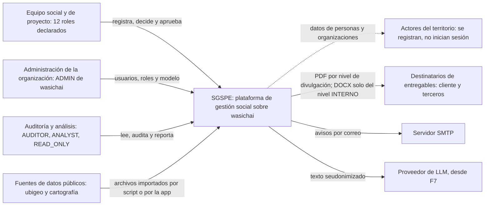
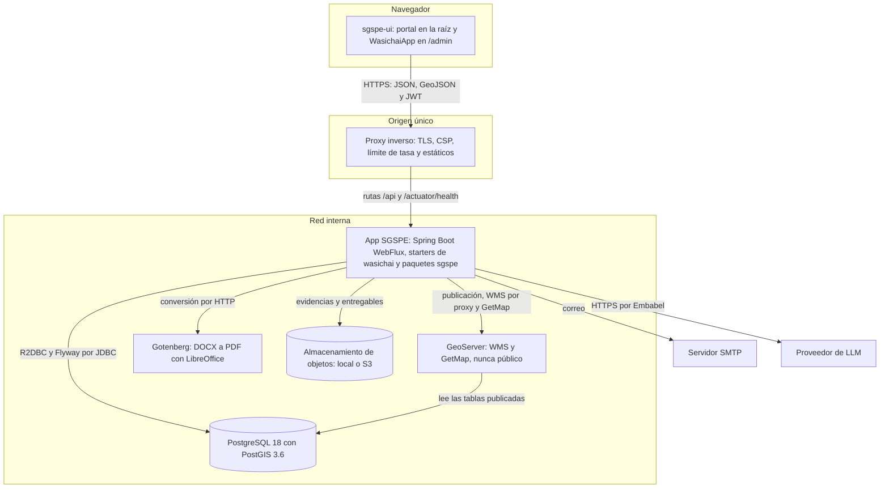
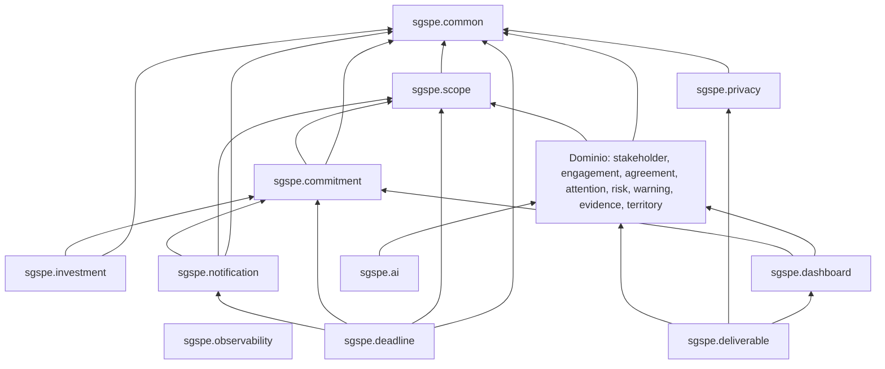
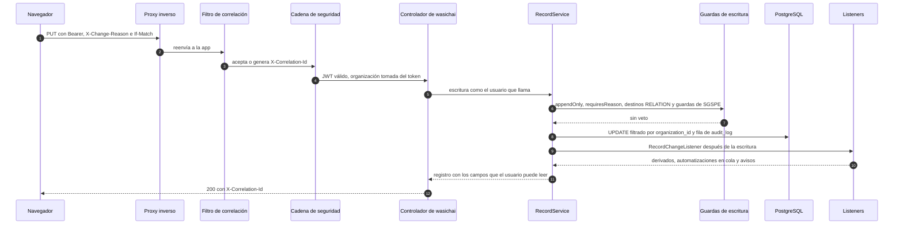
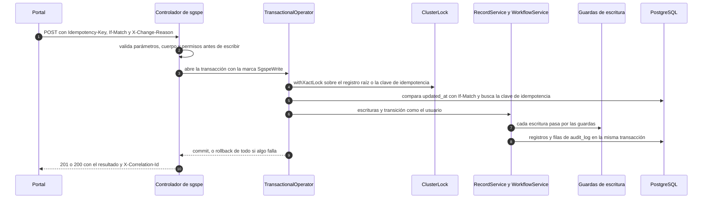
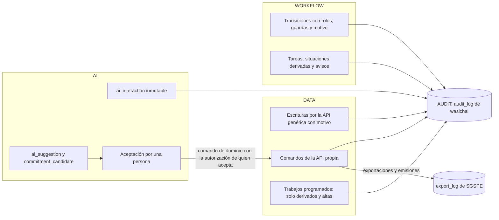
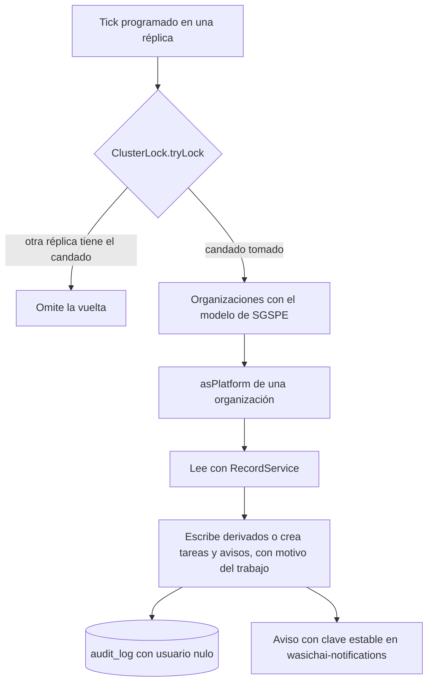
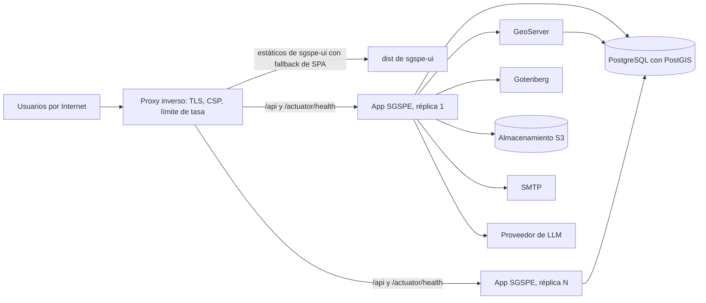

# Arquitectura de SGSPE

Sistema de Gestión Social para Proyectos Extractivos · Fase 0 (descubrimiento) · versión 1.0 · 2026-10-07

Este documento cumple el paso 5 del prompt maestro: definir la arquitectura antes de escribir código [PRM-01 §0, §27]. Parte
de las tres fuentes de verdad de la Fase 0 — el [análisis de requisitos](requirements-analysis.md), el [glosario](glossary.md)
y el [modelo de dominio](domain-model.md) — y de la decisión del usuario de construir SGSPE sobre wasichai y wasichai-ui, como
srtm y caja [USR-03]. Los IDs (RF, RNF, RN, RQ, CON, GAP, ASM, UPS) se definen solo en el análisis; aquí se citan. El encaje
de cada mandato del prompt con la plataforma está en [Encaje con wasichai](platform-fit.md) y el contrato de la API propia, en
[API de SGSPE](api.md). Los ADR de SGSPE se citan por su número (por ejemplo, ADR-0001); sus archivos, títulos y estados
están en el [índice de ADR](adr/README.md).

## 1. Propósito y alcance

- Fija, para el resto de la documentación y para la Fase 1:
  - los drivers de arquitectura y los atributos de calidad (§2);
  - el contexto y los contenedores, en notación C4 (§3 y §4);
  - los componentes del backend: starters de wasichai por fase, los 19 paquetes `sgspe.*` y el modelo como código (§5);
  - la ruta de una petición y la convergencia de datos, workflow e IA en la auditoría (§6 y §7) [ARQ-01];
  - el trabajo en segundo plano (§8), el frontend (§9), el despliegue y los entornos (§10 y §11);
  - la observabilidad (§12), la estrategia de pruebas (§13) y los riesgos (§14).
- No repite lo que fijan los demás documentos derivados:
  - campos, índices y relaciones con su nombre técnico: `database-model.md`;
  - transiciones, roles por transición, automatizaciones `AUT-NN` y trabajos `JOB-NN`: `workflows.md`;
  - permisos por rol, objeto y campo: `security.md`; capas `LYR-NN`: `gis.md`; anatomía de los entregables: `deliverables.md`;
  - casos de IA y su flujo: `ai-architecture.md`; KPIs y tableros: `dashboards.md`.
- Regla de precedencia: si este documento contradice el análisis o el modelo de dominio, ganan ellos y este se corrige; un
  objeto, campo, estado o catálogo nuevo se propone primero en el modelo de dominio [RNF-MNT-009].

## 2. Drivers de arquitectura

### 2.1 Requisitos que dan forma a la arquitectura

| # | Driver | Fuente | Consecuencia en la arquitectura |
|---|---|---|---|
| 1 | Construir sobre wasichai 0.3.2 y `@wasichai/*` 0.5.0, con caja como plantilla | [USR-03] RNF-MNT-001 | Una app Spring Boot con `@WasichaiApplication` y los starters de wasichai; la lista técnica del prompt queda sustituida por la plataforma (CON-039) |
| 2 | Metadata primero, código propio solo donde la metadata no alcanza | RNF-MNT-002, RNF-MNT-005, CON-040 [WAS-ADR-0003] | Los 89 objetos, sus workflows, roles, vistas y formularios viven en `model/`; el código Kotlin vive en 19 paquetes `sgspe.*` (§5.2) |
| 3 | Monolito modular, sin microservicios | [PRM-01 §3, §26] [WAS-ADR-0001] [WAS-ADR-0024] | Un solo desplegable (`app.jar`), con paquetes por capacidad del dominio y no por capas técnicas genéricas |
| 4 | Auditabilidad: quién, qué, cuándo, por qué, desde y hacia | [PRM-01 §18] OBJ-10, RQ-AUD-001, RQ-AUD-002, RQ-AUD-014 | Toda escritura pasa por `RecordService`, que escribe su fila de `audit_log` (en la misma transacción cuando quien llama abrió una); los objetos críticos son `requiresReason` y la historia es `appendOnly` |
| 5 | La IA sugiere y la persona decide | OBJ-09, RQ-AI-001, RQ-AI-003, RN-EWS-001 [ARQ-01] [ARQ-02] | Plano de IA separado (`ai_interaction`, `ai_suggestion`, `commitment_candidate`); aceptar es un comando humano auditado (§7) |
| 6 | El territorio es un componente crítico | [PRM-01 §6] RQ-GIS-004, RQ-GIS-006, ASM-002 | wasichai-gis desde F2, geometrías en SRID 4326 y CRS de trabajo por proyecto; análisis espacial propio en `sgspe.territory` |
| 7 | Entregables DOCX y PDF del mismo documento | [USR-01] RQ-REP-001, ASM-014 | `sgspe.deliverable` con Apache POI, Gotenberg y mapas de GeoServer, generados en segundo plano (§8) |
| 8 | Datos personales protegidos y artefactos anonimizados | [USR-07] OBJ-08, RQ-SEC-010, RQ-SEC-018, RQ-REP-014 | Permisos de campo, niveles de divulgación en `sgspe.privacy`, seudonimización antes del LLM (RQ-AI-009) y logs sin datos personales |
| 9 | Autorización por proyecto y territorio | [PRM-01 §7] RQ-SEC-006, CON-041, GAP-025, UPS-01 | `ProjectScopeGuard` acota las escrituras. Desde el plan 4.4, `ProjectReadScope` acota la lectura por proyecto (ADR-0029); territorio y región siguen sin fuente (UPS-01) |
| 10 | El paso del tiempo nunca es un estado | RN-WFL-001, CON-028, CON-043 | Trabajos programados mantienen `deadline_status`, `validity_status` y `review_status` (§8) |
| 11 | Ejecución por fases, cada una ejecutable | [USR-04] [USR-05] RNF-MNT-003, RNF-MNT-007 | Los starters, los paquetes y las pantallas se agregan en la fase que los necesita (§5.1, §9) |
| 12 | Dos repositorios | [USR-08] RNF-MNT-006 | `wasichai/sgspe` (backend, modelo, documentación y ADR) y `wasichai/sgspe-ui` (portal y `/admin`) |

### 2.2 Atributos de calidad

El prompt fija el orden de prioridad: corrección, claridad del dominio, mantenibilidad, seguridad, auditabilidad,
testeabilidad, extensibilidad, experiencia de uso, rendimiento y sofisticación de la IA [PRM-01 §28].

| Atributo | Cómo lo atiende la arquitectura | Requisitos |
|---|---|---|
| Corrección | Invariantes con su mecanismo explícito (metadata, guarda, endpoint, trabajo o listener) [domain-model §7] | RNF-MNT-005, RNF-TST-001 |
| Claridad del dominio | Nombres canónicos únicos y paquetes por capacidad del dominio | RNF-MNT-004, RF-CAT-001 |
| Mantenibilidad | Metadata versionada y aplicada de forma idempotente; código propio mínimo; pruebas de arquitectura | RNF-MNT-002, RNF-MNT-005 |
| Seguridad | JWT de wasichai endurecido, permisos por rol, objeto, campo y acción, alcance por asignación, GeoServer nunca público | RQ-SEC-001, RQ-SEC-004, RQ-SEC-006, RQ-SEC-011 |
| Auditabilidad | `audit_log` con motivo, `export_log`, identificador de correlación | RQ-AUD-001, RQ-AUD-006, RQ-AUD-011 |
| Testeabilidad | Funciones puras para las reglas, pruebas de integración contra PostGIS real, modelos falsos de IA | RNF-TST-001, RQ-AI-007 |
| Extensibilidad | SPI de wasichai (guardas, listeners, contribuidores) en vez de bifurcar la plataforma [WAS-ADR-0025] | RNF-MNT-005 |
| Experiencia de uso | Portal propio con las 13 secciones del prompt, más `/admin` para catálogos y administración | RNF-USA-001, RF-IAM-001 |
| Rendimiento | Sin metas hasta responder GAP-027; conteos por `RecordService`, sin vistas materializadas; se mide antes de optimizar | RQ-DSH-031, RQ-GIS-016 |
| Sofisticación de IA | Diferida a F7 y siempre detrás de la validación humana | RQ-AI-001, RQ-AI-008 |

La disponibilidad y el despliegue no tienen requisito hasta que se responda GAP-022; los valores por defecto están en §10.

### 2.3 Restricciones de plataforma

- Sin JPA, Hibernate, Envers ni Spring Data: todo SQL va por `DatabaseClient` con valores enlazados
  [WAS-DOC architecture/overview.md] (RNF-MNT-005).
- El DDL de negocio solo lo emite `ObjectSchemaManager` a partir de la metadata; el código propio no usa `RecordStore`,
  `AuditService` ni `ObjectSchemaManager` [WAS-ADR-0004] [WAS-ADR-0024] (RNF-MNT-005).
- Nada vive en el paquete `wasichai`: el escaneo de componentes de `@WasichaiApplication` registraría dos veces los
  controladores de la plataforma [WAS-DOC modules/core.md] [WAS-ADR-0024].
- WebFlux no bloquea el event loop: la E/S bloqueante del código propio (Apache POI, almacenamiento, GDAL) corre en
  `Dispatchers.IO`, y las llamadas a Gotenberg y GeoServer usan `WebClient`.
- `RecordService.asPlatform` solo funciona fuera de una petición y solo para `RecordService`: los trabajos nunca aplican
  transiciones [WAS-ADR-0039] [domain-model §8.3].
- El agente de wasichai es de solo lectura y actúa como el usuario que pregunta [WAS-ADR-0014] (RQ-AI-001).

## 3. Contexto del sistema (C4, nivel 1)

SGSPE es un solo sistema, para los equipos sociales de una empresa cliente (el tenant, ASM-001). wasichai no aparece como
sistema externo: viaja dentro de SGSPE como librerías y starters [WAS-ADR-0024].

| Actor o sistema | Relación con SGSPE | Fuente |
|---|---|---|
| Equipo social y de proyecto | Los 12 roles declarados de gestión, campo y aprobación, de `PROJECT_ADMIN` a `APPROVER` en el orden del análisis, operan el portal; con los 3 de auditoría y análisis y los 2 administradores suman los 17 del prompt | [PRM-01 §7] RQ-SEC-003 |
| Administración de la organización | `SUPER_ADMIN` y `ORGANIZATION_ADMIN` son el `ADMIN` de wasichai: usuarios, roles, modelo y alta de tenants | ASM-024, CON-059, UPS-10 |
| Auditoría y análisis | `AUDITOR` lee todo el tenant y la auditoría; `ANALYST` y `READ_ONLY` leen por objeto | RQ-SEC-007 |
| Actores del territorio | Personas y organizaciones registradas como actores y grupos de interés; nunca usuarios | [requirements-analysis §4.2] RN-STK-008 |
| Destinatarios de entregables | Reciben fuera del sistema los archivos emitidos: DOCX y PDF del nivel INTERNO, y solo PDF de EXTERNO y PUBLICO; el nivel de divulgación decide qué datos personales salen | [USR-01] RQ-REP-014 |
| Fuentes de datos públicos | Ubigeo del INEI cargado por script; coordenadas y cartografía importadas con su CRS de origen | RF-TER-001, RQ-GIS-003, ASM-016, GAP-011 |
| Servidor SMTP | Envío de notificaciones por correo, con reintentos | RF-NTF-001, GAP-021 |
| Proveedor de LLM | IA de F7, intercambiable y desactivada por defecto | RQ-AI-005, RQ-AI-009, GAP-015 |

Las integraciones de sistema a sistema (por ejemplo, un canal de contratistas) usarían cuentas de servicio de wasichai; hoy no
hay ninguna y los contratistas reportan a través del equipo social (RQ-SEC-014, ASM-043, GAP-020) [WAS-ADR-0043].

## 4. Contenedores (C4, nivel 2)

Un solo origen sirve el frontend y la API: el navegador nunca habla con otro host, así que la API no necesita CORS, ni en
desarrollo (el servidor de Vite reenvía `/api`) ni en producción (el proxy inverso reenvía `/api/**`).

| Contenedor | Tecnología | Responsabilidad | Desde | Fuente |
|---|---|---|---|---|
| `sgspe-ui` | React 19, Vite, `@wasichai/*` 1.0.0 | Portal propio en `/` y `WasichaiApp` en `/admin`, con el mismo login | F1 | [USR-03] [USR-08] RF-IAM-001 |
| Proxy inverso | Servidor HTTP del entorno | TLS, CSP, límite de tasa en `/api/auth/login` y `/api/auth/token`, archivos estáticos con fallback de SPA (incluido `/admin/*`) y reenvío de `/api/**` y `/actuator/health/**` | F1 | RQ-SEC-001, RQ-SEC-015, ASM-049 |
| App SGSPE | Kotlin 2.4.20, JDK 25, Spring Boot 4.1.1 WebFlux, wasichai 1.2.0 | API genérica de wasichai, API propia `/api/sgspe/**`, guardas, listeners y trabajos programados; un solo `app.jar` | F1 | RNF-MNT-001, RNF-INT-004 |
| PostgreSQL con PostGIS | PostgreSQL 18, PostGIS 3.6 (`postgis/postgis:18-3.6`) | Esquema de metadata `wasichai`, esquema de datos `app_data` (una tabla por objeto y organización) y esquema `sgspe` de tablas fijas | F1 | [WAS-ADR-0002] [WAS-ADR-0004] CON-052 |
| GeoServer | `docker.osgeo.org/geoserver:3.0.1`, red interna (en desarrollo, solo en el loopback, puerto 8095) | Capas de referencia no sensibles por WMS (vía el proxy autenticado de `sgspe.territory`) y mapas de informe por GetMap | F6, F8 | RQ-SEC-011, RQ-REP-030, ASM-038 [WAS-ADR-0006] |
| Gotenberg | `gotenberg/gotenberg:8-libreoffice` | Convierte a PDF el DOCX que arma el trabajador de generación, que es el único que lo llama: con marca de agua en los borradores y en PDF/A-2b en las versiones candidatas que se emiten. En INTERNO se entregan el DOCX y el PDF; en EXTERNO y PUBLICO el DOCX es solo un paso intermedio y se entrega solo el PDF | F8 | ASM-014, RQ-REP-001 |
| Almacenamiento de objetos | Compatible con S3 (MinIO solo en desarrollo), el `FileStore` de wasichai-files | Los archivos de las evidencias (campo `FILE`, ADR-0014); desde F8, los entregables. En F2 las cargas de importación usan una carpeta temporal | F3 | ASM-013, ASM-060, RF-DOC-001, RQ-SEC-020, GAP-022 [WAS-ADR-0061] |
| Servidor SMTP | Configurable; servidor de prueba en desarrollo | Correos del canal `email` de wasichai-notifications | F3 | RF-NTF-001, GAP-021 |
| Proveedor de LLM | Embabel (Anthropic por defecto, intercambiable) | Asistente de solo lectura y agentes propios que sugieren | F7 | RQ-AI-005, RQ-AI-014 [WAS-ADR-0015] |

## 5. Componentes del backend

### 5.1 Starters de wasichai por fase

Cada módulo de wasichai es un starter del backend más un paquete del frontend; se agrega en la fase que lo necesita
[WAS-DOC guides/build-your-app.md]. `/admin` nunca registra un módulo cuyo starter no está instalado: sus rutas responderían
`404` y la interfaz lo trataría como "no instalado" [WAS-ADR-0031].

| Fase | Starters del backend | Paquetes del frontend | Por qué en esa fase |
|---|---|---|---|
| F1 | `wasichai-spring-boot-starter` (core), `-views`, `-forms`, `-pages`; `wasichai-test` en pruebas | `@wasichai/core`, `@wasichai/ui`, `@wasichai/views`, `@wasichai/forms`, `@wasichai/pages`, `@wasichai/testing` | El conjunto de administración y diseño de caja; identidad, auditoría y errores ya vienen en core (CON-053) |
| F2 | + `-gis`, + `-workflow` | + `@wasichai/gis` (con `maplibre-gl` 6.10.0 y su worker), + `@wasichai/workflow` | Primeras geometrías (proyecto, comunidad, área de influencia) y primeros ciclos de vida (WF-A, WF-B, WF-C, WF-L, WF-O) (CON-036) |
| F3–F4 | + `-automation`, + `-documents`, + `-files`, + `-notifications`; AWS SDK v2 (S3) y `spring-boot-starter-mail` | + `@wasichai/automation`, + `@wasichai/documents` | Tareas al aprobar o recibir (automatizaciones de metadata), documentos administrativos de un registro (RQ-REP-029), el campo `FILE` de las evidencias (ADR-0014) y las notificaciones con su canal de correo (ADR-0018) |
| F7 | + `-agent` | Ninguno: el portal pregunta por `/api/sgspe/ai/**` y `/admin` no registra `agentModule()` (`ai-architecture.md`) | Asistente de solo lectura de AI-05 sobre Embabel, llamado en proceso por `sgspe.ai` (RF-AIK-005) |

- La imagen `postgis/postgis:18-3.6` se usa desde F1 en el entorno y en las pruebas: instalar wasichai-gis en F2 solo
  ejecuta su migración, que crea la extensión, sin migrar datos [WAS-DOC modules/gis.md].
- Las dependencias que no son de wasichai (Apache POI, cliente S3, ECharts, GDAL) llegan con el paquete que las usa; la
  lista con versión y licencia está en [Encaje con wasichai §6](platform-fit.md#6-versiones-fijadas).

### 5.2 Paquetes `sgspe.*`

Diecinueve paquetes, los de [domain-model §8.2](domain-model.md#82-código-kotlin-propio-por-paquete). Cada uno existe porque la
metadata no alcanza para lo que contiene; ninguno es un controlador por objeto (CON-040).

| Paquete | Contenido principal | BC | Desde |
|---|---|---|---|
| `sgspe.common` | Marca de escritura `SgspeWrite`; guardas transversales (`DerivedFieldsGuard`, `TransitionReasonGuard`, `ExactlyOneGuard`, `UserReferenceGuard`, `FieldChangeReasonGuard`, `CommandTransitionGuard`); envoltura de `RecordService`; correlativos; `Idempotency-Key` de los comandos con la tabla fija `idempotency_key` y el contrato nativo (ASM-065) y su purga por JOB-08 (`RetentionJob`); precondición sobre `updated_at` con los saltos de `derived_version` (ADR-0027); `AmountFieldsGuard` (montos, ASM-092), `GeneratorKeyGuard` (`generator_key` solo de un trabajo) y `DependentsDeleteGuard`; los topes del multipart (`FILE_TOO_LARGE`, `PART_TOO_LARGE`); filtros estrictos con 422; fechas en America/Lima; desde F4, `HolidayCalendar` (`@ConfigurationProperties("sgspe.calendar")`: los feriados nacionales por año y despliegue, validados al arrancar) y `BusinessDays` (días hábiles, ASM-096), y `AttentionCounting` (cada planteamiento de QCS cuenta una vez); valores por defecto de los parámetros (UPS-15); `DerivedFieldsJob`; desde 4.4, `ProjectReach` («mis proyectos» o todos, ASM-106) y `SweepTiming` (duración por organización de los trabajos) | Transversal | F1 |
| `sgspe.observability` | Filtro `X-Correlation-Id` antes de la cadena de seguridad; una línea de acceso por petición; logs estructurados | Transversal | F1 |
| `sgspe.scope` | `ProjectScopeGuard`, `ProjectWriteGuard`, `AssignmentRoleGuard` (`role_name` de `project_assignment` contra los roles configurados, ASM-070) y `EditAnyGuard` (sin `EDIT_ANY`, solo se cambia o borra lo propio, ASM-069); `IssueDocumentFilter` (emitir un documento a mano pide lo mismo que cambiar el registro); lectura de `project_assignment`; desde F4, `ProjectLinkGuard` (mismo proyecto en las relaciones) y `ConfidentialAttentionScope` (`RecordReadScope` de las QCS confidenciales, ASM-095); desde 4.4, `ProjectReadScope` y `ProjectReadCondition` (`RecordReadScope` del alcance por proyecto, ASM-106) y `ProjectScope.TENANT` | BC-01, BC-16 | F2 |
| `sgspe.stakeholder` | `InfluenceClassifier` y `Prioritizer` (funciones puras), endpoint de evaluaciones, `StakeholderWriteGuard`, `StakeholderFollowUpJob` | BC-03 | F2 |
| `sgspe.engagement` | `EngagementWriteGuard`, derivación de preguntas a QCS (F4), `AttendanceCountsListener`, recalculador de `strategic_alliance.formalized` | BC-04 | F2 |
| `sgspe.commitment` | `CommitmentWriteGuard` (reglas de alta y edición, del mismo proyecto, de aprobación, de cumplimiento y de candidatos, en un orden fijo), reprogramación, entrega y su corrección, alta humana, aceptación y duplicado de candidatos, `CommitmentDerivationsListener`; `Commitments`, los conjuntos de estados de WF-D que leen `sgspe.deadline`, `sgspe.notification`, `sgspe.investment` y los tableros | BC-05 | F3 |
| `sgspe.agreement` | `AgreementWriteGuard` (predios, comunidad titular, autorizaciones de asamblea, cláusulas) | BC-06 | F3 |
| `sgspe.attention` | `AttentionWriteGuard`, `QcsDueDatesListener` (plazos al recibir), `QcsTransitionDatesListener` (`resolved_date` y `closed_date`), reclasificación, aceptación de solicitudes, `RequestClosureListener` (cierra la solicitud al cerrarse su compromiso o, desde F5, su aporte, ASM-068), reporte unificado de QCS | BC-07 | F4 |
| `sgspe.risk` | Endpoint de revisiones (puntaje, nivel, tendencia y residual), `RiskLevels` (función pura), `RiskWriteGuard` | BC-08 | F4 |
| `sgspe.warning` | `WarningRulesJob` (un evaluador puro por cada uno de los seis tipos de regla, ASM-097) y `WarningWriteGuard` (decisión humana, reglas válidas) | BC-09 | F4 |
| `sgspe.investment` | `SupportPolicyGuard` (desde F3, con el candado de la campaña) y el recalculador de `executed_social_amount` de JOB-02 (desde F3); desde F5, `InvestmentWriteGuard` (WF-P y WF-G), `ContributionCapRule`, `ContributionGuidelines`, `SupportCap` y `CampaignCommitted` (que también usa `SupportPolicyGuard`), el endpoint de entrega de aportes (`ContributionDeliveries`), `ContributionTotalsListener`, `ProgramTotalsListener` y sus recalculadores | BC-10 | F5 (tope y lineamientos en F3) |
| `sgspe.deadline` | `DeadlineJob`: situaciones derivadas de plazo y vigencia (revisión de riesgos en F4), tareas de escalamiento; la fuente de avisos de plazo `DeadlineNotices`; `DeadlineStatusListener` (la situación al reprogramar) | BC-13 | F3–F4 |
| `sgspe.notification` | Destinatarios por asignación, con el filtro de las QCS confidenciales (ASM-102), y textos de los avisos sobre wasichai-notifications; `ApprovalNoticeListener`; desde F4, `RiskNoticeListener` y `WarningNoticeListener` | BC-14 | F3–F4 |
| `sgspe.evidence` | Alta, cambio y vínculos de evidencias sobre el campo `FILE` de wasichai-files; la descarga con `DOWNLOAD_RESTRICTED` por las dos rutas; `EvidenceWriteGuard` | BC-12 | F3 |
| `sgspe.territory` | Importación con CRS y reconciliación, área en hectáreas, `TerritoryWriteGuard`, `AreaListener`; desde F6, `SpatialGate` (la única vía de SQL de lectura que cruza tablas del tenant, ASM-122), `ZoneCriterion` y las consultas espaciales, sugerencias de miembros, la parte territorial de la ficha (geometría, relaciones y filtros espaciales), `WmsProxy` (el proxy WMS de GeoServer, ASM-121), `MapSettings` (mapa base por organización, ASM-125), `GdalReader` y `GdalWriter` (formatos de ASM-127), `TerritoryExports` (ASM-124), `GeometryChecks` y `DataQuality`; el WFS se pospone (ASM-120) | BC-02 | F2 (análisis en F6) |
| `sgspe.dashboard` | Indicadores y tableros `/api/sgspe/dashboards/**`, incluidas las cifras de la ficha territorial (KPI-TER-01); desde F6, `TerritoryKpis` (KPI-TER-01 a KPI-TER-04 y el tablero `territory`, sobre `SpatialGate`); conteos con `RecordService`; cierre de periodo | BC-15 | F2–F8 |
| `sgspe.deliverable` | Una clase por tipo de entregable, ensamblado del modelo, DOCX con Apache POI, PDF con Gotenberg, mapas con GetMap, trabajador de generación, emisión, `DeliverableWriteGuard`, paso de retención de borradores de JOB-08 | BC-15 | F8 |
| `sgspe.ai` | Agentes Embabel, seudonimización, registro de `ai_interaction`, creación de `ai_suggestion` y `commitment_candidate`, aceptación, indexación documental (JOB-07) y RAG sobre `knowledge_chunk`; el asistente de wasichai-agent se llama en proceso y un filtro cierra `/api/agent/ask` por HTTP (`ai-architecture.md`) | BC-18 | F7 |
| `sgspe.privacy` | Niveles de divulgación como transformación del modelo, enmascaramiento, menciones de personas como referencias, exportaciones XLSX y `export_log` | BC-15, BC-17 | F2 (exportaciones), F8 |

La línea base social (BC-19) y los catálogos (BC-20) son solo metadata, más un script Python que carga el ubigeo
(RF-TER-001) [domain-model §8.1].

### 5.3 Reglas de dependencia entre paquetes

- Los paquetes de dominio no dependen de `sgspe.dashboard` ni de `sgspe.deliverable`; una prueba de arquitectura lo
  verifica (RNF-TST-001) [domain-model §8.2]. Por eso la ficha territorial la arma el portal con dos lecturas: la parte
  territorial de `sgspe.territory` y las cifras de KPI-TER-01 de `sgspe.dashboard`, las mismas de los tableros (RQ-GIS-005,
  RQ-DSH-034) (`dashboards.md`).
- `sgspe.ai` depende del dominio y nunca al revés: BC-18 es una capa anticorrupción que entrega sugerencias, y aceptar una
  ejecuta el comando del paquete dueño con la autorización de la persona (RQ-AI-001, RQ-AI-003) [domain-model §2].
- `sgspe.deliverable` usa el mismo código de indicadores que `sgspe.dashboard`, para que tableros y entregables den las mismas
  cifras (RQ-DSH-034), y aplica el nivel de divulgación de `sgspe.privacy` al modelo antes de generar (RQ-REP-014).
- `sgspe.observability` no depende de ningún paquete de dominio: es un filtro web.
- Entre paquetes de dominio, las flechas van hacia `sgspe.commitment`: `sgspe.investment` (el tope de la campaña),
  `sgspe.deadline` (JOB-01 y los avisos de plazo) y `sgspe.notification` (los avisos de aprobación) leen sus conjuntos
  de estados (`Commitments`) y la regla de nivel superior; `sgspe.deadline` y `sgspe.notification` leen además las
  asignaciones de `sgspe.scope`, y `sgspe.deadline` publica con `sgspe.notification`. `sgspe.commitment` no depende de
  ninguno de los tres. `ArchitectureTest` clasifica cada paquete como de dominio o no y vigila que `sgspe.scope` y
  `sgspe.privacy` solo dependan de `sgspe.common`.
- Desde F6, `sgspe.dashboard` (`TerritoryKpis`) depende de `sgspe.territory`, nunca al revés. En `sgspe.territory` solo
  `SpatialGate` y los escritores que ya existen (`TerritoryImports`, `Areas`, `ProjectComponents` y `GeoSql`) usan
  `DatabaseClient`; `ArchitectureTest` lo vigila, y así ninguna consulta que cruza tablas se salta el alcance
  (ASM-122).
- Las reglas que miran otro contexto (por ejemplo, el tope de apoyo de `sgspe.investment` al aprobar un compromiso) viven
  como guardas del paquete dueño de la regla; wasichai las reúne todas, así que el paquete que escribe no las importa
  [WAS-ADR-0040].
- El código propio decide con permisos y acciones declaradas, nunca comparando nombres de rol; una prueba de arquitectura
  busca literales de rol en el backend y en `sgspe-ui` (RQ-SEC-005).
- Otra prueba de arquitectura falla si hay código en el paquete `wasichai` o si se importan `RecordStore`,
  `PhysicalTableRecordStore`, `AuditService` u `ObjectSchemaManager` (RNF-MNT-005).

### 5.4 Modelo como código (`model/`)

- `model/model.json` (ENUM, objetos, acciones declaradas, relaciones, flags, índices y únicos compuestos), `model/roles.json`,
  `model/workflows/<objeto>.json`, `model/views/`, `model/forms/` y `model/pages/` desde F2, y
  `model/document-types/<objeto>.json` y `model/automations/<objeto>.json` desde F3, con sus starters (convención de
  `database-model.md` §3.1; RQ-REP-029), versionados en el repositorio (RNF-MNT-002) [WAS-ADR-0003].
- `apply.py` y `apply_roles.py`, en Python con solo la biblioteca estándar como en caja, los aplican por REST de forma
  idempotente: crean lo que falta, sincronizan lo que cambió y nunca renombran (CON-052). `--validate-only` y
  `--dry-run` revisan sin escribir; `test_model.py` y las pruebas de los scripts corren en CI.
- La metadata es por organización. Un tenant nuevo se prepara en este orden, y el procedimiento queda documentado
  (GAP-026) [WAS-DOC api/rest.md]:
  1. `POST /api/organizations`, que hace el operador y crea el administrador del tenant; los pasos siguientes usan la
     cuenta de ese administrador;
  2. `apply.py`: objetos, acciones declaradas, relaciones e índices;
  3. `apply_roles.py`: roles y permisos, que nombran esos objetos y acciones;
  4. `apply.py --workflows`: workflows, tipos de documento, automatizaciones y vistas, formularios y páginas, en ese orden
     y cada uno desde su fase. Va después de los roles porque wasichai rechaza un workflow que nombra un rol inexistente;
  5. el script que carga el ubigeo (RF-TER-001);
  6. desde F6, `model/publish_layers.py`.
- Después, el administrador crea los usuarios y sus asignaciones; el procedimiento operativo completo está en
  `security.md` §4.1.
- `test_apply.py` tiene un caso de tenant nuevo que recorre ese orden.
- `model/publish_layers.py` es un script de Python con el patrón de `apply.py`: publica en GeoServer solo las capas no
  sensibles con `POST /api/gis/layers/{object}/{geometry}` y un token de `ADMIN`, es idempotente porque consulta antes
  `GET /api/gis/layers`, y corre al aprovisionar y en cada actualización de F6. En el mismo paso carga o actualiza, con la API
  REST de GeoServer y las credenciales del despliegue, los estilos SLD, que son únicos por despliegue: el proxy WMS y el
  trabajador de entregables los piden por nombre (`STYLES`). SGSPE no tiene un endpoint propio para esto (RQ-SEC-011)
  (`gis.md`).
- `roles.json` es la fuente de verdad de roles y permisos: volver a aplicarlo pisa lo editado a mano en `/admin`. En
  producción, `/admin` no es fuente de verdad del modelo (GAP-030), y la administración de metadata no se audita (UPS-02).
- Un campo derivado lleva la clave `"derived": true` en su definición de `model/model.json`. Solo la leen las herramientas
  de SGSPE: `apply_roles.py`, que expande `u` en UPDATE más una entrada de solo lectura para cada campo no derivado
  (`security.md` §6), y las pruebas. `apply.py` nunca la envía, porque, como el `field_payload` de caja, publica un
  conjunto fijo de claves. Nunca se usa `editable: false` de wasichai
  para un campo derivado: `PhysicalTableRecordStore` omite los campos no editables en toda escritura, también en las de la
  plataforma, así que nadie podría escribirlo (wasichai-core, `PhysicalTableRecordStore`).
- Renombrar una opción ENUM o un campo exige un script de migración de datos, porque `apply.py` no renombra (ASM-025).
- Las migraciones de datos de objetos `apiOnly` no van por REST, que los rechaza: corren en proceso, dentro del paquete
  `sgspe.*` dueño del objeto, como un trabajo que escribe con `RecordService` como la plataforma, con motivo y con las
  guardas activas [WAS-ADR-0040]. Las de objetos `appendOnly` exigen además un ADR explícito.
- wasichai guarda el `defaultValue` de un campo pero no lo aplica: no crea un DEFAULT de columna, y ni `RecordService` ni la
  interfaz lo usan (UPS-15). Los valores por defecto de los parámetros y las políticas de `project` (ASM-019) los aplica el
  código de SGSPE: el portal los propone al crear el registro, y la lectura común de parámetros de `sgspe.common` usa el
  mismo valor cuando un parámetro está vacío (`database-model.md` §3.6).

### 5.5 Tablas fijas del esquema `sgspe`

- `idempotency_key` y `derived_version` (transversales, desde F3) y `knowledge_chunk` (BC-18, F7) no son Custom Objects:
  son tablas fijas con una migración Flyway propia registrada como `ModuleMigration`, que solo lee y escribe su paquete
  (ASM-065, ASM-091, RQ-AI-008) [WAS-ADR-0026] ([database-model.md §2.3](database-model.md)). Los avisos no tienen
  tablas propias desde la decisión D2: los guarda wasichai-notifications (ASM-012, ADR-0018).
- `idempotency_key` guarda la clave y la respuesta de cada comando de `/api/sgspe/**` que la trae, en la transacción del
  comando ([API de SGSPE §3.5](api.md#35-idempotencia-idempotency-key)); el alta genérica usa la tabla nativa de
  wasichai con el mismo contrato; JOB-08 borra las claves vencidas (§8.2).
- Ninguna tabla fija se publica en GeoServer ni se lee desde la API genérica.

## 6. Ruta de una petición

### 6.1 Escritura por la API genérica de wasichai

1. El proxy inverso solo reenvía `/api/**` y `/actuator/health/**`; nunca enruta a GeoServer ni a Gotenberg (§10).
2. El filtro de `sgspe.observability` va antes de la cadena de seguridad, para que también un `401` lleve el identificador
   (RQ-AUD-006, ASM-034).
3. La cadena de wasichai valida el JWT HS256 y toma la organización del token, nunca del cuerpo [WAS-DOC security/authentication.md]
   (RQ-SEC-001, RQ-SEC-002).
4. `RecordService` aplica el permiso de rol, objeto y campo y el tenant [WAS-DOC architecture/overview.md]. SGSPE no usa
   `own_records_only`: limitar las ediciones a lo propio es tarea de `EditAnyGuard` (ASM-069).
5. `RecordWriteGuards` rechaza primero lo que nunca puede ocurrir (`appendOnly` con `409`, falta de motivo con `400`, un
   valor `RELATION` que el usuario no puede leer) y luego llama a las guardas de SGSPE en orden [WAS-ADR-0040]
   [WAS-ADR-0041]. Una guarda que lanza aborta la escritura sin guardar ni auditar nada.
6. La escritura y su fila de `audit_log` salen de la misma llamada. Por la API genérica no hay transacción del llamador, así
   que cada sentencia se confirma por separado: si un listener falla después, la escritura queda guardada, y los derivados
   que no se escribieron los corrige `DerivedFieldsJob` [WAS-ADR-0038] [domain-model §7.5]. Los comandos propios, en
   cambio, abren una transacción (§6.2).
7. `AutomationDispatcher` evalúa las automatizaciones dentro de la misma llamada y encola sus acciones, que corren después
   como la plataforma con el motivo `automation '<nombre>'` [WAS-ADR-0016] [WAS-ADR-0041].

### 6.2 Comando de `/api/sgspe/**`

Un comando escribe varios registros en una sola transacción, con la marca de escritura de SGSPE (RQ-AUD-004, RNF-INT-004).

- La transacción une las escrituras, sus filas de auditoría y los listeners que escriben por R2DBC: o se guarda todo o
  nada [WAS-ADR-0038]. Los listeners de una transición son atómicos con ella porque `WorkflowService.apply` es transaccional
  [domain-model §7.1].
- `ClusterLock.withXactLock` serializa dos comandos sobre el mismo registro y vale en todas las réplicas, porque usa los
  candados consultivos de PostgreSQL [WAS-ADR-0039].
- Una creación no tiene registro raíz: la clave de idempotencia se protege con un candado de transacción que no espera,
  y una segunda petición en curso recibe `409` con `Retry-After`
  ([API de SGSPE §3.5](api.md#35-idempotencia-idempotency-key)). Un reenvío no escribe nada: recibe la respuesta
  guardada (ASM-065).
- La marca `SgspeWrite` es un elemento del contexto de corrutina: las guardas rechazan sin ella las transiciones de comando
  y los campos derivados, que es lo que ocurre con toda llamada por la API genérica [domain-model §4.5] [WAS-ADR-0040].
- La comprobación de permisos ocurre antes de la primera escritura, como en caja: el usuario recibe un `403` que nombra el
  permiso que falta, en vez de un comando a medias.

### 6.3 Qué garantiza cada capa

| Capa | Garantiza | No garantiza | Fuente |
|---|---|---|---|
| Proxy inverso | TLS, CSP, límite de tasa en el login, un solo origen | Autorización | RQ-SEC-001, ASM-049 |
| Filtro de correlación | `X-Correlation-Id` en petición, respuesta y línea de acceso | Correlación en `audit_log` (UPS-03) | RQ-AUD-006 |
| Cadena de seguridad de wasichai | Token válido, tenant del token | Alcance por proyecto (UPS-01) | RQ-SEC-002, RQ-SEC-006 |
| `RecordService` | Permisos de rol, objeto y campo; auditoría con motivo | Bloqueo optimista (UPS-04); idempotencia (UPS-18) | RQ-SEC-004, RQ-AUD-001 |
| Guardas de SGSPE | Reglas de negocio, derivados protegidos, segregación de funciones, escritura acotada por asignación, edición de lo ajeno solo con `EDIT_ANY` | Reglas sobre geometrías: las guardas no las ven | RQ-AUD-004, RQ-GIS-011, RQ-SEC-008 |
| Endpoints `/api/sgspe/**` | Atomicidad de comandos de varios registros, idempotencia con `idempotency_key`, precondición y validación de geometrías | — | RNF-INT-002, RNF-INT-003, ASM-065 |

## 7. DATA, WORKFLOW e IA convergen en la auditoría

El boceto de arquitectura separa tres planos que confluyen en la auditoría [ARQ-01]. En SGSPE cada plano tiene su mecanismo
de wasichai y todos escriben en el mismo `audit_log` append-only, más `export_log` para lo que sale del sistema (RQ-AI-001,
RQ-AUD-011).

| Plano | Qué escribe | Quién decide | Cómo llega a la auditoría | Fuente |
|---|---|---|---|---|
| DATA | Registros por la API genérica, comandos propios, importaciones y trabajos | La persona, o el trabajo para los campos derivados | `CREATE`, `UPDATE` y `DELETE` con cambios antes y después y motivo; los trabajos escriben con usuario nulo y un motivo que los nombra | RQ-AUD-001, RQ-AUD-007, ASM-051 |
| WORKFLOW | Transiciones, tareas y situaciones derivadas | La persona con el rol de la transición; nunca un trabajo | Cada transición queda en `audit_log` con su motivo; las tareas y los avisos los crean automatizaciones, listeners y trabajos | RQ-AUD-002, RN-WFL-001 [WAS-ADR-0013] |
| AI | `ai_interaction` (append-only), `ai_suggestion` y `commitment_candidate` (`apiOnly`) | Una persona acepta, rechaza o marca como duplicado | El alta de cada registro y la aceptación, que ejecuta el comando de dominio como la persona y queda auditada | RQ-AI-001, RQ-AI-003, RQ-AUD-012 |
| Salidas | Exportaciones XLSX y geográficas, entregables emitidos (una versión por nivel de divulgación) y toda descarga de sus borradores y versiones, en todo nivel | Quien tiene la acción declarada `EXPORT` o `ISSUE`; las descargas de borradores y versiones INTERNO, `DOWNLOAD_RESTRICTED` | `export_log` append-only (quién, qué tipo de salida, nivel, filtros, cuándo) y, en los entregables, también `audit_log` | RQ-AUD-011, RQ-REP-014 |

Brechas de la auditoría de wasichai y cómo se mitigan mientras se resuelven upstream:

- No audita la administración de usuarios, roles, permisos ni metadata (UPS-02): el modelo y los roles solo cambian desde el
  repositorio (RNF-MNT-002).
- No guarda identificador de correlación ni origen del cambio (UPS-03): el identificador va en los logs (ASM-034) y el origen
  se codifica en el motivo (ASM-051).
- `/api/audit` no pagina ni filtra por fecha o usuario (UPS-05): el portal muestra el historial por registro (RQ-AUD-005).
- `audit_log` no es inmutable en la base (UPS-12): ningún código de SGSPE escribe en la auditoría.

## 8. Trabajo en segundo plano

### 8.1 Reglas

- Los trabajos programados corren con `@Scheduled`, o con un sondeo continuo (JOB-05), y toman un `ClusterLock`
  para que una sola réplica haga cada vuelta [WAS-ADR-0039] [WAS-DOC guides/build-your-app.md].
- Los que leen o escriben registros de wasichai (JOB-01 a JOB-05, JOB-07 y JOB-08) lo hacen con
  `RecordService.asPlatform(organización)`, donde el motivo es obligatorio: nombra al trabajo, y así su fila de
  `audit_log`, que tiene usuario nulo, dice qué trabajo escribió [WAS-ADR-0041] (ASM-051). No todos escriben así: JOB-07
  escribe además `knowledge_chunk` con SQL propio, y JOB-08 no escribe registros de wasichai: borra con SQL propio las
  claves vencidas de `idempotency_key` y los saltos vencidos de `derived_version`, y borra archivos de borradores que
  nada referencia (`workflows.md`).
- **Solo escriben campos derivados y crean registros nuevos** (tareas, avisos, alertas en su estado inicial). Nunca aplican
  una transición ni vinculan registros, porque fuera de `RecordService` los servicios de wasichai piden un usuario y
  `asPlatform` no los cubre [domain-model §8.3] (RN-WFL-001, CON-043). La única excepción son las migraciones de datos de
  §5.4, que escriben campos no derivados como la plataforma, con motivo y con las guardas activas.
- **Todo cambio de estado automático ocurre en la petición de una persona**, como listener que corre con su identidad. Un
  listener es transaccional solo si quien llama abrió una transacción (una transición o un comando propio); por la API
  genérica no lo es [domain-model §7.1, §7.5].
- Los listeners escriben como el usuario y necesitan su permiso: si quien escribe no tiene UPDATE sobre el objeto que toca el
  listener, la escritura derivada se omite y la corrige `DerivedFieldsJob`; en un listener de transición, la transición se
  revierte. `EditAnyGuard` no frena las escrituras derivadas que llevan la marca de SGSPE: cuando `FIELD_AGENT` agrega un
  participante a una interacción ajena que puede leer, `AttendanceCountsListener` actualiza los conteos de esa interacción
  [domain-model §7.5] (RQ-SEC-008, ASM-069).
- **Un trabajo nunca decide por una persona**: las reglas de alerta crean alertas en `detected` y confirmarlas o
  descartarlas es humano (RN-EWS-001).
- Cada trabajo recorre las organizaciones que tienen el modelo de SGSPE con `TenantDirectory.organizationsWithObject`, la forma
  soportada desde wasichai 0.5.0 (UPS-17, [WAS-ADR-0057]): una instantánea ordenada por id que lanza si se pide desde una
  petición. Solo `sgspe.common.Organizations` toca `TenantDirectory`, y `ArchitectureTest` rechaza `findAllOrganizations` en todo
  el código. Cada trabajo escribe con `Records.asPlatform(organización, source, …)`: la fila de auditoría lleva
  `source = job:<nombre>` ([WAS-ADR-0050], UPS-03) y el motivo conserva el nombre del trabajo (ASM-051).
- Una organización que falla no detiene a las demás: el error se registra y la vuelta sigue, como en el publicador de caja.

### 8.2 Trabajos y procesos en segundo plano

| Proceso | Paquete | Qué hace | Frecuencia | Desde | Fuente |
|---|---|---|---|---|---|
| JOB-01 `DeadlineJob` | `sgspe.deadline` | `deadline_status` y `validity_status` (y `review_status` desde F4); escalamientos por días de atraso con su tarea; los avisos de plazo los publica `DeadlineNotices` | Cada hora | F3 (QCS y riesgos en F4) | RN-WFL-001, RF-WFL-004, ASM-006, ASM-030 |
| JOB-02 `DerivedFieldsJob` | `sgspe.common` | Recalcula los campos derivados que mantienen listeners, sobre los registros cambiados desde la última vuelta y una vez al día sobre todos | Cada hora | F2 | [domain-model §7.4, §7.5] |
| JOB-03 `StakeholderFollowUpJob` | `sgspe.stakeholder` | Tareas de evaluación periódica e inactividad, `last_contact_date` y la regla de primer contacto de `relationship_status` | Diaria, configurable | F2 (tareas desde F3) | RF-STK-010, RF-STK-014, ASM-022 |
| JOB-04 `WarningRulesJob` | `sgspe.warning` | Evalúa los seis tipos de regla por proyecto, con la regla del proyecto en lugar de la del tenant del mismo tipo, y crea alertas en `detected` con `generator_key`; nunca confirma ni aplica transiciones (`workflows.md`, «Tipos de regla de JOB-04») | Cada hora, configurable | F4 | RF-EWS-004, RN-EWS-001, ASM-006, ASM-097 |
| JOB-05 Trabajador de generación | `sgspe.deliverable` | Toma los pedidos de borrador pendientes, congela el modelo, pide los mapas por GetMap, genera por nivel de divulgación el borrador y la versión candidata (DOCX y PDF en INTERNO; solo PDF en EXTERNO y PUBLICO) y escribe los campos `draft_*` | Sondeo continuo | F8 | RQ-REP-021, ASM-061 |
| JOB-07 Indexación documental | `sgspe.ai` | Divide en fragmentos el texto de las `evidence` creadas o cambiadas desde la vuelta anterior y los guarda en la tabla fija `knowledge_chunk`, con su proyecto y su clasificación; borra los de una evidencia reemplazada y deja una `ai_interaction` por documento cuando llama a un modelo | Periódica y configurable, solo en las organizaciones con la IA activada | F7 | RF-AIK-006, RQ-AI-008 |
| JOB-08 Retención (`RetentionJob`) | `sgspe.common` | Desde F3, borra con SQL propio, sin `asPlatform`, las filas de la tabla fija `idempotency_key` con `created_at` anterior al plazo configurable (ASM-065). Desde F8 purga además los archivos de borradores y conserva los N últimos, con un paso que aporta `sgspe.deliverable`, así que `sgspe.common` no depende de `sgspe.deliverable` | Diaria | F3 (claves), F8 (borradores) | RQ-REP-027, ASM-028, RNF-INT-002, ASM-065 |
| `AutomationDrain` | wasichai-automation | Ejecuta las acciones de automatización en cola como la plataforma | Cada segundo | F3 | [WAS-ADR-0016] |
| Bucle de wasichai-notifications | wasichai-notifications | Corre las fuentes de avisos (`DeadlineNotices`), envía el correo con reintentos y purga los avisos resueltos | Cada 30 s (`wasichai.notifications.tick`) | F3 | [WAS-ADR-0046] [WAS-ADR-0060] |

Los identificadores `JOB-NN` y `AUT-NN` y los parámetros exactos de cada trabajo los fija `workflows.md`. La indexación de
JOB-07 no depende de pgvector: en F7 guarda fragmentos de texto con un índice de búsqueda de texto completo de PostgreSQL, y
los vectores llegarían después solo si una medición los justifica (RQ-AI-008, CON-035) (`ai-architecture.md`).

## 9. Frontend (`sgspe-ui`)

### 9.1 Una aplicación, dos partes

`sgspe-ui` es una sola aplicación Vite, copiada de caja-ui: `src/main.tsx` elige entre las dos partes según la ruta
[USR-03] [USR-08].

| Parte | Ruta | Qué es | Para qué | Fuente |
|---|---|---|---|---|
| Portal | `/` | Aplicación propia con `WasichaiProviders`, el registro de módulos, i18n, TanStack Query y un router de datos; pantallas por sección del dominio construidas con `@wasichai/ui` | Los flujos principales del equipo social | RNF-USA-001, ASM-020 |
| Consola de administración | `/admin` | `WasichaiApp` con `basename: '/admin'` y los módulos de los starters instalados, salvo el del asistente | Usuarios, roles, permisos, auditoría, modelo, catálogos y objetos de baja frecuencia | RF-IAM-001 [WAS-ADR-0028] |

- **Un solo login:** las dos partes usan el mismo cliente (`apiBaseUrl: '/api'`) y el mismo `storagePrefix` `sgspe`, así que
  comparten el token `sgspe.token` en `localStorage`, el tema y el idioma (RQ-SEC-001) [WAS-DOC security/authentication.md].
  Un `401` en medio de la sesión cierra la sesión y vuelve al login [WAS-ADR-0031].
- **Navegación:** el árbol del portal declara las 13 secciones del prompt en su orden, con etiquetas en español; una hoja se
  dibuja solo si tiene pantalla registrada y el usuario tiene los permisos que pide (RNF-USA-001, RF-IAM-002). Mientras no
  exista UPS-06, el portal deduce las capacidades de `GET /api/auth/me/permissions`.
- **Motivo de cambio:** el portal pide el motivo en los objetos `requiresReason` y en las transiciones que lo exigen y lo
  envía en `X-Change-Reason`; `/admin` todavía no lo pide, así que las escrituras críticas se hacen desde el portal (UPS-08,
  RQ-AUD-002).
- **Mapas y gráficos:** MapLibre 6.10.0 y ECharts se cargan de forma diferida, solo en las rutas que los usan; las tablas
  "Ver datos" acompañan a cada gráfico (RQ-GIS-014, RQ-DSH-035, ASM-046, ASM-047) [WAS-ADR-0028].
- **Idioma:** español por defecto e inglés, con números y fechas es-PE; las etiquetas de la metadata existen solo en español
  (RNF-I18N-001, CON-051).

### 9.2 Secciones y fase de llegada

| Sección del portal | Fase | Notas |
|---|---|---|
| Dashboard | F1 (bienvenida y mapa de módulos), F8 (consolidado) | Los indicadores de cada módulo llegan con su módulo (RQ-DSH-036) |
| Proyectos | F2; F7 (bandeja de revisión de IA por proyecto y pantalla del asistente) | — |
| Territorio | F2 (datos y mapa básico), F6 (mapa territorial y ficha) | RQ-GIS-014, RQ-GIS-005. Incluye la línea base social (BC-19) |
| Grupos de interés | F2 | — |
| Relacionamiento | F2 | Incluye las visitas de campo (ASM-045) |
| Compromisos | F3 | Incluye los acuerdos y convenios (BC-06) |
| Quejas, consultas y solicitudes | F4 | — |
| Riesgos | F4 | Incluye alertas e incidentes |
| Programas sociales | F5 | Incluye los aportes (el tope y los lineamientos, en F3) |
| Documentos | F3 | Evidencias y documentos emitidos |
| Tareas | F3 | Bandeja "mis tareas" y avisos (RF-WFL-001, RF-NTF-001) |
| Reportes | F2–F4 (exportaciones), F8 (entregables) | RQ-REP-022, RF-REP-001, RF-REP-002 |
| Administración | F1 | Enlace a `/admin`, visible solo para quien administra |

### 9.3 Paquetes del frontend por fase

| Fase | Paquetes y bibliotecas | Fuente |
|---|---|---|
| F1 | `@wasichai/core`, `@wasichai/ui`, `@wasichai/views`, `@wasichai/forms`, `@wasichai/pages`, `@wasichai/testing`; React 19.3, React Router 8.4, TanStack Query 5.104, i18next 26 | [USR-03] RNF-MNT-001 |
| F2 | + `@wasichai/gis` con `maplibre-gl` 6.10.0, + `@wasichai/workflow`; React Hook Form y Zod con los primeros formularios propios; ECharts en los tableros de módulo | RQ-GIS-014, RQ-DSH-035 |
| F3–F4 | + `@wasichai/automation`, + `@wasichai/documents` | RQ-REP-029 |
| F7 | Ninguno nuevo: la pantalla del asistente es del portal y usa `/api/sgspe/ai/**` | RF-AIK-005 |

En desarrollo, Vite sirve en el puerto 5182 y reenvía `/api` al backend en el 8094: mismo origen, sin CORS (§11).

## 10. Despliegue

### 10.1 Topología

El destino de producción no está definido (GAP-022); la topología de referencia es un solo origen detrás de un proxy inverso,
con los servicios de apoyo en una red interna. La decide ADR-0026 (topología de despliegue, puertos y observabilidad).

- **Un solo origen.** El proxy sirve `sgspe-ui/dist` con fallback de SPA (incluido `/admin/*`) y reenvía `/api/**` y
  `/actuator/health/**` a la app. La CSP y el límite de tasa del login viven en el proxy (RQ-SEC-001, RQ-SEC-015, ASM-049).
- **GeoServer nunca es público:** el proxy no tiene ruta hacia él. El navegador pide las capas de referencia al proxy WMS
  autenticado de `sgspe.territory`, que exige READ sobre el objeto de cada capa y la lista blanca del tenant, con solo capas
  no sensibles; los predios con titulares y los grupos de interés nunca se publican (RQ-SEC-011, RQ-GIS-012, CON-054)
  [WAS-ADR-0006]. Los mapas de informe se piden por
  GetMap desde el trabajador de entregables (RQ-REP-030).
- **Gotenberg** solo es alcanzable por la app y solo lo llama el trabajador de generación, nunca la petición de un usuario;
  su tiempo de espera de conversión es configurable (ASM-014).
- **Réplicas:** varias instancias de la app comparten la base; `ClusterLock` coordina los trabajos, y la cola de
  automatizaciones se reclama con `FOR UPDATE SKIP LOCKED` [WAS-ADR-0039] [WAS-DOC modules/automation.md].
- **Almacenamiento de objetos:** cualquier servicio compatible con S3 en producción; MinIO solo en desarrollo, por su licencia
  AGPL. Las versiones emitidas pueden ir con bloqueo WORM opcional (RQ-REP-027, ASM-028).
- **Salidas a Internet:** SMTP y, desde F7, el proveedor de LLM, con texto seudonimizado y sin secretos registrados
  (RQ-AI-009). La residencia de datos queda en GAP-015.
- **Respaldos:** de la base y del almacenamiento de objetos, según la política que fije GAP-022.

### 10.2 Configuración de producción

| Ajuste | Valor | Fuente |
|---|---|---|
| Perfil | `application-prod.yml`, sin perfil llamado `test` | [WAS-DOC modules/testing.md] |
| Datos semilla de desarrollo | `wasichai.seed.dev: false` | RQ-SEC-016 |
| Secreto JWT | `WASICHAI_JWT_SECRET` obligatorio, sin valor por defecto: el arranque falla si falta | RQ-SEC-016 [WAS-ADR-0010] |
| Duración del token | Más corta que las 8 horas por defecto | RQ-SEC-001 |
| Revocación, límite de intentos y contraseñas | `wasichai.security.jwt.revocation`, `wasichai.security.login.*` y `wasichai.security.password.*` encendidos; valores en [Seguridad §3.2](security.md#32-endurecimiento-de-sgspe) | RQ-SEC-015 (UPS-09) [WAS-ADR-0059] |
| Cabeceras de reenvío | `server.forward-headers-strategy: framework`. **Condición obligatoria del despliegue:** el proxy inverso sobrescribe, nunca agrega, `X-Forwarded-For` y `X-Forwarded-Proto` con lo que él mismo ve; si los reenvía tal como llegan, un cliente falsifica su dirección y evade el límite de intentos de login, que cuenta por `remoteAddress`. El servicio de aplicación no debe ser alcanzable sin pasar por el proxy | ADR-0026, RQ-SEC-015 |
| Logs | JSON estructurado (ECS), sin datos personales | RNF-OBS-001, RQ-SEC-010 |
| GeoServer | `wasichai.gis.geoserver.*` hacia el servicio interno; su datastore usa el usuario de solo lectura `sgspe_geoserver` sobre la base vista desde su red, nunca el de la aplicación; no es público | [WAS-DOC modules/gis.md] |
| IA | Desactivada por defecto; se activa por organización | RQ-AI-009, ASM-015 |
| Feriados | `sgspe.calendar.holidays` con la lista de feriados nacionales de cada año, que operación agrega cuando se publica la oficial en El Peruano (desde F4, 2026 y 2027; `develop/README.md` §4 dice cómo). Un año sin lista cuenta de lunes a viernes y se advierte en el log, también al arrancar si falta el año en curso; una fecha que no es de su año o repetida impide arrancar | RNF-I18N-002, ASM-096 |

## 11. Entornos

| Entorno | Dónde corre | Puertos | Base de datos | Notas |
|---|---|---|---|---|
| Desarrollo | Backend con `bootRun` y UI con Vite en la máquina local; PostGIS y los servicios de apoyo en el Docker remoto | Backend 8094, UI 5182, PostGIS 5435 | `sgspe`, con datos semilla de desarrollo | El demonio Docker es remoto: los puertos se publican en su loopback y llegan a la máquina local por túnel SSH; `compose.yml` usa volúmenes con nombre y ningún bind mount |
| Pruebas de integración | CI (GitHub Actions) con Testcontainers; localmente, contra una base externa por túnel | Aleatorios en CI; 5435 por túnel | `postgis/postgis:18-3.6`; en modo externo, una base cuyo nombre termina en `_test` | Testcontainers no alcanza los puertos de un Docker remoto, por eso el modo externo `WASICHAI_TEST_DB_*` [WAS-DOC modules/testing.md] |
| CI | GitHub Actions del repositorio `sgspe` y del repositorio `sgspe-ui` | — | Contenedor efímero | Backend: build, integración, modelo y formato; UI: lint, typecheck, tests y build; Conventional Commits verificados |
| Producción | Por definir (GAP-022) | Solo el proxy expone 443 | PostgreSQL 18 con PostGIS 3.6 | §10 |

- Los puertos 8094, 5182 y 5435 se eligieron libres frente a las otras apps de wasichai que corren en el mismo entorno; los
  fija ADR-0026 junto con la topología de cada entorno. Desde F3, el desarrollo publica también MinIO en 9095 (API) y
  9096 (consola) y Mailpit en 1029 (SMTP) y 8029 (web), en el loopback del VPS y por túnel.
- Los servicios de apoyo se agregan al `compose.yml` en la fase que los necesita: almacenamiento S3 (MinIO) y servidor SMTP
  de prueba (Mailpit) en F3, GeoServer en F6 y Gotenberg en F8; el pico técnico de F1 los levanta solo para probar la ruta de entregables
  (ASM-014, ASM-038).
- Las credenciales de GitHub Packages para descargar wasichai van en variables de entorno, nunca en archivos del
  repositorio; los paquetes Maven son públicos y los npm son internos, así que la CI de `sgspe-ui` necesita un token de
  lectura de paquetes.
- Desde F6, el `compose.yml` suma GeoServer solo en el loopback del VPS, en el puerto 8095 (`SGSPE_GEOSERVER_PORT`; el
  contenedor escucha en 8080), con un datastore que usa `sgspe_geoserver`; nunca se publica. `gdal-bin` 3.8 o superior
  (`ogrinfo` y `ogr2ogr`) debe estar en los trabajos de integración de la CI y en el equipo de desarrollo (ASM-127).
  Un backend de F6 sin GeoServer funciona y el proxy WMS responde `503`; sin GDAL, la importación de esos formatos
  responde `422 FORMAT_UNAVAILABLE`.
- Orden de despliegue de F6: modelo y roles (`apply.py` → `apply_roles.py` → `apply.py --workflows`), después
  `model/publish_layers.py` con GeoServer arriba.
- Los fixtures y los datos semilla usan nombres ficticios y topónimos reales (RQ-SEC-018).

## 12. Observabilidad

La línea base de F1 la decide ADR-0026 (topología de despliegue, puertos y observabilidad); esta tabla la resume.

| Señal | F1 | Después | Fuente |
|---|---|---|---|
| Salud | `/actuator/health/liveness` y `/readiness`, públicos | — | RNF-OBS-001 [WAS-DOC modules/core.md] |
| Correlación | `X-Correlation-Id` aceptado si cumple `^[A-Za-z0-9._-]{1,64}$`, generado si no; devuelto en toda respuesta, incluido un `401`; en el contexto de Reactor para el código de SGSPE | En `audit_log` cuando exista UPS-03; en los logs propios de wasichai al propagarlo por MDC | RQ-AUD-006, ASM-034, UPS-03 |
| Logs | JSON estructurado (ECS) en producción; una línea de acceso por petición con método, ruta, estado, duración e identificador; sin datos personales | — | RNF-OBS-001, RQ-SEC-010 |
| Métricas y trazas | — | Micrometer y trazas distribuidas, diferidas | ASM-059 |
| Trabajos | Cada vuelta registra una línea por organización con lo que escribió y sus errores | Métricas de duración y atraso | RNF-OBS-001 |
| Automatizaciones | Registro de ejecuciones de wasichai (`/api/automation-runs`) | — | [WAS-DOC modules/automation.md] |
| Correo y entregables | Estado de los envíos de wasichai-notifications y de `draft_generation_status` | — | RF-NTF-001, RQ-REP-021 |

La auditoría de negocio vive en la base, no en los logs: los logs sirven para operar, y `audit_log` para responder quién
cambió qué y por qué (RQ-AUD-014).

## 13. Estrategia de pruebas

| Nivel | Qué se prueba | Herramienta | Fuente |
|---|---|---|---|
| Unitarias | Reglas puras: clasificación interés × poder, priorización, puntaje de riesgo, plazos en días hábiles (`BusinessDaysTest`), evaluadores de reglas de alerta, numeración de leyendas | JUnit, sin Docker | RNF-TST-001 |
| Integración por endpoint | Cada endpoint propio y cada guarda contra PostGIS real, con fixtures ficticios | `WasichaiIntegrationTest`, Testcontainers `postgis/postgis:18-3.6` | RNF-TST-001 [WAS-DOC modules/testing.md] |
| Contrato con la plataforma | Lo que SGSPE asume de wasichai: forma de los errores, motivo, append-only, aislamiento de tenants, permisos | Pruebas de integración de F1 | RNF-TST-001, RQ-SEC-017 |
| Workflows | Cada transición permitida y denegada, con su guarda | Pruebas de integración | RNF-TST-001, CON-042 |
| Seguridad | Aislamiento de tenants, `401` y `403`, permisos de campo, roles y alcance | Pruebas de integración | RQ-SEC-017 |
| GIS | Ida y vuelta UTM y 4326, área de un cuadrado conocido, desplazamiento PSAD56, sondaje × predio, polígono inválido, aislamiento | Pruebas de integración | RQ-GIS-021 |
| IA | Agentes con modelos falsos, stub y mock, sin llamadas reales al LLM | `ScriptedLlmOperations` de Embabel | RQ-AI-007 [WAS-ADR-0015] |
| Modelo | `model.json` y `roles.json` válidos; los 17 roles (15 declarados y 2 mapeados); un tenant nuevo aprovisionado en el orden de §5.4 (`test_apply.py`) | `unittest` de Python | RNF-TST-001 |
| Arquitectura | Sin código en `wasichai`, sin APIs internas, sin literales de rol, dominio sin dependencias de reportes | Pruebas de escaneo de fuentes, como en caja | RNF-MNT-005, RQ-SEC-005 |
| Frontend | Componentes y pantallas, navegación por permisos, i18n | Vitest, Testing Library y `mockFetch` de `@wasichai/testing` | RNF-TST-001 |
| Extremo a extremo | Flujos críticos del portal en el navegador | Playwright, desde F2 | RNF-TST-001, ASM-066 [PRM-01 §21] |

- Las pruebas de integración corren en CI o contra una base externa por túnel, porque el Docker de desarrollo es remoto (§11).
- Las pruebas extremo a extremo automatizadas de los flujos críticos del portal empiezan en F2, con Playwright, cuando existen
  las primeras pantallas propias; en F1, el agente ejecuta una prueba de humo (arranque, login, roles y `/admin`) (ASM-066,
  RNF-TST-001) [PRM-01 §21].

## 14. Riesgos

| # | Riesgo | Impacto | Mitigación | Fuente |
|---|---|---|---|---|
| 1 | El alcance por proyecto se desalinea del modelo en F5 a F8 | Un objeto nuevo sin clasificar no se lee; uno mal clasificado como maestro queda abierto | Resuelto por proyecto en el plan 4.4 (`ProjectReadScope`, ADR-0029); `ArchitectureTest` exige que cada objeto de `model.json` esté en `ProjectScope` y la revisión de cada plan de modelo mira la clasificación; territorio y región siguen sin fuente (UPS-01) | CON-041, GAP-025, RQ-SEC-006, UPS-01, ASM-106 |
| 2 | Las líneas de wasichai para el backend (1.2.0) y para el frontend (1.0.0) son independientes | Cambios de contrato entre versiones | Versiones exactas, actualizar las dos juntas, pruebas de contrato con la plataforma | [WAS-ADR-0032] RNF-MNT-001 |
| 3 | Acoplamiento a detalles de la plataforma: SQL de agregación sobre tablas físicas `<objeto>__<org8>` y enumeración de organizaciones para los trabajos | Una actualización de wasichai puede romper consultas o trabajos | Un solo módulo resuelve tablas por la metadata; compuerta de permisos con pruebas; la enumeración usa `TenantDirectory` (UPS-17, adoptada), aislado en `sgspe.common`. El SQL de las tablas físicas no es solo de agregación: `DependentsDeleteGuard` también las lee (con el tenant de la escritura, identificadores entrecomillados y valores enlazados) porque wasichai responde 500 al borrar un padre con hijos obligatorios (NOT NULL con ON DELETE SET NULL); se acepta hasta que lo corrija upstream (UPS-20). `UserReferenceGuard` lee además la tabla `users` de la metadata de wasichai (por organización y correo, con valores enlazados) porque el único buscador público es global y falla con el mismo correo en dos tenants, y el listado de usuarios exige `MANAGE_ORGANIZATION`; se acepta hasta UPS-21 | RQ-GIS-017, RQ-DSH-031, UPS-17, UPS-20, UPS-21 [WAS-ADR-0004] [WAS-ADR-0036] |
| 4 | Deriva del modelo por ediciones en `/admin` | Producción distinta del repositorio, sin auditoría de metadata | `apply.py` resincroniza; el repositorio es la fuente de verdad | GAP-030, UPS-02, RNF-MNT-002 |
| 5 | Escrituras concurrentes por la API genérica: el `PUT` reemplaza el registro | Se pierden cambios (gana el último) | Precondición sobre `updatedAt` en el portal y en los comandos; por la API genérica, wasichai la compara en la propia escritura con la versión leída y las que la siguieron por saltos exactos de derivados (ADR-0027) | UPS-04, ASM-035, ASM-091, RNF-INT-003 |
| 6 | Listeners no atómicos por la API genérica | Derivados desactualizados por un rato | Recalculadores idempotentes y `DerivedFieldsJob` | [domain-model §7.5] |
| 7 | LibreOffice pagina y numera distinto que Word; fuentes sin licencia | Entregables con otro aspecto que DOC-01 | Pico técnico en F1, constructos de Word restringidos, fuentes métricamente compatibles | ASM-014, ASM-055, RQ-SEC-019 |
| 8 | GeoServer pasa a ser necesario para emitir mapas y su WMS no autentica | Emisión bloqueada si cae; fuga si se expone | Red interna, proxy autenticado con lista blanca, solo capas no sensibles; el borrador muestra un aviso | ASM-038, RQ-SEC-011, RQ-REP-030 |
| 9 | Token en `localStorage` expuesto a XSS; sin revocación | Sesión robada válida hasta que vence | CSP en el proxy, TTL corto, límite de tasa; revocación pedida upstream | RQ-SEC-001, RQ-SEC-015, UPS-09 |
| 10 | Docker de desarrollo remoto | Pruebas de integración lentas o imposibles en local | CI y modo de base externa por túnel | [WAS-DOC modules/testing.md] |
| 11 | Gotenberg tarda o falla con un entregable de unas 100 páginas con fotos | Borradores FALLIDO o lentos | Generación en segundo plano con tiempo de espera configurable y fotos reducidas; la emisión solo copia las versiones candidatas ya generadas | RQ-REP-021, ASM-014 |
| 12 | Datos personales en artefactos versionados o en logs | Incumple USR-07 | Verificación local contra una lista de nombres fuera del repositorio; logs sin datos personales | RQ-SEC-018, RQ-SEC-010 |
| 13 | Trabajos horarios sobre todos los tenants sin volúmenes conocidos | Vueltas largas | Medir antes de optimizar; procesar solo lo cambiado | GAP-027, RQ-DSH-031 |
| 14 | Licencia de MinIO (AGPL) y disponibilidad de su imagen | Restricción de uso en producción | Cualquier almacenamiento compatible con S3 en producción | GAP-022 |
| 15 | El catálogo de modelos de Embabel 1.5.2 no conoce los modelos más nuevos | Capacidad de IA menor | Proveedor configurable; revisar al llegar a F7 | [WAS-ADR-0015] GAP-015 |
| 16 | La API genérica no abre una transacción por petición: una guarda que lee otro registro (el estado de la versión del área de influencia) lo hace bajo un candado que se suelta al volver, y la escritura ocurre después | Ventana de milisegundos en las dos direcciones: un miembro entra en una versión recién aprobada, o sale de una aprobada y la deja sin miembros (RN-TER-003); lo mismo vale para un cambio de la identidad de un borrador (proyecto, tipo o número de versión) que se confirma justo después de que la aprobación tomó el candado | `TerritoryWriteGuard` y la aprobación toman el mismo candado `area_of_influence:<id>`, lo que estrecha la ventana sin cerrarla; las aprobaciones las hace una persona y son escasas. Se cierra con una transacción de petición en la plataforma | UPS-22, RN-TER-003, [WAS-ADR-0038] |
| 17 | La geometría `boundary` de una versión aprobada del área de influencia no se congela: las guardas de wasichai no ven geometrías (`RecordWrite` solo trae atributos) | Editar `boundary` por la API genérica recalcula el área oficial (`calculated_area_ha`) y con ella KPI-TER-02, sin que haya una versión nueva | Se acepta en F2: `boundary` solo sugiere miembros (RN-TER-004) y la pertenencia, que es lo que se aprueba, sí está congelada: `FROZEN_MEMBERS` congela los miembros y `FROZEN_AREA` la identidad de la versión (proyecto, tipo y número), no los miembros ni el polígono; queda el historial de auditoría. Se cierra si la plataforma deja que una guarda vea las geometrías | [WAS-ADR-0040], RN-TER-003, RN-TER-004, KPI-TER-02 |

## 15. ADR relacionados

Este documento se apoya en los ADR de wasichai [WAS-ADR-0001] [WAS-ADR-0003] [WAS-ADR-0004] [WAS-ADR-0006] [WAS-ADR-0010]
[WAS-ADR-0013] [WAS-ADR-0014] [WAS-ADR-0016] [WAS-ADR-0024] [WAS-ADR-0025] [WAS-ADR-0028] [WAS-ADR-0038] [WAS-ADR-0039]
[WAS-ADR-0040] [WAS-ADR-0041] y en estos ADR de SGSPE, con los títulos del [índice de ADR](adr/README.md):

- ADR-0001 (Construir SGSPE sobre wasichai);
- ADR-0007 (El modelo como código en `model/`);
- ADR-0008 (Código propio solo donde la metadata no alcanza, y API del portal);
- ADR-0010 (Repositorios `sgspe` y `sgspe-ui`);
- ADR-0011 (Auditoría sobre el `audit_log` de wasichai);
- ADR-0012 (Estados temporales materializados por trabajos programados);
- ADR-0014 (Evidencias y entregables en almacenamiento de objetos);
- ADR-0015 (Mapas de informe con GeoServer GetMap);
- ADR-0020 (Autenticación con el JWT de wasichai, endurecida);
- ADR-0024 (Interfaz: portal en `/` y administración en `/admin`);
- ADR-0025 (Concurrencia e idempotencia en la API del portal);
- ADR-0026 (Topología de despliegue, puertos y observabilidad).
