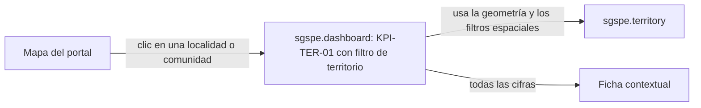
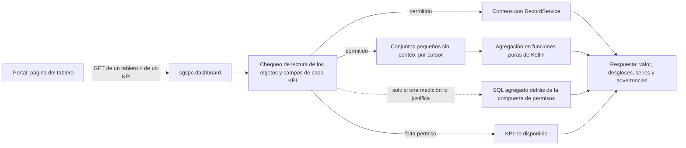

# Tableros e indicadores de SGSPE

Sistema de Gestión Social para Proyectos Extractivos · Fase 0 (descubrimiento) · versión 1.0 · 2026-10-07

Este documento define el catálogo de indicadores (KPI) de SGSPE y los tableros que los muestran: qué mide cada indicador, con qué
fórmula y sobre qué objetos y campos, qué requisitos cumple, cómo se actualiza y en qué fase aparece. También fija la arquitectura
de consultas, los endpoints `/api/sgspe/dashboards/**`, el tratamiento de los permisos y las reglas de los gráficos. Deriva del
[análisis de requisitos](requirements-analysis.md), del [glosario](glossary.md) y del [modelo de dominio](domain-model.md), que
son la fuente de verdad: los IDs (RF, RNF, RN, RQ, CON, GAP, ASM, UPS) se definen solo en el análisis y aquí solo se citan; los
valores de catálogo están solo en [§10 del análisis](requirements-analysis.md#10-catálogos). Los identificadores `KPI-…` se
definen aquí, como prevé §0.5 del análisis. Ningún ejemplo usa nombres de personas reales [USR-07].

## 1. Alcance y fuentes

- El usuario pide ver la situación en GIS y en tableros [USR-02]. El prompt pide al menos seis tableros (ejecutivo, de proyecto,
  de compromisos, de quejas, de riesgos y territorial) [PRM-01 §16] y una ficha contextual en el mapa [PRM-01 §15].
- DOC-01 aporta los 13 indicadores de monitoreo de la Tabla 9.5 con sus medios de verificación, la evaluación mensual de grupos
  de interés frente a la línea base [DOC-01 §9.3.1.1], la revisión semanal de riesgos [DOC-01 §9.3.2.1] y la clasificación
  interés × poder [DOC-01 §7.2, Anexo 3].
- Requisitos: los tableros RF-DSH-001, RF-DSH-002, RF-DSH-003, RF-DSH-004, RF-DSH-005, RF-DSH-006, RF-DSH-007, RF-DSH-008,
  RF-DSH-009 y RF-DSH-010, y los indicadores y reglas de §13.2 del análisis (RQ-DSH). En el texto, "#n" es el número del
  indicador en la Tabla 9.5, como en el análisis.
- Los indicadores los calcula el paquete `sgspe.dashboard` (§8.2 del modelo de dominio). Los usan también `sgspe.deliverable`,
  para que los entregables muestren las mismas cifras (RQ-DSH-034), y el resumen ejecutivo de IA (AI-04, ver
  [ai-architecture.md](ai-architecture.md)).
- No reemplaza a otros documentos:
  - las capas y el mapa territorial están en `gis.md`;
  - el contrato de los endpoints, en `api.md`;
  - qué roles leen qué objetos y campos, en `security.md`;
  - la anatomía de los entregables, en `deliverables.md`;
  - la decisión de calcular en vivo y de usar ECharts, en ADR-0016 (KPIs calculados en vivo y ECharts como librería de gráficos).

## 2. Principios

| # | Principio | Consecuencia en el diseño | Fuente |
|---|---|---|---|
| P1 | Responder la pregunta central | Los tableros muestran la situación social, los compromisos, los riesgos, lo que ocurre en el territorio y lo pendiente de cada proyecto | [PRM-01 §2] OBJ-01, OBJ-05 |
| P2 | Cálculo en vivo con los permisos de la plataforma | Los conteos pasan por `RecordService`, que aplica tenant, permisos por objeto y campo y registros propios; no hay un segundo motor de permisos | RQ-DSH-001, RQ-DSH-031 [WAS-ADR-0038] |
| P3 | Sin permiso no hay cifra | Si un indicador necesita un campo que la persona no puede leer, se muestra "no disponible", nunca cero | RQ-DSH-032 |
| P4 | Un solo código de indicadores | Tableros, entregables y resumen de IA llaman a las mismas funciones, así que sus cifras coinciden | RQ-DSH-034 |
| P5 | La historia sale de los registros | Las tendencias se arman con las fechas de los eventos y con evaluaciones append-only; sin vistas materializadas ni tablas de instantáneas, porque el DDL de negocio solo nace de la metadata | RQ-DSH-031, RQ-GIS-016 [WAS-ADR-0003] |
| P6 | Indicadores al ritmo de los módulos | Cada módulo trae sus indicadores en su fase; F8 consolida los tableros | RQ-DSH-036 [USR-05] |
| P7 | Los conteos siempre se calculan | Ningún total se teclea: se cuentan los registros | CON-002, CON-007 |
| P8 | No se mezclan monedas | Cada total va por moneda; lo que está en otra moneda se señala como advertencia | ASM-063, RNF-I18N-002 |
| P9 | Agregados, no personas | Los tableros muestran agregados; una etiqueta de persona respeta los permisos de campo, y el mapa nunca inventa coordenadas de personas | RQ-SEC-010, RQ-GIS-015 [USR-07] |
| P10 | Una sola biblioteca de gráficos | ECharts, cargada en diferido, con los colores del tema y una tabla "Ver datos" bajo cada gráfico | RQ-DSH-035, ASM-046, ASM-047 |

## 3. Definiciones comunes

### 3.1 Filtros

Todos los tableros comparten una fila de filtros sobre todos sus gráficos (RQ-DSH-001):

| Filtro | Parámetro | Cómo se aplica | Fuente |
|---|---|---|---|
| Organización | Implícita: el tenant del token | Solo se leen las tablas de la organización | RQ-SEC-002 |
| Proyecto | `project`, uno o varios | Por la relación `project` de cada objeto. Por defecto, «mis proyectos» de `ProjectReach`: todos los que lee quien lee todos los proyectos (`ADMIN` y `READ_ALL_PROJECTS`) y, si no, los de sus asignaciones vigentes (`active` y, si tiene fechas, hoy en Lima entre ellas); sin asignaciones vigentes, ninguno. Un proyecto pedido que quien mira no lee da conjuntos vacíos, sin error (`security.md` §9.7) | RF-PRJ-005, RQ-SEC-006 |
| Periodo | `periodStart`, `periodEnd` | Fechas en America/Lima; por defecto, el mes en curso. Las series mensuales cubren los 12 meses que terminan en `periodEnd` | RNF-I18N-002 |
| Territorio | `locality`, `community`, `administrativeUnit`, `areaOfInfluence` | Por las relaciones `locality` y `community` de cada objeto. Una localidad incluye sus sectores (`parent_locality`); una unidad administrativa, sus localidades y unidades hijas; un área de influencia, los miembros de su versión `approved`. `stakeholder` no tiene `community`: los KPI-STK no aplican ese filtro y lo informan en `ignoredFilters`, nunca con un cero | RF-TER-002, RF-TER-005 |
| Ámbito | `scope` | En los indicadores de grupos de interés y de participantes, por `stakeholder_scope` o `participant_scope`. En los demás, AIDS y AIIS se traducen a las localidades y comunidades miembros del área de influencia aprobada de ese tipo; REGIONAL y NACIONAL solo filtran grupos de interés | RQ-DSH-001, ASM-040 |
| Campaña | `explorationCampaign` | Solo en compromisos e inversión social: desde F3 la aplican KPI-COM-01 a KPI-COM-05 y KPI-COM-10, y desde F5 KPI-INV-01. Los demás indicadores la aceptan, no la aplican y lo informan en `ignoredFilters` | RF-PRJ-004 |
| Programa | `program` | Desde F5, solo en el tablero `investment` y en los KPI-INV: un `social_program` (UUID; `400` si no lo es); lo aplican KPI-INV-02 y el bloque de programas de KPI-INV-04; los demás KPI-INV lo informan en `ignoredFilters`. En otro tablero o indicador es un parámetro desconocido (`422`) | RF-INV-003 |
| Año | `year` | Desde F5, solo en el tablero `investment` y en los KPI-INV: el año presupuestal (`program_budget.budget_year`), un entero de 2000 a 2100 (`400` si no); lo aplica KPI-INV-02; los demás KPI-INV lo informan en `ignoredFilters`. En otro tablero o indicador, `422` | RF-INV-004, ASM-113 |
| Responsable | `owner` | Por `owner_user_id` del compromiso, en KPI-COM-03, KPI-COM-04, KPI-COM-06 y KPI-COM-09; los demás indicadores lo declaran en `ignoredFilters` | RQ-DSH-019 |

Lo "local" de la Tabla 9.5 corresponde a AIDS más AIIS: el ámbito del grupo de interés y el ámbito de acción son datos distintos
(CON-016, ASM-040).

### 3.2 Estados que cuentan

Los conjuntos usan los estados de §7.3 del modelo de dominio. Los de plazo son los mismos en que JOB-01 calcula
`deadline_status`; fuera de ellos lo deja vacío (`workflows.md`). En un compromiso son `approved`, `in_progress` y `blocked`: un
borrador o un compromiso pendiente de aprobación no tiene plazo en curso. Además, todo indicador de plazo filtra por estado.

| Objeto | Conjunto | Estados | Lo usan |
|---|---|---|---|
| `project` | activo | `active`. WF-A nunca se desactiva: una organización que no revisa proyectos usa una variante de su definición (ASM-010), así que todo proyecto tiene estado | KPI-EXE-01 |
| `stakeholder` | vigente | Todos salvo `retired` | KPI-STK |
| `engagement` | realizada | `held`, `minutes_drafted`, `minutes_in_review`, `minutes_approved`, `closed`: la regla de `last_contact_date` (§7.4 del modelo de dominio) | KPI-STK, KPI-ENG |
| `commitment` | abierto | Todos salvo `closed` y `cancelled` | KPI-COM-02 |
| `commitment` | pendiente de cumplimiento | `approved`, `in_progress`, `blocked`: los estados en que JOB-01 calcula `deadline_status` | KPI-COM-03, KPI-COM-04; KPI-COM-11 aproxima el pasado con ellos |
| `commitment` | cumplido | `fulfilled`, `verified`, `closed`: los únicos en que se lee `fulfilled_date` | KPI-COM-05, KPI-COM-09 |
| `commitment` | comprometido | `approved`, `in_progress`, `blocked`, `fulfilled`, `verified`, `closed`: los montos aprobados de ASM-063 | KPI-COM-10, KPI-INV-01, KPI-INV-03; P1 de WF-P y D7 de WF-D (`CampaignCommitted`) |
| `grievance` | abierta | Todos salvo `closed`, `rejected` y `withdrawn`; el plazo corre en `received`, `acknowledged`, `in_assessment`, `in_investigation` e `in_action` | KPI-GRV |
| `inquiry`, `stakeholder_request` | abierta | Todos salvo `closed`; el plazo corre en `received` (consulta) y en `received` y `under_evaluation` (solicitud) | KPI-GRV |
| `social_risk` | activo | Todos salvo `closed` | KPI-RSK |
| `early_warning` | activa | `detected`, `in_triage`, `confirmed`, `responding` | KPI-EXE-02 |
| `social_contribution` | comprometido | `approved`, `procured`, `delivered`, `closed`: los aportes aprobados y no anulados, cuyo `total_amount` cuenta para el tope de la campaña (ASM-110) | KPI-INV-01; P1 de WF-P y D7 de WF-D (`CampaignCommitted`) |
| `social_contribution` | ejecutado | `delivered`, `closed` (ASM-063) | KPI-INV-03, KPI-INV-04 |
| `area_of_influence` | vigente | `approved` | KPI-TER |

### 3.3 Reglas de conteo

- **Contacto con un grupo de interés:** una interacción realizada con `held_at` en el periodo, vinculada por la M2M
  `engagement_stakeholder` o por un `engagement_participant` con ese `stakeholder` y con `attended`. Un grupo invitado que no
  asistió no cuenta (§7.4 del modelo de dominio).
- **Oposición:** postura EN CONTRA o EN CONTRA PERO ABIERTO A ESCUCHAR (RN-STK-007).
- **Postura vigente en una fecha:** la de la última `stakeholder_assessment` con `assessment_date` hasta esa fecha. Las
  evaluaciones son inmutables (RF-STK-005), así que la historia se reconstruye sin instantáneas.
- **Reunión (#5):** interacción realizada de tipo REUNION, REUNION INFORMATIVA, TALLER, ASAMBLEA o MESA DE DIALOGO: los tipos
  formales de RN-ENG-004, que incluyen la reunión informativa.
- **Reunión informativa (#7, #8 y #9):** interacción realizada de tipo REUNION INFORMATIVA o TALLER, como agrupa el glosario
  [DOC-01 §9.1.1.2].
- **Vencido y por vencer:** `deadline_status` VENCIDO o POR VENCER, que `DeadlineJob` recalcula cada hora; "por vencer" usa
  `due_soon_days` del proyecto, 7 días por defecto (ASM-006, RN-WFL-001); en una QCS, POR VENCER empieza a lo sumo a la
  mitad del plazo (ASM-100).
- **Cumplimiento:** `fulfilled_date` solo se lee en un compromiso cumplido (§3.2). Volver a ejecución (`reopen_execution`) la
  vacía, y se escribe de nuevo en el siguiente cumplimiento (§12).
- **Reclasificación:** reclasificar una QCS crea el registro del otro tipo, con el vínculo `reclassified_from_*`, y cierra el
  original con `close_reclassified_*` (RF-GRV-007, `workflows.md`).
  - El registro nuevo copia el `received_at` del primer registro de la cadena, y sus plazos corren desde esa fecha (ASM-072).
    Así cada registro ya trae la fecha en que llegó el planteamiento, y los cortes por periodo y el tiempo de atención usan su
    propio `received_at`.
  - El planteamiento cuenta una sola vez, como el último registro de la cadena: los originales a los que apunta otra QCS
    por `reclassified_from_grievance`, `reclassified_from_inquiry` o `reclassified_from_request` no cuentan como
    recibidos, cerrados ni atendidos.
  - Lo cuenta `AttentionCounting` (`sgspe.common`), la misma función pura en el reporte unificado, los KPI-GRV, la
    exportación PUBLICO de `attention-register` y la regla CONTEO DE QCS de JOB-04.
- **Absuelta:** una QCS con `responded_at` (glosario), en cualquier estado. Una queja rechazada o una consulta derivada cuentan si
  se registró la respuesta comunicada.
- **Riesgo alto:** `risk_level` ALTO o CRITICO, según los umbrales del proyecto (ASM-004, RN-RSK-002).
- **Parámetros del proyecto:** un parámetro vacío usa su valor por defecto, porque la plataforma no aplica `defaultValue`
  (UPS-15, ASM-019; los valores en §6.1 del modelo de dominio):
  - 3 para los umbrales de interés y poder;
  - 2 reuniones al mes;
  - 7 días para "por vencer", y 7 y 15 días para el escalamiento;
  - 5, 10 y 15 como puntajes mínimos de los niveles MEDIO, ALTO y CRITICO del riesgo (ASM-004);
  - 5 días hábiles para el acuse de quejas, 15 días para responder consultas y 30 para resolver quejas (ASM-005).
- **Montos:** solo se suman montos de la misma moneda. Cada total va por moneda y lo que está en otra moneda se cuenta aparte como
  advertencia (ASM-063); la consolidación por proyecto usa PEN por defecto (RNF-I18N-002).
- **Los 10 primeros:** un desglose con muchas categorías muestra las 10 de mayor valor y agrupa el resto en "Otros"; la tabla
  "Ver datos" las lista todas.

### 3.4 Actualización

| Valor | Significado |
|---|---|
| Vivo | Se calcula en cada consulta; la interfaz guarda la respuesta 60 segundos y ofrece "Actualizar" |
| Vivo (plazo horario) | Se calcula en cada consulta sobre `deadline_status`, que `DeadlineJob` recalcula cada hora (ASM-006) |
| Vivo (derivado) | Se calcula en cada consulta sobre un campo derivado que escriben un endpoint o un listener al escribir la fuente; si quedó pendiente, `DerivedFieldsJob` lo corrige en la hora (§7.5 del modelo de dominio) |

Las cifras oficiales de un periodo solo se congelan al cerrarlo (§10, ASM-042).

## 4. Catálogo de KPIs

Cada indicador tiene un ID `KPI-<familia>-NN` y un registro `indicator` con ese código (§10). Columnas: **Definición** dice qué
mide; **Fórmula**, cómo se calcula; **Fuente**, los objetos y campos que lee; **Filtros y desgloses**, cuáles de §3.1 aplican y
qué cortes ofrece; **Actualización**, según §3.4; **Fase**, cuándo aparece (RQ-DSH-036).

### 4.1 Ejecutivos (`KPI-EXE`)

| ID | Indicador | Definición | Fórmula | Fuente | Filtros y desgloses | Requisitos | Actualización | Fase |
|---|---|---|---|---|---|---|---|---|
| KPI-EXE-01 | Proyectos activos | Proyectos en ejecución que la persona puede leer | Número de `project` en `active` (§3.2) | `project.workflow_state`, `stage`, `project_type` | Proyecto; desglose por `stage` y `project_type` | RQ-DSH-002, RF-PRJ-003 | Vivo | F8 |
| KPI-EXE-02 | Alertas activas | Alertas tempranas que siguen en curso | Número de `early_warning` activas (§3.2) | `early_warning.workflow_state`, `severity`, `detected_at`, `project`, `locality`, `community` | Proyecto, territorio; desglose por `severity` y estado | RQ-DSH-002, RF-EWS-004, RN-EWS-001 | Vivo | F8 (alertas desde F4) |
| KPI-EXE-03 | Tendencia mensual | Evolución de la actividad, de las quejas y de los atrasos en los últimos 12 meses | Tres series mensuales, cada una en su propio gráfico: interacciones realizadas (KPI-ENG-01 por mes), quejas recibidas frente a cerradas (calculadas como KPI-GRV-09, pero solo sobre `grievance`: KPI-GRV-09 suma las tres QCS) y compromisos vencidos al cierre de cada mes (KPI-COM-11) | Las de los KPI que compone | Proyecto, territorio, ámbito | RQ-DSH-003 | Vivo | F8 |

### 4.2 Grupos de interés (`KPI-STK`)

| ID | Indicador | Definición | Fórmula | Fuente | Filtros y desgloses | Requisitos | Actualización | Fase |
|---|---|---|---|---|---|---|---|---|
| KPI-STK-01 | Grupos de interés por grupo de influencia y ámbito | Cuántos grupos de interés vigentes hay en cada grupo de influencia y en cada ámbito | Número de `stakeholder` vigentes por `influence_group` × `stakeholder_scope`; los que aún no tienen evaluación van a "sin evaluar" | `stakeholder.influence_group`, `stakeholder_scope`, `workflow_state` | Proyecto, territorio (`locality`, `area_of_influence`), ámbito; desglose por `stakeholder_type` | RQ-DSH-004, RF-STK-009 | Vivo | F2 |
| KPI-STK-02 | Distribución de posturas | Cuántos grupos de interés vigentes hay en cada postura | Número de `stakeholder` vigentes por `stance`, en el orden del catálogo "Postura", más "sin evaluar" | `stakeholder.stance` (restringido: solo para quien puede leerlo, §8), `workflow_state` | Proyecto, territorio, ámbito; desglose por `influence_group` y `stakeholder_type` | RQ-DSH-004, RQ-SEC-010 | Vivo | F2 |
| KPI-STK-03 | Matriz interés × poder | Posición de cada grupo de interés evaluado según su interés y su poder | Un punto por `stakeholder` vigente evaluado: x = `interest_index`, y = `power_index` (de 1 a 5); cuadrantes con `interest_threshold` y `power_threshold` del proyecto, 3 por defecto (ASM-003) | `stakeholder.interest_index`, `power_index`, `influence_group`; `stakeholder_assessment.group_overridden`; `project.interest_threshold`, `power_threshold` | Un proyecto a la vez, porque los umbrales son del proyecto; ámbito, tipo | RQ-DSH-005, RF-STK-008, RF-STK-009 | Vivo | F2 |
| KPI-STK-04 | #1 Grupos de interés contactados | Grupos de interés contactados en el periodo, diferenciados por sexo, ámbito e institución | Número de `stakeholder` distintos con contacto en el periodo (§3.3) | `engagement.held_at`, `workflow_state`; M2M `engagement_stakeholder`; `engagement_participant.stakeholder`, `attended`; `stakeholder.stakeholder_scope`, `person`, `organization`; `person.sex`; `position.organization`, `position_status` | Proyecto, periodo, territorio, ámbito; desglose por `person.sex` (las organizaciones aparte), por ámbito y por institución: la organización del grupo de interés o, si es una persona, las de sus cargos vigentes | RQ-DSH-006 | Vivo | F2 |
| KPI-STK-05 | #2 Oposición que aceptó conversar | Porcentaje de grupos de interés de oposición que aceptaron conversar con la empresa | Grupos de interés en oposición al inicio del periodo con al menos un contacto en el periodo ÷ grupos de interés en oposición al inicio del periodo. La postura al inicio es la vigente en `periodStart` o, si no había evaluación, la primera del periodo | `stakeholder_assessment.stance` (restringido: solo para quien puede leerlo, §8), `assessment_date`; el contacto de §3.3 | Proyecto, periodo, territorio, ámbito | RQ-DSH-007, RN-STK-007, RQ-SEC-010 | Vivo | F2 |
| KPI-STK-06 | #3 Oposición que cambió de postura | Porcentaje de grupos de interés de oposición que variaron su postura frente a la línea base | Grupos de interés en oposición en la línea base (postura vigente al inicio del periodo, ASM-087) cuya última evaluación del periodo con postura informada tiene otra postura ÷ grupos de interés en oposición en la línea base con al menos una evaluación en el periodo. Se muestra también la cobertura: evaluados ÷ en oposición | `stakeholder_assessment.stance` (restringido: solo para quien puede leerlo, §8), `assessment_date` | Proyecto, periodo, territorio, ámbito; desglose por dirección: hacia una postura más o menos favorable en el orden del catálogo | RQ-DSH-008, RF-STK-010, RQ-SEC-010 | Vivo | F2 |
| KPI-STK-07 | #4 Grupos de interés con más de un contacto | Porcentaje de grupos de interés que aceptaron más de un contacto | Grupos de interés con contacto en al menos dos interacciones distintas del periodo ÷ grupos de interés contactados en el periodo (KPI-STK-04) | Las de KPI-STK-04 | Proyecto, periodo, territorio, ámbito | RQ-DSH-009 | Vivo | F2 |
| KPI-STK-08 | Confianza promedio y tendencia | Grado de confianza de los grupos de interés hacia el proyecto, de 1 a 5, y su evolución | Para cada fin de mes: promedio del último `trust_score` informado hasta esa fecha (ASM-087) de cada grupo de interés evaluado, sin contar los hoy retirados; serie de 12 meses, con la distribución de 1 a 5 y el número de evaluados | `stakeholder_assessment.trust_score`, `assessment_date` | Proyecto, territorio, ámbito, `influence_group` | RQ-DSH-010, RF-STK-010 | Vivo | F2 |

### 4.3 Relacionamiento y comunicación (`KPI-ENG`)

| ID | Indicador | Definición | Fórmula | Fuente | Filtros y desgloses | Requisitos | Actualización | Fase |
|---|---|---|---|---|---|---|---|---|
| KPI-ENG-01 | Interacciones realizadas | Interacciones con grupos de interés realizadas en el periodo, de cualquier tipo | Número de `engagement` realizadas con `held_at` en el periodo | `engagement.held_at`, `workflow_state`, `engagement_type` | Proyecto, periodo, territorio (`locality`, `community`); desglose por `engagement_type` y por mes | RQ-DSH-002, RQ-DSH-003 | Vivo | F2 |
| KPI-ENG-02 | #5 Reuniones sostenidas al mes | Reuniones realizadas en cada mes frente a la meta, que DOC-01 sugiere en al menos dos | Por mes, número de reuniones realizadas (§3.3). Meta: `meetings_per_month_target` del `engagement_plan` vigente en el mes (con dos o más vigentes, el de `start_date` más reciente) o, si no hay, el del `project` (2 por defecto); con varios proyectos, la suma. La meta del periodo suma la de cada uno de sus meses, aunque pase de 12; un mes que el periodo cubre en parte cuenta su meta entera | `engagement.engagement_type`, `held_at`, `workflow_state`; `engagement_plan.meetings_per_month_target`, `start_date`, `end_date`; `project.meetings_per_month_target` | Proyecto, periodo, territorio; desglose por tipo | RQ-DSH-011, RN-ENG-003, RF-ENG-007 | Vivo | F2 |
| KPI-ENG-03 | #7 Asistentes por reunión informativa | Participantes de cada reunión informativa, su porcentaje por sexo y ámbito y la organización que representan | Por reunión informativa realizada en el periodo: `attendees_total_count`; porcentajes con `attendees_female_count` y `attendees_male_count` y con los conteos por ámbito; organizaciones de sus participantes con `attended` (`organization` o `represented_group`). También el total y el promedio del periodo | `engagement.attendees_total_count`, `attendees_female_count`, `attendees_male_count`, `attendees_direct_area_count`, `attendees_indirect_area_count`, `attendees_regional_count`, `attendees_national_count`; `engagement_participant.organization`, `represented_group`, `attended` | Proyecto, periodo, territorio | RQ-DSH-012, RF-ENG-004 | Vivo (derivado) | F2 |
| KPI-ENG-04 | #8 Temas consultados | Temas tratados en las reuniones informativas y su frecuencia | Por `topic`: número de reuniones informativas realizadas en el periodo que lo trataron (M2M `engagement_topic`) y número de preguntas de esas reuniones con ese tema (`engagement_question.topic`) | M2M `engagement_topic`; `engagement_question.topic`; `topic.name`, `parent_topic` | Proyecto, periodo, territorio; agrupación por tema padre | RQ-DSH-013, RF-ENG-012 | Vivo | F2 |
| KPI-ENG-05 | #9 Inquietudes resueltas | Porcentaje de inquietudes resueltas en las reuniones informativas | Preguntas absueltas ÷ preguntas efectuadas [DOC-01 Tabla 9.5], sobre las `engagement_question` de reuniones informativas realizadas en el periodo. Absuelta: `answered_on_site` o con `answered_at`. Desde F4, también una pregunta derivada a una QCS: cuenta por su `referred_at`, que la derivación (`api.md` §4.4) escribe en la pregunta, sin leer la QCS, así que una derivada a una confidencial cuenta igual para todos. La respuesta lleva `confidentialHidden` (§8), como los KPI-GRV | `engagement_question.answered_on_site`, `answered_at`, `referred_at`, `engagement` | Proyecto, periodo, territorio; desglose por tema | RQ-DSH-014, RF-ENG-003, RN-ENG-005 | Vivo | F2 |
| KPI-ENG-06 | #11 Monitoreos participativos de agua | Monitoreos ambientales del agua hechos con participación de grupos de interés y un agente independiente | Número de `engagement` realizadas de tipo MONITOREO PARTICIPATIVO en el periodo (ASM-029), con sus grupos de interés participantes; el agente independiente y los resultados constan en sus `evidence` | `engagement.engagement_type`, `held_at`, `workflow_state`, `title`; M2M `engagement_stakeholder` y `stakeholder.project` | Proyecto, periodo, territorio | RQ-DSH-015, ASM-029 | Vivo | F4 |
| KPI-ENG-07 | #12 Comunicados sobre compromisos cumplidos | Comunicados en medios que informan sobre compromisos cumplidos | Número de `media_mention` con `reports_fulfilled_commitment` y `published_date` en el periodo (ASM-029) | `media_mention.reports_fulfilled_commitment`, `published_date`, `commitment`, `outlet` | Proyecto, periodo | RQ-DSH-016, ASM-029 | Vivo | F4 |
| KPI-ENG-08 | #13 Medios con información positiva y negativa | Porcentaje de medios que presentan información positiva o negativa | Menciones del periodo de cada `tone` ÷ menciones del periodo (el valor es el de NEGATIVO; los otros tonos, en el desglose por tono); además, medios distintos (`outlet` u `outlet_name`) con al menos una mención de cada tono ÷ medios con menciones | `media_mention.tone`, `outlet`, `outlet_name`, `published_date`, `topic` | Proyecto, periodo; desglose por medio y tema | RQ-DSH-017, RF-EWS-002 | Vivo | F4 |

### 4.4 Compromisos (`KPI-COM`)

| ID | Indicador | Definición | Fórmula | Fuente | Filtros y desgloses | Requisitos | Actualización | Fase |
|---|---|---|---|---|---|---|---|---|
| KPI-COM-01 | Compromisos registrados | Todos los compromisos del filtro | Número de `commitment` en cualquier estado, con desglose por estado de WF-D | `commitment.workflow_state` | Proyecto, territorio, campaña | RQ-DSH-018 | Vivo | F3 |
| KPI-COM-02 | Compromisos abiertos | Compromisos que todavía no se cierran ni se cancelan | Número de `commitment` abiertos (§3.2) | `commitment.workflow_state` | Proyecto, territorio, campaña | RQ-DSH-018, RQ-DSH-002 | Vivo | F3 |
| KPI-COM-03 | Compromisos vencidos | Compromisos pendientes de cumplimiento cuyo plazo venció | Número de `commitment` pendientes de cumplimiento con `deadline_status` VENCIDO; desglose por días de atraso (`1-7`, `8-15`, `más de 15` con los umbrales por defecto) con los umbrales de escalamiento del proyecto (`escalation_first_days` y `escalation_second_days`, 7 y 15 por defecto, ASM-030): las claves `OVERDUE_FIRST`, `OVERDUE_SECOND` y `OVERDUE_OVER` no cambian entre proyectos, y la etiqueta lleva los días solo si todos los compromisos comparten umbrales | `commitment.deadline_status`, `workflow_state`, `due_date`; `project.escalation_first_days`, `escalation_second_days` | Proyecto, territorio, campaña, responsable | RQ-DSH-018, RQ-DSH-002, RN-WFL-001, RF-WFL-004 | Vivo (plazo horario) | F3 |
| KPI-COM-04 | Compromisos por vencer | Compromisos pendientes cuyo plazo vence pronto | Número de `commitment` pendientes de cumplimiento con `deadline_status` POR VENCER (`due_soon_days`, 7 días por defecto, ASM-006) | `commitment.deadline_status`, `workflow_state`, `due_date`; `project.due_soon_days` | Proyecto, territorio, campaña, responsable | RQ-DSH-018 | Vivo (plazo horario) | F3 |
| KPI-COM-05 | Compromisos cumplidos en el periodo | Compromisos entregados con conformidad en el periodo | Número de `commitment` cumplidos (§3.2) con `fulfilled_date` en el periodo | `commitment.fulfilled_date`, `workflow_state` | Proyecto, periodo, territorio, campaña | RQ-DSH-018 | Vivo | F3 |
| KPI-COM-06 | Compromisos bloqueados | Compromisos detenidos | Número de `commitment` en `blocked` | `commitment.workflow_state` | Proyecto, territorio, responsable | RQ-DSH-018 | Vivo | F3 |
| KPI-COM-07 | Desgloses de compromisos | Dónde y en manos de quién están los compromisos abiertos y vencidos | KPI-COM-02 y KPI-COM-03 por responsable (`owner_user_email`), proyecto, localidad o comunidad y categoría (`topic`), los 10 primeros más "Otros" | `commitment.owner_user_email`, `project`, `locality`, `community`, `topic` | Proyecto, territorio | RQ-DSH-019 | Vivo (plazo horario) | F3 |
| KPI-COM-08 | #10 Compromisos formales por tema | Compromisos formales (escritos) asumidos por la empresa, según su tema | Número de `commitment` con `formality` FORMAL, salvo los `cancelled`, por `commitment_theme` (AMBIENTAL o SOCIAL); con periodo, por `agreed_date` | `commitment.formality`, `commitment_theme`, `agreed_date`, `workflow_state` | Proyecto, periodo, territorio | RQ-DSH-019, RF-COM-009 | Vivo | F3 |
| KPI-COM-09 | Compromisos cumplidos a tiempo | Porcentaje de compromisos cumplidos dentro de su plazo | Compromisos cumplidos (§3.2) con `fulfilled_date` en el periodo y no posterior a su `due_date` ÷ compromisos cumplidos con `fulfilled_date` en el periodo. También frente a la fecha original (la `previous_due_date` de su primera `commitment_reschedule`), para ver el efecto de las reprogramaciones | `commitment.fulfilled_date`, `due_date`, `workflow_state`; `commitment_reschedule.previous_due_date`, `new_due_date`, `agreed_with_stakeholder` | Proyecto, periodo, territorio, responsable | RQ-DSH-020, RF-COM-003 | Vivo | F3 |
| KPI-COM-10 | Monto comprometido frente a ejecutado | Lo que la empresa se obligó a aportar frente a lo ya entregado | Por moneda: suma de `amount` de los compromisos comprometidos (§3.2) frente a la suma de su `executed_amount`, que suma el `delivered_amount` de sus `delivery` (ASM-063). Con campaña, lo que está en otra moneda que la de la campaña no se suma y se cuenta como advertencia | `commitment.amount`, `currency`, `executed_amount`, `workflow_state`; `exploration_campaign.currency` | Proyecto, campaña, territorio | RQ-DSH-021, ASM-063, RN-COM-004 | Vivo | F3 |
| KPI-COM-11 | Compromisos vencidos al cierre de cada mes | Serie histórica de los compromisos vencidos al final de cada mes | Para cada fin de mes M, compromisos que cumplen todo esto: hoy están en `approved` o en un estado posterior (o están `cancelled` con `cancelled_date` posterior a M), como los que sigue JOB-01; tienen `agreed_date` hasta M; su fecha de vencimiento vigente en M es anterior a M; y no tienen `fulfilled_date` hasta M. La fecha vigente en M es la `new_due_date` de la última `commitment_reschedule` creada hasta M o, si no la hay, la fecha original. **Límite histórico:** el modelo no guarda la fecha de aprobación, así que la serie toma el estado de hoy como prueba de aprobación, y un compromiso cancelado antes de aprobarse puede contar en los meses previos a su cancelación. Como volver a ejecución vacía `fulfilled_date`, un compromiso reabierto cuenta como no cumplido también entre su primer cumplimiento y la reapertura (§12) | `commitment.agreed_date`, `due_date`, `fulfilled_date`, `cancelled_date`, `workflow_state`; `commitment_reschedule.previous_due_date`, `new_due_date`, `created_at` | Proyecto, territorio | RQ-DSH-003 | Vivo | F3 (serie), F8 (tablero ejecutivo) |

### 4.5 Quejas, consultas y solicitudes (`KPI-GRV`)

Los indicadores de QCS leen los tres objetos: `grievance`, `inquiry` y `stakeholder_request`; no hay un objeto "QCS"
genérico (§6.7 del modelo de dominio). Leen como quien llama: una QCS confidencial que no lee no cuenta (ASM-095), y la
respuesta de cada KPI-GRV y del tablero `attention` lo dice con `confidentialHidden` (§8).

| ID | Indicador | Definición | Fórmula | Fuente | Filtros y desgloses | Requisitos | Actualización | Fase |
|---|---|---|---|---|---|---|---|---|
| KPI-GRV-01 | QCS recibidas | Quejas, consultas y solicitudes recibidas en el periodo, cada planteamiento una vez | Número de QCS con `received_at` en el periodo, por tipo, sin los originales reclasificados: cada planteamiento cuenta una vez, y un registro reclasificado ya trae el `received_at` del primero de la cadena (§3.3, ASM-072) | `received_at`, `channel`, `reclassified_from_grievance`, `reclassified_from_inquiry`, `reclassified_from_request` de los tres objetos | Proyecto, periodo, territorio; desglose por tipo y `channel` | RQ-DSH-022, RF-GRV-007 | Vivo | F4 |
| KPI-GRV-02 | QCS abiertas | QCS que siguen en atención | Número de QCS abiertas (§3.2), por tipo y estado | `workflow_state` | Proyecto, territorio | RQ-DSH-022, RQ-DSH-002 | Vivo | F4 |
| KPI-GRV-03 | Quejas resueltas | Quejas que llegaron a `resolved` en el periodo | Número de `grievance` con `resolved_date` en el periodo; una queja reabierta deja de contar hasta su nueva resolución, porque la reapertura vacía la fecha (§12) | `grievance.resolved_date` (derivado), `severity` | Proyecto, periodo, territorio; desglose por `severity` | RQ-DSH-022 | Vivo | F4 |
| KPI-GRV-04 | QCS cerradas | QCS que llegaron a `closed` en el periodo | Número de QCS en `closed` con `closed_date` en el periodo, por tipo, sin los originales cerrados por reclasificación (§3.3). Las quejas rechazadas o desistidas también tienen `closed_date`, pero no están en `closed`: las cuenta KPI-GRV-05 | `workflow_state`, `closed_date` (derivado) y los vínculos `reclassified_from_*` de los tres objetos | Proyecto, periodo, territorio | RQ-DSH-022 | Vivo | F4 |
| KPI-GRV-05 | Quejas rechazadas | Quejas rechazadas, y aparte las desistidas | Número de quejas en `rejected` con `closed_date` en el periodo (y aparte en `withdrawn`): `closed_date` guarda la fecha de la transición a cualquier estado final (§12). Un original reclasificado nunca está en `rejected`: se cierra en `closed`. Las solicitudes declinadas se ven en el desglose por estado de KPI-GRV-02 | `grievance.workflow_state`, `closed_date` (derivado) | Proyecto, periodo, territorio | RQ-DSH-022 | Vivo | F4 |
| KPI-GRV-06 | QCS fuera de plazo | QCS abiertas cuyo plazo de atención venció | Número de QCS abiertas con `deadline_status` VENCIDO, por tipo | `deadline_status`, `workflow_state`, `ack_due_date`, `response_due_date`, `resolution_due_date` | Proyecto, territorio; desglose por tipo. No aplica el responsable (`owner`, que filtra compromisos, §3.1): si viene, lo informa en `ignoredFilters` | RQ-DSH-022, RF-GRV-006 | Vivo (plazo horario) | F4 |
| KPI-GRV-07 | #6 QCS absueltas | Porcentaje de quejas, consultas o solicitudes absueltas por el proyecto | Planteamientos recibidos en el periodo (KPI-GRV-01) con respuesta registrada (`responded_at`), en cualquier estado ÷ planteamientos recibidos en el periodo. "Absuelta" es "respondida" (glosario); un original reclasificado no cuenta, porque el caso sigue en el registro nuevo (§3.3) | `received_at`, `responded_at`, vínculos `reclassified_from_*` | Proyecto, periodo, territorio; desglose por tipo | RQ-DSH-023, RF-GRV-003, RF-GRV-005 | Vivo | F4 |
| KPI-GRV-08 | Desgloses de QCS | Cómo se reparten las QCS recibidas y abiertas | KPI-GRV-01 y KPI-GRV-02, con su regla de reclasificación, por severidad (`grievance.severity`), categoría (`category`), territorio (`locality`, `community`), grupo de interés (`stakeholder`; las anónimas aparte) y canal, los 10 primeros más "Otros". El tablero es interno y no aplica celdas pequeñas: lee como quien llama, así que las QCS confidenciales que no ve ya quedan fuera (§8) | `severity`, `category`, `locality`, `community`, `stakeholder`, `anonymous`, `channel` | Proyecto, periodo, territorio | RQ-DSH-024 | Vivo | F4 |
| KPI-GRV-09 | QCS recibidas frente a cerradas por mes | Ritmo de entrada y de salida de las QCS | Dos series mensuales de 12 meses, en total para los tres tipos (sin desglose por tipo): recibidas, como en KPI-GRV-01, y cerradas, como en KPI-GRV-04 (sin originales reclasificados, §3.3); el valor es lo recibido en el último mes | `received_at`, `closed_date` (derivado), vínculos `reclassified_from_*` | Proyecto, territorio. Como todo KPI-GRV, no aplica `explorationCampaign` ni `owner` y los informa en `ignoredFilters` | RQ-DSH-024, RQ-DSH-003 | Vivo | F4 |
| KPI-GRV-10 | Tiempo de atención | Días que toma atender una QCS y cumplimiento de sus plazos | Mediana de días desde `received_at` (que en un registro reclasificado es el del primero de la cadena, ASM-072) hasta `resolved_date` en quejas y hasta `responded_at` en consultas y solicitudes, sobre las atendidas en el periodo; porcentaje dentro de plazo frente a `resolution_due_date` (quejas) y `response_due_date` (consultas), con los plazos de ASM-005. Las solicitudes no tienen plazo por defecto (GAP-005) y solo muestran la mediana | `received_at`, `resolved_date` (derivado), `responded_at`, `resolution_due_date`, `response_due_date` | Proyecto, periodo, territorio, tipo, `severity` | RQ-DSH-025, ASM-005 | Vivo | F4 |

### 4.6 Riesgos (`KPI-RSK`)

| ID | Indicador | Definición | Fórmula | Fuente | Filtros y desgloses | Requisitos | Actualización | Fase |
|---|---|---|---|---|---|---|---|---|
| KPI-RSK-01 | Riesgos altos | Riesgos activos de nivel alto o crítico | Número de `social_risk` activos con `risk_level` ALTO o CRITICO | `social_risk.risk_level`, `workflow_state` | Proyecto, territorio; desglose por `category` | RQ-DSH-002 | Vivo | F4 |
| KPI-RSK-02 | Mapa de calor probabilidad × impacto | Cuántos riesgos activos hay en cada combinación de probabilidad e impacto de su última revisión | Matriz 5 × 5 con el número de `social_risk` activos por `probability` e `impact`. Con un solo proyecto, cada celda muestra además el nivel que da su puntaje (P × I) según los umbrales del proyecto (ASM-004). Los riesgos sin revisión van aparte como "sin evaluar". Vista alternativa con los valores residuales | `social_risk.probability`, `impact`, `score`, `risk_level`, `residual_probability`, `residual_impact`, `residual_level`; `project.risk_medium_min_score`, `risk_high_min_score`, `risk_critical_min_score` | Proyecto, territorio | RQ-DSH-026, RN-RSK-002, ASM-004 | Vivo | F4 |
| KPI-RSK-03 | Riesgos por territorio y por proyecto | Dónde se concentran los riesgos activos | Número de `social_risk` activos por localidad, comunidad, área de influencia y proyecto, apilado por `risk_level` | `social_risk.locality`, `community`, `area_of_influence`, `project`, `risk_level` | Proyecto, territorio | RQ-DSH-027 | Vivo | F4 |
| KPI-RSK-04 | Evolución de los riesgos | Cómo cambia el nivel de los riesgos semana a semana | Para cada semana: distribución por nivel de los riesgos hoy activos según su última `risk_assessment` no residual hasta esa semana, y número de revisiones de la semana por `trend` (AUMENTA, SE MANTIENE, DISMINUYE). Los riesgos ya cerrados no aparecen en la serie, porque el modelo no guarda su fecha de cierre: la serie muestra la historia de los riesgos vigentes | `risk_assessment.assessment_date`, `risk_level`, `score`, `trend`, `residual` | Proyecto, territorio; 12 semanas por defecto | RQ-DSH-027, RF-RSK-002, RN-RSK-001 | Vivo | F4 |
| KPI-RSK-05 | Avance de la mitigación | Medidas de mitigación hechas frente a las planificadas | Medidas con `completed` ÷ medidas de los riesgos activos; aparte, las atrasadas: sin `completed` y con `planned_date` anterior a hoy | `mitigation_measure.completed`, `planned_date`, `completed_date`, `owner_user_email` | Proyecto, territorio; desglose por riesgo y responsable | RQ-DSH-027, RF-RSK-003 | Vivo | F4 |

### 4.7 Inversión social (`KPI-INV`)

| ID | Indicador | Definición | Fórmula | Fuente | Filtros y desgloses | Requisitos | Actualización | Fase |
|---|---|---|---|---|---|---|---|---|
| KPI-INV-01 | Ejecución de la campaña frente a su tope | Cuánto del tope de apoyo social de cada campaña ya se comprometió y cuánto se ejecutó | Por campaña, en su moneda: lo comprometido (compromisos y aportes comprometidos de §3.2, con `CampaignCommitted`, la misma lectura de P1 y D7) y lo ejecutado (`executed_social_amount`) frente a `social_support_cap`; son cifras distintas (ASM-063, ASM-110). `other_currency_items_count` y los montos comprometidos en otra moneda se muestran como advertencia (`otherCurrencyCount` y `committedOtherCurrencyCount`) | `exploration_campaign.social_support_cap`, `currency`, `executed_social_amount`, `other_currency_items_count`; `commitment.amount`, `currency`; `social_contribution.total_amount`, `currency` | Proyecto, campaña | RQ-DSH-030, RF-INV-004, RN-INV-003 | Vivo (derivado y lectura de lo comprometido) | F5 (datos desde F3) |
| KPI-INV-02 | Ejecución de programas frente a presupuesto | Avance presupuestal de los programas sociales | Por programa, año y moneda: suma de `program_budget.executed_amount` ÷ suma de `allocated_amount`; el ejecutado se registra a mano por año (ASM-113) y las monedas no se convierten | `program_budget.budget_year`, `allocated_amount`, `executed_amount`, `currency`; `social_program` | Proyecto, programa, año | RQ-DSH-030, RF-INV-003 | Vivo | F5 |
| KPI-INV-03 | Inversión social ejecutada | Inversión social ejecutada frente a lo presupuestado y a los topes | Por proyecto y moneda, ejecutado = `executed_amount` de los compromisos + `total_amount` de los aportes ejecutados (§3.2) + `executed_amount` de `program_budget` (ASM-063); frente al presupuesto (suma de `allocated_amount`) y a los topes de las campañas (suma de `social_support_cap`). PEN por defecto y otras monedas como advertencia. Con periodo, los compromisos suman el `delivered_amount` de sus entregas del periodo, los aportes cuentan si su entrega cae en el periodo y los programas, por los años presupuestales que lo cruzan | `commitment.executed_amount`, `currency`; `delivery.delivery_date`, `delivered_amount`; `social_contribution.total_amount`, `currency`, `workflow_state`; `program_budget.budget_year`, `allocated_amount`, `executed_amount`; `exploration_campaign.social_support_cap` | Proyecto, periodo, territorio | RQ-DSH-030, RQ-DSH-002, RF-INV-004, ASM-063 | Vivo | F5 |
| KPI-INV-04 | Beneficiarios | Población alcanzada por la inversión social | Tres bloques que no se suman, porque una misma persona puede estar en varias fuentes: por programa, suma de `reached_count` frente a suma de `target_count` de sus `beneficiary_group`; los aportes ejecutados (§3.2), suma de `beneficiaries_count`; y los compromisos cumplidos, suma de `beneficiaries_count` | `beneficiary_group.target_count`, `reached_count`, `locality`; `social_contribution.beneficiaries_count`; `commitment.beneficiaries_count` | Proyecto, programa, territorio | RQ-DSH-030 | Vivo | F5 |

### 4.8 Territorio (`KPI-TER`)

| ID | Indicador | Definición | Fórmula | Fuente | Filtros y desgloses | Requisitos | Actualización | Fase |
|---|---|---|---|---|---|---|---|---|
| KPI-TER-01 | Resumen de una localidad o comunidad | Las cifras de la ficha contextual del mapa | No tiene un valor propio: reúne estas cifras con el filtro del territorio elegido. Son grupos de interés vigentes por postura (KPI-STK-02); interacciones realizadas en los últimos 90 días, configurable (KPI-ENG-01); compromisos abiertos y vencidos (KPI-COM-02, KPI-COM-03); QCS abiertas (KPI-GRV-02); riesgos altos (KPI-RSK-01); programas con iniciativas o grupos de beneficiarios en el territorio; inversión ejecutada (KPI-INV-03); y la última actividad, el `held_at` más reciente de las interacciones realizadas (§3.2). La respuesta trae cada componente con su propio `available`, y con `unavailableReason` y `missingFields` cuando falta (§8): los que son KPI, con su `code`; los dos sin código, con su clave, `programs` y `lastActivity`. Así quien no lee `stance` solo pierde KPI-STK-02, y quien no lee `social_program` solo pierde `programs` | Las relaciones `locality` y `community` de cada objeto; `social_initiative.locality`, `community`; `beneficiary_group.locality`; `engagement.held_at` | Territorio (obligatorio), proyecto | RQ-GIS-005, RF-DSH-006 | Vivo | F6 |
| KPI-TER-02 | Superficie del área de influencia | Tamaño de cada área de influencia vigente | `calculated_area_ha` de la versión `approved` de cada tipo de área del proyecto: área plana en el CRS de trabajo (RQ-GIS-009, ASM-057) | `area_of_influence.area_type`, `version_number`, `calculated_area_ha`, `workflow_state` | Proyecto | RQ-DSH-029 | Vivo (derivado) | F6 |
| KPI-TER-03 | Miembros por tipo de área | Localidades, comunidades y unidades administrativas de cada área vigente | Número de `area_of_influence_member` de la versión aprobada, por `area_type`, tipo de miembro y `member_condition` | `area_of_influence_member.locality`, `community`, `administrative_unit`, `member_condition`; `area_of_influence.area_type` | Proyecto | RQ-DSH-029, RF-TER-005 | Vivo | F6 |
| KPI-TER-04 | Componentes sobre tierras comunales o privadas | Componentes del proyecto que cruzan territorio comunal o predios | Número de `project_component` vigentes (`superseded` falso) cuya geometría interseca `community.territory` o `land_parcel.boundary`, por `tenure_type`. Lo calcula una consulta espacial de `sgspe.territory` detrás de su compuerta de permisos (RQ-GIS-017) | `project_component.location`, `trace`, `footprint`, `superseded`, `component_type`; `community.territory`; `land_parcel.boundary`, `tenure_type` | Proyecto; desglose por `component_type` | RQ-DSH-029, RQ-GIS-002 | Vivo | F6 |

### 4.9 Cobertura de la Tabla 9.5 y del prompt

Los 13 indicadores de la Tabla 9.5 de DOC-01, con su medio de verificación y el tipo de entregable que lo produce (RQ-REP-002,
ASM-026):

| # | Indicador de la Tabla 9.5 | KPI | Requisito | Medio de verificación [DOC-01 Tabla 9.5] | Entregable | Fase |
|---|---|---|---|---|---|---|
| 1 | Grupos de interés contactados, por sexo, ámbito e institución | KPI-STK-04 | RQ-DSH-006 | Reporte de cobertura de grupos de interés contactados | T5 | F2 |
| 2 | Porcentaje de grupos de interés de oposición que aceptaron conversar con la empresa | KPI-STK-05 | RQ-DSH-007 | Reporte de cobertura de grupos de interés contactados | T5 | F2 |
| 3 | Porcentaje de grupos de interés de oposición que variaron su posición | KPI-STK-06 | RQ-DSH-008 | Reporte de cobertura de grupos de interés contactados | T5 | F2 |
| 4 | Porcentaje de grupos de interés que aceptaron más de un contacto | KPI-STK-07 | RQ-DSH-009 | Reporte de reuniones mensuales; minuta de reunión; sistematización de percepciones y posición | T3, T6 | F2 |
| 5 | Reuniones sostenidas al mes (al menos 2) | KPI-ENG-02 | RQ-DSH-011 | Reporte de reuniones mensuales; minuta de reunión | T3 | F2 |
| 6 | Porcentaje de quejas, consultas o solicitudes absueltas | KPI-GRV-07 | RQ-DSH-023 | Reporte de quejas, consultas y solicitudes | T4 | F4 |
| 7 | Asistentes por reunión informativa, por sexo y ámbito, con la organización que representan | KPI-ENG-03 | RQ-DSH-012 | Reporte de reuniones informativas y de recojo de sugerencias; lista de asistentes | T10 | F2 |
| 8 | Temas consultados durante la reunión | KPI-ENG-04 | RQ-DSH-013 | Reporte de reuniones informativas y de recojo de sugerencias | T10 | F2 |
| 9 | Porcentaje de inquietudes resueltas en las reuniones informativas | KPI-ENG-05 | RQ-DSH-014 | Reporte de reuniones informativas; evaluaciones de los participantes de talleres | T10 | F2 |
| 10 | Compromisos formales (escritos) según tema | KPI-COM-08 | RQ-DSH-019 | Matriz de seguimiento de compromisos | T7 | F3 |
| 11 | Monitoreos ambientales del agua participativos y con agente independiente | KPI-ENG-06 | RQ-DSH-015 | Reporte de los resultados de los monitoreos de agua | T9 | F4 |
| 12 | Comunicados en medios sobre compromisos cumplidos | KPI-ENG-07 | RQ-DSH-016 | Matriz de seguimiento de compromisos (difusión) | T7 | F4 |
| 13 | Porcentaje de medios con información positiva y negativa | KPI-ENG-08 | RQ-DSH-017 | Seguimiento de medios informativos [DOC-01 §9.3.1] | — | F4 |

La Tabla 9.5 tiene además la viñeta "Compromisos asumidos por la empresa construidos con los Grupos de Interés", que el análisis
no numera: la cubren KPI-COM-01 y KPI-COM-08, sin KPI propio.

Los tableros del prompt [PRM-01 §16]:

| Tablero del prompt | Elemento | KPI |
|---|---|---|
| Executive | Proyectos activos; compromisos; compromisos vencidos; grievances abiertos; riesgos altos; inversiones; actividades; tendencia temporal | KPI-EXE-01; KPI-COM-02; KPI-COM-03; KPI-GRV-02; KPI-RSK-01; KPI-INV-03; KPI-ENG-01; KPI-EXE-03 |
| Project | Stakeholder landscape; engagement activity; commitment status; grievance status; social risks; programs; geographic distribution | KPI-STK-01, KPI-STK-02, KPI-STK-03; KPI-ENG-01, KPI-ENG-02; KPI-COM-02, KPI-COM-03, KPI-COM-04, KPI-COM-06; KPI-GRV-01, KPI-GRV-02, KPI-GRV-06; KPI-RSK-01, KPI-RSK-02; KPI-INV-02, KPI-INV-04; mapa del proyecto (RQ-GIS-014) |
| Commitment | Total; overdue; due soon; completed; blocked; by responsible, project, community y category | KPI-COM-01; KPI-COM-03; KPI-COM-04; KPI-COM-05; KPI-COM-06; KPI-COM-07 |
| Grievance | Opened; resolved; overdue; severity, category, territory y stakeholder; trend | KPI-GRV-01; KPI-GRV-03; KPI-GRV-06; KPI-GRV-08; KPI-GRV-09 |
| Risk | Heatmap probability × impact; risks by territory y by project; risk evolution; mitigation progress | KPI-RSK-02; KPI-RSK-03; KPI-RSK-04; KPI-RSK-05 |
| Territory | Map + statistics | Mapa territorial (RQ-GIS-014); KPI-TER-01, KPI-TER-02, KPI-TER-03, KPI-TER-04 |

## 5. Tableros

| Tablero | Pregunta que responde | Requisito | `{dashboard}` | Sección del portal | Fase |
|---|---|---|---|---|---|
| Ejecutivo | ¿Cómo está la cartera de proyectos? | RF-DSH-001 | `executive` | Dashboard | F8 |
| Proyecto | ¿Cuál es la situación social de este proyecto? | RF-DSH-002 | `project` | Dashboard y ficha del proyecto | F8 |
| Grupos de interés | ¿Quiénes son, cuánto pesan y qué postura tienen? | RF-DSH-007 | `stakeholders` | Grupos de interés | F2, F8 |
| Relacionamiento | ¿Cuánto y cómo nos relacionamos? | RF-DSH-009 | `engagement` | Relacionamiento | F2, F8 |
| Monitoreo | ¿Cómo van los indicadores de la Tabla 9.5? | RF-DSH-008 | `monitoring` | Dashboard | F8 |
| Compromisos | ¿Qué debemos, a quién y desde cuándo? | RF-DSH-003 | `commitments` | Compromisos | F3, F8 |
| QCS | ¿Qué nos piden y reclaman, y cómo respondemos? | RF-DSH-004 | `attention` | Quejas, consultas y solicitudes | F4, F8 |
| Riesgos | ¿Qué puede impedir el proyecto y qué hacemos? | RF-DSH-005 | `risks` | Riesgos | F4, F8 |
| Territorial | ¿Qué ocurre en cada lugar? | RF-DSH-006 | `territory` | Territorio | F6, F8 |
| Inversión social | ¿Cuánto invertimos frente a lo previsto? | RF-DSH-010 | `investment` | Programas sociales | F5, F8 |

Las secciones del portal son las de la navegación principal (RNF-USA-001). El tablero de QCS usa `attention`, como el paquete
`sgspe.attention`, porque cubre los tres objetos de BC-07 y no solo las quejas. En todos, la fila de filtros de §3.1 va arriba y
gobierna todos los gráficos.

### 5.1 Ejecutivo (RF-DSH-001)

| Zona | Contenido | Forma (§9.2) |
|---|---|---|
| Fila de indicadores | KPI-EXE-01, KPI-COM-02, KPI-COM-03, KPI-GRV-02, KPI-RSK-01, KPI-ENG-01, KPI-EXE-02 | Tiles |
| Inversión | KPI-INV-03 frente a presupuesto y topes | Medidor por moneda |
| Tendencia | KPI-EXE-03 | Tres gráficos de línea pequeños, uno por medida |
| Por proyecto | Las mismas cifras, una fila por proyecto | Tabla |

### 5.2 Proyecto (RF-DSH-002)

Exige un solo `project`.

| Zona | Contenido | Forma |
|---|---|---|
| Paisaje de grupos de interés | KPI-STK-01, KPI-STK-02, KPI-STK-03 | Barra apilada, barra divergente y dispersión con cuadrantes |
| Relacionamiento | KPI-ENG-01, KPI-ENG-02 | Tile y columnas por mes con la meta |
| Compromisos | KPI-COM-02, KPI-COM-03, KPI-COM-04, KPI-COM-06 | Tiles |
| QCS | KPI-GRV-01, KPI-GRV-02, KPI-GRV-06 | Tiles |
| Riesgos | KPI-RSK-01, KPI-RSK-02 | Tile y mapa de calor |
| Programas e inversión | KPI-INV-02, KPI-INV-03, KPI-INV-04 | Medidores y tabla de beneficiarios |
| Distribución geográfica | Mapa del proyecto con sus capas (RQ-GIS-014) | Mapa MapLibre |

### 5.3 Grupos de interés (RF-DSH-007)

| Zona | Contenido | Forma |
|---|---|---|
| Clasificación | KPI-STK-01 | Barra apilada horizontal: grupo de influencia × ámbito |
| Posturas | KPI-STK-02 | Barra apilada divergente centrada en NEUTRAL |
| Matriz interés × poder | KPI-STK-03 | Dispersión con líneas de umbral y cuadrantes rotulados |
| Cambio de postura | KPI-STK-06 | Tile con "n de N" y desglose por dirección |
| Confianza | KPI-STK-08 | Línea mensual con su distribución de 1 a 5 |

Reglas de la matriz interés × poder:

- Los umbrales son parámetros del proyecto, 3 por defecto (ASM-003, RF-STK-009).
- Los cuadrantes se rotulan con los grupos de influencia: ESTRATEGICO (interés y poder altos), POLITICO (poder alto e interés
  limitado), PARA MONITOREO (interés alto y poder limitado) y VULNERABLE (ambos bajos, por defecto, GAP-003).
- Los puntos llevan un solo color, porque la posición ya dice el grupo. Un punto cuyo grupo se ajustó a mano
  (`group_overridden` en su última evaluación) lleva un anillo, y su justificación aparece al pasar el cursor.
- La etiqueta de un punto es el nombre del actor si la persona puede leerlo y, si no, su cargo o su organización
  (RQ-SEC-010). La postura del grupo de interés solo aparece en el detalle del punto si la persona puede leer `stance` (§8).

### 5.4 Relacionamiento (RF-DSH-009)

| Zona | Contenido | Forma |
|---|---|---|
| Actividad | KPI-ENG-01 por tipo | Barras horizontales |
| Reuniones al mes | KPI-ENG-02 | Columnas por mes con la meta como línea de referencia |
| Reuniones informativas | KPI-ENG-03, KPI-ENG-05 | Tabla por reunión y tiles del periodo |
| Temas | KPI-ENG-04 | Barras horizontales: los 10 primeros más "Otros" |

### 5.5 Monitoreo de la Tabla 9.5 (RF-DSH-008)

- Una tabla con los 13 indicadores de §4.9, en su orden, con el valor del periodo, la meta (§10), el desglose por sexo, ámbito e
  institución donde la Tabla 9.5 lo pide y el medio de verificación.
- Cada fila abre el detalle de su KPI.
- Si el periodo está cerrado, la tabla muestra la cifra oficial de `indicator_measurement` y lo indica (§10). Antes de mostrarla
  se aplica el mismo chequeo de campos de §8: #2 y #3 dicen "no disponible" a quien no puede leer `stance`, también con el
  periodo cerrado.

### 5.6 Compromisos (RF-DSH-003)

| Zona | Contenido | Forma |
|---|---|---|
| Estado | KPI-COM-01, KPI-COM-02, KPI-COM-03, KPI-COM-04, KPI-COM-05, KPI-COM-06 | Tiles; los vencidos con su desglose por días de atraso |
| Desgloses | KPI-COM-07 | Barras horizontales por responsable, territorio y categoría |
| Cumplimiento | KPI-COM-09 | Tile con "n de N", frente al plazo vigente y al original |
| Montos | KPI-COM-10 | Barras por moneda: comprometido frente a ejecutado |
| Formales por tema | KPI-COM-08 | Barras |
| Historia | KPI-COM-11 | Línea de 12 meses |
| Pendientes | Lista de los compromisos vencidos y por vencer, con enlace a su ficha | Tabla |

### 5.7 Quejas, consultas y solicitudes (RF-DSH-004)

| Zona | Contenido | Forma |
|---|---|---|
| Flujo | KPI-GRV-01, KPI-GRV-02, KPI-GRV-03, KPI-GRV-04, KPI-GRV-05, KPI-GRV-06 | Tiles por tipo |
| Absueltas | KPI-GRV-07 | Tile con "n de N" |
| Desgloses | KPI-GRV-08 | Barras horizontales |
| Tendencia | KPI-GRV-09 | Dos líneas, recibidas y cerradas, en un solo eje |
| Tiempos | KPI-GRV-10 | Tiles: mediana de días y porcentaje dentro de plazo |

### 5.8 Riesgos (RF-DSH-005)

| Zona | Contenido | Forma |
|---|---|---|
| Mapa de calor | KPI-RSK-02 | Matriz 5 × 5 con el conteo en cada celda y, con un solo proyecto, también su nivel |
| Riesgos altos | KPI-RSK-01 | Tile |
| Distribución | KPI-RSK-03 | Barras apiladas por nivel |
| Evolución | KPI-RSK-04 | Barras apiladas por semana |
| Mitigación | KPI-RSK-05 | Medidor y lista de medidas atrasadas |

### 5.9 Territorial (RF-DSH-006)

| Zona | Contenido | Forma |
|---|---|---|
| Mapa | Capas, leyenda de paleta compartida, filtros, mapa de calor y captura PNG (RQ-GIS-014; capas en `gis.md`) | Mapa MapLibre 6.10.0 |
| Ficha contextual | Al seleccionar una localidad o una comunidad, sus cifras de KPI-TER-01 (RQ-GIS-005) | Panel lateral con tiles |
| Estadísticas | KPI-TER-02, KPI-TER-03, KPI-TER-04 | Tiles y tabla |

La ficha territorial toma todas sus cifras de KPI-TER-01, que calcula `sgspe.dashboard`. `sgspe.territory` solo aporta la
geometría y los filtros espaciales: qué localidad o comunidad se seleccionó en el mapa y qué registros caen en ella (§8.2 del
modelo de dominio). Así las cifras de la ficha coinciden con las de los demás tableros (RQ-DSH-034), y `sgspe.territory`, que es
un paquete de dominio, no depende de `sgspe.dashboard`: la dependencia va de `sgspe.dashboard` hacia `sgspe.territory`. El
contrato de la ficha está en `api.md`.



### 5.10 Inversión social (RF-DSH-010)

| Zona | Contenido | Forma |
|---|---|---|
| Campañas | KPI-INV-01 | Un medidor por campaña frente a su tope, con la marca de lo comprometido y la de lo ejecutado y la advertencia de otras monedas |
| Programas | KPI-INV-02 | Barras por programa y año |
| Consolidado | KPI-INV-03 | Tile por moneda y desglose por fuente: compromisos, aportes y programas |
| Beneficiarios | KPI-INV-04 | Tres bloques sin sumar: por programa (meta y alcanzados), aportes ejecutados y compromisos cumplidos |

El tablero es interno y no aplica celdas pequeñas. Filtros: `project`, `explorationCampaign`, `program`, `year`,
`periodStart`, `periodEnd` y `locality` (§3.1); lee como quien llama y hereda el alcance (`InvestmentKpis`, §7). Prueba:
`InvestmentDashboardApiTest`.

## 6. Arquitectura de consultas



1. **Conteos con `RecordService`.** Una consulta con tamaño de página 1 y conteo devuelve el total que calcula la base, con los
   permisos ya aplicados [WAS-ADR-0036] [WAS-ADR-0038]. Los filtros de igualdad van como filtros de campo, incluido el estado,
   que vive en una columna como cualquier otra [WAS-DOC modules/workflow.md]; los rangos de fechas y los conjuntos de estados o
   de localidades, como criterios `RecordCriterion` con valores enlazados. Un desglose por un ENUM corto es una consulta de conteo
   por valor.
2. **Conjuntos pequeños.** Lo que necesita más que un conteo (medianas, distintos, porcentajes, la reconstrucción de la postura
   vigente o de la fecha de vencimiento vigente) se lee sin conteo y por cursor (`count=false` y `after`) [WAS-ADR-0036], y se
   agrega con funciones puras de Kotlin, probadas con pruebas unitarias. Es el patrón de `PanelService` de srtm, que lee los
   conjuntos con criterios `RecordCriterion` y cuenta en una función pura.
   - La lectura es acotada mientras GAP-027 no dé volúmenes: cada conjunto se lee con `Records.all` hasta 20 000 filas, y las
     relaciones M2M (`engagement_stakeholder`, `engagement_topic`) se leen una interacción a la vez, en serie, hasta 200
     interacciones.
   - Pasarse de un tope no recorta la cifra: el pedido entero responde `400 TOO_MANY_RECORDS` y pide acotar los proyectos, el
     periodo o el territorio (`api.md` §4.11). El costo es que un solo conjunto grande tumba el tablero entero, no solo su KPI;
     un `unavailableReason` por indicador cambiaría el contrato con el portal y queda para cuando GAP-027 dé números.
3. **SQL agregado solo con medición.** Donde una medición muestre que los dos caminos anteriores no alcanzan (p. ej. la tabla
   ejecutiva por proyecto o el resumen territorial), se usa SQL de agregación sobre las tablas del propio tenant, resueltas
   desde la metadata. Va detrás de la misma compuerta de permisos que las consultas espaciales: READ sobre cada objeto, lectura de
   cada campo usado, registros propios y alcance (RQ-GIS-017). No hay requisito de volumen hasta que se responda GAP-027.
4. **Sin vistas materializadas ni tablas de instantáneas.** El DDL de negocio solo nace de la metadata por
   `ObjectSchemaManager`, y las únicas tablas fijas son `knowledge_chunk`, `idempotency_key` y `derived_version` (§4.10
   del modelo de dominio) [WAS-ADR-0003].
5. **Historia desde los registros.** Las series usan las fechas de los eventos (`held_at`, `received_at`, `published_date`,
   `assessment_date`, `delivery_date` y las fechas derivadas de transición de §12) y los objetos append-only: las evaluaciones
   mensuales de grupos de interés, las revisiones semanales de riesgos y las reprogramaciones (RQ-AUD-003).
6. **Un solo código.** Los KPI son funciones de `sgspe.dashboard` que reciben los filtros y devuelven el resultado; el endpoint,
   el ensamblado de entregables y el resumen de IA las llaman en proceso (RQ-DSH-034). El trabajador de entregables corre como la
   plataforma [WAS-ADR-0039], así que en un entregable no hay "no disponible": lo que se imprime lo deciden su tipo y su nivel de
   divulgación (RQ-REP-014). Por eso generar, aprobar y emitir un entregable queda en manos de los roles que pueden leer los
   campos sensibles, como la postura (`security.md`, RQ-SEC-010).
7. **Índices.** Las relaciones y el estado ya tienen índice en wasichai; los campos de fecha y los ENUM que filtran los KPI son
   candidatos a índices declarados, que fija `database-model.md` [WAS-ADR-0036] (RQ-GIS-016).
8. **Caché.** Solo en la interfaz, 60 segundos; el servidor no guarda resultados en el MVP. Si GAP-027 muestra que hace falta, se
   decide con una medición.

## 7. Endpoints

Los tableros usan endpoints de lectura de `sgspe.dashboard` bajo `/api/sgspe/dashboards/**` (§8.2 del modelo de dominio). El
contrato completo lo fija `api.md`; las convenciones son las de `/api/sgspe/**`: Problem Details (RNF-INT-001), 422 ante un
parámetro desconocido (ASM-054, RNF-INT-004) y `X-Correlation-Id` (RQ-AUD-006).

| Método y ruta | Uso | Origen |
|---|---|---|
| `GET /api/sgspe/dashboards/{dashboard}` | Todos los KPI de un tablero (§5) con los filtros: una sola llamada por pantalla | `api.md` |
| `GET /api/sgspe/dashboards/indicators/{code}` | Un KPI (`{code}` es su ID `KPI-…`) con sus desgloses, sus series y la tabla de datos | `api.md` |
| `GET /api/sgspe/dashboards/indicators` | Catálogo de KPI con su disponibilidad para quien llama, para mostrar u ocultar tableros y zonas | `api.md` |
| `POST /api/sgspe/indicators/{id}/measurements` | Cierre de periodo (F8): congela una medición oficial (§7.2 del modelo de dominio); responde 409 para los indicadores que nunca se congelan (§10) | Modelo de dominio §7.2, `api.md` |

Parámetros de consulta (§3.1), como los fija `api.md`: `project` (repetible), `periodStart`, `periodEnd`, `locality`,
`community`, `administrativeUnit`, `areaOfInfluence`, `explorationCampaign`, `scope` y `owner`; desde F5, en el tablero
`investment` y en los KPI-INV, también `program` y `year`. Reglas:

- El tablero `project` y KPI-STK-03 exigen un solo `project`.
- KPI-RSK-02 acepta varios proyectos, pero solo con uno muestra el nivel de cada celda (§4.6).
- El tablero `territory` (no el parámetro de territorio) exige `locality` o `community` para KPI-TER-01.
- Los KPI-INV aplican de los filtros de territorio solo `locality`, con sus sectores; KPI-INV-03 no suma los
  presupuestos de programas cuando viene, porque no tienen territorio, y lo advierte. La cifra titular de KPI-INV-01 a
  03 va en PEN (§3.3); la de KPI-INV-04 son los alcanzados de los programas, y los aportes y compromisos van aparte en
  su desglose `source`.

Las propiedades van en camelCase (`unavailableReason`) y las constantes de la API en inglés UPPER_SNAKE (`FIELD_NOT_READABLE`),
como en el resto de `/api/sgspe/**`. `unit` es la palabra en español que muestra la interfaz. Ejemplo de respuesta:

```json
{
  "dashboard": "commitments",
  "computedAt": "2026-10-07T15:04:05Z",
  "filters": { "project": ["…"], "periodStart": "2026-09-01", "periodEnd": "2026-09-30" },
  "indicators": [
    {
      "code": "KPI-COM-03",
      "label": "Compromisos vencidos",
      "available": true,
      "value": 7,
      "unit": "compromisos",
      "breakdowns": [
        {
          "by": "daysOverdue",
          "rows": [
            { "key": "OVERDUE_FIRST", "label": "1-7", "value": 4 },
            { "key": "OVERDUE_SECOND", "label": "8-15", "value": 3 }
          ]
        }
      ],
      "warnings": []
    },
    {
      "code": "KPI-COM-10",
      "label": "Monto comprometido frente a ejecutado",
      "available": false,
      "unavailableReason": "FIELD_NOT_READABLE",
      "missingFields": ["commitment.amount"]
    }
  ]
}
```

## 8. Permisos y "no disponible"

- **Chequeo previo.** Cada KPI declara los objetos y campos que lee. Antes de calcular, `sgspe.dashboard` comprueba que la
  persona tenga READ sobre esos objetos y pueda leer esos campos, con la definición de cada objeto filtrada para quien llama
  (`MetadataService.definitionOf`, la misma vista que usan la interfaz y el agente) [WAS-ADR-0014] [WAS-ADR-0020].
- **Nunca cero.** Si falta un permiso, el KPI responde `available: false` y la interfaz muestra "no disponible" (RQ-DSH-032).
  `RecordService` omite en silencio los campos que la persona no puede leer: sin el chequeo, un conteo podría salir en cero.
- **Postura, un dato sensible.** Los KPI que leen `stance` solo dan cifras a los roles que pueden leer ese campo: hoy
  `SOCIAL_MANAGER` y `STAKEHOLDER_MANAGER`, además de `ADMIN` (`security.md`, RQ-SEC-010, GAP-024).
  - Son KPI-STK-02, KPI-STK-05 y KPI-STK-06, la parte de posturas de KPI-TER-01 y la postura en el detalle de los puntos de
    KPI-STK-03.
  - A los demás roles les muestran "no disponible", también en el tablero de monitoreo (#2 y #3) y en la tabla "Ver datos".
    Ninguno cae a cero ni deduce la postura de otros campos.
  - El chequeo también se aplica antes de mostrar una cifra oficial de periodo, y el cierre de periodo no congela estos KPI:
    su endpoint responde 409 (§10). Un periodo cerrado no abre la postura a quien no puede leerla.
  - Mostrar esos agregados a más roles es una decisión del checkpoint. `security.md` prevé hacerlo publicando la cifra oficial
    del periodo en `indicator_measurement` (ASM-042); solo entonces el cierre los congelaría para esos roles.
- **QCS confidenciales (F4, ASM-095).** Los KPI-GRV y el tablero `attention` leen como quien llama, así que excluyen las
  QCS confidenciales que la persona no ve (`security.md` §9.6); KPI-ENG-05 no lee las QCS (cuenta la derivación por
  `referred_at` de la pregunta). Su respuesta, y la de KPI-ENG-05, lleva `confidentialHidden:
  true` cuando quien llama no es `ADMIN` ni tiene `READ_CONFIDENTIAL` sobre los tres objetos: un booleano, nunca el
  número de excluidas, y la interfaz avisa que la cifra puede no incluirlas.
- **Celdas pequeñas.** Los tableros son internos y no aplican `SmallCells`: la supresión de celdas de menos de 5 rige
  solo en las salidas PUBLICO (ASM-088). Un desglose de KPI-GRV-08 por grupo de interés o canal muestra lo que quien
  llama ya puede leer registro por registro.
- **Registros propios.** Desde ASM-069, `FIELD_AGENT` no usa `own_records_only`: la guarda de `EDIT_ANY` limita lo que
  actualiza, no lo que lee (RQ-SEC-008). Si un rol usara `own_records_only`, la plataforma filtraría en silencio sus
  lecturas [WAS-ADR-0020] y sus cifras serían parciales. `security.md` decide qué roles ven tableros.
- **Alcance.** El alcance por proyecto de los endpoints de indicadores lo da `ProjectReadScope` desde el plan 4.4
  (RQ-SEC-006, ADR-0029). El filtro de proyecto por defecto son «mis proyectos» de la persona (RF-PRJ-005, §3.1).
- **Navegación.** Un tablero aparece si la persona puede leer al menos uno de sus KPI, según
  `GET /api/sgspe/dashboards/indicators` (RF-IAM-002).
- **Sin exportación de tableros.** En el MVP la tabla "Ver datos" solo se puede copiar: los tableros no generan archivos. Las
  exportaciones XLSX son las de RQ-REP-022, con su acción `EXPORT` y su fila de `export_log` (RQ-AUD-011); su contrato está en
  `api.md`.

## 9. Gráficos con ECharts

### 9.1 Biblioteca y carga

- ECharts (Apache-2.0) es la única biblioteca de gráficos (RQ-DSH-035, ASM-046). Su primer uso es la matriz interés × poder de
  F2.
- Se carga solo en las rutas de tableros, como toda biblioteca pesada de las apps de wasichai [WAS-ADR-0028], con importación por
  módulos (solo los tipos de gráfico usados) y el renderizador SVG.
- Una envoltura propia y delgada de React la aísla. Cambiar de biblioteca es cambiar esa envoltura, que es la forma de revertir
  ASM-046.
- Los tiles siguen el componente `StatCard` de srtm, un precedente; si dos apps lo usan, se propone subirlo a `@wasichai/ui`.
- Los mapas no son de ECharts: son de MapLibre 6.10.0, la versión que fija `@wasichai/gis` (RQ-GIS-014).

### 9.2 Formas por tipo de dato

| Dato | Forma | Ejemplos |
|---|---|---|
| Un número actual | Tile con el valor, la variación frente al periodo anterior y un minigráfico | KPI-COM-02, KPI-GRV-02 |
| Un porcentaje | Tile con "n de N", para que se vea la base | KPI-STK-05, KPI-GRV-07 |
| Una razón frente a un límite | Medidor de un solo color | KPI-INV-01, KPI-RSK-05 |
| Una serie en el tiempo | Línea; la meta, como línea de referencia en el mismo eje | KPI-ENG-02, KPI-STK-08 |
| Varias medidas en el tiempo | Un gráfico pequeño por medida; nunca dos ejes Y | KPI-EXE-03 |
| Una escala ordenada (posturas) | Barra apilada divergente centrada en NEUTRAL | KPI-STK-02 |
| Partes de un todo | Barra apilada horizontal | KPI-STK-01, KPI-RSK-03 |
| Muchas categorías con nombres largos | Barras horizontales: los 10 primeros más "Otros" | KPI-COM-07, KPI-GRV-08 |
| Dos escalas de 1 a 5 cruzadas | Mapa de calor 5 × 5 con el conteo escrito en cada celda | KPI-RSK-02 |
| Dos índices por elemento | Dispersión con líneas de umbral y cuadrantes rotulados | KPI-STK-03 |
| Más de siete clases con significado | Tabla | Tablero de monitoreo, KPI-ENG-03 |

### 9.3 Color y tema

- Los colores salen de los tokens del tema de wasichai, en claro, oscuro y los temas de la app [WAS-ADR-0034] [WAS-ADR-0035].
  El modo oscuro tiene sus propios tonos, no una inversión automática.
- Gráficos y leyendas del mapa comparten una paleta (RQ-GIS-014).
- Los colores categóricos van en un orden fijo y siguen a la entidad, no a su posición: un filtro nunca repinta lo que queda.
  Una serie apilada o de líneas con más de ocho categorías de color agrupa el resto en "Otros". Los desgloses de los 10 primeros
  (§3.3) no chocan con ese límite, porque son barras de una sola serie y un solo color.
- Una magnitud usa un solo tono, de claro a oscuro; una polaridad, como la postura, dos tonos opuestos con gris neutro al centro.
- Los colores de estado (niveles de riesgo y situación de plazo) quedan reservados y siempre van con su texto: BAJO, MEDIO, ALTO y
  CRITICO; AL DIA, POR VENCER y VENCIDO.
- Los textos usan los tokens de texto, nunca el color de una serie.
- Antes de F2 se valida la paleta: contraste y separación para daltonismo, en claro y en oscuro.

### 9.4 Accesibilidad

Se aplica ASM-047 (RQ-DSH-035):

- Cada gráfico activa la descripción ARIA de ECharts y ofrece patrones de relleno para daltonismo, impresión y colores forzados.
- Cada gráfico tiene debajo una tabla "Ver datos" con las mismas cifras; el tooltip nunca es la única forma de leer un valor.
- El foco de teclado muestra lo mismo que el cursor, y las zonas sensibles miden al menos 24 píxeles.
- Hay leyenda desde dos series, y las etiquetas directas son pocas: el extremo, el último valor, la serie que importa.
- Al actualizar, el gráfico anterior queda atenuado hasta que llegan los datos nuevos, sin saltos de diseño.

### 9.5 Entregables

Los entregables no usan imágenes de ECharts en el MVP: sus gráficos son tablas y gráficos nativos de Word (RQ-REP-031). Sus cifras
salen del mismo código de KPI (RQ-DSH-034), y su anatomía está en `deliverables.md`.

## 10. Catálogo `indicator` y cierres de periodo

- **Catálogo.** Cada KPI tiene un registro `indicator` (objeto catálogo de BC-20) con su ID como `code` y con `name`,
  `definition`, `formula` (el texto de §4), `disaggregation`, `target_value`, `frequency`, `verification_means` y
  `source_reference` (RQ-DSH-037). Se carga en F8 con un script idempotente desde este catálogo.
- **Cálculo y documentación.** El cálculo vive en el código de `sgspe.dashboard`; el registro documenta el KPI y guarda su meta.
- **Metas.** Cuando hay un parámetro del proyecto, manda el parámetro (p. ej. `meetings_per_month_target`, RN-ENG-003); si no, se
  usa `target_value`. Las metas y frecuencias de los indicadores siguen GAP-018: por defecto, los valores de DOC-01 (dos
  reuniones al mes, evaluación mensual y revisión semanal).
- **Cierre de periodo.** Es opcional y llega en F8 (ASM-042). `POST /api/sgspe/indicators/{id}/measurements` crea una
  `indicator_measurement` (`appendOnly` y `apiOnly`) con el valor, el numerador, el denominador y el desglose en Markdown. Hay una
  sola por indicador, proyecto (o todo el tenant) y periodo, con una guarda para el proyecto vacío (§7.2 del modelo de dominio).
- **Lo que no se cierra.** Para estos indicadores, `POST /api/sgspe/indicators/{id}/measurements` responde 409 (`api.md`):
  - KPI-STK-02, KPI-STK-05 y KPI-STK-06, que leen `stance`. `indicator_measurement` no tiene campos restringidos y lo leen
    roles sin acceso a la postura, así que una cifra congelada se leería por la API genérica (`security.md` §7.9);
  - KPI-TER-01, que no tiene un valor propio (§4.8).

  Publicar los de postura agregados a más roles es la opción que `security.md` §7.9 deja al checkpoint (ASM-042). Además,
  `sgspe.dashboard` aplica el chequeo de §8 antes de mostrar cualquier cifra oficial.
- **Cifra viva y cifra oficial.** La cifra cerrada es la oficial de ese periodo; la viva puede cambiar si llegan registros
  tardíos. La interfaz dice cuál muestra. No hay tablas de instantáneas (RQ-DSH-031).

## 11. Fases

| Fase | Qué aparece | Requisitos |
|---|---|---|
| F1 | El inicio del portal, sin indicadores | RNF-USA-001 |
| F2 | KPI-STK, KPI-ENG-01, KPI-ENG-02, KPI-ENG-03, KPI-ENG-04 y KPI-ENG-05; tableros de grupos de interés y de relacionamiento; primer uso de ECharts; mapa básico del proyecto | RQ-DSH-004, RQ-DSH-005, RQ-DSH-006, RQ-DSH-007, RQ-DSH-008, RQ-DSH-009, RQ-DSH-010, RQ-DSH-011, RQ-DSH-012, RQ-DSH-013, RQ-DSH-014, RQ-DSH-035, RQ-GIS-014 |
| F3 | KPI-COM; tablero de compromisos | RQ-DSH-018, RQ-DSH-019, RQ-DSH-020, RQ-DSH-021 |
| F4 | KPI-GRV, KPI-RSK, KPI-ENG-06, KPI-ENG-07 y KPI-ENG-08; tableros de QCS y de riesgos | RQ-DSH-015, RQ-DSH-016, RQ-DSH-017, RQ-DSH-022, RQ-DSH-023, RQ-DSH-024, RQ-DSH-025, RQ-DSH-026, RQ-DSH-027 |
| F5 | KPI-INV; tablero de inversión social. KPI-INV-01 usa los topes de campaña, que existen desde F3 (RF-INV-002), y lo comprometido de compromisos y aportes (ASM-110) | RQ-DSH-030 |
| F6 | KPI-TER; tablero territorial con su ficha | RQ-DSH-029, RQ-GIS-005, RQ-GIS-014 |
| F7 | El resumen ejecutivo de IA lee estos KPI (AI-04) | RF-AIK-004 |
| F8 | KPI-EXE; tableros ejecutivo, de proyecto y de monitoreo; consolidación de todos los tableros; catálogo `indicator` y cierres de periodo; entregables con el mismo código | RQ-DSH-002, RQ-DSH-003, RQ-DSH-034, RQ-DSH-037 |

Los indicadores de cada módulo llegan con su módulo y se consolidan en F8 (RQ-DSH-036) [USR-05]. RQ-DSH-001, RQ-DSH-031 y
RQ-DSH-032 rigen desde F2 para todos.

- KPI-STK-04, KPI-STK-05 y KPI-STK-07 (F2) y KPI-ENG-06, KPI-ENG-07 y KPI-ENG-08 (F4) no tienen zona en un tablero de su
  fase: desde su fase se consultan con `GET /api/sgspe/dashboards/indicators/{code}` (detalle del KPI) y tienen pantalla en el
  tablero de monitoreo de F8 (§5.5).
- Prueba: el `<Tablero>DashboardApiTest` de cada fase verifica que `GET /api/sgspe/dashboards/indicators` informa disponibles
  los KPI del módulo desde su fase (RQ-DSH-036). En F2 los dos tableros y sus permisos se prueban juntos en `DashboardsApiTest`.

## 12. Fechas de transición que usan los indicadores

Las series y los cortes por periodo de compromisos y QCS usan fechas derivadas que el modelo de dominio guarda al aplicar cada
transición (§6.5, §6.7, §7.4 y §7.5 del modelo de dominio). Son fechas de eventos, como pide RQ-DSH-031:

| Campo | Objeto | Regla | Lo escribe | Lo usan |
|---|---|---|---|---|
| `fulfilled_date`, `closed_date`, `cancelled_date` | `commitment` | Fecha, en America/Lima, de la transición a `fulfilled`, `closed` o `cancelled`; volver a ejecución (`reopen_execution`) vacía `fulfilled_date` | `CommitmentDerivationsListener` (`sgspe.commitment`), en la transacción de la transición | KPI-COM-05, KPI-COM-09, KPI-COM-11 |
| `resolved_date` | `grievance` | Fecha de la transición a `resolved`; una reapertura de la queja la vacía | `QcsTransitionDatesListener` (`sgspe.attention`), en la transacción de la transición | KPI-GRV-03, KPI-GRV-10 |
| `closed_date` | `grievance`, `inquiry`, `stakeholder_request` | Fecha de la transición a cualquier estado final: `closed` y, en la queja, también `rejected` y `withdrawn` (`reject_*` y `withdraw_*`) | `QcsTransitionDatesListener` | KPI-GRV-04 y KPI-GRV-09 (con `workflow_state` = `closed`), KPI-GRV-05 |

- Si el listener no puede escribir la fecha, la transición se revierte (§7.5 del modelo de dominio): un registro que llegó al
  estado siempre tiene su fecha.
- `fulfilled_date` solo se lee en un compromiso cumplido (§3.2). Como la reapertura la vacía, un compromiso reabierto deja de
  contar como cumplido hasta su nuevo cumplimiento, y la serie de KPI-COM-11 tiene el límite histórico que declara su fila.
- Las QCS llegan en F4 ya con estas fechas, así que sus indicadores no necesitan una vista por cohorte de respaldo.
- Una queja que llega a `rejected` o `withdrawn` también recibe `closed_date`, así que KPI-GRV-04 y KPI-GRV-09 filtran por
  `workflow_state` = `closed` y KPI-GRV-05 corta por `closed_date`.

## 13. Trazabilidad

| Requisito | Dónde se cumple |
|---|---|
| RQ-DSH-001 | §3.1 (todos los KPI) |
| RQ-DSH-002 | KPI-EXE-01, KPI-EXE-02, KPI-COM-02, KPI-COM-03, KPI-GRV-02, KPI-RSK-01, KPI-INV-03, KPI-ENG-01 |
| RQ-DSH-003 | KPI-EXE-03, KPI-ENG-01, KPI-GRV-09, KPI-COM-11 |
| RQ-DSH-004 | KPI-STK-01, KPI-STK-02 |
| RQ-DSH-005 | KPI-STK-03 |
| RQ-DSH-006 | KPI-STK-04 |
| RQ-DSH-007 | KPI-STK-05 |
| RQ-DSH-008 | KPI-STK-06 |
| RQ-DSH-009 | KPI-STK-07 |
| RQ-DSH-010 | KPI-STK-08 |
| RQ-DSH-011 | KPI-ENG-02 |
| RQ-DSH-012 | KPI-ENG-03 |
| RQ-DSH-013 | KPI-ENG-04 |
| RQ-DSH-014 | KPI-ENG-05 |
| RQ-DSH-015 | KPI-ENG-06 |
| RQ-DSH-016 | KPI-ENG-07 |
| RQ-DSH-017 | KPI-ENG-08 |
| RQ-DSH-018 | KPI-COM-01, KPI-COM-02, KPI-COM-03, KPI-COM-04, KPI-COM-05, KPI-COM-06 |
| RQ-DSH-019 | KPI-COM-07, KPI-COM-08 |
| RQ-DSH-020 | KPI-COM-09 |
| RQ-DSH-021 | KPI-COM-10 |
| RQ-DSH-022 | KPI-GRV-01, KPI-GRV-02, KPI-GRV-03, KPI-GRV-04, KPI-GRV-05, KPI-GRV-06 |
| RQ-DSH-023 | KPI-GRV-07 |
| RQ-DSH-024 | KPI-GRV-08, KPI-GRV-09 |
| RQ-DSH-025 | KPI-GRV-10 |
| RQ-DSH-026 | KPI-RSK-02 |
| RQ-DSH-027 | KPI-RSK-03, KPI-RSK-04, KPI-RSK-05 |
| RQ-DSH-029 | KPI-TER-02, KPI-TER-03, KPI-TER-04 |
| RQ-DSH-030 | KPI-INV-01, KPI-INV-02, KPI-INV-03, KPI-INV-04 |
| RQ-DSH-031 | §6, §12 |
| RQ-DSH-032 | §8 |
| RQ-DSH-034 | §6 (punto 6), §9.5 |
| RQ-DSH-035 | §9 |
| RQ-DSH-036 | §11 |
| RQ-DSH-037 | §10 |
| RQ-GIS-005 | KPI-TER-01, §5.9 |
| RF-DSH-001 | §5.1 |
| RF-DSH-002 | §5.2 |
| RF-DSH-003 | §5.6 |
| RF-DSH-004 | §5.7 |
| RF-DSH-005 | §5.8 |
| RF-DSH-006 | §5.9 |
| RF-DSH-007 | §5.3 |
| RF-DSH-008 | §5.5 |
| RF-DSH-009 | §5.4 |
| RF-DSH-010 | §5.10 |
