# Modelo de metadatos y datos de SGSPE

Sistema de Gestión Social para Proyectos Extractivos · Fase 0 (descubrimiento) · versión 1.0 · 2026-10-07

Este documento fija cómo guarda SGSPE sus datos sobre wasichai: los esquemas y las tablas que crea la plataforma, las
convenciones de `model/model.json`, una ficha por cada objeto del catálogo canónico y por cada tabla fija, las claves de los
catálogos ENUM, el comportamiento de `apply.py`, las semillas, los fixtures y la retención. Los nombres y los tipos de los
objetos salen del [modelo de dominio](domain-model.md) §6, que es su fuente de verdad; los IDs, del
[análisis de requisitos](requirements-analysis.md); el vocabulario, del [glosario](glossary.md). Los valores de los catálogos
solo se listan en [§10 del análisis](requirements-analysis.md#10-catálogos). Ningún ejemplo usa nombres de personas reales
[USR-07].

## 1. Propósito y alcance

- Cumple el paso "definir modelo de datos" del prompt maestro y su capítulo de base de datos, cuyo stack sustituye wasichai:
  PostgreSQL con PostGIS, esquema versionado, índices, unicidad y claves foráneas [PRM-01 §0] [PRM-01 §20] [PRM-01 §22]
  [USR-03] (CON-039, CON-052).
- Fija, para el resto de la documentación y para la Fase 1:
  - el modelo físico que resulta de la metadata: esquemas, columnas de sistema, tipos de columna, claves foráneas, únicos,
    índices, reglas de escritura y tablas fijas (§2);
  - las convenciones de `model.json`, incluidos los nombres de relación (§3), y la clave de `enums` de cada catálogo (§4);
  - una ficha por objeto, con campos, requeridos, únicos, relaciones, flags, índices declarados, workflow, fase y acciones
    declaradas (§6 a §22; cómo leerlas, en §5);
  - cómo `apply.py` aplica y sincroniza el modelo y cómo se migran los datos (§24);
  - las semillas, los fixtures y la retención (§25 y §26).
- No reemplaza a otros documentos: las transiciones de los workflows están en `workflows.md`; los permisos por rol, objeto y
  campo, en `security.md`; los endpoints, en `api.md`; las capas, en `gis.md`; los indicadores, en `dashboards.md`.
- Regla de cambio: un objeto, un campo, un estado o un catálogo nuevo se agrega primero en el modelo de dominio (y el catálogo,
  en §10 del análisis); después cambian su ficha aquí y su definición en `model.json` (RNF-MNT-009).

## 2. Principios del modelo físico

### 2.1 La metadata es el programa

- `custom_objects` y `custom_fields` definen en tiempo de ejecución el esquema físico, la API, la validación, los formularios,
  las páginas y las capas: no hay una entidad, un repositorio ni un controlador por objeto [WAS-ADR-0003] (CON-040).
- SGSPE no escribe DDL de negocio. Lo emite solo `ObjectSchemaManager` cuando `apply.py` crea o cambia la metadata por REST;
  no hay JPA, Hibernate ni Spring Data, ni uso de las APIs internas de la plataforma (RNF-MNT-005) [WAS-ADR-0004]
  [WAS-ADR-0024].
- El esquema versionado de los datos de negocio es `model/*.json` aplicado con `apply.py`, no una serie de migraciones.
  Flyway solo crea las tablas fijas de §2.3 (CON-052, RNF-MNT-002) [WAS-ADR-0026].

### 2.2 Dos esquemas de wasichai

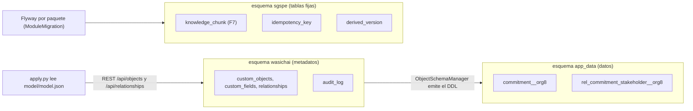

- **Metadatos (`wasichai`).** Identidad, organizaciones, metadata y auditoría: `organizations`, `users`, `roles`,
  `user_roles`, `custom_objects`, `custom_fields`, `relationships`, `permissions`, `field_permissions`, `object_actions` y
  `audit_log`, más las tablas de cada módulo instalado (vistas, formularios, páginas, workflow, automatizaciones,
  documentos) [WAS-DOC modules/core.md].
  - Cada módulo migra lo suyo con un Flyway propio registrado como `ModuleMigration`, con su historia en
    `flyway_history_<módulo>`. Corren al arrancar, antes de atender tráfico, sobre un `DataSource` JDBC de vida corta
    [WAS-ADR-0008] [WAS-ADR-0026].
- **Datos (`app_data`).** Una tabla física por organización y objeto, `app_data.<name>__<org8>` (`<org8>` son los primeros
  ocho caracteres del id de la organización), con columnas tipadas, `CHECK` de los ENUM, claves foráneas reales, columnas
  `geometry` con índice GIST y los índices de §2.7. La crea `ObjectSchemaManager`, el único componente que ejecuta DDL
  [WAS-ADR-0004] [WAS-DOC domain/metadata-model.md].
  - Cada relación MANY_TO_MANY tiene su tabla de unión `app_data.rel_<relación>__<org8>`, con `organization_id`,
    `source_id`, `target_id` y `created_at`, clave primaria (`source_id`, `target_id`), claves foráneas `ON DELETE CASCADE`
    e índice por `target_id`. No admite atributos [WAS-DOC domain/metadata-model.md].
- Los nombres de los dos esquemas son configurables (`wasichai.database.metadata-schema` y `wasichai.database.data-schema`);
  SGSPE usa los valores por defecto [WAS-ADR-0026].
- La metadata es por organización: cada tenant tiene su copia del modelo y sus tablas, que nacen cuando se le aplica
  `model.json` (RQ-SEC-002) [WAS-ADR-0004]. El procedimiento está en §24.

### 2.3 El esquema `sgspe` de las tablas fijas

- `idempotency_key` y `derived_version` (transversales, desde F3) y `knowledge_chunk` (BC-18, F7) no son Custom Objects:
  son tablas fijas del esquema `sgspe` (ASM-065, ASM-091, RQ-AI-008, CON-052). Los avisos no tienen tablas propias desde
  la decisión D2: los guarda el módulo wasichai-notifications en su esquema (ASM-012, ADR-0018).
- Cada paquete dueño registra su propia `ModuleMigration`, como un módulo más [WAS-ADR-0026]:
  - `sgspe_common`, en `classpath:db/sgspe/common`, con orden 200, en F3, para `idempotency_key` (`V1`) y
    `derived_version` (`V2`, ADR-0027);
  - `sgspe_ai`, en `classpath:db/sgspe/ai`, en F7 con el RAG documental (RF-AIK-006, RQ-AI-008).
- Las dos usan un orden mayor que el de los módulos de wasichai (100), guardan su historia en `flyway_history_<nombre>` del
  esquema de metadatos y su primera migración crea el esquema `sgspe` si no existe. Un cambio es una migración nueva: una
  migración aplicada nunca se edita, porque Flyway verifica su checksum [WAS-ADR-0026].
- Un bean que lea estas tablas al arrancar declara `@DependsOn("wasichaiMigrations")` para no adelantarse a su migración
  [WAS-ADR-0026].
- Solo su paquete las lee y las escribe (`sgspe.common` y `sgspe.ai`), con `DatabaseClient` y SQL
  propio; toda consulta filtra por `organization_id` (RQ-SEC-002).
- No hay claves foráneas entre esquemas: ni hacia `app_data`, porque cada organización tiene su propia tabla física, ni
  hacia las organizaciones de `wasichai`. `project_id` y `evidence_id` de `knowledge_chunk` son referencias lógicas que valida
  el paquete.
- Por eso borrar una organización en wasichai no borra sus filas de `sgspe.*`: la baja de un tenant incluye un paso que las
  borra por `organization_id` (§24, GAP-026).

### 2.4 Columnas de sistema

Toda tabla de un objeto en `app_data` lleva estas columnas, que las fichas no repiten; las tablas de unión tienen las suyas
(§2.2) [WAS-DOC api/rest.md]:

| Columna | Tipo PostgreSQL | Existe | Qué guarda |
|---|---|---|---|
| `id` | uuid, clave primaria, `gen_random_uuid()` | Siempre | Identificador del registro |
| `organization_id` | uuid NOT NULL, índice `<tabla>_org_idx` | Siempre | Tenant; sale del token, nunca del cuerpo (RQ-SEC-002) |
| `created_at` | timestamptz NOT NULL, `now()` | Siempre | Momento del alta |
| `updated_at` | timestamptz NOT NULL, `now()` | Siempre | Momento del último cambio; precondición de escritura del portal (RNF-INT-003, ASM-035) |
| `created_by` | uuid | Siempre | Usuario que creó el registro; con él `EditAnyGuard` limita la edición a lo propio de quien no tiene `EDIT_ANY` (RQ-SEC-008, ASM-069) |
| `updated_by` | uuid | Siempre | Usuario del último cambio |
| `workflow_state` | text, índice `<tabla>_state_idx` | Al adjuntar un workflow | Estado del registro; solo cambia por transiciones [WAS-ADR-0013] |

- `workflow_state` no es un Custom Field: ningún cuerpo de escritura lo fija, se puede filtrar y ordenar como una columna
  más, y queda aunque se borre el workflow [WAS-ADR-0013].
- `version`, `count` y `after` están reservados y no tienen columna. `version` espera un bloqueo optimista que wasichai no
  tiene (UPS-04, CON-047); `count` y `after` son parámetros de consulta de las listas, así que un campo con esos nombres no se
  podría filtrar [WAS-ADR-0036] [WAS-DOC api/rest.md].

### 2.5 De campo a columna

| Tipo de campo | Columna | Lo hace cumplir | Uso en SGSPE |
|---|---|---|---|
| TEXT, LONG_TEXT, EMAIL, URL | `text` | Formato en el codec; NOT NULL si es requerido | Códigos, nombres, textos en Markdown (LONG_TEXT), correos de usuarios, enlaces de medios |
| INTEGER | `bigint` | Codec | Conteos `_count`, días de los parámetros, indicadores de 1 a 5 |
| DECIMAL | `numeric` | Codec | Montos, índices, áreas en ha, coordenadas de origen |
| BOOLEAN | `boolean` | Codec | Afirmaciones y políticas `policy_` |
| DATE, DATETIME | `date`, `timestamptz` | Codec (ISO 8601) | Campos `_date` y `_at` |
| ENUM | `text` | `CHECK (columna IN (…))` y codec | Catálogos de §4 |
| UUID | `uuid` | Codec | `*_user_id`, `import_batch_id`, `target_record_id` |
| RELATION | `uuid` | `REFERENCES <destino> (id) ON DELETE SET NULL`, con índice propio | Campos de las relaciones MANY_TO_ONE |
| GEOMETRY | `geometry(<tipo>, 4326)` | wasichai-gis y PostGIS, índice GIST | `location`, `boundary`, `trace`, `footprint`, `route`, `territory`, `interest_area` |

- `required` se vuelve NOT NULL y `unique`, una restricción UNIQUE con su índice. La validación vive en la base además de en
  la aplicación, así que un dato inválido no entra por otro camino [WAS-DOC domain/metadata-model.md].
- No existen CURRENCY, FORMULA, ROLLUP ni JSON: los montos son DECIMAL más `currency` y los cálculos son campos
  derivados (§3.6) [WAS-DOC domain/metadata-model.md]. `FILE` e `IMAGE` llegan con wasichai-files en F3 (UPS-07
  resuelta, WAS-ADR-0061): el único campo `FILE` del modelo es `evidence.file` (ASM-013, ADR-0014).
- El nombre y el tipo de un campo, y el nombre de un objeto, no cambian: wasichai los rechaza con 400. Cambiar un tipo es un
  campo nuevo más una migración de datos (§24) [WAS-ADR-0017].

### 2.6 Relaciones y claves foráneas

- **MANY_TO_ONE.** Crea en el origen un campo RELATION con clave foránea real `ON DELETE SET NULL` y un índice propio, porque
  PostgreSQL no indexa una clave foránea [WAS-ADR-0036]. ONE_TO_ONE y ONE_TO_MANY no se usan en este modelo.
- **MANY_TO_MANY.** Crea la tabla de unión de §2.2. Cuando la relación necesita atributos es un objeto propio:
  `project_party`, `area_of_influence_member`, `engagement_participant`, `network_node` y `agreement_party`.
- **Lectura y escritura.** Un valor RELATION debe apuntar a un registro que quien escribe puede leer; si no, la escritura
  responde 400 [WAS-DOC api/rest.md].
- **Exactamente uno de.** Persona u organización; localidad, comunidad o unidad administrativa: varias relaciones opcionales
  más `ExactlyOneGuard` (§4.4 del modelo de dominio). Las fichas lo indican.
- **Requeridas.** Una relación requerida es NOT NULL; como su clave foránea es `ON DELETE SET NULL`, la base rechaza borrar
  el destino mientras haya registros que lo apunten. El fin de vida de un registro es un estado de cierre de su workflow, no
  un borrado (§2.9).
- **Apuntadas por un objeto `appendOnly`.** No se pueden borrar `stakeholder`, `position`, `commitment`, `social_risk`,
  `program_indicator`, `indicator`, `deliverable`, `deliverable_version` ni `project` mientras una evaluación, una
  reprogramación, una revisión, una medición, una versión, un registro de exportación o una interacción con IA los
  apunte: responde 409 para todos, también para `ADMIN` [WAS-ADR-0040] [WAS-ADR-0044]. Ese `409` lo da wasichai antes
  que las guardas y no lleva código ni `errors[]`: solo un `detail` que nombra el objeto y el campo (`api.md` §3.3).
  Como el registro `appendOnly` no se puede cambiar, lo que apunta no se borra nunca: un cargo citado por una evaluación
  se da por terminado con `end_date` y su `position_status`.
- **Apuntadas por una relación opcional de un objeto `requiresReason`.** Desde F3, `DependentsDeleteGuard` también
  rechaza con `409` `HAS_DEPENDENTS` el borrado de lo que apuntan `commitment` (`exploration_campaign`, `locality`,
  `community`, `topic`, `origin_engagement`, `agreement` y `agreement_clause`) y `agreement` (`community` y
  `assembly_engagement`): la base no lo impediría, pero `ON DELETE SET NULL` vaciaría el vínculo de ese registro sin
  motivo ni fila de auditoría. Con los roles de F3, solo una `agreement_clause` citada queda así bloqueada para quien
  no es `ADMIN`: se borra después de vaciar `agreement_clause` en el compromiso, con un cambio con motivo. El campo
  del `409` es `<objeto>.<campo>` del primer dependiente.
- **Autorreferencias y ciclos.** Son intencionales: `parent_unit`, `parent_locality`, `affiliated_to`, `split_from`,
  `previous_version`, `baseline_assessment`, `duplicate_of`, `replaces`, `derived_from` y `parent_topic` apuntan a su propio
  objeto, y hay ciclos entre `deliverable` y `deliverable_version` y entre las tres QCS. wasichai los admite, y `apply.py`
  crea todas las relaciones después de todos los objetos (§24). En una autorreferencia, el listado de relacionados devuelve
  el registro apuntado; los registros que lo apuntan se leen filtrando por el campo, por ejemplo `?parent_locality=<id>`,
  mientras wasichai no lea las autorrelaciones desde el lado destino (UPS-16) [WAS-DOC api/rest.md].

### 2.7 Únicos compuestos e índices declarados

- **Únicos.** `unique: true` hace única una columna. `uniqueConstraints` declara unicidad sobre dos a 32 campos, como
  `UNIQUE (a, b, …)` en la tabla de la organización, con nombre `<tabla>_uq_<hash>`. Repetir un valor responde 409 con un
  `errors[]` que nombra los campos, nunca los valores [WAS-ADR-0037].
  - Los NULL son distintos: un registro con un miembro vacío nunca choca. Por eso los campos de una clave que siempre existe
    son requeridos, y donde un miembro opcional importa una guarda completa la regla (`prioritization_rule`,
    `indicator_measurement`).
  - Un campo o una relación que nombra un único compuesto no se puede borrar mientras lo nombre [WAS-ADR-0037].
- **Índices automáticos.** wasichai indexa `organization_id`, `workflow_state`, cada columna RELATION, cada restricción
  única, cada geometría (GIST) y el `target_id` de cada tabla de unión [WAS-ADR-0036] [WAS-DOC gis/geometry.md]. Los índices
  espaciales que pide el prompt son esos GIST (RQ-GIS-016) [PRM-01 §6].
- **Índices declarados.** `indexed: true` da un índice a un campo e `indexes` declara índices compuestos, con nombre
  `<tabla>_ix_<hash>` [WAS-ADR-0036]. Solo nombran campos del modelo: no `workflow_state`, `created_at` ni `updated_at`, ni
  campos LONG_TEXT o GEOMETRY.
- **Política de SGSPE.** Se declara un conjunto inicial mínimo: las fechas que usan los trabajos programados y los filtros por
  periodo, los usuarios de las bandejas "mis tareas" y "mis compromisos", los `import_batch_id` y (`project`, situación
  derivada) para los tableros (RQ-GIS-016). Cada ficha dice qué declara y para qué. Lo demás se agrega cuando una medición lo
  justifique (GAP-027, RQ-DSH-031): declarar un índice en una tabla grande bloquea sus escrituras mientras se construye, y
  `DeclaredIndexReconciler` crea al arrancar los que falten en cada organización [WAS-ADR-0036].

### 2.8 Reglas de escritura por objeto

| Flag | Efecto en wasichai | Objetos de SGSPE |
|---|---|---|
| `appendOnly` | Nadie edita ni borra; `PUT`, `DELETE`, una transición y todo vínculo responden 409, también para `ADMIN` y la plataforma [WAS-ADR-0040] | `stakeholder_assessment`, `commitment_reschedule`, `risk_assessment`, `program_measurement`, `indicator_measurement`, `deliverable_version`, `export_log`, `ai_interaction` (RQ-AUD-003) |
| `apiOnly` | La API genérica rechaza altas, cambios, bajas y vínculos con 403; escribe solo el código propio en proceso; las transiciones no se rechazan [WAS-ADR-0040] | `project_component`, `stakeholder_assessment`, `commitment_reschedule`, `delivery`, `commitment_candidate`, `risk_assessment`, `evidence`, `indicator_measurement`, `deliverable_version`, `export_log`, `ai_suggestion`, `ai_interaction` (RQ-AUD-004) |
| `requiresReason` | Toda escritura, vínculo y transición exige `X-Change-Reason` de hasta 500 caracteres; sin él responde 400 [WAS-ADR-0041] | `stakeholder_assessment`, `commitment`, `agreement`, `grievance`, `inquiry`, `stakeholder_request`, `social_risk`, `social_contribution`, `deliverable` (ASM-058, RQ-AUD-002) |

- `appendOnly` no es un permiso de la base: lo hace cumplir el código de wasichai (UPS-12) [WAS-ADR-0040]. Un objeto con
  workflow nunca es `appendOnly` y ninguna relación MANY_TO_MANY toca uno (§4.5 del modelo de dominio).
- `evidence` necesita vínculos MANY_TO_MANY y además ser inmutable: es `apiOnly` más `EvidenceWriteGuard`, no `appendOnly`.
- Los objetos `apiOnly` con workflow (`commitment_candidate` y `ai_suggestion`) protegen sus transiciones de comando con
  `CommandTransitionGuard`, porque `apiOnly` no las rechaza [WAS-DOC modules/workflow.md].
- Los endpoints propios escriben con la marca `SgspeWrite`; `DerivedFieldsGuard` rechaza toda escritura de un campo derivado
  sin ella (§4.5 y §4.6 del modelo de dominio) [WAS-ADR-0040].

### 2.9 Tenant, alcance, concurrencia y fin de vida

- **Tenant.** Cada organización tiene sus tablas físicas y el tenant sale del token; ninguna consulta propia lo toma del
  cuerpo (RQ-SEC-002) [WAS-ADR-0004] [WAS-ADR-0010].
- **Alcance por proyecto.** Toda raíz de agregado de un proyecto lleva `project` RELATION, requerido salvo en `evidence`,
  `early_warning_rule`, `indicator_measurement`, `export_log`, `ai_suggestion` y `ai_interaction`; los hijos lo heredan de su
  raíz (§4.7 del modelo de dominio). `ProjectScopeGuard` acota la escritura con `project_assignment`; la lectura la
  acota `ProjectReadScope` (ADR-0029; RQ-SEC-006, CON-041).
- **Concurrencia.** `PUT` reemplaza el registro completo y `version` no tiene columna. El portal envía `updated_at` como
  precondición (RNF-INT-003, ASM-035, UPS-04) y `Idempotency-Key` en sus altas (RNF-INT-002).
- **Fin de vida.** No hay una columna genérica de borrado lógico [PRM-01 §20]. Un registro termina en un estado de cierre de
  su workflow (`closed`, `cancelled`, o `retired` en un grupo de interés), los catálogos y las configuraciones se desactivan
  con su campo `active` o `enabled` (`topic`, `project_assignment`, `early_warning_rule`) y un objeto entero se retira con
  `enabled: false` [WAS-ADR-0017]. Un borrado físico queda en `audit_log` con su imagen anterior (RQ-AUD-001).

### 2.10 Lo que el modelo físico no hace

- No hay vistas materializadas, tablas de resumen, triggers ni vistas propias en `app_data`: los indicadores se calculan en
  vivo con `RecordService` y la historia sale de las fechas de los eventos y de los objetos `appendOnly` (RQ-DSH-031,
  RNF-MNT-005).
- Nada escribe en `app_data` con SQL: el código propio usa `RecordService` y `RelatedRecordService` en proceso, dentro de la
  transacción del comando [WAS-ADR-0038], y como la plataforma solo en trabajos programados y en las migraciones de datos de
  §24 [WAS-ADR-0039]. Las consultas espaciales que necesitan SQL leen detrás de una compuerta de permisos (RQ-GIS-017).
- La auditoría registra un cambio de geometría sin coordenadas; la historia de las coordenadas se conserva con los campos
  `source_*` de cada importación (RQ-AUD-013, RQ-GIS-008).

## 3. Convenciones de `model.json`

### 3.1 Archivos y estructura

- `model/` contiene el modelo y sus herramientas, que como en caja y srtm usan Python con solo la biblioteca estándar
  (RNF-MNT-002) [USR-03]:
  - `model.json` (objetos, campos, ENUM, relaciones, flags, únicos e índices) y `roles.json`;
  - `workflows/<objeto>.json`, con el formato de `workflows.md`, desde F2;
  - `document-types/<objeto>.json`, los tipos de documento de wasichai-documents (RQ-REP-029), desde F3;
  - `automations/<objeto>.json`, con las automatizaciones que numera `workflows.md`, desde F3;
  - `views/`, `forms/` y `pages/`, con las vistas, los formularios y las páginas de wasichai que usa `/admin`, desde F2;
  - `apply.py`, `apply_roles.py`, `publish_layers.py` (capas y estilos SLD de GeoServer, F6), el importador del ubigeo y sus
    pruebas.
- Los nombres de las carpetas `document-types/`, `views/`, `forms/` y `pages/` son una convención de este documento; el orden
  en que se aplican está en §24.
- `model.json` tiene tres claves:
  - `enums`: mapa de clave de catálogo a lista de opciones. La clave sale de §4 y las opciones, en su orden, de §10 del
    análisis. La clave es interna de `model.json`: `apply.py` envía a wasichai la lista de opciones del campo, no la clave.
  - `objects`: cada objeto con `name`, `label`, `pluralLabel`, `description`, `fields` y, si aplican, `appendOnly`,
    `apiOnly`, `requiresReason`, `uniqueConstraints`, `indexes` y `actions`.
  - `relationships`: cada relación con `name`, `label`, `inverseLabel`, `type` (MANY_TO_ONE si se omite, o MANY_TO_MANY),
    `source`, `target` y, en las MANY_TO_ONE, `fieldName` y `required`.
- Un campo lleva `name`, `label`, `type`, `required`, `unique`, `indexed`, `description` y, según su tipo, `enum` (clave de
  catálogo), `defaultValue` o `geometryType`, `srid` y `dimension`. Los campos RELATION no se declaran en `fields`: los crea
  su relación con `fieldName`.
- Un campo derivado (§3.6) lleva además la clave `"derived": true`:
  - solo la leen las herramientas de SGSPE: `apply_roles.py`, que expande la notación `u` de la matriz de permisos en
    UPDATE más entradas de campo de solo lectura para los campos no derivados (`security.md` §6.3), y las pruebas;
  - `apply.py` nunca la envía, porque el `field_payload` de caja publica un conjunto fijo de claves;
  - un derivado nunca se marca con `editable: false` de wasichai: `PhysicalTableRecordStore` omite los campos no editables
    en toda escritura, también en las de la plataforma, y el derivado no se podría escribir (`PhysicalTableRecordStore.kt`,
    en el código de wasichai-core 0.3.2).
- Son obligatorios `label` y `pluralLabel` de cada objeto, `label` de cada campo y `label` e `inverseLabel` de cada relación:
  el `apply.py` de caja los exige. La regla con que se escriben está en §3.8.

Extracto ilustrativo de la ficha de `commitment` (no es el archivo completo):

```json
{
  "objects": [
    {
      "name": "commitment",
      "label": "Compromiso",
      "pluralLabel": "Compromisos",
      "requiresReason": true,
      "fields": [
        { "name": "code", "label": "Código", "type": "TEXT", "required": true },
        { "name": "amount", "label": "Monto", "type": "DECIMAL", "required": true },
        { "name": "currency", "label": "Moneda", "type": "ENUM", "enum": "currency", "required": true, "defaultValue": "PEN" },
        { "name": "due_date", "label": "Fecha de vencimiento", "type": "DATE", "indexed": true },
        { "name": "deadline_status", "label": "Situación de plazo", "type": "ENUM", "enum": "deadline_status", "derived": true },
        { "name": "location", "label": "Ubicación", "type": "GEOMETRY", "geometryType": "POINT", "srid": 4326, "dimension": 2 }
      ],
      "uniqueConstraints": [["project", "code"]],
      "indexes": [["project", "deadline_status"]]
    }
  ],
  "relationships": [
    {
      "name": "commitment_project", "label": "Proyecto", "inverseLabel": "Compromisos",
      "source": "commitment", "target": "project", "fieldName": "project", "required": true
    },
    {
      "name": "commitment_stakeholder", "type": "MANY_TO_MANY", "label": "Solicitantes", "inverseLabel": "Compromisos",
      "source": "commitment", "target": "stakeholder"
    }
  ]
}
```

### 3.2 Nombres y límites

- Objetos, campos, relaciones, estados y transiciones en inglés `snake_case`; etiquetas en español (RNF-MNT-004) [USR-09]. La
  única excepción de origen español es `ubigeo_code` (§4.1 del modelo de dominio).
- Límites de los validadores de wasichai 0.3.2 (§4.1 del modelo de dominio): objeto `^[a-z][a-z0-9_]{0,38}$`, hasta 39
  caracteres, para que `<name>__<org8>` sea un identificador válido [WAS-DOC domain/metadata-model.md]; campo
  `^[a-z][a-z0-9_]{0,48}$`, hasta 49, y relación hasta 35, según `SqlIdentifier` y `RelationshipService` en el código de
  wasichai 0.3.2.
- Nombres reservados (§4.1 del modelo de dominio). wasichai rechaza como nombre de campo las columnas de sistema (`id`,
  `organization_id`, `created_at`, `updated_at`, `created_by`, `updated_by`, `workflow_state`), los reservados `version`,
  `count` y `after` y las palabras clave de SQL (`order`, `user`, `group`, `key`, `end`, `from`, `to`, `index`, `table`,
  `values`, `limit`…) [WAS-DOC api/rest.md]. `apply.py` rechaza además los parámetros de consulta `page`, `size`, `sort`,
  `dir`, `q`, `bbox` y `geometry`, porque un campo con ese nombre no se podría filtrar. Por eso existen `sort_order`,
  `version_number`, `end_date` y geometrías con nombre propio.
- Nombres físicos que deriva wasichai: tabla `<name>__<org8>`, tabla de unión `rel_<relación>__<org8>`, índice declarado
  `<tabla>_ix_<hash>`, único compuesto `<tabla>_uq_<hash>` e índice espacial `<tabla>_<columna>_gix`, recortado con un hash si
  pasa de 63 caracteres [WAS-DOC modules/core.md] [WAS-DOC gis/geometry.md]. Nada en SGSPE depende de estos nombres.

### 3.3 Nombres de relación

- Una relación MANY_TO_ONE se llama `<origen>_<campo>` y su campo RELATION, por el papel del destino (`project`,
  `origin_engagement`, `payer_organization`) (§4.1 del modelo de dominio).
- Cuando alguna relación MANY_TO_ONE de un objeto pasa de 35 caracteres, todas las de ese objeto usan el alias del origen; si
  aun así una pasa, se acorta la parte del campo. El campo RELATION nunca cambia de nombre:

| Objeto de origen | Alias en el nombre de la relación |
|---|---|
| `area_of_influence_member` | `aoi_member` |
| `stakeholder_assessment` | `stk_assessment` |
| `commitment_candidate` | `candidate` |
| `stakeholder_request` | `request` |
| `social_contribution` | `contribution` |
| `contribution_item` | `contrib_item` |
| `social_initiative` | `initiative` |
| `community_network` | `network` |
| `actor_relationship` | `actor_rel` |
| `program_measurement` | `prog_measurement` |
| `mining_concession` | `concession` |
| `environmental_feature` | `env_feature` |
| `project_component` | `component` |
| `local_conflict` | `conflict` |
| `deliverable`, campo `prepared_for_organization` | `prepared_for` (solo la parte del campo) |
| `deliverable`, campo `prepared_by_organization` | `prepared_by` (solo la parte del campo) |

- Las relaciones MANY_TO_MANY tienen el nombre que fija §4.4 del modelo de dominio: las del catálogo canónico,
  `social_risk_stakeholder`, `incident_stakeholder` y una `evidence_<objeto>` por destino.

### 3.4 Patrones de campo

Aplican §4.1 del modelo de dominio:

- `code` TEXT es el código del negocio, único en su ámbito, y `name` o `title` TEXT, el nombre que identifica al registro.
- Las fechas son DATE con sufijo `_date`; los momentos, DATETIME con sufijo `_at`, guardados en UTC y mostrados en
  America/Lima (RNF-I18N-002).
- Las cantidades son INTEGER con sufijo `_count`; los índices y los puntajes tienen nombre propio (`interest_index`,
  `score`).
- Los montos son DECIMAL más `currency` ENUM (PEN por defecto, RNF-I18N-002). DECIMAL es un `numeric` sin escala ni
  mínimo, así que `AmountFieldsGuard` acota los montos que alguien escribe en toda alta y en todo cambio de su valor: de
  0 a 15 dígitos enteros y 4 decimales tras quitar los ceros finales (ASM-092); los derivados los escribe
  solo la plataforma.
- Una persona usuaria del sistema es un par `<rol>_user_id` UUID y `<rol>_user_email` EMAIL, que valida `UserReferenceGuard`,
  porque wasichai no tiene relaciones con usuarios (ASM-023).
- Un BOOLEAN se lee como afirmación: un adjetivo o participio, `has_` más un sustantivo o un verbo en tercera persona; las
  políticas llevan el prefijo `policy_`; nunca `is_`.
- Los textos estructurados (minutas, secciones de entregable) son LONG_TEXT en Markdown, sin HTML.

### 3.5 Opciones de ENUM

- Los valores son datos visibles: van en español, en MAYÚSCULAS y sin tildes, comas, barras ni paréntesis (ASM-025). La
  alternativa en inglés con etiquetas en la interfaz es una decisión pendiente (CON-050).
- El validador de opciones de wasichai 0.3.2 (`MetadataService`, en su código) acepta `^[\p{L}0-9 _.-]{1,64}$`: letras,
  dígitos, espacio, `_`, `.` y `-`, hasta 64 caracteres. Cambiar la lista de opciones reemplaza el `CHECK` de la columna en
  la misma transacción [WAS-DOC api/rest.md].
- Un mismo catálogo se reutiliza en todos los campos que lo nombran, con la misma clave de `enums` (RF-CAT-001).
- Los catálogos jerárquicos, largos o editables son objetos y no ENUM: `topic`, `administrative_unit` e `indicator`.

### 3.6 Requeridos, valores por defecto y derivados

- **Requerido** (`required`, NOT NULL) se reserva para estas categorías, que cubren todos los requeridos de las fichas:
  - lo que el modelo de dominio marca como requerido y lo que exige un requisito del análisis, como la fecha, la fuente y la
    confiabilidad de cada perfil de localidad (RF-LBS-002);
  - la relación `project` de las raíces de proyecto (§2.9);
  - los campos de una clave única que siempre existen (`code`, los miembros fijos de un `uniqueConstraints`);
  - el nombre o título que identifica al registro y, en un registro sin nombre propio, el padre, el usuario o el contenido que
    lo identifica: `strategic_alliance.organization` (RF-ENG-010), `land_right.land_parcel`, el par `member_user_*` de
    `project_assignment`, `contact_value`, `question_text`, `observation`, `message`, `question`, `statement`, `clause_text`,
    `headline`, `prioritization_rule.information_priority` y la `description` de las QCS, del incidente, de la señal y de las
    acciones, medidas, impactos, hitos e ítems;
  - el tipo que clasifica al registro o decide qué guarda o regla aplica: `engagement_type`, `agreement_type`,
    `evidence_type`, `level`, `locality_type`, `position_status`, `role_name`, `commitment_dependency.blocking`, entre otros;
  - el monto y la moneda de lo que existe para registrar dinero: `commitment.amount` y `currency`, `receipt.amount` y
    `currency`, `program_budget.allocated_amount` y `currency`, `social_contribution.currency`, `contribution_item.line_amount`;
  - la fecha o el número que ancla un plazo o un orden: `received_at` de las QCS y de la señal, `occurred_at`,
    `published_date`, `commitment_milestone.due_date`, `deliverable_section.sort_order` (`early_warning.detected_at` no: lo
    escribe solo la plataforma, y en el alta manual SGSPE le pone la hora del alta);
  - los interruptores y los conteos con valor por defecto: `project_assignment.active`, `early_warning_rule.enabled`,
    `topic.active` y `engagement_participant.represented_people_count`;
  - en un objeto `appendOnly`, lo que el registro necesita para estar completo, porque no se puede completar después; y en un
    objeto `apiOnly`, lo que siempre escribe el código propio.
- Un requerido con valor por defecto, como esos interruptores o las monedas en PEN, no se completa solo: como wasichai no
  aplica `defaultValue` (UPS-15), el portal, los scripts de carga y los endpoints propios envían el valor en cada alta.
- Todo lo demás es opcional: la captura en campo es progresiva y los mínimos para avanzar de estado los exige una guarda, no
  un NOT NULL (§7.2 del modelo de dominio). Volver requerido un campo después exige completar antes los datos, porque
  `apply.py` no lo hace (§24); relajarlo es inmediato.
- **Valor por defecto.** `defaultValue` vive en la metadata. En wasichai 0.3.2 no se traduce a un `DEFAULT` de la columna, ni
  `RecordService` ni la interfaz lo aplican, y una escritura que omite el campo lo deja vacío (UPS-15). Por eso el portal
  propone el valor al crear y el código que lee un parámetro vacío de `project` usa el mismo valor por defecto (ASM-019). Las
  fichas lo indican con "Por defecto".
- **Derivado.** Lo escribe solo el código propio, con la marca `SgspeWrite`; nunca es requerido. Su regla y su escritor están
  en §7.4 del modelo de dominio. Las fichas lo marcan "(derivado)" y `model.json`, con `"derived": true` (§3.1).
- **Restringido.** Dato personal o sensible protegido por permiso de campo (RQ-SEC-010, GAP-024); los permisos están en
  `security.md`. Las fichas lo marcan "(restringido)".

### 3.7 Geometrías

- Toda geometría es un campo GEOMETRY en SRID 4326 y dos dimensiones; la cota, el azimut y la inclinación son atributos
  (RQ-GIS-006, ASM-002). El código lee el SRID de la metadata y nunca lo supone (RQ-GIS-022).
- Cada proyecto tiene un CRS de trabajo UTM (`working_crs`) para áreas, distancias y coordenadas este y norte (RQ-GIS-004);
  PSAD56 solo se acepta como CRS de origen al importar y nunca se guarda (RQ-GIS-007).
- En SGSPE una geometría nunca es requerida (RQ-GIS-006, ASM-002); wasichai además rechaza `unique` y `defaultValue` en una
  geometría [WAS-DOC api/rest.md]. La API habla GeoJSON EPSG:4326 (RNF-INT-005) y cada columna tiene su índice GIST
  [WAS-DOC gis/geometry.md].
- Los nombres siguen el papel: `location` (POINT), `boundary` (POLYGON o MULTIPOLYGON), `trace` y `route` (LINESTRING),
  `footprint` (POLYGON), `territory` (MULTIPOLYGON de la comunidad) e `interest_area` (MULTIPOLYGON del proyecto).
- `MULTI*` se acepta por API e importación aunque la interfaz de wasichai no la dibuje (RQ-GIS-020, CON-060). Las guardas no
  reciben geometrías, así que sus reglas viven en endpoints de `sgspe.territory` (RQ-GIS-011) [WAS-ADR-0019]
  [WAS-ADR-0040].

### 3.8 Etiquetas y acciones declaradas

- `label`, `pluralLabel`, `inverseLabel` y las etiquetas de estado van en español; la metadata de wasichai tiene un solo
  idioma (RNF-I18N-001, CON-051).
- Las etiquetas de `model.json` se escriben en F2 con una regla, sin inventarlas una por una:
  - `label` de un objeto: la frase nominal en español del nombre de su ficha (el texto en negrita), por ejemplo
    "Compromiso";
  - `label` de un campo: la frase nominal de la primera cláusula de su descripción, sin las marcas "(derivado)" y
    "(restringido)": "Fecha de vencimiento" para `due_date` y "Situación de plazo" para `deadline_status`;
  - `label` de una relación: la frase nominal de su nota, sin la marca "desde Fn"; si la nota no es una frase nominal, o la
    relación no tiene nota, el `label` del destino, como "Proyecto" en `commitment_project`;
  - toda etiqueta se puede acortar mientras conserve el sentido: "Monto" por "Monto comprometido", "Moneda" por "Moneda del
    monto" o "Solicitantes" por "Grupos de interés solicitantes";
  - `pluralLabel`: el plural en español del `label`;
  - `inverseLabel`: el `pluralLabel` del objeto de origen, como "Compromisos" en `commitment_project`.
- El extracto de §3.1 sigue esta regla.
- Las acciones declaradas se declaran en `actions` del objeto y se conceden en `roles.json`. El catálogo definitivo es el de
  RQ-SEC-004: `APPROVE`, `VERIFY`, `ISSUE`, `EXPORT`, `GENERATE`, `CONFIRM_ALERT`, `APPROVE_OVER_CAP`, `DOWNLOAD_RESTRICTED`
  y `EDIT_ANY` [WAS-ADR-0042].
- La fuente de qué objeto declara cuál es la tabla por objeto de `security.md` §5.3; §8.1.1 del modelo de dominio la replica
  y cada ficha la copia en su línea "Acciones declaradas". Qué rol recibe cada acción está solo en `security.md`. En F6,
  cada objeto con exportación GIS declara además `EXPORT` (RQ-GIS-018).
- `EDIT_ANY` no concede una transición, que la dan los roles del workflow. `EditAnyGuard` rechaza a quien no la tiene sobre
  el objeto cambiar, transicionar, vincular o borrar registros ajenos, los que creó otra persona (`created_by`), y decide con
  el permiso, nunca con el nombre del rol (RQ-SEC-005, ASM-069; `security.md` §5.5).

## 4. Catálogos ENUM

Cada catálogo de §10 del análisis tiene una clave de `enums` en inglés `snake_case`, la misma en todos los campos que lo usan.
Los valores, en español MAYÚSCULAS, están solo en [§10 del análisis](requirements-analysis.md#10-catálogos) y aquí no se
repiten. Los catálogos con sub-listas (tipo, naturaleza y signo del impacto; sujeto y polaridad de la percepción) son una clave
por sub-lista, porque un campo ENUM tiene una sola lista de opciones. La columna "Campos que lo usan" sale de las fichas, es
decir, de §6 del modelo de dominio.

| Catálogo de §10 | Clave en `enums` | Campos que lo usan |
|---|---|---|
| Postura (`stance`) | `stance` | `stakeholder.stance`, `stakeholder_assessment.stance`, `prioritization_rule.stance` |
| Grupo de influencia (`influence_group`) | `influence_group` | `stakeholder.influence_group`, `stakeholder_assessment.influence_group`, `prioritization_rule.influence_group` |
| Prioridad informativa | `information_priority` | `stakeholder.information_priority`, `prioritization_rule.information_priority` |
| Ámbito del grupo de interés | `stakeholder_scope` | `stakeholder.stakeholder_scope`, `prioritization_rule.stakeholder_scope`, `engagement_participant.participant_scope`, `study_instrument.application_scope`, `perception.perception_scope` |
| Estado de entrevista | `interview_status` | `stakeholder.interview_status` |
| Base de la evaluación | `assessment_basis` | `stakeholder_assessment.basis` |
| Estado de la relación (`relationship_status`) | `relationship_status` | `stakeholder.relationship_status` |
| Tipo de grupo de interés | `stakeholder_type` | `stakeholder.stakeholder_type`, `prioritization_rule.stakeholder_type` |
| Tipo de organización | `organization_type` | `organization.organization_type` |
| Afiliación | `affiliation` | `organization.affiliation` |
| Nivel territorial de la organización | `territorial_level` | `organization.territorial_level` |
| Estado del cargo | `position_status` | `position.position_status` |
| Tipo de medio de contacto | `contact_channel` | `contact_method.channel` |
| Nivel de unidad administrativa | `administrative_level` | `administrative_unit.level` |
| Tipo de localidad | `locality_type` | `locality.locality_type` |
| Estado de reconocimiento | `recognition_status` | `locality.recognition_status` |
| Tipo de comunidad | `community_type` | `community.community_type` |
| Estado orgánico | `organic_status` | `community.organic_status` |
| Tipo de área de influencia | `area_of_influence_type` | `area_of_influence.area_type` |
| Condición de miembro | `member_condition` | `area_of_influence_member.member_condition` |
| Tipo de componente | `component_type` | `project_component.component_type` |
| Estado del componente | `component_status` | `project_component.component_status` |
| Tenencia del predio | `tenure_type` | `land_parcel.tenure_type`, `land_right.tenure_type` |
| Tipo de elemento ambiental | `environmental_feature_type` | `environmental_feature.feature_type` |
| Tipo de conflicto local | `local_conflict_type` | `local_conflict.conflict_type` |
| Estado del conflicto local | `local_conflict_status` | `local_conflict.conflict_status` |
| Tipo de proyecto | `project_type` | `project.project_type` |
| Etapa del proyecto | `project_stage` | `project.stage` |
| Fase de exploración | `exploration_phase` | `project.exploration_phase`, `exploration_campaign.exploration_phase` |
| Tipo de actividad de campaña | `campaign_activity_type` | `exploration_campaign.activity_type`, `potential_impact.activity_type` |
| Estado de la campaña | `campaign_status` | `exploration_campaign.campaign_status` |
| Rol de la parte | `party_role` | `project_party.party_role` |
| CRS de trabajo (`working_crs`) | `working_crs` | `project.working_crs` |
| CRS de origen | `source_crs` | `mining_concession.source_crs`, `project_component.source_crs`, `land_parcel.source_crs` |
| Tipo de interacción | `engagement_type` | `engagement.engagement_type` |
| Tipo de recurso | `resource_type` | `commitment.resource_type` |
| Medio de solicitud | `request_medium` | `commitment.request_medium`, `stakeholder_request.request_medium` |
| Formalidad del compromiso | `commitment_formality` | `commitment.formality` |
| Tema del compromiso | `commitment_theme` | `commitment.commitment_theme` |
| Situación de plazo (`deadline_status`) | `deadline_status` | `commitment.deadline_status`, `grievance.deadline_status`, `inquiry.deadline_status`, `stakeholder_request.deadline_status`, `task.deadline_status` |
| Situación de vigencia (`validity_status`) | `validity_status` | `agreement.validity_status` |
| Situación de revisión (`review_status`) | `review_status` | `social_risk.review_status` |
| Prioridad | `priority` | `commitment.priority`, `grievance.priority`, `inquiry.priority`, `stakeholder_request.priority`, `task.priority` |
| Canal de QCS | `qcs_channel` | `grievance.channel`, `inquiry.channel`, `stakeholder_request.channel` |
| Categoría de QCS | `qcs_category` | `grievance.category`, `inquiry.category`, `stakeholder_request.category` |
| Severidad de queja | `grievance_severity` | `grievance.severity` |
| Tipo de acuerdo | `agreement_type` | `agreement.agreement_type` |
| Categoría de riesgo | `risk_category` | `social_risk.category` |
| Nivel de riesgo | `risk_level` | `social_risk.risk_level`, `social_risk.residual_level`, `risk_assessment.risk_level` |
| Tendencia del riesgo | `risk_trend` | `risk_assessment.trend` |
| Decisión de tratamiento | `treatment_decision` | `social_risk.treatment_decision` |
| Tipo y naturaleza del impacto (sub-lista de tipo) | `impact_type` | `social_risk.impact_type`, `potential_impact.impact_type` |
| Tipo y naturaleza del impacto (sub-lista de naturaleza) | `impact_nature` | `social_risk.impact_nature`, `potential_impact.impact_nature` |
| Tipo y naturaleza del impacto (sub-lista de signo) | `impact_sign` | `potential_impact.impact_sign` |
| Tipo de incidente | `incident_type` | `incident.incident_type` |
| Tono de la mención | `mention_tone` | `media_mention.tone` |
| Fuente de la señal | `signal_source` | `early_warning_signal.source_type` |
| Tipo de regla de alerta | `warning_rule_kind` | `early_warning_rule.rule_kind` |
| Severidad de alerta | `warning_severity` | `early_warning_rule.severity`, `early_warning.severity` |
| Tipo de aporte | `contribution_type` | `social_contribution.contribution_type` |
| Tipo de ítem del aporte | `item_kind` | `contribution_item.item_kind` |
| Tipo de comprobante | `receipt_type` | `receipt.receipt_type` |
| Tipo de evidencia | `evidence_type` | `evidence.evidence_type` |
| Clasificación de evidencia | `evidence_classification` | `evidence.classification` |
| Tipo de documento administrativo | no aplica | No es un ENUM de `model.json`: son los tipos de documento de wasichai-documents (RQ-REP-029), versionados en `model/document-types/<objeto>.json` y aplicados por `apply.py --workflows` con `/api/objects/{object}/document-types` (§24) |
| Nivel de divulgación | `disclosure_level` | `deliverable_version.disclosure_level`, `export_log.disclosure_level` |
| Tipo de entregable | `deliverable_type` | `deliverable.deliverable_type` |
| Tipo de sección de entregable | `deliverable_section_kind` | `deliverable_section.section_kind` |
| Origen del contenido | `content_origin` | `deliverable_section.content_origin` |
| Estado de generación del borrador | `draft_generation_status` | `deliverable.draft_generation_status` |
| Tipo de sugerencia de IA | `ai_suggestion_kind` | `ai_suggestion.suggestion_kind` |
| Percepción (sub-lista de sujeto) | `perception_subject` | `perception.subject` |
| Percepción (sub-lista de polaridad) | `perception_polarity` | `perception.polarity` |
| Confiabilidad del dato | `data_reliability` | `locality_profile.reliability` |
| Tipo de instrumento | `instrument_type` | `study_instrument.instrument_type` |
| Rol del nodo | `node_role` | `network_node.node_role` |
| Estado de contacto de la red | `network_contact_status` | `community_network.contact_status` |
| Tipo de relación entre actores | `actor_relationship_type` | `actor_relationship.relationship_type` |
| Sexo | `sex` | `person.sex`, `engagement_participant.sex` |
| Moneda | `currency` | `exploration_campaign.currency`, `commitment.currency`, `agreement.currency`, `social_contribution.currency`, `receipt.currency`, `social_program.currency`, `program_budget.currency` |

## 5. Cómo leer las fichas

- Cada objeto del catálogo canónico (§6 del modelo de dominio) y cada tabla fija tiene una ficha titulada con su nombre
  técnico, ordenada por bounded context. BC-11, BC-16, BC-17 y BC-20 no tienen objetos propios (§23).
- **Campos:** nombre, tipo de wasichai (con la clave de `enums` o el `geometryType`), requerido (§3.6), único ("sí" =
  `unique`; "compuesto" = forma parte de un `uniqueConstraints`), descripción y fuente. No se repiten las columnas de sistema
  (§2.4). En las tablas fijas, el tipo es el de PostgreSQL.
- **Relaciones:** nombre de la relación (§3.3), tipo, campo RELATION, destino, requerido y nota. Las MANY_TO_MANY que define
  otro objeto aparecen como "Inversa". Una nota "desde Fn" indica que la relación se agrega en esa fase, cuando existen sus
  dos extremos.
- **Flags, únicos, índices declarados, acciones declaradas, workflow y fase.** Las acciones copian la tabla por objeto de
  `security.md` §5.3, que §8.1.1 del modelo de dominio replica (§3.8). El workflow nombra su letra de §11 del análisis; sus estados están
  en §7.3 del modelo de dominio y sus transiciones en `workflows.md`. La fase es la del roadmap [PRM-01 §24] [USR-05] y su
  release, la de §0.8 del análisis (ASM-044).
- Cada sección de contexto empieza con su diagrama entidad-relación: una línea continua es una relación requerida; una
  punteada, una opcional o una MANY_TO_MANY.

Índice de fichas:

| Objeto | BC | `appendOnly` | `apiOnly` | `requiresReason` | WF | Fase |
|---|---|---|---|---|---|---|
| `project` | BC-01 | no | no | no | WF-A | F2 |
| `project_party` | BC-01 | no | no | no | — | F2 |
| `exploration_campaign` | BC-01 | no | no | no | — | F2 |
| `project_assignment` | BC-01 | no | no | no | — | F2 |
| `mining_concession` | BC-01 | no | no | no | — | F2 |
| `administrative_unit` | BC-02 | no | no | no | — | F2 |
| `locality` | BC-02 | no | no | no | — | F2 |
| `community` | BC-02 | no | no | no | — | F2 |
| `community_sector` | BC-02 | no | no | no | — | F2 |
| `area_of_influence` | BC-02 | no | no | no | WF-O | F2 |
| `area_of_influence_member` | BC-02 | no | no | no | — | F2 |
| `project_component` | BC-02 | no | sí | no | — | F2 |
| `land_parcel` | BC-02 | no | no | no | — | F2 |
| `land_right` | BC-02 | no | no | no | — | F2 |
| `environmental_feature` | BC-02 | no | no | no | — | F2 |
| `person` | BC-03 | no | no | no | — | F2 |
| `organization` | BC-03 | no | no | no | — | F2 |
| `contact_method` | BC-03 | no | no | no | — | F2 |
| `position` | BC-03 | no | no | no | — | F2 |
| `stakeholder` | BC-03 | no | no | no | WF-B | F2 |
| `stakeholder_assessment` | BC-03 | sí | sí | sí | — | F2 |
| `prioritization_rule` | BC-03 | no | no | no | — | F2 |
| `actor_relationship` | BC-03 | no | no | no | — | F2 |
| `community_network` | BC-03 | no | no | no | — | F2 |
| `network_node` | BC-03 | no | no | no | — | F2 |
| `engagement` | BC-04 | no | no | no | WF-C | F2 |
| `engagement_participant` | BC-04 | no | no | no | — | F2 |
| `engagement_question` | BC-04 | no | no | no | — | F2 |
| `field_visit` | BC-04 | no | no | no | WF-L | F2 |
| `field_observation` | BC-04 | no | no | no | — | F2 |
| `engagement_plan` | BC-04 | no | no | no | — | F2 |
| `key_message` | BC-04 | no | no | no | — | F2 |
| `aligned_answer` | BC-04 | no | no | no | — | F2 |
| `strategic_alliance` | BC-04 | no | no | no | — | F2 |
| `planned_activity` | BC-04 | no | no | no | — | F2 |
| `commitment` | BC-05 | no | no | sí | WF-D | F3 |
| `commitment_action` | BC-05 | no | no | no | — | F3 |
| `commitment_milestone` | BC-05 | no | no | no | — | F3 |
| `commitment_reschedule` | BC-05 | sí | sí | no | — | F3 |
| `commitment_dependency` | BC-05 | no | no | no | — | F3 |
| `delivery` | BC-05 | no | sí | no | — | F3 |
| `commitment_candidate` | BC-05 | no | sí | no | WF-K | F3 |
| `agreement` | BC-06 | no | no | sí | WF-I | F3 |
| `agreement_party` | BC-06 | no | no | no | — | F3 |
| `agreement_clause` | BC-06 | no | no | no | — | F3 |
| `grievance` | BC-07 | no | no | sí | WF-E1 | F4 |
| `inquiry` | BC-07 | no | no | sí | WF-E2 | F4 |
| `stakeholder_request` | BC-07 | no | no | sí | WF-E3 | F4 |
| `social_risk` | BC-08 | no | no | sí | WF-F | F4 |
| `risk_assessment` | BC-08 | sí | sí | no | — | F4 |
| `mitigation_measure` | BC-08 | no | no | no | — | F4 |
| `potential_impact` | BC-08 | no | no | no | — | F4 |
| `incident` | BC-09 | no | no | no | WF-M | F4 |
| `media_mention` | BC-09 | no | no | no | — | F4 |
| `early_warning_signal` | BC-09 | no | no | no | — | F4 |
| `early_warning_rule` | BC-09 | no | no | no | — | F4 |
| `early_warning` | BC-09 | no | no | no | WF-J | F4 |
| `social_contribution` | BC-10 | no | no | sí | WF-P | F5 |
| `contribution_item` | BC-10 | no | no | no | — | F5 |
| `receipt` | BC-10 | no | no | no | — | F5 |
| `social_program` | BC-10 | no | no | no | WF-G | F5 |
| `social_initiative` | BC-10 | no | no | no | — | F5 |
| `beneficiary_group` | BC-10 | no | no | no | — | F5 |
| `program_budget` | BC-10 | no | no | no | — | F5 |
| `program_indicator` | BC-10 | no | no | no | — | F5 |
| `program_measurement` | BC-10 | sí | no | no | — | F5 |
| `program_milestone` | BC-10 | no | no | no | — | F5 |
| `evidence` | BC-12 | no | sí | no | — | F3 |
| `task` | BC-13 | no | no | no | WF-N | F3 |
| `indicator` | BC-15 | no | no | no | — | F8 |
| `indicator_measurement` | BC-15 | sí | sí | no | — | F8 |
| `deliverable` | BC-15 | no | no | sí | WF-H | F8 |
| `deliverable_section` | BC-15 | no | no | no | — | F8 |
| `deliverable_version` | BC-15 | sí | sí | no | — | F8 |
| `export_log` | BC-15 | sí | sí | no | — | F2 |
| `ai_suggestion` | BC-18 | no | sí | no | WF-K | F7 |
| `ai_interaction` | BC-18 | sí | sí | no | — | F7 |
| `knowledge_chunk` (tabla fija) | BC-18 | — | — | — | — | F7 |
| `study` | BC-19 | no | no | no | — | F2 |
| `study_instrument` | BC-19 | no | no | no | — | F2 |
| `locality_profile` | BC-19 | no | no | no | — | F2 |
| `school` | BC-19 | no | no | no | — | F2 |
| `health_facility` | BC-19 | no | no | no | — | F2 |
| `road_access` | BC-19 | no | no | no | — | F2 |
| `festivity` | BC-19 | no | no | no | — | F2 |
| `state_program` | BC-19 | no | no | no | — | F2 |
| `local_conflict` | BC-19 | no | no | no | — | F2 |
| `perception` | BC-19 | no | no | no | — | F2 |
| `key_theme` | BC-19 | no | no | no | — | F2 |
| `topic` | BC-19 | no | no | no | — | F2 |
| `idempotency_key` (tabla fija) | Transversal | — | — | — | — | F3 |
| `derived_version` (tabla fija) | Transversal | — | — | — | — | F3 |

## 6. BC-01 Proyectos

Proyecto con sus partes, campañas, equipo y concesiones (RF-PRJ-001, RF-PRJ-002, RF-PRJ-004, RF-PRJ-005, RF-PRJ-006).
Toda raíz de agregado de un proyecto apunta a `project`, y `project_assignment` es la fuente del alcance por proyecto
(RQ-SEC-006).

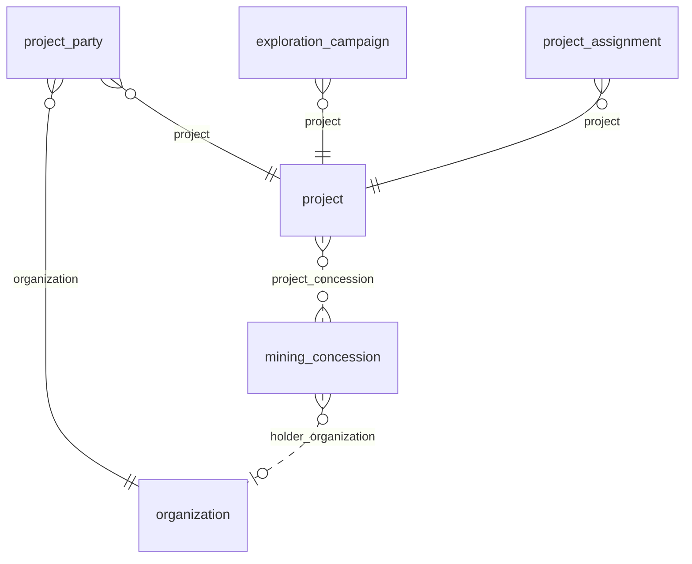

### `project`

**Proyecto** (BC-01). Proyecto extractivo (o prospecto) con su etapa, su fase de exploración, su CRS de trabajo y los
parámetros y políticas que configuran las reglas de DOC-01 (ASM-019). Tabla física `app_data.project__<org8>`.
Requisitos: RF-PRJ-001, RF-PRJ-003, RN-PRJ-001, RQ-GIS-001, RQ-GIS-004, ASM-019, ASM-062.

| Campo | Tipo | Req. | Único | Descripción | Fuente |
|---|---|---|---|---|---|
| `code` | TEXT | sí | sí | Código del proyecto. | RF-PRJ-001 |
| `name` | TEXT | sí | — | Nombre del proyecto o prospecto. | RF-PRJ-001 |
| `description` | LONG_TEXT | no | — | Descripción. | RF-PRJ-001 |
| `project_type` | ENUM `project_type` | no | — | Tipo de proyecto. | RF-PRJ-001 |
| `stage` | ENUM `project_stage` | no | — | Etapa del ciclo de vida; cambia con motivo y nunca es un estado de WF-A. | RN-PRJ-001 |
| `exploration_phase` | ENUM `exploration_phase` | no | — | Fase de exploración; cambia con motivo. | RN-PRJ-001 |
| `start_date` | DATE | no | — | Fecha de inicio. | RF-PRJ-001 |
| `end_date` | DATE | no | — | Fecha de fin. | RF-PRJ-001 |
| `working_crs` | ENUM `working_crs` | no | — | CRS UTM de trabajo para áreas, distancias, buffers y coordenadas este y norte; lo exige el paso a `active`. | RQ-GIS-004 |
| `interest_threshold` | DECIMAL | no | — | Índice desde el que el interés es "alto" (ASM-003). Por defecto: 3. | RF-STK-009 |
| `power_threshold` | DECIMAL | no | — | Índice desde el que el poder es "alto" (ASM-003). Por defecto: 3. | RF-STK-009 |
| `stakeholder_review_days` | INTEGER | no | — | Días entre evaluaciones periódicas de grupos de interés. Por defecto: 30. | RF-STK-010 |
| `inactivity_days` | INTEGER | no | — | Días sin contacto tras los que se sugiere una tarea (ASM-022). Por defecto: 90. | RF-STK-014 |
| `meetings_per_month_target` | INTEGER | no | — | Meta de reuniones al mes del proyecto. Por defecto: 2. | RN-ENG-003 |
| `policy_workshop_commitments_blocked` | BOOLEAN | no | — | Bloquear compromisos nacidos de talleres y reuniones informativas; con false advierte y pide justificación (ASM-007). Desde F3. Por defecto: false. | RN-ENG-001 |
| `policy_senior_approval_for_dialogue` | BOOLEAN | no | — | Aprobación de nivel superior para compromisos de mesas de diálogo. Desde F3. Por defecto: true. | RN-ENG-002 |
| `policy_minutes_only_formal_types` | BOOLEAN | no | — | Solo los tipos formales de interacción necesitan acta aprobada (ASM-033). Por defecto: true. | RN-ENG-004 |
| `policy_internal_approval` | BOOLEAN | no | — | Aprobación interna con segregación de funciones de compromisos, aportes y programas. Desde F3. Por defecto: true. | ASM-008 |
| `policy_activation_preconditions` | BOOLEAN | no | — | Exigir `working_crs` y una parte CLIENTE u OPERADOR para llegar a `active`. Por defecto: true. | ASM-062 |
| `policy_local_jobs_direct_area_only` | BOOLEAN | no | — | Empleo limitado al AIDS y rotativo. Desde F3. Por defecto: true. | RN-COM-002 |
| `local_jobs_min` | INTEGER | no | — | Puestos ofrecidos. Desde F3. Por defecto: 6. | RN-COM-002 |
| `local_jobs_max` | INTEGER | no | — | Máximo negociable de puestos. Desde F3. Por defecto: 10. | RN-COM-002 |
| `policy_no_jobs_in_easements` | BOOLEAN | no | — | Sin puestos de trabajo en la negociación de servidumbres. Desde F3. Por defecto: true. | RN-COM-003 |
| `due_soon_days` | INTEGER | no | — | Días antes del plazo desde los que se marca POR VENCER (compromisos, QCS y tareas). Desde F3. Por defecto: 7. | ASM-006 |
| `escalation_first_days` | INTEGER | no | — | Días de atraso del primer nivel de escalamiento, que avisa a los roles de la transición de verificación o de revisión del objeto, resueltos con las asignaciones del proyecto y sin nombres de rol fijos (ASM-030, ASM-070). Desde F3. Por defecto: 7. | RF-WFL-004 |
| `escalation_second_days` | INTEGER | no | — | Días de atraso del segundo nivel, que avisa a los roles de la aprobación de nivel superior (`approve_senior` de WF-D), resueltos igual (ASM-030, ASM-070). Desde F3. Por defecto: 15. | RF-WFL-004 |
| `grievance_ack_days` | INTEGER | no | — | Plazo de acuse de quejas, en días hábiles: de lunes a viernes, menos los feriados nacionales configurados por año en `sgspe.calendar.holidays`; el día de recepción no cuenta (`BusinessDays`, ASM-005, ASM-096). Desde F4. Por defecto: 5. | RF-GRV-006 |
| `inquiry_response_days` | INTEGER | no | — | Plazo de respuesta de consultas, en días (ASM-005). Desde F4. Por defecto: 15. | RF-GRV-006 |
| `grievance_resolution_days` | INTEGER | no | — | Plazo de resolución de quejas, en días (ASM-005). Desde F4. Por defecto: 30. | RF-GRV-006 |
| `policy_high_severity_requires_approver` | BOOLEAN | no | — | Resolver quejas ALTA o CRITICA exige `APPROVER` (ASM-036). Desde F4. Por defecto: true. | RN-GRV-002 |
| `risk_review_days` | INTEGER | no | — | Días entre revisiones de riesgos. Desde F4. Por defecto: 7. | RN-RSK-001 |
| `risk_medium_min_score` | INTEGER | no | — | Puntaje P × I desde el que el nivel es MEDIO (ASM-004). Desde F4. Por defecto: 5. | RN-RSK-002 |
| `risk_high_min_score` | INTEGER | no | — | Puntaje P × I desde el que el nivel es ALTO (ASM-004). Desde F4. Por defecto: 10. | RN-RSK-002 |
| `risk_critical_min_score` | INTEGER | no | — | Puntaje P × I desde el que el nivel es CRITICO (ASM-004). Desde F4. Por defecto: 15. | RN-RSK-002 |
| `policy_cap_blocks_approval` | BOOLEAN | no | — | El tope de apoyo social bloquea la aprobación, salvo con `APPROVE_OVER_CAP` (GAP-006); con false solo advierte. Desde F3. Por defecto: true. | RN-INV-003 |
| `policy_no_paid_labor` | BOOLEAN | no | — | No se financia mano de obra. Desde F3. Por defecto: true. | RN-INV-001 |
| `policy_non_monetary_donations` | BOOLEAN | no | — | Donaciones no monetarias. Desde F3. Por defecto: true. | RN-INV-002 |
| `policy_synergy_requires_agreement` | BOOLEAN | no | — | Sinergias formalizadas en un acuerdo antes de aprobar. Desde F3. Por defecto: true. | RN-INV-004 |
| `policy_priority_warning` | BOOLEAN | no | — | Advertir si un aporte no atiende las prioridades. Desde F3. Por defecto: true. | RN-INV-005 |
| `location` | GEOMETRY (POINT) | no | — | Ubicación de referencia del proyecto. | RQ-GIS-001 |
| `interest_area` | GEOMETRY (MULTIPOLYGON) | no | — | Área de interés del proyecto, como la del Anexo 1 de DOC-01. | RQ-GIS-001 |

| Relación | Tipo | Campo | Destino | Req. | Nota |
|---|---|---|---|---|---|
| `project_concession` | MANY_TO_MANY | — | `mining_concession` | — | Concesiones del proyecto |
| `project_priority_topic` | MANY_TO_MANY | — | `topic` | — | Temas priorizados para aportes (RN-INV-005, ASM-112); desde F5 |

- **Flags:** `appendOnly` no · `apiOnly` no · `requiresReason` no.
- **Únicos:** `unique` en `code`.
- **Índices declarados:** ninguno.
- **Acciones declaradas:** `APPROVE`, `READ_ALL_PROJECTS`.
- **Workflow:** WF-A.
- **Fase:** F2 · Release 1 (MVP).
- `FieldChangeReasonGuard` exige motivo al cambiar `stage` o `exploration_phase` (RN-PRJ-001); `ProjectWriteGuard`
  aplica la precondición de `active` mientras `policy_activation_preconditions` esté activo (ASM-062).
- Los parámetros y políticas llegan con el módulo que los usa (columna "Descripción"); `apply.py` agrega cada campo en
  su fase. Su `defaultValue` lo aplica el código de SGSPE, porque wasichai no lo aplica (§3.6, UPS-15).
- Los parámetros de F4: `ProjectWriteGuard` rechaza con `400 OUT_OF_RANGE` un plazo o una cadencia
  (`grievance_ack_days`, `inquiry_response_days`, `grievance_resolution_days`, `risk_review_days`) menor que 1 o mayor
  que 365, y umbrales de riesgo fuera de 1 a 25 o que no crezcan estrictamente (`risk_medium_min_score` <
  `risk_high_min_score` < `risk_critical_min_score`).
- Desde F5, los temas priorizados para aportes son el vínculo `project_priority_topic` (RF-INV-002, ASM-112): lo
  escriben quienes editan las políticas del proyecto (`PROJECT_ADMIN`, `PROJECT_MANAGER`), con UPDATE sobre `project` y
  `u` sobre `topic` (`security.md` §7.7); un tema cuenta si es priorizado o desciende de uno (`parent_topic`, hasta 10
  niveles). Sin temas priorizados, la prioridad de RN-INV-005 no se evalúa y se advierte. `topic` es un maestro del
  tenant: no hay regla «mismo proyecto».

### `project_party`

**Parte del proyecto** (BC-01). Organización con un rol en el proyecto: cliente, operador, titular de concesiones,
consultora o contratista. Tabla física `app_data.project_party__<org8>`. Requisitos: RF-PRJ-002, CON-022.

| Campo | Tipo | Req. | Único | Descripción | Fuente |
|---|---|---|---|---|---|
| `party_role` | ENUM `party_role` | sí | compuesto | Rol de la organización en el proyecto. | RF-PRJ-002 |
| `start_date` | DATE | no | — | Inicio del rol. | RF-PRJ-002 |
| `end_date` | DATE | no | — | Fin del rol. | RF-PRJ-002 |

| Relación | Tipo | Campo | Destino | Req. | Nota |
|---|---|---|---|---|---|
| `project_party_project` | MANY_TO_ONE | `project` | `project` | sí | — |
| `project_party_organization` | MANY_TO_ONE | `organization` | `organization` | sí | — |

- **Flags:** `appendOnly` no · `apiOnly` no · `requiresReason` no.
- **Únicos:** `uniqueConstraints` (`project`, `organization`, `party_role`).
- **Índices declarados:** ninguno.
- **Acciones declaradas:** ninguna.
- **Workflow:** ninguno.
- **Fase:** F2 · Release 1 (MVP).

### `exploration_campaign`

**Campaña de exploración** (BC-01). Periodo de actividad del proyecto (cateo o perforación) con su tope de apoyo social
y la ejecución que se le imputa. Tabla física `app_data.exploration_campaign__<org8>`. Requisitos: RF-PRJ-004,
RF-INV-004, RN-INV-003, ASM-063.

| Campo | Tipo | Req. | Único | Descripción | Fuente |
|---|---|---|---|---|---|
| `name` | TEXT | sí | — | Nombre de la campaña. | RF-PRJ-004 |
| `activity_type` | ENUM `campaign_activity_type` | no | — | Tipo de actividad. | RF-PRJ-004 |
| `exploration_phase` | ENUM `exploration_phase` | no | — | Fase de exploración de la campaña. | RF-PRJ-004 |
| `planned_start_date` | DATE | no | — | Inicio planificado. | RF-PRJ-004 |
| `planned_end_date` | DATE | no | — | Fin planificado. | RF-PRJ-004 |
| `actual_start_date` | DATE | no | — | Inicio real. | RF-PRJ-004 |
| `actual_end_date` | DATE | no | — | Fin real. | RF-PRJ-004 |
| `campaign_status` | ENUM `campaign_status` | no | — | Estado de la campaña; es un dato, no un workflow. | RF-PRJ-004 |
| `social_support_cap` | DECIMAL | no | — | Tope de apoyo social definido por adelantado. | RN-INV-003 |
| `currency` | ENUM `currency` | no | — | Moneda del tope. Por defecto: PEN. | RNF-I18N-002 |
| `executed_social_amount` | DECIMAL | no | — | (derivado) Ejecutado de la campaña (compromisos y aportes) en su moneda, según ASM-063. | RF-INV-004 |
| `other_currency_items_count` | INTEGER | no | — | (derivado) Compromisos y aportes de la campaña en otra moneda, que no se suman y se muestran como advertencia. | RQ-DSH-021 |

| Relación | Tipo | Campo | Destino | Req. | Nota |
|---|---|---|---|---|---|
| `exploration_campaign_project` | MANY_TO_ONE | `project` | `project` | sí | — |

- **Flags:** `appendOnly` no · `apiOnly` no · `requiresReason` no.
- **Únicos:** ninguno.
- **Índices declarados:** ninguno.
- **Acciones declaradas:** ninguna.
- **Workflow:** ninguno.
- **Fase:** F2 · Release 1 (MVP).
- `social_support_cap` es un monto (ASM-092): `AmountFieldsGuard` lo acepta de 0 a 15 dígitos enteros y 4
  decimales tras quitar los ceros finales, en el alta y en todo cambio de su valor; otro valor es `400` `INVALID_NUMBER`
  u `OUT_OF_RANGE` sobre `social_support_cap`.
- Los derivados se calculan desde F3 (compromisos) y F5 (aportes) con el recalculador de `sgspe.investment` (§7.4 del
  modelo de dominio).
- Sin `currency` (PEN por defecto), el tope no se compara al aprobar: `SupportPolicyGuard` solo advierte
  `CAP_OTHER_CURRENCY` y nunca bloquea (`workflows.md`, D7).

### `project_assignment`

**Asignación a proyecto** (BC-01). Usuario de wasichai asignado a un proyecto con un rol y una vigencia: directorio del
equipo y fuente del alcance por proyecto. Tabla física `app_data.project_assignment__<org8>`. Requisitos: RF-PRJ-005,
RQ-SEC-006, ASM-023, ASM-070.

| Campo | Tipo | Req. | Único | Descripción | Fuente |
|---|---|---|---|---|---|
| `member_user_id` | UUID | sí | compuesto | Id del usuario de wasichai asignado. | ASM-023 |
| `member_user_email` | EMAIL | sí | — | Correo del usuario; `UserReferenceGuard` valida el par id y correo. | ASM-023 |
| `role_name` | TEXT | sí | — | Nombre de un rol declarado de wasichai: el rol del usuario en el proyecto. | ASM-070 |
| `start_date` | DATE | no | — | Inicio de la asignación. | RF-PRJ-005 |
| `end_date` | DATE | no | — | Fin de la asignación. | RF-PRJ-005 |
| `active` | BOOLEAN | sí | — | Asignación vigente; solo una asignación vigente da alcance. Por defecto: true. | RF-PRJ-005 |

| Relación | Tipo | Campo | Destino | Req. | Nota |
|---|---|---|---|---|---|
| `project_assignment_project` | MANY_TO_ONE | `project` | `project` | sí | — |

- **Flags:** `appendOnly` no · `apiOnly` no · `requiresReason` no.
- **Únicos:** `uniqueConstraints` (`project`, `member_user_id`).
- **Índices declarados:** `indexed` en `member_user_id`.
- **Acciones declaradas:** ninguna.
- **Workflow:** ninguno.
- **Fase:** F2 · Release 1 (MVP).
- `member_user_id` lleva índice propio porque `ProjectScopeGuard` busca las asignaciones de un usuario en todos sus
  proyectos (RQ-SEC-006).
- `AssignmentRoleGuard` (`sgspe.scope`) comprueba que `role_name` sea un rol de `model/roles.json`, cargado como
  configuración. Los destinatarios de escalamientos, aprobaciones pendientes y alertas son las asignaciones activas del
  proyecto cuyo `role_name` está en la lista de roles de la transición siguiente, que sale de la definición del workflow
  y nunca de literales en el código (ASM-070, RQ-SEC-005).

### `mining_concession`

**Concesión minera** (BC-01). Derecho minero con código, titular, CRS de origen y polígono, vinculado a uno o más
proyectos. Tabla física `app_data.mining_concession__<org8>`. Requisitos: RF-PRJ-006, RQ-GIS-008, RQ-GIS-019, ASM-060,
ASM-064.

| Campo | Tipo | Req. | Único | Descripción | Fuente |
|---|---|---|---|---|---|
| `code` | TEXT | sí | sí | Código del derecho minero. | RF-PRJ-006 |
| `name` | TEXT | no | — | Nombre de la concesión. | RF-PRJ-006 |
| `source_crs` | ENUM `source_crs` | no | — | CRS en que vino la geometría importada. | RQ-GIS-008 |
| `source_reference` | TEXT | no | — | Fuente de origen (archivo, capa o registro público). | RQ-GIS-008 |
| `import_batch_id` | UUID | no | — | Importación que lo creó o cambió (ASM-060). | ASM-060 |
| `registered_area_ha` | DECIMAL | no | — | Área declarada, en ha. | RQ-GIS-009 |
| `calculated_area_ha` | DECIMAL | no | — | (derivado) Área plana en ha en la zona UTM del centroide (ASM-064). | ASM-064 |
| `boundary` | GEOMETRY (MULTIPOLYGON) | no | — | Polígono de la concesión. | RQ-GIS-019 |

| Relación | Tipo | Campo | Destino | Req. | Nota |
|---|---|---|---|---|---|
| `concession_holder_organization` | MANY_TO_ONE | `holder_organization` | `organization` | no | Titular |
| `project_concession` | MANY_TO_MANY | — | `project` | — | Inversa; se define en `project` |

- **Flags:** `appendOnly` no · `apiOnly` no · `requiresReason` no.
- **Únicos:** `unique` en `code`.
- **Índices declarados:** `indexed` en `import_batch_id`.
- **Acciones declaradas:** ninguna.
- **Workflow:** ninguno.
- **Fase:** F2 · Release 1 (MVP).

## 7. BC-02 Territorio y SIG

Maestros del territorio del tenant (`administrative_unit`, `locality`, `community`, `community_sector`, `land_parcel`,
`land_right`, `environmental_feature`) y construcciones del proyecto (`area_of_influence`, `project_component`). Las
geometrías siguen §3.7 y el área oficial en ha es un campo derivado (RQ-GIS-009, ASM-057, ASM-064). Cada registro
importado guarda `source_crs`, `source_reference` e `import_batch_id`; la importación no es un objeto (RQ-GIS-008,
ASM-060).

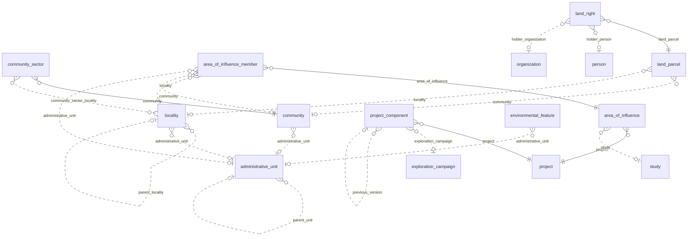

### `administrative_unit`

**Unidad administrativa** (BC-02). Departamento, provincia o distrito del ubigeo del INEI; objeto catálogo (BC-20) que
carga un script idempotente. Tabla física `app_data.administrative_unit__<org8>`. Requisitos: RF-TER-001, ASM-016.

| Campo | Tipo | Req. | Único | Descripción | Fuente |
|---|---|---|---|---|---|
| `ubigeo_code` | TEXT | sí | sí | Código ubigeo del INEI. | RF-TER-001 |
| `name` | TEXT | sí | — | Nombre oficial. | RF-TER-001 |
| `level` | ENUM `administrative_level` | sí | — | Nivel en la jerarquía del ubigeo. | RF-TER-001 |
| `boundary` | GEOMETRY (MULTIPOLYGON) | no | — | Límite oficial, opcional (ASM-016). | RF-TER-001 |

| Relación | Tipo | Campo | Destino | Req. | Nota |
|---|---|---|---|---|---|
| `administrative_unit_parent_unit` | MANY_TO_ONE | `parent_unit` | `administrative_unit` | no | Unidad superior (distrito → provincia → departamento) |

- **Flags:** `appendOnly` no · `apiOnly` no · `requiresReason` no.
- **Únicos:** `unique` en `ubigeo_code`.
- **Índices declarados:** ninguno.
- **Acciones declaradas:** ninguna.
- **Workflow:** ninguno.
- **Fase:** F2 · Release 1 (MVP).

### `locality`

**Localidad** (BC-02). Asentamiento humano (caserío, sector, centro poblado, anexo o ciudad) con localidad padre y
estado de reconocimiento. Tabla física `app_data.locality__<org8>`. Requisitos: RF-TER-002, CON-004.

| Campo | Tipo | Req. | Único | Descripción | Fuente |
|---|---|---|---|---|---|
| `name` | TEXT | sí | — | Nombre de la localidad. | RF-TER-002 |
| `alternative_names` | TEXT | no | — | Grafías y nombres alternativos. | CON-004 |
| `locality_type` | ENUM `locality_type` | sí | — | Tipo de localidad; un sector de caserío es de tipo SECTOR y tiene localidad padre. | RF-TER-002 |
| `populated_center_code` | TEXT | no | sí | Código de centro poblado del INEI. | RF-TER-002 |
| `recognition_status` | ENUM `recognition_status` | no | — | Estado de reconocimiento, incluida una separación en curso. | RF-TER-002 |
| `history` | LONG_TEXT | no | — | Historia de la localidad (narrativa en Markdown). | RF-TER-002 |
| `location` | GEOMETRY (POINT) | no | — | Ubicación. | RF-TER-002 |
| `boundary` | GEOMETRY (POLYGON) | no | — | Límite, opcional. | RF-TER-002 |

| Relación | Tipo | Campo | Destino | Req. | Nota |
|---|---|---|---|---|---|
| `locality_parent_locality` | MANY_TO_ONE | `parent_locality` | `locality` | no | Caserío del que es sector |
| `locality_administrative_unit` | MANY_TO_ONE | `administrative_unit` | `administrative_unit` | no | Distrito |
| `community_sector_locality` | MANY_TO_MANY | — | `community_sector` | — | Inversa; se define en `community_sector` |
| `state_program_locality` | MANY_TO_MANY | — | `state_program` | — | Inversa; se define en `state_program` |
| `local_conflict_locality` | MANY_TO_MANY | — | `local_conflict` | — | Inversa; se define en `local_conflict` |

- **Flags:** `appendOnly` no · `apiOnly` no · `requiresReason` no.
- **Únicos:** `unique` en `populated_center_code`.
- **Índices declarados:** ninguno.
- **Acciones declaradas:** ninguna.
- **Workflow:** ninguno.
- **Fase:** F2 · Release 1 (MVP).

### `community`

**Comunidad campesina o nativa** (BC-02). Colectivo con personería, territorio comunal inscrito, junta directiva y
sectores; como actor participa mediante la `organization` que lo representa (RN-STK-008). Tabla física
`app_data.community__<org8>`. Requisitos: RF-TER-003, RQ-REP-025, CON-013, CON-017, CON-018, ASM-018, ASM-064.

| Campo | Tipo | Req. | Único | Descripción | Fuente |
|---|---|---|---|---|---|
| `name` | TEXT | sí | — | Nombre de la comunidad. | RF-TER-003 |
| `alternative_names` | TEXT | no | — | Nombres alternativos. | RF-TER-003 |
| `community_type` | ENUM `community_type` | no | — | Comunidad campesina o nativa. | RF-TER-003 |
| `legal_entity_record` | TEXT | no | — | Partida de la personería jurídica (los números nunca van a artefactos versionados). | CON-017 |
| `property_record` | TEXT | no | — | Partida de propiedad del territorio comunal. | CON-017 |
| `parent_record` | TEXT | no | — | Partida matriz de la que aún no se independiza. | RF-TER-003 |
| `independized` | BOOLEAN | no | — | El territorio ya está independizado de la partida matriz. | RF-TER-003 |
| `title_reference` | TEXT | no | — | Referencia del título de propiedad. | RF-TER-003 |
| `title_issuer_as_written` | TEXT | no | — | Emisor del título tal como figura. | CON-018 |
| `title_issuer_normalized` | TEXT | no | — | Emisor del título normalizado. | CON-018 |
| `registered_area_ha` | DECIMAL | no | — | Área inscrita, en ha. | RQ-REP-025 |
| `calculated_area_ha` | DECIMAL | no | — | (derivado) Área plana en ha en la zona UTM del centroide (ASM-064). | ASM-064 |
| `registry_records_unverified` | BOOLEAN | no | — | Los datos registrales están pendientes de verificar. | CON-017 |
| `recognized_as_indigenous` | BOOLEAN | no | — | Reconocida como pueblo indígena u originario. | RF-TER-003 |
| `indigenous_people` | TEXT | no | — | Pueblo indígena u originario. | RF-TER-003 |
| `organic_status` | ENUM `organic_status` | no | — | Estado orgánico; dato aparte de la inscripción de la junta. | CON-013 |
| `board_registered` | BOOLEAN | no | — | La junta directiva está inscrita. | CON-013 |
| `registered_members_count` | INTEGER | no | — | Comuneros inscritos (conteo, sin padrón nominal). | ASM-018 |
| `has_member_roll` | BOOLEAN | no | — | Existe padrón de comuneros (sin nombres). | ASM-018 |
| `territory` | GEOMETRY (MULTIPOLYGON) | no | — | Territorio comunal. | RF-TER-003 |

| Relación | Tipo | Campo | Destino | Req. | Nota |
|---|---|---|---|---|---|
| `community_administrative_unit` | MANY_TO_ONE | `administrative_unit` | `administrative_unit` | no | Distrito |
| `evidence_community` | MANY_TO_MANY | — | `evidence` | — | Inversa; se define en `evidence`; desde F3 |

- **Flags:** `appendOnly` no · `apiOnly` no · `requiresReason` no.
- **Únicos:** ninguno.
- **Índices declarados:** ninguno.
- **Acciones declaradas:** ninguna.
- **Workflow:** ninguno.
- **Fase:** F2 · Release 1 (MVP).

### `community_sector`

**Sector comunal** (BC-02). División de una comunidad con delegados ante la asamblea; coincide solo en parte con
caseríos. Tabla física `app_data.community_sector__<org8>`. Requisitos: RF-TER-004.

| Campo | Tipo | Req. | Único | Descripción | Fuente |
|---|---|---|---|---|---|
| `name` | TEXT | sí | compuesto | Nombre del sector. | RF-TER-004 |
| `delegates_count` | INTEGER | no | — | Delegados ante la asamblea comunal. | RF-TER-004 |
| `boundary` | GEOMETRY (POLYGON) | no | — | Límite, opcional. | RF-TER-004 |

| Relación | Tipo | Campo | Destino | Req. | Nota |
|---|---|---|---|---|---|
| `community_sector_community` | MANY_TO_ONE | `community` | `community` | sí | — |
| `community_sector_locality` | MANY_TO_MANY | — | `locality` | — | Caseríos y centros poblados con que coincide |

- **Flags:** `appendOnly` no · `apiOnly` no · `requiresReason` no.
- **Únicos:** `uniqueConstraints` (`community`, `name`).
- **Índices declarados:** ninguno.
- **Acciones declaradas:** ninguna.
- **Workflow:** ninguno.
- **Fase:** F2 · Release 1 (MVP).

### `area_of_influence`

**Área de influencia** (BC-02). Construcción analítica y versionada de un proyecto: tipo, criterios, miembros curados y
geometría opcional. Tabla física `app_data.area_of_influence__<org8>`. Requisitos: RF-TER-005, RN-TER-003, RQ-GIS-009,
ASM-039, CON-025.

| Campo | Tipo | Req. | Único | Descripción | Fuente |
|---|---|---|---|---|---|
| `area_type` | ENUM `area_of_influence_type` | sí | compuesto | Tipo de área (ASM-039). | RF-TER-005 |
| `version_number` | INTEGER | sí | compuesto | Versión del área para el proyecto y el tipo. | RN-TER-003 |
| `criteria` | LONG_TEXT | no | — | Criterios aplicados. | RF-TER-005 |
| `defined_date` | DATE | no | — | Fecha de definición. | RF-TER-005 |
| `calculated_area_ha` | DECIMAL | no | — | (derivado) Área plana en ha en el `working_crs` del proyecto. | RQ-GIS-009 |
| `boundary` | GEOMETRY (MULTIPOLYGON) | no | — | Geometría opcional; solo sugiere miembros (RN-TER-004). | CON-025 |

| Relación | Tipo | Campo | Destino | Req. | Nota |
|---|---|---|---|---|---|
| `area_of_influence_project` | MANY_TO_ONE | `project` | `project` | sí | — |
| `area_of_influence_study` | MANY_TO_ONE | `study` | `study` | no | Estudio de origen |

- **Flags:** `appendOnly` no · `apiOnly` no · `requiresReason` no.
- **Únicos:** `uniqueConstraints` (`project`, `area_type`, `version_number`).
- **Índices declarados:** ninguno.
- **Acciones declaradas:** `APPROVE`.
- **Workflow:** WF-O.
- **Fase:** F2 · Release 1 (MVP).
- Aprobar una versión nueva reemplaza a la anterior con el endpoint de aprobación y `CommandTransitionGuard`;
  `TerritoryWriteGuard` congela los miembros de una versión `approved` o `superseded` (RN-TER-003).

### `area_of_influence_member`

**Miembro del área de influencia** (BC-02). Localidad, comunidad o unidad administrativa incluida en un área de
influencia, con su condición y su justificación. Tabla física `app_data.area_of_influence_member__<org8>`. Requisitos:
RF-TER-005, RN-TER-001, RN-TER-004, CON-003.

| Campo | Tipo | Req. | Único | Descripción | Fuente |
|---|---|---|---|---|---|
| `member_condition` | ENUM `member_condition` | sí | — | Condición del miembro. | RF-TER-005 |
| `applied_criteria` | TEXT | no | — | Criterios que lo incluyen. | RF-TER-005 |
| `rationale` | LONG_TEXT | no | — | Justificación. | RF-TER-005 |
| `studied_in_diagnosis` | BOOLEAN | no | — | Fue estudiado en el diagnóstico. | CON-003 |
| `spatially_suggested` | BOOLEAN | no | — | Se aceptó desde una sugerencia espacial. | RN-TER-004 |

| Relación | Tipo | Campo | Destino | Req. | Nota |
|---|---|---|---|---|---|
| `aoi_member_area_of_influence` | MANY_TO_ONE | `area_of_influence` | `area_of_influence` | sí | — |
| `aoi_member_locality` | MANY_TO_ONE | `locality` | `locality` | no | — |
| `aoi_member_community` | MANY_TO_ONE | `community` | `community` | no | — |
| `aoi_member_administrative_unit` | MANY_TO_ONE | `administrative_unit` | `administrative_unit` | no | — |

- **Exactamente uno de:** (`locality`, `community`, `administrative_unit`), con `ExactlyOneGuard`.
- **Flags:** `appendOnly` no · `apiOnly` no · `requiresReason` no.
- **Únicos:** `uniqueConstraints` (`area_of_influence`, `locality`); (`area_of_influence`, `community`);
  (`area_of_influence`, `administrative_unit`).
- **Índices declarados:** ninguno.
- **Acciones declaradas:** ninguna.
- **Workflow:** ninguno.
- **Fase:** F2 · Release 1 (MVP).

### `project_component`

**Componente del proyecto** (BC-02). Elemento físico del proyecto (sondaje, plataforma, acceso, campamento, captación)
con sus coordenadas de origen y sus versiones. Tabla física `app_data.project_component__<org8>`. Requisitos:
RF-TER-006, RQ-GIS-003, RQ-GIS-008, RQ-GIS-010, CON-023, CON-024, ASM-060.

| Campo | Tipo | Req. | Único | Descripción | Fuente |
|---|---|---|---|---|---|
| `code` | TEXT | sí | compuesto | Código del componente (por ejemplo, el código de un sondaje). | RF-TER-006 |
| `component_type` | ENUM `component_type` | sí | — | Tipo de componente. | RF-TER-006 |
| `drill_type` | TEXT | no | — | Tipo de perforación. | RF-TER-006 |
| `component_status` | ENUM `component_status` | no | — | Estado del componente. | RF-TER-006 |
| `version_number` | INTEGER | sí | compuesto | Versión del componente para su código. | RQ-GIS-010 |
| `superseded` | BOOLEAN | no | — | (derivado) Existe una versión posterior del mismo código. | RQ-GIS-010 |
| `source_crs` | ENUM `source_crs` | no | — | CRS de origen; el endpoint de importación lo exige (CON-024). | RQ-GIS-003 |
| `source_easting` | DECIMAL | no | — | Coordenada este tal como vino. | RQ-GIS-008 |
| `source_northing` | DECIMAL | no | — | Coordenada norte tal como vino. | RQ-GIS-008 |
| `source_elevation` | DECIMAL | no | — | Cota tal como vino; la geometría es 2D. | RQ-GIS-006 |
| `azimuth` | DECIMAL | no | — | Azimut. | RF-TER-006 |
| `dip` | DECIMAL | no | — | Inclinación. | RF-TER-006 |
| `depth_m` | DECIMAL | no | — | Profundidad en metros. | RF-TER-006 |
| `source_reference` | TEXT | no | — | Fuente de origen. | RQ-GIS-008 |
| `import_batch_id` | UUID | no | — | Importación que lo creó (ASM-060). | ASM-060 |
| `location` | GEOMETRY (POINT) | no | — | Ubicación (collar de un sondaje). | RF-TER-006 |
| `trace` | GEOMETRY (LINESTRING) | no | — | Trazo (accesos). | RF-TER-006 |
| `footprint` | GEOMETRY (POLYGON) | no | — | Huella (plataformas, campamento). | RF-TER-006 |

| Relación | Tipo | Campo | Destino | Req. | Nota |
|---|---|---|---|---|---|
| `component_project` | MANY_TO_ONE | `project` | `project` | sí | — |
| `component_exploration_campaign` | MANY_TO_ONE | `exploration_campaign` | `exploration_campaign` | no | — |
| `component_previous_version` | MANY_TO_ONE | `previous_version` | `project_component` | no | Versión anterior del mismo código |

- **Flags:** `appendOnly` no · `apiOnly` sí · `requiresReason` no.
- **Únicos:** `uniqueConstraints` (`project`, `code`, `version_number`).
- **Índices declarados:** `indexed` en `import_batch_id`.
- **Acciones declaradas:** ninguna.
- **Workflow:** ninguno.
- **Fase:** F2 · Release 1 (MVP).
- Es `apiOnly` porque un código repetido con coordenadas distintas crea una versión y nunca sobrescribe, y esa regla
  depende de la geometría, que las guardas no ven (RQ-GIS-010, RQ-GIS-011) [WAS-ADR-0040]. Escriben la importación y el
  alta o versión manual de `sgspe.territory`.

### `land_parcel`

**Predio** (BC-02). Unidad de tierra con su tenencia, su partida (restringida) y su polígono. Tabla física
`app_data.land_parcel__<org8>`. Requisitos: RF-TER-007, RQ-GIS-002, RQ-SEC-011, ASM-060, ASM-064.

| Campo | Tipo | Req. | Único | Descripción | Fuente |
|---|---|---|---|---|---|
| `code` | TEXT | sí | sí | Código del predio. | RF-TER-007 |
| `tenure_type` | ENUM `tenure_type` | no | — | Tenencia del predio. | RF-TER-007 |
| `registry_record` | TEXT | no | — | (restringido) Partida registral del predio. | RQ-SEC-010 |
| `registered_area_ha` | DECIMAL | no | — | Área registral declarada, en ha. | RQ-GIS-009 |
| `calculated_area_ha` | DECIMAL | no | — | (derivado) Área plana en ha en la zona UTM del centroide (ASM-064). | ASM-064 |
| `source_crs` | ENUM `source_crs` | no | — | CRS en que vino la geometría importada. | RQ-GIS-008 |
| `source_reference` | TEXT | no | — | Fuente de origen (por ejemplo, COFOPRI). | RQ-GIS-008 |
| `import_batch_id` | UUID | no | — | Importación que lo creó o cambió (ASM-060). | ASM-060 |
| `boundary` | GEOMETRY (POLYGON) | no | — | Polígono del predio. | RF-TER-007 |

| Relación | Tipo | Campo | Destino | Req. | Nota |
|---|---|---|---|---|---|
| `land_parcel_community` | MANY_TO_ONE | `community` | `community` | no | — |
| `land_parcel_locality` | MANY_TO_ONE | `locality` | `locality` | no | — |
| `agreement_land_parcel` | MANY_TO_MANY | — | `agreement` | — | Inversa; se define en `agreement`; desde F3 |
| `evidence_land_parcel` | MANY_TO_MANY | — | `evidence` | — | Inversa; se define en `evidence`; desde F3 |

- **Flags:** `appendOnly` no · `apiOnly` no · `requiresReason` no.
- **Únicos:** `unique` en `code`.
- **Índices declarados:** `indexed` en `import_batch_id`.
- **Acciones declaradas:** ninguna.
- **Workflow:** ninguno.
- **Fase:** F2 · Release 1 (MVP).
- Los predios con titulares nunca se publican en GeoServer (RQ-SEC-011).

### `land_right`

**Titularidad del predio** (BC-02). Vínculo de una persona u organización con un predio como propietario o posesionario,
con vigencia. Tabla física `app_data.land_right__<org8>`. Requisitos: RF-TER-007.

| Campo | Tipo | Req. | Único | Descripción | Fuente |
|---|---|---|---|---|---|
| `tenure_type` | ENUM `tenure_type` | no | — | Propiedad o posesión. | RF-TER-007 |
| `start_date` | DATE | no | — | Inicio de la titularidad. | RF-TER-007 |
| `end_date` | DATE | no | — | Fin de la titularidad. | RF-TER-007 |
| `source_reference` | TEXT | no | — | Fuente de la titularidad. | RF-TER-007 |

| Relación | Tipo | Campo | Destino | Req. | Nota |
|---|---|---|---|---|---|
| `land_right_land_parcel` | MANY_TO_ONE | `land_parcel` | `land_parcel` | sí | — |
| `land_right_holder_person` | MANY_TO_ONE | `holder_person` | `person` | no | Titular persona; restringido |
| `land_right_holder_organization` | MANY_TO_ONE | `holder_organization` | `organization` | no | Titular organización |

- **Exactamente uno de:** (`holder_person`, `holder_organization`), con `ExactlyOneGuard`.
- **Flags:** `appendOnly` no · `apiOnly` no · `requiresReason` no.
- **Únicos:** ninguno.
- **Índices declarados:** ninguno.
- **Acciones declaradas:** ninguna.
- **Workflow:** ninguno.
- **Fase:** F2 · Release 1 (MVP).

### `environmental_feature`

**Elemento ambiental** (BC-02). Lugar ambiental o culturalmente sensible (zona de protección, fuente de agua,
microcuenca, cerro, sitio sagrado, resto arqueológico) con su base legal. Tabla física
`app_data.environmental_feature__<org8>`. Requisitos: RF-TER-008.

| Campo | Tipo | Req. | Único | Descripción | Fuente |
|---|---|---|---|---|---|
| `name` | TEXT | sí | — | Nombre. | RF-TER-008 |
| `feature_type` | ENUM `environmental_feature_type` | no | — | Tipo de elemento ambiental. | RF-TER-008 |
| `legal_basis` | TEXT | no | — | Base legal de la declaración. | RF-TER-008 |
| `declaring_authority` | TEXT | no | — | Autoridad que lo declaró. | RF-TER-008 |
| `declaration_date` | DATE | no | — | Fecha de la declaración. | RF-TER-008 |
| `location` | GEOMETRY (POINT) | no | — | Ubicación. | RF-TER-008 |
| `trace` | GEOMETRY (LINESTRING) | no | — | Trazo. | RF-TER-008 |
| `boundary` | GEOMETRY (MULTIPOLYGON) | no | — | Polígono. | RF-TER-008 |

| Relación | Tipo | Campo | Destino | Req. | Nota |
|---|---|---|---|---|---|
| `env_feature_administrative_unit` | MANY_TO_ONE | `administrative_unit` | `administrative_unit` | no | — |

- **Flags:** `appendOnly` no · `apiOnly` no · `requiresReason` no.
- **Únicos:** ninguno.
- **Índices declarados:** ninguno.
- **Acciones declaradas:** ninguna.
- **Workflow:** ninguno.
- **Fase:** F2 · Release 1 (MVP).

## 8. BC-03 Grupos de interés

Actor (`person`, `organization`), cargo (`position`), grupo de interés por proyecto (`stakeholder`) y evaluación fechada
(`stakeholder_assessment`) son registros distintos (CON-038, RN-STK-006). Las evaluaciones de personas son datos
sensibles con permiso de campo (RQ-SEC-010, GAP-024).

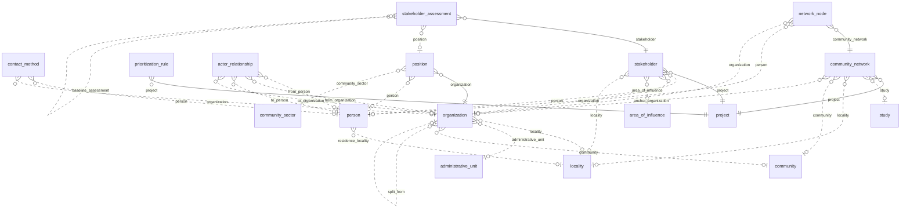

### `person`

**Persona** (BC-03). Persona natural del territorio, registrada una sola vez con independencia de los proyectos; sus
datos están restringidos. Tabla física `app_data.person__<org8>`. Requisitos: RF-STK-001, RQ-SEC-010, CON-014, GAP-013.

| Campo | Tipo | Req. | Único | Descripción | Fuente |
|---|---|---|---|---|---|
| `given_names` | TEXT | sí | — | (restringido) Nombres. | RQ-SEC-010 |
| `surnames` | TEXT | no | — | (restringido) Apellidos. | RQ-SEC-010 |
| `sex` | ENUM `sex` | no | — | Sexo. | RF-STK-001 |
| `id_document_type` | TEXT | no | — | Tipo de documento de identidad. | RF-STK-001 |
| `id_document_number` | TEXT | no | — | (restringido) Número del documento de identidad. | CON-014 |
| `preferred_language` | TEXT | no | — | Idioma preferido. | GAP-013 |

| Relación | Tipo | Campo | Destino | Req. | Nota |
|---|---|---|---|---|---|
| `person_residence_locality` | MANY_TO_ONE | `residence_locality` | `locality` | no | Localidad de residencia |

- **Flags:** `appendOnly` no · `apiOnly` no · `requiresReason` no.
- **Únicos:** ninguno.
- **Índices declarados:** ninguno.
- **Acciones declaradas:** ninguna.
- **Workflow:** ninguno.
- **Fase:** F2 · Release 1 (MVP).

### `organization`

**Organización** (BC-03). Organización del territorio o de su entorno (ronda, JASS, municipalidad, federación, ONG,
empresa…); no es el tenant. Tabla física `app_data.organization__<org8>`. Requisitos: RF-STK-001, RF-STK-004,
RN-STK-008, RQ-REP-003, CON-005, CON-020.

| Campo | Tipo | Req. | Único | Descripción | Fuente |
|---|---|---|---|---|---|
| `name` | TEXT | sí | — | Nombre. | RF-STK-001 |
| `alternative_names` | TEXT | no | — | Nombres alternativos de la misma organización. | CON-020 |
| `address` | TEXT | no | — | Dirección (portada de los entregables). | RQ-REP-003 |
| `organization_type` | ENUM `organization_type` | no | — | Tipo de organización. | RF-STK-001 |
| `territorial_level` | ENUM `territorial_level` | no | — | Nivel territorial. | RF-STK-001 |
| `affiliation` | ENUM `affiliation` | no | — | Relación con su federación. | RF-STK-004 |
| `recognized` | BOOLEAN | no | — | Reconocida; dato distinto de la afiliación. | CON-005 |
| `members_count` | INTEGER | no | — | Número de miembros. | RF-STK-001 |
| `election_mechanism` | TEXT | no | — | Cómo elige a sus directivos. | RF-STK-001 |
| `term_years` | INTEGER | no | — | Duración del periodo de sus cargos, en años. | RF-STK-001 |
| `achievements` | LONG_TEXT | no | — | Logros. | RF-STK-001 |

| Relación | Tipo | Campo | Destino | Req. | Nota |
|---|---|---|---|---|---|
| `organization_locality` | MANY_TO_ONE | `locality` | `locality` | no | — |
| `organization_administrative_unit` | MANY_TO_ONE | `administrative_unit` | `administrative_unit` | no | — |
| `organization_community` | MANY_TO_ONE | `community` | `community` | no | Comunidad que representa (RN-STK-008) |
| `organization_affiliated_to` | MANY_TO_ONE | `affiliated_to` | `organization` | no | Federación a la que se afilia |
| `organization_split_from` | MANY_TO_ONE | `split_from` | `organization` | no | Organización de la que se escindió |

- **Flags:** `appendOnly` no · `apiOnly` no · `requiresReason` no.
- **Únicos:** ninguno.
- **Índices declarados:** ninguno.
- **Acciones declaradas:** ninguna.
- **Workflow:** ninguno.
- **Fase:** F2 · Release 1 (MVP).

### `contact_method`

**Medio de contacto** (BC-03). Canal de contacto de una persona u organización, con consentimiento; no hay tabla
genérica de contactos. Tabla física `app_data.contact_method__<org8>`. Requisitos: RF-STK-001, RNF-PRIV-004.

| Campo | Tipo | Req. | Único | Descripción | Fuente |
|---|---|---|---|---|---|
| `channel` | ENUM `contact_channel` | sí | — | Tipo de medio. | RF-STK-001 |
| `contact_value` | TEXT | sí | — | (restringido) Número, correo, dirección o usuario. | RQ-SEC-010 |
| `preferred` | BOOLEAN | no | — | Medio preferido. | RF-STK-001 |
| `consent_given` | BOOLEAN | no | — | Consentimiento para usar este medio. | RNF-PRIV-004 |
| `consent_date` | DATE | no | — | Fecha del consentimiento. | RNF-PRIV-004 |

| Relación | Tipo | Campo | Destino | Req. | Nota |
|---|---|---|---|---|---|
| `contact_method_person` | MANY_TO_ONE | `person` | `person` | no | — |
| `contact_method_organization` | MANY_TO_ONE | `organization` | `organization` | no | — |

- **Exactamente uno de:** (`person`, `organization`), con `ExactlyOneGuard`.
- **Flags:** `appendOnly` no · `apiOnly` no · `requiresReason` no.
- **Únicos:** ninguno.
- **Índices declarados:** ninguno.
- **Acciones declaradas:** ninguna.
- **Workflow:** ninguno.
- **Fase:** F2 · Release 1 (MVP).

### `position`

**Cargo** (BC-03). Puesto en una organización con periodo y estado; puede estar vacante o previsto. No es la postura.
Tabla física `app_data.position__<org8>`. Requisitos: RF-STK-002, CON-005.

| Campo | Tipo | Req. | Único | Descripción | Fuente |
|---|---|---|---|---|---|
| `position_title` | TEXT | sí | — | Nombre del cargo (por ejemplo, Teniente Gobernador). | RF-STK-002 |
| `election_mechanism` | TEXT | no | — | Mecanismo de elección. | RF-STK-002 |
| `term_start_date` | DATE | no | — | Inicio del periodo. | RF-STK-002 |
| `term_end_date` | DATE | no | — | Fin del periodo. | RF-STK-002 |
| `start_date` | DATE | no | — | Inicio del ejercicio efectivo. | RF-STK-002 |
| `end_date` | DATE | no | — | Fin del ejercicio efectivo. | RF-STK-002 |
| `position_status` | ENUM `position_status` | sí | — | Estado del cargo; sin persona solo puede ser VACANTE o PREVISTO. | RF-STK-002 |
| `career_notes` | LONG_TEXT | no | — | Trayectoria. | RF-STK-002 |

| Relación | Tipo | Campo | Destino | Req. | Nota |
|---|---|---|---|---|---|
| `position_organization` | MANY_TO_ONE | `organization` | `organization` | sí | — |
| `position_person` | MANY_TO_ONE | `person` | `person` | no | Vacío si el cargo está vacante o previsto |
| `position_community_sector` | MANY_TO_ONE | `community_sector` | `community_sector` | no | Sector comunal al que representa |

- **Flags:** `appendOnly` no · `apiOnly` no · `requiresReason` no.
- **Únicos:** ninguno.
- **Índices declarados:** ninguno.
- **Acciones declaradas:** ninguna.
- **Workflow:** ninguno.
- **Fase:** F2 · Release 1 (MVP).

### `stakeholder`

**Grupo de interés** (BC-03). Persona u organización en relación con un proyecto, con los valores vigentes de su última
evaluación (la postura y la confianza, el último valor informado de cada una) y su último contacto. Tabla física `app_data.stakeholder__<org8>`. Requisitos: RF-STK-003, RF-STK-013,
RF-STK-014, RN-STK-006, RN-STK-008, ASM-032, CON-030.

| Campo | Tipo | Req. | Único | Descripción | Fuente |
|---|---|---|---|---|---|
| `stakeholder_type` | ENUM `stakeholder_type` | no | — | Tipo de grupo de interés. | RF-STK-003 |
| `stakeholder_scope` | ENUM `stakeholder_scope` | no | — | Ámbito respecto del proyecto (ASM-040). | RF-STK-003 |
| `inclusion_reason` | LONG_TEXT | no | — | Motivo de inclusión. | RF-STK-013 |
| `interview_status` | ENUM `interview_status` | no | — | Resultado del intento de entrevista. | RF-STK-003 |
| `relationship_status` | ENUM `relationship_status` | no | — | Estado de la relación, separado del workflow; regla de primer contacto de ASM-032. | RF-STK-014 |
| `owner_user_id` | UUID | no | — | Responsable (ASM-023). | ASM-023 |
| `owner_user_email` | EMAIL | no | — | Correo del responsable. | ASM-023 |
| `profile_summary` | LONG_TEXT | no | — | Perfil del grupo de interés. | RF-STK-003 |
| `stance` | ENUM `stance` | no | — | (derivado) (restringido) Postura vigente: último valor informado de la postura. | RF-STK-003 |
| `influence_group` | ENUM `influence_group` | no | — | (derivado) Grupo de influencia de la última evaluación. | RF-STK-003 |
| `information_priority` | ENUM `information_priority` | no | — | (derivado) Prioridad que resulta de la matriz de priorización. | RF-STK-011 |
| `interest_index` | DECIMAL | no | — | (derivado) Índice de interés de la última evaluación. | RF-STK-003 |
| `power_index` | DECIMAL | no | — | (derivado) Índice de poder de la última evaluación. | RF-STK-003 |
| `trust_score` | INTEGER | no | — | (derivado) Confianza vigente: último valor informado de la confianza. | RF-STK-003 |
| `last_assessment_date` | DATE | no | — | (derivado) Fecha de la última evaluación. | RF-STK-003 |
| `last_contact_date` | DATE | no | — | (derivado) Fecha (America/Lima) de la última interacción realizada con él. | RF-STK-014 |

| Relación | Tipo | Campo | Destino | Req. | Nota |
|---|---|---|---|---|---|
| `stakeholder_project` | MANY_TO_ONE | `project` | `project` | sí | — |
| `stakeholder_person` | MANY_TO_ONE | `person` | `person` | no | — |
| `stakeholder_organization` | MANY_TO_ONE | `organization` | `organization` | no | — |
| `stakeholder_area_of_influence` | MANY_TO_ONE | `area_of_influence` | `area_of_influence` | no | — |
| `stakeholder_locality` | MANY_TO_ONE | `locality` | `locality` | no | — |
| `engagement_stakeholder` | MANY_TO_MANY | — | `engagement` | — | Inversa; se define en `engagement` |
| `commitment_stakeholder` | MANY_TO_MANY | — | `commitment` | — | Inversa; se define en `commitment`; desde F3 |
| `social_risk_stakeholder` | MANY_TO_MANY | — | `social_risk` | — | Inversa; se define en `social_risk`; desde F4 |
| `incident_stakeholder` | MANY_TO_MANY | — | `incident` | — | Inversa; se define en `incident`; desde F4 |
| `evidence_stakeholder` | MANY_TO_MANY | — | `evidence` | — | Inversa; se define en `evidence`; desde F3 |

- **Exactamente uno de:** (`person`, `organization`), con `ExactlyOneGuard`.
- **Flags:** `appendOnly` no · `apiOnly` no · `requiresReason` no.
- **Únicos:** `uniqueConstraints` (`project`, `person`); (`project`, `organization`).
- **Índices declarados:** ninguno.
- **Acciones declaradas:** `EXPORT`.
- **Workflow:** WF-B.
- **Fase:** F2 · Release 1 (MVP).
- Los valores vigentes los escribe el endpoint de evaluaciones en su transacción y `last_contact_date` y la regla de
  primer contacto, `StakeholderFollowUpJob` (§7.4 del modelo de dominio).

### `stakeholder_assessment`

**Evaluación del grupo de interés** (BC-03). Registro fechado e inmutable de interés, poder, grupo de influencia,
postura y confianza; una corrección es una evaluación nueva. Tabla física `app_data.stakeholder_assessment__<org8>`.
Requisitos: RF-STK-005, RF-STK-006, RF-STK-007, RF-STK-008, RF-STK-009, RF-STK-010, RQ-SEC-010, ASM-003, ASM-031,
CON-006.

| Campo | Tipo | Req. | Único | Descripción | Fuente |
|---|---|---|---|---|---|
| `assessment_date` | DATE | sí | — | Fecha de la evaluación. | RF-STK-005 |
| `basis` | ENUM `assessment_basis` | sí | — | Base de la evaluación (CON-006). | RF-STK-005 |
| `assessor_user_id` | UUID | sí | — | Usuario que evalúa (ASM-023). | ASM-023 |
| `assessor_user_email` | EMAIL | sí | — | Correo de quien evalúa. | ASM-023 |
| `affect_environment` | INTEGER | no | — | Percepción de afectación del medio ambiente y ecosistema. Indicador de interés de 1 a 5. | RF-STK-006 |
| `affect_livelihood` | INTEGER | no | — | "Afecta económicamente mi vida". Indicador de interés de 1 a 5. | RF-STK-006 |
| `affect_property_status` | INTEGER | no | — | Afectación de la propiedad o de la posición social o económica. Indicador de interés de 1 a 5. | RF-STK-006 |
| `opportunity_work` | INTEGER | no | — | Oportunidad de trabajo u oportunidad personal. Indicador de interés de 1 a 5. | RF-STK-006 |
| `opportunity_development` | INTEGER | no | — | Oportunidad de desarrollo u oportunidad colectiva. Indicador de interés de 1 a 5. | RF-STK-006 |
| `opportunity_benefits` | INTEGER | no | — | Oportunidad de beneficios económicos o políticos. Indicador de interés de 1 a 5. | RF-STK-006 |
| `power_legal_action` | INTEGER | no | — | Habilidad de acción legal. Indicador de poder de 1 a 5. | RF-STK-007 |
| `power_credibility` | INTEGER | no | — | Credibilidad. Indicador de poder de 1 a 5. | RF-STK-007 |
| `power_permit_control` | INTEGER | no | — | Control de permisos. Indicador de poder de 1 a 5. | RF-STK-007 |
| `power_action_scope` | INTEGER | no | — | Ámbito de acción (local, regional o nacional). Indicador de poder de 1 a 5. | RF-STK-007 |
| `power_organization_level` | INTEGER | no | — | Nivel de organización. Indicador de poder de 1 a 5. | RF-STK-007 |
| `power_convening_capacity` | INTEGER | no | — | Capacidad de convocatoria. Indicador de poder de 1 a 5. | RF-STK-007 |
| `power_network_membership` | INTEGER | no | — | Pertenencia a redes. Indicador de poder de 1 a 5. | RF-STK-007 |
| `power_group_mobilization` | INTEGER | no | — | Participación en acciones grupales de movilización. Indicador de poder de 1 a 5. | RF-STK-007 |
| `power_other_pressure` | INTEGER | no | — | Participación en otros mecanismos de presión. Indicador de poder de 1 a 5. | RF-STK-007 |
| `interest_affectation` | DECIMAL | no | — | Componente de percepción de afectación. | RF-STK-008 |
| `interest_opportunity` | DECIMAL | no | — | Componente de percepción de oportunidad. | RF-STK-008 |
| `interest_index` | DECIMAL | sí | — | Índice de interés de 1 a 5 (ASM-031). | RF-STK-008 |
| `power_resource_control` | DECIMAL | no | — | Componente de control de recursos. | RF-STK-008 |
| `power_action_capacity` | DECIMAL | no | — | Componente de capacidad de acción. | RF-STK-008 |
| `power_network_mobilization` | DECIMAL | no | — | Componente de movilización de redes. | RF-STK-008 |
| `power_index` | DECIMAL | sí | — | Índice de poder de 1 a 5 (ASM-031). | RF-STK-008 |
| `influence_score` | DECIMAL | sí | — | Influencia = interés + poder. | RF-STK-009 |
| `influence_group` | ENUM `influence_group` | sí | — | Grupo por los umbrales del proyecto (ASM-003). | RF-STK-009 |
| `group_overridden` | BOOLEAN | sí | — | El grupo se ajustó a mano. | RF-STK-009 |
| `override_reason` | LONG_TEXT | no | — | Justificación del ajuste manual. | RF-STK-009 |
| `stance` | ENUM `stance` | no | — | (restringido) Postura; puede faltar cuando la fuente no la da (CON-006). | RF-STK-005 |
| `stance_changed` | BOOLEAN | no | — | (derivado) La postura difiere de la última postura informada antes, que puede no ser la de la evaluación de la línea base. | RF-STK-010 |
| `stance_reasons` | LONG_TEXT | no | — | (restringido) Razones de la postura. | RF-STK-005 |
| `concerns` | LONG_TEXT | no | — | (restringido) Preocupaciones. | RF-STK-005 |
| `expectations` | LONG_TEXT | no | — | (restringido) Expectativas. | RF-STK-005 |
| `open_to_dialogue` | BOOLEAN | no | — | Apertura al diálogo. | RF-STK-005 |
| `project_knowledge` | LONG_TEXT | no | — | Conocimiento del proyecto. | RF-STK-010 |
| `company_knowledge` | LONG_TEXT | no | — | Conocimiento de la empresa. | RF-STK-010 |
| `team_closeness` | TEXT | no | — | Cercanía con el equipo. | RF-STK-010 |
| `communication_sufficient` | BOOLEAN | no | — | Las formas de comunicación son suficientes. | RF-STK-010 |
| `information_adequate` | BOOLEAN | no | — | La información es adecuada. | RF-STK-010 |
| `trust_score` | INTEGER | no | — | Confianza de 1 a 5. | RF-STK-010 |

| Relación | Tipo | Campo | Destino | Req. | Nota |
|---|---|---|---|---|---|
| `stk_assessment_stakeholder` | MANY_TO_ONE | `stakeholder` | `stakeholder` | sí | — |
| `stk_assessment_position` | MANY_TO_ONE | `position` | `position` | no | Cargo evaluado |
| `stk_assessment_baseline_assessment` | MANY_TO_ONE | `baseline_assessment` | `stakeholder_assessment` | no | Evaluación anterior (línea base) |

- **Flags:** `appendOnly` sí · `apiOnly` sí · `requiresReason` sí.
- **Únicos:** ninguno.
- **Índices declarados:** `indexes` (`stakeholder`, `assessment_date`).
- **Acciones declaradas:** ninguna.
- **Workflow:** ninguno.
- **Fase:** F2 · Release 1 (MVP).
- Lo escribe solo `POST /api/sgspe/stakeholders/{id}/assessments`, que valida los rangos de 1 a 5 porque wasichai no
  tiene mínimos ni máximos (RF-STK-008).
- El índice (`stakeholder`, `assessment_date`) sirve a la búsqueda de la última evaluación y a la evaluación mensual
  frente a la línea base (RF-STK-010, RQ-DSH-008).

### `prioritization_rule`

**Regla de priorización** (BC-03). Fila de la matriz de priorización: grupo de influencia × postura × ámbito (y, si
aplica, tipo de actor) → prioridad informativa. Tabla física `app_data.prioritization_rule__<org8>`. Requisitos:
RF-STK-011.

| Campo | Tipo | Req. | Único | Descripción | Fuente |
|---|---|---|---|---|---|
| `influence_group` | ENUM `influence_group` | sí | compuesto | Grupo de influencia. | RF-STK-011 |
| `stance` | ENUM `stance` | sí | compuesto | Postura. | RF-STK-011 |
| `stakeholder_scope` | ENUM `stakeholder_scope` | sí | compuesto | Ámbito. | RF-STK-011 |
| `stakeholder_type` | ENUM `stakeholder_type` | no | compuesto | Tipo de actor; vacío = cualquier tipo. | RF-STK-011 |
| `information_priority` | ENUM `information_priority` | sí | — | Prioridad informativa resultante. | RF-STK-011 |
| `rationale` | LONG_TEXT | no | — | Justificación. | RF-STK-011 |

| Relación | Tipo | Campo | Destino | Req. | Nota |
|---|---|---|---|---|---|
| `prioritization_rule_project` | MANY_TO_ONE | `project` | `project` | sí | — |

- **Flags:** `appendOnly` no · `apiOnly` no · `requiresReason` no.
- **Únicos:** `uniqueConstraints` (`project`, `influence_group`, `stance`, `stakeholder_scope`, `stakeholder_type`).
- **Índices declarados:** ninguno.
- **Acciones declaradas:** ninguna.
- **Workflow:** ninguno.
- **Fase:** F2 · Release 1 (MVP).
- Como los NULL son distintos, `StakeholderWriteGuard` impide dos filas sin tipo para la misma combinación
  [WAS-ADR-0037].

### `actor_relationship`

**Relación entre actores** (BC-03). Vínculo dirigido entre dos actores (afiliado a, coordina con, apoya, se opone,
asesora). Tabla física `app_data.actor_relationship__<org8>`. Requisitos: RF-STK-012.

| Campo | Tipo | Req. | Único | Descripción | Fuente |
|---|---|---|---|---|---|
| `relationship_type` | ENUM `actor_relationship_type` | sí | — | Tipo de relación. | RF-STK-012 |
| `start_date` | DATE | no | — | Inicio de la relación. | RF-STK-012 |
| `end_date` | DATE | no | — | Fin de la relación. | RF-STK-012 |
| `source_reference` | TEXT | no | — | Fuente de la relación. | RF-STK-012 |

| Relación | Tipo | Campo | Destino | Req. | Nota |
|---|---|---|---|---|---|
| `actor_rel_from_person` | MANY_TO_ONE | `from_person` | `person` | no | — |
| `actor_rel_from_organization` | MANY_TO_ONE | `from_organization` | `organization` | no | — |
| `actor_rel_to_person` | MANY_TO_ONE | `to_person` | `person` | no | — |
| `actor_rel_to_organization` | MANY_TO_ONE | `to_organization` | `organization` | no | — |

- **Exactamente uno de:** (`from_person`, `from_organization`); (`to_person`, `to_organization`), con `ExactlyOneGuard`.
- **Flags:** `appendOnly` no · `apiOnly` no · `requiresReason` no.
- **Únicos:** ninguno.
- **Índices declarados:** ninguno.
- **Acciones declaradas:** ninguna.
- **Workflow:** ninguno.
- **Fase:** F2 · Release 1 (MVP).

### `community_network`

**Red comunitaria** (BC-03). Conjunto de personas y organizaciones conectadas en torno a un caserío, una institución o
un apoyo externo. Tabla física `app_data.community_network__<org8>`. Requisitos: RF-STK-012 [DOC-02 p.3, p.5].

| Campo | Tipo | Req. | Único | Descripción | Fuente |
|---|---|---|---|---|---|
| `name` | TEXT | sí | — | Nombre de la red. | RF-STK-012 |
| `network_type` | TEXT | no | — | Tipo de red (texto). | RF-STK-012 |
| `contact_status` | ENUM `network_contact_status` | no | — | Estado de contacto de la red. | RF-STK-012 |
| `description` | LONG_TEXT | no | — | Descripción. | RF-STK-012 |

| Relación | Tipo | Campo | Destino | Req. | Nota |
|---|---|---|---|---|---|
| `network_project` | MANY_TO_ONE | `project` | `project` | sí | — |
| `network_study` | MANY_TO_ONE | `study` | `study` | no | — |
| `network_locality` | MANY_TO_ONE | `locality` | `locality` | no | — |
| `network_community` | MANY_TO_ONE | `community` | `community` | no | — |
| `network_anchor_organization` | MANY_TO_ONE | `anchor_organization` | `organization` | no | Organización en torno a la que se arma |

- **Flags:** `appendOnly` no · `apiOnly` no · `requiresReason` no.
- **Únicos:** ninguno.
- **Índices declarados:** ninguno.
- **Acciones declaradas:** ninguna.
- **Workflow:** ninguno.
- **Fase:** F2 · Release 1 (MVP).

### `network_node`

**Nodo de red** (BC-03). Integrante de una red comunitaria con su rol. Tabla física `app_data.network_node__<org8>`.
Requisitos: RF-STK-012.

| Campo | Tipo | Req. | Único | Descripción | Fuente |
|---|---|---|---|---|---|
| `node_role` | ENUM `node_role` | no | — | Rol en la red. | RF-STK-012 |
| `notes` | LONG_TEXT | no | — | Notas. | RF-STK-012 |

| Relación | Tipo | Campo | Destino | Req. | Nota |
|---|---|---|---|---|---|
| `network_node_community_network` | MANY_TO_ONE | `community_network` | `community_network` | sí | — |
| `network_node_person` | MANY_TO_ONE | `person` | `person` | no | — |
| `network_node_organization` | MANY_TO_ONE | `organization` | `organization` | no | — |

- **Exactamente uno de:** (`person`, `organization`), con `ExactlyOneGuard`.
- **Flags:** `appendOnly` no · `apiOnly` no · `requiresReason` no.
- **Únicos:** `uniqueConstraints` (`community_network`, `person`); (`community_network`, `organization`).
- **Índices declarados:** ninguno.
- **Acciones declaradas:** ninguna.
- **Workflow:** ninguno.
- **Fase:** F2 · Release 1 (MVP).

## 9. BC-04 Relacionamiento (absorbe BC-11 Operaciones de campo)

Relacionamiento planificado y ejecutado. `field_visit` y `field_observation` son los objetos de BC-11 que el MVP absorbe
(ASM-045). El acta firmada por los asistentes es una `evidence` de tipo ACTA, no un estado (CON-032, RF-ENG-005).

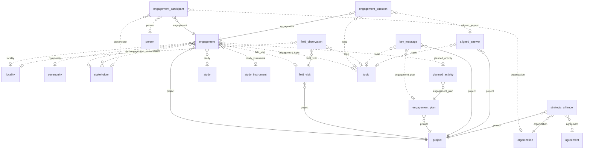

### `engagement`

**Interacción** (BC-04). Contacto o evento con grupos de interés (desde el contacto cara a cara hasta la mesa de
diálogo), con su minuta y sus conteos de asistentes. Tabla física `app_data.engagement__<org8>`. Requisitos: RF-ENG-001,
RF-ENG-002, RF-ENG-003, RF-ENG-004, RF-ENG-005, RF-ENG-006, RF-ENG-011, RF-ENG-012, RF-LBS-001, RQ-DSH-012, ASM-029.

| Campo | Tipo | Req. | Único | Descripción | Fuente |
|---|---|---|---|---|---|
| `engagement_type` | ENUM `engagement_type` | sí | — | Tipo de interacción; decide si el cierre exige acta (RN-ENG-004). | RF-ENG-001 |
| `title` | TEXT | sí | — | Título. | RF-ENG-001 |
| `objective` | LONG_TEXT | no | — | Objetivo. | RF-ENG-001 |
| `description` | LONG_TEXT | no | — | Descripción. | RF-ENG-001 |
| `results` | LONG_TEXT | no | — | Resultados. | RF-ENG-001 |
| `scheduled_at` | DATETIME | no | — | Fecha y hora programadas. | RF-ENG-001 |
| `held_at` | DATETIME | no | — | Fecha y hora en que se realizó; la exige `held`. | RF-ENG-004 |
| `place` | TEXT | no | — | Lugar. | RF-ENG-001 |
| `minutes` | LONG_TEXT | no | — | Minuta o acta interna, en Markdown. | RF-ENG-005 |
| `cancel_reason` | TEXT | no | — | Motivo de la cancelación. | RF-ENG-006 |
| `attendees_total_count` | INTEGER | no | — | (derivado) Asistentes en total. | RF-ENG-004 |
| `attendees_female_count` | INTEGER | no | — | (derivado) Asistentes de sexo femenino. | RQ-DSH-012 |
| `attendees_male_count` | INTEGER | no | — | (derivado) Asistentes de sexo masculino. | RQ-DSH-012 |
| `attendees_direct_area_count` | INTEGER | no | — | (derivado) Asistentes del AIDS. | RQ-DSH-012 |
| `attendees_indirect_area_count` | INTEGER | no | — | (derivado) Asistentes del AIIS. | RQ-DSH-012 |
| `attendees_regional_count` | INTEGER | no | — | (derivado) Asistentes de ámbito regional. | RQ-DSH-012 |
| `attendees_national_count` | INTEGER | no | — | (derivado) Asistentes de ámbito nacional. | RQ-DSH-012 |
| `participant_rating_summary` | LONG_TEXT | no | — | Resultado agregado de las evaluaciones de los participantes. | RF-ENG-011 |
| `location` | GEOMETRY (POINT) | no | — | Ubicación. | RF-ENG-001 |

| Relación | Tipo | Campo | Destino | Req. | Nota |
|---|---|---|---|---|---|
| `engagement_project` | MANY_TO_ONE | `project` | `project` | sí | — |
| `engagement_locality` | MANY_TO_ONE | `locality` | `locality` | no | — |
| `engagement_community` | MANY_TO_ONE | `community` | `community` | no | — |
| `engagement_convener` | MANY_TO_ONE | `convener` | `stakeholder` | no | Interlocutor local que convoca |
| `engagement_field_visit` | MANY_TO_ONE | `field_visit` | `field_visit` | no | Visita en la que se realizó |
| `engagement_study` | MANY_TO_ONE | `study` | `study` | no | Estudio al que aporta (entrevistas) |
| `engagement_study_instrument` | MANY_TO_ONE | `study_instrument` | `study_instrument` | no | Instrumento aplicado |
| `engagement_planned_activity` | MANY_TO_ONE | `planned_activity` | `planned_activity` | no | Actividad del plan que ejecuta |
| `engagement_stakeholder` | MANY_TO_MANY | — | `stakeholder` | — | Grupos de interés de la interacción |
| `engagement_topic` | MANY_TO_MANY | — | `topic` | — | Temas tratados |
| `evidence_engagement` | MANY_TO_MANY | — | `evidence` | — | Inversa; se define en `evidence`; desde F3 |

- **Flags:** `appendOnly` no · `apiOnly` no · `requiresReason` no.
- **Únicos:** ninguno.
- **Índices declarados:** `indexed` en `scheduled_at`, `held_at`.
- **Acciones declaradas:** `EDIT_ANY`.
- **Workflow:** WF-C.
- **Fase:** F2 · Release 1 (MVP).
- Los conteos suman `represented_people_count` de los participantes con `attended` y los escriben
  `AttendanceCountsListener` y `DerivedFieldsJob` (RF-ENG-004).
- `scheduled_at` y `held_at` llevan índice porque los tableros y los entregables filtran por periodo (RQ-DSH-011,
  RQ-REP-013).

### `engagement_participant`

**Participante** (BC-04). Fila de la lista de asistentes de una interacción; una fila con `represented_people_count`
mayor que 1 es un grupo sin nombres. Tabla física `app_data.engagement_participant__<org8>`. Requisitos: RF-ENG-004,
RQ-DSH-006, RQ-DSH-012, RQ-SEC-010.

| Campo | Tipo | Req. | Único | Descripción | Fuente |
|---|---|---|---|---|---|
| `participant_name` | TEXT | no | — | (restringido) Nombre del asistente; vacío en un grupo sin nombres. | RQ-SEC-010 |
| `represented_group` | TEXT | no | — | Organización o grupo que representa (texto). | RF-ENG-004 |
| `phone` | TEXT | no | — | (restringido) Teléfono. | RQ-SEC-010 |
| `email` | EMAIL | no | — | (restringido) Correo. | RQ-SEC-010 |
| `sex` | ENUM `sex` | no | — | Sexo. | RF-ENG-004 |
| `participant_scope` | ENUM `stakeholder_scope` | no | — | Ámbito. | RF-ENG-004 |
| `represented_people_count` | INTEGER | sí | — | Personas que representa la fila; nunca menor que 1. Por defecto: 1. | RQ-DSH-012 |
| `attended` | BOOLEAN | no | — | Asistió; solo las filas con `attended` cuentan. | RQ-DSH-006 |

| Relación | Tipo | Campo | Destino | Req. | Nota |
|---|---|---|---|---|---|
| `engagement_participant_engagement` | MANY_TO_ONE | `engagement` | `engagement` | sí | — |
| `engagement_participant_person` | MANY_TO_ONE | `person` | `person` | no | — |
| `engagement_participant_organization` | MANY_TO_ONE | `organization` | `organization` | no | A quién representa |
| `engagement_participant_stakeholder` | MANY_TO_ONE | `stakeholder` | `stakeholder` | no | — |

- **Flags:** `appendOnly` no · `apiOnly` no · `requiresReason` no.
- **Únicos:** ninguno.
- **Índices declarados:** ninguno.
- **Acciones declaradas:** `EDIT_ANY`.
- **Workflow:** ninguno.
- **Fase:** F2 · Release 1 (MVP).
- `EngagementWriteGuard` rechaza un `represented_people_count` menor que 1, porque wasichai no tiene mínimos
  (RF-ENG-004).

### `engagement_question`

**Pregunta de la interacción** (BC-04). Pregunta o sugerencia planteada en una interacción, con su respuesta en el lugar
o posterior. Tabla física `app_data.engagement_question__<org8>`. Requisitos: RF-ENG-003, RN-ENG-005, RQ-DSH-014.

| Campo | Tipo | Req. | Único | Descripción | Fuente |
|---|---|---|---|---|---|
| `question_text` | LONG_TEXT | sí | — | Pregunta o sugerencia. | RF-ENG-003 |
| `raised_as_suggestion` | BOOLEAN | no | — | Se planteó como sugerencia. | RF-ENG-003 |
| `raised_by_role` | TEXT | no | — | Cargo de quien la planteó, nunca el nombre. | RF-ENG-003 |
| `answered_on_site` | BOOLEAN | no | — | Se respondió en la interacción. | RQ-DSH-014 |
| `answer` | LONG_TEXT | no | — | Respuesta. | RF-ENG-003 |
| `answered_at` | DATETIME | no | — | Momento de la respuesta posterior. | RF-ENG-003 |
| `referred_at` | DATETIME | no | — | (derivado) Momento en que la pregunta se derivó a una QCS; lo escribe el endpoint de derivación con la marca, y con él `EngagementWriteGuard` la cuenta como atendida sin leer la QCS, que puede ser confidencial. Desde F4. | RN-ENG-005 |

| Relación | Tipo | Campo | Destino | Req. | Nota |
|---|---|---|---|---|---|
| `engagement_question_engagement` | MANY_TO_ONE | `engagement` | `engagement` | sí | — |
| `engagement_question_topic` | MANY_TO_ONE | `topic` | `topic` | no | — |
| `engagement_question_aligned_answer` | MANY_TO_ONE | `aligned_answer` | `aligned_answer` | no | Respuesta alineada usada |

- **Flags:** `appendOnly` no · `apiOnly` no · `requiresReason` no.
- **Únicos:** ninguno.
- **Índices declarados:** ninguno.
- **Acciones declaradas:** ninguna.
- **Workflow:** ninguno.
- **Fase:** F2 · Release 1 (MVP).
- La derivación a `inquiry`, `stakeholder_request` o `grievance` se guarda en la QCS (`origin_question`) desde F4
  (RN-ENG-005), y la pregunta guarda `referred_at`: una pregunta ya derivada no se vuelve a derivar
  (`409 ALREADY_REFERRED`).

### `field_visit`

**Visita de campo** (BC-04). Salida al territorio con itinerario y equipo, en la que se realizan interacciones y
observaciones (BC-11 en el MVP). Tabla física `app_data.field_visit__<org8>`. Requisitos: RF-FLD-001, ASM-045.

| Campo | Tipo | Req. | Único | Descripción | Fuente |
|---|---|---|---|---|---|
| `title` | TEXT | sí | — | Título. | RF-FLD-001 |
| `objective` | LONG_TEXT | no | — | Objetivo. | RF-FLD-001 |
| `itinerary` | LONG_TEXT | no | — | Itinerario. | RF-FLD-001 |
| `outcome_summary` | LONG_TEXT | no | — | Resumen de resultados. | RF-FLD-001 |
| `leader_user_id` | UUID | no | — | Responsable de la visita (ASM-023). | ASM-023 |
| `leader_user_email` | EMAIL | no | — | Correo del responsable. | ASM-023 |
| `team_note` | TEXT | no | — | Equipo (texto). | RF-FLD-001 |
| `planned_start_date` | DATE | no | — | Inicio planificado. | RF-FLD-001 |
| `planned_end_date` | DATE | no | — | Fin planificado. | RF-FLD-001 |
| `actual_start_date` | DATE | no | — | Inicio real. | RF-FLD-001 |
| `actual_end_date` | DATE | no | — | Fin real. | RF-FLD-001 |
| `route` | GEOMETRY (LINESTRING) | no | — | Recorrido. | RF-FLD-001 |

| Relación | Tipo | Campo | Destino | Req. | Nota |
|---|---|---|---|---|---|
| `field_visit_project` | MANY_TO_ONE | `project` | `project` | sí | — |
| `evidence_field_visit` | MANY_TO_MANY | — | `evidence` | — | Inversa; se define en `evidence`; desde F3 |

- **Flags:** `appendOnly` no · `apiOnly` no · `requiresReason` no.
- **Únicos:** ninguno.
- **Índices declarados:** ninguno.
- **Acciones declaradas:** `EDIT_ANY`.
- **Workflow:** WF-L.
- **Fase:** F2 · Release 1 (MVP).

### `field_observation`

**Observación de campo** (BC-04). Observación geolocalizada registrada durante una visita. Tabla física
`app_data.field_observation__<org8>`. Requisitos: RF-FLD-001.

| Campo | Tipo | Req. | Único | Descripción | Fuente |
|---|---|---|---|---|---|
| `observed_at` | DATETIME | no | — | Momento de la observación. | RF-FLD-001 |
| `observation` | LONG_TEXT | sí | — | Observación. | RF-FLD-001 |
| `location` | GEOMETRY (POINT) | no | — | Ubicación. | RF-FLD-001 |

| Relación | Tipo | Campo | Destino | Req. | Nota |
|---|---|---|---|---|---|
| `field_observation_field_visit` | MANY_TO_ONE | `field_visit` | `field_visit` | sí | — |
| `field_observation_locality` | MANY_TO_ONE | `locality` | `locality` | no | — |
| `field_observation_topic` | MANY_TO_ONE | `topic` | `topic` | no | — |
| `evidence_field_observation` | MANY_TO_MANY | — | `evidence` | — | Inversa; se define en `evidence`; desde F3 |

- **Flags:** `appendOnly` no · `apiOnly` no · `requiresReason` no.
- **Únicos:** ninguno.
- **Índices declarados:** ninguno.
- **Acciones declaradas:** `EDIT_ANY`.
- **Workflow:** ninguno.
- **Fase:** F2 · Release 1 (MVP).

### `engagement_plan`

**Plan de relacionamiento** (BC-04). Objetivo estratégico, objetivos tácticos, ejes y metas del relacionamiento de un
proyecto. Tabla física `app_data.engagement_plan__<org8>`. Requisitos: RF-ENG-007, RN-ENG-003 [DOC-02 p.2].

| Campo | Tipo | Req. | Único | Descripción | Fuente |
|---|---|---|---|---|---|
| `name` | TEXT | sí | — | Nombre del plan. | RF-ENG-007 |
| `strategic_objective` | LONG_TEXT | no | — | Objetivo estratégico. | RF-ENG-007 |
| `tactical_objectives` | LONG_TEXT | no | — | Objetivos tácticos. | RF-ENG-007 |
| `action_axes` | LONG_TEXT | no | — | Ejes de acción. | RF-ENG-007 |
| `meetings_per_month_target` | INTEGER | no | — | Meta de reuniones al mes del plan. | RN-ENG-003 |
| `start_date` | DATE | no | — | Inicio. | RF-ENG-007 |
| `end_date` | DATE | no | — | Fin. | RF-ENG-007 |

| Relación | Tipo | Campo | Destino | Req. | Nota |
|---|---|---|---|---|---|
| `engagement_plan_project` | MANY_TO_ONE | `project` | `project` | sí | — |

- **Flags:** `appendOnly` no · `apiOnly` no · `requiresReason` no.
- **Únicos:** ninguno.
- **Índices declarados:** ninguno.
- **Acciones declaradas:** ninguna.
- **Workflow:** ninguno.
- **Fase:** F2 · Release 1 (MVP).

### `key_message`

**Mensaje clave** (BC-04). Mensaje que el equipo debe instalar, con justificación, acciones de soporte y público
objetivo. Tabla física `app_data.key_message__<org8>`. Requisitos: RF-ENG-008.

| Campo | Tipo | Req. | Único | Descripción | Fuente |
|---|---|---|---|---|---|
| `justification` | LONG_TEXT | no | — | Justificación. | RF-ENG-008 |
| `message` | LONG_TEXT | sí | — | Mensaje. | RF-ENG-008 |
| `support_actions` | LONG_TEXT | no | — | Acciones o materiales de soporte. | RF-ENG-008 |
| `target_audience` | TEXT | no | — | Público objetivo. | RF-ENG-008 |

| Relación | Tipo | Campo | Destino | Req. | Nota |
|---|---|---|---|---|---|
| `key_message_project` | MANY_TO_ONE | `project` | `project` | sí | — |
| `key_message_engagement_plan` | MANY_TO_ONE | `engagement_plan` | `engagement_plan` | no | — |
| `key_message_topic` | MANY_TO_ONE | `topic` | `topic` | no | — |

- **Flags:** `appendOnly` no · `apiOnly` no · `requiresReason` no.
- **Únicos:** ninguno.
- **Índices declarados:** ninguno.
- **Acciones declaradas:** ninguna.
- **Workflow:** ninguno.
- **Fase:** F2 · Release 1 (MVP).

### `aligned_answer`

**Respuesta alineada** (BC-04). Pregunta frecuente con la respuesta aprobada por el equipo. Tabla física
`app_data.aligned_answer__<org8>`. Requisitos: RF-ENG-009.

| Campo | Tipo | Req. | Único | Descripción | Fuente |
|---|---|---|---|---|---|
| `question` | LONG_TEXT | sí | — | Pregunta frecuente. | RF-ENG-009 |
| `answer` | LONG_TEXT | no | — | Respuesta. | RF-ENG-009 |
| `approved` | BOOLEAN | no | — | Aprobada por el equipo. | RF-ENG-009 |
| `approved_date` | DATE | no | — | Fecha de aprobación. | RF-ENG-009 |

| Relación | Tipo | Campo | Destino | Req. | Nota |
|---|---|---|---|---|---|
| `aligned_answer_project` | MANY_TO_ONE | `project` | `project` | sí | — |
| `aligned_answer_topic` | MANY_TO_ONE | `topic` | `topic` | no | — |

- **Flags:** `appendOnly` no · `apiOnly` no · `requiresReason` no.
- **Únicos:** ninguno.
- **Índices declarados:** ninguno.
- **Acciones declaradas:** ninguna.
- **Workflow:** ninguno.
- **Fase:** F2 · Release 1 (MVP).

### `strategic_alliance`

**Alianza estratégica** (BC-04). Institución con la que conviene aliarse, con razones, acciones posibles y el acuerdo
cuando se formaliza. Tabla física `app_data.strategic_alliance__<org8>`. Requisitos: RF-ENG-010.

| Campo | Tipo | Req. | Único | Descripción | Fuente |
|---|---|---|---|---|---|
| `reasons` | LONG_TEXT | no | — | Razones. | RF-ENG-010 |
| `possible_actions` | LONG_TEXT | no | — | Acciones posibles. | RF-ENG-010 |
| `formalized` | BOOLEAN | no | — | (derivado) Tiene acuerdo y ese acuerdo llegó a `active`. | RF-ENG-010 |

| Relación | Tipo | Campo | Destino | Req. | Nota |
|---|---|---|---|---|---|
| `strategic_alliance_project` | MANY_TO_ONE | `project` | `project` | sí | — |
| `strategic_alliance_organization` | MANY_TO_ONE | `organization` | `organization` | sí | Institución (RF-ENG-010) |
| `strategic_alliance_agreement` | MANY_TO_ONE | `agreement` | `agreement` | no | Acuerdo que la formaliza; desde F3 |

- **Flags:** `appendOnly` no · `apiOnly` no · `requiresReason` no.
- **Únicos:** ninguno.
- **Índices declarados:** ninguno.
- **Acciones declaradas:** ninguna.
- **Workflow:** ninguno.
- **Fase:** F2 · Release 1 (MVP).

### `planned_activity`

**Actividad planificada** (BC-04). Actividad prevista en el plan de relacionamiento, con fecha y responsable. Tabla
física `app_data.planned_activity__<org8>`. Requisitos: RF-ENG-007, RF-WFL-003.

| Campo | Tipo | Req. | Único | Descripción | Fuente |
|---|---|---|---|---|---|
| `name` | TEXT | sí | — | Nombre. | RF-ENG-007 |
| `description` | LONG_TEXT | no | — | Descripción. | RF-ENG-007 |
| `resources` | LONG_TEXT | no | — | Recursos. | RF-WFL-003 |
| `planned_date` | DATE | no | — | Fecha prevista. | RF-ENG-007 |
| `owner_user_id` | UUID | no | — | Responsable (ASM-023). | ASM-023 |
| `owner_user_email` | EMAIL | no | — | Correo del responsable. | ASM-023 |
| `completed` | BOOLEAN | no | — | Completada. | RF-WFL-003 |

| Relación | Tipo | Campo | Destino | Req. | Nota |
|---|---|---|---|---|---|
| `planned_activity_engagement_plan` | MANY_TO_ONE | `engagement_plan` | `engagement_plan` | sí | — |

- **Flags:** `appendOnly` no · `apiOnly` no · `requiresReason` no.
- **Únicos:** ninguno.
- **Índices declarados:** ninguno.
- **Acciones declaradas:** ninguna.
- **Workflow:** ninguno.
- **Fase:** F2 · Release 1 (MVP).

## 10. BC-05 Compromisos

La matriz de compromisos y su ciclo completo [DOC-01 §9.3.1.2] (RF-COM-001). El vencimiento es `deadline_status`,
nunca un estado (CON-028, RN-WFL-001).

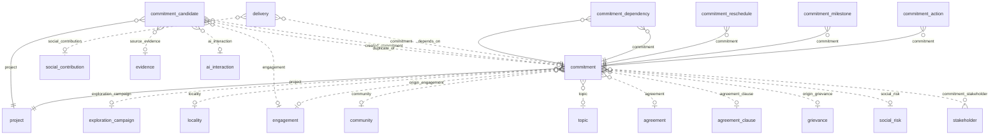

### `commitment`

**Compromiso** (BC-05). Obligación que el proyecto asume ante grupos de interés, con los campos de la matriz de DOC-01
§9.3.1.2; núcleo del sistema. Tabla física `app_data.commitment__<org8>`. Requisitos: RF-COM-001, RF-COM-002,
RF-COM-005, RF-COM-007, RF-COM-009, RN-COM-004, RN-ENG-001, RN-ENG-002, RN-WFL-001, RQ-DSH-003, ASM-023, ASM-063.

| Campo | Tipo | Req. | Único | Descripción | Fuente |
|---|---|---|---|---|---|
| `code` | TEXT | sí | compuesto | Código del compromiso en el proyecto. | RF-COM-001 |
| `title` | TEXT | sí | — | Título. | RF-COM-001 |
| `description` | LONG_TEXT | no | — | Descripción. | RF-COM-001 |
| `objective` | LONG_TEXT | no | — | Objetivo. | RF-COM-001 |
| `resource_type` | ENUM `resource_type` | no | — | Tipo de recurso; decide la evidencia mínima (ASM-009). | RF-COM-001 |
| `quantity` | DECIMAL | no | — | Cantidad. | RF-COM-001 |
| `unit` | TEXT | no | — | Unidad. | RF-COM-001 |
| `execution_time` | TEXT | no | — | Tiempo de ejecución (texto). | RF-COM-001 |
| `commitment_theme` | ENUM `commitment_theme` | no | — | Tema del compromiso. | RF-COM-009 |
| `formality` | ENUM `commitment_formality` | no | — | Formal (escrito) o no. | RF-COM-009 |
| `request_medium` | ENUM `request_medium` | no | — | Cómo se pidió. | RF-COM-001 |
| `agreed_date` | DATE | no | — | Fecha del acuerdo. | RF-COM-001 |
| `due_date` | DATE | no | — | Fecha de vencimiento; desde `approved` solo cambia por reprogramación. | RF-COM-003 |
| `amount` | DECIMAL | sí | — | Monto comprometido; todo compromiso tiene monto. | RN-COM-004 |
| `currency` | ENUM `currency` | sí | — | Moneda del monto. Por defecto: PEN. | RNF-I18N-002 |
| `executed_amount` | DECIMAL | no | — | (derivado) Suma de `delivered_amount` de sus entregas (ASM-063). | RQ-DSH-021 |
| `priority` | ENUM `priority` | no | — | Prioridad. | [PRM-01 §5] |
| `owner_user_id` | UUID | no | — | Responsable (ASM-023). | RF-COM-005 |
| `owner_user_email` | EMAIL | no | — | Correo del responsable. | RF-COM-005 |
| `verifier_user_id` | UUID | no | — | Verificador, distinto del responsable. | RN-COM-005 |
| `verifier_user_email` | EMAIL | no | — | Correo del verificador. | RN-COM-005 |
| `delay_risk_reported` | BOOLEAN | no | — | El responsable informó riesgo de retraso. | RF-COM-007 |
| `delay_risk_note` | LONG_TEXT | no | — | Detalle del riesgo de retraso. | RF-COM-007 |
| `deadline_status` | ENUM `deadline_status` | no | — | (derivado) Situación de plazo; nunca es un estado de WF-D. | RN-WFL-001 |
| `beneficiaries_count` | INTEGER | no | — | Beneficiarios en total. | RF-COM-001 |
| `beneficiaries_female_count` | INTEGER | no | — | Beneficiarias. | RF-COM-001 |
| `beneficiaries_male_count` | INTEGER | no | — | Beneficiarios varones. | RF-COM-001 |
| `beneficiaries_detail` | LONG_TEXT | no | — | (restringido) Nombre, sexo y edad de los beneficiarios. | RQ-SEC-010 |
| `origin_justification` | LONG_TEXT | no | — | Justificación cuando nace de un taller o una reunión informativa. | RN-ENG-001 |
| `requires_senior_approval` | BOOLEAN | no | — | (derivado) Informa si requiere aprobación de nivel superior; la guarda no lo lee. | RN-ENG-002 |
| `fulfilled_date` | DATE | no | — | (derivado) Fecha (America/Lima) de la transición a `fulfilled`. | RQ-DSH-020 |
| `closed_date` | DATE | no | — | (derivado) Fecha (America/Lima) de la transición a `closed`. | RQ-DSH-020 |
| `cancelled_date` | DATE | no | — | (derivado) Fecha (America/Lima) de la transición a `cancelled`. | RQ-DSH-003 |
| `location` | GEOMETRY (POINT) | no | — | Ubicación. | RF-COM-005 |

| Relación | Tipo | Campo | Destino | Req. | Nota |
|---|---|---|---|---|---|
| `commitment_project` | MANY_TO_ONE | `project` | `project` | sí | — |
| `commitment_exploration_campaign` | MANY_TO_ONE | `exploration_campaign` | `exploration_campaign` | no | — |
| `commitment_locality` | MANY_TO_ONE | `locality` | `locality` | no | — |
| `commitment_community` | MANY_TO_ONE | `community` | `community` | no | — |
| `commitment_topic` | MANY_TO_ONE | `topic` | `topic` | no | — |
| `commitment_origin_engagement` | MANY_TO_ONE | `origin_engagement` | `engagement` | no | Interacción de origen |
| `commitment_agreement` | MANY_TO_ONE | `agreement` | `agreement` | no | — |
| `commitment_agreement_clause` | MANY_TO_ONE | `agreement_clause` | `agreement_clause` | no | — |
| `commitment_origin_grievance` | MANY_TO_ONE | `origin_grievance` | `grievance` | no | Queja de origen; desde F4 |
| `commitment_social_risk` | MANY_TO_ONE | `social_risk` | `social_risk` | no | Riesgo que atiende; desde F4 |
| `commitment_stakeholder` | MANY_TO_MANY | — | `stakeholder` | — | Grupos de interés solicitantes |
| `evidence_commitment` | MANY_TO_MANY | — | `evidence` | — | Inversa; se define en `evidence` |

- **Flags:** `appendOnly` no · `apiOnly` no · `requiresReason` sí.
- **Únicos:** `uniqueConstraints` (`project`, `code`).
- **Índices declarados:** `indexed` en `due_date`, `owner_user_id`; `indexes` (`project`, `deadline_status`).
- **Acciones declaradas:** `APPROVE`, `VERIFY`, `EXPORT`, `APPROVE_OVER_CAP`.
- **Workflow:** WF-D.
- **Fase:** F3 · Release 1 (MVP).
- `amount` es un monto (ASM-092): `AmountFieldsGuard` lo acepta de 0 a 15 dígitos enteros y 4 decimales
  tras quitar los ceros finales, en el alta y en todo cambio de su valor; otro valor es `400` `INVALID_NUMBER` u
  `OUT_OF_RANGE` sobre `amount`.
- Índices: `due_date` para `DeadlineJob` (RN-WFL-001), `owner_user_id` para "mis compromisos" y el desglose por
  responsable (RQ-DSH-019), y (`project`, `deadline_status`) para los vencidos y por vencer de cada proyecto
  (RQ-DSH-018).
- `DerivedFieldsGuard` protege los derivados; `CommitmentWriteGuard` protege `due_date` desde `approved`, también en
  `cancelled` (`409` `DUE_DATE_RESCHEDULE_ONLY`): solo la cambia `POST /api/sgspe/commitments/{id}/reschedules`
  (RF-COM-003), que recalcula `deadline_status` en su transacción.
- Las relaciones hacia un objeto de proyecto (`exploration_campaign`, `origin_engagement`, `agreement`,
  `agreement_clause`) apuntan a registros del mismo `project` (`409` `PROJECT_MISMATCH`), al crear, al cambiar el
  vínculo y al cambiar el proyecto. Mover el destino a otro proyecto no se bloquea: es un límite conocido.
- `CommitmentDerivationsListener` escribe `fulfilled_date`, `closed_date` y `cancelled_date` en la transacción de su
  transición, y vacía `fulfilled_date` cuando `reopen_execution` devuelve el compromiso a ejecución; los tableros y la
  tendencia mensual las leen (RQ-DSH-003, RQ-DSH-020).

### `commitment_action`

**Acción del compromiso** (BC-05). Gestión interna o paso para cumplir un compromiso. Tabla física
`app_data.commitment_action__<org8>`. Requisitos: RF-COM-006.

| Campo | Tipo | Req. | Único | Descripción | Fuente |
|---|---|---|---|---|---|
| `description` | LONG_TEXT | sí | — | Acción. | RF-COM-006 |
| `action_date` | DATE | no | — | Fecha. | RF-COM-006 |
| `owner_user_id` | UUID | no | — | Responsable (ASM-023). | ASM-023 |
| `owner_user_email` | EMAIL | no | — | Correo del responsable. | ASM-023 |
| `completed` | BOOLEAN | no | — | Completada. | RF-COM-006 |

| Relación | Tipo | Campo | Destino | Req. | Nota |
|---|---|---|---|---|---|
| `commitment_action_commitment` | MANY_TO_ONE | `commitment` | `commitment` | sí | — |

- **Flags:** `appendOnly` no · `apiOnly` no · `requiresReason` no.
- **Únicos:** ninguno.
- **Índices declarados:** ninguno.
- **Acciones declaradas:** ninguna.
- **Workflow:** ninguno.
- **Fase:** F3 · Release 1 (MVP).

### `commitment_milestone`

**Hito del compromiso** (BC-05). Plazo parcial de un compromiso. Tabla física `app_data.commitment_milestone__<org8>`.
Requisitos: RF-COM-006.

| Campo | Tipo | Req. | Único | Descripción | Fuente |
|---|---|---|---|---|---|
| `description` | TEXT | sí | — | Hito. | RF-COM-006 |
| `due_date` | DATE | sí | — | Fecha prevista. | RF-COM-006 |
| `reached_date` | DATE | no | — | Fecha en que se alcanzó. | RF-COM-006 |

| Relación | Tipo | Campo | Destino | Req. | Nota |
|---|---|---|---|---|---|
| `commitment_milestone_commitment` | MANY_TO_ONE | `commitment` | `commitment` | sí | — |

- **Flags:** `appendOnly` no · `apiOnly` no · `requiresReason` no.
- **Únicos:** ninguno.
- **Índices declarados:** ninguno.
- **Acciones declaradas:** ninguna.
- **Workflow:** ninguno.
- **Fase:** F3 · Release 1 (MVP).

### `commitment_reschedule`

**Reprogramación** (BC-05). Cambio inmutable de la fecha de vencimiento de un compromiso, con las fechas anterior y
nueva y su motivo. Tabla física `app_data.commitment_reschedule__<org8>`. Requisitos: RF-COM-003.

| Campo | Tipo | Req. | Único | Descripción | Fuente |
|---|---|---|---|---|---|
| `previous_due_date` | DATE | sí | — | Fecha de vencimiento anterior. | RF-COM-003 |
| `new_due_date` | DATE | sí | — | Fecha de vencimiento nueva. | RF-COM-003 |
| `reschedule_reason` | LONG_TEXT | sí | — | Motivo. | RF-COM-003 |
| `agreed_with_stakeholder` | BOOLEAN | sí | — | Se acordó con el grupo de interés. | RF-COM-003 |

| Relación | Tipo | Campo | Destino | Req. | Nota |
|---|---|---|---|---|---|
| `commitment_reschedule_commitment` | MANY_TO_ONE | `commitment` | `commitment` | sí | — |

- **Flags:** `appendOnly` sí · `apiOnly` sí · `requiresReason` no.
- **Únicos:** ninguno.
- **Índices declarados:** ninguno.
- **Acciones declaradas:** ninguna.
- **Workflow:** ninguno.
- **Fase:** F3 · Release 1 (MVP).
- Lo crea `POST /api/sgspe/commitments/{id}/reschedules` en la misma transacción que actualiza `due_date` (RF-COM-003).

### `commitment_dependency`

**Dependencia entre compromisos** (BC-05). Relación entre compromisos: uno no se cumple mientras el otro siga abierto si
la dependencia es bloqueante. Tabla física `app_data.commitment_dependency__<org8>`. Requisitos: RF-COM-004.

| Campo | Tipo | Req. | Único | Descripción | Fuente |
|---|---|---|---|---|---|
| `blocking` | BOOLEAN | sí | — | La dependencia bloquea el cumplimiento. | RF-COM-004 |
| `notes` | TEXT | no | — | Notas. | RF-COM-004 |

| Relación | Tipo | Campo | Destino | Req. | Nota |
|---|---|---|---|---|---|
| `commitment_dependency_commitment` | MANY_TO_ONE | `commitment` | `commitment` | sí | Compromiso que depende |
| `commitment_dependency_depends_on` | MANY_TO_ONE | `depends_on` | `commitment` | sí | Compromiso del que depende |

- **Flags:** `appendOnly` no · `apiOnly` no · `requiresReason` no.
- **Únicos:** `uniqueConstraints` (`commitment`, `depends_on`).
- **Índices declarados:** ninguno.
- **Acciones declaradas:** ninguna.
- **Workflow:** ninguno.
- **Fase:** F3 · Release 1 (MVP).
- `CommitmentWriteGuard` rechaza los ciclos al crear o cambiar la dependencia (RF-COM-004): `400` `DEPENDENCY_SELF` y
  `409` `DEPENDENCY_CYCLE`, sobre `depends_on`. La búsqueda recorre hasta 500 compromisos (`409`
  `DEPENDENCY_GRAPH_TOO_LARGE`), lee como quien escribe y no se serializa: dos altas simultáneas `a → b` y `b → a`
  pueden pasar las dos (límite aceptado en F3).

### `delivery`

**Entrega** (BC-05). Entrega de lo comprometido o aportado, con fecha, receptores, conformidad, acta y fotos como
evidencias. Tabla física `app_data.delivery__<org8>`. Requisitos: RF-COM-008, RN-COM-001, ASM-009, ASM-063 [DOC-02 p.4].

| Campo | Tipo | Req. | Único | Descripción | Fuente |
|---|---|---|---|---|---|
| `delivery_date` | DATE | sí | — | Fecha de la entrega. | RF-COM-008 |
| `place` | TEXT | no | — | Lugar. | RF-COM-008 |
| `delivered_items` | LONG_TEXT | no | — | Qué se entregó. | RF-COM-008 |
| `delivered_amount` | DECIMAL | no | — | Monto entregado, solo en las entregas de compromisos y en su moneda; vacío en las de aportes (ASM-063). | ASM-063 |
| `recipients` | LONG_TEXT | no | — | (restringido) Receptores. | RQ-SEC-010 |
| `conformity_given` | BOOLEAN | sí | — | El grupo de interés dio conformidad. | RN-COM-001 |
| `conformity_by` | LONG_TEXT | no | — | (restringido) Quiénes dieron la conformidad. | RQ-SEC-010 |
| `location` | GEOMETRY (POINT) | no | — | Ubicación de la entrega. | RF-COM-008 |

| Relación | Tipo | Campo | Destino | Req. | Nota |
|---|---|---|---|---|---|
| `delivery_commitment` | MANY_TO_ONE | `commitment` | `commitment` | no | — |
| `delivery_social_contribution` | MANY_TO_ONE | `social_contribution` | `social_contribution` | no | desde F5 |
| `evidence_delivery` | MANY_TO_MANY | — | `evidence` | — | Inversa; se define en `evidence` |

- **Exactamente uno de:** (`commitment`, `social_contribution`), con `ExactlyOneGuard`.
- **Flags:** `appendOnly` no · `apiOnly` sí · `requiresReason` no.
- **Únicos:** `unique` en `social_contribution` (desde F5, ASM-111; wasichai no admite un único compuesto de un solo
  campo; las entregas de compromisos lo llevan vacío y no chocan).
- **Índices declarados:** ninguno.
- **Acciones declaradas:** ninguna.
- **Workflow:** ninguno.
- **Fase:** F3 · Release 1 (MVP).
- `delivered_amount` es un monto (ASM-092): `AmountFieldsGuard` lo acepta de 0 a 15 dígitos enteros y 4
  decimales tras quitar los ceros finales, en el alta y en todo cambio de su valor; otro valor es `400` `INVALID_NUMBER`
  u `OUT_OF_RANGE` sobre `delivered_amount`.
- Escriben `POST /api/sgspe/commitments/{id}/deliveries`, `PATCH /api/sgspe/deliveries/{id}` y, desde F5,
  `POST /api/sgspe/social-contributions/{id}/deliveries`. El «Acta de entrega» como documento de wasichai-documents
  (RQ-REP-029, AUT-03) espera a UPS-23, porque `recipients` y `conformity_by` son restringidos (ASM-090).
- La entrega de un compromiso en `fulfilled`, `verified`, `closed` o `cancelled` no cambia ni gana o pierde evidencias
  (`409` `DELIVERY_FROZEN` sobre `commitment`); su `commitment` no cambia nunca. En la matriz de compromisos EXTERNO,
  `place` se generaliza a la localidad del compromiso (`deliverables.md` §9.1).
- Desde F5, la entrega de un aporte (ASM-111): una por aporte (`409 DELIVERY_EXISTS`), capturada solo con el aporte en
  `procured`, sin `delivered_amount` (`400 FIELD_NOT_ALLOWED`); desde `delivered` y en `cancelled` no cambia ni gana o
  pierde evidencias (`409 DELIVERY_FROZEN` sobre `social_contribution`), y su `social_contribution` no cambia nunca. El
  «Acta de recepción» (AUT-04) espera a UPS-23: el acta firmada es una evidencia ACTA DE RECEPCION (ASM-116).
- Desde F5, `delivery` es un hijo con dos padres posibles, de los que lleva exactamente uno: se lee por el proyecto del
  compromiso o del aporte que tiene, nunca «sin padre, todos»; una entrega sin ninguno de los dos solo la leen `ADMIN`
  y quien tiene `READ_ALL_PROJECTS` (ASM-114, `security.md` §9.7).

### `commitment_candidate`

**Candidato a compromiso** (BC-05). Posible compromiso detectado por una persona o por la IA, con evidencia y confianza;
solo es compromiso si una persona lo acepta. Tabla física `app_data.commitment_candidate__<org8>`. Requisitos:
RF-COM-010, RF-AIK-003, RQ-AI-001, RQ-AI-003, RQ-AI-004.

| Campo | Tipo | Req. | Único | Descripción | Fuente |
|---|---|---|---|---|---|
| `proposed_text` | LONG_TEXT | sí | — | Texto propuesto. | RF-COM-010 |
| `evidence_quote` | LONG_TEXT | no | — | (restringido) Cita que lo sustenta, seudonimizada: marcadores en lugar de valores restringidos, como en `ai_suggestion` (RQ-AI-009). | RQ-AI-004 |
| `beneficiaries_text` | LONG_TEXT | no | — | Beneficiarios según la fuente. | RF-COM-010 |
| `suggested_owner_user_email` | EMAIL | no | — | Responsable sugerido. | RF-COM-010 |
| `suggested_due_date` | DATE | no | — | Fecha de vencimiento sugerida. | RF-COM-010 |
| `confidence` | DECIMAL | no | — | Confianza de la IA. | RQ-AI-004 |
| `ai_generated` | BOOLEAN | sí | — | Lo propuso la IA. | RF-COM-010 |

| Relación | Tipo | Campo | Destino | Req. | Nota |
|---|---|---|---|---|---|
| `candidate_project` | MANY_TO_ONE | `project` | `project` | sí | — |
| `candidate_engagement` | MANY_TO_ONE | `engagement` | `engagement` | no | Interacción de origen |
| `candidate_source_evidence` | MANY_TO_ONE | `source_evidence` | `evidence` | no | Documento de origen |
| `candidate_ai_interaction` | MANY_TO_ONE | `ai_interaction` | `ai_interaction` | no | Llamada a la IA que lo produjo; desde F7 |
| `candidate_created_commitment` | MANY_TO_ONE | `created_commitment` | `commitment` | no | Compromiso creado al aceptar |
| `candidate_duplicate_of` | MANY_TO_ONE | `duplicate_of` | `commitment` | no | Compromiso que ya lo cubre |

- **Flags:** `appendOnly` no · `apiOnly` sí · `requiresReason` no.
- **Únicos:** ninguno.
- **Índices declarados:** ninguno.
- **Acciones declaradas:** ninguna.
- **Workflow:** WF-K.
- **Fase:** F3 · Release 1 (MVP).
- Con IA desde F7. `CommandTransitionGuard` protege `accepted`, porque `apiOnly` no rechaza transiciones
  [WAS-DOC modules/workflow.md].
- `engagement`, `source_evidence`, `created_commitment` y `duplicate_of` apuntan a registros del mismo `project`
  (`409` `PROJECT_MISMATCH`); una evidencia sin proyecto, del tenant, se admite. El alta humana no escribe
  `ai_generated` (lo fija en falso), `confidence`, `created_commitment` ni `duplicate_of`; `duplicate_of` solo lo
  escribe `POST /api/sgspe/commitment-candidates/{id}/duplicate`.

## 11. BC-06 Acuerdos y convenios

Instrumentos formales, permisos de uso de terreno, servidumbres y autorizaciones de asamblea, cuyas cláusulas originan
compromisos (RF-AGR-001, RF-AGR-002, RF-AGR-003). La vigencia vencida es `validity_status` (RN-WFL-001).

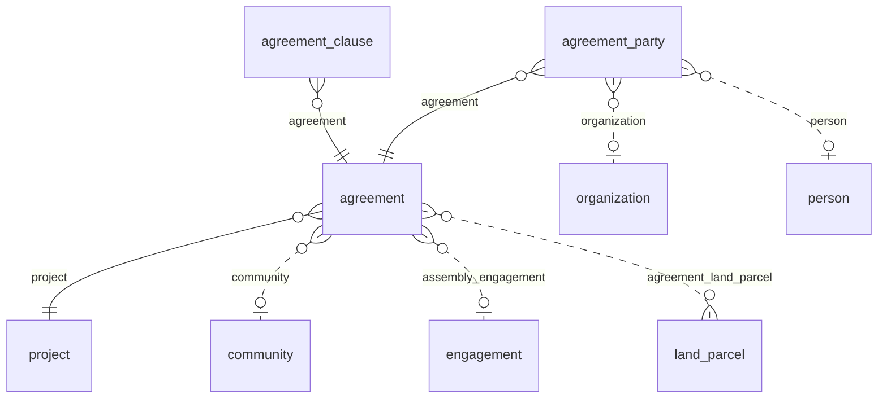

### `agreement`

**Acuerdo** (BC-06). Instrumento formal (acta de acuerdos, convenio, permiso de uso de terreno, servidumbre,
autorización de asamblea, alianza formal) con partes, cláusulas y vigencia. Tabla física `app_data.agreement__<org8>`.
Requisitos: RF-AGR-001, RF-AGR-002, RF-AGR-003, RN-INV-004, RN-WFL-001.

| Campo | Tipo | Req. | Único | Descripción | Fuente |
|---|---|---|---|---|---|
| `code` | TEXT | sí | compuesto | Código del acuerdo en el proyecto. | RF-AGR-001 |
| `title` | TEXT | sí | — | Título. | RF-AGR-001 |
| `agreement_type` | ENUM `agreement_type` | sí | — | Tipo de acuerdo; decide qué valida `AgreementWriteGuard`. | RF-AGR-001 |
| `summary` | LONG_TEXT | no | — | Resumen. | RF-AGR-001 |
| `signed_date` | DATE | no | — | Fecha de firma. | RF-AGR-001 |
| `effective_date` | DATE | no | — | Inicio de la vigencia. | RF-AGR-001 |
| `expiry_date` | DATE | no | — | Fin de la vigencia. | RF-AGR-001 |
| `amount` | DECIMAL | no | — | Monto. | RF-AGR-001 |
| `currency` | ENUM `currency` | no | — | Moneda. Por defecto: PEN. | RNF-I18N-002 |
| `validity_status` | ENUM `validity_status` | no | — | (derivado) Situación de vigencia; nunca es un estado de WF-I. | RN-WFL-001 |
| `owner_user_id` | UUID | no | — | Responsable (ASM-023). | ASM-023 |
| `owner_user_email` | EMAIL | no | — | Correo del responsable. | ASM-023 |

| Relación | Tipo | Campo | Destino | Req. | Nota |
|---|---|---|---|---|---|
| `agreement_project` | MANY_TO_ONE | `project` | `project` | sí | — |
| `agreement_community` | MANY_TO_ONE | `community` | `community` | no | Comunidad titular |
| `agreement_assembly_engagement` | MANY_TO_ONE | `assembly_engagement` | `engagement` | no | Asamblea que autoriza |
| `agreement_land_parcel` | MANY_TO_MANY | — | `land_parcel` | — | Predios afectados |
| `evidence_agreement` | MANY_TO_MANY | — | `evidence` | — | Inversa; se define en `evidence` |

- **Flags:** `appendOnly` no · `apiOnly` no · `requiresReason` sí.
- **Únicos:** `uniqueConstraints` (`project`, `code`).
- **Índices declarados:** `indexed` en `expiry_date`.
- **Acciones declaradas:** ninguna.
- **Workflow:** WF-I.
- **Fase:** F3 · Release 1 (MVP).
- `amount` es un monto (ASM-092): `AmountFieldsGuard` lo acepta de 0 a 15 dígitos enteros y 4 decimales
  tras quitar los ceros finales, en el alta y en todo cambio de su valor; otro valor es `400` `INVALID_NUMBER` u
  `OUT_OF_RANGE` sobre `amount`.
- `expiry_date` lleva índice para `DeadlineJob` (RN-WFL-001).

### `agreement_party`

**Parte del acuerdo** (BC-06). Organización o persona firmante de un acuerdo. Tabla física
`app_data.agreement_party__<org8>`. Requisitos: RF-AGR-001.

| Campo | Tipo | Req. | Único | Descripción | Fuente |
|---|---|---|---|---|---|
| `signatory_role` | TEXT | no | — | Rol del firmante. | RF-AGR-001 |
| `signed` | BOOLEAN | no | — | Firmó. | RF-AGR-001 |

| Relación | Tipo | Campo | Destino | Req. | Nota |
|---|---|---|---|---|---|
| `agreement_party_agreement` | MANY_TO_ONE | `agreement` | `agreement` | sí | — |
| `agreement_party_organization` | MANY_TO_ONE | `organization` | `organization` | no | — |
| `agreement_party_person` | MANY_TO_ONE | `person` | `person` | no | — |

- **Exactamente uno de:** (`organization`, `person`), con `ExactlyOneGuard`.
- **Flags:** `appendOnly` no · `apiOnly` no · `requiresReason` no.
- **Únicos:** ninguno.
- **Índices declarados:** ninguno.
- **Acciones declaradas:** ninguna.
- **Workflow:** ninguno.
- **Fase:** F3 · Release 1 (MVP).

### `agreement_clause`

**Cláusula** (BC-06). Disposición de un acuerdo que puede originar compromisos. Tabla física
`app_data.agreement_clause__<org8>`. Requisitos: RF-AGR-001, RF-COM-005.

| Campo | Tipo | Req. | Único | Descripción | Fuente |
|---|---|---|---|---|---|
| `clause_number` | TEXT | sí | compuesto | Número de la cláusula. | RF-AGR-001 |
| `clause_text` | LONG_TEXT | sí | — | Texto de la cláusula. | RF-AGR-001 |
| `creates_commitment` | BOOLEAN | no | — | La cláusula origina compromisos. | RF-COM-005 |

| Relación | Tipo | Campo | Destino | Req. | Nota |
|---|---|---|---|---|---|
| `agreement_clause_agreement` | MANY_TO_ONE | `agreement` | `agreement` | sí | — |

- **Flags:** `appendOnly` no · `apiOnly` no · `requiresReason` no.
- **Únicos:** `uniqueConstraints` (`agreement`, `clause_number`).
- **Índices declarados:** ninguno.
- **Acciones declaradas:** ninguna.
- **Workflow:** ninguno.
- **Fase:** F3 · Release 1 (MVP).

## 12. BC-07 Quejas, Consultas y Solicitudes (QCS)

Quejas, consultas y solicitudes son tres objetos con un workflow cada uno y un juego común de campos y relaciones
(ASM-011, CON-033). No hay un objeto "QCS" genérico: el reporte unificado lee los tres (RF-GRV-005).

```mermaid
erDiagram
    grievance }o--|| project : "project"
    grievance }o..o| stakeholder : "stakeholder"
    grievance }o..o| person : "person"
    grievance }o..o| locality : "locality"
    grievance }o..o| community : "community"
    grievance }o..o| topic : "topic"
    grievance }o..o| engagement : "origin_engagement"
    grievance }o..o| engagement_question : "origin_question"
    grievance }o..o| social_risk : "social_risk"
    grievance }o..o| incident : "incident"
    grievance }o..o| grievance : "duplicate_of"
    grievance }o..o| inquiry : "reclassified_from_inquiry"
    grievance }o..o| stakeholder_request : "reclassified_from_request"
    inquiry }o--|| project : "project"
    inquiry }o..o| stakeholder : "stakeholder"
    inquiry }o..o| person : "person"
    inquiry }o..o| locality : "locality"
    inquiry }o..o| community : "community"
    inquiry }o..o| topic : "topic"
    inquiry }o..o| engagement : "origin_engagement"
    inquiry }o..o| engagement_question : "origin_question"
    inquiry }o..o| grievance : "reclassified_from_grievance"
    inquiry }o..o| stakeholder_request : "reclassified_from_request"
    stakeholder_request }o--|| project : "project"
    stakeholder_request }o..o| stakeholder : "stakeholder"
    stakeholder_request }o..o| person : "person"
    stakeholder_request }o..o| locality : "locality"
    stakeholder_request }o..o| community : "community"
    stakeholder_request }o..o| topic : "topic"
    stakeholder_request }o..o| engagement : "origin_engagement"
    stakeholder_request }o..o| engagement_question : "origin_question"
    stakeholder_request }o..o| commitment : "created_commitment"
    stakeholder_request }o..o| social_contribution : "created_contribution"
    stakeholder_request }o..o| grievance : "reclassified_from_grievance"
    stakeholder_request }o..o| inquiry : "reclassified_from_inquiry"
```

### `grievance`

**Queja** (BC-07). Reclamo por una afectación atribuida al proyecto, que se acusa, evalúa, atiende, resuelve y cierra.
Tabla física `app_data.grievance__<org8>`. Requisitos: RF-GRV-001, RF-GRV-002, RF-GRV-006, RF-GRV-007, RN-GRV-002,
RQ-DSH-022, RQ-DSH-025, ASM-005, ASM-036.

| Campo | Tipo | Req. | Único | Descripción | Fuente |
|---|---|---|---|---|---|
| `code` | TEXT | sí | compuesto | Código en el proyecto. | RF-GRV-001 |
| `channel` | ENUM `qcs_channel` | no | — | Canal por el que llegó. | RF-GRV-001 |
| `received_at` | DATETIME | sí | — | Momento de recepción; base de los plazos. Un registro reclasificado copia el del primer registro de la cadena, y sus plazos corren desde esa fecha (ASM-072). | RF-GRV-006 |
| `received_by_user_id` | UUID | no | — | Usuario que la recibió (ASM-023). | ASM-023 |
| `received_by_user_email` | EMAIL | no | — | Correo de quien la recibió. | ASM-023 |
| `anonymous` | BOOLEAN | no | — | Anónima: sin `person` ni `stakeholder`. | RF-GRV-001 |
| `confidential` | BOOLEAN | no | — | Confidencial. | RF-GRV-001 |
| `category` | ENUM `qcs_category` | no | — | Categoría. | RF-GRV-001 |
| `description` | LONG_TEXT | sí | — | Descripción del planteamiento. | RF-GRV-001 |
| `priority` | ENUM `priority` | no | — | Prioridad. | RF-GRV-001 |
| `response_due_date` | DATE | no | — | (derivado) Plazo de respuesta (ASM-005). En la queja queda siempre vacío (ASM-100). | RF-GRV-006 |
| `deadline_status` | ENUM `deadline_status` | no | — | (derivado) Situación de plazo; nunca es un estado. | RN-WFL-001 |
| `owner_user_id` | UUID | no | — | Responsable (ASM-023). | ASM-023 |
| `owner_user_email` | EMAIL | no | — | Correo del responsable. | ASM-023 |
| `response` | LONG_TEXT | no | — | Respuesta. | RF-GRV-001 |
| `responded_at` | DATETIME | no | — | Momento de la respuesta. | RF-GRV-001 |
| `closed_date` | DATE | no | — | (derivado) Fecha (America/Lima) de la transición a un estado final: `closed`, `rejected` o `withdrawn`. | RQ-DSH-022 |
| `location` | GEOMETRY (POINT) | no | — | Ubicación. | RF-GRV-001 |
| `severity` | ENUM `grievance_severity` | no | — | Severidad (ASM-036). | RN-GRV-002 |
| `ack_due_date` | DATE | no | — | (derivado) Plazo de acuse: el n-ésimo día hábil posterior a la fecha de recepción en Lima (`BusinessDays`, ASM-005, ASM-096). | RF-GRV-006 |
| `resolution_due_date` | DATE | no | — | (derivado) Plazo de resolución (ASM-005). | RF-GRV-006 |
| `resolved_date` | DATE | no | — | (derivado) Fecha (America/Lima) de la transición a `resolved`; una reapertura la vacía. | RQ-DSH-025 |
| `resolution` | LONG_TEXT | no | — | Resolución. | RF-GRV-002 |
| `complainant_conformity_given` | BOOLEAN | no | — | El reclamante dio conformidad. | RF-GRV-002 |

| Relación | Tipo | Campo | Destino | Req. | Nota |
|---|---|---|---|---|---|
| `grievance_project` | MANY_TO_ONE | `project` | `project` | sí | — |
| `grievance_stakeholder` | MANY_TO_ONE | `stakeholder` | `stakeholder` | no | — |
| `grievance_person` | MANY_TO_ONE | `person` | `person` | no | Vacío si es anónima; restringido |
| `grievance_locality` | MANY_TO_ONE | `locality` | `locality` | no | — |
| `grievance_community` | MANY_TO_ONE | `community` | `community` | no | — |
| `grievance_topic` | MANY_TO_ONE | `topic` | `topic` | no | — |
| `grievance_origin_engagement` | MANY_TO_ONE | `origin_engagement` | `engagement` | no | Interacción de origen |
| `grievance_origin_question` | MANY_TO_ONE | `origin_question` | `engagement_question` | no | Pregunta de reunión que la originó |
| `grievance_social_risk` | MANY_TO_ONE | `social_risk` | `social_risk` | no | Riesgo relacionado |
| `grievance_incident` | MANY_TO_ONE | `incident` | `incident` | no | Incidente relacionado |
| `grievance_duplicate_of` | MANY_TO_ONE | `duplicate_of` | `grievance` | no | Queja de la que es duplicado |
| `grievance_reclassified_from_inquiry` | MANY_TO_ONE | `reclassified_from_inquiry` | `inquiry` | no | Consulta reclasificada |
| `grievance_reclassified_from_request` | MANY_TO_ONE | `reclassified_from_request` | `stakeholder_request` | no | Solicitud reclasificada |
| `evidence_grievance` | MANY_TO_MANY | — | `evidence` | — | Inversa; se define en `evidence` |

- **Flags:** `appendOnly` no · `apiOnly` no · `requiresReason` sí.
- **Únicos:** `uniqueConstraints` (`project`, `code`).
- **Índices declarados:** `indexed` en `received_at`; `indexes` (`project`, `deadline_status`).
- **Acciones declaradas:** `APPROVE`, `EXPORT`, `READ_CONFIDENTIAL`.
- **Workflow:** WF-E1.
- **Fase:** F4 · Release 1 (MVP).
- Confidencialidad por registro (ASM-095): con `confidential` verdadero, la queja solo la leen `ADMIN`, quien tiene
  `READ_CONFIDENTIAL`, su responsable, quien la recibió y, si es ALTA o CRITICA, quien tiene `APPROVE`
  (`ConfidentialAttentionScope`, `security.md` §9.6). El alta de una confidencial lleva `received_by_user_id` igual a
  quien escribe, salvo que tenga `READ_CONFIDENTIAL`.
- La queja mide `ack_due_date` en `received` y `resolution_due_date` después; `response_due_date` queda siempre vacío
  (ASM-100).
- Campos y relaciones comunes de las tres QCS (ASM-011); el reporte unificado los lee juntos (RF-GRV-005).
- Índices: `received_at` para los conteos por mes (RQ-DSH-024) y (`project`, `deadline_status`) para las QCS fuera de
  plazo (RQ-DSH-022). `QcsDueDatesListener` escribe los plazos al recibir (RF-GRV-006).
- `QcsTransitionDatesListener` escribe, en la transacción de la transición, `closed_date` al llegar a cualquier estado
  final (`closed` y, en la queja, también `rejected` y `withdrawn`, por `reject_*` y `withdraw_*`) y, en la queja,
  `resolved_date`; con ellas se miden el flujo y el tiempo de resolución (RQ-DSH-022, RQ-DSH-025).

### `inquiry`

**Consulta** (BC-07). Pregunta que requiere una respuesta del proyecto. Tabla física `app_data.inquiry__<org8>`.
Requisitos: RF-GRV-001, RF-GRV-003, RF-GRV-007.

| Campo | Tipo | Req. | Único | Descripción | Fuente |
|---|---|---|---|---|---|
| `code` | TEXT | sí | compuesto | Código en el proyecto. | RF-GRV-001 |
| `channel` | ENUM `qcs_channel` | no | — | Canal por el que llegó. | RF-GRV-001 |
| `received_at` | DATETIME | sí | — | Momento de recepción; base de los plazos. Un registro reclasificado copia el del primer registro de la cadena, y sus plazos corren desde esa fecha (ASM-072). | RF-GRV-006 |
| `received_by_user_id` | UUID | no | — | Usuario que la recibió (ASM-023). | ASM-023 |
| `received_by_user_email` | EMAIL | no | — | Correo de quien la recibió. | ASM-023 |
| `anonymous` | BOOLEAN | no | — | Anónima: sin `person` ni `stakeholder`. | RF-GRV-001 |
| `confidential` | BOOLEAN | no | — | Confidencial. | RF-GRV-001 |
| `category` | ENUM `qcs_category` | no | — | Categoría. | RF-GRV-001 |
| `description` | LONG_TEXT | sí | — | Descripción del planteamiento. | RF-GRV-001 |
| `priority` | ENUM `priority` | no | — | Prioridad. | RF-GRV-001 |
| `response_due_date` | DATE | no | — | (derivado) Plazo de respuesta (ASM-005). | RF-GRV-006 |
| `deadline_status` | ENUM `deadline_status` | no | — | (derivado) Situación de plazo; nunca es un estado. | RN-WFL-001 |
| `owner_user_id` | UUID | no | — | Responsable (ASM-023). | ASM-023 |
| `owner_user_email` | EMAIL | no | — | Correo del responsable. | ASM-023 |
| `response` | LONG_TEXT | no | — | Respuesta. | RF-GRV-001 |
| `responded_at` | DATETIME | no | — | Momento de la respuesta. | RF-GRV-001 |
| `closed_date` | DATE | no | — | (derivado) Fecha (America/Lima) de la transición a `closed`. | RQ-DSH-022 |
| `location` | GEOMETRY (POINT) | no | — | Ubicación. | RF-GRV-001 |

| Relación | Tipo | Campo | Destino | Req. | Nota |
|---|---|---|---|---|---|
| `inquiry_project` | MANY_TO_ONE | `project` | `project` | sí | — |
| `inquiry_stakeholder` | MANY_TO_ONE | `stakeholder` | `stakeholder` | no | — |
| `inquiry_person` | MANY_TO_ONE | `person` | `person` | no | Vacío si es anónima; restringido |
| `inquiry_locality` | MANY_TO_ONE | `locality` | `locality` | no | — |
| `inquiry_community` | MANY_TO_ONE | `community` | `community` | no | — |
| `inquiry_topic` | MANY_TO_ONE | `topic` | `topic` | no | — |
| `inquiry_origin_engagement` | MANY_TO_ONE | `origin_engagement` | `engagement` | no | Interacción de origen |
| `inquiry_origin_question` | MANY_TO_ONE | `origin_question` | `engagement_question` | no | Pregunta de reunión que la originó |
| `inquiry_reclassified_from_grievance` | MANY_TO_ONE | `reclassified_from_grievance` | `grievance` | no | Queja reclasificada |
| `inquiry_reclassified_from_request` | MANY_TO_ONE | `reclassified_from_request` | `stakeholder_request` | no | Solicitud reclasificada |
| `evidence_inquiry` | MANY_TO_MANY | — | `evidence` | — | Inversa; se define en `evidence` |

- **Flags:** `appendOnly` no · `apiOnly` no · `requiresReason` sí.
- **Únicos:** `uniqueConstraints` (`project`, `code`).
- **Índices declarados:** `indexed` en `received_at`; `indexes` (`project`, `deadline_status`).
- **Acciones declaradas:** `EXPORT`, `READ_CONFIDENTIAL`.
- **Workflow:** WF-E2.
- **Fase:** F4 · Release 1 (MVP).
- Confidencialidad por registro (ASM-095): con `confidential` verdadero, la consulta solo la leen `ADMIN`, quien tiene
  `READ_CONFIDENTIAL`, su responsable y quien la recibió (`ConfidentialAttentionScope`, `security.md` §9.6). El alta de
  una confidencial lleva `received_by_user_id` igual a quien escribe, salvo que tenga `READ_CONFIDENTIAL`.
- Campos y relaciones comunes de las tres QCS (ASM-011); el reporte unificado los lee juntos (RF-GRV-005).
- Índices: `received_at` para los conteos por mes (RQ-DSH-024) y (`project`, `deadline_status`) para las QCS fuera de
  plazo (RQ-DSH-022). `QcsDueDatesListener` escribe los plazos al recibir (RF-GRV-006).
- `QcsTransitionDatesListener` escribe, en la transacción de la transición, `closed_date` al llegar a cualquier estado
  final (`closed` y, en la queja, también `rejected` y `withdrawn`, por `reject_*` y `withdraw_*`) y, en la queja,
  `resolved_date`; con ellas se miden el flujo y el tiempo de resolución (RQ-DSH-022, RQ-DSH-025).

### `stakeholder_request`

**Solicitud** (BC-07). Pedido de apoyo, obra o recurso; si se acepta, origina un compromiso o un aporte. Tabla física
`app_data.stakeholder_request__<org8>`. Requisitos: RF-GRV-001, RF-GRV-004, RF-GRV-007, RN-GRV-001.

| Campo | Tipo | Req. | Único | Descripción | Fuente |
|---|---|---|---|---|---|
| `code` | TEXT | sí | compuesto | Código en el proyecto. | RF-GRV-001 |
| `channel` | ENUM `qcs_channel` | no | — | Canal por el que llegó. | RF-GRV-001 |
| `received_at` | DATETIME | sí | — | Momento de recepción; base de los plazos. Un registro reclasificado copia el del primer registro de la cadena, y sus plazos corren desde esa fecha (ASM-072). | RF-GRV-006 |
| `received_by_user_id` | UUID | no | — | Usuario que la recibió (ASM-023). | ASM-023 |
| `received_by_user_email` | EMAIL | no | — | Correo de quien la recibió. | ASM-023 |
| `anonymous` | BOOLEAN | no | — | Anónima: sin `person` ni `stakeholder`. | RF-GRV-001 |
| `confidential` | BOOLEAN | no | — | Confidencial. | RF-GRV-001 |
| `category` | ENUM `qcs_category` | no | — | Categoría. | RF-GRV-001 |
| `description` | LONG_TEXT | sí | — | Descripción del planteamiento. | RF-GRV-001 |
| `priority` | ENUM `priority` | no | — | Prioridad. | RF-GRV-001 |
| `response_due_date` | DATE | no | — | (derivado) Plazo de respuesta (ASM-005). | RF-GRV-006 |
| `deadline_status` | ENUM `deadline_status` | no | — | (derivado) Situación de plazo; nunca es un estado. | RN-WFL-001 |
| `owner_user_id` | UUID | no | — | Responsable (ASM-023). | ASM-023 |
| `owner_user_email` | EMAIL | no | — | Correo del responsable. | ASM-023 |
| `response` | LONG_TEXT | no | — | Respuesta. | RF-GRV-001 |
| `responded_at` | DATETIME | no | — | Momento de la respuesta. | RF-GRV-001 |
| `closed_date` | DATE | no | — | (derivado) Fecha (America/Lima) de la transición a `closed`. | RQ-DSH-022 |
| `location` | GEOMETRY (POINT) | no | — | Ubicación. | RF-GRV-001 |
| `request_medium` | ENUM `request_medium` | no | — | Medio de la solicitud. | RF-GRV-004 |
| `requested_resource` | LONG_TEXT | no | — | Recurso pedido. | RF-GRV-004 |

| Relación | Tipo | Campo | Destino | Req. | Nota |
|---|---|---|---|---|---|
| `request_project` | MANY_TO_ONE | `project` | `project` | sí | — |
| `request_stakeholder` | MANY_TO_ONE | `stakeholder` | `stakeholder` | no | — |
| `request_person` | MANY_TO_ONE | `person` | `person` | no | Vacío si es anónima; restringido |
| `request_locality` | MANY_TO_ONE | `locality` | `locality` | no | — |
| `request_community` | MANY_TO_ONE | `community` | `community` | no | — |
| `request_topic` | MANY_TO_ONE | `topic` | `topic` | no | — |
| `request_origin_engagement` | MANY_TO_ONE | `origin_engagement` | `engagement` | no | Interacción de origen |
| `request_origin_question` | MANY_TO_ONE | `origin_question` | `engagement_question` | no | Pregunta de reunión que la originó |
| `request_created_commitment` | MANY_TO_ONE | `created_commitment` | `commitment` | no | Compromiso creado al aceptar |
| `request_created_contribution` | MANY_TO_ONE | `created_contribution` | `social_contribution` | no | Aporte creado al aceptar; desde F5 |
| `request_reclassified_from_grievance` | MANY_TO_ONE | `reclassified_from_grievance` | `grievance` | no | Queja reclasificada |
| `request_reclassified_from_inquiry` | MANY_TO_ONE | `reclassified_from_inquiry` | `inquiry` | no | Consulta reclasificada |
| `evidence_stakeholder_request` | MANY_TO_MANY | — | `evidence` | — | Inversa; se define en `evidence` |

- **Flags:** `appendOnly` no · `apiOnly` no · `requiresReason` sí.
- **Únicos:** `uniqueConstraints` (`project`, `code`).
- **Índices declarados:** `indexed` en `received_at`; `indexes` (`project`, `deadline_status`).
- **Acciones declaradas:** `EXPORT`, `READ_CONFIDENTIAL`.
- **Workflow:** WF-E3.
- **Fase:** F4 · Release 1 (MVP).
- Confidencialidad por registro (ASM-095): con `confidential` verdadero, la solicitud solo la leen `ADMIN`, quien tiene
  `READ_CONFIDENTIAL`, su responsable y quien la recibió (`ConfidentialAttentionScope`, `security.md` §9.6). El alta de
  una confidencial lleva `received_by_user_id` igual a quien escribe, salvo que tenga `READ_CONFIDENTIAL`.
- `response_due_date` y `deadline_status` quedan vacíos mientras GAP-005 no fije un plazo de solicitudes (ASM-100).
- Campos y relaciones comunes de las tres QCS (ASM-011); el reporte unificado los lee juntos (RF-GRV-005).
- Índices: `received_at` para los conteos por mes (RQ-DSH-024) y (`project`, `deadline_status`) para las QCS fuera de
  plazo (RQ-DSH-022). `QcsDueDatesListener` escribe los plazos al recibir (RF-GRV-006).
- `QcsTransitionDatesListener` escribe, en la transacción de la transición, `closed_date` al llegar a cualquier estado
  final (`closed` y, en la queja, también `rejected` y `withdrawn`, por `reject_*` y `withdraw_*`) y, en la queja,
  `resolved_date`; con ellas se miden el flujo y el tiempo de resolución (RQ-DSH-022, RQ-DSH-025).
- Al cerrar el compromiso creado y, desde F5, el aporte creado, `RequestClosureListener` cierra la solicitud
  (RN-GRV-001, ASM-068). Si el compromiso o el aporte se cancela o se rechaza, la solicitud se cierra a mano con
  `close_unfulfilled`.
- `created_commitment` y, desde F5, `created_contribution` solo los escribe la aceptación: una persona que los fija,
  cambia o vacía por la API genérica recibe `403 COMMAND_ONLY` (`AttentionCommandFieldsGuard`, ASM-117).

## 13. BC-08 Riesgos sociales

Matriz de riesgos con revisiones inmutables, medidas e impactos potenciales [DOC-01 §9.3.2]. La revisión semanal es un
trabajo programado más una tarea, nunca un estado (RN-RSK-001, RN-WFL-001).

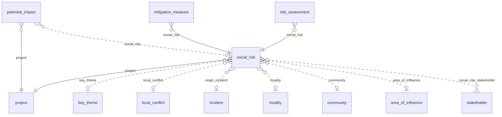

### `social_risk`

**Riesgo social** (BC-08). Tema social que puede impedir el normal desarrollo del proyecto, con los valores vigentes de
su última revisión y su riesgo residual. Tabla física `app_data.social_risk__<org8>`. Requisitos: RF-RSK-001,
RF-RSK-003, RF-RSK-005, RN-RSK-002, RN-RSK-003, RN-WFL-001, ASM-004, CON-011.

| Campo | Tipo | Req. | Único | Descripción | Fuente |
|---|---|---|---|---|---|
| `code` | TEXT | sí | compuesto | Código del riesgo en el proyecto. | RF-RSK-001 |
| `title` | TEXT | sí | — | Título. | RF-RSK-001 |
| `risk_source` | LONG_TEXT | no | — | Fuente del riesgo. | RF-RSK-001 |
| `category` | ENUM `risk_category` | no | — | Categoría de riesgo. | RF-RSK-001 |
| `impact_type` | ENUM `impact_type` | no | — | Tipo de impacto (sub-lista de tipo). | RF-RSK-001 |
| `impact_nature` | ENUM `impact_nature` | no | — | Naturaleza del impacto (sub-lista de naturaleza). | RF-RSK-001 |
| `probability` | INTEGER | no | — | (derivado) Probabilidad de la última revisión. | RN-RSK-002 |
| `impact` | INTEGER | no | — | (derivado) Impacto de la última revisión. | RN-RSK-002 |
| `score` | INTEGER | no | — | (derivado) Puntaje P × I de la última revisión. | RN-RSK-002 |
| `risk_level` | ENUM `risk_level` | no | — | (derivado) Nivel por los umbrales del proyecto (ASM-004). | RN-RSK-002 |
| `treatment_decision` | ENUM `treatment_decision` | no | — | Decisión de tratamiento. | RF-RSK-003 |
| `treatment_rationale` | LONG_TEXT | no | — | Razón de la decisión. | RF-RSK-003 |
| `current_controls` | LONG_TEXT | no | — | Acciones actuales. | RF-RSK-003 |
| `monitoring_sources` | LONG_TEXT | no | — | Fuentes de monitoreo. | RF-RSK-003 |
| `controls_adequate` | BOOLEAN | no | — | Las acciones actuales son adecuadas. | RF-RSK-003 |
| `residual_probability` | INTEGER | no | — | (derivado) Probabilidad residual. | RN-RSK-003 |
| `residual_impact` | INTEGER | no | — | (derivado) Impacto residual. | RN-RSK-003 |
| `residual_score` | INTEGER | no | — | (derivado) Puntaje residual. | RN-RSK-003 |
| `residual_level` | ENUM `risk_level` | no | — | (derivado) Nivel residual. | RN-RSK-003 |
| `review_every_days` | INTEGER | no | — | Días entre revisiones, de 1 a 365 (`400 OUT_OF_RANGE` fuera de rango); vacío = `risk_review_days` del proyecto. | RN-RSK-001 |
| `next_review_date` | DATE | no | — | (derivado) Fecha de la próxima revisión. | RN-RSK-001 |
| `review_status` | ENUM `review_status` | no | — | (derivado) Situación de revisión; nunca es un estado de WF-F. | RN-WFL-001 |
| `owner_user_id` | UUID | no | — | Responsable (ASM-023). | RF-RSK-001 |
| `owner_user_email` | EMAIL | no | — | Correo del responsable. | RF-RSK-001 |
| `close_reason` | LONG_TEXT | no | — | Motivo de cierre. | RN-RSK-003 |
| `location` | GEOMETRY (POINT) | no | — | Ubicación. | RF-RSK-001 |

| Relación | Tipo | Campo | Destino | Req. | Nota |
|---|---|---|---|---|---|
| `social_risk_project` | MANY_TO_ONE | `project` | `project` | sí | — |
| `social_risk_key_theme` | MANY_TO_ONE | `key_theme` | `key_theme` | no | — |
| `social_risk_local_conflict` | MANY_TO_ONE | `local_conflict` | `local_conflict` | no | — |
| `social_risk_origin_incident` | MANY_TO_ONE | `origin_incident` | `incident` | no | Incidente de origen |
| `social_risk_locality` | MANY_TO_ONE | `locality` | `locality` | no | — |
| `social_risk_community` | MANY_TO_ONE | `community` | `community` | no | — |
| `social_risk_area_of_influence` | MANY_TO_ONE | `area_of_influence` | `area_of_influence` | no | — |
| `social_risk_stakeholder` | MANY_TO_MANY | — | `stakeholder` | — | Grupos de interés involucrados |
| `evidence_social_risk` | MANY_TO_MANY | — | `evidence` | — | Inversa; se define en `evidence` |

- **Flags:** `appendOnly` no · `apiOnly` no · `requiresReason` sí.
- **Únicos:** `uniqueConstraints` (`project`, `code`).
- **Índices declarados:** `indexed` en `next_review_date`.
- **Acciones declaradas:** `EXPORT`.
- **Workflow:** WF-F.
- **Fase:** F4 · Release 1 (MVP).
- Los valores vigentes y los residuales los escribe `POST /api/sgspe/social-risks/{id}/assessments` en su transacción;
  `next_review_date` lleva índice para `DeadlineJob` (RN-RSK-001).

### `risk_assessment`

**Revisión de riesgo** (BC-08). Evaluación periódica e inmutable de un riesgo, residual o no, con su tendencia. Tabla
física `app_data.risk_assessment__<org8>`. Requisitos: RF-RSK-002, RN-RSK-001, RN-RSK-002, RQ-DSH-026, RQ-DSH-027.

| Campo | Tipo | Req. | Único | Descripción | Fuente |
|---|---|---|---|---|---|
| `assessment_date` | DATE | sí | — | Fecha de la revisión. | RF-RSK-002 |
| `probability` | INTEGER | sí | — | Probabilidad de 1 a 5. | RN-RSK-002 |
| `impact` | INTEGER | sí | — | Impacto de 1 a 5. | RN-RSK-002 |
| `score` | INTEGER | sí | — | Puntaje P × I. | RN-RSK-002 |
| `risk_level` | ENUM `risk_level` | sí | — | Nivel por los umbrales del proyecto (ASM-004). | RN-RSK-002 |
| `residual` | BOOLEAN | sí | — | Es la evaluación del riesgo residual. | RN-RSK-003 |
| `trend` | ENUM `risk_trend` | no | — | Tendencia frente a la revisión anterior; vacía en la primera. | RF-RSK-002 |
| `notes` | LONG_TEXT | no | — | Notas. | RF-RSK-002 |
| `assessor_user_id` | UUID | sí | — | Usuario que revisa (ASM-023). | ASM-023 |
| `assessor_user_email` | EMAIL | sí | — | Correo de quien revisa. | ASM-023 |

| Relación | Tipo | Campo | Destino | Req. | Nota |
|---|---|---|---|---|---|
| `risk_assessment_social_risk` | MANY_TO_ONE | `social_risk` | `social_risk` | sí | — |

- **Flags:** `appendOnly` sí · `apiOnly` sí · `requiresReason` no.
- **Únicos:** ninguno.
- **Índices declarados:** `indexes` (`social_risk`, `assessment_date`).
- **Acciones declaradas:** ninguna.
- **Workflow:** ninguno.
- **Fase:** F4 · Release 1 (MVP).
- Lo escribe solo el endpoint de revisiones, que valida los rangos de 1 a 5. El índice (`social_risk`,
  `assessment_date`) sirve a la tendencia y al mapa de calor (RQ-DSH-026, RQ-DSH-027).

### `mitigation_measure`

**Medida de mitigación** (BC-08). Acción del plan que reduce la probabilidad o la consecuencia de un riesgo. Tabla
física `app_data.mitigation_measure__<org8>`. Requisitos: RF-RSK-003, RN-RSK-003, RQ-DSH-027.

| Campo | Tipo | Req. | Único | Descripción | Fuente |
|---|---|---|---|---|---|
| `description` | LONG_TEXT | sí | — | Medida. | RF-RSK-003 |
| `owner_user_id` | UUID | no | — | Responsable (ASM-023); `mitigating` exige al menos una medida con responsable. | RN-RSK-003 |
| `owner_user_email` | EMAIL | no | — | Correo del responsable. | RN-RSK-003 |
| `planned_date` | DATE | no | — | Fecha planificada. | RF-RSK-003 |
| `completed_date` | DATE | no | — | Fecha en que se completó. | RQ-DSH-027 |
| `completed` | BOOLEAN | no | — | Completada. | RQ-DSH-027 |

| Relación | Tipo | Campo | Destino | Req. | Nota |
|---|---|---|---|---|---|
| `mitigation_measure_social_risk` | MANY_TO_ONE | `social_risk` | `social_risk` | sí | — |

- **Flags:** `appendOnly` no · `apiOnly` no · `requiresReason` no.
- **Únicos:** ninguno.
- **Índices declarados:** ninguno.
- **Acciones declaradas:** ninguna.
- **Workflow:** ninguno.
- **Fase:** F4 · Release 1 (MVP).

### `potential_impact`

**Impacto potencial** (BC-08). Impacto ambiental o social, real o percibido, positivo o negativo, asociado a un tipo de
actividad. Tabla física `app_data.potential_impact__<org8>`. Requisitos: RF-RSK-004 [DOC-01 Tabla 9.4].

| Campo | Tipo | Req. | Único | Descripción | Fuente |
|---|---|---|---|---|---|
| `activity_type` | ENUM `campaign_activity_type` | no | — | Tipo de actividad que lo origina. | RF-RSK-004 |
| `description` | LONG_TEXT | sí | — | Impacto. | RF-RSK-004 |
| `impact_type` | ENUM `impact_type` | no | — | Tipo (sub-lista de tipo). | RF-RSK-004 |
| `impact_nature` | ENUM `impact_nature` | no | — | Naturaleza (sub-lista de naturaleza). | RF-RSK-004 |
| `impact_sign` | ENUM `impact_sign` | no | — | Signo (sub-lista de signo). | RF-RSK-004 |

| Relación | Tipo | Campo | Destino | Req. | Nota |
|---|---|---|---|---|---|
| `potential_impact_project` | MANY_TO_ONE | `project` | `project` | sí | — |
| `potential_impact_social_risk` | MANY_TO_ONE | `social_risk` | `social_risk` | no | Riesgo que origina |

- **Flags:** `appendOnly` no · `apiOnly` no · `requiresReason` no.
- **Únicos:** ninguno.
- **Índices declarados:** ninguno.
- **Acciones declaradas:** ninguna.
- **Workflow:** ninguno.
- **Fase:** F4 · Release 1 (MVP).

## 14. BC-09 Alerta temprana e incidentes

Hechos ocurridos, menciones en medios, señales, reglas y alertas. Confirmar o descartar una alerta es siempre humano
(RN-EWS-001).

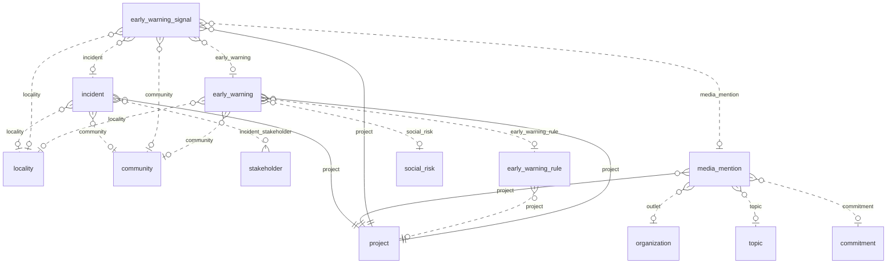

### `incident`

**Incidente** (BC-09). Hecho social ocurrido (expulsión, retención de vehículo, bloqueo, protesta…) con su respuesta
inmediata y sus consecuencias. Tabla física `app_data.incident__<org8>`. Requisitos: RF-EWS-001 [DOC-02 p.2].

| Campo | Tipo | Req. | Único | Descripción | Fuente |
|---|---|---|---|---|---|
| `code` | TEXT | sí | compuesto | Código del incidente en el proyecto. | RF-EWS-001 |
| `incident_type` | ENUM `incident_type` | no | — | Tipo de incidente. | RF-EWS-001 |
| `occurred_at` | DATETIME | sí | — | Momento en que ocurrió. | RF-EWS-001 |
| `place` | TEXT | no | — | Lugar. | RF-EWS-001 |
| `description` | LONG_TEXT | sí | — | Descripción. | RF-EWS-001 |
| `immediate_response` | LONG_TEXT | no | — | Respuesta inmediata. | RF-EWS-001 |
| `consequences` | LONG_TEXT | no | — | Consecuencias. | RF-EWS-001 |
| `location` | GEOMETRY (POINT) | no | — | Ubicación. | RF-EWS-001 |

| Relación | Tipo | Campo | Destino | Req. | Nota |
|---|---|---|---|---|---|
| `incident_project` | MANY_TO_ONE | `project` | `project` | sí | — |
| `incident_locality` | MANY_TO_ONE | `locality` | `locality` | no | — |
| `incident_community` | MANY_TO_ONE | `community` | `community` | no | — |
| `incident_stakeholder` | MANY_TO_MANY | — | `stakeholder` | — | Actores involucrados |
| `evidence_incident` | MANY_TO_MANY | — | `evidence` | — | Inversa; se define en `evidence` |

- **Flags:** `appendOnly` no · `apiOnly` no · `requiresReason` no.
- **Únicos:** `uniqueConstraints` (`project`, `code`).
- **Índices declarados:** `indexed` en `occurred_at`.
- **Acciones declaradas:** ninguna.
- **Workflow:** WF-M.
- **Fase:** F4 · Release 1 (MVP).
- `occurred_at` lleva índice porque las reglas de alerta cuentan incidentes en una ventana de días (RF-EWS-004).

### `media_mention`

**Mención en medios** (BC-09). Nota de prensa, radio o redes sobre el proyecto, con su tono; un comunicado sobre un
compromiso cumplido también lo es (ASM-029). Tabla física `app_data.media_mention__<org8>`. Requisitos: RF-EWS-002,
RQ-DSH-016, RQ-DSH-017, ASM-029, ASM-050, GAP-023.

| Campo | Tipo | Req. | Único | Descripción | Fuente |
|---|---|---|---|---|---|
| `outlet_name` | TEXT | no | — | Nombre del medio (texto). | RF-EWS-002 |
| `published_date` | DATE | sí | — | Fecha de publicación. | RF-EWS-002 |
| `url` | URL | no | — | Enlace; el servidor nunca lo descarga (ASM-050). | RF-EWS-002 |
| `headline` | TEXT | sí | — | Titular. | RF-EWS-002 |
| `summary` | LONG_TEXT | no | — | Resumen. | RF-EWS-002 |
| `tone` | ENUM `mention_tone` | no | — | Tono de la mención. | RQ-DSH-017 |
| `reports_fulfilled_commitment` | BOOLEAN | no | — | Informa sobre un compromiso cumplido (ASM-029). | RQ-DSH-016 |

| Relación | Tipo | Campo | Destino | Req. | Nota |
|---|---|---|---|---|---|
| `media_mention_project` | MANY_TO_ONE | `project` | `project` | sí | — |
| `media_mention_outlet` | MANY_TO_ONE | `outlet` | `organization` | no | Medio de comunicación |
| `media_mention_topic` | MANY_TO_ONE | `topic` | `topic` | no | — |
| `media_mention_commitment` | MANY_TO_ONE | `commitment` | `commitment` | no | — |
| `evidence_media_mention` | MANY_TO_MANY | — | `evidence` | — | Inversa; se define en `evidence` |

- **Flags:** `appendOnly` no · `apiOnly` no · `requiresReason` no.
- **Únicos:** ninguno.
- **Índices declarados:** `indexed` en `published_date`.
- **Acciones declaradas:** ninguna.
- **Workflow:** ninguno.
- **Fase:** F4 · Release 1 (MVP).
- `published_date` lleva índice para los indicadores del periodo y la regla de menciones negativas (RQ-DSH-017,
  RF-EWS-004).

### `early_warning_signal`

**Señal de alerta** (BC-09). Dato que puede anticipar un conflicto, con su fuente; alimenta reglas y alertas. Tabla
física `app_data.early_warning_signal__<org8>`. Requisitos: RF-EWS-003, ASM-043, GAP-020.

| Campo | Tipo | Req. | Único | Descripción | Fuente |
|---|---|---|---|---|---|
| `source_type` | ENUM `signal_source` | no | — | Fuente de la señal. | RF-EWS-003 |
| `received_at` | DATETIME | sí | — | Momento en que se recibió. | RF-EWS-003 |
| `description` | LONG_TEXT | sí | — | Descripción. | RF-EWS-003 |
| `reported_via` | TEXT | no | — | Cómo llegó (por ejemplo, a través del equipo social, ASM-043). | RF-EWS-003 |
| `location` | GEOMETRY (POINT) | no | — | Ubicación. | RF-EWS-003 |

| Relación | Tipo | Campo | Destino | Req. | Nota |
|---|---|---|---|---|---|
| `early_warning_signal_project` | MANY_TO_ONE | `project` | `project` | sí | — |
| `early_warning_signal_locality` | MANY_TO_ONE | `locality` | `locality` | no | — |
| `early_warning_signal_community` | MANY_TO_ONE | `community` | `community` | no | — |
| `early_warning_signal_media_mention` | MANY_TO_ONE | `media_mention` | `media_mention` | no | — |
| `early_warning_signal_incident` | MANY_TO_ONE | `incident` | `incident` | no | — |
| `early_warning_signal_early_warning` | MANY_TO_ONE | `early_warning` | `early_warning` | no | Alerta que alimenta |

- **Flags:** `appendOnly` no · `apiOnly` no · `requiresReason` no.
- **Únicos:** ninguno.
- **Índices declarados:** `indexed` en `received_at`.
- **Acciones declaradas:** ninguna.
- **Workflow:** ninguno.
- **Fase:** F4 · Release 1 (MVP).
- `received_at` lleva índice porque las reglas cuentan señales en una ventana de días (RF-EWS-004).

### `early_warning_rule`

**Regla de alerta** (BC-09). Condición configurable que convierte señales o datos en una alerta; nunca decide. Tabla
física `app_data.early_warning_rule__<org8>`. Requisitos: RF-EWS-004.

| Campo | Tipo | Req. | Único | Descripción | Fuente |
|---|---|---|---|---|---|
| `name` | TEXT | sí | — | Nombre. | RF-EWS-004 |
| `rule_kind` | ENUM `warning_rule_kind` | sí | — | Tipo de regla; decide qué evalúa `WarningRulesJob`. | RF-EWS-004 |
| `threshold` | DECIMAL | no | — | Umbral entero; su sentido depende de `rule_kind`: un conteo de 1 en adelante, o un puntaje de 1 a 25 en NIVEL DE RIESGO (ASM-097). | RF-EWS-004 |
| `window_days` | INTEGER | no | — | Ventana en días de Lima que terminan hoy, de 1 a 365; vacía vale 7. Es también el silencio tras una alerta de la regla (ASM-097). | RF-EWS-004 |
| `severity` | ENUM `warning_severity` | no | — | Severidad de las alertas que crea. | RF-EWS-004 |
| `enabled` | BOOLEAN | sí | — | Regla activa. Por defecto: true. | RF-EWS-004 |
| `description` | LONG_TEXT | no | — | Descripción. | RF-EWS-004 |

| Relación | Tipo | Campo | Destino | Req. | Nota |
|---|---|---|---|---|---|
| `early_warning_rule_project` | MANY_TO_ONE | `project` | `project` | no | Vacío = regla del tenant, que un proyecto reemplaza con una propia del mismo tipo |

- **Flags:** `appendOnly` no · `apiOnly` no · `requiresReason` no.
- **Únicos:** ninguno.
- **Índices declarados:** ninguno.
- **Acciones declaradas:** ninguna.
- **Workflow:** ninguno.
- **Fase:** F4 · Release 1 (MVP).
- Una regla sin `project` es del tenant: aplica a cada proyecto en `active` o `suspended`, salvo a los que tienen una
  regla propia del mismo tipo, que la reemplaza (ASM-097). `ProjectScopeGuard` acota solo las reglas con proyecto.
- `WarningWriteGuard` rechaza con `400 OUT_OF_RANGE` un `threshold` vacío, no entero o fuera del rango de su tipo, y un
  `window_days` fuera de 1 a 365. Qué cuenta cada tipo está en `workflows.md`, «Tipos de regla de JOB-04».
- Una regla con alertas no se borra (`409 HAS_DEPENDENTS`): se desactiva con `enabled` en falso, para no perder el
  origen de sus alertas.

### `early_warning`

**Alerta temprana** (BC-09). Aviso triado que solo una persona confirma o descarta (RN-EWS-001). Tabla física
`app_data.early_warning__<org8>`. Requisitos: RF-EWS-004, RN-EWS-001, RQ-SEC-014.

| Campo | Tipo | Req. | Único | Descripción | Fuente |
|---|---|---|---|---|---|
| `title` | TEXT | sí | — | Título. | RF-EWS-004 |
| `detected_at` | DATETIME | no | — | Momento de detección. Solo lo escribe la plataforma: JOB-04 o, en el alta manual, SGSPE con la hora del alta (`GeneratorKeyGuard`, 403 `PLATFORM_ONLY`). | RF-EWS-004 |
| `severity` | ENUM `warning_severity` | no | — | Severidad. | RF-EWS-004 |
| `trigger_description` | LONG_TEXT | no | — | Qué la disparó. | RF-EWS-004 |
| `ai_detected` | BOOLEAN | no | — | La detectó la IA, que solo propone (RN-EWS-001). | RN-EWS-001 |
| `owner_user_id` | UUID | no | — | Responsable (ASM-023). | ASM-023 |
| `owner_user_email` | EMAIL | no | — | Correo del responsable. | ASM-023 |
| `location` | GEOMETRY (POINT) | no | — | Ubicación. | RF-EWS-004 |
| `generator_key` | TEXT | no | sí | Clave idempotente de una alerta creada por JOB-04: `warning_rule:<regla>:<proyecto>[:<riesgo>]:<fecha de Lima>`; vacía en una alerta creada por una persona. Solo la escribe JOB-04 (`GeneratorKeyGuard`, ASM-097). | RF-EWS-004 |

| Relación | Tipo | Campo | Destino | Req. | Nota |
|---|---|---|---|---|---|
| `early_warning_project` | MANY_TO_ONE | `project` | `project` | sí | — |
| `early_warning_early_warning_rule` | MANY_TO_ONE | `early_warning_rule` | `early_warning_rule` | no | Regla que la creó |
| `early_warning_locality` | MANY_TO_ONE | `locality` | `locality` | no | — |
| `early_warning_community` | MANY_TO_ONE | `community` | `community` | no | — |
| `early_warning_social_risk` | MANY_TO_ONE | `social_risk` | `social_risk` | no | Riesgo al que alimenta |

- **Flags:** `appendOnly` no · `apiOnly` no · `requiresReason` no.
- **Únicos:** `unique` en `generator_key`.
- **Índices declarados:** ninguno.
- **Acciones declaradas:** `CONFIRM_ALERT`.
- **Workflow:** WF-J.
- **Fase:** F4 · Release 1 (MVP).
- `WarningRulesJob` la crea en `detected`; `WarningWriteGuard` rechaza `confirmed` y `dismissed` sin usuario o desde una
  cuenta de servicio (RN-EWS-001, RQ-SEC-014).
- `generator_key` solo la escribe JOB-04: una persona que la fija, la cambia o la vacía recibe
  `403 GENERATOR_KEY_PLATFORM_ONLY`, como en `task`. Su único frena una carrera entre réplicas.

## 15. BC-10 Inversión social y programas

Aportes puntuales con acta, foto y comprobante [DOC-02 p.3–p.4] y programas sociales con presupuesto, beneficiarios,
indicadores e hitos (RF-INV-001, RF-INV-003). Los lineamientos de apoyo son políticas de `project` desde F3 (RF-INV-002,
ASM-019); desde F5, la aprobación de un aporte los evalúa con el tipo de cada ítem (`item_kind`), el tema del aporte
(`topic`) y los temas priorizados del proyecto (`project_priority_topic`, ASM-112). Los hijos de BC-10 heredan el
proyecto de su raíz (`social_contribution` o `social_program`); `program_measurement`, por la cadena de su indicador
(ASM-114).

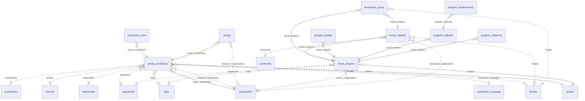

### `social_contribution`

**Aporte social** (BC-10). Apoyo puntual (donación o apoyo en especie) entregado con acta de recepción, foto y
comprobante, con propósito, condiciones y pagador declarados. Tabla física `app_data.social_contribution__<org8>`.
Requisitos: RF-INV-001, RN-INV-001, RN-INV-002, RN-INV-003, RN-INV-004, RN-INV-005, RN-INV-006, ASM-063, CON-021,
CON-022.

| Campo | Tipo | Req. | Único | Descripción | Fuente |
|---|---|---|---|---|---|
| `code` | TEXT | sí | compuesto | Código del aporte en el proyecto. | RF-INV-001 |
| `contribution_type` | ENUM `contribution_type` | no | — | Tipo de aporte; se exige al aprobar (P9, ASM-112). | RF-INV-001 |
| `occasion` | TEXT | no | — | Ocasión (por ejemplo, un aniversario escolar). | RF-INV-001 |
| `declared_purpose` | LONG_TEXT | sí | — | Propósito declarado. | RN-INV-006 |
| `conditions` | LONG_TEXT | sí | — | Condiciones declaradas. | RN-INV-006 |
| `total_amount` | DECIMAL | no | — | (derivado) Suma de `line_amount` de sus ítems: el monto que se aprueba y se compara con el tope de la campaña (ASM-110). | RF-INV-001 |
| `currency` | ENUM `currency` | sí | — | Moneda del aporte y de sus ítems. Por defecto: PEN. | RNF-I18N-002 |
| `beneficiaries_count` | INTEGER | no | — | Beneficiarios; entero no negativo (ASM-118). | RF-INV-001 |
| `has_institutional_synergy` | BOOLEAN | no | — | Forma parte de una sinergia institucional; con la política activa, exige un acuerdo vigente al aprobar (P6). | RN-INV-004 |
| `guideline_deviation_justification` | LONG_TEXT | no | — | Justificación cuando se aparta de los lineamientos; cubre todos los incumplidos (ASM-112). | RN-INV-006 |

| Relación | Tipo | Campo | Destino | Req. | Nota |
|---|---|---|---|---|---|
| `contribution_project` | MANY_TO_ONE | `project` | `project` | sí | — |
| `contribution_exploration_campaign` | MANY_TO_ONE | `exploration_campaign` | `exploration_campaign` | no | — |
| `contribution_payer_organization` | MANY_TO_ONE | `payer_organization` | `organization` | sí | Pagador |
| `contribution_recipient_organization` | MANY_TO_ONE | `recipient_organization` | `organization` | no | Receptor |
| `contribution_stakeholder` | MANY_TO_ONE | `stakeholder` | `stakeholder` | no | — |
| `contribution_locality` | MANY_TO_ONE | `locality` | `locality` | no | — |
| `contribution_festivity` | MANY_TO_ONE | `festivity` | `festivity` | no | — |
| `contribution_commitment` | MANY_TO_ONE | `commitment` | `commitment` | no | — |
| `contribution_agreement` | MANY_TO_ONE | `agreement` | `agreement` | no | Acuerdo de sinergia |
| `contribution_topic` | MANY_TO_ONE | `topic` | `topic` | no | Tema del aporte, para la prioridad (RN-INV-005, ASM-112) |
| `evidence_social_contribution` | MANY_TO_MANY | — | `evidence` | — | Inversa; se define en `evidence` |

- **Flags:** `appendOnly` no · `apiOnly` no · `requiresReason` sí.
- **Únicos:** `uniqueConstraints` (`project`, `code`).
- **Índices declarados:** ninguno.
- **Acciones declaradas:** `APPROVE`, `APPROVE_OVER_CAP`.
- **Workflow:** WF-P.
- **Fase:** F5 · Release 2 (Fase 2 de producto).
- `ContributionTotalsListener` mantiene `total_amount` con cada alta, cambio o baja de un ítem y lo vuelve a escribir en
  `approve` y `approve_direct`, así lo aprobado queda escrito; `DerivedFieldsJob` lo recalcula desde cero (RF-INV-001,
  ASM-110).
- La aprobación (P1 a P9 de WF-P, `workflows.md`) exige ítems y `contribution_type`, evalúa los lineamientos con
  `item_kind`, `topic` y los temas priorizados del proyecto, y compara la suma de los ítems, leída en la transacción,
  con el tope de la campaña (ASM-110, ASM-112). Fuera de `requested` no cambian `currency`, `contribution_type`,
  `topic`, `exploration_campaign`, `has_institutional_synergy`, `agreement`, `guideline_deviation_justification` ni
  `project` (`409 CONTRIBUTION_FROZEN`).
- Un aporte tiene a lo sumo una `delivery` (ASM-111). `stakeholder_request.created_contribution` apunta al aporte que
  creó la aceptación de una solicitud, que cuenta como quien lo registró (ASM-117).
- Las relaciones hacia `exploration_campaign`, `stakeholder`, `commitment` y `agreement` son del mismo proyecto
  (`409 PROJECT_MISMATCH`, `ProjectLinkGuard`); `topic` es un maestro del tenant.

### `contribution_item`

**Ítem del aporte** (BC-10). Bien, servicio, dinero o mano de obra que compone un aporte, con su tipo, cantidad y monto.
Tabla física `app_data.contribution_item__<org8>`. Requisitos: RF-INV-001, RN-INV-001, RN-INV-002, ASM-110, ASM-112.

| Campo | Tipo | Req. | Único | Descripción | Fuente |
|---|---|---|---|---|---|
| `description` | TEXT | sí | — | Bien o servicio. | RF-INV-001 |
| `item_kind` | ENUM `item_kind` | sí | — | Tipo de ítem; lo leen los lineamientos al aprobar (ASM-112). | RN-INV-001 |
| `quantity` | DECIMAL | no | — | Cantidad; informativa, no se compara con `line_amount`. | RF-INV-001 |
| `unit` | TEXT | no | — | Unidad. | RF-INV-001 |
| `unit_cost` | DECIMAL | no | — | Costo unitario; informativo. | RF-INV-001 |
| `line_amount` | DECIMAL | sí | — | Monto de la línea, en la moneda del aporte; es el que cuenta (ASM-110). | RF-INV-001 |

| Relación | Tipo | Campo | Destino | Req. | Nota |
|---|---|---|---|---|---|
| `contrib_item_social_contribution` | MANY_TO_ONE | `social_contribution` | `social_contribution` | sí | — |

- **Flags:** `appendOnly` no · `apiOnly` no · `requiresReason` no.
- **Únicos:** ninguno.
- **Índices declarados:** ninguno.
- **Acciones declaradas:** ninguna.
- **Workflow:** ninguno.
- **Fase:** F5 · Release 2 (Fase 2 de producto).
- Fuera de `requested` del aporte, un ítem no se crea, cambia ni borra, y su `social_contribution` no cambia nunca
  (`409 ITEMS_FROZEN` sobre `social_contribution`, ASM-110); la regla toma el candado del aporte. `line_amount` y
  `unit_cost` son montos (ASM-092, ASM-118); `quantity` no lo es.

### `receipt`

**Comprobante** (BC-10). Datos estructurados del documento de pago de un aporte; el escaneo es una `evidence` de tipo
COMPROBANTE. Tabla física `app_data.receipt__<org8>`. Requisitos: RF-INV-001, CON-022 [DOC-02 p.4].

| Campo | Tipo | Req. | Único | Descripción | Fuente |
|---|---|---|---|---|---|
| `receipt_type` | ENUM `receipt_type` | no | — | Tipo de comprobante. | RF-INV-001 |
| `receipt_number` | TEXT | no | — | Número (nunca en artefactos versionados). | RF-INV-001 |
| `issuer_name` | TEXT | no | — | Emisor. | RF-INV-001 |
| `issued_to_name` | TEXT | no | — | A nombre de quién se emitió. | CON-022 |
| `issue_date` | DATE | no | — | Fecha de emisión. | RF-INV-001 |
| `amount` | DECIMAL | sí | — | Monto. | RF-INV-001 |
| `currency` | ENUM `currency` | sí | — | Moneda. Por defecto: PEN. | RNF-I18N-002 |

| Relación | Tipo | Campo | Destino | Req. | Nota |
|---|---|---|---|---|---|
| `receipt_social_contribution` | MANY_TO_ONE | `social_contribution` | `social_contribution` | sí | — |
| `receipt_issued_to_organization` | MANY_TO_ONE | `issued_to_organization` | `organization` | no | A nombre de quién |

- **Flags:** `appendOnly` no · `apiOnly` no · `requiresReason` no.
- **Únicos:** ninguno.
- **Índices declarados:** ninguno.
- **Acciones declaradas:** ninguna.
- **Workflow:** ninguno.
- **Fase:** F5 · Release 2 (Fase 2 de producto).
- Opcional: `register_delivery` (P8) exige la evidencia COMPROBANTE, no el `receipt`, y ninguna regla compara `amount`
  con el `total_amount` del aporte (ASM-116). `amount` es un monto (ASM-092, ASM-118). El comprobante no se crea, cambia
  ni borra con el aporte en `delivered` o después (`closed`, `rejected`, `cancelled`): `409 DELIVERY_FROZEN` sobre
  `social_contribution` (decisión del usuario del 2026-10-11).

### `social_program`

**Programa social** (BC-10). Programa de inversión social de la empresa, con socios, presupuesto, beneficiarios,
indicadores e hitos. Tabla física `app_data.social_program__<org8>`. Requisitos: RF-INV-003, RN-INV-004, GAP-007.

| Campo | Tipo | Req. | Único | Descripción | Fuente |
|---|---|---|---|---|---|
| `code` | TEXT | sí | compuesto | Código del programa en el proyecto. | RF-INV-003 |
| `name` | TEXT | sí | — | Nombre. | RF-INV-003 |
| `description` | LONG_TEXT | no | — | Descripción. | RF-INV-003 |
| `start_date` | DATE | no | — | Inicio. | RF-INV-003 |
| `end_date` | DATE | no | — | Fin. | RF-INV-003 |
| `total_budget` | DECIMAL | no | — | (derivado) Suma de `allocated_amount` de sus presupuestos en la moneda del programa; sin moneda del programa, vacío (ASM-113). | RF-INV-003 |
| `currency` | ENUM `currency` | no | — | Moneda. Por defecto: PEN. | RNF-I18N-002 |

| Relación | Tipo | Campo | Destino | Req. | Nota |
|---|---|---|---|---|---|
| `social_program_project` | MANY_TO_ONE | `project` | `project` | sí | — |
| `social_program_topic` | MANY_TO_ONE | `topic` | `topic` | no | — |
| `social_program_partner_organization` | MANY_TO_ONE | `partner_organization` | `organization` | no | Socio |
| `social_program_agreement` | MANY_TO_ONE | `agreement` | `agreement` | no | Acuerdo de sinergia |
| `evidence_social_program` | MANY_TO_MANY | — | `evidence` | — | Inversa; se define en `evidence` |

- **Flags:** `appendOnly` no · `apiOnly` no · `requiresReason` no.
- **Únicos:** `uniqueConstraints` (`project`, `code`).
- **Índices declarados:** ninguno.
- **Acciones declaradas:** `APPROVE`.
- **Workflow:** WF-G.
- **Fase:** F5 · Release 2 (Fase 2 de producto).
- `ProgramTotalsListener` mantiene `total_budget` con cada alta, cambio o baja de un `program_budget`, y
  `DerivedFieldsJob` lo recalcula (ASM-113). El ejecutado del programa no se deriva: es el `executed_amount` de cada
  presupuesto, registrado a mano.
- Con `partner_organization` y `policy_synergy_requires_agreement` activa, `approve` y `plan_direct` exigen un acuerdo
  en `active`, no VENCIDO y con el socio como parte (G3, ASM-115). `end_date` no es anterior a `start_date`
  (`400 OUT_OF_RANGE`). `agreement` es del mismo proyecto (`409 PROJECT_MISMATCH`).

### `social_initiative`

**Iniciativa social** (BC-10). Proyecto concreto dentro de un programa. Tabla física
`app_data.social_initiative__<org8>`. Requisitos: RF-INV-003, RN-INV-001.

| Campo | Tipo | Req. | Único | Descripción | Fuente |
|---|---|---|---|---|---|
| `name` | TEXT | sí | — | Nombre. | RF-INV-003 |
| `description` | LONG_TEXT | no | — | Descripción. | RF-INV-003 |
| `start_date` | DATE | no | — | Inicio. | RF-INV-003 |
| `end_date` | DATE | no | — | Fin. | RF-INV-003 |
| `location` | GEOMETRY (POINT) | no | — | Ubicación. | RF-INV-003 |

| Relación | Tipo | Campo | Destino | Req. | Nota |
|---|---|---|---|---|---|
| `initiative_social_program` | MANY_TO_ONE | `social_program` | `social_program` | sí | — |
| `initiative_locality` | MANY_TO_ONE | `locality` | `locality` | no | — |
| `initiative_community` | MANY_TO_ONE | `community` | `community` | no | — |
| `initiative_counterpart_organization` | MANY_TO_ONE | `counterpart_organization` | `organization` | no | Contraparte (por ejemplo, la república, RN-INV-001) |

- **Flags:** `appendOnly` no · `apiOnly` no · `requiresReason` no.
- **Únicos:** ninguno.
- **Índices declarados:** ninguno.
- **Acciones declaradas:** ninguna.
- **Workflow:** ninguno.
- **Fase:** F5 · Release 2 (Fase 2 de producto).
- `end_date` no es anterior a `start_date` (`400 OUT_OF_RANGE`, ASM-118).

### `beneficiary_group`

**Grupo de beneficiarios** (BC-10). Población objetivo de un programa o de una iniciativa. Tabla física
`app_data.beneficiary_group__<org8>`. Requisitos: RF-INV-003, RQ-DSH-030.

| Campo | Tipo | Req. | Único | Descripción | Fuente |
|---|---|---|---|---|---|
| `name` | TEXT | sí | — | Nombre. | RF-INV-003 |
| `description` | LONG_TEXT | no | — | Descripción. | RF-INV-003 |
| `target_count` | INTEGER | no | — | Beneficiarios previstos. | RQ-DSH-030 |
| `reached_count` | INTEGER | no | — | Beneficiarios alcanzados. | RQ-DSH-030 |

| Relación | Tipo | Campo | Destino | Req. | Nota |
|---|---|---|---|---|---|
| `beneficiary_group_social_program` | MANY_TO_ONE | `social_program` | `social_program` | sí | — |
| `beneficiary_group_social_initiative` | MANY_TO_ONE | `social_initiative` | `social_initiative` | no | — |
| `beneficiary_group_locality` | MANY_TO_ONE | `locality` | `locality` | no | — |

- **Flags:** `appendOnly` no · `apiOnly` no · `requiresReason` no.
- **Únicos:** ninguno.
- **Índices declarados:** ninguno.
- **Acciones declaradas:** ninguna.
- **Workflow:** ninguno.
- **Fase:** F5 · Release 2 (Fase 2 de producto).
- `social_initiative`, si se informa, es del mismo programa (`409 PROGRAM_MISMATCH` sobre `social_initiative`);
  `target_count` y `reached_count` son enteros no negativos (`400 OUT_OF_RANGE`, ASM-118).

### `program_budget`

**Presupuesto del programa** (BC-10). Monto asignado y ejecutado de un programa por año. Tabla física
`app_data.program_budget__<org8>`. Requisitos: RF-INV-003, RF-INV-004.

| Campo | Tipo | Req. | Único | Descripción | Fuente |
|---|---|---|---|---|---|
| `budget_year` | INTEGER | sí | compuesto | Año. | RF-INV-003 |
| `allocated_amount` | DECIMAL | sí | — | Monto asignado. | RF-INV-003 |
| `executed_amount` | DECIMAL | no | — | Monto ejecutado registrado (ASM-063). | RF-INV-004 |
| `currency` | ENUM `currency` | sí | — | Moneda. Por defecto: PEN. | RNF-I18N-002 |

| Relación | Tipo | Campo | Destino | Req. | Nota |
|---|---|---|---|---|---|
| `program_budget_social_program` | MANY_TO_ONE | `social_program` | `social_program` | sí | — |

- **Flags:** `appendOnly` no · `apiOnly` no · `requiresReason` no.
- **Únicos:** `uniqueConstraints` (`social_program`, `budget_year`).
- **Índices declarados:** ninguno.
- **Acciones declaradas:** ninguna.
- **Workflow:** ninguno.
- **Fase:** F5 · Release 2 (Fase 2 de producto).
- `budget_year` va de 2000 a 2100 (`400 OUT_OF_RANGE`); `allocated_amount` y `executed_amount` son montos (ASM-092,
  ASM-118). El ejecutado se registra a mano por año y moneda (ASM-113).

### `program_indicator`

**Indicador de programa** (BC-10). Indicador de resultado o de impacto de un programa, con línea base y meta (GAP-032).
Tabla física `app_data.program_indicator__<org8>`. Requisitos: RF-INV-003, GAP-032.

| Campo | Tipo | Req. | Único | Descripción | Fuente |
|---|---|---|---|---|---|
| `name` | TEXT | sí | — | Nombre. | RF-INV-003 |
| `definition` | LONG_TEXT | no | — | Definición. | RF-INV-003 |
| `unit` | TEXT | no | — | Unidad. | RF-INV-003 |
| `baseline_value` | DECIMAL | no | — | Valor de línea base. | GAP-032 |
| `target_value` | DECIMAL | no | — | Meta. | GAP-032 |
| `frequency` | TEXT | no | — | Frecuencia de medición. | RF-INV-003 |

| Relación | Tipo | Campo | Destino | Req. | Nota |
|---|---|---|---|---|---|
| `program_indicator_social_program` | MANY_TO_ONE | `social_program` | `social_program` | sí | — |

- **Flags:** `appendOnly` no · `apiOnly` no · `requiresReason` no.
- **Únicos:** ninguno.
- **Índices declarados:** ninguno.
- **Acciones declaradas:** ninguna.
- **Workflow:** ninguno.
- **Fase:** F5 · Release 2 (Fase 2 de producto).
- Un indicador con mediciones no se borra: `program_measurement` es `appendOnly` y wasichai rechaza la baja con un `409`
  sin código (`AppendOnlyReferences`), no `HAS_DEPENDENTS`. `baseline_value` y `target_value` no son dinero
  (ASM-118).

### `program_measurement`

**Medición de programa** (BC-10). Valor periódico e inmutable de un indicador de programa. Tabla física
`app_data.program_measurement__<org8>`. Requisitos: RF-INV-003, RQ-AUD-003.

| Campo | Tipo | Req. | Único | Descripción | Fuente |
|---|---|---|---|---|---|
| `period_start_date` | DATE | sí | compuesto | Inicio del periodo. | RF-INV-003 |
| `period_end_date` | DATE | sí | — | Fin del periodo. | RF-INV-003 |
| `measured_value` | DECIMAL | sí | — | Valor medido. | RF-INV-003 |
| `notes` | LONG_TEXT | no | — | Notas. | RF-INV-003 |

| Relación | Tipo | Campo | Destino | Req. | Nota |
|---|---|---|---|---|---|
| `prog_measurement_program_indicator` | MANY_TO_ONE | `program_indicator` | `program_indicator` | sí | — |

- **Flags:** `appendOnly` sí · `apiOnly` no · `requiresReason` no.
- **Únicos:** `uniqueConstraints` (`program_indicator`, `period_start_date`).
- **Índices declarados:** ninguno.
- **Acciones declaradas:** ninguna.
- **Workflow:** ninguno.
- **Fase:** F5 · Release 2 (Fase 2 de producto).
- Hijo de un hijo: se lee por el proyecto del programa de su indicador, sin copiar `project` (ASM-114). Una medición no
  se corrige: se registra otra de otro periodo; la del mismo periodo no se repite (único). `period_end_date` no es
  anterior a `period_start_date` (`400 OUT_OF_RANGE`, ASM-118).

### `program_milestone`

**Hito de programa** (BC-10). Fecha o logro previsto de un programa. Tabla física `app_data.program_milestone__<org8>`.
Requisitos: RF-INV-003.

| Campo | Tipo | Req. | Único | Descripción | Fuente |
|---|---|---|---|---|---|
| `name` | TEXT | sí | — | Nombre. | RF-INV-003 |
| `planned_date` | DATE | no | — | Fecha prevista. | RF-INV-003 |
| `reached_date` | DATE | no | — | Fecha en que se alcanzó. | RF-INV-003 |
| `notes` | LONG_TEXT | no | — | Notas. | RF-INV-003 |

| Relación | Tipo | Campo | Destino | Req. | Nota |
|---|---|---|---|---|---|
| `program_milestone_social_program` | MANY_TO_ONE | `social_program` | `social_program` | sí | — |

- **Flags:** `appendOnly` no · `apiOnly` no · `requiresReason` no.
- **Únicos:** ninguno.
- **Índices declarados:** ninguno.
- **Acciones declaradas:** ninguna.
- **Workflow:** ninguno.
- **Fase:** F5 · Release 2 (Fase 2 de producto).

## 16. BC-12 Evidencias y documentos

Archivos inmutables con hash en un campo `FILE` de wasichai-files, cuyos bytes viven en almacenamiento compatible con
S3 (UPS-07, ASM-013, ADR-0014). Los documentos emitidos de wasichai-documents (actas, cargos, cartas y fichas) no son objetos de SGSPE: son tipos
de documento por objeto, congelados y con correlativo, que viven en el esquema de metadatos (RQ-REP-029) [WAS-ADR-0023].

```mermaid
erDiagram
    evidence }o..o| project : "project"
    evidence }o..o| evidence : "replaces"
    evidence }o..o{ community : "evidence_community"
    evidence }o..o{ land_parcel : "evidence_land_parcel"
    evidence }o..o{ stakeholder : "evidence_stakeholder"
    evidence }o..o{ engagement : "evidence_engagement"
    evidence }o..o{ field_visit : "evidence_field_visit"
    evidence }o..o{ field_observation : "evidence_field_observation"
    evidence }o..o{ commitment : "evidence_commitment"
    evidence }o..o{ delivery : "evidence_delivery"
    evidence }o..o{ agreement : "evidence_agreement"
    evidence }o..o{ grievance : "evidence_grievance"
    evidence }o..o{ inquiry : "evidence_inquiry"
    evidence }o..o{ stakeholder_request : "evidence_stakeholder_request"
    evidence }o..o{ social_risk : "evidence_social_risk"
    evidence }o..o{ incident : "evidence_incident"
    evidence }o..o{ media_mention : "evidence_media_mention"
    evidence }o..o{ social_contribution : "evidence_social_contribution"
    evidence }o..o{ social_program : "evidence_social_program"
    evidence }o..o{ study : "evidence_study"
```

### `evidence`

**Evidencia** (BC-12). Archivo inmutable con hash que prueba un hecho, guardado en un campo `FILE` de wasichai-files y
vinculable a varios registros. Tabla física `app_data.evidence__<org8>`. Requisitos: RF-DOC-001, RF-DOC-003,
RNF-PRIV-004, ASM-013, ASM-060, CON-046, UPS-07.

| Campo | Tipo | Req. | Único | Descripción | Fuente |
|---|---|---|---|---|---|
| `evidence_type` | ENUM `evidence_type` | sí | — | Tipo de evidencia; la regla de evidencia mínima para cumplir un compromiso lo lee (ASM-009). | RF-DOC-001 |
| `classification` | ENUM `evidence_classification` | sí | — | Clasificación; decide quién descarga el archivo. | RF-DOC-003 |
| `title` | TEXT | no | — | Título. | RF-DOC-001 |
| `file` | FILE | sí | — | Archivo; wasichai-files guarda al subirlo su nombre original, su tipo MIME detectado por su contenido, su tamaño y su hash SHA-256, y el registro los muestra como su descriptor (ASM-013). | RF-DOC-001 |
| `document_date` | DATE | no | — | Fecha del documento. | RF-DOC-001 |
| `author` | TEXT | no | — | Autor. | RF-DOC-001 |
| `captured_at` | DATETIME | no | — | Momento de captura (EXIF de una foto). | RF-DOC-001 |
| `people_identifiable` | BOOLEAN | no | — | Muestra personas identificables. | RNF-PRIV-004 |
| `photo_consent_given` | BOOLEAN | no | — | Las personas fotografiadas dieron consentimiento. | RNF-PRIV-004 |
| `import_batch_id` | UUID | no | — | Archivo original de una importación (ASM-060). | ASM-060 |
| `location` | GEOMETRY (POINT) | no | — | Ubicación de la captura. | RF-DOC-001 |

| Relación | Tipo | Campo | Destino | Req. | Nota |
|---|---|---|---|---|---|
| `evidence_project` | MANY_TO_ONE | `project` | `project` | no | Vacío si la evidencia es del tenant |
| `evidence_replaces` | MANY_TO_ONE | `replaces` | `evidence` | no | Versión a la que reemplaza |
| `evidence_community` | MANY_TO_MANY | — | `community` | — | Registros que prueba |
| `evidence_land_parcel` | MANY_TO_MANY | — | `land_parcel` | — | Registros que prueba |
| `evidence_stakeholder` | MANY_TO_MANY | — | `stakeholder` | — | Registros que prueba |
| `evidence_engagement` | MANY_TO_MANY | — | `engagement` | — | Registros que prueba |
| `evidence_field_visit` | MANY_TO_MANY | — | `field_visit` | — | Registros que prueba |
| `evidence_field_observation` | MANY_TO_MANY | — | `field_observation` | — | Registros que prueba |
| `evidence_commitment` | MANY_TO_MANY | — | `commitment` | — | Registros que prueba |
| `evidence_delivery` | MANY_TO_MANY | — | `delivery` | — | Registros que prueba |
| `evidence_agreement` | MANY_TO_MANY | — | `agreement` | — | Registros que prueba |
| `evidence_grievance` | MANY_TO_MANY | — | `grievance` | — | Registros que prueba; desde F4 |
| `evidence_inquiry` | MANY_TO_MANY | — | `inquiry` | — | Registros que prueba; desde F4 |
| `evidence_stakeholder_request` | MANY_TO_MANY | — | `stakeholder_request` | — | Registros que prueba; desde F4 |
| `evidence_social_risk` | MANY_TO_MANY | — | `social_risk` | — | Registros que prueba; desde F4 |
| `evidence_incident` | MANY_TO_MANY | — | `incident` | — | Registros que prueba; desde F4 |
| `evidence_media_mention` | MANY_TO_MANY | — | `media_mention` | — | Registros que prueba; desde F4 |
| `evidence_social_contribution` | MANY_TO_MANY | — | `social_contribution` | — | Registros que prueba; desde F5 |
| `evidence_social_program` | MANY_TO_MANY | — | `social_program` | — | Registros que prueba; desde F5 |
| `evidence_study` | MANY_TO_MANY | — | `study` | — | Registros que prueba |

- **Flags:** `appendOnly` no · `apiOnly` sí · `requiresReason` no.
- **Únicos:** ninguno.
- **Índices declarados:** `indexed` en `import_batch_id`.
- **Acciones declaradas:** `DOWNLOAD_RESTRICTED`, `EDIT_ANY`.
- **Tipos de archivo:** `file` admite `application/pdf`, `image/*`, `text/csv`, `text/plain`,
  `application/vnd.openxmlformats-officedocument.wordprocessingml.document`,
  `application/vnd.openxmlformats-officedocument.spreadsheetml.sheet`, `application/vnd.oasis.opendocument.text` y
  `application/vnd.oasis.opendocument.spreadsheet`, la lista contentTypes del campo; wasichai-files detecta el tipo por
  el contenido y responde 400 a los demás.
- **Workflow:** ninguno.
- **Fase:** F3 · Release 1 (MVP).
- `apiOnly` más `EvidenceWriteGuard` (el archivo no cambia; no se borra) y no `appendOnly`, porque tiene vínculos
  MANY_TO_MANY y un vínculo con un registro `appendOnly` responde 409 [WAS-ADR-0040].
- `file` es un campo `FILE` de wasichai-files [WAS-ADR-0061]: la columna guarda el id de una fila de `stored_files` y el
  registro, su historial y los listeners ven `{ id, name, contentType, size, sha256 }`, nunca los bytes. Lo escribe solo
  `sgspe.evidence`, al crear la evidencia, con la subida que la misma persona hizo antes
  (`POST /api/objects/evidence/files/file`); la ruta genérica que reemplaza el archivo responde 403 porque el objeto es
  `apiOnly`. Un campo `FILE` no es `unique` ni se filtra ni se ordena; los bytes viven en el almacenamiento compatible con
  S3 de `wasichai.files.*` (MinIO solo en desarrollo) y un trabajo de wasichai borra los que ningún registro nombra.
- Los vínculos con destinos `requiresReason` exigen motivo en ambos registros; `sgspe.evidence` lo pasa en cada vínculo
  [WAS-ADR-0041]. `import_batch_id` lleva índice para encontrar el archivo de una importación.
- Un archivo es de una sola evidencia: un alta con un `file` que ya tiene otra responde `409` `EVIDENCE_FILE_IN_USE`.
  `file`, `replaces` e `import_batch_id` no cambian después del alta (`409` `EVIDENCE_IMMUTABLE`), pero el alta no
  comprueba que la evidencia reemplazada sea de quien sube ni que la importación exista: es un límite conocido.
- El descriptor de `file` guarda el nombre original y la huella, pero en una evidencia CONFIDENCIAL o de DATOS
  PERSONALES se lee sin `name` ni `sha256` salvo con `DOWNLOAD_RESTRICTED` (`EvidenceFileReadPolicy`, UPS-24); el portal
  sube además las restringidas con un nombre neutro (ASM-093).

## 17. BC-13 Tareas y aprobaciones

Tareas con un único origen y vencimiento derivado. Las aprobaciones no son objetos: son transiciones con roles o la acción
declarada `APPROVE` (RF-WFL-002) [WAS-ADR-0042]; el motor de workflow es de wasichai [WAS-ADR-0013].

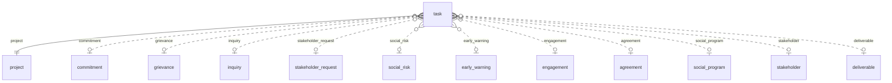

### `task`

**Tarea** (BC-13). Trabajo asignado a una persona, con vencimiento derivado y un único origen; incluye las tareas que
crean los trabajos programados. Tabla física `app_data.task__<org8>`. Requisitos: RF-WFL-001, RF-WFL-004, RN-WFL-001,
ASM-022, ASM-030.

| Campo | Tipo | Req. | Único | Descripción | Fuente |
|---|---|---|---|---|---|
| `title` | TEXT | sí | — | Título. | RF-WFL-001 |
| `description` | LONG_TEXT | no | — | Descripción. | RF-WFL-001 |
| `assignee_user_id` | UUID | no | — | Responsable (ASM-023). | RF-WFL-001 |
| `assignee_user_email` | EMAIL | no | — | Correo del responsable. | RF-WFL-001 |
| `due_date` | DATE | no | — | Vencimiento. | RF-WFL-001 |
| `priority` | ENUM `priority` | no | — | Prioridad. | RF-WFL-001 |
| `deadline_status` | ENUM `deadline_status` | no | — | (derivado) Situación de plazo; nunca es un estado de WF-N. | RN-WFL-001 |
| `generator_key` | TEXT | no | sí | Clave idempotente de una tarea creada por un trabajo programado. | RF-WFL-004 |

| Relación | Tipo | Campo | Destino | Req. | Nota |
|---|---|---|---|---|---|
| `task_project` | MANY_TO_ONE | `project` | `project` | sí | — |
| `task_commitment` | MANY_TO_ONE | `commitment` | `commitment` | no | — |
| `task_grievance` | MANY_TO_ONE | `grievance` | `grievance` | no | desde F4 |
| `task_inquiry` | MANY_TO_ONE | `inquiry` | `inquiry` | no | desde F4 |
| `task_stakeholder_request` | MANY_TO_ONE | `stakeholder_request` | `stakeholder_request` | no | desde F4 |
| `task_social_risk` | MANY_TO_ONE | `social_risk` | `social_risk` | no | desde F4 |
| `task_early_warning` | MANY_TO_ONE | `early_warning` | `early_warning` | no | desde F4 |
| `task_engagement` | MANY_TO_ONE | `engagement` | `engagement` | no | — |
| `task_agreement` | MANY_TO_ONE | `agreement` | `agreement` | no | — |
| `task_social_program` | MANY_TO_ONE | `social_program` | `social_program` | no | desde F5 |
| `task_stakeholder` | MANY_TO_ONE | `stakeholder` | `stakeholder` | no | — |
| `task_deliverable` | MANY_TO_ONE | `deliverable` | `deliverable` | no | desde F8 |

- **Exactamente uno de:** (`commitment`, `grievance`, `inquiry`, `stakeholder_request`, `social_risk`, `early_warning`,
  `engagement`, `agreement`, `social_program`, `stakeholder`, `deliverable`), con `ExactlyOneGuard`.
- **Flags:** `appendOnly` no · `apiOnly` no · `requiresReason` no.
- **Únicos:** `unique` en `generator_key`.
- **Índices declarados:** `indexed` en `assignee_user_id`, `due_date`.
- **Acciones declaradas:** ninguna.
- **Workflow:** WF-N.
- **Fase:** F3 · Release 1 (MVP).
- Índices: `assignee_user_id` para la bandeja "mis tareas" y `due_date` para `DeadlineJob` (RF-WFL-001, RN-WFL-001).
  Cada origen llega en la fase de su objeto.
- `generator_key` solo la escribe un trabajo (JOB-01 y JOB-03): una persona que la fija, la cambia o la vacía, también
  con un `PUT` que la omite, recibe `403` `GENERATOR_KEY_PLATFORM_ONLY` (`GeneratorKeyGuard`). Las claves son
  `escalation:<commitment, grievance o inquiry>:<id>:<fecha del plazo>:<nivel>` (con la huella en lugar del id en el
  nivel 2 de una QCS confidencial), `stakeholder_review:<id>:<fecha>` y
  `stakeholder_inactivity:<id>:<fecha de referencia>`; una tarea borrada vuelve a crearse mientras dure su condición.
- La tarea de escalamiento del nivel 2 de una QCS confidencial es la única sin origen, para no delatarla:
  `ExactlyOneGuard` la admite solo con una `generator_key` de la forma
  `escalation:<objeto>:<huella>:<fecha del plazo>:2` (`workflows.md`, «Avisos»).
- Desde F5, `social_program` entra en el grupo de «Exactamente uno de» y `ProjectLinkGuard` juzga los orígenes de una
  tarea: cada uno es del proyecto de la tarea (`409 PROJECT_MISMATCH` sobre el campo).

## 18. BC-14 Notificaciones

BC-14 no tiene objetos ni tablas propias desde la decisión D2 (ASM-012, ADR-0018): los avisos, su estado por persona, los
envíos por correo y las preferencias viven en las tablas del módulo wasichai-notifications (`notifications`,
`notification_targets`, `notification_receipts`, `notification_deliveries`, `notification_preferences`), que SGSPE no lee
ni escribe con SQL: publica con `Notifications.publish` y lee la bandeja con la API del módulo. Los avisos salen de
listeners y trabajos, nunca de las entidades (RN-NTF-001); sus claves están en `workflows.md` («Avisos»).

## 19. BC-15 Reportes, tableros y entregables

Catálogo de indicadores y mediciones oficiales, entregables con secciones y versiones emitidas, y el registro de
exportaciones (RQ-DSH-037, RF-REP-001, RF-REP-002, RQ-AUD-011). Los indicadores se calculan en vivo;
`indicator_measurement` solo congela el cierre de un periodo (ASM-042).

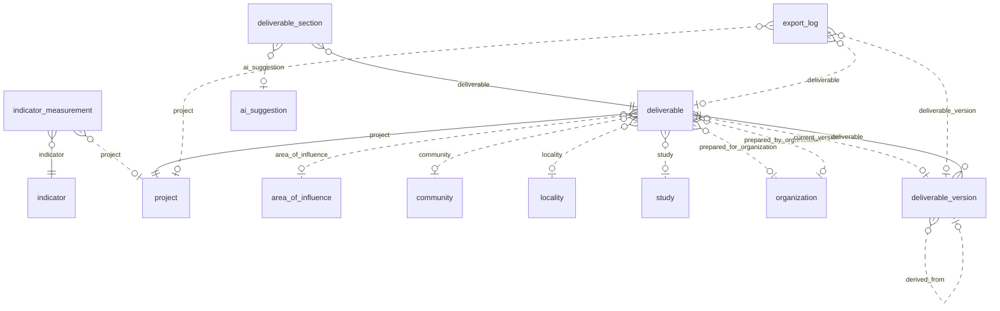

### `indicator`

**Indicador** (BC-15). Indicador de monitoreo o KPI con definición, fórmula, desagregación, meta y frecuencia; objeto
catálogo (BC-20). Tabla física `app_data.indicator__<org8>`. Requisitos: RQ-DSH-037, GAP-018.

| Campo | Tipo | Req. | Único | Descripción | Fuente |
|---|---|---|---|---|---|
| `code` | TEXT | sí | sí | ID del KPI que define `dashboards.md`. | RQ-DSH-037 |
| `name` | TEXT | sí | — | Nombre. | RQ-DSH-037 |
| `definition` | LONG_TEXT | no | — | Definición. | RQ-DSH-037 |
| `formula` | LONG_TEXT | no | — | Fórmula. | RQ-DSH-037 |
| `verification_means` | LONG_TEXT | no | — | Medio de verificación. | RQ-DSH-037 |
| `disaggregation` | TEXT | no | — | Desagregación. | RQ-DSH-037 |
| `target_value` | DECIMAL | no | — | Meta (GAP-018). | GAP-018 |
| `frequency` | TEXT | no | — | Frecuencia. | RQ-DSH-037 |
| `source_reference` | TEXT | no | — | Fuente del indicador (por ejemplo, la Tabla 9.5 de DOC-01). | RQ-DSH-037 |

Sin relaciones propias.

- **Flags:** `appendOnly` no · `apiOnly` no · `requiresReason` no.
- **Únicos:** `unique` en `code`.
- **Índices declarados:** ninguno.
- **Acciones declaradas:** ninguna.
- **Workflow:** ninguno.
- **Fase:** F8 · Release 3 (Fase 3 de producto).
- Los indicadores se calculan en vivo desde F2 (RQ-DSH-036); el catálogo como objeto llega en F8 con el cierre de
  periodos (RQ-DSH-037).

### `indicator_measurement`

**Medición de indicador** (BC-15). Cifra oficial e inmutable de un indicador en un periodo cerrado, por proyecto o para
todo el tenant (ASM-042). Tabla física `app_data.indicator_measurement__<org8>`. Requisitos: RQ-DSH-037, ASM-042.

| Campo | Tipo | Req. | Único | Descripción | Fuente |
|---|---|---|---|---|---|
| `period_start_date` | DATE | sí | compuesto | Inicio del periodo. | RQ-DSH-037 |
| `period_end_date` | DATE | sí | — | Fin del periodo. | RQ-DSH-037 |
| `measured_value` | DECIMAL | sí | — | Valor oficial. | RQ-DSH-037 |
| `numerator` | DECIMAL | no | — | Numerador. | RQ-DSH-037 |
| `denominator` | DECIMAL | no | — | Denominador. | RQ-DSH-037 |
| `breakdown` | LONG_TEXT | no | — | Desagregación en Markdown. | RQ-DSH-037 |
| `closed_by_user_id` | UUID | sí | — | Usuario que cerró el periodo (ASM-023). | ASM-042 |
| `closed_by_user_email` | EMAIL | sí | — | Correo de quien cerró el periodo. | ASM-042 |

| Relación | Tipo | Campo | Destino | Req. | Nota |
|---|---|---|---|---|---|
| `indicator_measurement_indicator` | MANY_TO_ONE | `indicator` | `indicator` | sí | — |
| `indicator_measurement_project` | MANY_TO_ONE | `project` | `project` | no | Vacío = todo el tenant |

- **Flags:** `appendOnly` sí · `apiOnly` sí · `requiresReason` no.
- **Únicos:** `uniqueConstraints` (`indicator`, `project`, `period_start_date`).
- **Índices declarados:** ninguno.
- **Acciones declaradas:** ninguna.
- **Workflow:** ninguno.
- **Fase:** F8 · Release 3 (Fase 3 de producto).
- Como los NULL son distintos, el endpoint de cierre impide dos mediciones del tenant (sin `project`) para el mismo
  indicador y periodo [WAS-ADR-0037].
- El endpoint de cierre responde 409 para los indicadores que nunca se congelan (`dashboards.md` §10): KPI-STK-02,
  KPI-STK-05 y KPI-STK-06, que leen posturas restringidas, y KPI-TER-01, que no tiene valor propio.

### `deliverable`

**Entregable** (BC-15). Informe de varias secciones (diagnóstico social, informe de campo) que se genera en DOCX y PDF,
se revisa, se aprueba y se emite. Tabla física `app_data.deliverable__<org8>`. Requisitos: RF-REP-001, RF-REP-002,
RQ-REP-002, RQ-REP-003, RQ-REP-013, RQ-REP-015, RQ-REP-016, RQ-REP-021, ASM-027, ASM-061.

| Campo | Tipo | Req. | Único | Descripción | Fuente |
|---|---|---|---|---|---|
| `document_code` | TEXT | sí | sí | Código del documento (ASM-027). | RQ-REP-016 |
| `title` | TEXT | sí | — | Título. | RQ-REP-003 |
| `deliverable_type` | ENUM `deliverable_type` | sí | — | Tipo de entregable; cada tipo es una clase de `sgspe.deliverable`. | RQ-REP-002 |
| `period_start_date` | DATE | no | — | Inicio del periodo del informe. | RQ-REP-013 |
| `period_end_date` | DATE | no | — | Fin del periodo del informe. | RQ-REP-013 |
| `cutoff_date` | DATE | no | — | Fecha de corte de los datos. | RQ-REP-013 |
| `template_key` | TEXT | no | — | Plantilla Word de la organización. | RQ-REP-019 |
| `generation_requested_at` | DATETIME | no | — | (derivado) Momento del último pedido de borrador. | RQ-REP-021 |
| `draft_generation_status` | ENUM `draft_generation_status` | no | — | (derivado) Estado de generación del último borrador. | RQ-REP-021 |
| `draft_generated_at` | DATETIME | no | — | (derivado) Instante en que se congeló el modelo del último borrador. | ASM-061 |
| `draft_model_sha256` | TEXT | no | — | (derivado) SHA-256 del modelo congelado del último borrador. | ASM-061 |
| `draft_storage_key` | TEXT | no | — | (derivado) Clave del último borrador en el almacenamiento. | ASM-061 |
| `current_revision` | TEXT | no | — | (derivado) Revisión de la última versión emitida. | RQ-REP-026 |

| Relación | Tipo | Campo | Destino | Req. | Nota |
|---|---|---|---|---|---|
| `deliverable_project` | MANY_TO_ONE | `project` | `project` | sí | — |
| `deliverable_area_of_influence` | MANY_TO_ONE | `area_of_influence` | `area_of_influence` | no | Alcance |
| `deliverable_community` | MANY_TO_ONE | `community` | `community` | no | Alcance |
| `deliverable_locality` | MANY_TO_ONE | `locality` | `locality` | no | Alcance |
| `deliverable_study` | MANY_TO_ONE | `study` | `study` | no | — |
| `deliverable_prepared_for` | MANY_TO_ONE | `prepared_for_organization` | `organization` | no | Cliente ("Preparado para") |
| `deliverable_prepared_by` | MANY_TO_ONE | `prepared_by_organization` | `organization` | no | Organización autora ("Suscrito por") |
| `deliverable_current_version` | MANY_TO_ONE | `current_version` | `deliverable_version` | no | Última versión emitida; derivado |

- **Flags:** `appendOnly` no · `apiOnly` no · `requiresReason` sí.
- **Únicos:** `unique` en `document_code`.
- **Índices declarados:** ninguno.
- **Acciones declaradas:** `APPROVE`, `GENERATE`, `ISSUE`, `EXPORT`, `DOWNLOAD_RESTRICTED`.
- **Workflow:** WF-H.
- **Fase:** F8 · Release 3 (Fase 3 de producto).
- Los `draft_*` los escribe solo el trabajador de generación, como la plataforma; el endpoint de borradores solo escribe
  `generation_requested_at` (ASM-061).
- El ciclo `current_version` → `deliverable_version` → `deliverable` es intencional. Como `deliverable_version` y
  `export_log` son `appendOnly`, no se puede borrar un entregable con versiones emitidas ni uno con un borrador
  descargado, cuyo registro de `export_log` lo apunta por `deliverable` (§2.6) [WAS-ADR-0040].

### `deliverable_section`

**Sección de entregable** (BC-15). Parte de un entregable con su texto en Markdown y el origen de ese texto. Tabla
física `app_data.deliverable_section__<org8>`. Requisitos: RQ-REP-011, RQ-REP-032, RQ-REP-033, RQ-AI-012.

| Campo | Tipo | Req. | Único | Descripción | Fuente |
|---|---|---|---|---|---|
| `section_key` | TEXT | sí | compuesto | Clave de la sección en la estructura del tipo. | RQ-REP-011 |
| `title` | TEXT | sí | — | Título. | RQ-REP-011 |
| `sort_order` | INTEGER | sí | — | Orden en el documento. | RQ-REP-011 |
| `section_kind` | ENUM `deliverable_section_kind` | no | — | Tipo de sección. | RQ-REP-011 |
| `content` | LONG_TEXT | no | — | Texto en Markdown, sin HTML. | RQ-REP-032 |
| `content_origin` | ENUM `content_origin` | sí | — | Origen del contenido; con IA exige motivo (RQ-AI-012). | RQ-AI-012 |
| `reviewed` | BOOLEAN | no | — | Revisada por una persona. | RQ-REP-032 |

| Relación | Tipo | Campo | Destino | Req. | Nota |
|---|---|---|---|---|---|
| `deliverable_section_deliverable` | MANY_TO_ONE | `deliverable` | `deliverable` | sí | — |
| `deliverable_section_ai_suggestion` | MANY_TO_ONE | `ai_suggestion` | `ai_suggestion` | no | Sugerencia de la que parte |

- **Flags:** `appendOnly` no · `apiOnly` no · `requiresReason` no.
- **Únicos:** `uniqueConstraints` (`deliverable`, `section_key`).
- **Índices declarados:** ninguno.
- **Acciones declaradas:** ninguna.
- **Workflow:** ninguno.
- **Fase:** F8 · Release 3 (Fase 3 de producto).

### `deliverable_version`

**Versión de entregable** (BC-15). Emisión inmutable de un entregable con los hashes del DOCX, del PDF y del modelo
congelado, y su nivel de divulgación. Tabla física `app_data.deliverable_version__<org8>`. Requisitos: RQ-REP-001,
RQ-REP-014, RQ-REP-017, RQ-REP-026, RQ-REP-027, RQ-AI-012.

| Campo | Tipo | Req. | Único | Descripción | Fuente |
|---|---|---|---|---|---|
| `version_number` | INTEGER | sí | compuesto | Número de versión. | RQ-REP-017 |
| `revision` | TEXT | sí | — | Revisión emitida (ASM-027). | RQ-REP-016 |
| `issued_at` | DATETIME | sí | — | Momento de la emisión. | RQ-REP-026 |
| `issued_by_user_id` | UUID | sí | — | Usuario que emitió (ASM-023). | RQ-REP-026 |
| `issued_by_user_email` | EMAIL | sí | — | Correo de quien emitió. | RQ-REP-026 |
| `disclosure_level` | ENUM `disclosure_level` | sí | — | Nivel de divulgación aplicado al modelo. | RQ-REP-014 |
| `pdf_storage_key` | TEXT | sí | — | Clave del PDF. | RQ-REP-017 |
| `model_storage_key` | TEXT | sí | — | Clave del modelo congelado. | RQ-REP-017 |
| `pdf_sha256` | TEXT | sí | — | SHA-256 del PDF. | RQ-REP-017 |
| `model_sha256` | TEXT | sí | — | SHA-256 del modelo. | RQ-REP-017 |
| `template_sha256` | TEXT | sí | — | SHA-256 de la plantilla usada. | RQ-REP-017 |
| `docx_storage_key` | TEXT | no | — | Clave del DOCX; vacía en una versión derivada solo PDF (EXTERNO o PUBLICO). | RQ-REP-001 |
| `docx_sha256` | TEXT | no | — | SHA-256 del DOCX; vacío en una versión derivada solo PDF. | RQ-REP-001 |
| `ai_assisted_sections` | LONG_TEXT | no | — | Secciones que tuvieron asistencia de IA. | RQ-AI-012 |

| Relación | Tipo | Campo | Destino | Req. | Nota |
|---|---|---|---|---|---|
| `deliverable_version_deliverable` | MANY_TO_ONE | `deliverable` | `deliverable` | sí | — |
| `deliverable_version_derived_from` | MANY_TO_ONE | `derived_from` | `deliverable_version` | no | Versión de la que deriva |

- **Flags:** `appendOnly` sí · `apiOnly` sí · `requiresReason` no.
- **Únicos:** `uniqueConstraints` (`deliverable`, `version_number`).
- **Índices declarados:** ninguno.
- **Acciones declaradas:** ninguna.
- **Workflow:** ninguno.
- **Fase:** F8 · Release 3 (Fase 3 de producto).
- La crea `POST /api/sgspe/deliverables/{id}/issue` en la misma transacción que la transición a `issued` (RQ-REP-026).
- Una versión INTERNO emitida lleva DOCX y PDF, porque el PDF se genera desde el DOCX (ASM-014); una versión derivada
  EXTERNO o PUBLICO puede ser solo PDF. Por eso `docx_storage_key` y `docx_sha256` no son requeridos en la metadata y
  `DeliverableWriteGuard` los exige al crear una versión INTERNO (RQ-REP-001, RQ-REP-014).

### `export_log`

**Registro de exportación** (BC-15). Registro inmutable de cada exportación, emisión y descarga de archivos de
entregable (borradores y versiones, en todo nivel de divulgación): quién, qué, con qué nivel y cuándo. Tabla física
`app_data.export_log__<org8>`. Requisitos: RQ-AUD-011, RQ-REP-014, RQ-REP-022.

| Campo | Tipo | Req. | Único | Descripción | Fuente |
|---|---|---|---|---|---|
| `exported_at` | DATETIME | sí | — | Momento de la salida. | RQ-AUD-011 |
| `exporter_user_id` | UUID | sí | — | Usuario que exporta, emite o descarga (ASM-023). | RQ-AUD-011 |
| `exporter_user_email` | EMAIL | sí | — | Correo de ese usuario. | RQ-AUD-011 |
| `export_kind` | TEXT | sí | — | Tipo de salida: exportación, emisión o descarga. | RQ-AUD-011 |
| `object_name` | TEXT | no | — | Objeto exportado o descargado. | RQ-REP-022 |
| `file_format` | TEXT | sí | — | Formato del archivo. | RQ-REP-022 |
| `disclosure_level` | ENUM `disclosure_level` | sí | — | Nivel de divulgación aplicado. | RQ-REP-014 |
| `filters_description` | LONG_TEXT | no | — | Filtros aplicados. | RQ-AUD-011 |
| `row_count` | INTEGER | no | — | Filas exportadas; vacío en una emisión o una descarga. | RQ-AUD-011 |

| Relación | Tipo | Campo | Destino | Req. | Nota |
|---|---|---|---|---|---|
| `export_log_project` | MANY_TO_ONE | `project` | `project` | no | — |
| `export_log_deliverable` | MANY_TO_ONE | `deliverable` | `deliverable` | no | Descarga de un borrador; desde F8 |
| `export_log_deliverable_version` | MANY_TO_ONE | `deliverable_version` | `deliverable_version` | no | Emisión o descarga de una versión; desde F8 |

- **Flags:** `appendOnly` sí · `apiOnly` sí · `requiresReason` no.
- **Únicos:** ninguno.
- **Índices declarados:** `indexed` en `exported_at`.
- **Acciones declaradas:** ninguna.
- **Workflow:** ninguno.
- **Fase:** F2 · Release 1 (MVP).
- Llega en F2 con las primeras exportaciones XLSX (RQ-REP-022); desde F8 registra además cada emisión y cada descarga de
  un borrador o de una versión de entregable, en todo nivel de divulgación (RQ-AUD-011).
- `exported_at` lleva índice para consultar las salidas de un periodo (RQ-AUD-011).

## 20. BC-18 IA y conocimiento

Sugerencias de IA y registro de cada llamada a un modelo, más la tabla fija `knowledge_chunk` para el RAG de F7. Ningún
agente escribe datos de dominio: una persona acepta y el comando corre con su autorización (RQ-AI-001, RQ-AI-003).

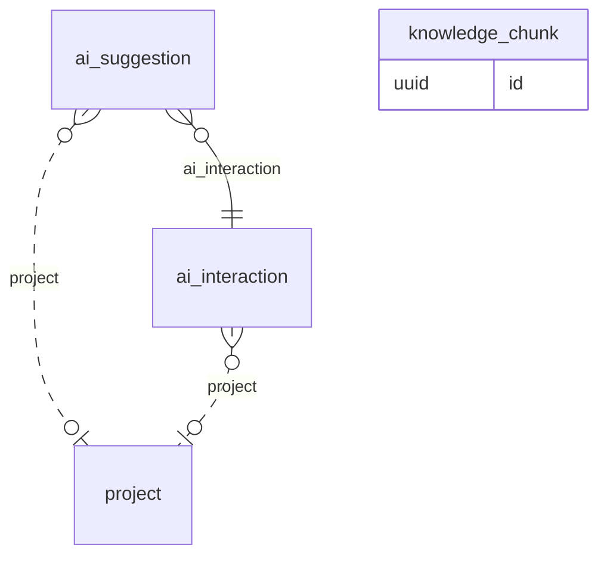

### `ai_suggestion`

**Sugerencia de IA** (BC-18). Resultado de la IA guardado aparte, con evidencia y confianza, que una persona acepta o
rechaza. Tabla física `app_data.ai_suggestion__<org8>`. Requisitos: RF-AIK-001, RF-AIK-002, RF-AIK-004, RF-AIK-007,
RF-AIK-008, RQ-AI-001, RQ-AI-003, RQ-AI-004, RQ-AI-015.

| Campo | Tipo | Req. | Único | Descripción | Fuente |
|---|---|---|---|---|---|
| `suggestion_kind` | ENUM `ai_suggestion_kind` | sí | — | Tipo de sugerencia. | RQ-AI-001 |
| `target_object` | TEXT | no | — | Objeto del registro al que se refiere. | RQ-AI-003 |
| `target_record_id` | UUID | no | — | Registro al que se refiere; una guarda verifica que exista y se pueda leer. | RQ-AI-003 |
| `suggested_value` | LONG_TEXT | sí | — | Valor o texto sugerido, con la forma que fija su fila de la lista permitida (`ai-architecture.md` §4.2); lleva marcadores o referencias, nunca valores restringidos (RQ-AI-009). | RQ-AI-001 |
| `evidence_quote` | LONG_TEXT | no | — | (restringido) Cita o fragmento que la sustenta, seudonimizado: marcadores en lugar de valores restringidos (RQ-AI-009). | RQ-AI-004 |
| `confidence` | DECIMAL | no | — | Confianza. | RQ-AI-004 |
| `model` | TEXT | sí | — | Modelo que la produjo. | RQ-AI-004 |

| Relación | Tipo | Campo | Destino | Req. | Nota |
|---|---|---|---|---|---|
| `ai_suggestion_project` | MANY_TO_ONE | `project` | `project` | no | Vacío si es del tenant |
| `ai_suggestion_ai_interaction` | MANY_TO_ONE | `ai_interaction` | `ai_interaction` | sí | — |

- **Flags:** `appendOnly` no · `apiOnly` sí · `requiresReason` no.
- **Únicos:** ninguno.
- **Índices declarados:** `indexed` en `target_record_id`.
- **Acciones declaradas:** ninguna.
- **Workflow:** WF-K.
- **Fase:** F7 · Release 3 (Fase 3 de producto).
- `target_record_id` lleva índice para listar las sugerencias de un registro. `CommandTransitionGuard` protege
  `accepted`: aceptar ejecuta el comando de dominio con la autorización de quien acepta (RQ-AI-003).
- `evidence_quote`, aquí y en `commitment_candidate`, se guarda seudonimizada y la API genérica solo devuelve
  marcadores. Un permiso de campo (`security.md` §7.9) la oculta además a los roles sin `DOWNLOAD_RESTRICTED` sobre
  `evidence`, también en la API genérica. Se re-identifica al mostrarla, solo para quien tiene acceso a esos campos y
  puede descargar la evidencia fuente, y la comprobación de que la cita es literal se hace sobre el fragmento
  seudonimizado (`ai-architecture.md` §12.2).

### `ai_interaction`

**Interacción con IA** (BC-18). Registro inmutable de cada llamada a un modelo: proveedor, modelo, versión de prompt,
tokens, latencia y confianza. Tabla física `app_data.ai_interaction__<org8>`. Requisitos: RF-AIK-009, RQ-AI-006,
RQ-AUD-003, RQ-AUD-012.

| Campo | Tipo | Req. | Único | Descripción | Fuente |
|---|---|---|---|---|---|
| `use_case` | TEXT | sí | — | Caso de IA, de AI-01 a AI-08. | RF-AIK-009 |
| `provider` | TEXT | sí | — | Proveedor. | RF-AIK-009 |
| `model` | TEXT | sí | — | Modelo. | RF-AIK-009 |
| `model_version` | TEXT | no | — | Versión del modelo. | RF-AIK-009 |
| `prompt_version` | TEXT | sí | — | Versión del prompt en el repositorio. | RQ-AI-006 |
| `started_at` | DATETIME | sí | — | Momento de la llamada. | RF-AIK-009 |
| `input_reference` | TEXT | no | — | Referencia a la entrada (registro o documento de origen). | RF-AIK-009 |
| `output_summary` | LONG_TEXT | no | — | Resumen de la salida. | RF-AIK-009 |
| `input_tokens` | INTEGER | no | — | Tokens de entrada. | RF-AIK-009 |
| `output_tokens` | INTEGER | no | — | Tokens de salida. | RF-AIK-009 |
| `latency_ms` | INTEGER | no | — | Latencia en milisegundos. | RF-AIK-009 |
| `confidence` | DECIMAL | no | — | Confianza. | RF-AIK-009 |
| `requested_by_user_id` | UUID | no | — | Usuario que la pidió (ASM-023); vacío cuando la llamada la hace un trabajo como la plataforma, como JOB-07. | RQ-AUD-012 |
| `requested_by_user_email` | EMAIL | no | — | Correo de quien la pidió; vacío en una llamada de la plataforma. | RQ-AUD-012 |
| `run_by_platform` | BOOLEAN | no | — | (derivado) Verdadero cuando la llamada la hizo un trabajo como la plataforma, sin usuario que la pida. | RF-AIK-009 |

| Relación | Tipo | Campo | Destino | Req. | Nota |
|---|---|---|---|---|---|
| `ai_interaction_project` | MANY_TO_ONE | `project` | `project` | no | Vacío si es del tenant |

- **Flags:** `appendOnly` sí · `apiOnly` sí · `requiresReason` no.
- **Únicos:** ninguno.
- **Índices declarados:** ninguno.
- **Acciones declaradas:** ninguna.
- **Workflow:** ninguno.
- **Fase:** F7 · Release 3 (Fase 3 de producto).
- La validación humana y el resultado se leen del estado de la `ai_suggestion` o del `commitment_candidate` que apunta a
  la interacción, porque una fila inmutable no se actualiza (RF-AIK-009).
- `UserReferenceGuard` valida el par `requested_by_*` solo cuando viene informado; `run_by_platform` lo escribe el
  código de `sgspe.ai` al registrar la interacción (§7.4 del modelo de dominio).

### `knowledge_chunk`

**Fragmento de conocimiento** (BC-18). Fragmento de una evidencia para la recuperación con citas (RAG). Tabla fija
`sgspe.knowledge_chunk`, no Custom Object (§2.3). Requisitos: RQ-AI-008, CON-035.

| Campo | Tipo | Req. | Único | Descripción | Fuente |
|---|---|---|---|---|---|
| `id` | uuid | sí | sí | Clave primaria; `gen_random_uuid()`. | RQ-AI-008 |
| `organization_id` | uuid | sí | compuesto | Tenant; toda recuperación filtra por él. | RQ-AI-008 |
| `project_id` | uuid | no | — | Proyecto; vacío si el documento es del tenant (referencia lógica). | RQ-AI-008 |
| `evidence_id` | uuid | sí | compuesto | Evidencia de origen (referencia lógica). | RQ-AI-008 |
| `chunk_index` | integer | sí | compuesto | Posición del fragmento en el documento. | RQ-AI-008 |
| `classification` | text | sí | — | Valor del catálogo de clasificación de la evidencia, copiado para filtrar. | RQ-AI-008 |
| `content` | text | sí | — | Texto del fragmento. | RQ-AI-008 |
| `embedding` | vector | no | — | Vector de pgvector; existe solo si F7 justifica pgvector con una medición (CON-035). | RQ-AI-008 |
| `created_at` | timestamptz | sí | — | Momento de creación; `now()` por defecto. | RQ-AI-008 |

- **Flags:** no aplican; es una tabla fija sin metadata de wasichai.
- **Únicos:** clave primaria `id`; (`organization_id`, `evidence_id`, `chunk_index`).
- **Índices:** (`organization_id`, `project_id`, `classification`); GIN de texto completo sobre
  `to_tsvector('spanish', content)`.
- **Acciones declaradas:** no aplican.
- **Workflow:** ninguno.
- **Fase:** F7 · Release 3 (Fase 3 de producto).
- El único compuesto hace idempotente la reindexación de una evidencia; el índice compuesto sirve a la recuperación
  filtrada por tenant, proyecto y clasificación (RQ-AI-008).
- El índice GIN de texto completo en español sobre `content` sostiene la primera etapa del RAG de F7, sin extensiones
  nuevas de PostgreSQL; pgvector y `embedding` llegan solo en la segunda etapa (RQ-AI-008, CON-035).
- Es un dato derivado: se puede borrar y regenerar desde su `evidence`. Si se adopta pgvector, un ADR nuevo fija el
  índice vectorial, la dimensión del vector y el modelo de embeddings (ADR-0005).

## 21. BC-19 Línea base social

Estudio, instrumentos, perfiles de localidad, servicios, festividades, programas estatales, conflictos locales,
percepciones, temas clave y el catálogo de temas [DOC-01 §5, §7.1, §8]. Es metadata pura: no tiene workflow ni código
propio, y cada dato del perfil queda con su fecha, su fuente y su confiabilidad (RF-LBS-002).

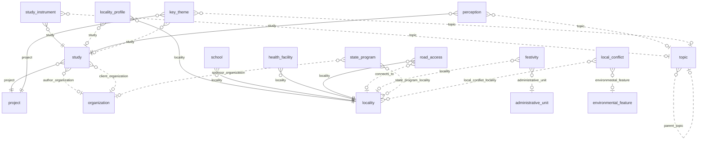

### `study`

**Estudio o diagnóstico** (BC-19). Estudio de línea base o diagnóstico social con objetivos, metodología, instrumentos y
trabajo de campo. Tabla física `app_data.study__<org8>`. Requisitos: RF-LBS-001 [DOC-01 §2, §3].

| Campo | Tipo | Req. | Único | Descripción | Fuente |
|---|---|---|---|---|---|
| `title` | TEXT | sí | — | Título. | RF-LBS-001 |
| `study_type` | TEXT | no | — | Tipo de estudio (texto). | RF-LBS-001 |
| `objectives` | LONG_TEXT | no | — | Objetivos. | RF-LBS-001 |
| `scope_description` | LONG_TEXT | no | — | Alcance. | RF-LBS-001 |
| `methodology` | LONG_TEXT | no | — | Metodología. | RF-LBS-001 |
| `fieldwork_start_date` | DATE | no | — | Inicio del trabajo de campo. | RF-LBS-001 |
| `fieldwork_end_date` | DATE | no | — | Fin del trabajo de campo. | RF-LBS-001 |

| Relación | Tipo | Campo | Destino | Req. | Nota |
|---|---|---|---|---|---|
| `study_project` | MANY_TO_ONE | `project` | `project` | sí | — |
| `study_author_organization` | MANY_TO_ONE | `author_organization` | `organization` | no | Autora |
| `study_client_organization` | MANY_TO_ONE | `client_organization` | `organization` | no | Cliente |
| `evidence_study` | MANY_TO_MANY | — | `evidence` | — | Inversa; se define en `evidence`; desde F3 |

- **Flags:** `appendOnly` no · `apiOnly` no · `requiresReason` no.
- **Únicos:** ninguno.
- **Índices declarados:** ninguno.
- **Acciones declaradas:** ninguna.
- **Workflow:** ninguno.
- **Fase:** F2 · Release 1 (MVP).

### `study_instrument`

**Instrumento de estudio** (BC-19). Instrumento aplicado a un tema y a un ámbito (tema → tipo de instrumento → ámbito de
aplicación). Tabla física `app_data.study_instrument__<org8>`. Requisitos: RF-LBS-001 [DOC-01 Tabla 10.1].

| Campo | Tipo | Req. | Único | Descripción | Fuente |
|---|---|---|---|---|---|
| `instrument_type` | ENUM `instrument_type` | sí | — | Tipo de instrumento. | RF-LBS-001 |
| `application_scope` | ENUM `stakeholder_scope` | no | — | Ámbito de aplicación. | RF-LBS-001 |
| `description` | LONG_TEXT | no | — | Descripción. | RF-LBS-001 |

| Relación | Tipo | Campo | Destino | Req. | Nota |
|---|---|---|---|---|---|
| `study_instrument_study` | MANY_TO_ONE | `study` | `study` | sí | — |
| `study_instrument_topic` | MANY_TO_ONE | `topic` | `topic` | no | — |

- **Flags:** `appendOnly` no · `apiOnly` no · `requiresReason` no.
- **Únicos:** ninguno.
- **Índices declarados:** ninguno.
- **Acciones declaradas:** ninguna.
- **Workflow:** ninguno.
- **Fase:** F2 · Release 1 (MVP).

### `locality_profile`

**Perfil de localidad** (BC-19). Datos socioeconómicos fechados de una localidad, cada uno con su fuente y su
confiabilidad. Tabla física `app_data.locality_profile__<org8>`. Requisitos: RF-LBS-002, RQ-SEC-010 [DOC-01 §5].

| Campo | Tipo | Req. | Único | Descripción | Fuente |
|---|---|---|---|---|---|
| `data_date` | DATE | sí | — | Fecha de los datos. | RF-LBS-002 |
| `data_source` | TEXT | sí | — | Fuente de los datos. | RF-LBS-002 |
| `reliability` | ENUM `data_reliability` | sí | — | Confiabilidad del dato. | RF-LBS-002 |
| `families_count` | INTEGER | no | — | Familias. | RF-LBS-002 |
| `population_count` | INTEGER | no | — | Población. | RF-LBS-002 |
| `communal_labor_members_count` | INTEGER | no | — | Republicanos. | RF-LBS-002 |
| `members_per_family` | DECIMAL | no | — | Miembros por familia. | RF-LBS-002 |
| `migration` | LONG_TEXT | no | — | Migración. | RF-LBS-002 |
| `economic_activities` | LONG_TEXT | no | — | Actividades económicas. | RF-LBS-002 |
| `crops` | LONG_TEXT | no | — | Cultivos. | RF-LBS-002 |
| `livestock` | LONG_TEXT | no | — | Ganadería. | RF-LBS-002 |
| `water_source` | TEXT | no | — | Fuente del agua. | RF-LBS-002 |
| `water_treatment` | TEXT | no | — | Tratamiento del agua. | RF-LBS-002 |
| `water_frequency` | TEXT | no | — | Frecuencia del servicio de agua. | RF-LBS-002 |
| `water_fee` | TEXT | no | — | Pago por el agua. | RF-LBS-002 |
| `water_system_age_years` | INTEGER | no | — | Antigüedad del sistema de agua, en años. | RF-LBS-002 |
| `water_problems` | LONG_TEXT | no | — | Problemas del servicio de agua. | RF-LBS-002 |
| `electricity` | TEXT | no | — | Electricidad. | RF-LBS-002 |
| `sanitation` | TEXT | no | — | Saneamiento. | RF-LBS-002 |
| `phone_coverage` | TEXT | no | — | Cobertura de telefonía. | RF-LBS-002 |
| `religion` | LONG_TEXT | no | — | (restringido) Religión. | RQ-SEC-010 |
| `electoral_process` | LONG_TEXT | no | — | (restringido) Proceso electoral. | RQ-SEC-010 |

| Relación | Tipo | Campo | Destino | Req. | Nota |
|---|---|---|---|---|---|
| `locality_profile_locality` | MANY_TO_ONE | `locality` | `locality` | sí | — |
| `locality_profile_study` | MANY_TO_ONE | `study` | `study` | no | — |

- **Flags:** `appendOnly` no · `apiOnly` no · `requiresReason` no.
- **Únicos:** ninguno.
- **Índices declarados:** `indexes` (`locality`, `data_date`).
- **Acciones declaradas:** ninguna.
- **Workflow:** ninguno.
- **Fase:** F2 · Release 1 (MVP).
- El índice (`locality`, `data_date`) sirve a la búsqueda del perfil más reciente de una localidad.

### `school`

**Institución educativa** (BC-19). Institución de nivel inicial, primario o secundario de una localidad. Tabla física
`app_data.school__<org8>`. Requisitos: RF-LBS-003 [DOC-01 Tablas 5.4, 5.9].

| Campo | Tipo | Req. | Único | Descripción | Fuente |
|---|---|---|---|---|---|
| `name` | TEXT | sí | — | Nombre. | RF-LBS-003 |
| `education_level` | TEXT | no | — | Nivel educativo. | RF-LBS-003 |
| `school_status` | TEXT | no | — | Estado. | RF-LBS-003 |
| `location` | GEOMETRY (POINT) | no | — | Ubicación. | RF-LBS-003 |

| Relación | Tipo | Campo | Destino | Req. | Nota |
|---|---|---|---|---|---|
| `school_locality` | MANY_TO_ONE | `locality` | `locality` | sí | — |

- **Flags:** `appendOnly` no · `apiOnly` no · `requiresReason` no.
- **Únicos:** ninguno.
- **Índices declarados:** ninguno.
- **Acciones declaradas:** ninguna.
- **Workflow:** ninguno.
- **Fase:** F2 · Release 1 (MVP).

### `health_facility`

**Establecimiento de salud** (BC-19). Puesto o centro de salud de una localidad. Tabla física
`app_data.health_facility__<org8>`. Requisitos: RF-LBS-003 [DOC-01 §5.1.5, §5.2.4].

| Campo | Tipo | Req. | Único | Descripción | Fuente |
|---|---|---|---|---|---|
| `name` | TEXT | sí | — | Nombre. | RF-LBS-003 |
| `facility_type` | TEXT | no | — | Tipo de establecimiento. | RF-LBS-003 |
| `facility_status` | TEXT | no | — | Estado. | RF-LBS-003 |
| `location` | GEOMETRY (POINT) | no | — | Ubicación. | RF-LBS-003 |

| Relación | Tipo | Campo | Destino | Req. | Nota |
|---|---|---|---|---|---|
| `health_facility_locality` | MANY_TO_ONE | `locality` | `locality` | sí | — |

- **Flags:** `appendOnly` no · `apiOnly` no · `requiresReason` no.
- **Únicos:** ninguno.
- **Índices declarados:** ninguno.
- **Acciones declaradas:** ninguna.
- **Workflow:** ninguno.
- **Fase:** F2 · Release 1 (MVP).

### `road_access`

**Vía de acceso** (BC-19). Trocha carrozable o camino de herradura que conecta localidades, con su estado y sus medios
de transporte. Tabla física `app_data.road_access__<org8>`. Requisitos: RF-LBS-003 [DOC-01 Tabla 5.5].

| Campo | Tipo | Req. | Único | Descripción | Fuente |
|---|---|---|---|---|---|
| `road_type` | TEXT | no | — | Tipo de vía. | RF-LBS-003 |
| `road_condition` | TEXT | no | — | Estado de la vía. | RF-LBS-003 |
| `transport_means` | TEXT | no | — | Medios de transporte. | RF-LBS-003 |
| `travel_time` | TEXT | no | — | Tiempo de viaje. | RF-LBS-003 |
| `trace` | GEOMETRY (LINESTRING) | no | — | Trazo. | RF-LBS-003 |

| Relación | Tipo | Campo | Destino | Req. | Nota |
|---|---|---|---|---|---|
| `road_access_locality` | MANY_TO_ONE | `locality` | `locality` | sí | Origen |
| `road_access_connects_to` | MANY_TO_ONE | `connects_to` | `locality` | no | Destino |

- **Flags:** `appendOnly` no · `apiOnly` no · `requiresReason` no.
- **Únicos:** ninguno.
- **Índices declarados:** ninguno.
- **Acciones declaradas:** ninguna.
- **Workflow:** ninguno.
- **Fase:** F2 · Release 1 (MVP).

### `festivity`

**Festividad** (BC-19). Celebración local o distrital con fechas y turnos de coorganización. Tabla física
`app_data.festivity__<org8>`. Requisitos: RF-LBS-004, RN-INV-002 [DOC-01 Tabla 5.6].

| Campo | Tipo | Req. | Único | Descripción | Fuente |
|---|---|---|---|---|---|
| `name` | TEXT | sí | — | Nombre. | RF-LBS-004 |
| `date_text` | TEXT | no | — | Fecha tal como se celebra (texto). | RF-LBS-004 |
| `month` | INTEGER | no | — | Mes. | RF-LBS-004 |
| `start_day` | INTEGER | no | — | Día de inicio. | RF-LBS-004 |
| `end_day` | INTEGER | no | — | Día de fin. | RF-LBS-004 |
| `co_organization_turns` | LONG_TEXT | no | — | Turnos de coorganización. | RF-LBS-004 |

| Relación | Tipo | Campo | Destino | Req. | Nota |
|---|---|---|---|---|---|
| `festivity_locality` | MANY_TO_ONE | `locality` | `locality` | no | — |
| `festivity_administrative_unit` | MANY_TO_ONE | `administrative_unit` | `administrative_unit` | no | Festividad distrital |

- **Flags:** `appendOnly` no · `apiOnly` no · `requiresReason` no.
- **Únicos:** ninguno.
- **Índices declarados:** ninguno.
- **Acciones declaradas:** ninguna.
- **Workflow:** ninguno.
- **Fase:** F2 · Release 1 (MVP).

### `state_program`

**Programa estatal** (BC-19). Programa social del Estado presente en una o más localidades; es contexto, no inversión
del proyecto. Tabla física `app_data.state_program__<org8>`. Requisitos: RF-LBS-005 [DOC-01 Tabla 5.10].

| Campo | Tipo | Req. | Único | Descripción | Fuente |
|---|---|---|---|---|---|
| `name` | TEXT | sí | — | Nombre. | RF-LBS-005 |
| `description` | LONG_TEXT | no | — | Descripción. | RF-LBS-005 |

| Relación | Tipo | Campo | Destino | Req. | Nota |
|---|---|---|---|---|---|
| `state_program_sponsor_organization` | MANY_TO_ONE | `sponsor_organization` | `organization` | no | Entidad del Estado |
| `state_program_locality` | MANY_TO_MANY | — | `locality` | — | Localidades donde está presente |

- **Flags:** `appendOnly` no · `apiOnly` no · `requiresReason` no.
- **Únicos:** ninguno.
- **Índices declarados:** ninguno.
- **Acciones declaradas:** ninguna.
- **Workflow:** ninguno.
- **Fase:** F2 · Release 1 (MVP).

### `local_conflict`

**Conflicto local** (BC-19). Disputa entre localidades por agua, límites, terrenos o separación, con su estado. Tabla
física `app_data.local_conflict__<org8>`. Requisitos: RF-LBS-006 [DOC-01 §5.1.1, §5.2.1].

| Campo | Tipo | Req. | Único | Descripción | Fuente |
|---|---|---|---|---|---|
| `title` | TEXT | sí | — | Título. | RF-LBS-006 |
| `conflict_type` | ENUM `local_conflict_type` | no | — | Tipo de conflicto. | RF-LBS-006 |
| `conflict_status` | ENUM `local_conflict_status` | no | — | Estado del conflicto. | RF-LBS-006 |
| `disputed_resource` | TEXT | no | — | Recurso en disputa. | RF-LBS-006 |
| `description` | LONG_TEXT | no | — | Descripción. | RF-LBS-006 |

| Relación | Tipo | Campo | Destino | Req. | Nota |
|---|---|---|---|---|---|
| `conflict_environmental_feature` | MANY_TO_ONE | `environmental_feature` | `environmental_feature` | no | Lugar o recurso en disputa |
| `local_conflict_locality` | MANY_TO_MANY | — | `locality` | — | Localidades en conflicto |

- **Flags:** `appendOnly` no · `apiOnly` no · `requiresReason` no.
- **Únicos:** ninguno.
- **Índices declarados:** ninguno.
- **Acciones declaradas:** ninguna.
- **Workflow:** ninguno.
- **Fase:** F2 · Release 1 (MVP).

### `perception`

**Percepción** (BC-19). Opinión frecuente sobre la minería, el proyecto o la empresa, con su ámbito, su polaridad y
citas atribuidas por cargo. Tabla física `app_data.perception__<org8>`. Requisitos: RF-LBS-007, RQ-REP-014
[DOC-01 §7.1].

| Campo | Tipo | Req. | Único | Descripción | Fuente |
|---|---|---|---|---|---|
| `subject` | ENUM `perception_subject` | sí | — | Sujeto de la percepción. | RF-LBS-007 |
| `polarity` | ENUM `perception_polarity` | sí | — | Polaridad. | RF-LBS-007 |
| `perception_scope` | ENUM `stakeholder_scope` | no | — | Ámbito. | RF-LBS-007 |
| `statement` | LONG_TEXT | sí | — | Enunciado de la percepción. | RF-LBS-007 |
| `quote` | LONG_TEXT | no | — | Cita textual. | RQ-REP-014 |
| `attributed_role` | TEXT | no | — | Cargo de quien la dijo, nunca el nombre. | RQ-REP-014 |

| Relación | Tipo | Campo | Destino | Req. | Nota |
|---|---|---|---|---|---|
| `perception_study` | MANY_TO_ONE | `study` | `study` | sí | — |
| `perception_topic` | MANY_TO_ONE | `topic` | `topic` | no | — |

- **Flags:** `appendOnly` no · `apiOnly` no · `requiresReason` no.
- **Únicos:** ninguno.
- **Índices declarados:** ninguno.
- **Acciones declaradas:** ninguna.
- **Workflow:** ninguno.
- **Fase:** F2 · Release 1 (MVP).

### `key_theme`

**Tema clave** (BC-19). Asunto frecuente en el discurso de los actores, con riesgos y oportunidades para el proyecto.
Tabla física `app_data.key_theme__<org8>`. Requisitos: RF-LBS-008 [DOC-01 §8, Tabla 8.1].

| Campo | Tipo | Req. | Único | Descripción | Fuente |
|---|---|---|---|---|---|
| `name` | TEXT | sí | — | Nombre. | RF-LBS-008 |
| `description` | LONG_TEXT | no | — | Descripción. | RF-LBS-008 |
| `risks` | LONG_TEXT | no | — | Riesgos. | RF-LBS-008 |
| `opportunities` | LONG_TEXT | no | — | Oportunidades. | RF-LBS-008 |

| Relación | Tipo | Campo | Destino | Req. | Nota |
|---|---|---|---|---|---|
| `key_theme_project` | MANY_TO_ONE | `project` | `project` | sí | — |
| `key_theme_study` | MANY_TO_ONE | `study` | `study` | no | — |
| `key_theme_topic` | MANY_TO_ONE | `topic` | `topic` | no | — |

- **Flags:** `appendOnly` no · `apiOnly` no · `requiresReason` no.
- **Únicos:** ninguno.
- **Índices declarados:** ninguno.
- **Acciones declaradas:** ninguna.
- **Workflow:** ninguno.
- **Fase:** F2 · Release 1 (MVP).

### `topic`

**Tema** (BC-19). Catálogo jerárquico de temas (agua, empleo, medio ambiente…); objeto catálogo (BC-20). Tabla física
`app_data.topic__<org8>`. Requisitos: RF-LBS-009, RF-CAT-001.

| Campo | Tipo | Req. | Único | Descripción | Fuente |
|---|---|---|---|---|---|
| `code` | TEXT | sí | sí | Código del tema. | RF-LBS-009 |
| `name` | TEXT | sí | — | Nombre. | RF-LBS-009 |
| `description` | LONG_TEXT | no | — | Descripción. | RF-LBS-009 |
| `active` | BOOLEAN | sí | — | Tema vigente; un tema inactivo no se ofrece en la captura. Por defecto: true. | RF-CAT-001 |

| Relación | Tipo | Campo | Destino | Req. | Nota |
|---|---|---|---|---|---|
| `topic_parent_topic` | MANY_TO_ONE | `parent_topic` | `topic` | no | Tema padre |
| `engagement_topic` | MANY_TO_MANY | — | `engagement` | — | Inversa; se define en `engagement` |
| `project_priority_topic` | MANY_TO_MANY | — | `project` | — | Inversa; se define en `project` |

- **Flags:** `appendOnly` no · `apiOnly` no · `requiresReason` no.
- **Únicos:** `unique` en `code`.
- **Índices declarados:** ninguno.
- **Acciones declaradas:** ninguna.
- **Workflow:** ninguno.
- **Fase:** F2 · Release 1 (MVP).

## 22. Tablas fijas transversales

Tablas fijas del esquema `sgspe` que no pertenecen a un contexto, con la migración de `sgspe.common` (§2.3). No tienen
relaciones:

- `idempotency_key`: las claves de idempotencia de los endpoints propios (RNF-INT-002, ASM-065).
- `derived_version`: los saltos de versión de las escrituras de solo derivados, que acepta `If-Match` (RNF-INT-003,
  ADR-0027).

### `idempotency_key`

**Clave de idempotencia** (Transversal). Clave `Idempotency-Key` de cada comando de `/api/sgspe/**` que la trae, con la
respuesta que recibió la primera petición, escrita en la misma transacción que el comando y purgada por JOB-08 después de
`wasichai.idempotency.ttl`; el alta genérica usa la tabla nativa de wasichai, con el mismo contrato (UPS-18). Tabla fija
`sgspe.idempotency_key`, no Custom Object (§2.3). Requisitos: RNF-INT-002, ASM-065, UPS-18.

| Campo | Tipo | Req. | Único | Descripción | Fuente |
|---|---|---|---|---|---|
| `organization_id` | uuid | sí | compuesto | Tenant; toda consulta filtra por él. | ASM-065 |
| `user_id` | uuid | sí | compuesto | Usuario que hizo la petición: la clave vale por organización y usuario. | ASM-065 |
| `request_key` | text | sí | compuesto | Valor de la cabecera `Idempotency-Key`, de 1 a 128 caracteres ASCII imprimibles. | RNF-INT-002 |
| `request_sha256` | text | sí | — | SHA-256 del método, la ruta y el cuerpo con sus claves ordenadas: con la misma clave, otra petición es un `422`. | RNF-INT-002 |
| `response_status` | integer | sí | — | Estado de la primera respuesta. | RNF-INT-002 |
| `response_body` | text | sí | — | Cuerpo de la primera respuesta, que un reenvío recibe byte por byte; lleva lo que quien llama podía leer. | RNF-INT-002 |
| `response_etag` | text | no | — | `ETag` de la primera respuesta. | RNF-INT-002 |
| `response_location` | text | no | — | `Location` de la primera respuesta. | RNF-INT-002 |
| `created_at` | timestamptz | sí | — | Momento de la primera petición; `now()` por defecto y base del plazo y de la purga. | ASM-065 |

- **Flags:** no aplican; es una tabla fija sin metadata de wasichai.
- **Únicos:** clave primaria (`organization_id`, `user_id`, `request_key`).
- **Índices:** (`created_at`), que sirve a la purga de JOB-08 con SQL propio, sin `asPlatform` (ASM-065).
- **Acciones declaradas:** no aplican.
- **Workflow:** ninguno.
- **Fase:** F3 · Release 1 (MVP).
- Lo que está en curso no es una columna: es un candado de transacción (`pg_try_advisory_xact_lock`) sobre la clave, que no
  espera; una segunda petición con la clave en curso recibe `409` con `Retry-After`. Una fila significa que el comando se
  confirmó; un comando que falló no deja fila y la clave queda libre (`api.md` §3.5).
- Una fila más antigua que el plazo se borra antes de leerla, así que el plazo es exacto aunque la purga se atrase. La escribe
  y la lee solo `sgspe.common`, con `DatabaseClient` (RNF-INT-002).
- `response_body` tiene un tope de 2 MiB (el `CHECK` `idempotency_key_response_size`): un comando que respondiera más
  falla con `500` y no escribe nada. Puede llevar campos restringidos que quien llamó podía leer, y por eso expira
  con el plazo (`security.md` §11.6).
- Las claves de esta tabla y las de la tabla nativa del alta genérica son espacios separados: la misma clave en las dos
  rutas corre las dos peticiones (`api.md` §3.5).

### `derived_version`

**Salto de versión de derivados** (Transversal). Cada escritura de solo derivados (`Records.patch` con campos
`"derived"`, sin geometrías) se condiciona al `updated_at` que leyó y, si gana, deja aquí de cuál a cuál pasó el
registro. El `If-Match` de la API genérica y de los comandos acepta la versión leída y las que la siguieron solo por
estos saltos (`api.md` §3.6); JOB-08 los purga después de `sgspe.concurrency.derived-versions-retention`. Tabla fija
`sgspe.derived_version`, no Custom Object (§2.3). Requisitos: RNF-INT-003, ASM-035, ASM-091, UPS-04.

| Campo | Tipo | Req. | Único | Descripción | Fuente |
|---|---|---|---|---|---|
| `organization_id` | uuid | sí | compuesto | Tenant; toda consulta filtra por él. | ASM-091 |
| `object_name` | text | sí | compuesto | Objeto del registro, como en la ruta de la API genérica. | RNF-INT-003 |
| `record_id` | uuid | sí | compuesto | Registro que cambió; referencia lógica, sin clave foránea (§2.3). | RNF-INT-003 |
| `from_updated_at` | timestamptz | sí | compuesto | `updated_at` que leyó la escritura de derivados y al que se condicionó su `UPDATE`. | ADR-0027 |
| `to_updated_at` | timestamptz | sí | — | `updated_at` que produjo, la hora de su sentencia [WAS-ADR-0051]. | ADR-0027 |
| `created_at` | timestamptz | sí | — | Momento del salto; `now()` por defecto y base del plazo y de la purga. | ASM-091 |

- **Flags:** no aplican; es una tabla fija sin metadata de wasichai.
- **Únicos:** clave primaria (`organization_id`, `object_name`, `record_id`, `from_updated_at`): de una versión sale a lo
  sumo un salto, porque solo una escritura condicionada a ella puede ganar.
- **Índices:** la clave primaria, que sirve a la lectura de la cadena desde una versión; (`created_at`), que sirve a la
  purga de JOB-08 con SQL propio, sin `asPlatform`.
- **Acciones declaradas:** no aplican.
- **Workflow:** ninguno.
- **Fase:** F3 · Release 1 (MVP).
- Fuera de una transacción el salto se inserta justo después del `UPDATE` ya confirmado: en ese intervalo una
  comparación no lo ve y responde `412`, nunca deja pasar una actualización perdida. Un salto más viejo que el plazo no
  cuenta aunque la purga se atrase. La escribe y la lee solo `sgspe.common`, con `DatabaseClient` (ADR-0027).

## 23. Contextos sin objetos propios

- **BC-11 Operaciones de campo.** Fusionado en BC-04 para el MVP: `field_visit` y `field_observation` (§9, ASM-045). La
  captura sin conexión no es requisito del MVP y depende de GAP-008 (ASM-021); si se aprueba, BC-11 se separa con sus propios
  objetos de sincronización.
- **BC-16 Identidad y acceso.** Usuarios, roles, permisos por objeto, campo y acción y cuentas de servicio viven en el
  esquema de metadatos de wasichai [WAS-ADR-0010] [WAS-ADR-0020] [WAS-ADR-0042] [WAS-ADR-0043]. Los roles se versionan en
  `model/roles.json` (RQ-SEC-003) y `project_assignment` (BC-01) es la fuente del alcance por proyecto (RF-PRJ-005,
  RQ-SEC-006). Ningún rol usa `own_records_only`: la edición limitada a lo propio la aplica `EditAnyGuard` con la acción
  `EDIT_ANY` (RQ-SEC-008, ASM-069).
- **BC-17 Auditoría.** `audit_log` vive en el esquema de metadatos y registra usuario, objeto, registro, operación, cambios
  antes y después y motivo (RQ-AUD-001, RQ-AUD-002) [WAS-ADR-0040] [WAS-ADR-0041]; ningún código de SGSPE lo escribe. Se
  suma `export_log` (BC-15, RQ-AUD-011). Sus brechas son UPS-02, UPS-03, UPS-05 y UPS-12.
- **BC-20 Catálogos.** Las claves de `enums` de §4 y los objetos catálogo `topic` (§21), `administrative_unit` (§7) e
  `indicator` (§19), que se cargan con scripts idempotentes o desde `/admin` (RF-CAT-001, RF-TER-001, ASM-020).

## 24. `apply.py`: aplicar, sincronizar y migrar

### Cómo aplica el modelo

- `apply.py` parte del de caja-backend, ya alineado con wasichai 0.3.2, y como él usa solo la biblioteca estándar de Python
  (RNF-MNT-002) [USR-03]. Con `--validate-only` revisa el modelo sin red: nombres, límites, reservados, opciones de ENUM,
  claves de `enums` existentes, `geometryType`, `srid` y `dimension`, y `uniqueConstraints` de dos a 32 campos sin LONG_TEXT.
- En cada tenant se aplica en tres pasos, por REST y con el administrador del tenant, cuyo rol `ADMIN` tiene todos los
  permisos, `MANAGE_METADATA` incluido [WAS-DOC api/rest.md]:
  1. `apply.py`:
     - los objetos, con sus campos propios y sus flags (`POST /api/objects`);
     - las acciones declaradas de cada objeto;
     - las relaciones (`POST /api/relationships`) y, después, `required` en los campos RELATION que lo piden;
     - los `uniqueConstraints` y los `indexes` que nombran campos de relación, que solo existen desde el punto anterior.
  2. `apply_roles.py`, con los roles y permisos de `roles.json`. Va después de las acciones declaradas, porque las concede,
     y antes de los workflows, porque sus transiciones nombran roles.
  3. `apply.py --workflows`, cada pieza desde su fase:
     - los workflows (`PUT /api/objects/{object}/workflow`), con el formato de `workflows.md`, desde F2;
     - los tipos de documento (`/api/objects/{object}/document-types`), desde F3;
     - las automatizaciones (`/api/objects/{object}/automations`), desde F3, después de los estados y los tipos de documento
       que nombran sus disparadores y acciones (`STATE_ENTERED`, `TRANSITION_APPLIED`, `GENERATE_DOCUMENT`);
     - las vistas, los formularios y las páginas, desde F2 y al final, porque nombran campos, relaciones y componentes de
       workflow.
- Como crea todos los objetos antes que las relaciones, admite las autorreferencias y los ciclos de §2.6.
- Lo que el `apply.py` de SGSPE agrega al de caja: GEOMETRY e `indexes` (tomados del de srtm) e `indexed` en F2; relaciones
  MANY_TO_MANY con `type`; autorreferencias y ciclos, que los validadores de caja y de srtm rechazan (exigen que el destino
  aparezca antes que el origen); `defaultValue`, que wasichai guarda pero no aplica (UPS-15); y el paso `--workflows`. Cada
  fase agrega solo los objetos, campos, relaciones y definiciones de su fase, según las fichas.
- Desde F3: el tipo `FILE` de wasichai-files (nunca `unique`, con `defaultValue` ni en un índice; `contentTypes` y `maxBytes`
  opcionales, y `wasichai.files.max-bytes` sigue siendo el tope), y en `--workflows` los
  tipos de documento (`model/document-types/<objeto>.json`) y las automatizaciones (`model/automations/<objeto>.json`), cada
  archivo una lista. Los valida sin red contra `model.json` y el workflow del objeto (lo que nombran sus plantillas, sus
  disparadores y sus acciones; sin `WEBHOOK` ni `NOTIFY`; ningún derivado escrito; ningún requerido de `CREATE_RECORD`
  omitido), crea los que faltan, reemplaza los que difieren y avisa, sin borrarla, de una automatización que el tenant
  tiene y `model/` ya no.
- Desde F4: el valor de cada condición de una automatización tiene que poder darse en su campo: una opción de su ENUM,
  `true` o `false` en un BOOLEAN, un número en un INTEGER o un DECIMAL y un estado del workflow en `state`. wasichai lo
  compara como texto (AUT-11 compara `risk_level` con `CRITICO`), así que otro valor saltaría cada ejecución sin error.

### Cómo sincroniza un modelo existente

- Es idempotente: una segunda corrida sin cambios no crea nada.
- Agrega lo que `model.json` tiene y wasichai no: objetos, campos, opciones de ENUM, acciones y relaciones. En un objeto pone
  los flags, los `uniqueConstraints` y los `indexes` cuando difieren.
- En un campo existente sincroniza, con el `PUT` de campo, `label`, `description`, `unique`, `indexed` y las opciones de
  ENUM, y relaja `required` (abajo) [WAS-DOC api/rest.md].
- `defaultValue` no se sincroniza: `UpdateFieldRequest`, el cuerpo de ese `PUT` en el código de wasichai 0.3.2, no lo
  incluye, así que queda fijo desde que se crea el campo. Cambiar un valor por defecto es un caso de migración (abajo).
- Quita una opción de ENUM que `model.json` ya no lista solo si ningún registro la usa; las que conserva por estar en uso
  quedan al final de la lista, después de las de `model.json` en su orden.
- Relaja (`required: false`) un campo que `model.json` ya no exige. Un campo que `model.json` ya no tiene se informa como
  sobrante y nunca se borra, porque puede tener datos; si era requerido, también se relaja.
- **Nunca** renombra, cambia de tipo, vuelve requerido ni borra un campo, ni borra una opción en uso: así los registros ya
  importados siguen siendo válidos. `--drop` desmonta todo, datos incluidos, y es solo para desarrollo.
- `--workflows` crea las definiciones que faltan y reemplaza por nombre las que difieren.
- `/admin` no es la fuente de verdad en producción: volver a correr `apply.py` resincroniza la metadata, como `apply_roles.py`
  resincroniza los permisos de `roles.json` (GAP-030, RNF-MNT-002).

### Cómo se migran los datos

Lo que `apply.py` no hace lo hace una migración de datos, que depende de las reglas de escritura del objeto (§2.8):

- **Objeto sin `apiOnly` ni `appendOnly`.** Un script `model/migrar_<tema>.py`, como los `migrar_*` de srtm:
  - lee todo, escribe un reporte CSV por registro y acepta `--dry-run`;
  - actualiza cada registro con un `PUT` de todos sus campos, porque el `PUT` de wasichai reemplaza el registro;
  - es idempotente, y su motivo de cambio nombra la migración, con la convención de ASM-051.
- **Objeto `apiOnly`.** La API genérica rechaza sus escrituras con 403, también para `ADMIN` [WAS-ADR-0040], así que la
  migración nunca va por REST. Corre en proceso, dentro del paquete `sgspe.*` dueño del objeto, como un trabajo que escribe
  con `RecordService` como la plataforma, con un motivo que nombra la migración y con las guardas activas [WAS-ADR-0039]
  [WAS-ADR-0041]. Es la excepción a la regla de que los trabajos solo escriben campos derivados y crean registros nuevos
  (§8.3 del modelo de dominio): una migración cambia campos no derivados de registros existentes. Vale para `evidence`,
  `delivery`, `project_component`, `commitment_candidate` y `ai_suggestion`, y para los siete objetos `apiOnly` que además
  son `appendOnly`, con la condición del punto siguiente.
- **Objeto `appendOnly`.** No se migra registro por registro, porque wasichai rechaza con 409 el cambio y el borrado de sus
  registros para todos, la plataforma incluida. Cambiar sus valores exige un ADR explícito que apague `appendOnly` durante la
  migración, o conservar la opción vieja en su catálogo [WAS-ADR-0040].
- Después, `apply.py` quita las opciones o los campos viejos que ya no se usan.

Casos previstos:

- renombrar una opción de ENUM: opción nueva, migración de los registros y retiro de la vieja (ASM-025);
- renombrar o cambiar de tipo un campo: campo nuevo, copia de los valores y borrado del viejo [WAS-ADR-0017];
- cambiar el valor por defecto de un campo: campo nuevo con el valor nuevo, copia de los valores y borrado del viejo;
- volver requerido un campo: completar los registros vacíos y después `required: true`;
- pasar los valores de ENUM al inglés, si así se decide en el checkpoint (CON-050).

### Cómo se prepara un tenant

1. `POST /api/organizations` crea la organización y su administrador [WAS-DOC api/rest.md].
2. Con ese administrador: `apply.py`, `apply_roles.py` y `apply.py --workflows`, en ese orden.
3. La carga de los catálogos de §25.
4. Desde F6, `publish_layers.py` publica en GeoServer las capas no sensibles (RQ-SEC-011) y, en el mismo paso, carga o
   actualiza los estilos SLD, que son únicos por despliegue (`gis.md` §7.1).

- Cada organización recibe sus propias tablas, índices y únicos al aplicarle el modelo [WAS-ADR-0036] [WAS-ADR-0037].
- Una subida de fase repite los mismos pasos, que son idempotentes. Quién opera este procedimiento queda en GAP-026.

### Cómo se da de baja un tenant

- `DELETE /api/organizations/current` borra la organización con todas sus tablas [WAS-DOC api/rest.md]. No borra sus filas de
  las tablas fijas de `sgspe.*`, porque no hay claves foráneas entre esquemas (§2.3).
- Por eso la baja incluye un paso que borra, por `organization_id`, las filas del tenant en `sgspe.idempotency_key`,
  `sgspe.derived_version` y `sgspe.knowledge_chunk`, y después llama a
  `DELETE /api/organizations/current`; los avisos los borra la baja de wasichai con el módulo. Quién la opera queda en
  GAP-026, como el alta.

### Cómo se prueba

- `test_model.py` verifica `model.json` contra este documento: objetos del catálogo canónico, claves de `enums` de §4,
  nombres, límites, flags, únicos e índices.
- `test_apply.py` prueba `apply.py` contra un núcleo falso, incluido el caso de un tenant nuevo: los tres pasos en orden sobre
  un núcleo vacío.
- Las pruebas de integración aplican `model.json` a una base PostGIS con Testcontainers (RNF-TST-001).

## 25. Semillas y fixtures

- **Producción.** Sin la semilla de desarrollo de wasichai (`wasichai.seed.dev=false`) y sin secreto JWT por defecto, de modo
  que el arranque falla si falta (RQ-SEC-016) [WAS-DOC modules/core.md].
- **Desarrollo.** La semilla de wasichai crea la organización de demostración y el usuario `admin@wasichai.local`; solo existe
  con `wasichai.seed.dev=true` [WAS-DOC modules/core.md].
- **Catálogos de referencia, en todo entorno.** El ubigeo del INEI en `administrative_unit`, desde el archivo público y con un
  script idempotente (RF-TER-001, ASM-016); el catálogo de temas en `topic`; y, desde F8, el catálogo de indicadores en
  `indicator`, con scripts idempotentes o desde `/admin` (ASM-020). Son datos públicos o de configuración, no datos
  personales.
- **Fixtures de pruebas y demostraciones.**
  - Solo personas ficticias ("Persona Ejemplo 1", "Persona Ejemplo 2") y correos `@sgspe.test`; topónimos e instituciones
    públicas reales, como el caserío El Pollo, el distrito de Otuzco o el distrito de Inkahuasi (RQ-SEC-018) [USR-07].
  - Nunca DNI, teléfonos, números de partida ni datos de comprobantes; los datos de las fuentes solo inspiran fixtures
    ficticios (§0.4 del análisis).
  - Geometrías sintéticas, como las de las pruebas GIS (RQ-GIS-021), y códigos inventados.
  - Cada fixture respeta los requeridos y los únicos de su ficha, así que una prueba detecta la deriva entre `model.json` y
    este documento.
- Antes de cada commit, la búsqueda local contra la lista de nombres reales, que vive fuera del repositorio, da cero
  coincidencias (RQ-SEC-018).

## 26. Retención

Sin fuente normativa (GAP-001) y sin política de retención (GAP-014), SGSPE no purga datos de negocio; solo purga lo que una
decisión registrada permite.

| Dato | Dónde vive | Retención | Fuente |
|---|---|---|---|
| Registros de negocio | `app_data` | Se conservan; el fin de vida es un estado de cierre (§2.9) y un borrado físico es excepcional y queda auditado | RQ-AUD-001 |
| Objetos de historia (`appendOnly`) | `app_data` | Nunca se editan ni se borran | RQ-AUD-003 [WAS-ADR-0040] |
| Auditoría | `audit_log` (metadatos) | SGSPE nunca la purga; su inmutabilidad en la base espera UPS-12 | RQ-AUD-010 |
| Archivos de evidencia | Almacenamiento de objetos | Inmutables; una corrección es una evidencia nueva que reemplaza a la anterior, que se conserva | RF-DOC-001, ASM-013 |
| Borradores de entregable | Almacenamiento de objetos | Se conservan los últimos N y se purgan los demás; `deliverable` apunta solo al último | RQ-REP-027, ASM-028, ASM-061 |
| Versiones emitidas | `deliverable_version` y almacenamiento | Siempre, con WORM opcional | RQ-REP-017, RQ-REP-027 |
| Exportaciones e interacciones con IA | `export_log`, `ai_interaction` | Siempre (append-only) | RQ-AUD-011, RQ-AUD-012 |
| Avisos y envíos | Tablas de wasichai-notifications | El módulo purga los avisos resueltos o vencidos después de `wasichai.notifications.retention` (90 días); los envíos se van con su aviso | RF-NTF-001, ADR-0018 |
| Claves de idempotencia | `sgspe.idempotency_key` | JOB-08 borra cada día las más antiguas que `wasichai.idempotency.ttl` (24 h por defecto), el mismo plazo de la cabecera nativa; guardan la respuesta de la primera petición, acotada, para reenviarla; esa respuesta puede llevar datos que quien llamó podía leer y por eso expira con el plazo; nunca guardan el cuerpo de la petición, solo su SHA-256 | ASM-065, RNF-INT-002 |
| Saltos de versión de derivados | `sgspe.derived_version` | JOB-08 borra cada día los más antiguos que `sgspe.concurrency.derived-versions-retention` (7 días); un salto solo sirve a quien leyó la versión de la que sale, y uno vencido no cuenta aunque la purga se atrase: esa versión, seguida de derivados, responde `412` | ASM-091, RNF-INT-003 |
| Fragmentos de RAG | `sgspe.knowledge_chunk` | Son derivados: se regeneran o se borran con su evidencia | RQ-AI-008 |
| Datos personales | Campos restringidos | Según la política de GAP-014; mientras tanto, minimización con permisos de campo y anonimización en salidas | RNF-PRIV-004, RQ-SEC-010, RQ-REP-014 |

- Los respaldos y su retención dependen del despliegue, que define GAP-022.
- Ningún dato real de las fuentes llega a artefactos versionados (RQ-SEC-018).

## 27. Decisiones abiertas que tocan el modelo

| Decisión | Efecto en el modelo | Referencia |
|---|---|---|
| Idioma de los valores de ENUM | Hoy en español MAYÚSCULAS; cambiarlo exige migraciones por script, en proceso en los objetos `apiOnly` y con un ADR en los `appendOnly` (§24) | CON-050, ASM-025 |
| Alcance de lectura por proyecto | El modelo ya lleva `project` y `project_assignment`; la lectura la acota `ProjectReadScope` (ADR-0029) | CON-041, UPS-01, GAP-025 |
| Bloqueo optimista | Sin columna `version`; precondición sobre `updated_at`, comparada por wasichai en la propia escritura, con la tabla fija `derived_version` para tolerar los derivados (ADR-0027) | UPS-04, ASM-035, ASM-091 |
| Campo FILE | `evidence` y el almacenamiento propio hasta que exista; después, migración | UPS-07, ASM-013 |
| Retención y consentimiento | Plazos de purga de datos personales y de notificaciones | GAP-014, RNF-PRIV-004 |
| pgvector | La columna `embedding` de `knowledge_chunk` solo con una medición que lo justifique | RQ-AI-008, CON-035 |
| Lotes de importación y borradores como objetos | Hoy son campos (`import_batch_id`, `draft_*`); un ADR en F6 o F8 puede volverlos objetos | ASM-060, ASM-061 |
| Volúmenes | Los índices declarados se amplían con mediciones | GAP-027 |
| Valores por defecto en la plataforma | Mientras wasichai no aplique `defaultValue`, el código de SGSPE aplica los de `project` (§3.6) | UPS-15, ASM-019 |
| Autorrelaciones desde el destino | Mientras falte, los registros que apuntan a uno se leen filtrando por el campo (§2.6) | UPS-16 |
| Idempotencia en la API genérica | Solo las creaciones de `/api/sgspe/**` son idempotentes, con `idempotency_key`; la tabla se retira cuando la plataforma la ofrezca | UPS-18, ASM-065 |
| Edición de la metadata en `/admin` | Solo el repositorio es fuente de verdad en producción | GAP-030 |
