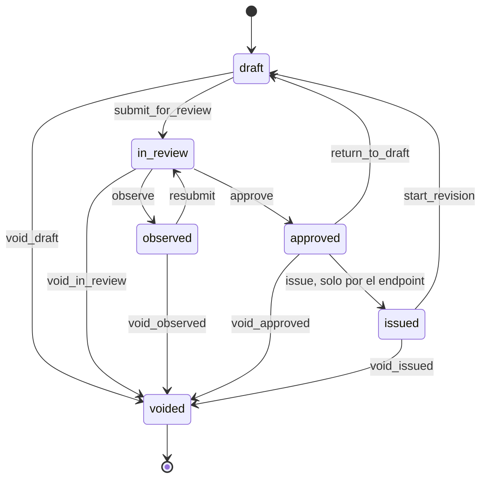
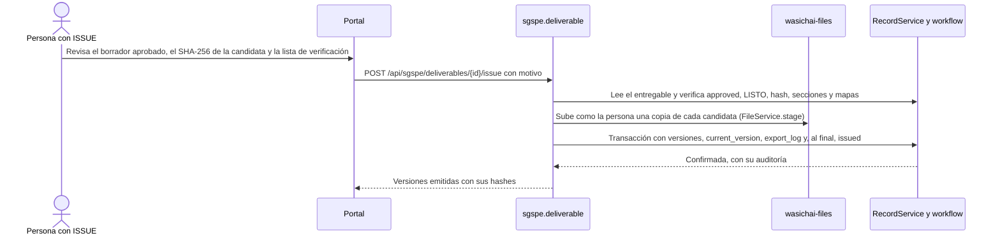

# Entregables DOCX y PDF de SGSPE

Sistema de Gestión Social para Proyectos Extractivos · Fase 0 (descubrimiento) · versión 1.0 · 2026-10-07

Este documento diseña cómo SGSPE produce entregables como DOC-01 y DOC-02 en DOCX y PDF [USR-01]: los tipos, la anatomía
capítulo por capítulo de los dos entregables de ejemplo, la tecnología (DOCX primero con Apache POI y PDF con Gotenberg), los
mapas y gráficos, el ciclo de vida WF-H con su emisión congelada, los niveles de divulgación, las exportaciones XLSX, el
almacenamiento y los criterios de aceptación.

- Los IDs se definen en el [análisis de requisitos](requirements-analysis.md) y aquí solo se citan; los objetos, campos y estados
  son los del [modelo de dominio](domain-model.md), y el vocabulario, el del [glosario](glossary.md).
- Los valores de catálogo se listan solo en [§10 del análisis](requirements-analysis.md#10-catálogos).
- Las capas `LYR-NN` y los mapas de informe se definen en el [SIG](gis.md).
- No están aquí: las transiciones, roles y guardas por transición de WF-H (`workflows.md`), el contrato de los endpoints
  (`api.md`), los permisos por rol (`security.md`) y el catálogo de indicadores (`dashboards.md`).
- Las decisiones de arquitectura se registran en los ADR de SGSPE (`docs/adr/`): ADR-0013 (Entregables DOCX primero, con PDF
  por Gotenberg), ADR-0014 (Evidencias y entregables en almacenamiento de objetos), ADR-0015 (Mapas de informe con GeoServer
  GetMap) y ADR-0017 (Datos personales y anonimización).
- Ningún ejemplo usa nombres de personas, números de partida ni datos de comprobantes de las fuentes [USR-07] (RQ-SEC-018).

## 1. Alcance

- USR-01 pide que el sistema genere entregables como DOC-01 (DOCX) y DOC-02 (PDF), en ambos formatos. Eso se despliega en
  RF-REP-001, RF-REP-002 y en los requisitos de §13.1 del análisis (OBJ-04, P-17).
- Un **entregable** es un informe de varias secciones que se genera, se revisa, se aprueba y se emite. No se confunde con el
  **documento emitido** de un registro (acta de entrega, minuta, cargo de queja), que sale de wasichai-documents (RQ-REP-029)
  [WAS-ADR-0023], ni con la **evidencia**, que es un archivo que prueba un hecho (RF-DOC-001) (domain-model §3).
- wasichai-documents emite una plantilla congelada de un solo registro que se imprime desde el navegador; no genera DOCX
  ni PDF en el servidor ni informes con mapas y gráficos [WAS-DOC modules/documents.md]. Por eso los entregables son
  código propio, `sgspe.deliverable`, con DOCX primero (ASM-014, CON-045). Su copia congelada lleva el registro entero
  sin permisos de campo, así que un tipo de documento solo se declara sobre un objeto sin campos restringidos (UPS-23,
  ASM-090): el acta de entrega espera.
- Las exportaciones XLSX (RQ-REP-022) también están aquí, porque comparten niveles de divulgación y registro (§10).

## 2. Principios

| Principio | Regla | Fuente |
|---|---|---|
| Datos primero | El entregable no crea datos: lee los registros y usa el mismo código de indicadores que los tableros, para que las cifras coincidan. Cada campo y tabla de DOC-01 y DOC-02 es algo que el sistema debe poder registrar | RQ-DSH-034 (análisis §0.4) (domain-model §10) |
| DOCX primero | Apache POI construye el DOCX sobre la plantilla Word de la organización; Gotenberg (LibreOffice) convierte ese mismo DOCX a PDF | ASM-014, RQ-REP-001 |
| Estructura en código, aspecto en Word, palabras en Markdown | Una clase Kotlin por tipo fija las secciones; la plantilla fija estilos y marca; la narrativa es Markdown que escriben personas | RQ-REP-011, RQ-REP-019, RQ-REP-032 |
| Lo emitido es lo aprobado | Emitir congela el modelo del borrador aprobado; volver a generar una versión emitida usa ese modelo, nunca datos vivos | RQ-REP-026, RQ-REP-017 [WAS-ADR-0023] |
| Anonimizar el modelo, no el documento | El nivel de divulgación transforma el modelo antes de generar; el generador de DOCX no sabe de niveles | RQ-REP-014, RQ-REP-033 |
| La narrativa es humana | La IA solo sugiere texto, que una persona copia o edita con motivo | RQ-REP-011, RQ-AI-012 |
| Sin datos reales en el repositorio | Plantillas de prueba, fixtures y textos de ejemplo usan nombres ficticios y topónimos reales | RQ-SEC-018 [USR-07] |

## 3. Tipos de entregable

| Tipo | `deliverable_type` | Formatos | Estado | Base | Niveles que prepara | Generable desde | Requisitos |
|---|---|---|---|---|---|---|---|
| T1 Diagnóstico social de áreas de influencia | DIAGNOSTICO SOCIAL | DOCX y PDF; la versión derivada EXTERNO, solo PDF | Confirmado | DOC-01 (§5) | INTERNO y EXTERNO (ASM-037) | F8 | RF-REP-001 [USR-01] [DOC-01] |
| T2 Informe de trabajo de campo y avance | INFORME DE CAMPO Y AVANCE | DOCX y PDF; la versión derivada EXTERNO, solo PDF | Confirmado | DOC-02 (§6) | INTERNO y EXTERNO (ASM-037) | F8 | RF-REP-002 [USR-01] [DOC-02] |
| Exportaciones XLSX: matriz de compromisos, registro de grupos de interés, QCS y riesgos | No son `deliverable` | XLSX | Confirmadas | DOC-01 §9.3.1.2 y Tabla 9.5 (§10) | INTERNO, EXTERNO, PUBLICO | F2 a F4, con su módulo | RQ-REP-022 [DOC-01 §9.3.1.2] |
| T3 Reporte mensual de reuniones con grupos de interés | Por agregar a §10 si se confirma | DOCX y PDF | Probable | `engagement` del mes | Los define su clase | Después de F8, si se confirma | RQ-REP-002, ASM-026 [DOC-01 Tabla 9.5] |
| T4 Reporte de quejas, consultas y solicitudes | Por agregar | DOCX y PDF | Probable | `grievance`, `inquiry`, `stakeholder_request` (RF-GRV-005) | Los define su clase | Después de F8, si se confirma | RQ-REP-002, ASM-026 |
| T5 Cobertura de grupos de interés contactados | Por agregar | DOCX y PDF | Probable | `engagement_participant`, `stakeholder` | Los define su clase | Después de F8, si se confirma | RQ-REP-002, ASM-026 |
| T6 Sistematización de percepciones y posición de los grupos de interés | Por agregar | DOCX y PDF | Probable | `stakeholder_assessment`, `perception` | Los define su clase | Después de F8, si se confirma | RQ-REP-002, ASM-026 |
| T7 Matriz de seguimiento de compromisos | Por agregar | XLSX y resumen DOCX | Probable | `commitment` y sus hijos | Los define su clase | Después de F8, si se confirma (el XLSX, en F3) | RQ-REP-002, ASM-026 |
| T8 Matriz de riesgos | Por agregar | XLSX y DOCX con mapa de calor | Probable | `social_risk`, `risk_assessment` | Los define su clase | Después de F8, si se confirma (el XLSX, en F4) | RQ-REP-002, ASM-026 |
| T9 Monitoreos participativos de agua | Por agregar | DOCX y PDF | Probable | `engagement` de tipo MONITOREO PARTICIPATIVO y sus `evidence` (ASM-029) | Los define su clase | Después de F8, si se confirma | RQ-REP-002, ASM-026 |
| T10 Reporte de reuniones informativas y de sugerencias | Por agregar | DOCX y PDF | Probable | `engagement`, `engagement_question`, `engagement_participant` | Los define su clase | Después de F8, si se confirma | RQ-REP-002, ASM-026 |

- Solo T1 y T2 están confirmados [USR-01], y F8 genera solo esos dos (decisión del usuario del 2026-10-12). Los
  probables salen de los medios de verificación de la Tabla 9.5 (ASM-026) y quedan fuera de F8; el catálogo "Tipo de
  entregable" de §10 queda con DIAGNOSTICO SOCIAL e INFORME DE CAMPO Y AVANCE (plan 8.1), y un tipo se agrega allí
  cuando se confirma. Cada tipo es una clase con sus secciones y una prueba con fixtures ficticios (RQ-REP-002).
- **Niveles que prepara cada tipo.** T1 y T2 preparan INTERNO y EXTERNO (decisión del usuario del 2026-10-13, ASM-037);
  EXTERNO sale solo en PDF y exige la lista de verificación (§9.4). PUBLICO, solo con agregados, se aplica a las
  exportaciones y a los tipos futuros que lo declaren: ningún tipo de F8 lo prepara, así que en F8 no hay archivos
  PUBLICO de entregables, y §9.2 conserva sus reglas por elemento para cuando un tipo lo declare.
- Dentro de F8 se genera primero T2, más corto (plan 8.2b, que se cierra con mapas y PDF reales en 8.2c), y después T1,
  que ejercita todo el pipeline (plan 8.2c).
- Las minutas y las listas de asistentes no son entregables: son documentos emitidos de un registro (RQ-REP-029).

## 4. Elementos comunes

Reglas que valen para todo tipo; la anatomía de §5 y §6 las da por supuestas.

| Elemento | Regla | Requisitos |
|---|---|---|
| Títulos | Numeración jerárquica con los estilos de título de la plantilla | RQ-REP-005 [DOC-01] |
| Índices | Índice (campo TOC) y listas propias de tablas y de gráficos con `PAGEREF`, con número de página, que se actualizan al convertir (ASM-135) | RQ-REP-004 [DOC-01 índice] |
| Tablas | Numeradas por capítulo ("Tabla 5.1"), título arriba y `Fuente: Elaboración <organización autora>` abajo; la fila de encabezado se repite en cada página; celdas combinadas para agrupar; matrices con marcas X | RQ-REP-006, RQ-REP-019 [DOC-01 Tablas 5.10, 6.1, 7.1] |
| Figuras | Gráficos, mapas y fotos numerados, con título y fuente | RQ-REP-007 [DOC-01 Gráfico 10.2] [DOC-02 p.5] |
| Fotos | De a dos por fila, reducidas, vinculadas a la actividad que prueban, con texto alternativo | RQ-REP-010, RQ-REP-028 [DOC-02 p.4] |
| Notas al pie | Aclaraciones que salen de los datos (cargo vacante, estado de entrevista, confiabilidad de un dato) o de la narrativa | RF-STK-002, RF-STK-003, RF-LBS-002 [DOC-01 notas 2, 12–19] |
| Encabezado y pie | Código del documento y revisión en el encabezado o el pie; número de página en cada página | RQ-REP-016, RQ-REP-024 (ASM-027) |
| Formato | es-PE: "Mayo, 2026"; separador de miles con coma y decimales con punto, como en las áreas de DOC-02 y en el "148.00 Ha" de DOC-03; inglés opcional | RQ-REP-020 [DOC-02 p.1, p.4] [DOC-03] |
| Periodo y alcance | Cada entregable tiene periodo (`period_start_date`, `period_end_date`), fecha de corte y alcance (`area_of_influence`, `community` o `locality`) | RQ-REP-013 [DOC-02 p.2] |
| Anexos | Recursos estáticos por tipo (instrumentos, diagramas metodológicos) | RQ-REP-023 [DOC-01 Anexos 1–3] |
| Marca | Logos, razón social y dirección de la organización autora y del cliente; plantilla Word de la organización o la base de SGSPE (ASM-135) | RQ-REP-019 [DOC-01 portada] |
| Conteos | Siempre calculados desde los registros, nunca tecleados | CON-002, CON-007 |
| Teléfonos y documentos de identidad | Nunca se imprimen, en ningún nivel | RQ-REP-014 |

## 5. Anatomía de T1 (DOC-01, diagnóstico social)

Cómo leer las columnas:

- **Forma:** narrativa, tabla, mapa, foto o gráfico; "campo" es un dato suelto, como un título o una fecha.
- **Autoría:** *humana* (lo escribe una persona, en `deliverable_section` o en un campo de texto del registro), *calculada* (sale de
  los datos), *IA→humana* (desde F7, la IA sugiere y una persona copia o edita con motivo, RQ-AI-012) o *estática* (recurso fijo del
  tipo). Las secciones guardan su origen en `content_origin` (catálogo "Origen del contenido").
- **Datos desde:** la fase en que existen los datos que lo alimentan (domain-model §10.1). **Generable desde:** la fase en que
  SGSPE puede producirlo; el DOCX y el PDF llegan en F8, y algunas tablas salen antes como XLSX o en un tablero.
- Los capítulos siguen la numeración de DOC-01; el generador numera de forma consistente aunque la fuente repita "6.2.1" y omita la
  Tabla 5.3 de su lista de tablas (CON-015).

| Elemento de DOC-01 | Contenido | Objetos y campos | Forma | Autoría | Datos desde | Generable desde | Requisitos |
|---|---|---|---|---|---|---|---|
| Portada | Título con el nombre del proyecto, "Preparado para", "Suscrito por" con dirección, mes y año, logos y mapa de ubicación opcional | `deliverable.title`, `cutoff_date`; `project.name`; `prepared_for_organization` y `prepared_by_organization` (`organization.name`, `address`); logos en la plantilla | Campos y mapa | Calculada | F2 | F8 | RQ-REP-003, RQ-REP-019, RQ-REP-020 [DOC-01 portada] |
| Índice, tabla de contenido, lista de tablas y lista de gráficos | Capítulos y secciones hasta cinco niveles, tablas y gráficos, con página | Estructura del documento | Campos de Word (TOC, PAGEREF) | Calculada | — | F8 | RQ-REP-004 [DOC-01 índice] |
| 1 Introducción | Ubicación (distrito, provincia, región), fase de exploración, campaña prevista, apoyos y oposición, empresa a cargo, qué quiere conocer y estructura del estudio, con remisión al Anexo 1 | `project` (`name`, `exploration_phase`); `locality.administrative_unit` de las localidades del AIDS y `administrative_unit` (`name`, `level`, `parent_unit`); `stakeholder_assessment.stance` (la última de cada grupo al corte, solo conteos); `exploration_campaign` (`activity_type`, `planned_start_date`, `planned_end_date`); `project_party` (CLIENTE, CONSULTORA); `deliverable_section` | Narrativa con datos | Humana sobre datos calculados; IA→humana | F2 | F8 | RF-PRJ-001, RF-PRJ-002, RF-PRJ-004, RQ-REP-011 [DOC-01 §1] |
| 2 Objetivos | Objetivo general y objetivos específicos del estudio | `study.objectives`; `deliverable_section` | Narrativa | Humana | F2 | F8 | RF-LBS-001 [DOC-01 §2] |
| 3 Metodología | Enfoque cualitativo y fuentes primarias y secundarias | `study.methodology` | Narrativa | Humana | F2 | F8 | RF-LBS-001 [DOC-01 §3] |
| 3.1 Alcance del estudio | Localidades del AIDS y del AIIS y actores distritales, provinciales y regionales | `study.scope_description`; miembros de las áreas aprobadas (`area_of_influence_member`, `locality`) | Narrativa con lista | Humana y calculada | F2 | F8 | RF-LBS-001, RF-TER-005 [DOC-01 §3.1] |
| 3.2 Diseño del estudio | Fuentes secundarias, lista de entrevistados aprobada y plan de campo; una línea remite al Anexo 2 (10.2), donde está la tabla de temas e instrumentos | `deliverable_section` | Narrativa con remisión | Humana y calculada | F2 | F8 | RF-LBS-001 [DOC-01 §3.2] |
| 3.3 Trabajo de campo y Tabla 3.1 | Fechas, localidades visitadas, entrevistas por ámbito y localidad, fichas de observación | `study.fieldwork_start_date`, `fieldwork_end_date`; `engagement` de tipo ENTREVISTA y FICHA DE OBSERVACION vinculados al `study`, por `locality` y tipo de área; `field_visit` | Tabla con celdas combinadas por ámbito, y narrativa | Calculada | F2 | F8 | RF-LBS-001, RQ-REP-006, RQ-REP-012 [DOC-01 §3.3, Tabla 3.1] |
| 4 Definición de áreas de influencia | Criterio general: impactos reales o percibidos de las actividades (solo la narrativa; la lista de criterios del AIDS sale en 4.1) | `deliverable_section` | Narrativa | Humana | F2 | F8 | RF-TER-005 [DOC-01 §4] |
| 4.1 Área de influencia directa social | Criterios y miembros: caseríos y sus sectores, un sector en separación y la comunidad cuyos terrenos cruzan los sondajes, con su condición y justificación | `area_of_influence` de tipo AIDS en `approved`; `area_of_influence_member` (`member_condition`, `applied_criteria`, `rationale`, `studied_in_diagnosis`); `locality` (`recognition_status`); `community`; consulta componentes × territorio comunal ([SIG](gis.md) §5.3) | Lista calculada y narrativa | Calculada y humana | F2 (consulta espacial en F6) | F8 | RF-TER-005, RN-TER-001, RN-TER-003, RN-TER-004 [DOC-01 §4.1] |
| 4.2 Área de influencia indirecta social | Criterios, caseríos agrupados por microcuenca y ámbito distrital y provincial | `area_of_influence` de tipo AIIS; `area_of_influence_member` con `locality` o `administrative_unit`; `environmental_feature` de tipo MICROCUENCA (`name`, `feature_type`) cuyo `boundary` cubre la `location` de la localidad, para agrupar | Lista calculada y narrativa | Calculada y humana | F2 | F8 | RF-TER-005, CON-002 [DOC-01 §4.2] |
| Mapa de áreas de influencia (lo agrega SGSPE) | AIDS y AIIS con localidades, componentes y territorio comunal | LYR-13, LYR-02, LYR-10, LYR-05 y LYR-01 | Mapa | Calculada | F2 | F8 (estilos en F6) | RQ-REP-008, RQ-REP-030 |
| 5 Contexto socioeconómico | Fuentes y alcance del capítulo, por ámbito (5.1 AIDS, 5.2 AIIS) | `deliverable_section` | Narrativa | Humana | F2 | F8 | RF-LBS-002 [DOC-01 §5] |
| 5.1.1 y 5.2.1 Historia y organización del territorio, por localidad | Fundación, sectores, reconocimiento, conflictos con otras localidades, tenencia de la tierra | `locality.history`, `parent_locality`, `recognition_status`; `local_conflict` (`conflict_type`, `conflict_status`, `disputed_resource`) con `local_conflict_locality` | Narrativa por localidad, con datos | Humana (texto del registro) y calculada | F2 | F8 | RF-TER-002, RF-LBS-006 [DOC-01 §5.1.1, §5.2.1] |
| 5.1.2 y 5.2.2 Población y migración; Tablas 5.1 y 5.7 | Familias y población por localidad; migración y sus causas | `locality_profile` (`families_count`, `population_count`, `members_per_family`, `migration`, `data_date`, `data_source`, `reliability`) | Tabla y narrativa | Calculada y humana | F2 | F8 | RF-LBS-002, RQ-REP-012 [DOC-01 Tablas 5.1, 5.7] |
| 5.1.3 y 5.2.3 Actividades económicas; Tablas 5.2 y 5.8 | Cultivos, ganadería y otras actividades | `locality_profile` (`crops`, `livestock`, `economic_activities`) | Tabla con localidades en columnas, y narrativa | Calculada y humana | F2 | F8 | RF-LBS-002 [DOC-01 Tablas 5.2, 5.8] |
| 5.1.4 Servicios básicos; Tabla 5.3 | Agua (fuente, tratamiento, frecuencia, pago, antigüedad, problemas), electricidad y saneamiento | `locality_profile` (`water_source`, `water_treatment`, `water_frequency`, `water_fee`, `water_system_age_years`, `water_problems`, `electricity`, `sanitation`) | Tabla con localidades en columnas | Calculada | F2 | F8 | RF-LBS-002, CON-015 [DOC-01 §5.1.4, Tabla 5.3] |
| 5.1.5 y 5.2.4 Condiciones educativas y de salud; Tablas 5.4 y 5.9 | Instituciones educativas por nivel; establecimientos de salud y su calidad percibida | `school` (`name`, `education_level`, `school_status`); `health_facility`; `deliverable_section` | Tabla y narrativa | Calculada y humana | F2 | F8 | RF-LBS-003 [DOC-01 §5.1.5, Tablas 5.4, 5.9] |
| 5.1.6 Vías y medios de comunicación; Tabla 5.5 | Tipo de vía, localidades que conecta, estado y medios de transporte; telefonía | `road_access` (`road_type`, `connects_to`, `road_condition`, `transport_means`, `travel_time`); `locality_profile.phone_coverage` | Tabla con celdas combinadas por localidad | Calculada | F2 | F8 | RF-LBS-003 [DOC-01 §5.1.6, Tabla 5.5] |
| 5.1.7 y 5.2.5 Organizaciones e instituciones locales; Tabla 5.10 | Organizaciones por localidad y programas del Estado presentes | `organization` (`organization_type`, `locality`, `affiliation`); `state_program` con `state_program_locality` | Matriz con marcas X | Calculada | F2 | F8 | RF-LBS-005, RF-STK-001, RF-STK-004, RQ-REP-006 [DOC-01 §5.1.7, Tabla 5.10] |
| 5.1.8 y 5.2.6 Proceso electoral | Preferencias electorales y percepción de la política local | `locality_profile.electoral_process` (restringido) | Narrativa | Humana (texto del registro) | F2 | F8, solo en INTERNO | RF-LBS-002, RQ-SEC-010 [DOC-01 §5.1.8, §5.2.6] |
| 5.1.9 Costumbres y fechas festivas; Tabla 5.6 | Religión y festividades, con turnos de coorganización | `locality_profile.religion` (restringido); `festivity` (`name`, `date_text`, `month`, `start_day`, `end_day`, `co_organization_turns`) | Tabla y narrativa | Calculada y humana | F2 | F8; la religión y la narrativa humana, solo en INTERNO (la tabla de festividades, en los dos) | RF-LBS-004, RQ-SEC-010 [DOC-01 §5.1.9, Tabla 5.6] |
| 6 Identificación de grupos de interés | Qué es un grupo de interés, la lista como punto de partida y una línea por cada una de las cuatro posturas | Texto fijo del tipo; catálogo "Postura" | Narrativa | Estática | — | F8 | RF-STK-013 [DOC-01 §6] |
| Tablas 6.1, 6.2 y 6.3 | Grupos de interés por ámbito y tipo | `stakeholder` (`stakeholder_scope`, `stakeholder_type`), con el actor por cargo y organización (`position.position_title`, `organization.name`) | Tabla con celdas combinadas por ámbito y tipo; cada una abre su ámbito (6.1 AIDS, 6.2 AIIS, 6.3 regional y nacional, y los sin ámbito al final), delante de los perfiles de la sección `perfiles` | Calculada | F2 | F8 (registro XLSX en F2) | RF-STK-003, RQ-REP-006, RQ-REP-012, CON-007 [DOC-01 Tablas 6.1–6.3] |
| 6.1 a 6.3 Perfiles por cargo | La sección `perfiles` (sin clave nueva ni título impreso, `DocxWriter.UNTITLED`) abre con su narrativa; sigue un encabezado de nivel 2 por ámbito (6.1, 6.2, 6.3) con su tabla, un subtítulo de nivel 3 por tipo de actor (rótulo del catálogo) y, dentro, los perfiles por localidad de la organización (los sin localidad, al final) y por cargo. Un apartado de nivel 4 por grupo de interés, titulado por su cargo: trayectoria, elección y periodo, funciones, coordinación, postura y sus razones, vacancia o estado de entrevista | `position` (`position_title`, `election_mechanism`, `term_start_date`, `term_end_date`, `career_notes`, `position_status`); `stakeholder` (`profile_summary`, `interview_status`); última `stakeholder_assessment` (`stance`, `stance_reasons`, `concerns`, `expectations`, restringidos) | Narrativa por grupo de interés | Humana (texto del registro) con datos calculados; IA→humana | F2 | F8 | RF-STK-002, RF-STK-003, RF-STK-005, RQ-REP-011 [DOC-01 §6.1–§6.3, notas 12–19] |
| 7 Caracterización de los grupos de interés | Qué contiene el capítulo | Texto fijo del tipo | Narrativa | Estática | — | F8 | [DOC-01 §7] |
| 7.1 Percepciones (7.1.1 minería, 7.1.2 proyecto, 7.1.3 empresa) | Percepciones frecuentes por objeto y, dentro de cada uno, por ámbito en orden fijo (AIDS, AIIS, regional, nacional, luego los demás por nombre y al final los sin ámbito), citas atribuidas por cargo y el análisis de cada objeto a continuación de su lista | `perception` (`subject`, `polarity`, `perception_scope`, `statement`, `quote`, `attributed_role`); `topic`; análisis en `deliverable_section` (`percepciones`, `percepciones_mineria`, `percepciones_proyecto`, `percepciones_empresa`) | Listas calculadas, citas y narrativa | Calculada y humana; IA→humana | F2 | F8 | RF-LBS-007, RQ-REP-011, RQ-REP-014 [DOC-01 §7.1] |
| 7.2 Clasificación según interés y poder | Método, umbrales y los cuatro grupos | Texto fijo del tipo; `interest_threshold` y `power_threshold` del `project` (ASM-003) | Narrativa | Estática y calculada | F2 | F8 | RF-STK-009 [DOC-01 §7.2] |
| Tablas 7.1, 7.2 y 7.3 | Por ámbito: grupo de influencia, nombre, cargo, tipo de actor y postura | Última `stakeholder_assessment` de cada `stakeholder` (`influence_group`, `stance`); `person` (nombre, restringido); `position`; `stakeholder_type` | Tabla con celdas combinadas por grupo de influencia | Calculada | F2 | F8 (tablero en F2) | RF-STK-009, RQ-REP-006, RQ-REP-009, CON-005, CON-006 [DOC-01 Tablas 7.1–7.3] |
| 7.2.1 a 7.2.3 Grupos estratégicos, políticos y para monitoreo, por ámbito | Quiénes son y qué implican; el grupo vulnerable no está definido en la fuente | `stakeholder_assessment` por grupo; `deliverable_section` | Narrativa con listas calculadas | Humana sobre datos; IA→humana | F2 | F8 | RF-STK-009, GAP-003 [DOC-01 §7.2.1–§7.2.3] |
| 8 Definición de temas clave; Tabla 8.1 | Tema, descripción, riesgos y oportunidades | Texto fijo del tipo; `key_theme` (`name`, `description`, `risks`, `opportunities`); `topic`; desde F4, los `social_risk` vinculados | Texto fijo del tipo (qué es un tema clave) y tabla de texto | Estática y calculada (textos de los registros) | F2 | F8 | RF-LBS-008 [DOC-01 §8, Tabla 8.1] |
| 9 Estrategias sociales | Meta del periodo y cuatro ejes de acción | `engagement_plan` (`strategic_objective`, `action_axes`); `exploration_campaign` | Narrativa | Humana | F2 | F8 | RF-ENG-007 [DOC-01 §9] |
| 9.1 Información y comunicación; 9.1.1 Metodología de interacción (9.1.1.1 contactos regulares, 9.1.1.2 reuniones informativas, 9.1.1.3 reuniones con grupos políticos) | Situación de la comunicación; contactos regulares; protocolo de reuniones informativas (convocatoria, interlocutor local, contenidos, sin compromisos) seguido de la lista de preguntas con su respuesta alineada del proyecto, o «Sin respuestas alineadas registradas.»; reuniones con grupos políticos | `engagement_plan`; `aligned_answer` (`question`, `answer`, sin campos restringidos); `deliverable_section` (`comunicacion`, `contactos_regulares`, `reuniones_informativas`, `reuniones_politicas`) | Narrativa y lista calculada | Humana; IA→humana | F2 | F8 | RF-ENG-002, RF-ENG-003 [DOC-01 §9.1.1] |
| 9.1.1.4 Priorización; Tabla 9.1 | Prioridad informativa por tipo de grupo y postura, con su justificación | `prioritization_rule` (`information_priority`, `influence_group`, `stance`, `stakeholder_scope`, `stakeholder_type`, `rationale`) | Tabla con celdas combinadas por prioridad | Calculada | F2 | F8 | RF-STK-011, RQ-REP-012 [DOC-01 §9.1.1.4, Tabla 9.1] |
| 9.1.2 Mensajes clave; Tabla 9.2 | Justificación, mensaje, acciones de soporte y público | `key_message` (`justification`, `message`, `support_actions`, `target_audience`) | Tabla | Calculada | F2 | F8 | RF-ENG-008 [DOC-01 §9.1.2, Tabla 9.2] |
| 9.2 Alianzas estratégicas; Tabla 9.3 | Institución, razones y acciones posibles | `strategic_alliance` (`reasons`, `possible_actions`, `formalized`); `organization`; `agreement` desde F3 | Tabla y narrativa | Calculada y humana | F2 | F8 | RF-ENG-010 [DOC-01 §9.2, Tabla 9.3] |
| 9.3 Gestión de las percepciones de impactos; Tabla 9.4 | Impactos ambientales y sociales potenciales por tipo de actividad | Texto fijo del tipo; `potential_impact` (`activity_type`, `impact_type`, `impact_nature`, `impact_sign`, `description`) | Encuadre y tabla | Estática y calculada | F4 | F8 | RF-RSK-004 [DOC-01 §9.3, Tabla 9.4] |
| 9.3.1 Monitoreo; Tabla 9.5 | Actividades, indicadores y medios de verificación, con el valor del periodo | `indicator` (`definition`, `formula`, `verification_means`); valores con el código de los tableros y, si el periodo se cerró, `indicator_measurement` | Tabla | Calculada | F2 a F4 | F8 (tableros desde F2) | RF-DSH-008, RQ-DSH-034, RQ-DSH-037 [DOC-01 §9.3.1, Tabla 9.5] |
| 9.3.1.1 Evaluación de los grupos de interés | Cambio de postura y de confianza frente a la línea base; cercanía, comunicación e información | Texto fijo del tipo (qué se mide y con qué periodicidad); `stakeholder_assessment` (`stance_changed`, `trust_score`, `team_closeness`, `communication_sufficient`, `information_adequate`, `baseline_assessment`) | Texto, tabla y gráfico nativo de tendencia | Estática y calculada | F2 | F8 | RF-STK-010, RQ-DSH-008, RQ-DSH-010 [DOC-01 §9.3.1.1] |
| 9.3.1.2 Seguimiento de compromisos sociales | Resumen de la matriz y lineamientos de apoyo de la campaña | Texto fijo del tipo (campos mínimos de la matriz); `commitment` y sus hijos, `delivery`, `evidence`; políticas del `project` (`policy_local_jobs_direct_area_only`, `local_jobs_min`, `local_jobs_max`, `policy_no_paid_labor`, `policy_non_monetary_donations`, `policy_synergy_requires_agreement`); `exploration_campaign.social_support_cap` | Texto, tabla resumen y lista; la matriz completa, en XLSX | Estática y calculada | F3 | F8 (XLSX en F3) | RF-COM-001, RF-INV-002, RQ-REP-022 [DOC-01 §9.3.1.2] |
| 9.3.2 Riesgos sociales | Riesgos identificados y su fuente | Texto fijo del tipo (qué es un riesgo social); `social_risk` (`title`, `risk_source`, `category`) | Texto y tabla | Estática y calculada | F4 | F8 (XLSX en F4) | RF-RSK-001, RF-RSK-005 [DOC-01 §9.3.2] |
| 9.3.2.1 Evaluación del riesgo | Probabilidad, impacto y nivel de la última revisión, y su tendencia | Texto fijo del tipo (probabilidad × impacto con los umbrales del proyecto); última `risk_assessment` de cada riesgo (`probability`, `impact`, `score`, `risk_level`, `trend`) | Texto y gráfico nativo: tabla 5 × 5 sombreada con conteos | Estática y calculada | F4 | F8 | RF-RSK-002, RQ-REP-009, RQ-REP-031 [DOC-01 §9.3.2.1] |
| 9.3.2.2 Gestión del riesgo | Decisión de tratamiento, controles, medidas, fuentes de monitoreo y riesgo residual | Texto fijo de 9.3.2.1 (las decisiones de tratamiento: mitigar, monitorear o aceptar); `social_risk` (`treatment_decision`, `treatment_rationale`, `current_controls`, `controls_adequate`, `monitoring_sources`, `residual_level`); `mitigation_measure` | Tabla y narrativa | Estática, calculada y humana | F4 | F8 | RF-RSK-003 [DOC-01 §9.3.2.2] |
| 9.4 Necesidades internas (9.4.1 alineamiento interno, 9.4.2 equipo de relaciones comunitarias) | Plan de trabajo con metas y responsables; equipo y contratistas | `engagement_plan`; `planned_activity`; `project_assignment` (`role_name`); `project_party` (CONTRATISTA); `deliverable_section` | Narrativa con listas | Humana y calculada | F2 | F8 | RF-PRJ-005, RF-WFL-003 [DOC-01 §9.4] |
| 10.1 Anexo 1: concesiones del proyecto | Mapa con las diez capas de la leyenda del Anexo 1, grilla UTM, norte y leyenda, en una sección horizontal | LYR-10, LYR-02, LYR-03, LYR-04, LYR-09, LYR-07, LYR-05, LYR-14, LYR-15 y LYR-01 ([SIG](gis.md) §2.3) | Mapa | Calculada | F2 | F8 (estilos en F6) | RQ-GIS-019, RQ-REP-008, RQ-REP-030 [DOC-01 Anexo 1] |
| 10.2 Anexo 2: temas e instrumentos; Tabla 10.1 | Tema, tipo de instrumento y ámbito de aplicación | `study_instrument` (`topic`, `instrument_type`, `application_scope`) | Tabla | Calculada | F2 | F8 | RF-LBS-001, RQ-REP-023 [DOC-01 Anexo 2, Tabla 10.1] |
| 10.3 Anexo 3: metodología de interés y poder; Gráfico 10.2 | Sistema de variables (componentes, subvariables e indicadores), índices de 1 a 5 e influencia | Recurso estático del tipo; pesos y umbrales del `project` (ASM-031, ASM-003) | Figura y narrativa | Estática | — | F8 | RQ-REP-023, RF-STK-006, RF-STK-007, RF-STK-008, CON-010 [DOC-01 Anexo 3, Gráfico 10.2] |
| Gráfico 10.3: gráfico de influencia | Grupos de interés por cuadrante interés × poder, por código | `stakeholder_assessment` (`interest_index`, `power_index`, `influence_group`) | Gráfico nativo: tabla de cuadrante 2 × 2 | Calculada | F2 | F8 (tablero en F2, RQ-DSH-005) | RQ-REP-009, RQ-REP-031 [DOC-01 Gráfico 10.3] |

- El Anexo 3 de DOC-01 menciona el "contexto social relacionado al PRB", resto de otra plantilla: el texto estático del tipo no lo
  reproduce (CON-012). El poder se describe con los tres componentes del Gráfico 10.2 (CON-010).
- Los rótulos cruzados de DOC-01 (AID y AII) no se copian: el generador usa los tipos canónicos AIDS y AIIS (CON-001).
- **Secciones de T1** (plan 8.2c, `SocialDiagnosisType`): 52 `section_key` en el orden de esta tabla: `portada`, `indice`,
  `introduccion`, `objetivos`, `metodologia`, `alcance`, `diseno`, `trabajo_campo`, `areas`, `aids`, `aiis` (con el mapa de
  áreas al final), `contexto`, `historia`, `poblacion`, `economia`, `servicios`, `educacion_salud`, `vias`, `organizaciones`,
  `proceso_electoral`, `costumbres`, `grupos_interes`, `perfiles`, `caracterizacion`, `percepciones`, `percepciones_mineria`,
  `percepciones_proyecto`, `percepciones_empresa`, `clasificacion`,
  `grupos_estrategicos`, `grupos_politicos`, `grupos_monitoreo`, `temas_clave`, `estrategias`, `comunicacion`, `contactos_regulares`,
  `reuniones_informativas`, `reuniones_politicas`, `priorizacion`,
  `mensajes`, `alianzas`, `impactos`, `monitoreo`, `evaluacion_grupos`, `seguimiento_compromisos`, `riesgos`,
  `gestion_riesgos`, `necesidades`, `anexos`, `anexo_concesiones`, `anexo_instrumentos` y `anexo_metodologia`. El capítulo 5
  va por tema con un título por ámbito (AIDS, AIIS), así que su numeración (5.1 a 5.9) difiere de la de DOC-01 (CON-015). Las
  asistidas por IA son `introduccion`, `areas`, `contexto`, `percepciones`, `percepciones_mineria`, `percepciones_proyecto`,
  `percepciones_empresa`, `grupos_estrategicos`, `grupos_politicos`, `grupos_monitoreo`, `estrategias`, `comunicacion`, `contactos_regulares`, `reuniones_informativas`, `reuniones_politicas` y `necesidades`. La postura de las Tablas 7.1 a 7.3 lleva la marca de
  restringida: EXTERNO la vacía. Las percepciones de 7.1 van por objeto (#107): `percepciones` queda como apertura general de 7.1 y cada objeto (7.1.1 minería,
  7.1.2 proyecto, 7.1.3 empresa) es una sección propia con su lista por ámbito y, a continuación, su análisis; así cada objeto
  cierra con su análisis, como en DOC-01. Un entregable creado antes, sin esas tres secciones, ensambla igual (sin esas
  narrativas). La metodología de interacción de 9.1 (#106) son tres secciones tras `comunicacion`: `contactos_regulares` (su título
  es el de 9.1.1 y abre con el encabezado 9.1.1.1), `reuniones_informativas` (9.1.1.2: su narrativa y, después, la lista calculada
  de `aligned_answer`) y `reuniones_politicas` (9.1.1.3); `priorizacion` pasa a 9.1.1.4 (nivel 4). Un entregable creado antes, sin
  esas tres secciones, ensambla igual. Un párrafo con la marca `EXTERNAL_ONLY` muestra «Información reservada en esta versión.»
  solo en EXTERNO, donde se retuvo contenido restringido (religión y proceso electoral, T1 5.8 y 5.9).
- **Sin repeticiones en T1** (#111): cada contenido sale una vez. La portada dice «del proyecto X», salvo que `project.name` ya
  empiece con «proyecto» (sin distinguir mayúsculas ni tildes); la portada y el índice no imprimen un título propio (la plantilla
  trae el de la portada y el índice, el suyo), así que no entran en la tabla de contenido. Los criterios del AIDS salen solo en
  4.1 (sin el rótulo «Criterios:» si el texto ya empieza con «Criterios»). La meta del periodo de 9 sale como campo solo si la
  sección no tiene narrativa; con narrativa, esta es la meta. En 5.1 la historia de cada localidad va bajo un subtítulo de
  nivel 4 (estilo «heading 4», opcional en la plantilla: sin él se usa el de nivel 3) que entra en el índice de cinco niveles.
- **Rótulos de T1** (#104): las tablas imprimen las opciones del modelo en español (`ReportLabels.option`: «EN SEPARACION» sale «En
  separación», «A FAVOR» sale «A favor», con el diccionario `option-words.json`, que una prueba obliga a cubrir cada palabra
  de cada enum), los estados con el `label` de su workflow (`ReportLabels.state`, también la Tabla 4 de T2) y los roles con el
  de `roles.json` (`ReportLabels.role`). Se agrupa y compara por el valor crudo; solo el texto impreso cambia. En la Tabla 9.1,
  un criterio vacío de la regla dice «Todos».
- **Ubicación de la introducción** (#80): «**Ubicación:** distrito de X, provincia de Y, región Z». Sale de la
  `administrative_unit` de cada localidad del AIDS y de sus `parent_unit`, por `level` (DISTRITO, PROVINCIA y DEPARTAMENTO,
  este como región); los nombres distintos de un nivel van unidos con «y», tal como están en el registro. Si ninguna
  localidad del AIDS tiene unidad, «**Ubicación:** Sin dato».
- **Apoyos y oposición de la introducción** (#80): conteos, sin nombres, de la última evaluación de cada grupo de interés
  del proyecto hasta el corte (catálogo `stance`): a favor es A FAVOR; en oposición, EN CONTRA y EN CONTRA PERO ABIERTO A
  ESCUCHAR (RN-STK-007); neutrales, cualquier otra postura (hoy, NEUTRAL). Un grupo sin evaluación al corte o con la
  postura vacía no se cuenta. La postura es restringida (security.md §7.9) y las Tablas 7.1 a 7.3 la vacían en EXTERNO:
  la línea de conteos lleva la misma marca, así que sale en INTERNO, y EXTERNO dice en su lugar «**Apoyos y oposición:** se
  reservan en la versión externa.».
- **4.2 por microcuenca** (#80): una tabla por `environmental_feature` MICROCUENCA, por nombre («Miembros del AIIS en la
  Microcuenca …»), con los miembros cuya localidad tiene la `location` dentro de su `boundary` (`ST_Covers`, por
  `SpatialGate` como la plataforma; si cae en dos, la primera por nombre), y «Otros miembros del AIIS» con las comunidades,
  las unidades administrativas y las localidades sin microcuenca. Si ninguna localidad del AIIS cae en una microcuenca,
  queda la tabla única «Miembros del área de influencia indirecta social».

## 6. Anatomía de T2 (DOC-02, informe de campo y avance)

Mismas columnas que §5.

| Elemento de DOC-02 | Contenido | Objetos y campos | Forma | Autoría | Datos desde | Generable desde | Requisitos |
|---|---|---|---|---|---|---|---|
| Portada (p.1) | Título con el nombre del prospecto, mapa de ubicación y mes y año | `deliverable.title`, `period_end_date`; `project.name` (un prospecto es un `project` en exploración inicial, CON-019); mapa con LYR-05, LYR-07, LYR-02, LYR-04, LYR-01 y los ríos de LYR-08 (elementos ambientales de tipo FUENTE DE AGUA con `trace`, [SIG](gis.md) §2.4) | Campos y mapa | Calculada | F2 | F8 (estilos en F6) | RQ-REP-003, RQ-REP-008, RQ-REP-020 [DOC-02 p.1] |
| Título del cuerpo (p.2) | "Informe de trabajo de campo y avance en el proyecto", con su nombre | `project.name` | Campo | Calculada | F2 | F8 | RF-REP-002 [DOC-02 p.2] |
| Antecedentes | Historia de la relación: el ingreso no autorizado, la expulsión con retención del vehículo, la respuesta del equipo social y el daño a la relación | `incident` (`incident_type` EXPULSION o RETENCION DE VEHICULO O EQUIPOS, `occurred_at`, `description`, `immediate_response`, `consequences`); `stakeholder.relationship_status` (RELACION DETERIORADA); `deliverable_section` | Narrativa con datos | Humana sobre datos calculados; IA→humana | F2 (el incidente, desde F4) | F8 | RF-EWS-001, RF-STK-014, RQ-REP-011 [DOC-02 p.2] |
| Objetivo estratégico y objetivos tácticos | Reconstruir la relación para reingresar; identificar personas y grupos, construir relaciones y conocer la organización comunal | `engagement_plan` (`strategic_objective`, `tactical_objectives`) | Narrativa en lista numerada | Humana (texto del registro) | F2 | F8 | RF-ENG-007 [DOC-02 p.2] |
| Estrategias de intervención | Mapeo de actores y estudio de redes comunitarias, con su justificación | `engagement_plan.action_axes`; `deliverable_section` | Narrativa en lista numerada | Humana | F2 | F8 | RF-ENG-007, RF-STK-012 [DOC-02 p.2] |
| Actividades del periodo (título) | "Actividades realizadas entre" los meses del periodo | `deliverable.period_start_date`, `period_end_date` | Campo | Calculada | F2 | F8 | RQ-REP-013 [DOC-02 p.2] |
| Viajes y reuniones | Viaje a una localidad, reunión prevista con comuneros durante una faena, cancelada por lluvia, y los contactos logrados igual | `field_visit` (`title`, `itinerary`, `actual_start_date`, `outcome_summary`, estado de WF-L); `engagement` (`engagement_type`, `cancel_reason`, estado `cancelled`); `locality` | Narrativa con datos | Humana sobre datos calculados | F2 | F8 | RF-FLD-001, RF-ENG-006 [DOC-02 p.2–p.3] |
| Identificación de redes comunitarias | Redes de caseríos, junta directiva comunal y redes de apoyo externo, con sus líderes y su papel | `community_network` (`name`, `network_type`, `description`, `contact_status`); `network_node` (`node_role`) con `person` u `organization`; `position` | Lista numerada calculada, con notas | Calculada y humana | F2 | F8 | RF-STK-012 [DOC-02 p.3] |
| Construcción de relaciones y penetración en redes | Contactos con autoridades y líderes, cargos nuevos y organizaciones del caserío con las que se puede dialogar | `engagement` de tipo CONTACTO CARA A CARA (`results`) con `engagement_stakeholder`; `position` (VIGENTE o PREVISTO); `community_network.contact_status` | Narrativa con datos | Humana sobre datos calculados | F2 | F8 | RF-ENG-001, RF-STK-002, RF-STK-012 [DOC-02 p.3] |
| Apoyo entregado | Pedido, ocasión, propósito y condiciones declarados, ítems comprados por tipo y la entrega con su acta de recepción (la evidencia ACTA DE RECEPCION firmada mientras UPS-23 siga abierta, ASM-116) | `social_contribution` (`contribution_type`, `occasion`, `declared_purpose`, `conditions`, `payer_organization`, `recipient_organization`, `topic`); `contribution_item` (`item_kind`, `line_amount`); `receipt` (`receipt_type`, `issuer_name`, `issue_date`, `amount`); `delivery` (la única del aporte, ASM-111) | Narrativa con tabla de ítems | Calculada y humana | F5 | F8 | RF-INV-001, RN-INV-006, CON-021, CON-022 [DOC-02 p.3–p.4] |
| Par de fotos (p.4) | La foto de la entrega y la del comprobante, lado a lado, con título y fuente | `evidence` de tipo FOTO (`people_identifiable`, `photo_consent_given`) y de tipo COMPROBANTE, vinculadas a la `delivery` | Fotos de a dos por fila | Calculada | F5 (evidencias desde F3) | F8 | RQ-REP-007, RQ-REP-010, RNF-PRIV-004 [DOC-02 p.4] |
| Identificación del predio: concesiones | Concesiones del prospecto, su titular y su ubicación sobre el territorio comunal y dos caseríos | `mining_concession` (`code`, `name`, `holder_organization`) por `project_concession`; consultas concesiones × territorio comunal y caseríos ([SIG](gis.md) §5.3) | Narrativa con datos | Calculada y humana | F2 (consulta en F6) | F8 | RF-PRJ-006, RQ-GIS-002 [DOC-02 p.4] |
| Datos registrales de la comunidad | Reconocimiento como pueblo indígena u originario, área inscrita frente a calculada, partida, partida matriz e independización, personería jurídica, título y su emisor | `community` (`recognized_as_indigenous`, `indigenous_people`, `registered_area_ha`, `calculated_area_ha`, `property_record`, `parent_record`, `independized`, `legal_entity_record`, `title_reference`, `title_issuer_as_written`, `title_issuer_normalized`, `registry_records_unverified`) | Texto armado desde campos estructurados | Calculada | F2 | F8 | RF-TER-003, RQ-REP-025, CON-017, CON-018 [DOC-02 p.4] |
| Sectores comunales | Cantidad de sectores, su coincidencia con caseríos y centros poblados, y sus delegados ante la asamblea | `community_sector` (`name`, `delegates_count`) con `community_sector_locality` | Narrativa con datos; tabla opcional | Calculada | F2 | F8 | RF-TER-004 [DOC-02 p.4–p.5] |
| Mapa del predio (p.5) | Territorio comunal, concesiones, caseríos, vías y límites, con su línea de fuente | LYR-05, LYR-07, LYR-02, LYR-04, LYR-01 y LYR-06 | Mapa | Calculada | F2 | F8 (estilos en F6) | RQ-REP-008, RQ-REP-019, RQ-REP-030 [DOC-02 p.5] |
| Conclusiones | Redes identificadas, contactos logrados, redes por trabajar y contactos pendientes con redes externas | `deliverable_section`, con menciones a `community_network`, `position` y `organization` | Narrativa en lista numerada | Humana; IA→humana | F2 | F8 | RQ-REP-011, RQ-REP-033 [DOC-02 p.5–p.6] |
| Recomendaciones | Riesgo reputacional asociado al titular de las concesiones; intervención sostenida para obtener el permiso de uso de tierras | `deliverable_section`; vínculos con `social_risk` (RF-RSK-005) y con un `agreement` de tipo PERMISO DE USO DE TERRENO (RF-AGR-002) | Narrativa en lista numerada | Humana; IA→humana | F2 (acuerdo desde F3, riesgo desde F4) | F8 | RQ-REP-011, RF-RSK-005, RF-AGR-002 [DOC-02 p.6] |
| Número de página | Número en cada página; T2 no lleva índice | — | Campo PAGE | Calculada | — | F8 | RQ-REP-024 [DOC-02 p.1–p.6] |

- DOC-02 cita el mismo número de partida para la propiedad y para la personería: son dos campos y una marca de verificación
  (`registry_records_unverified`), y el texto los imprime tal como están registrados (CON-017).
- El emisor del título se imprime tal como figura y, al lado, el normalizado (CON-018).
- El comprobante del apoyo está a nombre del titular de las concesiones: el pagador es explícito en `social_contribution` y en
  `receipt`, y la recomendación lo enlaza con el riesgo reputacional (CON-022).

## 7. Ensamblado y generación

### 7.1 Tres etapas: ensamblar, generar y convertir

```mermaid
flowchart LR
    REQ["Pedido de borrador (acción GENERATE)"] --> W["JOB-05 de sgspe.deliverable con ClusterLock, como la plataforma"]
    W --> A["Ensamblar: clase del tipo, Records, sgspe.territory y sgspe.dashboard con KpiReader"]
    A --> MP["Mapas: GetMap de GeoServer y MapComposer"]
    MP --> M["Modelo del informe: JSON canónico, congelado con su SHA-256"]
    M --> L["sgspe.privacy: ReportDisclosure por nivel"]
    L --> X["DocxWriter (Apache POI) sobre la plantilla: borrador y candidata"]
    X --> G["Gotenberg con LibreOffice: PDF, verificado con PDFBox"]
    G --> F["Siete campos FILE draft_* del entregable, en wasichai-files"]
```

- **Ensamblar.** Una clase Kotlin por tipo de entregable, en `sgspe.deliverable`, como srtm escribe una clase por
  documento. Lee con `RecordService`, con la extensión y las consultas espaciales de `sgspe.territory` y con los
  indicadores de `sgspe.dashboard`, el mismo código de los tableros, con el `KpiReader` de la plataforma de la
  organización (RQ-DSH-034, `DashboardDeliverableParityTest`) (domain-model §8.2).
- **Generar.** Un generador de DOCX aplica la narrativa, la marca y la plantilla Word base. No sabe de niveles de divulgación.
- **Convertir.** Gotenberg convierte cada DOCX a PDF (`PdfConverter`, que implementa `GotenbergConverter`) y PDFBox
  verifica el resultado: fuentes incrustadas de la lista, páginas y PDF/A-2b en la candidata; si no, el borrador queda
  FALLIDO con `PDF_CHECK_FAILED`. POI y wasichai-files corren en `Dispatchers.IO`; Gotenberg y GeoServer se llaman con
  `WebClient`, sin bloquear y solo desde JOB-05. `PdfConverter` y `ReportMaps` son puertos con dobles para las
  pruebas.
- Los paquetes de dominio no dependen de `sgspe.deliverable`; `sgspe.ai` depende de él (AI-04), nunca al revés, y el
  `WebClient` hacia Gotenberg y GeoServer solo vive en `sgspe.deliverable` (más el proxy WMS de F6); `ArchitectureTest`
  lo verifica (RNF-TST-001).

### 7.2 La clase de cada tipo

Cada clase declara:

- sus secciones, con `section_key`, título, tipo (catálogo "Tipo de sección de entregable": NARRATIVA, CALCULADA, MIXTA o ANEXO),
  si es obligatoria, una guía de redacción y si admite sugerencias de IA (RQ-REP-011, RQ-AI-012);
- sus parámetros (RQ-REP-013): T2 exige `project`, `community` y periodo; T1, `project`, `study`, periodo, `cutoff_date`
  y un área de influencia directa aprobada; los dos, el `working_crs` del proyecto. Si falta uno al pedir un borrador,
  la respuesta es `422 DELIVERABLE_PARAMETERS_MISSING`, con un error por campo. `deliverable_type` no cambia después del
  alta (`400 FIELD_NOT_EDITABLE`), como tampoco `section_key` ni `deliverable` de una `deliverable_section`; un `PUT` que
  omite o cambia `current_version` responde `400 DERIVED_FIELD` (solo la emisión la escribe); y un listener crea las
  secciones del tipo en la transacción del alta, como quien la da de alta;
- los niveles de divulgación que prepara (§3, §9), sus mapas (capas y regla de encuadre) y sus recursos estáticos (RQ-REP-023);
- su versión, que queda en el modelo congelado.

### 7.3 El modelo del informe y su congelamiento

- El modelo es un JSON canónico (claves ordenadas, UTF-8) con: los metadatos del entregable (tipo y versión de la clase,
  código, etiqueta de revisión, periodo, alcance y corte); el texto de cada sección, copiado de `deliverable_section` al
  congelar; las tablas, series y conteos calculados; los mapas PNG dentro del modelo, en base64 con su SHA-256, y las
  fotos por id de evidencia y SHA-256, porque una evidencia es inmutable y nunca se purga; la plantilla por su id de
  `deliverable_template` y su SHA-256; `aiAssistedSections`; y los avisos (`warnings`, por ejemplo un mapa que falló).
  Lo define `ReportModel` en `sgspe.privacy`, con cada elemento sensible marcado (`Mention`, `Restricted(<campo>)`,
  `Photo(identifiable, consent, kind)`, `ReceiptImage`, `HolderName`, `RegistryNumber`), y su forma canónica es
  `CanonicalJson`: claves ordenadas, UTF-8, sin espacios y DECIMAL como texto. Así un solo archivo, `draft_model`, basta
  para volver a generar.
- Su SHA-256 es `draft_model_sha256`, y `draft_generated_at` es el instante del intento: el trabajador lo toma al
  tomar el pedido, antes de leer las secciones, y lo guarda al congelar el modelo o al terminar FALLIDO (ASM-061)
  (domain-model §7.4). Los bytes de un DOCX o un PDF no son deterministas: la identidad de
  lo emitido es el hash del modelo, y los hashes de archivo identifican los artefactos guardados. El modelo es interno:
  la API no lo sirve (§11); se guarda en `draft_model`, cuyo SHA-256 de archivo es igual a `draft_model_sha256`.
- **El contenido lo define el tipo, no los permisos de campo de quien genera.** El trabajador lee como la plataforma
  [WAS-ADR-0039], como wasichai-documents no filtra por permisos de campo un documento emitido [WAS-ADR-0023]. El
  control está en quién tiene `GENERATE`, `ISSUE` y `DOWNLOAD_RESTRICTED`, en el nivel de la versión que se descarga y
  en el alcance por proyecto (§12). Ningún tipo imprime ni lee documentos de identidad ni teléfonos: `ReportSourcesTest`
  lo comprueba sobre la lista de campos que declara cada tipo (RQ-REP-014).

### 7.4 Narrativa en Markdown

- El texto de cada sección es `deliverable_section.content`, LONG_TEXT en Markdown (CommonMark con tablas GFM), sin HTML
  (domain-model §4.2). Razones: wasichai no tiene tipo JSON; su historial de campos muestra antes y después, legible en Markdown;
  los modelos de lenguaje redactan en Markdown; y se puede buscar.
- En el portal se edita como texto enriquecido con tiptap, que ya trae `@wasichai/documents` [WAS-DOC modules/documents.md], y con
  su extensión oficial de Markdown, una dependencia nueva del portal.
- El generador recorre el Markdown con commonmark-java y lo traduce a los estilos de la plantilla (párrafo de informe, viñeta,
  estilo de tabla). Las tablas GFM permiten que una tabla de DOC-01 empiece como narrativa antes de tener datos estructurados.
- **Texto propio de los registros.** Parte de la narrativa vive en los registros y se reutiliza en varios entregables:
  `locality.history`, `stakeholder.profile_summary`, `position.career_notes`, `engagement.description` y `results`,
  `perception.statement`.
- **Menciones de personas.** Se insertan como tokens Markdown que apuntan a un registro, `[[person:<id>]]`,
  `[[position:<id>]]` o `[[stakeholder:<id>]]`, nunca como el nombre escrito, para que EXTERNO las sustituya
  (RQ-REP-033, ASM-037, ASM-137); el editor del portal los inserta con un selector. Un nombre tecleado a mano no se
  puede detectar siempre: por eso EXTERNO exige una lista de verificación (§9.4), y el ensamblado avisa con
  `POSSIBLE_PERSONAL_DATA` y la clave de la sección donde encuentra, en la narrativa o en los textos de registro,
  nombres de `person` del proyecto, números de 8 dígitos, teléfonos o correos: una ayuda determinista, no una garantía.
- **Historial.** Cada edición queda en el historial de wasichai con quién, cuándo y por qué, más el modelo congelado de cada versión
  emitida; no hace falta otra tabla de versiones de sección (RQ-REP-032) [WAS-ADR-0041].
- **Origen.** `content_origin` guarda HUMANO, CALCULADO o ASISTIDO POR IA, y `reviewed` marca la revisión. Una
  sugerencia de IA (`ai_suggestion` de tipo BORRADOR DE SECCION, de AI-04 desde F8, o RESUMEN EJECUTIVO, de F7) solo se
  usa si una persona la adopta con motivo: `POST /api/sgspe/ai-suggestions/{id}/accept` escribe `content`,
  `content_origin` ASISTIDO POR IA y el vínculo `ai_suggestion` con `DeliverableSections.adopt`, y convierte
  `[PERSONA:<id>]` en `[[person:<id>]]` (un `[PERSONA]` sin id responde `422 UNRESOLVED_PSEUDONYM`).
  `DeliverableWriteGuard` exige el motivo cuando el origen indica IA y no deja volver a otro origen ni borrar la sección
  (`422 AI_ORIGIN_LOCKED`; en toda la vida del entregable, decisión del usuario del
  2026-10-15), así que la versión emitida lista en `ai_assisted_sections` toda sección que tuvo asistencia
  (RQ-AI-012, RF-AIK-004, ASM-137). AI-04 solo redacta las secciones que el tipo marca con IA (si no, `422
  SECTION_NOT_ASSISTED`), leyendo como la persona, seudonimizados, los registros que el tipo declara para esa sección y
  los KPI del periodo; nunca el modelo congelado, que se leyó como la plataforma.

### 7.5 DOCX con Apache POI

- Apache POI `poi-ooxml` 5.5.1 (la de `build.gradle.kts`, en `main` desde F2), Apache-2.0, que además sirve para las
  exportaciones XLSX (§10). Desde 5.4.0 incluye la corrección de CVE-2025-31672. Se descartan los motores de plantillas
  sobre Word: uno sin versiones recientes, atado a POI 5.2, y otro que pone expresiones de Spring dentro de las
  plantillas, es decir, código en archivos que edita el tenant.
- DOC-01 y DOC-02 son documentos de Word: DOC-01 tiene campos TOC (hasta cinco niveles), SEQ y STYLEREF para el índice y la
  numeración de tablas por capítulo, y el PDF de DOC-02 se produjo con Word [DOC-01 índice] [DOC-02]. DOCX primero conserva ese
  formato.

**Construcciones de Word permitidas** (lo que LibreOffice convierte con fidelidad, según el spike de ADR-0013):

| Permitido | No permitido |
|---|---|
| Estilos de la plantilla y numeración multinivel de títulos | Imágenes flotantes, cuadros de texto y formas |
| Imágenes en línea | Controles de contenido, objetos OLE y vínculos externos |
| Tablas con celdas combinadas y fila de encabezado repetida | Macros (archivos .dotm o con `vbaProject.bin`) |
| Saltos de sección, incluidas secciones horizontales para mapas y tablas anchas | Comentarios y control de cambios en lo que se entrega |
| Notas al pie simples | Fuentes fuera de la lista permitida (§7.6) |
| Campos TOC, PAGE, NUMPAGES y PAGEREF | Otros campos, incluidos SEQ y STYLEREF (LibreOffice no numera por capítulo con ellos) |
| Los marcadores fijos de la plantilla (ASM-135) | Marcadores desconocidos o expresiones |

- **Leyendas.** Cada tabla y figura lleva su número literal por capítulo («Tabla 5.1, 5.2…», que calcula `DocxWriter`)
  y un marcador, y las listas de tablas y de figuras son propias, con campos PAGEREF que LibreOffice resuelve al
  paginar (`updateIndexes`); el índice es el campo TOC de cinco niveles, solo en T1. Es la alternativa que eligió el
  spike de ADR-0013: LibreOffice no numera por capítulo con SEQ y STYLEREF (ASM-135).
- **Marcadores y Markdown.** `DocxWriter` rellena los marcadores fijos de la plantilla (ASM-135), normalizando las
  corridas partidas, y recorre el Markdown con commonmark-java y su extensión de tablas GFM hacia los estilos de la
  plantilla.
- **Tablas.** Título arriba, `Fuente:` abajo, encabezado repetido y celdas combinadas para agrupar (RQ-REP-006).
- **Fotos.** Se reducen en Kotlin antes de insertarlas (lado mayor de 2000 px como máximo y JPEG de calidad 85, valores
  por defecto propuestos y configurables), de a dos por fila en una tabla sin bordes, con texto alternativo (RQ-REP-010,
  RQ-REP-028). Las dimensiones se leen de la cabecera antes de decodificar, y la imagen se decodifica submuestreada; una
  de más de `sgspe.deliverable.photos.max-megapixels` (250) no se decodifica y sale como «[Foto no disponible]».
- **Narrativa muy anidada.** Más allá de 32 niveles de citas, listas o énfasis anidados, el contenido sale como texto
  plano, y si el parser de CommonMark agota la pila, la narrativa entera sale como texto plano: un anidado así no tumba
  el intento.
- **Gráficos.** Nativos de Word en la primera versión (§7.9).
- **Encabezado y pie.** Código del documento y revisión; "Página X de Y" con PAGE y NUMPAGES; en las versiones que no son INTERNO,
  también el nivel de divulgación (RQ-REP-016, RQ-REP-024).
- **Marca de agua.** Todo borrador lleva "BORRADOR" en el encabezado de cada sección, insertado con POI; el PDF del borrador la
  hereda al convertirse (RQ-REP-021).

### 7.6 Plantilla Word y fuentes

- **Plantilla por organización.** Un archivo .dotx o .docx con los estilos requeridos, la portada con los logos y el
  encabezado y pie (RQ-REP-019, ASM-014). Si una organización entrega a varios clientes con logos distintos, usa una
  plantilla por cliente, cada una con su `template_key`. La marca y quién es el tenant siguen abiertas en GAP-009;
  GAP-010 quedó resuelta: cada organización sube las suyas (ASM-135).
- **Dónde vive.** En el objeto `deliverable_template` (`apiOnly`, `appendOnly`, de todo el tenant), con el archivo en
  su campo `FILE` `file` de wasichai-files (ASM-133). Cada `deliverable` la elige por `template_key` (TEXT): el
  borrador toma la plantilla más reciente de esa clave y congela su id y su SHA-256 en el modelo, y cada versión
  emitida guarda su `template_sha256` (domain-model §6.15). Una plantilla no se edita ni se borra: subir otra con la
  misma clave la reemplaza para los borradores siguientes. Sin `template_key` rige la base de SGSPE
  (`BaseTemplate`, armada en código con POI, solo Liberation Sans y con los mismos bytes en cada armado; la prueba de que
  es determinista es `BaseTemplateTest`).
- **Validación al subir** (RQ-SEC-019, ASM-055, ASM-135). `POST /api/sgspe/deliverable-templates` (multipart `file`,
  `templateKey` y `name`, con `Idempotency-Key`) abre el OOXML con límites de entradas y de bytes descomprimidos y
  rechaza con `422 TEMPLATE_INVALID` y `violations[]` `vbaProject.bin`, los tipos con macros (.dotm, .docm), objetos
  OLE, ActiveX, controles de contenido, `altChunk`, relaciones `TargetMode="External"`, marcadores desconocidos, estilos
  requeridos faltantes (`TemplateStyles`) y fuentes fuera de la lista en un estilo o en el texto; una fuente que solo
  figura en la tabla de fuentes es un aviso. La validación es por tipo de contenido, por tipo de relación y por namespace
  (nada depende del prefijo ni de la extensión que el archivo declara), y falla cerrada:
  - toda parte se analiza como XML sin DTD, cualquiera sea su tipo declarado o su carpeta; un binario solo se acepta si
    se declara imagen raster (png, jpeg, gif, bmp, tiff, emf, wmf) y sus bytes mágicos coinciden; SVG no se permite
    (usar PNG), y lo demás (por ejemplo `printerSettings.bin` o fuentes `.odttf`) es `NOT_WORD`; también lo es un
    elemento con dos atributos del mismo nombre local;
  - los campos permitidos son una lista cerrada: PAGE, NUMPAGES, SECTIONPAGES, SECTION, DATE, TIME, CREATEDATE, SAVEDATE,
    PRINTDATE, TITLE, SUBJECT, AUTHOR, DOCPROPERTY, STYLEREF, REF, PAGEREF, NOTEREF, SEQ, TOC y TC. Cualquier otro
    (INCLUDEPICTURE, INCLUDETEXT, LINK, DDE, DDEAUTO, IMPORT, MERGEFIELD, DATABASE, RD…), un campo sin nombre, un campo
    anidado antes del nombre, texto de instrucción fuera de un campo o un campo sin cerrar es `FIELD_NOT_ALLOWED`;
  - cualquier atributo cuyo valor parezca una dirección (`esquema:`, `//`, `\\`) es `EXTERNAL_RELATIONSHIP`, salvo las
    declaraciones de namespace, `xsi:schemaLocation` y `noNamespaceSchemaLocation`, `xsi:type`, `Relationship/@Type`,
    `graphicData/@uri`, `schemaRef/@uri`, `ext/@uri` y el texto alternativo `descr` o `title` de `docPr` y `cNvPr`; toda
    relación con `TargetMode="External"` lo es también, incluidos los hipervínculos externos de la plantilla;
  - los estilos requeridos se buscan solo en la parte de estilos del documento principal, y las fuentes se revisan en
    todas las partes.
  Los estilos requeridos se nombran por su nombre integrado de Word (`Normal`, `Title`, `heading 1` a `heading 3`,
  `caption`, `List Paragraph`) y se buscan sin distinguir mayúsculas, porque el id del estilo cambia con el idioma de Word. El tope es el de una subida del navegador, 20 MB (ASM-138). La sube quien
  tiene `MANAGE_METADATA` sobre `deliverable` (en la práctica, `ADMIN`).
- **Marcadores fijos.** La portada, el encabezado y el pie llevan solo `{{titulo}}`, `{{proyecto}}`,
  `{{preparado_para}}`, `{{suscrito_por}}`, `{{direccion_autora}}`, `{{fecha}}`, `{{codigo}}`, `{{revision}}`,
  `{{nivel}}` y `{{mapa_portada}}`, sin lenguaje de expresiones: la plantilla aporta el aspecto, no la lógica. Un marcador va solo en su párrafo (o con
  texto plano): `DocxWriter` reescribe el párrafo entero en su primera corrida, así que una imagen, un campo o un formato
  mixto de ese párrafo se pierde.
- **Fuentes.** Gotenberg trae fuentes libres con métricas compatibles; las plantillas las usan en lugar de las de Microsoft, que no
  se pueden redistribuir en un contenedor. DOC-01 y DOC-02 usan Calibri y Arial; DOC-01 además Cambria, Century Gothic y Tahoma, y
  DOC-02 Arial Black en el título de la portada [DOC-01] [DOC-02 p.1].

| En las fuentes | En las plantillas de SGSPE |
|---|---|
| Calibri | Carlito |
| Cambria | Caladea |
| Arial | Liberation Sans |
| Times New Roman | Liberation Serif |
| Arial Black, Century Gothic, Tahoma | Prohibidas, salvo que la organización entregue los archivos de fuente con licencia y los incorpore en su propia imagen de Gotenberg |

### 7.7 PDF con Gotenberg

- El PDF se convierte desde el mismo DOCX que se entrega, con la ruta LibreOffice de Gotenberg (imagen
  `gotenberg/gotenberg:8.37.0-libreoffice`), en la red interna y nunca expuesta (en desarrollo, solo en el loopback del VPS,
  puerto 8096; ADR-0026) (RQ-REP-001, ASM-014). Un solo motor de render evita que el DOCX y el PDF diverjan, el mismo
  argumento de WAS-ADR-0023 para no tener dos renderizadores [WAS-ADR-0023].
- Opciones que se usan:
  - `updateIndexes` (activo): actualiza índice y listas antes de convertir (RQ-REP-004);
  - `pdfa` con PDF/A-2b en las versiones candidatas, que son las que se emiten (RQ-REP-017);
  - título, código y revisión van en las propiedades del DOCX, que LibreOffice lleva al PDF y a su XMP (a Gotenberg no se
    le mandan metadatos: reescribirlos después de convertir podría romper PDF/A-2b); el id de la corrida va en la
    cabecera `Gotenberg-Trace`; marcadores desde los títulos;
  - la marca de agua la dibuja el DOCX (el spike de F1 confirmó «BORRADOR» en cada página); Gotenberg nunca recibe una
    URL, una ruta ni una opción que venga del cliente, y no descarga nada de la red.
- **Tiempos.** El plazo de conversión es `sgspe.deliverable.gotenberg.timeout` (180 s) para un documento de unas 100
  páginas con fotos, y JOB-05 procesa un pedido a la vez; sin respuesta, con un estado que no es 2xx o con
  algo que no es un PDF, el borrador queda FALLIDO con `PDF_CONVERTER_UNAVAILABLE` (RQ-REP-021). Gotenberg corre con
  `--api-disable-download-from`, `--webhook-disable` y `--pdfengines-disable-routes` (plan 8.2c).
- **Spike técnico** (ADR-0013, hecho en F1 el 2026-10-07): el índice, la paginación, la marca BORRADOR, las fuentes
  incrustadas y PDF/A-2b pasaron, y 102 páginas con 40 fotos se convirtieron en 8 s; las leyendas por capítulo con SEQ
  y STYLEREF fallaron, así que se usan número literal, marcador y PAGEREF (§7.5). ADR-0013 quedó aceptado en F8.
- PDF etiquetado opcional para accesibilidad (RQ-REP-028, ASM-047).

### 7.8 Mapas de informe

- Salen de GeoServer con un `ogc:GetMap` por POST XML y estilos SLD, en el `working_crs` del proyecto: las capas
  publicadas por nombre y las demás en línea (`UserLayer` con `InlineFeature`), que nunca se publican. GeoServer dibuja
  solo el cuerpo del mapa; marco, grilla UTM, leyenda, barra y escala numérica, norte de cuadrícula, CRS y fuente los
  dibuja SGSPE con `MapComposer` (RQ-REP-008, RQ-REP-030, ASM-038, ASM-134). El procedimiento, el encuadre y las capas
  de cada mapa están en el [SIG](gis.md) §7.3.
- Cada mapa es una imagen PNG a 300 dpi con su SHA-256, en base64 dentro del modelo congelado: volver a generar una
  versión emitida no vuelve a pedir el mapa.
- Mapas de los tipos de F8: en T1, el mapa de áreas de influencia del capítulo 4 y el Anexo 1; en T2, el mapa de
  ubicación de la portada y el mapa del predio. La escala gráfica es una propuesta sobre DOC-01 (ASM-038).
- En EXTERNO rige la divulgación por capa de las exportaciones geográficas (ASM-124): sin LYR-10, LYR-11 ni LYR-15, y
  los predios sin titulares ni partida; la leyenda dice «Capas omitidas por nivel de divulgación» cuando quitó alguna.
- Si un mapa falla (GeoServer caído, `sgspe.deliverable.maps.timeout` de 30 s vencido o más de 5 000 elementos en línea,
  `MAP_TOO_MANY_FEATURES`), su bloque queda como aviso `MAP_FAILED <clave>`, el borrador sale LISTO con el aviso y la emisión
  responde `409 MAP_FAILED` (RQ-REP-030). La causa va solo a los logs: `SERVICE_EXCEPTION`, `HTTP_<estado>`, `NOT_PNG`,
  `BAD_IMAGE_SIZE`, `TIMEOUT`, `GEOSERVER_UNAVAILABLE`, `NO_WORKING_CRS`, `MAP_EMPTY`, `MAP_TOO_MANY_FEATURES` y `MAP_ERROR`.
  Los mapas de EXTERNO usan una lista explícita de capas permitidas (LYR-10, LYR-11 y LYR-15 quedan fuera). Los mapas de
  informe no llevan mapa base (GAP-011).
- **Estilos y geometrías** (plan 8.2c). Cada capa del GetMap lleva un `UserStyle` armado desde `model/styles/palette.json` y
  escalado a 300 dpi (×300/90,7), también las publicadas, que se piden por nombre: el mapa no depende de cómo tome GeoServer
  la resolución. Las geometrías en línea las lee `ReportMapFeatures` por `SpatialGate` como la plataforma, en GML 2
  simplificado a medio píxel; los predios nunca llevan atributos y las etiquetas en línea son solo `name` o `code`.

### 7.9 Gráficos

- En la primera versión los gráficos son nativos y editables en Word (RQ-REP-031, ASM-014):
  - probabilidad × impacto: tabla 5 × 5 con celdas sombreadas y conteos (RQ-REP-009);
  - interés × poder: tabla de cuadrante 2 × 2 con los códigos de los grupos de interés, como el Gráfico 10.3, más las tablas de
    clasificación al estilo de DOC-01;
  - distribuciones: tablas de conteos y porcentajes;
  - tendencias: gráficos nativos de Word con XDDF de POI (la de 9.3.1.1 de T1).
- ECharts es la única biblioteca de gráficos de los tableros (RQ-DSH-035). Si algún día un gráfico del informe debe verse idéntico
  al del tablero, la opción es una captura de una página de gráfico con Gotenberg y Chromium, decidida con un ADR, no antes de F8.

## 8. Ciclo de vida (WF-H) y emisión

### 8.1 Estados

`deliverable` tiene el workflow WF-H con los estados de domain-model §7.3 (RQ-REP-015). Las transiciones, sus roles y sus
guardas los define `workflows.md`; el diagrama repite sus transiciones para leer este documento. `deliverable` es
`requiresReason`: toda escritura y transición lleva motivo (ASM-058).

| Estado | Etiqueta | Qué significa |
|---|---|---|
| `draft` | Borrador | Se editan las secciones y se piden borradores |
| `in_review` | En revisión | Los revisores ven el último borrador; no se piden borradores nuevos |
| `observed` | Observado | Volvió con observaciones y su motivo; se corrige y se piden borradores |
| `approved` | Aprobado | Se aprobó el último borrador, que está LISTO y sin cambios posteriores; puede devolverse a `draft` |
| `issued` | Emitido | Existe al menos una `deliverable_version`; una revisión nueva vuelve a `draft` |
| `voided` | Anulado | Final, con motivo; si el entregable ya se había emitido, sus versiones se conservan como historia |

### 8.2 Borradores (ASM-061)

- Los borradores no son registros: el último borrador se describe en los campos derivados `draft_*` de `deliverable`
  (`draft_generation_status`, `draft_generated_at`, `draft_model_sha256`, `draft_revision`, `draft_warnings` y los siete
  campos `FILE` de §11), que solo escribe el trabajador de generación (ASM-061, ASM-133) (domain-model §8.3).
- **Pedido.** `POST /api/sgspe/deliverables/{id}/drafts` exige la acción `GENERATE`, procede solo en `draft` u
  `observed` (si no, `409 STATE_MISMATCH`), exige los parámetros del tipo (§7.2; si falta uno, `422
  DELIVERABLE_PARAMETERS_MISSING`) y escribe únicamente `generation_requested_at`, como el usuario y con la marca de
  escritura de SGSPE → `202`.
- **Trabajador.** Es JOB-05 de `workflows.md` (`DeliverableGenerationJob`): sondea cada
  `sgspe.deliverable.generation.poll` (5 s) en una sola réplica, con `ClusterLock` y la clave `sgspe.deliverable`,
  recorre `Organizations.having("deliverable")` como la plataforma y, al procesar cada pedido, toma además un candado
  por entregable (`sgspe.deliverable-generation:<id>`), para que dos réplicas nunca generen el mismo borrador
  [WAS-ADR-0039]. Lo pendiente se calcula en Kotlin sobre los entregables en `draft` u `observed`: un pedido está
  pendiente si `generation_requested_at` es posterior a `draft_generated_at` o este está vacío, y uno que sigue EN COLA
  o EN PROCESO hace más de `sgspe.deliverable.generation.stale-after` (15 min) se vuelve a tomar. Al tomarlo fija el
  instante del intento, antes de leer las secciones, y marca EN COLA; al congelar el modelo, EN PROCESO, y guarda ese
  instante en `draft_generated_at`, con `draft_model_sha256` y `draft_revision`; al terminar, sube y adjunta los siete
  archivos y escribe LISTO y `draft_warnings` en una sola escritura de la plataforma, o FALLIDO con su código en
  `draft_warnings` (catálogo "Estado de generación del borrador"). El intento queda en `draft_generated_at` también si
  termina FALLIDO (un pedido se atiende una vez), y el FALLIDO posterior a congelar el modelo gasta su letra de
  revisión. Nunca aplica transiciones ni escribe secciones (domain-model §8.3). Los archivos los adjunta como la
  plataforma un puerto (`DraftFiles`; UPS-31, resuelta en wasichai 1.3.0): en 8.2b, sin conversor real, todo borrador
  real termina FALLIDO con `PDF_CONVERTER_UNAVAILABLE`. Los avisos de `draft_warnings` también pueden ser
  `PDF_CHECK_FAILED` (con el nivel en el lugar de la sección) y `TYPE_NOT_AVAILABLE`, además de `GENERATION_FAILED` y
  `TEMPLATE_UNAVAILABLE`. Un `StackOverflowError` o un `OutOfMemoryError` del intento también deja FALLIDO con
  `GENERATION_FAILED`, para que no quede EN PROCESO y se retome para siempre.
- **Qué genera.** Desde un mismo modelo congelado y para cada nivel de divulgación que prepara el tipo:
  - el borrador, con la marca "BORRADOR" y la etiqueta de borrador, para revisar (RQ-REP-021): DOCX y PDF en INTERNO, y
    solo PDF en EXTERNO (`draft_internal_docx`, `draft_internal_pdf` y `draft_external_pdf`), en PDF común;
  - la versión candidata, sin marca de agua y con la revisión de emisión siguiente, que es la que se emitirá tal cual si
    se aprueba: DOCX y PDF/A-2b en INTERNO, y solo PDF/A-2b en EXTERNO (`draft_candidate_internal_docx`,
    `draft_candidate_internal_pdf` y `draft_candidate_external_pdf`). Nadie la descarga ni la previsualiza antes de
    emitir, porque RQ-REP-021 exige la marca de agua en todo lo no emitido: se revisa el borrador, que tiene el mismo
    contenido, y de la candidata solo se muestra su SHA-256.
  - En EXTERNO el DOCX es un paso intermedio: el PDF se convierte desde él (RQ-REP-001), pero no se guarda ni se
    entrega, porque esas versiones son solo PDF. Ningún tipo de F8 prepara PUBLICO (§3).
- **Etiquetas de revisión** (RQ-REP-016, ASM-027): los borradores llevan letras (A, B…) y las emisiones números (0, 1…).
  La letra sale de `draft_revision`, la del borrador anterior, y se reinicia en cada revisión nueva. El esquema es
  configurable por organización, por su slug, como el mapa base.
- **Vista previa.** El portal consulta `GET /api/sgspe/deliverables/{id}/draft` cada 5 s mientras está pendiente y abre
  el PDF del borrador en el `PdfDialog` de `@wasichai/ui`; no hay aviso al terminar. Descargar un borrador, de cualquier
  nivel, exige READ y `DOWNLOAD_RESTRICTED` sobre `deliverable`, y queda en `export_log` (§9.5, §12).
- El costo es de cuatro conversiones por borrador, dos por nivel; como la generación es asíncrona no afecta al usuario,
  y un tipo puede preparar menos niveles si pesa.

### 8.3 Revisión y aprobación

- Los revisores ven el borrador de cada nivel; el de EXTERNO permite revisar la anonimización antes de emitir.
- **Observar** devuelve el entregable con motivo; se editan las secciones y se pide un borrador nuevo.
- **Aprobar** exige a la vez uno de los roles de la transición y la acción declarada `APPROVE` sobre `deliverable`, como
  fija WF-H en `workflows.md`. `DeliverableWriteGuard` la rechaza, como a `submit_for_review` y `resubmit`, si el
  borrador no está LISTO, si ya se emitió (hay una `deliverable_version` con `issued_at` posterior a
  `draft_generated_at`: tras `start_revision` hace falta un borrador nuevo; `409 STATE_MISMATCH`) o si alguna
  `deliverable_section` tiene `updated_at` posterior a `draft_generated_at` (`409 SECTIONS_CHANGED`, con las claves de
  las secciones) (RQ-REP-015, RQ-REP-016, RQ-REP-026) (domain-model §7.2).
- Como no se piden borradores en `in_review`, el borrador aprobado es el que se revisó. El portal escribe su `draft_model_sha256`
  en el motivo de la aprobación, que queda en la auditoría.
- **Dónde se editan las secciones.** El editor del portal solo permite editar `deliverable_section` en `draft` y `observed`. Una
  edición posterior a congelar el modelo, venga de donde venga, hace fallar la aprobación y también la emisión (§8.4).

### 8.4 Emisión

- `POST /api/sgspe/deliverables/{id}/issue` (`DeliverableIssue`) exige la acción `ISSUE`, motivo, `Idempotency-Key` e
  `If-Match`, con `{ draftModelSha256, checklistConfirmed }`; si el tipo prepara EXTERNO, también la lista de
  verificación confirmada (§9.4; si no, `400 CHECKLIST_REQUIRED`, como en las exportaciones). Verifica:
  - `approved` y el borrador LISTO y sin emitir (si no, `409 STATE_MISMATCH`) y el mismo `draft_model_sha256` (si no,
    `409 MODEL_MISMATCH`);
  - que ninguna `deliverable_section` tenga `updated_at` posterior a `draft_generated_at`, el control de la aprobación,
    repetido porque una sección pudo editarse después de aprobar (`409 SECTIONS_CHANGED`);
  - que ningún mapa haya fallado (`409 MAP_FAILED`).
- **Si una sección cambió después de aprobar**, el endpoint responde `409 SECTIONS_CHANGED` con las secciones cambiadas
  y no emite nada. Luego una persona con un rol de la transición `return_to_draft` de WF-H la aplica, con motivo, y pide
  un borrador nuevo. La misma regla está en la fila de `issue` de WF-H en `workflows.md`, en la invariante de emisión
  del modelo de dominio (§7.2) y en el endpoint de emisión de `api.md`.
- La emisión no genera nada. Primero sube, como la persona que emite, una copia de cada candidata con
  `FileService.stage` (lo que `appendOnly` exige: el archivo al crear). Después, en una sola transacción con
  `TransactionalOperator` [WAS-ADR-0038]:
  1. crea la `deliverable_version` INTERNO y la EXTERNO, las dos con la misma `revision`, sus campos `FILE`, los SHA-256
     del modelo, del PDF y de la plantilla y `ai_assisted_sections` del modelo (RQ-REP-017). La INTERNO es la base y
     lleva además el DOCX y el modelo: `DeliverableWriteGuard` exige `docx` en una versión INTERNO y compara cada
     `*_sha256` con el descriptor de su archivo. La EXTERNO es derivada, con `derived_from` apuntando a la base, solo
     PDF y sin `model`, que toma de su base (domain-model §6.15, §7.2);
  2. apunta `current_version` y `current_revision` del entregable a la versión base (derivados, domain-model §7.4);
  3. escribe una fila de `export_log` por versión, con `export_kind` EMISION, su nivel y la confirmación de la lista en
     `filters_description` (RQ-AUD-011);
  4. aplica la transición a `issued` al final, para que AUT-12 vea el registro completo y genere la constancia de
     emisión con su correlativo (`workflows.md`).

  Responde `201 { deliverable, versions[] }`.
- Si la transacción falla, las subidas quedan sin adjuntar y las borra `StoredFileCleanup` de wasichai-files pasado
  `wasichai.files.cleanup.delay` (§11).
- Volver a generar una versión emitida usa su `model` (el de la base, en una derivada), nunca datos vivos (RQ-REP-026);
  se prueba, pero ninguna ruta lo expone.

### 8.5 Revisiones nuevas y anulación

- Una revisión nueva lleva el entregable de `issued` a `draft`; los borradores siguientes reensamblan el modelo con los datos
  vigentes, y las versiones anteriores quedan intactas porque `deliverable_version` es `appendOnly`.
- Anular deja el entregable en `voided`, con motivo, desde cualquier estado no final; las versiones ya emitidas se conservan.
- Un documento emitido fuera del sistema no es una versión: solo se emite lo que genera el sistema, y un DOCX emitido
  nunca se reimporta (GAP-010, resuelta; ASM-135).

### 8.6 Protecciones

| Qué se protege | Mecanismo | Fuente |
|---|---|---|
| Solo el endpoint emite | `CommandTransitionGuard`, un `RecordWriteGuard` de `sgspe.common`, rechaza la transición a `issued` sin la marca de escritura de SGSPE. Hace falta la guarda porque `deliverable` no es `apiOnly`, y aunque lo fuera, ese flag no rechaza transiciones de workflow | RQ-REP-026, RQ-AUD-004 [WAS-ADR-0040] [WAS-DOC modules/workflow.md] |
| Lo emitido no cambia | `deliverable_version` es `appendOnly` (409 al cambiar o borrar) y `apiOnly` (403 al crear por la API genérica) | RQ-REP-017, RQ-AUD-003 [WAS-ADR-0040] |
| El borrador lo describe solo el trabajador | `DerivedFieldsGuard` rechaza sin la marca las escrituras de `generation_requested_at`, `draft_*`, `current_version` y `current_revision`, y SGSPE atiende la subida nativa de los campos `FILE` de entregables con `403 FILE_WRITE_NOT_ALLOWED` | ASM-061, ASM-133 (domain-model §4.6, §7.4) |
| Se aprueba lo que se revisó | `DeliverableWriteGuard` hacia `approved` | RQ-REP-015 |
| Todo cambio tiene motivo | `deliverable` es `requiresReason` | RQ-AUD-002, ASM-058 [WAS-ADR-0041] |
| El texto de IA lo adopta una persona | `DeliverableWriteGuard` exige motivo cuando `content_origin` indica IA y no deja volver a otro origen ni borrar la sección, en toda la vida del entregable (`422 AI_ORIGIN_LOCKED`; decisión del usuario del 2026-10-15) | RQ-AI-012, ASM-137 |
| Una mención solo cita a quien su autor lee | `DeliverableWriteGuard` rechaza una mención nueva en `content` si quien escribe no lee el registro o, cuando cita a una persona, sus nombres (`422 MENTION_NOT_READABLE`): JOB-05 las resuelve como la plataforma; conservar una mención ya escrita no es escribirla (#81) | ASM-137, §7.9 de security.md |
| El tipo no cambia | `DeliverableWriteGuard` rechaza cambiar `deliverable_type` después del alta | RQ-REP-002 |
| La versión INTERNO conserva el DOCX editable | `DeliverableWriteGuard` rechaza crear una `deliverable_version` INTERNO sin el `FILE` `docx` y su `docx_sha256`, o con un `*_sha256` distinto del descriptor de su archivo; la derivada EXTERNO es solo PDF | RQ-REP-001, RQ-REP-014 (domain-model §7.2) |
| Generar, emitir y descargar son permisos explícitos | Acciones declaradas sobre `deliverable`: `GENERATE`, `ISSUE`, `DOWNLOAD_RESTRICTED` (borradores y versiones INTERNO) y `EXPORT` (versiones EXTERNO y PUBLICO); `EXPORT` sobre cada objeto que se exporta a XLSX o a formatos GIS | RQ-SEC-004 [WAS-ADR-0042] (domain-model §8.1.1) |

## 9. Niveles de divulgación y anonimización

### 9.1 Niveles

Los niveles INTERNO, EXTERNO y PUBLICO (catálogo "Nivel de divulgación") se aplican al modelo antes de generar con
`ReportDisclosure.apply(model, level)` de `sgspe.privacy`, que no sabe de tipos: trabaja sobre las marcas de cada
elemento (§7.3) (RQ-REP-014, ASM-037) [USR-07]. La Ley 29733 de protección de datos personales es la referencia mientras
no haya fuente normativa (GAP-001).

| Nivel | Para quién | Personas | Fotos | Ubicaciones | Datos restringidos |
|---|---|---|---|---|---|
| INTERNO | El equipo de la organización con `DOWNLOAD_RESTRICTED` sobre `deliverable` | Por nombre, como en el registro | Todas | Como en el registro | Los que el tipo incluye; nunca documento de identidad ni teléfono |
| EXTERNO | Terceros (cliente, autoridades, socios) | Por cargo y organización, o por código | Solo las que no muestran personas identificables o tienen consentimiento; un dato vacío cuenta como identificable sin consentimiento (ASM-037) | Los puntos que pueden ser viviendas (QCS, observaciones) se generalizan a la localidad; el lugar de una entrega del apoyo se omite (§9.2) | Se omiten religión, proceso electoral, razones de postura de personas y nombres de beneficiarios |
| PUBLICO | Cualquiera | Ninguna: solo agregados | Ninguna foto de personas | Solo capas públicas y conteos por localidad o distrito | Ninguno |

- **Celdas pequeñas en PUBLICO (ASM-088).** Una salida PUBLICO no revela nada de una sola persona. Cada desglose se arma sobre la
  grilla completa de los valores del catálogo (más «SIN EVALUAR» y «no disponible»), con las combinaciones sin ningún grupo de
  interés, para que la presencia de una fila no diga a qué categoría pertenece alguien; un valor fuera del catálogo se cuenta
  como «no disponible», y un catálogo vacío rechaza la salida. Todo conteo menor que 5, el cero incluido, sale con la misma
  marca neutra «reservado», que no dice qué valor esconde. Como restar un total (el de otra hoja del mismo archivo, o lo que
  suman las celdas visibles) despejaría una celda oculta, y una población de una sola postura se publicaría celda por celda, en
  cada tabla se marca también la menor de las visibles, con la misma marca, mientras lo oculto sume menos de 5, el cero
  incluido. Ninguna hoja de PUBLICO lleva totales. Rige para todo desglose, incluido el de grupo de influencia por postura,
  que sin ello publicaría la postura de una persona identificable.
- **El código de un grupo de interés es un seudónimo, no anonimato.** En EXTERNO una persona se cita por código `GI-` y
  los 12 primeros dígitos hexadecimales (48 bits) del id del grupo de interés. El código es estable: es el mismo en
  todas las exportaciones y niveles, así que la organización lo cruza con su registro y puede revertirlo, y un tercero
  que reciba varias salidas EXTERNO puede enlazar las filas entre ellas. Como `stakeholder` es por proyecto, la misma
  persona tiene códigos distintos en proyectos distintos. Con la Ley 29733 sigue siendo dato personal para quien
  responde por el registro; EXTERNO reduce la exposición de quien recibe el archivo, no la anula.

### 9.2 Reglas por elemento

| Elemento | INTERNO | EXTERNO | PUBLICO |
|---|---|---|---|
| Tablas 7.1 a 7.3 (nombre, cargo, postura) | Con nombre | Columna de nombre vacía en las personas (el cargo y la organización van en sus columnas) y «Postura» vacía; una organización lleva su nombre | Conteos por grupo de influencia y postura |
| Perfiles por cargo (§6 de T1) | Completos | Sin nombre; sin razones de postura de personas | Se omiten |
| Citas de percepciones | Atribuidas por cargo (nunca por nombre) | Igual | Sin atribución |
| Redes y nodos (T2) | Con nombres | Por cargo y papel en la red | Conteos de redes y nodos |
| Comprobante del apoyo (T2) | Imagen | Datos estructurados del `receipt` sin número ni nombre del emisor | Monto total del aporte |
| Lugar de una entrega del apoyo (T2) | Como en el registro | Se omite (puede ser una vivienda; el modelo lo lleva en un párrafo marcado); la fecha de la entrega queda | Se omite |
| Fotos de entregas | Todas | Solo sin personas identificables o con consentimiento; un dato vacío las excluye (RNF-PRIV-004, ASM-037) | Ninguna con personas |
| Datos registrales de la comunidad | Completos | Completos (son de la comunidad, no de una persona) | Se omiten los números |
| Mapas | Capas según el tipo | Divulgación por capa de ASM-124: sin LYR-10, LYR-11 ni LYR-15; predios sin titulares ni partida; puntos de vivienda generalizados (ASM-134) | Solo capas públicas y agregados |

### 9.3 Menciones de personas

- Las menciones de §7.4 se resuelven por nivel: nombre en INTERNO; cargo y organización, o código `GI-`, en EXTERNO, y
  sin cargo, «una persona de <localidad>»; texto genérico en PUBLICO (RQ-REP-033, ASM-137). Se resuelven en todo texto
  del modelo: párrafos y notas, títulos, celdas, las fuentes de tablas, fotos y mapas, y el texto alternativo de las
  fotos.
- El texto propio de los registros (perfiles, historias, resultados de interacciones) pasa por la misma resolución cuando trae
  menciones; si trae nombres tecleados, la lista de verificación los busca.

### 9.4 Lista de verificación de EXTERNO

Toda emisión o exportación EXTERNO exige confirmar (RQ-REP-033, ASM-037):

1. que la narrativa y los textos de registro no tienen nombres tecleados ni datos de contacto;
2. que las fotos incluidas tienen consentimiento o no muestran personas identificables;
3. que los mapas no muestran titulares ni ubicaciones de viviendas;
4. que los anexos no traen datos personales.

En la emisión, la confirmación es `checklistConfirmed: true`; sin ella, `400 CHECKLIST_REQUIRED`, como en las
exportaciones. Los avisos `POSSIBLE_PERSONAL_DATA` del borrador (ASM-137) ayudan a revisar el punto 1.

En la matriz de compromisos, el lugar de cada entrega (`delivery.place`) se generaliza a la localidad del compromiso en EXTERNO
(§9.1, ubicaciones): se escribe el nombre de la localidad, o nada si el compromiso no tiene una.

La confirmación queda en `filters_description` de la fila de `export_log` de esa emisión o exportación.

### 9.5 Registro de exportaciones y emisiones

`export_log` es `appendOnly` y `apiOnly` y registra cada exportación, cada emisión y cada descarga de un archivo de entregable,
sea borrador o versión emitida y de cualquier nivel (RQ-AUD-011) (domain-model §6.15, §8.1.1). Cada fila guarda:

- `exported_at` y quién (`exporter_user_id`, `exporter_user_email`);
- `export_kind`: EXPORTACION, EMISION o DESCARGA;
- `object_name`, `file_format`, `disclosure_level`, `filters_description` y `row_count`;
- en la emisión o la descarga de una versión, su `deliverable_version`; en la descarga de un borrador, su `deliverable` (M2O), y
  `filters_description` nombra el borrador por su instante de congelamiento. Como `export_log` es `appendOnly`, ese vínculo
  también impide borrar el entregable [WAS-ADR-0040].

La generación, la revisión y la emisión quedan además en `audit_log` con su motivo (RQ-AUD-001).

## 10. Exportaciones XLSX

- Exportaciones de F2 a F4, cada una con su módulo (RQ-REP-022, RQ-DSH-036): el registro de grupos de interés (F2), la matriz de
  compromisos con los campos de DOC-01 §9.3.1.2 (F3), el reporte unificado de QCS (F4, RF-GRV-005) y la matriz de riesgos (F4).
- Las genera `sgspe.privacy` con POI en modo de escritura por flujo, para no cargar todo en memoria (domain-model §8.2).
- A diferencia de los entregables, una exportación lee con `RecordService` **como el usuario**: solo contiene los registros y
  campos que puede leer, y un campo ilegible sale como "no disponible", con el mismo criterio de los indicadores (RQ-DSH-032).
  Exige la acción `EXPORT` sobre el objeto y aplica el nivel de divulgación pedido, con la lista de verificación si es EXTERNO.
- Cada exportación escribe su fila de `export_log`, con `export_kind` exportación (RQ-AUD-011).
- **Matriz de compromisos.** Sus columnas siguen la correspondencia de domain-model §6.5: descripción (objetivo, tipo de
  recurso, cantidad, unidad, tiempo), solicitantes, beneficiarios, medio de solicitud, plazos (acuerdo, hitos,
  vencimiento y reprogramaciones), monto comprometido y ejecutado con su moneda (ASM-063), estatus de avance (estado de
  WF-D, acciones, riesgo de retraso, `deadline_status`), entrega (fecha, lugar, conformidad, acta, fotos) y cierre
  (RF-COM-001). En EXTERNO no lleva al responsable ni `beneficiaries_detail`, `conformity_by` ni `recipients`, y cita a
  los solicitantes por código `GI-`; en PUBLICO solo cuenta por estado y tema y por tipo de recurso, con la marca
  `reservado` (ASM-088). `deadline_status` sale solo en un compromiso pendiente, y un compromiso o una entrega con más
  de 200 solicitantes o evidencias no se exporta (`api.md` §4.13).
- **Documento de identidad de los solicitantes.** La matriz de DOC-01 lo pide [DOC-01 §9.3.1.2], pero en SGSPE es solo
  un campo restringido y nunca se exporta, en ningún nivel de divulgación: la matriz exportada no tiene esa columna
  (RF-COM-001, RQ-REP-014, RQ-REP-022, CON-014).
- **Texto libre (F4, ASM-101).** Son los campos LONG_TEXT: en las QCS `description`, `response`, `resolution` y
  `requested_resource`; en los riesgos `risk_source`, `treatment_rationale`, `current_controls`, `monitoring_sources` y
  `close_reason`; en las revisiones `notes`; en medidas e impactos `description`. EXTERNO no lleva ninguno.
- **Quejas, consultas y solicitudes (`attention-register`, F4, RF-GRV-005).** Exige READ y `EXPORT` sobre los tres
  objetos. Filtros, topes y errores en `api.md` §4.13; `export_log` cuenta planteamientos.

| Nivel | Hojas | Columnas y exclusiones |
|---|---|---|
| INTERNO | «Quejas», «Consultas», «Solicitudes», «Resumen» | Comunes: código, canal, recibida (fecha y hora de Lima), recibida por (correo), anónima, confidencial, categoría, prioridad, estado, situación de plazo (solo en estados con plazo), plazo que corre, responsable (correo), grupo de interés (nombre), persona (nombres y apellidos si los lee; «anónima»; «no disponible»), localidad, comunidad, tema, descripción, respuesta, respondida, cerrada, reclasificada de (código). Queja: severidad, acuse, plazo de resolución, resuelta, resolución, conformidad. Solicitud: medio, recurso pedido, compromiso creado (código). «Resumen»: los conteos del reporte unificado; «Absueltas» sale «no disponible» en el tipo cuyo `responded_at` quien exporta no lee, y en el total (RQ-DSH-032). Las confidenciales salen si quien exporta las ve |
| EXTERNO | «Quejas», «Consultas», «Solicitudes», «Notas» (sin «Resumen», cuyos conteos leen como quien exporta) | Sin QCS confidenciales (aunque quien exporta las vea), sin texto libre, sin persona, sin quien recibió ni responsable; grupo de interés por código `GI-`; una hoja «Notas» dice que las confidenciales y el texto libre no se incluyen, sin conteos |
| PUBLICO | «Por tipo y estado», «Por tipo y canal», «Por tipo y categoría», «Absueltas por tipo» | Conteos de planteamientos (`AttentionCounting`) del periodo: estado agrupado (abiertas, cerradas, rechazadas, desistidas, declinadas), canal y categoría sobre la grilla completa; «Absueltas por tipo» con recibidas y absueltas por tipo (absueltas «no disponible» si quien exporta no lee `responded_at` de ese tipo). Cuenta lo que quien exporta lee, confidenciales incluidas si las ve; «Notas» dice si el conteo incluye las confidenciales (sí o no). Sin territorio ni grupo de interés; con la marca `reservado` (ASM-088) |

- **Matriz de riesgos (`risk-register`, F4).** Exige READ y `EXPORT` sobre `social_risk`; `export_log` cuenta riesgos.
  Las dos hojas de PUBLICO comparten el total por nivel: una celda reservada de un nivel se puede despejar restando
  entre ellas, como el tipo entre las hojas de `attention-register`; es un residual aceptado (`security.md` §11.4).

| Nivel | Hojas | Columnas y exclusiones |
|---|---|---|
| INTERNO | «Matriz», «Revisiones», «Medidas», «Impactos» | «Matriz» con los campos de DOC-01 §9.3.2: código, título, fuente, categoría, tipo y naturaleza del impacto, P, I, puntaje, nivel, tendencia y fecha de la última revisión, decisión de tratamiento y su razón, acciones actuales y su adecuación, fuentes de monitoreo, P, I, puntaje y nivel residuales, próxima revisión, situación de revisión (solo en estados que la calculan), estado, responsable (correo), localidad, comunidad, área de influencia, conflicto local, tema clave, incidente de origen (código), grupos de interés (nombres), motivo de cierre. «Revisiones»: todas, con quien revisó. «Medidas» e «Impactos» completos |
| EXTERNO | «Matriz», «Revisiones», «Impactos» | Sin texto libre ni correos; grupos de interés por código `GI-`; la «Matriz» suma medidas totales, completadas y atrasadas en lugar de la hoja «Medidas»; «Impactos» con actividad, tipo, naturaleza, signo y riesgo |
| PUBLICO | «Por nivel y categoría», «Por tratamiento y nivel» | Conteos de riesgos activos sobre la grilla completa (nivel × categoría; decisión de tratamiento, con «sin decidir», × nivel), con la marca `reservado` (ASM-088) |

## 11. Almacenamiento, hashes y retención

- **Dónde.** En wasichai-files, el `FileStore` compatible con S3 de las evidencias, nunca como bytes en la base
  (ASM-013, ASM-133, ADR-0014). Cada archivo es un campo `FILE` de un registro, con su descriptor (`{ id, name,
  contentType, size, sha256 }`), su historial, sus permisos y la limpieza de la plataforma; SGSPE no tiene claves
  propias, SQL propio ni purga para los archivos de entregables. El despliegue y los respaldos siguen abiertos en
  GAP-022.
- **Campos:**

| Campo `FILE` | Objeto | Contenido | Se sirve |
|---|---|---|---|
| `draft_model` | `deliverable` | Modelo congelado (JSON canónico con los mapas) | Nunca (`404`) |
| `draft_internal_docx`, `draft_internal_pdf` | `deliverable` | Borrador INTERNO con la marca BORRADOR | READ y `DOWNLOAD_RESTRICTED`; `export_log` |
| `draft_external_pdf` | `deliverable` | Borrador EXTERNO con la marca BORRADOR | READ y `DOWNLOAD_RESTRICTED`; `export_log` |
| `draft_candidate_internal_docx`, `draft_candidate_internal_pdf`, `draft_candidate_external_pdf` | `deliverable` | Candidatas sin marca, que se copian al emitir | Nunca; de ellas solo se muestra el SHA-256 |
| `docx`, `pdf`, `model` | `deliverable_version` | Versión emitida (`docx` solo en INTERNO; `model` vacío en la derivada, que toma el de su base por `derived_from`) | INTERNO: READ y `DOWNLOAD_RESTRICTED`; EXTERNO: READ y `EXPORT`; `model` nunca; `export_log` |
| `file` | `deliverable_template` | Plantilla .dotx o .docx | READ, por la ruta nativa de wasichai-files |

- **Quién escribe.** Los siete `draft_*` los sube y los adjunta JOB-05 como la plataforma, en una sola escritura
  (UPS-31, desde wasichai 1.3.0); los de `deliverable_version`, quien emite (§8.4); el de `deliverable_template`, `POST
  /api/sgspe/deliverable-templates` después de validar. SGSPE atiende las rutas nativas de archivos de los tres objetos,
  como con `evidence` (el segmento literal gana a `{object}`): en `deliverable`, los borradores con las comprobaciones
  de `GET …/draft/content` y su fila de `export_log`, y las candidatas y `draft_model`, `404`; en `deliverable_version`,
  las de `GET …/versions/{n}/content`, y `model`, `404`; la subida y el reemplazo (`POST
  /api/objects/{deliverable|deliverable_version|deliverable_template}/files/{field}` y `…/records/{id}/files/{field}`),
  `403 FILE_WRITE_NOT_ALLOWED`. Así el portal no se salta `export_log` ni la marca de agua por la API genérica.
- **Topes.** Lo que sube el servidor, hasta 64 MB (`wasichai.files.max-bytes` y el `maxBytes` de cada campo `FILE` de
  entregables); lo que sube el navegador, 20 MB, también las plantillas (ASM-138). Un artefacto más grande deja el
  borrador FALLIDO con `FILE_TOO_LARGE`.
- **Hashes.** SHA-256 del modelo canónico, del PDF y de la plantilla en cada versión, y del DOCX en la versión INTERNO
  (RQ-REP-017); los `*_sha256` TEXT se conservan y `DeliverableWriteGuard` los compara con los descriptores. La descarga
  usa el SHA-256 como ETag. El SHA-256 de archivo de `draft_model` es igual a `draft_model_sha256`.
- **Modelo congelado.** Es interno: la API no lo sirve, y solo se usa para volver a generar una versión y para verificar
  hashes (RQ-REP-026). Es el modelo nominal, anterior a la anonimización, así que si algún día se sirviera exigiría READ
  y `DOWNLOAD_RESTRICTED` sobre `deliverable` en todos los niveles, también cuando lo referencia una versión EXTERNO
  (RQ-REP-014). Lleva los mapas en base64, así que un modelo de T1 puede pesar unos MB.
- **Retención** (RQ-REP-027, ASM-028): solo se conserva el último borrador. Un borrador nuevo reemplaza los siete
  archivos en una sola escritura, y `StoredFileCleanup` de wasichai-files borra los bytes reemplazados, y las subidas
  que nadie adjuntó (como las de una emisión fallida, §8.4), pasado `wasichai.files.cleanup.delay` (24 h); el historial
  conserva sus descriptores. Todo lo emitido se conserva, sin bloqueo WORM en F8. JOB-08 no tiene paso de entregables.
  UPS-31 se resolvió en wasichai 1.3.0: el respaldo de ASM-133 (un `draft_storage_key` con su paso en JOB-08) no se usa.

## 12. Permisos

Detalle por rol en `security.md`. Lo que exige este diseño:

- **Contenido completo.** Un entregable se genera como la plataforma y su contenido no se filtra por permisos de campo (§7.3).
  Por eso `GENERATE`, `APPROVE` e `ISSUE` sobre `deliverable` se conceden solo a quien puede leer todo lo que el tipo incluye
  (RQ-SEC-004) [WAS-ADR-0042]; los roles concretos están en `security.md` y los de cada transición, en `workflows.md`.
- **Descargas** (RQ-SEC-004) (domain-model §8.1.1):
  - los borradores, de cualquier nivel y siempre con la marca "BORRADOR", y las versiones INTERNO exigen READ y
    `DOWNLOAD_RESTRICTED` sobre `deliverable`;
  - las versiones EXTERNO y PUBLICO exigen READ y `EXPORT` sobre `deliverable`;
  - formatos: en INTERNO, el borrador y la versión se descargan en DOCX y en PDF; en EXTERNO y PUBLICO, solo en PDF. El
    modelo congelado nunca se sirve (§11): en `api.md`, `format=docx` de un nivel EXTERNO o PUBLICO y `format=model`
    responden 404, y las rutas nativas de archivos aplican lo mismo (§11);
  - toda descarga, de un borrador o de una versión y de cualquier nivel, queda en `export_log` (§9.5);
  - antes de emitir nunca se sirve un archivo sin marca de agua: la versión candidata no se descarga (§8.2, RQ-REP-021).
- **Alcance.** El alcance por proyecto sigue RQ-SEC-006: desde el plan 4.4, lectura por proyecto con `ProjectReadScope`
  (ADR-0029) y escritura acotada por `project_assignment`.
- **Exportaciones:** las exportaciones XLSX y las geoespaciales exigen `EXPORT` sobre el objeto que se exporta (§10).
- **Plantillas:** subirlas exige `MANAGE_METADATA` sobre `deliverable` (en la práctica, `ADMIN`); leerlas y
  descargarlas, READ sobre `deliverable_template`, que tienen los roles que leen `deliverable`.
- Ningún log técnico contiene datos personales (RQ-SEC-010).

## 13. Criterios de aceptación y pruebas

### 13.1 Fixtures ficticios

- Un proyecto de prueba con topónimos reales y personas, organizaciones privadas y números ficticios ("Persona Ejemplo 1",
  "Asociación Ejemplo"), con datos para todos los capítulos de T1 y todas las secciones de T2 (RQ-SEC-018).
- Una plantilla Word de prueba en el repositorio, con los estilos requeridos y solo fuentes libres; la base de SGSPE
  (`BaseTemplate`) la valida `TemplateValidatorTest`.

### 13.2 Criterios de aceptación

| # | Criterio | Requisitos |
|---|---|---|
| 1 | Un T1 generado con los fixtures contiene los capítulos 1 a 10 de DOC-01 en su orden, con sus tablas | RF-REP-001 |
| 2 | Un T2 contiene antecedentes, objetivos, estrategias, actividades, conclusiones y recomendaciones | RF-REP-002 |
| 3 | El PDF se convierte desde el DOCX entregado y su texto coincide con el del DOCX | RQ-REP-001 |
| 4 | El índice y las listas de tablas y gráficos tienen sus entradas con número de página | RQ-REP-004 |
| 5 | Las tablas se numeran por capítulo sin saltos, con título arriba y "Fuente:" abajo | RQ-REP-006 |
| 6 | Las fotos van de a dos por fila, con título, fuente y texto alternativo | RQ-REP-010, RQ-REP-028 |
| 7 | Cada mapa tiene leyenda, norte, grilla y fuente en el `working_crs`; si GeoServer falla, el borrador muestra el aviso y la emisión se rechaza | RQ-REP-008, RQ-REP-030 |
| 8 | Cada página del PDF de un borrador muestra "BORRADOR"; el PDF emitido no lo muestra y es PDF/A-2b | RQ-REP-017, RQ-REP-021 |
| 9 | La versión INTERNO emitida guarda los SHA-256 de modelo, DOCX, PDF y plantilla, y las derivadas EXTERNO o PUBLICO, los de modelo, PDF y plantilla; en todas, el hash de modelo es el `draft_model_sha256` del borrador aprobado | RQ-REP-017, RQ-REP-026 |
| 10 | Volver a generar una versión emitida desde su modelo da el mismo texto, aunque los datos hayan cambiado | RQ-REP-026 |
| 11 | Un EXTERNO no contiene ningún nombre de persona de los fixtures, ni documentos de identidad ni teléfonos, ni fotos sin consentimiento | RQ-REP-014 |
| 12 | Una exportación PUBLICO, o un tipo que declare ese nivel, contiene solo agregados | RQ-REP-014 |
| 13 | Los datos registrales salen de campos estructurados, con el área inscrita al lado de la calculada | RQ-REP-025 |
| 14 | Cada exportación, cada emisión y cada descarga de un borrador o de una versión, de cualquier nivel, deja su fila en `export_log` con su `export_kind` | RQ-AUD-011 |
| 15 | Fechas y números en formato es-PE ("Mayo, 2026") | RQ-REP-020 |
| 16 | Un documento de unas 100 páginas con fotos se genera dentro del tiempo de espera configurado | RQ-REP-021 |
| 17 | El PDF solo incrusta fuentes de la lista permitida | ASM-014 |
| 18 | Una plantilla con macros, un objeto OLE, un vínculo externo, un marcador desconocido, un estilo requerido faltante o una fuente no permitida se rechaza al subirla con `422 TEMPLATE_INVALID` | RQ-SEC-019 |
| 19 | Las cifras del entregable coinciden con las del tablero para el mismo periodo | RQ-DSH-034 |
| 20 | Desde F7, la versión emitida lista las secciones con asistencia de IA | RQ-AI-012 |
| 21 | La exportación de la matriz de compromisos no contiene el documento de identidad en ningún nivel | RF-COM-001, RQ-REP-022 |
| 22 | Un borrador o una versión INTERNO no se descarga sin `DOWNLOAD_RESTRICTED`, y una versión EXTERNO, o PUBLICO en un tipo que lo declare, no se descarga sin `EXPORT` | RQ-SEC-004 |
| 23 | La API nunca sirve el modelo congelado, y los borradores y las versiones de nivel EXTERNO, o PUBLICO en un tipo que lo declare, solo se descargan en PDF | RQ-REP-014, RQ-REP-026 |
| 24 | Ninguna ruta, propia ni nativa de wasichai-files, sirve una candidata ni un modelo, y ninguna subida por la API genérica escribe un campo `FILE` de entregables (`403 FILE_WRITE_NOT_ALLOWED`) | RQ-REP-021, RQ-REP-026 |
| 25 | Una foto con `people_identifiable` vacío, o identificable y sin consentimiento, no aparece en un EXTERNO | RQ-REP-014 |

### 13.3 Pruebas

| Tipo | Qué verifica | Herramientas |
|---|---|---|
| Unitarias | Ensamblado de cada tipo con fixtures; transformación por nivel; recorrido del Markdown (estilos, tablas GFM, menciones); numeración de leyendas; ajuste de escala de mapas; etiquetas de revisión; hash estable del JSON canónico; validación de plantillas; aviso de datos personales (`CanonicalJsonTest`, `ReportDisclosureTest`, `MentionsTest`, `RevisionLabelsTest`, `CaptionNumberingTest`, `MarkdownToDocxTest`, `ReportSourcesTest`, `PersonalDataScanTest`, `MapFramingTest`, `MapComposerTest`, `GetMapRequestTest`, `TemplateValidatorTest`) | JUnit |
| Lectura del DOCX | Títulos y numeración; secuencia "Tabla 5.1, 5.2…"; celdas combinadas; imágenes en línea; líneas "Fuente:"; marca de agua en los borradores; ningún nombre de los fixtures en EXTERNO; texto alternativo | Apache POI |
| PDF | Texto extraído con las entradas del índice y su página; cantidad de páginas en un rango; "BORRADOR" en cada página de los borradores; fuentes incrustadas y permitidas; PDF/A-2b en los metadatos XMP; un texto de referencia normalizado por tipo | PDFBox, con Gotenberg como servicio del trabajo de integración de la CI (etiqueta `gotenberg`) |
| Guardas | Emitir por la ruta genérica de workflow, rechazado; aprobar después de editar una sección, rechazado; emitir con una sección cambiada después de aprobar, 409 con las secciones cambiadas; escribir `draft_*`, rechazado; cambiar una `deliverable_version`, 409; crearla por la API genérica, 403; crear una versión INTERNO sin DOCX, rechazado; pedir un borrador en `in_review`, 409; ninguna ruta sirve la versión candidata antes de emitir; descargas sin `DOWNLOAD_RESTRICTED` o sin `EXPORT` según el nivel, 403; pedir el modelo, o el DOCX de un borrador o de una versión EXTERNO o PUBLICO, 404; cada descarga deja su fila en `export_log` | wasichai-test (`WasichaiIntegrationTest`) |
| Almacenamiento | Los siete archivos del borrador quedan adjuntos en una sola escritura y un borrador nuevo los reemplaza; las rutas nativas de los tres objetos aplican las comprobaciones de las propias, `404` para candidatas y modelos y `403 FILE_WRITE_NOT_ALLOWED` para la subida (`DeliverableDraftsApiTest`, `DeliverableDownloadsApiTest`); el `FileStore` sigue cubierto por `FileStoreContractTest` | wasichai-test, MinIO |
| Suite lenta (`slowTest`, a pedido) | GetMap contra un GeoServer real: el PNG se decodifica y la leyenda que dibuja `MapComposer` tiene píxeles, sin comparar píxel a píxel; un T1 de unas 100 páginas con 40 fotos en menos de 180 s | GeoServer y Gotenberg reales (CI o túnel) |

- Como el Docker de desarrollo es remoto, las pruebas con contenedores corren en CI o contra servicios externos por túnel
  [WAS-DOC modules/testing.md].
- Ninguna prueba ni fixture usa datos reales de las fuentes; una búsqueda local contra la lista de nombres reales da cero
  coincidencias antes de cada commit (RQ-SEC-018).

## 14. Fases

| Fase | Qué llega |
|---|---|
| F1 | Spike técnico de ADR-0013 (POI, Gotenberg, fuentes e índice) y de ADR-0015 (GetMap), recomendado al inicio |
| F2 | Registro de grupos de interés en XLSX con niveles y `export_log`; el tablero de grupos de interés (interés × poder) |
| F3 | Evidencias en el campo `FILE` de wasichai-files; matriz de compromisos en XLSX; documentos emitidos de un registro con wasichai-documents (RQ-REP-029) |
| F4 | Reportes de QCS y de riesgos en XLSX |
| F6 | Estilos y publicación en GeoServer; capas del Anexo 1 |
| F7 | Resumen ejecutivo de IA con adopción humana (RQ-AI-012, RF-AIK-004); los borradores de sección de AI-04 esperan a `deliverable_section` |
| F8 | Generación de entregables: T2 primero (plan 8.2b) y después T1 (plan 8.2c); WF-H, emisión congelada con la constancia de AUT-12, INTERNO y EXTERNO, plantillas por organización, mapas de informe y borradores de sección de AI-04; T3 a T10 y PUBLICO quedan fuera (ASM-026) |

## 15. Riesgos, decisiones y pendientes

| Riesgo | Mitigación |
|---|---|
| LibreOffice pagina distinto que Word (leyendas numeradas por capítulo, fuentes) | Spike de F1; construcciones de Word acotadas; leyendas con número literal, marcador y `PAGEREF`; `updateIndexes`; fuentes con métricas compatibles; la prueba de texto entre DOCX y PDF |
| Licencias de fuentes de Microsoft | Carlito, Caladea y Liberation en las plantillas; fuentes con licencia solo si la organización las aporta |
| GeoServer como dependencia para emitir mapas | Red interna; capas sensibles en línea; aviso y bloqueo de la emisión si falla (ASM-038, ASM-134, GAP-011) |
| Tiempos o memoria de Gotenberg con documentos largos | Fotos reducidas; un pedido a la vez con plazo de 180 s; pedidos viejos retomados; topes de 64 MB (ASM-138); la suite lenta de 100 páginas |
| Bytes de DOCX y PDF no deterministas | El hash del modelo congelado es la identidad; los hashes de archivo identifican los artefactos |
| Datos personales en la narrativa o en fotos | Niveles, menciones como referencias, consentimiento de fotos, lista de verificación y `export_log` |
| Un consultor edita el DOCX fuera del sistema | Solo se emite lo que genera el sistema y un DOCX emitido nunca se reimporta (GAP-010, resuelta; ASM-135) |
| La plataforma no puede adjuntar archivos (UPS-31) | Resuelta en wasichai 1.3.0 y adoptada en el plan 8.2b: JOB-05 adjunta el borrador como la plataforma; el respaldo de ASM-133 no se usa |

- **ADR de SGSPE:** ADR-0013, ADR-0014, ADR-0015 y ADR-0017.
- **Supuestos que este documento aplica:** ASM-003, ASM-013, ASM-014, ASM-026, ASM-027, ASM-028, ASM-029, ASM-031,
  ASM-037, ASM-038, ASM-047, ASM-055, ASM-058, ASM-061, ASM-063, ASM-088, ASM-124 y ASM-133 a ASM-138.
- **Pendientes:** GAP-001 (normativa, en particular la de datos personales), GAP-009 (tenant y marca), GAP-011
  (GeoServer y cartografía), GAP-014 (retención; el consentimiento por foto quedó confirmado) y GAP-022 (despliegue y
  almacenamiento). UPS-31 (la plataforma adjunta archivos) quedó resuelta en wasichai 1.3.0, GAP-010 (ASM-135) también, y
  T3 a T10 quedan fuera de F8 (ASM-026).
