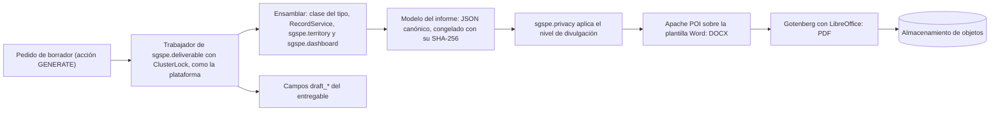
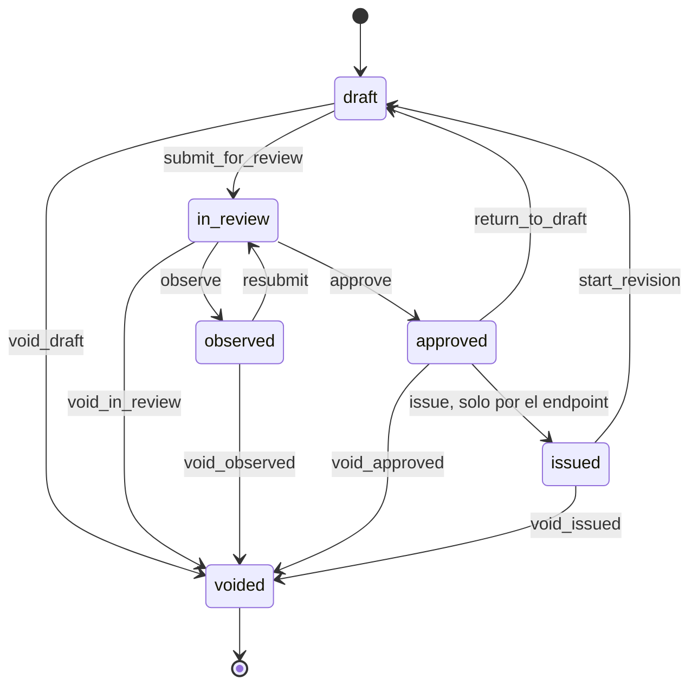
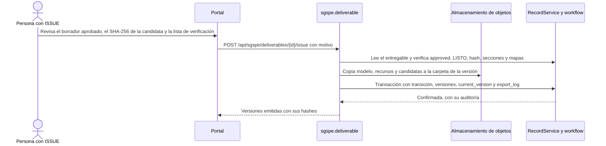

# Entregables DOCX y PDF de SGSPE

Sistema de Gestión Social para Proyectos Extractivos · Fase 0 (descubrimiento) · versión 1.0 · 2026-10-07

Este documento diseña cómo SGSPE produce entregables como DOC-01 y DOC-02 en DOCX y PDF [USR-01]: los tipos, la anatomía
capítulo por capítulo de los dos entregables de ejemplo, la tecnología (DOCX primero con Apache POI y PDF con Gotenberg), los
mapas y gráficos, el ciclo de vida WF-H con su emisión congelada, los niveles de divulgación, las exportaciones XLSX, el
almacenamiento y los criterios de aceptación.

- Los IDs se definen en el [análisis de requisitos](requirements-analysis.md) y aquí solo se citan; los objetos, campos y estados
  son los del [modelo de dominio](domain-model.md), y el vocabulario, el del [glosario](glossary.md).
- Los valores de catálogo se listan solo en [§10 del análisis](requirements-analysis.md#10-catálogos).
- Las capas `LYR-NN` y los mapas de informe se definen en el [SIG](gis.md).
- No están aquí: las transiciones, roles y guardas por transición de WF-H (`workflows.md`), el contrato de los endpoints
  (`api.md`), los permisos por rol (`security.md`) y el catálogo de indicadores (`dashboards.md`).
- Las decisiones de arquitectura se registran en los ADR de SGSPE (`docs/adr/`): ADR-0013 (Entregables DOCX primero, con PDF
  por Gotenberg), ADR-0014 (Evidencias y entregables en almacenamiento de objetos), ADR-0015 (Mapas de informe con GeoServer
  GetMap) y ADR-0017 (Datos personales y anonimización).
- Ningún ejemplo usa nombres de personas, números de partida ni datos de comprobantes de las fuentes [USR-07] (RQ-SEC-018).

## 1. Alcance

- USR-01 pide que el sistema genere entregables como DOC-01 (DOCX) y DOC-02 (PDF), en ambos formatos. Eso se despliega en
  RF-REP-001, RF-REP-002 y en los requisitos de §13.1 del análisis (OBJ-04, P-17).
- Un **entregable** es un informe de varias secciones que se genera, se revisa, se aprueba y se emite. No se confunde con el
  **documento emitido** de un registro (acta de entrega, minuta, cargo de queja), que sale de wasichai-documents (RQ-REP-029)
  [WAS-ADR-0023], ni con la **evidencia**, que es un archivo que prueba un hecho (RF-DOC-001) (domain-model §3).
- wasichai-documents emite una plantilla congelada de un solo registro que se imprime desde el navegador; no genera DOCX
  ni PDF en el servidor ni informes con mapas y gráficos [WAS-DOC modules/documents.md]. Por eso los entregables son
  código propio, `sgspe.deliverable`, con DOCX primero (ASM-014, CON-045). Su copia congelada lleva el registro entero
  sin permisos de campo, así que un tipo de documento solo se declara sobre un objeto sin campos restringidos (UPS-23,
  ASM-090): el acta de entrega espera.
- Las exportaciones XLSX (RQ-REP-022) también están aquí, porque comparten niveles de divulgación y registro (§10).

## 2. Principios

| Principio | Regla | Fuente |
|---|---|---|
| Datos primero | El entregable no crea datos: lee los registros y usa el mismo código de indicadores que los tableros, para que las cifras coincidan. Cada campo y tabla de DOC-01 y DOC-02 es algo que el sistema debe poder registrar | RQ-DSH-034 (análisis §0.4) (domain-model §10) |
| DOCX primero | Apache POI construye el DOCX sobre la plantilla Word de la organización; Gotenberg (LibreOffice) convierte ese mismo DOCX a PDF | ASM-014, RQ-REP-001 |
| Estructura en código, aspecto en Word, palabras en Markdown | Una clase Kotlin por tipo fija las secciones; la plantilla fija estilos y marca; la narrativa es Markdown que escriben personas | RQ-REP-011, RQ-REP-019, RQ-REP-032 |
| Lo emitido es lo aprobado | Emitir congela el modelo del borrador aprobado; volver a generar una versión emitida usa ese modelo, nunca datos vivos | RQ-REP-026, RQ-REP-017 [WAS-ADR-0023] |
| Anonimizar el modelo, no el documento | El nivel de divulgación transforma el modelo antes de generar; el generador de DOCX no sabe de niveles | RQ-REP-014, RQ-REP-033 |
| La narrativa es humana | La IA solo sugiere texto, que una persona copia o edita con motivo | RQ-REP-011, RQ-AI-012 |
| Sin datos reales en el repositorio | Plantillas de prueba, fixtures y textos de ejemplo usan nombres ficticios y topónimos reales | RQ-SEC-018 [USR-07] |

## 3. Tipos de entregable

| Tipo | `deliverable_type` | Formatos | Estado | Base | Niveles que prepara | Generable desde | Requisitos |
|---|---|---|---|---|---|---|---|
| T1 Diagnóstico social de áreas de influencia | DIAGNOSTICO SOCIAL | DOCX y PDF; la versión derivada EXTERNO, solo PDF | Confirmado | DOC-01 (§5) | INTERNO y EXTERNO (propuesta, ASM-037) | F8 | RF-REP-001 [USR-01] [DOC-01] |
| T2 Informe de trabajo de campo y avance | INFORME DE CAMPO Y AVANCE | DOCX y PDF; la versión derivada EXTERNO, solo PDF | Confirmado | DOC-02 (§6) | INTERNO y EXTERNO (propuesta, ASM-037) | F8 | RF-REP-002 [USR-01] [DOC-02] |
| Exportaciones XLSX: matriz de compromisos, registro de grupos de interés, QCS y riesgos | No son `deliverable` | XLSX | Confirmadas | DOC-01 §9.3.1.2 y Tabla 9.5 (§10) | INTERNO, EXTERNO, PUBLICO | F2 a F4, con su módulo | RQ-REP-022 [DOC-01 §9.3.1.2] |
| T3 Reporte mensual de reuniones con grupos de interés | Por agregar a §10 si se confirma | DOCX y PDF | Probable | `engagement` del mes | Los define su clase | F8 | RQ-REP-002, ASM-026 [DOC-01 Tabla 9.5] |
| T4 Reporte de quejas, consultas y solicitudes | Por agregar | DOCX y PDF | Probable | `grievance`, `inquiry`, `stakeholder_request` (RF-GRV-005) | Los define su clase | F8 | RQ-REP-002, ASM-026 |
| T5 Cobertura de grupos de interés contactados | Por agregar | DOCX y PDF | Probable | `engagement_participant`, `stakeholder` | Los define su clase | F8 | RQ-REP-002, ASM-026 |
| T6 Sistematización de percepciones y posición de los grupos de interés | Por agregar | DOCX y PDF | Probable | `stakeholder_assessment`, `perception` | Los define su clase | F8 | RQ-REP-002, ASM-026 |
| T7 Matriz de seguimiento de compromisos | Por agregar | XLSX y resumen DOCX | Probable | `commitment` y sus hijos | Los define su clase | F8 (el XLSX, en F3) | RQ-REP-002, ASM-026 |
| T8 Matriz de riesgos | Por agregar | XLSX y DOCX con mapa de calor | Probable | `social_risk`, `risk_assessment` | Los define su clase | F8 (el XLSX, en F4) | RQ-REP-002, ASM-026 |
| T9 Monitoreos participativos de agua | Por agregar | DOCX y PDF | Probable | `engagement` de tipo MONITOREO PARTICIPATIVO y sus `evidence` (ASM-029) | Los define su clase | F8 | RQ-REP-002, ASM-026 |
| T10 Reporte de reuniones informativas y de sugerencias | Por agregar | DOCX y PDF | Probable | `engagement`, `engagement_question`, `engagement_participant` | Los define su clase | F8 | RQ-REP-002, ASM-026 |

- Solo T1 y T2 están confirmados [USR-01]. Los probables salen de los medios de verificación de la Tabla 9.5 (ASM-026); el catálogo
  "Tipo de entregable" de §10 todavía no tiene sus valores, y se agregan allí cuando un tipo se confirma. Cada tipo es una clase con
  sus secciones y una prueba con fixtures ficticios (RQ-REP-002).
- **Niveles que prepara cada tipo.** Que T1 y T2 preparen INTERNO y EXTERNO es una propuesta de este diseño sobre los niveles de
  ASM-037: ninguna fuente fija qué niveles necesita cada informe. PUBLICO, solo con agregados, se aplica a las exportaciones y a
  los tipos futuros que lo declaren; por eso §9.2 define sus reglas por elemento.
- Dentro de F8 conviene generar primero T2, más corto, y después T1, que ejercita todo el pipeline.
- Las minutas y las listas de asistentes no son entregables: son documentos emitidos de un registro (RQ-REP-029).

## 4. Elementos comunes

Reglas que valen para todo tipo; la anatomía de §5 y §6 las da por supuestas.

| Elemento | Regla | Requisitos |
|---|---|---|
| Títulos | Numeración jerárquica con los estilos de título de la plantilla | RQ-REP-005 [DOC-01] |
| Índices | Índice, lista de tablas y lista de gráficos con número de página, con campos de Word que se actualizan al convertir | RQ-REP-004 [DOC-01 índice] |
| Tablas | Numeradas por capítulo ("Tabla 5.1"), título arriba y `Fuente: Elaboración <organización autora>` abajo; la fila de encabezado se repite en cada página; celdas combinadas para agrupar; matrices con marcas X | RQ-REP-006, RQ-REP-019 [DOC-01 Tablas 5.10, 6.1, 7.1] |
| Figuras | Gráficos, mapas y fotos numerados, con título y fuente | RQ-REP-007 [DOC-01 Gráfico 10.2] [DOC-02 p.5] |
| Fotos | De a dos por fila, reducidas, vinculadas a la actividad que prueban, con texto alternativo | RQ-REP-010, RQ-REP-028 [DOC-02 p.4] |
| Notas al pie | Aclaraciones que salen de los datos (cargo vacante, estado de entrevista, confiabilidad de un dato) o de la narrativa | RF-STK-002, RF-STK-003, RF-LBS-002 [DOC-01 notas 2, 12–19] |
| Encabezado y pie | Código del documento y revisión en el encabezado o el pie; número de página en cada página | RQ-REP-016, RQ-REP-024 (ASM-027) |
| Formato | es-PE: "Mayo, 2026"; separador de miles con coma y decimales con punto, como en las áreas de DOC-02 y en el "148.00 Ha" de DOC-03; inglés opcional | RQ-REP-020 [DOC-02 p.1, p.4] [DOC-03] |
| Periodo y alcance | Cada entregable tiene periodo (`period_start_date`, `period_end_date`), fecha de corte y alcance (`area_of_influence`, `community` o `locality`) | RQ-REP-013 [DOC-02 p.2] |
| Anexos | Recursos estáticos por tipo (instrumentos, diagramas metodológicos) | RQ-REP-023 [DOC-01 Anexos 1–3] |
| Marca | Logos, razón social y dirección de la organización autora y del cliente; plantilla Word base | RQ-REP-019 [DOC-01 portada] |
| Conteos | Siempre calculados desde los registros, nunca tecleados | CON-002, CON-007 |
| Teléfonos y documentos de identidad | Nunca se imprimen, en ningún nivel | RQ-REP-014 |

## 5. Anatomía de T1 (DOC-01, diagnóstico social)

Cómo leer las columnas:

- **Forma:** narrativa, tabla, mapa, foto o gráfico; "campo" es un dato suelto, como un título o una fecha.
- **Autoría:** *humana* (lo escribe una persona, en `deliverable_section` o en un campo de texto del registro), *calculada* (sale de
  los datos), *IA→humana* (desde F7, la IA sugiere y una persona copia o edita con motivo, RQ-AI-012) o *estática* (recurso fijo del
  tipo). Las secciones guardan su origen en `content_origin` (catálogo "Origen del contenido").
- **Datos desde:** la fase en que existen los datos que lo alimentan (domain-model §10.1). **Generable desde:** la fase en que
  SGSPE puede producirlo; el DOCX y el PDF llegan en F8, y algunas tablas salen antes como XLSX o en un tablero.
- Los capítulos siguen la numeración de DOC-01; el generador numera de forma consistente aunque la fuente repita "6.2.1" y omita la
  Tabla 5.3 de su lista de tablas (CON-015).

| Elemento de DOC-01 | Contenido | Objetos y campos | Forma | Autoría | Datos desde | Generable desde | Requisitos |
|---|---|---|---|---|---|---|---|
| Portada | Título con el nombre del proyecto, "Preparado para", "Suscrito por" con dirección, mes y año, logos y mapa de ubicación opcional | `deliverable.title`, `cutoff_date`; `project.name`; `prepared_for_organization` y `prepared_by_organization` (`organization.name`, `address`); logos en la plantilla | Campos y mapa | Calculada | F2 | F8 | RQ-REP-003, RQ-REP-019, RQ-REP-020 [DOC-01 portada] |
| Índice, tabla de contenido, lista de tablas y lista de gráficos | Capítulos y secciones hasta cinco niveles, tablas y gráficos, con página | Estructura del documento | Campos de Word (TOC, PAGEREF) | Calculada | — | F8 | RQ-REP-004 [DOC-01 índice] |
| 1 Introducción | Ubicación (distrito, provincia, región), fase de exploración, campaña prevista, apoyos y oposición, empresa a cargo, qué quiere conocer y estructura del estudio, con remisión al Anexo 1 | `project` (`name`, `exploration_phase`); `administrative_unit`; `exploration_campaign` (`activity_type`, `planned_start_date`, `planned_end_date`); `project_party` (CLIENTE, CONSULTORA); `deliverable_section` | Narrativa con datos | Humana sobre datos calculados; IA→humana | F2 | F8 | RF-PRJ-001, RF-PRJ-002, RF-PRJ-004, RQ-REP-011 [DOC-01 §1] |
| 2 Objetivos | Objetivo general y objetivos específicos del estudio | `study.objectives`; `deliverable_section` | Narrativa | Humana | F2 | F8 | RF-LBS-001 [DOC-01 §2] |
| 3 Metodología | Enfoque cualitativo y fuentes primarias y secundarias | `study.methodology` | Narrativa | Humana | F2 | F8 | RF-LBS-001 [DOC-01 §3] |
| 3.1 Alcance del estudio | Localidades del AIDS y del AIIS y actores distritales, provinciales y regionales | `study.scope_description`; miembros de las áreas aprobadas (`area_of_influence_member`, `locality`) | Narrativa con lista | Humana y calculada | F2 | F8 | RF-LBS-001, RF-TER-005 [DOC-01 §3.1] |
| 3.2 Diseño del estudio | Temas, instrumentos, fuentes secundarias, lista de entrevistados aprobada y plan de campo | `study_instrument`; `deliverable_section` | Narrativa con lista | Humana y calculada | F2 | F8 | RF-LBS-001 [DOC-01 §3.2] |
| 3.3 Trabajo de campo y Tabla 3.1 | Fechas, localidades visitadas, entrevistas por ámbito y localidad, fichas de observación | `study.fieldwork_start_date`, `fieldwork_end_date`; `engagement` de tipo ENTREVISTA y FICHA DE OBSERVACION vinculados al `study`, por `locality` y tipo de área; `field_visit` | Tabla con celdas combinadas por ámbito, y narrativa | Calculada | F2 | F8 | RF-LBS-001, RQ-REP-006, RQ-REP-012 [DOC-01 §3.3, Tabla 3.1] |
| 4 Definición de áreas de influencia | Criterio general: impactos reales o percibidos de las actividades | `area_of_influence.criteria`; `deliverable_section` | Narrativa | Humana | F2 | F8 | RF-TER-005 [DOC-01 §4] |
| 4.1 Área de influencia directa social | Criterios y miembros: caseríos y sus sectores, un sector en separación y la comunidad cuyos terrenos cruzan los sondajes, con su condición y justificación | `area_of_influence` de tipo AIDS en `approved`; `area_of_influence_member` (`member_condition`, `applied_criteria`, `rationale`, `studied_in_diagnosis`); `locality` (`recognition_status`); `community`; consulta componentes × territorio comunal ([SIG](gis.md) §5.3) | Lista calculada y narrativa | Calculada y humana | F2 (consulta espacial en F6) | F8 | RF-TER-005, RN-TER-001, RN-TER-003, RN-TER-004 [DOC-01 §4.1] |
| 4.2 Área de influencia indirecta social | Criterios, caseríos agrupados por microcuenca y ámbito distrital y provincial | `area_of_influence` de tipo AIIS; `area_of_influence_member` con `locality` o `administrative_unit`; `environmental_feature` de tipo MICROCUENCA para agrupar | Lista calculada y narrativa | Calculada y humana | F2 | F8 | RF-TER-005, CON-002 [DOC-01 §4.2] |
| Mapa de áreas de influencia (lo agrega SGSPE) | AIDS y AIIS con localidades, componentes y territorio comunal | LYR-13, LYR-02, LYR-10, LYR-05 y LYR-01 | Mapa | Calculada | F2 | F8 (estilos en F6) | RQ-REP-008, RQ-REP-030 |
| 5 Contexto socioeconómico | Fuentes y alcance del capítulo, por ámbito (5.1 AIDS, 5.2 AIIS) | `deliverable_section` | Narrativa | Humana | F2 | F8 | RF-LBS-002 [DOC-01 §5] |
| 5.1.1 y 5.2.1 Historia y organización del territorio, por localidad | Fundación, sectores, reconocimiento, conflictos con otras localidades, tenencia de la tierra | `locality.history`, `parent_locality`, `recognition_status`; `local_conflict` (`conflict_type`, `conflict_status`, `disputed_resource`) con `local_conflict_locality` | Narrativa por localidad, con datos | Humana (texto del registro) y calculada | F2 | F8 | RF-TER-002, RF-LBS-006 [DOC-01 §5.1.1, §5.2.1] |
| 5.1.2 y 5.2.2 Población y migración; Tablas 5.1 y 5.7 | Familias y población por localidad; migración y sus causas | `locality_profile` (`families_count`, `population_count`, `members_per_family`, `migration`, `data_date`, `data_source`, `reliability`) | Tabla y narrativa | Calculada y humana | F2 | F8 | RF-LBS-002, RQ-REP-012 [DOC-01 Tablas 5.1, 5.7] |
| 5.1.3 y 5.2.3 Actividades económicas; Tablas 5.2 y 5.8 | Cultivos, ganadería y otras actividades | `locality_profile` (`crops`, `livestock`, `economic_activities`) | Tabla con localidades en columnas, y narrativa | Calculada y humana | F2 | F8 | RF-LBS-002 [DOC-01 Tablas 5.2, 5.8] |
| 5.1.4 Servicios básicos; Tabla 5.3 | Agua (fuente, tratamiento, frecuencia, pago, antigüedad, problemas), electricidad y saneamiento | `locality_profile` (`water_source`, `water_treatment`, `water_frequency`, `water_fee`, `water_system_age_years`, `water_problems`, `electricity`, `sanitation`) | Tabla con localidades en columnas | Calculada | F2 | F8 | RF-LBS-002, CON-015 [DOC-01 §5.1.4, Tabla 5.3] |
| 5.1.5 y 5.2.4 Condiciones educativas y de salud; Tablas 5.4 y 5.9 | Instituciones educativas por nivel; establecimientos de salud y su calidad percibida | `school` (`name`, `education_level`, `school_status`); `health_facility`; `deliverable_section` | Tabla y narrativa | Calculada y humana | F2 | F8 | RF-LBS-003 [DOC-01 §5.1.5, Tablas 5.4, 5.9] |
| 5.1.6 Vías y medios de comunicación; Tabla 5.5 | Tipo de vía, localidades que conecta, estado y medios de transporte; telefonía | `road_access` (`road_type`, `connects_to`, `road_condition`, `transport_means`, `travel_time`); `locality_profile.phone_coverage` | Tabla con celdas combinadas por localidad | Calculada | F2 | F8 | RF-LBS-003 [DOC-01 §5.1.6, Tabla 5.5] |
| 5.1.7 y 5.2.5 Organizaciones e instituciones locales; Tabla 5.10 | Organizaciones por localidad y programas del Estado presentes | `organization` (`organization_type`, `locality`, `affiliation`); `state_program` con `state_program_locality` | Matriz con marcas X | Calculada | F2 | F8 | RF-LBS-005, RF-STK-001, RF-STK-004, RQ-REP-006 [DOC-01 §5.1.7, Tabla 5.10] |
| 5.1.8 y 5.2.6 Proceso electoral | Preferencias electorales y percepción de la política local | `locality_profile.electoral_process` (restringido) | Narrativa | Humana (texto del registro) | F2 | F8, solo en INTERNO | RF-LBS-002, RQ-SEC-010 [DOC-01 §5.1.8, §5.2.6] |
| 5.1.9 Costumbres y fechas festivas; Tabla 5.6 | Religión y festividades, con turnos de coorganización | `locality_profile.religion` (restringido); `festivity` (`name`, `date_text`, `month`, `start_day`, `end_day`, `co_organization_turns`) | Tabla y narrativa | Calculada y humana | F2 | F8; la religión, solo en INTERNO | RF-LBS-004, RQ-SEC-010 [DOC-01 §5.1.9, Tabla 5.6] |
| 6 Identificación de grupos de interés | Qué es un grupo de interés, la lista como punto de partida y las cuatro posturas | Texto fijo del tipo; catálogo "Postura" | Narrativa | Estática | — | F8 | RF-STK-013 [DOC-01 §6] |
| Tablas 6.1, 6.2 y 6.3 | Grupos de interés por ámbito y tipo | `stakeholder` (`stakeholder_scope`, `stakeholder_type`), con el actor por cargo y organización (`position.position_title`, `organization.name`) | Tabla con celdas combinadas por ámbito y tipo | Calculada | F2 | F8 (registro XLSX en F2) | RF-STK-003, RQ-REP-006, RQ-REP-012, CON-007 [DOC-01 Tablas 6.1–6.3] |
| 6.1 a 6.3 Perfiles por cargo | Un apartado por grupo de interés, titulado por su cargo: trayectoria, elección y periodo, funciones, coordinación, postura y sus razones, vacancia o estado de entrevista | `position` (`position_title`, `election_mechanism`, `term_start_date`, `term_end_date`, `career_notes`, `position_status`); `stakeholder` (`profile_summary`, `interview_status`); última `stakeholder_assessment` (`stance`, `stance_reasons`, `concerns`, `expectations`, restringidos) | Narrativa por grupo de interés | Humana (texto del registro) con datos calculados; IA→humana | F2 | F8 | RF-STK-002, RF-STK-003, RF-STK-005, RQ-REP-011 [DOC-01 §6.1–§6.3, notas 12–19] |
| 7 Caracterización de los grupos de interés | Qué contiene el capítulo | Texto fijo del tipo | Narrativa | Estática | — | F8 | [DOC-01 §7] |
| 7.1 Percepciones (7.1.1 minería, 7.1.2 proyecto, 7.1.3 empresa) | Percepciones frecuentes por ámbito, citas atribuidas por cargo y análisis | `perception` (`subject`, `polarity`, `perception_scope`, `statement`, `quote`, `attributed_role`); `topic`; análisis en `deliverable_section` | Listas calculadas, citas y narrativa | Calculada y humana; IA→humana | F2 | F8 | RF-LBS-007, RQ-REP-011, RQ-REP-014 [DOC-01 §7.1] |
| 7.2 Clasificación según interés y poder | Método, umbrales y los cuatro grupos | Texto fijo del tipo; `interest_threshold` y `power_threshold` del `project` (ASM-003) | Narrativa | Estática y calculada | F2 | F8 | RF-STK-009 [DOC-01 §7.2] |
| Tablas 7.1, 7.2 y 7.3 | Por ámbito: grupo de influencia, nombre, cargo, tipo de actor y postura | Última `stakeholder_assessment` de cada `stakeholder` (`influence_group`, `stance`); `person` (nombre, restringido); `position`; `stakeholder_type` | Tabla con celdas combinadas por grupo de influencia | Calculada | F2 | F8 (tablero en F2) | RF-STK-009, RQ-REP-006, RQ-REP-009, CON-005, CON-006 [DOC-01 Tablas 7.1–7.3] |
| 7.2.1 a 7.2.3 Grupos estratégicos, políticos y para monitoreo, por ámbito | Quiénes son y qué implican; el grupo vulnerable no está definido en la fuente | `stakeholder_assessment` por grupo; `deliverable_section` | Narrativa con listas calculadas | Humana sobre datos; IA→humana | F2 | F8 | RF-STK-009, GAP-003 [DOC-01 §7.2.1–§7.2.3] |
| 8 Definición de temas clave; Tabla 8.1 | Tema, descripción, riesgos y oportunidades | `key_theme` (`name`, `description`, `risks`, `opportunities`); `topic`; desde F4, los `social_risk` vinculados | Tabla de texto | Calculada (textos de los registros) | F2 | F8 | RF-LBS-008 [DOC-01 §8, Tabla 8.1] |
| 9 Estrategias sociales | Meta del periodo y cuatro ejes de acción | `engagement_plan` (`strategic_objective`, `action_axes`); `exploration_campaign` | Narrativa | Humana | F2 | F8 | RF-ENG-007 [DOC-01 §9] |
| 9.1 Información y comunicación; 9.1.1.1 a 9.1.1.3 | Situación de la comunicación; contactos regulares; protocolo de reuniones informativas; reuniones con grupos políticos | `engagement_plan`; `aligned_answer`; `deliverable_section` | Narrativa | Humana | F2 | F8 | RF-ENG-002, RF-ENG-003, RF-ENG-009 [DOC-01 §9.1, §9.1.1] |
| 9.1.1.4 Priorización; Tabla 9.1 | Prioridad informativa por tipo de grupo y postura, con su justificación | `prioritization_rule` (`information_priority`, `influence_group`, `stance`, `stakeholder_scope`, `stakeholder_type`, `rationale`) | Tabla con celdas combinadas por prioridad | Calculada | F2 | F8 | RF-STK-011, RQ-REP-012 [DOC-01 §9.1.1.4, Tabla 9.1] |
| 9.1.2 Mensajes clave; Tabla 9.2 | Justificación, mensaje, acciones de soporte y público | `key_message` (`justification`, `message`, `support_actions`, `target_audience`) | Tabla | Calculada | F2 | F8 | RF-ENG-008 [DOC-01 §9.1.2, Tabla 9.2] |
| 9.2 Alianzas estratégicas; Tabla 9.3 | Institución, razones y acciones posibles | `strategic_alliance` (`reasons`, `possible_actions`, `formalized`); `organization`; `agreement` desde F3 | Tabla y narrativa | Calculada y humana | F2 | F8 | RF-ENG-010 [DOC-01 §9.2, Tabla 9.3] |
| 9.3 Gestión de las percepciones de impactos; Tabla 9.4 | Impactos ambientales y sociales potenciales por tipo de actividad | `potential_impact` (`activity_type`, `impact_type`, `impact_nature`, `impact_sign`, `description`) | Tabla | Calculada | F4 | F8 | RF-RSK-004 [DOC-01 §9.3, Tabla 9.4] |
| 9.3.1 Monitoreo; Tabla 9.5 | Actividades, indicadores y medios de verificación, con el valor del periodo | `indicator` (`definition`, `formula`, `verification_means`); valores con el código de los tableros y, si el periodo se cerró, `indicator_measurement` | Tabla | Calculada | F2 a F4 | F8 (tableros desde F2) | RF-DSH-008, RQ-DSH-034, RQ-DSH-037 [DOC-01 §9.3.1, Tabla 9.5] |
| 9.3.1.1 Evaluación de los grupos de interés | Cambio de postura y de confianza frente a la línea base; cercanía, comunicación e información | `stakeholder_assessment` (`stance_changed`, `trust_score`, `team_closeness`, `communication_sufficient`, `information_adequate`, `baseline_assessment`) | Tabla y gráfico nativo de tendencia | Calculada | F2 | F8 | RF-STK-010, RQ-DSH-008, RQ-DSH-010 [DOC-01 §9.3.1.1] |
| 9.3.1.2 Seguimiento de compromisos sociales | Resumen de la matriz y lineamientos de apoyo de la campaña | `commitment` y sus hijos, `delivery`, `evidence`; políticas del `project` (`policy_local_jobs_direct_area_only`, `local_jobs_min`, `local_jobs_max`, `policy_no_paid_labor`, `policy_non_monetary_donations`, `policy_synergy_requires_agreement`); `exploration_campaign.social_support_cap` | Tabla resumen y lista; la matriz completa, en XLSX | Calculada | F3 | F8 (XLSX en F3) | RF-COM-001, RF-INV-002, RQ-REP-022 [DOC-01 §9.3.1.2] |
| 9.3.2 Riesgos sociales | Riesgos identificados y su fuente | `social_risk` (`title`, `risk_source`, `category`) | Lista o tabla | Calculada | F4 | F8 (XLSX en F4) | RF-RSK-001, RF-RSK-005 [DOC-01 §9.3.2] |
| 9.3.2.1 Evaluación del riesgo | Probabilidad, impacto y nivel de la última revisión, y su tendencia | Última `risk_assessment` de cada riesgo (`probability`, `impact`, `score`, `risk_level`, `trend`) | Gráfico nativo: tabla 5 × 5 sombreada con conteos | Calculada | F4 | F8 | RF-RSK-002, RQ-REP-009, RQ-REP-031 [DOC-01 §9.3.2.1] |
| 9.3.2.2 Gestión del riesgo | Decisión de tratamiento, controles, medidas, fuentes de monitoreo y riesgo residual | `social_risk` (`treatment_decision`, `treatment_rationale`, `current_controls`, `controls_adequate`, `monitoring_sources`, `residual_level`); `mitigation_measure` | Tabla y narrativa | Calculada y humana | F4 | F8 | RF-RSK-003 [DOC-01 §9.3.2.2] |
| 9.4 Necesidades internas (9.4.1 alineamiento interno, 9.4.2 equipo de relaciones comunitarias) | Plan de trabajo con metas y responsables; equipo y contratistas | `engagement_plan`; `planned_activity`; `project_assignment` (`role_name`); `project_party` (CONTRATISTA); `deliverable_section` | Narrativa con listas | Humana y calculada | F2 | F8 | RF-PRJ-005, RF-WFL-003 [DOC-01 §9.4] |
| 10.1 Anexo 1: concesiones del proyecto | Mapa con las diez capas de la leyenda del Anexo 1, grilla UTM, norte y leyenda, en una sección horizontal | LYR-10, LYR-02, LYR-03, LYR-04, LYR-09, LYR-07, LYR-05, LYR-14, LYR-15 y LYR-01 ([SIG](gis.md) §2.3) | Mapa | Calculada | F2 | F8 (estilos en F6) | RQ-GIS-019, RQ-REP-008, RQ-REP-030 [DOC-01 Anexo 1] |
| 10.2 Anexo 2: temas e instrumentos; Tabla 10.1 | Tema, tipo de instrumento y ámbito de aplicación | `study_instrument` (`topic`, `instrument_type`, `application_scope`) | Tabla | Calculada | F2 | F8 | RF-LBS-001, RQ-REP-023 [DOC-01 Anexo 2, Tabla 10.1] |
| 10.3 Anexo 3: metodología de interés y poder; Gráfico 10.2 | Sistema de variables (componentes, subvariables e indicadores), índices de 1 a 5 e influencia | Recurso estático del tipo; pesos y umbrales del `project` (ASM-031, ASM-003) | Figura y narrativa | Estática | — | F8 | RQ-REP-023, RF-STK-006, RF-STK-007, RF-STK-008, CON-010 [DOC-01 Anexo 3, Gráfico 10.2] |
| Gráfico 10.3: gráfico de influencia | Grupos de interés por cuadrante interés × poder, por código | `stakeholder_assessment` (`interest_index`, `power_index`, `influence_group`) | Gráfico nativo: tabla de cuadrante 2 × 2 | Calculada | F2 | F8 (tablero en F2, RQ-DSH-005) | RQ-REP-009, RQ-REP-031 [DOC-01 Gráfico 10.3] |

- El Anexo 3 de DOC-01 menciona el "contexto social relacionado al PRB", resto de otra plantilla: el texto estático del tipo no lo
  reproduce (CON-012). El poder se describe con los tres componentes del Gráfico 10.2 (CON-010).
- Los rótulos cruzados de DOC-01 (AID y AII) no se copian: el generador usa los tipos canónicos AIDS y AIIS (CON-001).

## 6. Anatomía de T2 (DOC-02, informe de campo y avance)

Mismas columnas que §5.

| Elemento de DOC-02 | Contenido | Objetos y campos | Forma | Autoría | Datos desde | Generable desde | Requisitos |
|---|---|---|---|---|---|---|---|
| Portada (p.1) | Título con el nombre del prospecto, mapa de ubicación y mes y año | `deliverable.title`, `period_end_date`; `project.name` (un prospecto es un `project` en exploración inicial, CON-019); mapa con LYR-05, LYR-07, LYR-02, LYR-04, LYR-01 y los ríos de LYR-08 (elementos ambientales de tipo FUENTE DE AGUA con `trace`, [SIG](gis.md) §2.4) | Campos y mapa | Calculada | F2 | F8 (estilos en F6) | RQ-REP-003, RQ-REP-008, RQ-REP-020 [DOC-02 p.1] |
| Título del cuerpo (p.2) | "Informe de trabajo de campo y avance en el proyecto", con su nombre | `project.name` | Campo | Calculada | F2 | F8 | RF-REP-002 [DOC-02 p.2] |
| Antecedentes | Historia de la relación: el ingreso no autorizado, la expulsión con retención del vehículo, la respuesta del equipo social y el daño a la relación | `incident` (`incident_type` EXPULSION o RETENCION DE VEHICULO O EQUIPOS, `occurred_at`, `description`, `immediate_response`, `consequences`); `stakeholder.relationship_status` (RELACION DETERIORADA); `deliverable_section` | Narrativa con datos | Humana sobre datos calculados; IA→humana | F2 (el incidente, desde F4) | F8 | RF-EWS-001, RF-STK-014, RQ-REP-011 [DOC-02 p.2] |
| Objetivo estratégico y objetivos tácticos | Reconstruir la relación para reingresar; identificar personas y grupos, construir relaciones y conocer la organización comunal | `engagement_plan` (`strategic_objective`, `tactical_objectives`) | Narrativa en lista numerada | Humana (texto del registro) | F2 | F8 | RF-ENG-007 [DOC-02 p.2] |
| Estrategias de intervención | Mapeo de actores y estudio de redes comunitarias, con su justificación | `engagement_plan.action_axes`; `deliverable_section` | Narrativa en lista numerada | Humana | F2 | F8 | RF-ENG-007, RF-STK-012 [DOC-02 p.2] |
| Actividades del periodo (título) | "Actividades realizadas entre" los meses del periodo | `deliverable.period_start_date`, `period_end_date` | Campo | Calculada | F2 | F8 | RQ-REP-013 [DOC-02 p.2] |
| Viajes y reuniones | Viaje a una localidad, reunión prevista con comuneros durante una faena, cancelada por lluvia, y los contactos logrados igual | `field_visit` (`title`, `itinerary`, `actual_start_date`, `outcome_summary`, estado de WF-L); `engagement` (`engagement_type`, `cancel_reason`, estado `cancelled`); `locality` | Narrativa con datos | Humana sobre datos calculados | F2 | F8 | RF-FLD-001, RF-ENG-006 [DOC-02 p.2–p.3] |
| Identificación de redes comunitarias | Redes de caseríos, junta directiva comunal y redes de apoyo externo, con sus líderes y su papel | `community_network` (`name`, `network_type`, `description`, `contact_status`); `network_node` (`node_role`) con `person` u `organization`; `position` | Lista numerada calculada, con notas | Calculada y humana | F2 | F8 | RF-STK-012 [DOC-02 p.3] |
| Construcción de relaciones y penetración en redes | Contactos con autoridades y líderes, cargos nuevos y organizaciones del caserío con las que se puede dialogar | `engagement` de tipo CONTACTO CARA A CARA (`results`) con `engagement_stakeholder`; `position` (VIGENTE o PREVISTO); `community_network.contact_status` | Narrativa con datos | Humana sobre datos calculados | F2 | F8 | RF-ENG-001, RF-STK-002, RF-STK-012 [DOC-02 p.3] |
| Apoyo entregado | Pedido, ocasión, propósito y condiciones declarados, ítems comprados y entrega con acta de recepción | `social_contribution` (`contribution_type`, `occasion`, `declared_purpose`, `conditions`, `payer_organization`, `recipient_organization`); `contribution_item`; `receipt` (`receipt_type`, `issuer_name`, `issue_date`, `amount`); `delivery` | Narrativa con tabla de ítems | Calculada y humana | F5 | F8 | RF-INV-001, RN-INV-006, CON-021, CON-022 [DOC-02 p.3–p.4] |
| Par de fotos (p.4) | La foto de la entrega y la del comprobante, lado a lado, con título y fuente | `evidence` de tipo FOTO (`people_identifiable`, `photo_consent_given`) y de tipo COMPROBANTE, vinculadas a la `delivery` | Fotos de a dos por fila | Calculada | F5 (evidencias desde F3) | F8 | RQ-REP-007, RQ-REP-010, RNF-PRIV-004 [DOC-02 p.4] |
| Identificación del predio: concesiones | Concesiones del prospecto, su titular y su ubicación sobre el territorio comunal y dos caseríos | `mining_concession` (`code`, `name`, `holder_organization`) por `project_concession`; consultas concesiones × territorio comunal y caseríos ([SIG](gis.md) §5.3) | Narrativa con datos | Calculada y humana | F2 (consulta en F6) | F8 | RF-PRJ-006, RQ-GIS-002 [DOC-02 p.4] |
| Datos registrales de la comunidad | Reconocimiento como pueblo indígena u originario, área inscrita frente a calculada, partida, partida matriz e independización, personería jurídica, título y su emisor | `community` (`recognized_as_indigenous`, `indigenous_people`, `registered_area_ha`, `calculated_area_ha`, `property_record`, `parent_record`, `independized`, `legal_entity_record`, `title_reference`, `title_issuer_as_written`, `title_issuer_normalized`, `registry_records_unverified`) | Texto armado desde campos estructurados | Calculada | F2 | F8 | RF-TER-003, RQ-REP-025, CON-017, CON-018 [DOC-02 p.4] |
| Sectores comunales | Cantidad de sectores, su coincidencia con caseríos y centros poblados, y sus delegados ante la asamblea | `community_sector` (`name`, `delegates_count`) con `community_sector_locality` | Narrativa con datos; tabla opcional | Calculada | F2 | F8 | RF-TER-004 [DOC-02 p.4–p.5] |
| Mapa del predio (p.5) | Territorio comunal, concesiones, caseríos, vías y límites, con su línea de fuente | LYR-05, LYR-07, LYR-02, LYR-04, LYR-01 y LYR-06 | Mapa | Calculada | F2 | F8 (estilos en F6) | RQ-REP-008, RQ-REP-019, RQ-REP-030 [DOC-02 p.5] |
| Conclusiones | Redes identificadas, contactos logrados, redes por trabajar y contactos pendientes con redes externas | `deliverable_section`, con menciones a `community_network`, `position` y `organization` | Narrativa en lista numerada | Humana; IA→humana | F2 | F8 | RQ-REP-011, RQ-REP-033 [DOC-02 p.5–p.6] |
| Recomendaciones | Riesgo reputacional asociado al titular de las concesiones; intervención sostenida para obtener el permiso de uso de tierras | `deliverable_section`; vínculos con `social_risk` (RF-RSK-005) y con un `agreement` de tipo PERMISO DE USO DE TERRENO (RF-AGR-002) | Narrativa en lista numerada | Humana; IA→humana | F2 (acuerdo desde F3, riesgo desde F4) | F8 | RQ-REP-011, RF-RSK-005, RF-AGR-002 [DOC-02 p.6] |
| Número de página | Número en cada página; T2 no lleva índice | — | Campo PAGE | Calculada | — | F8 | RQ-REP-024 [DOC-02 p.1–p.6] |

- DOC-02 cita el mismo número de partida para la propiedad y para la personería: son dos campos y una marca de verificación
  (`registry_records_unverified`), y el texto los imprime tal como están registrados (CON-017).
- El emisor del título se imprime tal como figura y, al lado, el normalizado (CON-018).
- El comprobante del apoyo está a nombre del titular de las concesiones: el pagador es explícito en `social_contribution` y en
  `receipt`, y la recomendación lo enlaza con el riesgo reputacional (CON-022).

## 7. Ensamblado y generación

### 7.1 Tres etapas: ensamblar, generar y convertir

- **Ensamblar.** Una clase Kotlin por tipo de entregable, en `sgspe.deliverable`, como srtm escribe una clase por documento. Lee con
  `RecordService`, con la extensión y las consultas espaciales de `sgspe.territory` y con los indicadores de `sgspe.dashboard`, el
  mismo código de los tableros (RQ-DSH-034) (domain-model §8.2).
- **Generar.** Un generador de DOCX aplica la narrativa, la marca y la plantilla Word base. No sabe de niveles de divulgación.
- **Convertir.** Gotenberg convierte el DOCX a PDF. POI y el almacenamiento corren en `Dispatchers.IO`; Gotenberg y GeoServer se
  llaman con `WebClient`, sin bloquear.
- Los paquetes de dominio no dependen de `sgspe.deliverable`; una prueba de arquitectura lo verifica (RNF-TST-001).

### 7.2 La clase de cada tipo

Cada clase declara:

- sus secciones, con `section_key`, título, tipo (catálogo "Tipo de sección de entregable": NARRATIVA, CALCULADA, MIXTA o ANEXO),
  si es obligatoria, una guía de redacción y si admite sugerencias de IA (RQ-REP-011, RQ-AI-012);
- sus parámetros: periodo, fecha de corte y alcance (`area_of_influence`, `community` o `locality`, y el `study` de origen)
  (RQ-REP-013);
- los niveles de divulgación que prepara (§3, §9), sus mapas (capas y regla de encuadre) y sus recursos estáticos (RQ-REP-023);
- su versión, que queda en el modelo congelado.

### 7.3 El modelo del informe y su congelamiento

- El modelo es un JSON canónico (claves ordenadas, UTF-8) con: los metadatos del entregable (tipo y versión de la clase, código,
  etiqueta de revisión, periodo, alcance y corte); el texto de cada sección, copiado de `deliverable_section` al congelar; las
  tablas, series y conteos calculados; las referencias a mapas y fotos por clave de almacenamiento y SHA-256; la plantilla por
  `template_key` y su SHA-256; y los avisos (por ejemplo, un mapa que falló).
- Su SHA-256 es `draft_model_sha256`, y `draft_generated_at` es el instante en que el trabajador congela el modelo al empezar a
  generar (ASM-061) (domain-model §7.4). Los bytes de un DOCX o un PDF no son deterministas: la identidad de lo emitido es el hash
  del modelo, y los hashes de archivo identifican los artefactos guardados. El modelo es interno: la API no lo sirve (§11).
- **El contenido lo define el tipo, no los permisos de campo de quien genera.** El trabajador lee como la plataforma
  [WAS-ADR-0039], como wasichai-documents no filtra por permisos de campo un documento emitido [WAS-ADR-0023]. El control está en
  quién tiene `GENERATE`, `ISSUE` y `DOWNLOAD_RESTRICTED`, en el nivel de la versión que se descarga y en el alcance por proyecto
  (§12). Ningún tipo imprime documentos de identidad ni teléfonos (RQ-REP-014).

### 7.4 Narrativa en Markdown

- El texto de cada sección es `deliverable_section.content`, LONG_TEXT en Markdown (CommonMark con tablas GFM), sin HTML
  (domain-model §4.2). Razones: wasichai no tiene tipo JSON; su historial de campos muestra antes y después, legible en Markdown;
  los modelos de lenguaje redactan en Markdown; y se puede buscar.
- En el portal se edita como texto enriquecido con tiptap, que ya trae `@wasichai/documents` [WAS-DOC modules/documents.md], y con
  su extensión oficial de Markdown, una dependencia nueva del portal.
- El generador recorre el Markdown con commonmark-java y lo traduce a los estilos de la plantilla (párrafo de informe, viñeta,
  estilo de tabla). Las tablas GFM permiten que una tabla de DOC-01 empiece como narrativa antes de tener datos estructurados.
- **Texto propio de los registros.** Parte de la narrativa vive en los registros y se reutiliza en varios entregables:
  `locality.history`, `stakeholder.profile_summary`, `position.career_notes`, `engagement.description` y `results`,
  `perception.statement`.
- **Menciones de personas.** Se insertan como referencias a un registro (`person`, `position` o `stakeholder`), nunca como el
  nombre escrito, para que EXTERNO y PUBLICO las sustituyan (RQ-REP-033, ASM-037). Un nombre tecleado a mano no se puede detectar
  siempre: por eso EXTERNO exige una lista de verificación (§9.4) y, desde F7, la IA puede sugerir posibles datos personales.
- **Historial.** Cada edición queda en el historial de wasichai con quién, cuándo y por qué, más el modelo congelado de cada versión
  emitida; no hace falta otra tabla de versiones de sección (RQ-REP-032) [WAS-ADR-0041].
- **Origen.** `content_origin` guarda HUMANO, CALCULADO o ASISTIDO POR IA, y `reviewed` marca la revisión. Una sugerencia de IA
  (`ai_suggestion` de tipo BORRADOR DE SECCION o RESUMEN EJECUTIVO, F7) solo se usa si una persona la copia o la edita con motivo:
  `DeliverableWriteGuard` exige el motivo cuando el origen indica IA, y la versión emitida lista en `ai_assisted_sections` qué
  secciones tuvieron asistencia (RQ-AI-012, RF-AIK-004).

### 7.5 DOCX con Apache POI

- Apache POI `poi-ooxml` 5.4 o posterior, Apache-2.0, que además sirve para las exportaciones XLSX (§10). Desde 5.4.0 incluye la
  corrección de CVE-2025-31672. Se descartan los motores de plantillas sobre Word: uno sin versiones recientes, atado a POI 5.2, y
  otro que pone expresiones de Spring dentro de las plantillas, es decir, código en archivos que edita el tenant.
- DOC-01 y DOC-02 son documentos de Word: DOC-01 tiene campos TOC (hasta cinco niveles), SEQ y STYLEREF para el índice y la
  numeración de tablas por capítulo, y el PDF de DOC-02 se produjo con Word [DOC-01 índice] [DOC-02]. DOCX primero conserva ese
  formato.

**Construcciones de Word permitidas** (lo que LibreOffice convierte con fidelidad; el spike de ADR-0013 lo confirma):

| Permitido | No permitido |
|---|---|
| Estilos de la plantilla y numeración multinivel de títulos | Imágenes flotantes, cuadros de texto y formas |
| Imágenes en línea | Controles de contenido, objetos OLE y vínculos externos |
| Tablas con celdas combinadas y fila de encabezado repetida | Macros (archivos .dotm o con `vbaProject.bin`) |
| Saltos de sección, incluidas secciones horizontales para mapas y tablas anchas | Comentarios y control de cambios en lo que se entrega |
| Notas al pie simples | Fuentes fuera de la lista permitida (§7.6) |
| Campos TOC, SEQ, STYLEREF, PAGE, NUMPAGES y PAGEREF | Otros campos |

- **Leyendas.** Cada tabla y figura lleva un campo SEQ con su resultado ya calculado (el generador conoce el capítulo y el orden),
  y el documento marca la actualización de campos al abrir para que Word refresque el índice. Si LibreOffice maneja mal los SEQ
  numerados por capítulo, la alternativa es número literal, marcador y listas propias con campos PAGEREF, que LibreOffice resuelve
  al paginar.
- **Tablas.** Título arriba, `Fuente:` abajo, encabezado repetido y celdas combinadas para agrupar (RQ-REP-006).
- **Fotos.** Se reducen en Kotlin antes de insertarlas (lado mayor de 2000 px como máximo y JPEG de calidad 85, valores por defecto
  propuestos y configurables), de a dos por fila en una tabla sin bordes, con texto alternativo (RQ-REP-010, RQ-REP-028).
- **Gráficos.** Nativos de Word en la primera versión (§7.9).
- **Encabezado y pie.** Código del documento y revisión; "Página X de Y" con PAGE y NUMPAGES; en las versiones que no son INTERNO,
  también el nivel de divulgación (RQ-REP-016, RQ-REP-024).
- **Marca de agua.** Todo borrador lleva "BORRADOR" en el encabezado de cada sección, insertado con POI; el PDF del borrador la
  hereda al convertirse (RQ-REP-021).

### 7.6 Plantilla Word y fuentes

- **Plantilla por organización.** Un archivo .dotx o .docx con los estilos requeridos, la portada con los logos y el encabezado y
  pie (RQ-REP-019, ASM-014). Si una organización entrega a varios clientes con logos distintos, usa una plantilla por cliente. La
  marca y quién es el tenant siguen abiertas en GAP-009, y si hay plantillas corporativas, en GAP-010.
- **Dónde vive.** En el almacenamiento de objetos, bajo su `template_key`; cada `deliverable` la elige por `template_key` y cada
  versión emitida congela su `template_sha256` (domain-model §6.15).
- **Validación al subir** (RQ-SEC-019, ASM-055): sin macros, con los estilos requeridos, solo con fuentes de la lista permitida, sin
  objetos OLE ni vínculos externos y con un tamaño máximo. La sube quien tiene `MANAGE_METADATA` sobre `deliverable`.
- **Fuentes.** Gotenberg trae fuentes libres con métricas compatibles; las plantillas las usan en lugar de las de Microsoft, que no
  se pueden redistribuir en un contenedor. DOC-01 y DOC-02 usan Calibri y Arial; DOC-01 además Cambria, Century Gothic y Tahoma, y
  DOC-02 Arial Black en el título de la portada [DOC-01] [DOC-02 p.1].

| En las fuentes | En las plantillas de SGSPE |
|---|---|
| Calibri | Carlito |
| Cambria | Caladea |
| Arial | Liberation Sans |
| Times New Roman | Liberation Serif |
| Arial Black, Century Gothic, Tahoma | Prohibidas, salvo que la organización entregue los archivos de fuente con licencia y los incorpore en su propia imagen de Gotenberg |

### 7.7 PDF con Gotenberg

- El PDF se convierte desde el mismo DOCX que se entrega, con la ruta LibreOffice de Gotenberg (imagen
  `gotenberg/gotenberg:8-libreoffice`), en la red interna y nunca expuesta (RQ-REP-001, ASM-014). Un solo motor de render evita que
  el DOCX y el PDF diverjan, el mismo argumento de WAS-ADR-0023 para no tener dos renderizadores [WAS-ADR-0023].
- Opciones que se usan:
  - `updateIndexes` (activo): actualiza índice y listas antes de convertir (RQ-REP-004);
  - `pdfa` con PDF/A-2b en las versiones emitidas (RQ-REP-017);
  - metadatos del PDF con código, revisión y hashes; marcadores desde los títulos; calidad de imagen;
  - la marca de agua nativa de Gotenberg queda como alternativa si el spike muestra que LibreOffice no dibuja la del DOCX.
- **Tiempos.** El tiempo de espera de conversión es configurable, del orden de 180 s para un documento de unas 100 páginas con
  fotos; la cola de Gotenberg limita la concurrencia (RQ-REP-021).
- **Spike técnico** (ADR-0013, recomendado al inicio, en F1): una plantilla base con lo que usa DOC-01, generada con POI y
  convertida con Gotenberg. Verifica números de página, numeración de leyendas, fuentes incrustadas (con PDFBox) y PDF/A. Si
  falla, un ADR nuevo reemplaza al de entregables sin cambiar el modelo de datos (ASM-014).
- PDF etiquetado opcional para accesibilidad (RQ-REP-028, ASM-047).

### 7.8 Mapas de informe

- Salen de GeoServer con GetMap, estilos SLD y decoraciones, en el `working_crs` del proyecto; las capas no públicas viajan en línea
  dentro de la petición y nunca se publican (RQ-REP-008, RQ-REP-030, ASM-038). El procedimiento está en el [SIG](gis.md) §7.3.
- Cada mapa es una imagen PNG a 300 dpi con su SHA-256, guardada con el borrador y congelada en el modelo: volver a generar una
  versión emitida no vuelve a pedir el mapa.
- Mapas de los tipos confirmados: en T1, el mapa de áreas de influencia del capítulo 4 y el Anexo 1; en T2, el mapa de ubicación de
  la portada y el mapa del predio. La escala gráfica es una propuesta sobre DOC-01 (ASM-038).
- Si un mapa falla, el borrador muestra un aviso en su lugar y la emisión se bloquea (RQ-REP-030).

### 7.9 Gráficos

- En la primera versión los gráficos son nativos y editables en Word (RQ-REP-031, ASM-014):
  - probabilidad × impacto: tabla 5 × 5 con celdas sombreadas y conteos (RQ-REP-009);
  - interés × poder: tabla de cuadrante 2 × 2 con los códigos de los grupos de interés, como el Gráfico 10.3, más las tablas de
    clasificación al estilo de DOC-01;
  - distribuciones: tablas de conteos y porcentajes;
  - tendencias: gráficos nativos de Word con POI.
- ECharts es la única biblioteca de gráficos de los tableros (RQ-DSH-035). Si algún día un gráfico del informe debe verse idéntico
  al del tablero, la opción es una captura de una página de gráfico con Gotenberg y Chromium, decidida con un ADR, no antes de F8.

## 8. Ciclo de vida (WF-H) y emisión

### 8.1 Estados

`deliverable` tiene el workflow WF-H con los estados de domain-model §7.3 (RQ-REP-015). Las transiciones, sus roles y sus
guardas los define `workflows.md`; el diagrama repite sus transiciones para leer este documento. `deliverable` es
`requiresReason`: toda escritura y transición lleva motivo (ASM-058).

| Estado | Etiqueta | Qué significa |
|---|---|---|
| `draft` | Borrador | Se editan las secciones y se piden borradores |
| `in_review` | En revisión | Los revisores ven el último borrador; no se piden borradores nuevos |
| `observed` | Observado | Volvió con observaciones y su motivo; se corrige y se piden borradores |
| `approved` | Aprobado | Se aprobó el último borrador, que está LISTO y sin cambios posteriores; puede devolverse a `draft` |
| `issued` | Emitido | Existe al menos una `deliverable_version`; una revisión nueva vuelve a `draft` |
| `voided` | Anulado | Final, con motivo; si el entregable ya se había emitido, sus versiones se conservan como historia |

### 8.2 Borradores (ASM-061)

- Los borradores no son registros: el último borrador se describe en los campos derivados `draft_*` de `deliverable`
  (`draft_generation_status`, `draft_generated_at`, `draft_model_sha256`, `draft_storage_key`), que solo escribe el trabajador de
  generación (ASM-061) (domain-model §8.3).
- **Pedido.** `POST /api/sgspe/deliverables/{id}/drafts` exige la acción `GENERATE`, procede solo en `draft` u `observed` y escribe
  únicamente `generation_requested_at`, como el usuario y con la marca de escritura de SGSPE.
- **Trabajador.** Es JOB-05 de `workflows.md`: corre como la plataforma en una sola réplica, con `ClusterLock.tryLock` y una
  clave del paquete, y al procesar cada pedido toma además un candado por entregable (`deliverable:<id>`), para que dos réplicas
  nunca generen el mismo borrador [WAS-ADR-0039]. Un pedido está pendiente si
  `generation_requested_at` es posterior a `draft_generated_at` o este está vacío. Al tomarlo marca EN COLA; al congelar el modelo,
  EN PROCESO, y guarda ese instante en `draft_generated_at`; al terminar, LISTO o FALLIDO (catálogo "Estado de generación del
  borrador"). Nunca aplica transiciones (domain-model §8.3).
- **Qué genera.** Desde un mismo modelo congelado y para cada nivel de divulgación que prepara el tipo:
  - el borrador, con la marca "BORRADOR" y la etiqueta de borrador, para revisar (RQ-REP-021): DOCX y PDF en INTERNO, y solo PDF
    en EXTERNO y PUBLICO;
  - la versión candidata, sin marca de agua y con la revisión de emisión siguiente, que es la que se emitirá tal cual si se
    aprueba: DOCX y PDF/A-2b en INTERNO, y solo PDF/A-2b en EXTERNO y PUBLICO. Nadie la descarga ni la previsualiza antes de
    emitir, porque RQ-REP-021 exige la marca de agua en todo lo no emitido: se revisa el borrador, que tiene el mismo contenido, y
    de la candidata solo se muestra su SHA-256.
  - En EXTERNO y PUBLICO el DOCX es un paso intermedio: el PDF se convierte desde él (RQ-REP-001), pero no se guarda ni se
    entrega, porque esas versiones son solo PDF.
- **Etiquetas de revisión** (RQ-REP-016, ASM-027): los borradores llevan letras (A, B…) y las emisiones números (0, 1…). La letra
  sale de la del borrador anterior, que el trabajador lee del modelo en `draft_storage_key`, y se reinicia en cada revisión nueva.
  El esquema es configurable por organización.
- **Vista previa.** El portal consulta el estado y abre el PDF del borrador en el `PdfDialog` de `@wasichai/ui`. Descargar un
  borrador, de cualquier nivel, exige READ y `DOWNLOAD_RESTRICTED` sobre `deliverable`, y queda en `export_log` (§9.5, §12).
- El costo es de dos conversiones por nivel en cada borrador; como la generación es asíncrona no afecta al usuario, y un tipo puede
  preparar menos niveles si pesa.

### 8.3 Revisión y aprobación

- Los revisores ven el borrador de cada nivel; el de EXTERNO permite revisar la anonimización antes de emitir.
- **Observar** devuelve el entregable con motivo; se editan las secciones y se pide un borrador nuevo.
- **Aprobar** exige a la vez uno de los roles de la transición y la acción declarada `APPROVE` sobre `deliverable`, como fija
  WF-H en `workflows.md`. `DeliverableWriteGuard` la rechaza si el borrador no está LISTO o si alguna `deliverable_section` tiene
  `updated_at` posterior a `draft_generated_at` (RQ-REP-015, RQ-REP-026) (domain-model §7.2).
- Como no se piden borradores en `in_review`, el borrador aprobado es el que se revisó. El portal escribe su `draft_model_sha256`
  en el motivo de la aprobación, que queda en la auditoría.
- **Dónde se editan las secciones.** El editor del portal solo permite editar `deliverable_section` en `draft` y `observed`. Una
  edición posterior a congelar el modelo, venga de donde venga, hace fallar la aprobación y también la emisión (§8.4).

### 8.4 Emisión

- `POST /api/sgspe/deliverables/{id}/issue` exige la acción `ISSUE` y motivo; si el tipo prepara EXTERNO, también la lista de
  verificación confirmada (§9.4). Verifica:
  - `approved`, borrador LISTO y el mismo `draft_model_sha256`;
  - que ninguna `deliverable_section` tenga `updated_at` posterior a `draft_generated_at`, el control de la aprobación, repetido
    porque una sección pudo editarse después de aprobar;
  - que ningún mapa haya fallado.
- **Si una sección cambió después de aprobar**, el endpoint responde 409 con las secciones cambiadas y no emite nada. Luego una
  persona con un rol de la transición `return_to_draft` de WF-H la aplica, con motivo, y pide un borrador nuevo. La misma regla
  está en la fila de `issue` de WF-H en `workflows.md`, en la invariante de emisión del modelo de dominio (§7.2) y en el endpoint
  de emisión de `api.md`.
- Primero copia el modelo, sus recursos y las versiones candidatas a la carpeta de la versión en el almacenamiento. Después, en una
  sola transacción con `TransactionalOperator` [WAS-ADR-0038]:
  1. aplica la transición a `issued`;
  2. crea una `deliverable_version` por nivel, todas con la misma `revision` y con las claves y los SHA-256 del modelo, del PDF y
     de la plantilla (RQ-REP-017). La INTERNO es la base y lleva además el DOCX: `DeliverableWriteGuard` exige
     `docx_storage_key` y `docx_sha256` en una versión INTERNO. Las EXTERNO y PUBLICO son derivadas, con `derived_from`
     apuntando a la base, y solo PDF: sus campos DOCX quedan vacíos (domain-model §6.15, §7.2);
  3. apunta `current_version` y `current_revision` del entregable a la versión base (derivados, domain-model §7.4);
  4. escribe una fila de `export_log` por versión, con `export_kind` emisión y su nivel (RQ-AUD-011).
- Si la transacción falla, la carpeta `v<n>` copiada queda sin `deliverable_version` que la referencie, y la retención la borra
  pasado su margen (§11).
- Volver a generar una versión emitida usa su `model_storage_key`, nunca datos vivos (RQ-REP-026).

### 8.5 Revisiones nuevas y anulación

- Una revisión nueva lleva el entregable de `issued` a `draft`; los borradores siguientes reensamblan el modelo con los datos
  vigentes, y las versiones anteriores quedan intactas porque `deliverable_version` es `appendOnly`.
- Anular deja el entregable en `voided`, con motivo, desde cualquier estado no final; las versiones ya emitidas se conservan.
- Un documento emitido fuera del sistema no es una versión: en el MVP solo se emite lo que genera el sistema (GAP-010).

### 8.6 Protecciones

| Qué se protege | Mecanismo | Fuente |
|---|---|---|
| Solo el endpoint emite | `CommandTransitionGuard`, un `RecordWriteGuard` de `sgspe.common`, rechaza la transición a `issued` sin la marca de escritura de SGSPE. Hace falta la guarda porque `deliverable` no es `apiOnly`, y aunque lo fuera, ese flag no rechaza transiciones de workflow | RQ-REP-026, RQ-AUD-004 [WAS-ADR-0040] [WAS-DOC modules/workflow.md] |
| Lo emitido no cambia | `deliverable_version` es `appendOnly` (409 al cambiar o borrar) y `apiOnly` (403 al crear por la API genérica) | RQ-REP-017, RQ-AUD-003 [WAS-ADR-0040] |
| El borrador lo describe solo el trabajador | `DerivedFieldsGuard` rechaza sin la marca las escrituras de `generation_requested_at`, `draft_*`, `current_version` y `current_revision` | ASM-061 (domain-model §4.6, §7.4) |
| Se aprueba lo que se revisó | `DeliverableWriteGuard` hacia `approved` | RQ-REP-015 |
| Todo cambio tiene motivo | `deliverable` es `requiresReason` | RQ-AUD-002, ASM-058 [WAS-ADR-0041] |
| El texto de IA lo adopta una persona | `DeliverableWriteGuard` exige motivo cuando `content_origin` indica IA | RQ-AI-012 |
| La versión INTERNO conserva el DOCX editable | `DeliverableWriteGuard` rechaza crear una `deliverable_version` INTERNO sin `docx_storage_key` y `docx_sha256`; las derivadas EXTERNO y PUBLICO pueden ser solo PDF | RQ-REP-001, RQ-REP-014 (domain-model §7.2) |
| Generar, emitir y descargar son permisos explícitos | Acciones declaradas sobre `deliverable`: `GENERATE`, `ISSUE`, `DOWNLOAD_RESTRICTED` (borradores y versiones INTERNO) y `EXPORT` (versiones EXTERNO y PUBLICO); `EXPORT` sobre cada objeto que se exporta a XLSX o a formatos GIS | RQ-SEC-004 [WAS-ADR-0042] (domain-model §8.1.1) |

## 9. Niveles de divulgación y anonimización

### 9.1 Niveles

Los niveles INTERNO, EXTERNO y PUBLICO (catálogo "Nivel de divulgación") se aplican al modelo antes de generar, en `sgspe.privacy`
(RQ-REP-014, ASM-037) [USR-07]. La Ley 29733 de protección de datos personales es la referencia mientras no haya fuente normativa
(GAP-001).

| Nivel | Para quién | Personas | Fotos | Ubicaciones | Datos restringidos |
|---|---|---|---|---|---|
| INTERNO | El equipo de la organización con `DOWNLOAD_RESTRICTED` sobre `deliverable` | Por nombre, como en el registro | Todas | Como en el registro | Los que el tipo incluye; nunca documento de identidad ni teléfono |
| EXTERNO | Terceros (cliente, autoridades, socios) | Por cargo y organización, o por código | Se excluyen las que muestran personas identificables sin consentimiento | Los puntos que pueden ser viviendas (QCS, entregas, observaciones) se generalizan a la localidad | Se omiten religión, proceso electoral, razones de postura de personas y nombres de beneficiarios |
| PUBLICO | Cualquiera | Ninguna: solo agregados | Ninguna foto de personas | Solo capas públicas y conteos por localidad o distrito | Ninguno |

- **Celdas pequeñas en PUBLICO (ASM-088).** Una salida PUBLICO no revela nada de una sola persona. Cada desglose se arma sobre la
  grilla completa de los valores del catálogo (más «SIN EVALUAR» y «no disponible»), con las combinaciones sin ningún grupo de
  interés, para que la presencia de una fila no diga a qué categoría pertenece alguien; un valor fuera del catálogo se cuenta
  como «no disponible», y un catálogo vacío rechaza la salida. Todo conteo menor que 5, el cero incluido, sale con la misma
  marca neutra «reservado», que no dice qué valor esconde. Como restar un total (el de otra hoja del mismo archivo, o lo que
  suman las celdas visibles) despejaría una celda oculta, y una población de una sola postura se publicaría celda por celda, en
  cada tabla se marca también la menor de las visibles, con la misma marca, mientras lo oculto sume menos de 5, el cero
  incluido. Ninguna hoja de PUBLICO lleva totales. Rige para todo desglose, incluido el de grupo de influencia por postura,
  que sin ello publicaría la postura de una persona identificable.
- **El código de un grupo de interés es un seudónimo, no anonimato.** En EXTERNO una persona se cita por código `GI-` y
  los 12 primeros dígitos hexadecimales (48 bits) del id del grupo de interés. El código es estable: es el mismo en
  todas las exportaciones y niveles, así que la organización lo cruza con su registro y puede revertirlo, y un tercero
  que reciba varias salidas EXTERNO puede enlazar las filas entre ellas. Como `stakeholder` es por proyecto, la misma
  persona tiene códigos distintos en proyectos distintos. Con la Ley 29733 sigue siendo dato personal para quien
  responde por el registro; EXTERNO reduce la exposición de quien recibe el archivo, no la anula.

### 9.2 Reglas por elemento

| Elemento | INTERNO | EXTERNO | PUBLICO |
|---|---|---|---|
| Tablas 7.1 a 7.3 (nombre, cargo, postura) | Con nombre | Columna de nombre con código o vacía; cargo y organización | Conteos por grupo de influencia y postura |
| Perfiles por cargo (§6 de T1) | Completos | Sin nombre; sin razones de postura de personas | Se omiten |
| Citas de percepciones | Atribuidas por cargo (nunca por nombre) | Igual | Sin atribución |
| Redes y nodos (T2) | Con nombres | Por cargo y papel en la red | Conteos de redes y nodos |
| Comprobante del apoyo (T2) | Imagen | Datos estructurados del `receipt` sin número ni nombre del emisor | Monto total del aporte |
| Fotos de entregas | Todas | Solo con consentimiento o sin personas identificables (RNF-PRIV-004) | Ninguna con personas |
| Datos registrales de la comunidad | Completos | Completos (son de la comunidad, no de una persona) | Se omiten los números |
| Mapas | Capas según el tipo | Sin titulares ni partida; puntos de vivienda generalizados | Solo capas públicas y agregados |

### 9.3 Menciones de personas

- Las menciones de §7.4 se resuelven por nivel: nombre en INTERNO; cargo y organización, o código, en EXTERNO; texto genérico en
  PUBLICO (RQ-REP-033).
- El texto propio de los registros (perfiles, historias, resultados de interacciones) pasa por la misma resolución cuando trae
  menciones; si trae nombres tecleados, la lista de verificación los busca.

### 9.4 Lista de verificación de EXTERNO

Toda emisión o exportación EXTERNO exige confirmar (RQ-REP-033, ASM-037):

1. que la narrativa y los textos de registro no tienen nombres tecleados ni datos de contacto;
2. que las fotos incluidas tienen consentimiento o no muestran personas identificables;
3. que los mapas no muestran titulares ni ubicaciones de viviendas;
4. que los anexos no traen datos personales.

En la matriz de compromisos, el lugar de cada entrega (`delivery.place`) se generaliza a la localidad del compromiso en EXTERNO
(§9.1, ubicaciones): se escribe el nombre de la localidad, o nada si el compromiso no tiene una.

La confirmación queda en `filters_description` de la fila de `export_log` de esa emisión o exportación.

### 9.5 Registro de exportaciones y emisiones

`export_log` es `appendOnly` y `apiOnly` y registra cada exportación, cada emisión y cada descarga de un archivo de entregable,
sea borrador o versión emitida y de cualquier nivel (RQ-AUD-011) (domain-model §6.15, §8.1.1). Cada fila guarda:

- `exported_at` y quién (`exporter_user_id`, `exporter_user_email`);
- `export_kind`, que dice si fue exportación, emisión o descarga;
- `object_name`, `file_format`, `disclosure_level`, `filters_description` y `row_count`;
- en la emisión o la descarga de una versión, su `deliverable_version`; en la descarga de un borrador, su `deliverable` (M2O), y
  `filters_description` nombra el borrador por su instante de congelamiento. Como `export_log` es `appendOnly`, ese vínculo
  también impide borrar el entregable [WAS-ADR-0040].

La generación, la revisión y la emisión quedan además en `audit_log` con su motivo (RQ-AUD-001).

## 10. Exportaciones XLSX

- Exportaciones de F2 a F4, cada una con su módulo (RQ-REP-022, RQ-DSH-036): el registro de grupos de interés (F2), la matriz de
  compromisos con los campos de DOC-01 §9.3.1.2 (F3), el reporte unificado de QCS (F4, RF-GRV-005) y la matriz de riesgos (F4).
- Las genera `sgspe.privacy` con POI en modo de escritura por flujo, para no cargar todo en memoria (domain-model §8.2).
- A diferencia de los entregables, una exportación lee con `RecordService` **como el usuario**: solo contiene los registros y
  campos que puede leer, y un campo ilegible sale como "no disponible", con el mismo criterio de los indicadores (RQ-DSH-032).
  Exige la acción `EXPORT` sobre el objeto y aplica el nivel de divulgación pedido, con la lista de verificación si es EXTERNO.
- Cada exportación escribe su fila de `export_log`, con `export_kind` exportación (RQ-AUD-011).
- **Matriz de compromisos.** Sus columnas siguen la correspondencia de domain-model §6.5: descripción (objetivo, tipo de
  recurso, cantidad, unidad, tiempo), solicitantes, beneficiarios, medio de solicitud, plazos (acuerdo, hitos,
  vencimiento y reprogramaciones), monto comprometido y ejecutado con su moneda (ASM-063), estatus de avance (estado de
  WF-D, acciones, riesgo de retraso, `deadline_status`), entrega (fecha, lugar, conformidad, acta, fotos) y cierre
  (RF-COM-001). En EXTERNO no lleva al responsable ni `beneficiaries_detail`, `conformity_by` ni `recipients`, y cita a
  los solicitantes por código `GI-`; en PUBLICO solo cuenta por estado y tema y por tipo de recurso, con la marca
  `reservado` (ASM-088). `deadline_status` sale solo en un compromiso pendiente, y un compromiso o una entrega con más
  de 200 solicitantes o evidencias no se exporta (`api.md` §4.13).
- **Documento de identidad de los solicitantes.** La matriz de DOC-01 lo pide [DOC-01 §9.3.1.2], pero en SGSPE es solo un campo
  restringido y nunca se exporta, en ningún nivel de divulgación: la matriz exportada no tiene esa columna (RF-COM-001,
  RQ-REP-014, RQ-REP-022, CON-014).

## 11. Almacenamiento, hashes y retención

- **Dónde.** En el almacenamiento de objetos compatible con S3, nunca como bytes en la base (ASM-013, ADR-0014). Las
  evidencias usan el campo `FILE` de wasichai-files; los entregables de F8 usan el `FileStore` del mismo módulo o un
  puerto propio, que decide el plan de F8, con claves relativas y una prueba de contrato. El despliegue y los respaldos
  siguen abiertos en GAP-022.
- **Claves:**

| Qué | Clave |
|---|---|
| Borrador (`draft_storage_key`) | `deliverables/<id>/drafts/<instante>/` con `model.json`, los recursos (mapas y fotos reducidas) y, por nivel, `draft.pdf` y `final.pdf`, más `draft.docx` y `final.docx` en INTERNO |
| Versión emitida INTERNO (`docx_storage_key`, `pdf_storage_key`, `model_storage_key`) | `deliverables/<id>/v<n>/` con `model.json`, los recursos, `document.docx` y `document.pdf` |
| Versión derivada EXTERNO o PUBLICO (`pdf_storage_key`, `model_storage_key`) | `deliverables/<id>/v<n>/` con `document.pdf`; su `model_storage_key` apunta al `model.json` de la versión base, el mismo modelo congelado |
| Plantilla | `templates/<template_key>/<sha256>.dotx` |

- **Hashes.** SHA-256 del modelo canónico, del PDF y de la plantilla en cada versión, y del DOCX en la versión INTERNO
  (RQ-REP-017). La descarga usa el SHA-256 como ETag.
- **Modelo congelado.** `model.json` es interno: la API no lo sirve en el MVP, y solo se usa para volver a generar una versión y
  para verificar hashes (RQ-REP-026). Es el modelo nominal, anterior a la anonimización, así que si algún día se sirviera
  exigiría READ y `DOWNLOAD_RESTRICTED` sobre `deliverable` en todos los niveles, también cuando lo referencia una versión
  EXTERNO o PUBLICO (RQ-REP-014).
- **Retención** (RQ-REP-027, ASM-028): se conservan los últimos N borradores de cada entregable y todo lo emitido. Un trabajo con
  `ClusterLock`, JOB-08 de `workflows.md`, borra los borradores viejos y los archivos sin referencia, pasado su margen. Entre
  ellos está una carpeta `v<n>` que no tiene `deliverable_version`, de una emisión fallida (§8.4). Su invariante es no borrar
  nunca lo que referencia una `deliverable_version` o el `draft_storage_key` de un entregable. Opcionalmente, lo emitido se
  guarda con bloqueo de objetos (WORM) de S3. `deliverable` referencia solo el último borrador (ASM-061).

## 12. Permisos

Detalle por rol en `security.md`. Lo que exige este diseño:

- **Contenido completo.** Un entregable se genera como la plataforma y su contenido no se filtra por permisos de campo (§7.3).
  Por eso `GENERATE`, `APPROVE` e `ISSUE` sobre `deliverable` se conceden solo a quien puede leer todo lo que el tipo incluye
  (RQ-SEC-004) [WAS-ADR-0042]; los roles concretos están en `security.md` y los de cada transición, en `workflows.md`.
- **Descargas** (RQ-SEC-004) (domain-model §8.1.1):
  - los borradores, de cualquier nivel y siempre con la marca "BORRADOR", y las versiones INTERNO exigen READ y
    `DOWNLOAD_RESTRICTED` sobre `deliverable`;
  - las versiones EXTERNO y PUBLICO exigen READ y `EXPORT` sobre `deliverable`;
  - formatos: en INTERNO, el borrador y la versión se descargan en DOCX y en PDF; en EXTERNO y PUBLICO, solo en PDF. El modelo
    congelado nunca se sirve (§11): en `api.md`, `format=docx` de un nivel EXTERNO o PUBLICO y `format=model` responden 404;
  - toda descarga, de un borrador o de una versión y de cualquier nivel, queda en `export_log` (§9.5);
  - antes de emitir nunca se sirve un archivo sin marca de agua: la versión candidata no se descarga (§8.2, RQ-REP-021).
- **Alcance.** El alcance por proyecto sigue RQ-SEC-006, y es una decisión pendiente (CON-041, recomendación A): en el MVP,
  lectura a nivel de tenant y escritura acotada por `project_assignment`; antes de la producción con varios proyectos, UPS-01.
- **Exportaciones:** las exportaciones XLSX y las geoespaciales exigen `EXPORT` sobre el objeto que se exporta (§10).
- **Plantillas:** `MANAGE_METADATA` sobre `deliverable`.
- Ningún log técnico contiene datos personales (RQ-SEC-010).

## 13. Criterios de aceptación y pruebas

### 13.1 Fixtures ficticios

- Un proyecto de prueba con topónimos reales y personas, organizaciones privadas y números ficticios ("Persona Ejemplo 1",
  "Asociación Ejemplo"), con datos para todos los capítulos de T1 y todas las secciones de T2 (RQ-SEC-018).
- Una plantilla Word de prueba en el repositorio, con los estilos requeridos y solo fuentes libres.

### 13.2 Criterios de aceptación

| # | Criterio | Requisitos |
|---|---|---|
| 1 | Un T1 generado con los fixtures contiene los capítulos 1 a 10 de DOC-01 en su orden, con sus tablas | RF-REP-001 |
| 2 | Un T2 contiene antecedentes, objetivos, estrategias, actividades, conclusiones y recomendaciones | RF-REP-002 |
| 3 | El PDF se convierte desde el DOCX entregado y su texto coincide con el del DOCX | RQ-REP-001 |
| 4 | El índice y las listas de tablas y gráficos tienen sus entradas con número de página | RQ-REP-004 |
| 5 | Las tablas se numeran por capítulo sin saltos, con título arriba y "Fuente:" abajo | RQ-REP-006 |
| 6 | Las fotos van de a dos por fila, con título, fuente y texto alternativo | RQ-REP-010, RQ-REP-028 |
| 7 | Cada mapa tiene leyenda, norte, grilla y fuente en el `working_crs`; si GeoServer falla, el borrador muestra el aviso y la emisión se rechaza | RQ-REP-008, RQ-REP-030 |
| 8 | Cada página del PDF de un borrador muestra "BORRADOR"; el PDF emitido no lo muestra y es PDF/A-2b | RQ-REP-017, RQ-REP-021 |
| 9 | La versión INTERNO emitida guarda los SHA-256 de modelo, DOCX, PDF y plantilla, y las derivadas EXTERNO o PUBLICO, los de modelo, PDF y plantilla; en todas, el hash de modelo es el `draft_model_sha256` del borrador aprobado | RQ-REP-017, RQ-REP-026 |
| 10 | Volver a generar una versión emitida desde su modelo da el mismo texto, aunque los datos hayan cambiado | RQ-REP-026 |
| 11 | Un EXTERNO no contiene ningún nombre de persona de los fixtures, ni documentos de identidad ni teléfonos, ni fotos sin consentimiento | RQ-REP-014 |
| 12 | Una exportación PUBLICO, o un tipo que declare ese nivel, contiene solo agregados | RQ-REP-014 |
| 13 | Los datos registrales salen de campos estructurados, con el área inscrita al lado de la calculada | RQ-REP-025 |
| 14 | Cada exportación, cada emisión y cada descarga de un borrador o de una versión, de cualquier nivel, deja su fila en `export_log` con su `export_kind` | RQ-AUD-011 |
| 15 | Fechas y números en formato es-PE ("Mayo, 2026") | RQ-REP-020 |
| 16 | Un documento de unas 100 páginas con fotos se genera dentro del tiempo de espera configurado | RQ-REP-021 |
| 17 | El PDF solo incrusta fuentes de la lista permitida | ASM-014 |
| 18 | Una plantilla con macros o con una fuente no permitida se rechaza al subirla | RQ-SEC-019 |
| 19 | Las cifras del entregable coinciden con las del tablero para el mismo periodo | RQ-DSH-034 |
| 20 | Desde F7, la versión emitida lista las secciones con asistencia de IA | RQ-AI-012 |
| 21 | La exportación de la matriz de compromisos no contiene el documento de identidad en ningún nivel | RF-COM-001, RQ-REP-022 |
| 22 | Un borrador o una versión INTERNO no se descarga sin `DOWNLOAD_RESTRICTED`, y una versión EXTERNO, o PUBLICO en un tipo que lo declare, no se descarga sin `EXPORT` | RQ-SEC-004 |
| 23 | La API nunca sirve el modelo congelado, y los borradores y las versiones de nivel EXTERNO, o PUBLICO en un tipo que lo declare, solo se descargan en PDF | RQ-REP-014, RQ-REP-026 |

### 13.3 Pruebas

| Tipo | Qué verifica | Herramientas |
|---|---|---|
| Unitarias | Ensamblado de cada tipo con fixtures; transformación por nivel; recorrido del Markdown (estilos, tablas GFM, menciones); numeración de leyendas; ajuste de escala de mapas; etiquetas de revisión; hash estable del JSON canónico | JUnit |
| Lectura del DOCX | Títulos y numeración; secuencia "Tabla 5.1, 5.2…"; celdas combinadas; imágenes en línea; líneas "Fuente:"; marca de agua en los borradores; ningún nombre de los fixtures en EXTERNO; texto alternativo | Apache POI |
| PDF | Texto extraído con las entradas del índice y su página; cantidad de páginas en un rango; "BORRADOR" en cada página de los borradores; fuentes incrustadas y permitidas; PDF/A-2b en los metadatos XMP; un texto de referencia normalizado por tipo | PDFBox, con Gotenberg, MinIO y PostGIS en Testcontainers |
| Guardas | Emitir por la ruta genérica de workflow, rechazado; aprobar después de editar una sección, rechazado; emitir con una sección cambiada después de aprobar, 409 con las secciones cambiadas; escribir `draft_*`, rechazado; cambiar una `deliverable_version`, 409; crearla por la API genérica, 403; crear una versión INTERNO sin DOCX, rechazado; pedir un borrador en `in_review`, 409; ninguna ruta sirve la versión candidata antes de emitir; descargas sin `DOWNLOAD_RESTRICTED` o sin `EXPORT` según el nivel, 403; pedir el modelo, o el DOCX de un borrador o de una versión EXTERNO o PUBLICO, 404; cada descarga deja su fila en `export_log` | wasichai-test (`WasichaiIntegrationTest`) |
| Almacenamiento | Prueba de contrato del puerto, con la implementación local y la de S3 | JUnit, MinIO |
| Suite lenta, etiquetada | GetMap: el PNG se decodifica y el área de la leyenda no está vacía, sin comparar píxel a píxel; el documento de 100 páginas dentro del tiempo | Testcontainers con GeoServer y Gotenberg |

- Como el Docker de desarrollo es remoto, las pruebas con contenedores corren en CI o contra servicios externos por túnel
  [WAS-DOC modules/testing.md].
- Ninguna prueba ni fixture usa datos reales de las fuentes; una búsqueda local contra la lista de nombres reales da cero
  coincidencias antes de cada commit (RQ-SEC-018).

## 14. Fases

| Fase | Qué llega |
|---|---|
| F1 | Spike técnico de ADR-0013 (POI, Gotenberg, fuentes e índice) y de ADR-0015 (GetMap), recomendado al inicio |
| F2 | Registro de grupos de interés en XLSX con niveles y `export_log`; el tablero de grupos de interés (interés × poder) |
| F3 | Evidencias en el campo `FILE` de wasichai-files; matriz de compromisos en XLSX; documentos emitidos de un registro con wasichai-documents (RQ-REP-029) |
| F4 | Reportes de QCS y de riesgos en XLSX |
| F6 | Estilos y publicación en GeoServer; capas del Anexo 1 |
| F7 | Sugerencias de IA para secciones y resumen ejecutivo, con adopción humana (RQ-AI-012, RF-AIK-004) |
| F8 | Generación de entregables: T2 primero y después T1; WF-H, emisión congelada, niveles de divulgación y plantillas por organización; T3 a T10 si se confirman |

## 15. Riesgos, decisiones y pendientes

| Riesgo | Mitigación |
|---|---|
| LibreOffice pagina distinto que Word (leyendas numeradas por capítulo, fuentes) | Spike de F1; construcciones de Word acotadas; alternativa para las leyendas; fuentes con métricas compatibles |
| Licencias de fuentes de Microsoft | Carlito, Caladea y Liberation en las plantillas; fuentes con licencia solo si la organización las aporta |
| GeoServer como dependencia para emitir mapas | Red interna; capas sensibles en línea; aviso y bloqueo de la emisión si falla (ASM-038, GAP-011) |
| Tiempos o memoria de Gotenberg con documentos largos | Fotos reducidas; tiempo de espera configurable; generación asíncrona con cerrojo y recuperación |
| Bytes de DOCX y PDF no deterministas | El hash del modelo congelado es la identidad; los hashes de archivo identifican los artefactos |
| Datos personales en la narrativa o en fotos | Niveles, menciones como referencias, consentimiento de fotos, lista de verificación y `export_log` |
| Un consultor edita el DOCX fuera del sistema | En el MVP solo se emite lo que genera el sistema (GAP-010); una versión editada fuera, si se admite después, se etiqueta y pasa por aprobación |

- **ADR de SGSPE:** ADR-0013, ADR-0014, ADR-0015 y ADR-0017.
- **Supuestos que este documento aplica:** ASM-003, ASM-013, ASM-014, ASM-026, ASM-027, ASM-028, ASM-029, ASM-031, ASM-037,
  ASM-038, ASM-047, ASM-055, ASM-058, ASM-061, ASM-063 y ASM-088.
- **Pendientes:** GAP-001 (normativa, en particular la de datos personales), GAP-009 (tenant y marca), GAP-010 (plantillas
  corporativas y DOCX editado fuera del sistema), GAP-011 (GeoServer y cartografía), GAP-014 (consentimiento y retención de fotos)
  y GAP-022 (despliegue y almacenamiento); los valores del catálogo "Tipo de entregable" para T3 a T10.
