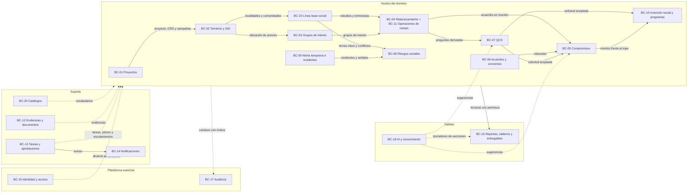
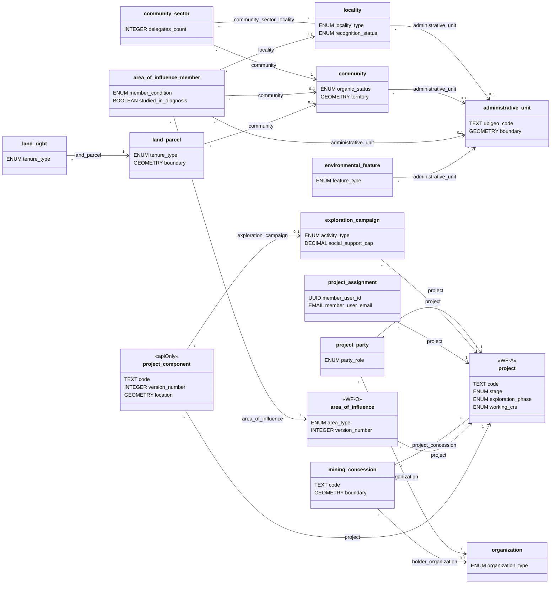
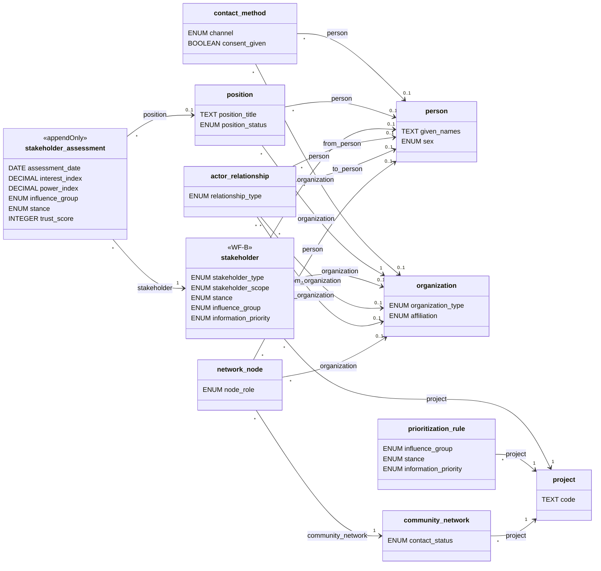
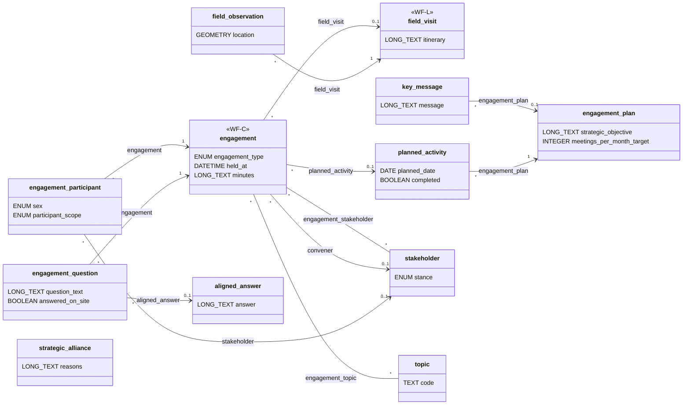
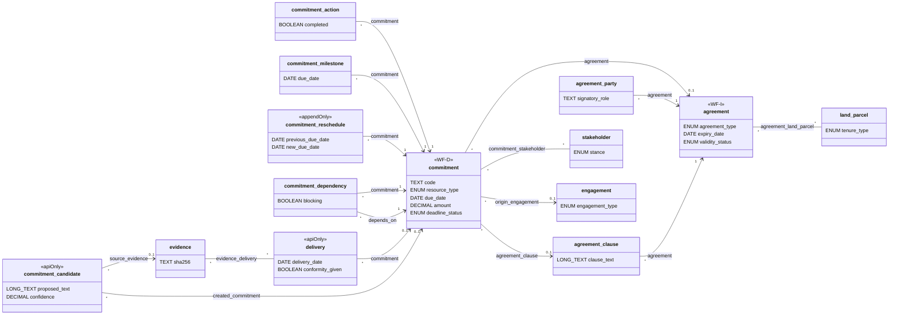
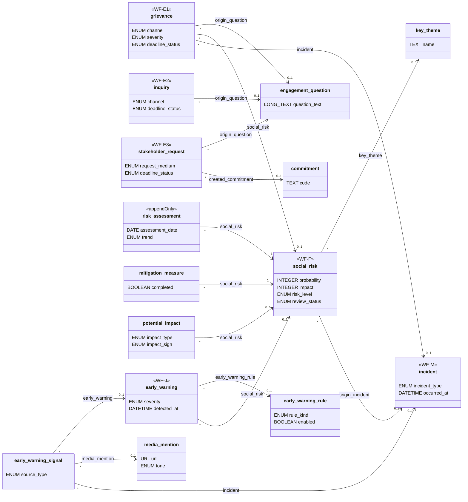
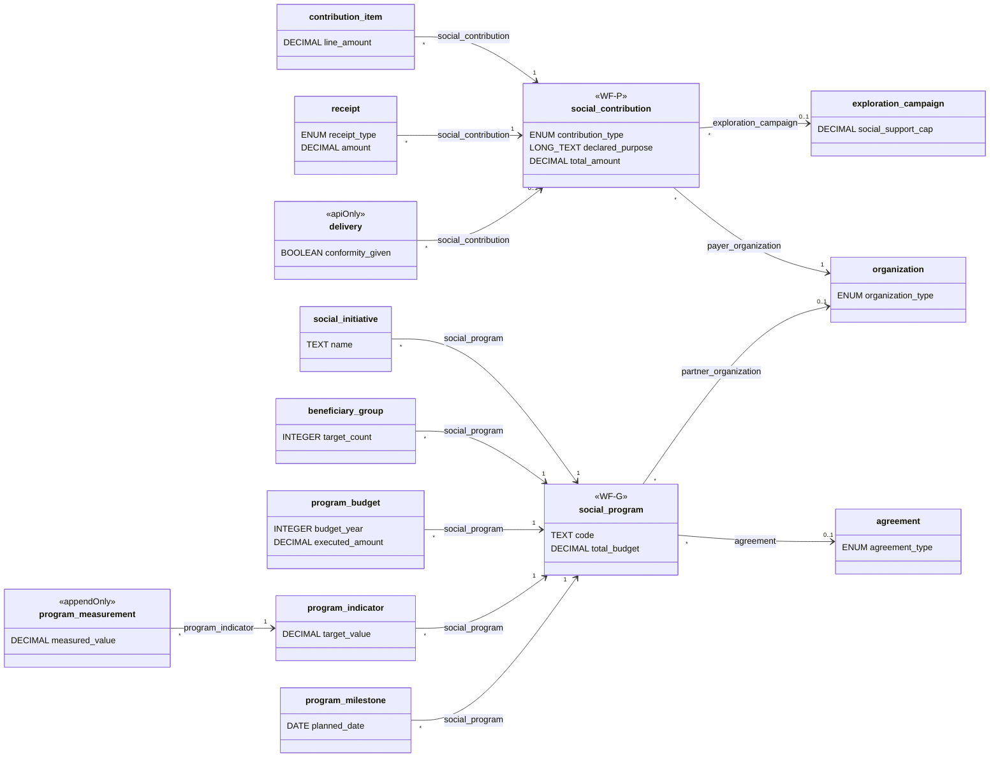
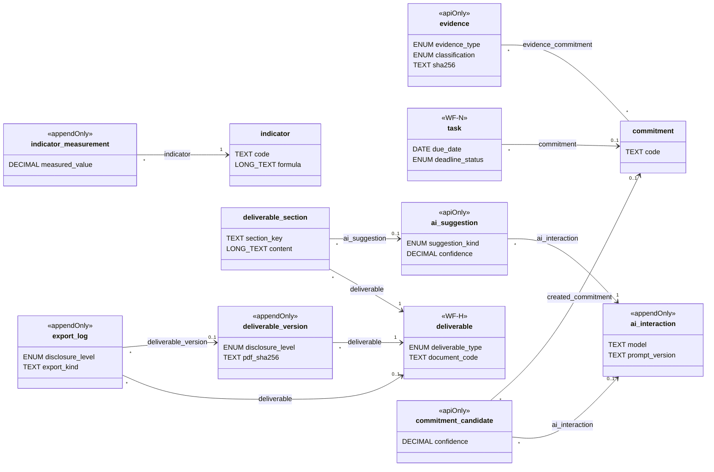
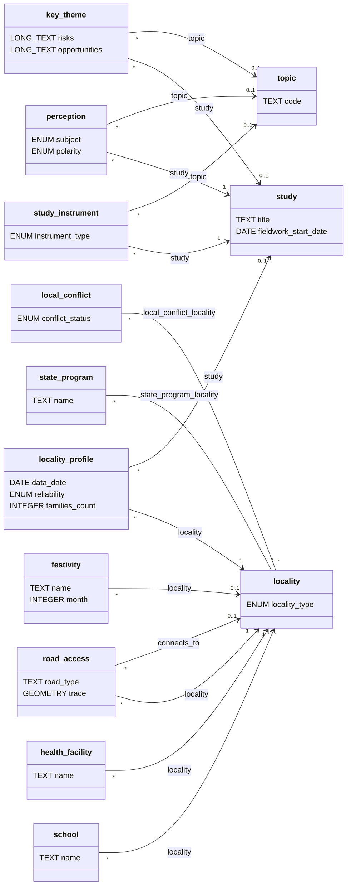

# Modelo de dominio de SGSPE

Sistema de Gestión Social para Proyectos Extractivos · Fase 0 (descubrimiento) · versión 1.0 · 2026-10-07

Este documento es la **segunda fuente de verdad** de la Fase 0, después del [análisis de requisitos](requirements-analysis.md)
y del [glosario](glossary.md). Fija los bounded contexts, el catálogo canónico de objetos con sus campos clave, los agregados
con sus invariantes y el mecanismo que hace cumplir cada una sobre wasichai. Los IDs (RF, RNF, RN, RQ, CON, GAP, ASM, UPS) se
definen solo en el análisis y aquí solo se citan; los valores de los catálogos ENUM se listan solo en
[§10 del análisis](requirements-analysis.md#10-catálogos). Ningún ejemplo usa nombres de personas reales [USR-07].

## 1. Propósito

- Cumple el paso 4 del prompt maestro: construir un modelo de dominio explícito, validado contra los documentos y no copiado
  de las entidades sugeridas [PRM-01 §0, §4, §5].
- Fija, para el resto de la documentación:
  - los bounded contexts BC-01 a BC-20, con su decisión frente al prompt, su release y su fase (§5);
  - los 89 objetos del catálogo canónico, con sus campos clave, tipos de wasichai, relaciones, flags y workflow (§6);
  - los agregados, sus invariantes y el mecanismo de cada una: metadata, `RecordWriteGuard`, endpoint `/api/sgspe/**`,
    trabajo programado o listener (§7);
  - los nombres de los estados de cada workflow, sin el detalle de sus transiciones (§7.3);
  - qué es metadata y qué es código Kotlin propio, por paquete `sgspe.*` (§8);
  - qué objetos alimentan cada capítulo de los entregables de ejemplo DOC-01 y DOC-02 (§10).
- Lo consumen seis documentos derivados: arquitectura, API y encaje con wasichai; modelo de datos; workflows; seguridad; GIS
  y entregables; IA y tableros. Toman de aquí los nombres de objetos, campos, relaciones y estados, sin sinónimos.
- No reemplaza a esos documentos:
  - la lista completa de campos, índices y relaciones con su nombre técnico está en `database-model.md`;
  - las transiciones, roles, guardas por transición, automatizaciones y trabajos numerados están en `workflows.md`;
  - los endpoints con su contrato están en `api.md`; los permisos por rol, objeto y campo, en `security.md`;
  - las capas, en `gis.md`; los KPIs, en `dashboards.md`; la anatomía de los entregables, en `deliverables.md`.
- Regla de cambio: si un documento derivado necesita un objeto, un campo, un estado o un catálogo nuevo, lo propone y se
  agrega primero aquí (y el catálogo, en §10 del análisis) [RNF-MNT-009].

## 2. Mapa de contextos

El prompt propone 18 contextos [PRM-01 §4]. SGSPE conserva su numeración, fusiona BC-11 en BC-04 para el MVP y agrega BC-19 y
BC-20 (ASM-045). Las flechas indican quién provee datos a quién; las punteadas, servicios transversales.

| Relación | Patrón | Qué cruza la frontera | Regla |
|---|---|---|---|
| BC-01 → contextos con datos de proyecto | Núcleo compartido | `project` y `project_assignment` | Toda raíz de agregado de un proyecto apunta a `project`; el alcance sale de las asignaciones (RQ-SEC-006) |
| BC-02 y BC-19 → BC-03 a BC-10 | Cliente-proveedor | `administrative_unit`, `locality`, `community`, `topic` | Los demás contextos se ubican por relación territorial; el mapa nunca inventa coordenadas de personas (RQ-GIS-015) |
| BC-20 → todos | Núcleo compartido | ENUM y objetos catálogo | Un solo vocabulario, con valores solo en §10 del análisis (RF-CAT-001) |
| wasichai → todos | Conformista | metadata, workflow, auditoría, permisos, GIS | SGSPE no reimplementa lo que la plataforma ofrece [USR-03] [WAS-ADR-0003] |
| BC-07 → BC-05 y BC-10 | Cliente-proveedor | solicitud aceptada → compromiso o aporte | La aceptación crea el registro destino en un solo comando (RF-GRV-004) |
| BC-18 → BC-05, BC-07 y BC-15 | Capa anticorrupción | sugerencias y candidatos | La IA nunca escribe datos de dominio; una persona acepta (RQ-AI-001, RQ-AI-003) |
| Todos → BC-15 | Lectura publicada | conteos y conjuntos leídos con `RecordService` | Tableros y entregables usan el mismo código de indicadores (RQ-DSH-031, RQ-DSH-034) |
| Todos → BC-17 | Conformista | escrituras, transiciones y vínculos | Cada cambio queda en `audit_log` con su motivo (RQ-AUD-001, RQ-AUD-002) |

## 3. Distinciones fundamentales

El prompt pide diseñar el modelo para que no se confundan comunidad, área geográfica, área de influencia y grupo de interés
[PRM-01 §5]. Las definiciones están en el [glosario](glossary.md); aquí se fija cómo se modela cada distinción.

| Concepto | Objeto(s) | Qué es | Qué no es | Regla y fuente |
|---|---|---|---|---|
| Área geográfica | `administrative_unit`, `locality`, `environmental_feature` | El "dónde": jurisdicción (ubigeo), asentamiento o lugar sensible, sin voluntad ni postura | Nunca es grupo de interés | RN-STK-008 [DOC-01 §4–§5] |
| Comunidad | `community` y `community_sector` | Colectivo con personería, territorio comunal inscrito, junta directiva, asamblea y sectores; se superpone con caseríos | No es una localidad ni un área de influencia; como actor participa mediante la `organization` que la representa | RF-TER-003, RN-STK-008 [DOC-02 p.4–p.5] |
| Área de influencia | `area_of_influence` y `area_of_influence_member` | Construcción analítica y versionada de un proyecto: tipo, criterios, miembros curados y geometría opcional | No es territorio ni actor; un polígono solo sugiere miembros | RN-TER-001, RN-TER-003, RN-TER-004, CON-025 [DOC-01 §4] |
| Grupo de interés | `stakeholder` y `stakeholder_assessment` | Una persona u organización en relación con un proyecto, con evaluaciones fechadas | No es el actor: un actor puede ser grupo de interés de varios proyectos | RN-STK-006, CON-038 [DOC-01 §6] |
| Actor, cargo y postura | `person`, `organization`, `position`; campo `stance` | El actor es un maestro del tenant; el cargo es un puesto con periodo que puede estar vacante; la postura es la posición frente al proyecto | "Posición" nunca es identificador: el cargo es `position` y la postura es `stance` | RF-STK-001, RF-STK-002, RF-STK-005 |
| Solicitud, compromiso, acuerdo y aporte | `stakeholder_request`, `commitment`, `agreement`, `social_contribution` | Pedido recibido; obligación asumida con plazo y responsable; instrumento formal con partes y vigencia; apoyo puntual sin obligación | Ninguno se convierte en otro: la aceptación de una solicitud crea un compromiso o un aporte y los vincula | RF-GRV-004, RF-COM-001, RF-AGR-001, RF-INV-001 |
| Riesgo, incidente, alerta, señal, tema clave y conflicto local | `social_risk`, `incident`, `early_warning`, `early_warning_signal`, `key_theme`, `local_conflict` | Hecho potencial; hecho ocurrido; aviso triado por una persona; dato bruto; hallazgo analítico; disputa entre localidades | Ninguna regla ni IA confirma un conflicto | RN-EWS-001 [DOC-01 §8, §9.3.2] [DOC-02 p.2] |
| Evidencia, documento emitido y entregable | `evidence`, documento de wasichai-documents, `deliverable` | Archivo que prueba un hecho; documento congelado de un registro; informe de varias secciones en DOCX y PDF | Ninguno reemplaza a otro; cada uno tiene su almacenamiento y su ciclo | RF-DOC-001, RQ-REP-029, RF-REP-001 |
| Organización tenant y `organization` | `organization_id` de wasichai; objeto `organization` | El cliente de la plataforma; un actor del territorio | Nunca se mezclan: un tenant tiene muchas `organization` | RQ-SEC-002, RF-STK-001 |
| Estado y situación derivada | `workflow_state`; `deadline_status`, `validity_status`, `review_status` | Decisión humana registrada por una transición; paso del tiempo calculado por un trabajo programado | Ningún estado representa vencido, por vencer, expirado ni revisión pendiente | RN-WFL-001, CON-028 |
| Dato, workflow e IA | Registros; transiciones con roles; `ai_suggestion` y `commitment_candidate` | Tres planos que convergen en la auditoría | La IA sugiere y la persona ejecuta el comando de dominio | RQ-AI-001 [ARQ-01] [ARQ-02] |
| Programa social y programa estatal | `social_program`, `state_program` | Inversión social de la empresa; presencia de un programa del Estado en una localidad | El programa estatal es contexto de línea base, no inversión del proyecto | RF-INV-003, RF-LBS-005 |
| Tema y tema clave | `topic`, `key_theme` | Catálogo jerárquico de asuntos; hallazgo con riesgos y oportunidades | Un tema clave usa un tema, no lo reemplaza | RF-LBS-008, RF-LBS-009 |
| Sector de caserío y sector comunal | `locality` de tipo SECTOR; `community_sector` | Parte de un caserío; división de una comunidad con delegados | Coinciden solo en parte (M2M `community_sector_locality`) | RF-TER-002, RF-TER-004 |
| Parte del proyecto y parte del acuerdo | `project_party`, `agreement_party` | Organización con un rol en el proyecto; firmante de un acuerdo | Una no implica la otra | RF-PRJ-002, RF-AGR-001 |

## 4. Convenciones de modelado sobre wasichai

Estas convenciones aplican las reglas de la plataforma [WAS-DOC domain/metadata-model.md] [WAS-DOC api/rest.md] y las
decisiones de nombres del usuario [USR-09]. `database-model.md` las detalla para `model/model.json`.

### 4.1 Nombres

- **Idioma:** objetos, campos, relaciones, estados y transiciones en inglés `snake_case`; roles y acciones declaradas en
  UPPER_SNAKE; etiquetas en español (RNF-MNT-004). Única excepción de origen español: `ubigeo_code`, porque "ubigeo" es el
  nombre oficial del código del INEI. Los demás términos locales se traducen: `populated_center_code` (código de centro
  poblado), `registered_members_count` (comuneros inscritos) y `communal_labor_members_count` (republicanos).
- **Límites:** objeto `^[a-z][a-z0-9_]{0,38}$` [WAS-DOC domain/metadata-model.md]; campo hasta 49 caracteres y relación
  hasta 35, según los validadores de nombres de wasichai 0.3.2. Cuando `<origen>_<campo>` supera 35 caracteres,
  `database-model.md` abrevia el nombre de la relación, nunca el del campo.
- **Reservados:** ningún campo se llama `id`, `organization_id`, `created_at`, `updated_at`, `created_by`, `updated_by`,
  `workflow_state`, `version`, `count`, `after`, `page`, `size`, `sort`, `dir`, `q`, `bbox`, `geometry` ni `limit`, ni como
  una palabra clave SQL (`order`, `user`, `group`, `key`, `end`, `from`, `to`, `index`, `table`, `values`…). Por eso se usan
  `sort_order`, `version_number`, `end_date` y geometrías con nombre propio.
- **Patrones de campo:**
  - `code` TEXT (código del negocio, único en su ámbito) y `name` o `title` TEXT;
  - fechas DATE con sufijo `_date` y momentos DATETIME con sufijo `_at`;
  - cantidades INTEGER con sufijo `_count`; índices y puntajes con nombre propio (`interest_index`, `score`);
  - montos DECIMAL más `currency` ENUM (catálogo "Moneda"; PEN por defecto, RNF-I18N-002);
  - una persona usuaria del sistema se guarda como `<rol>_user_id` UUID más `<rol>_user_email` EMAIL, validados por una
    guarda, porque wasichai no tiene relaciones con usuarios (ASM-023): `owner_user_id`, `assignee_user_id`, `member_user_id`,
    `assessor_user_id`;
  - BOOLEAN que se lee como afirmación: un adjetivo o participio (`completed`, `anonymous`, `consent_given`), `has_` más un
    sustantivo para una posesión (`has_member_roll`, `has_institutional_synergy`) o un verbo en tercera persona del singular
    para una condición (`requires_senior_approval`, `creates_commitment`); los interruptores de política llevan el prefijo
    `policy_`; nunca `is_`;
  - un campo RELATION se nombra por el papel del destino (`project`, `locality`, `origin_engagement`, `payer_organization`).

### 4.2 Tipos de campo y lo que falta

- Tipos disponibles: TEXT, LONG_TEXT, INTEGER, DECIMAL, BOOLEAN, DATE, DATETIME, ENUM, EMAIL, URL, UUID, RELATION y GEOMETRY
  (con wasichai-gis) [WAS-DOC domain/metadata-model.md].
- No existen FILE, IMAGE, CURRENCY, FORMULA, ROLLUP ni JSON. Consecuencias:
  - los archivos viven en almacenamiento de objetos y se representan con `evidence` (ASM-013, CON-046, UPS-07);
  - los montos son DECIMAL más `currency`;
  - los valores calculados y los acumulados son campos derivados que escribe el código propio (§4.6);
  - los textos estructurados (minutas, secciones de entregable) son LONG_TEXT en Markdown, sin HTML.
- Un campo ENUM nombra su catálogo de §10 del análisis entre paréntesis, por ejemplo `stance` ENUM (Postura). Sus valores van
  en español MAYÚSCULAS (ASM-025, CON-050) y no se repiten aquí. Todos los catálogos que nombra este modelo están en §10.

### 4.3 Geometrías

- Toda geometría es un campo GEOMETRY en SRID 4326 y 2D; cota, azimut e inclinación son atributos (RQ-GIS-006). Cada
  proyecto tiene un CRS de trabajo UTM (`working_crs`) para áreas, distancias y coordenadas este y norte (ASM-002, RQ-GIS-004).
- Una geometría nunca es requerida ni única [WAS-DOC api/rest.md]. La API habla GeoJSON EPSG:4326 (RNF-INT-005).
- Nombres por papel: `location` (POINT), `boundary` (POLYGON o MULTIPOLYGON), `trace` (LINESTRING), `footprint` (POLYGON),
  `territory` (MULTIPOLYGON de la comunidad) e `interest_area` (MULTIPOLYGON del proyecto).
- `MULTI*` se acepta por API e importación aunque la interfaz de wasichai no la dibuje (RQ-GIS-020, CON-060). Lo que se edita
  a mano en el mapa usa tipos de una sola parte.
- Las guardas y los listeners no reciben geometrías [WAS-ADR-0040]: las reglas sobre geometrías (validez, área, versión) viven
  en endpoints de `sgspe.territory`, que releen el registro con `RecordService` (RQ-GIS-011).

### 4.4 Relaciones

- MANY_TO_ONE crea un campo RELATION con clave foránea real `ON DELETE SET NULL`; MANY_TO_MANY crea una tabla de unión
  [WAS-DOC domain/metadata-model.md]. ONE_TO_ONE y ONE_TO_MANY no se usan en este modelo.
- La tabla de unión de MANY_TO_MANY no admite atributos. Cuando la relación los necesita, es un objeto propio: por eso
  `project_party`, `area_of_influence_member`, `engagement_participant`, `network_node` y `agreement_party` son objetos.
- Un valor RELATION debe apuntar a un registro que quien escribe puede leer [WAS-DOC api/rest.md].
- "Exactamente uno de" (persona u organización; localidad, comunidad o unidad administrativa) se modela con varias relaciones
  opcionales y una guarda (§7).
- Relaciones MANY_TO_MANY del modelo, con su nombre: las del catálogo canónico (`project_concession`,
  `community_sector_locality`, `engagement_stakeholder`, `engagement_topic`, `commitment_stakeholder`,
  `agreement_land_parcel`, `state_program_locality`, `local_conflict_locality`) y las que agrega este modelo:
  `social_risk_stakeholder` (RF-RSK-001), `incident_stakeholder` (RF-EWS-001) y una `evidence_<objeto>` por cada destino de
  §6.12 (RF-DOC-001). Ninguna toca un objeto `appendOnly`.

### 4.5 Flags por objeto y sus restricciones

| Flag | Efecto en wasichai | Uso en SGSPE |
|---|---|---|
| `appendOnly` | Nadie edita ni borra; `PUT`, `DELETE`, una transición de workflow y todo vínculo o desvínculo responden 409, también para `ADMIN` y la plataforma; un registro al que apunta no se puede borrar [WAS-ADR-0040] [WAS-ADR-0044] | Historia: evaluaciones, reprogramaciones, mediciones, versiones de entregable, exportaciones e interacciones con IA (RQ-AUD-003). Nunca tiene workflow ni relaciones MANY_TO_MANY |
| `apiOnly` | La API genérica rechaza altas, cambios, bajas y vínculos con 403; solo escribe el código propio en proceso; las transiciones de workflow no se rechazan [WAS-ADR-0040] [WAS-DOC modules/workflow.md] | Objetos cuyas escrituras llevan reglas de negocio de varios registros (RQ-AUD-004). Si además tiene workflow, una guarda exige la marca de escritura de SGSPE en las transiciones de comando |
| `requiresReason` | Toda escritura, vínculo y transición exige `X-Change-Reason` (hasta 500 caracteres) [WAS-ADR-0041] | Objetos que registran decisiones o compromisos con terceros (ASM-058, RQ-AUD-002) |

- Un objeto que necesita vínculos MANY_TO_MANY y además debe ser inmutable (`evidence`) es `apiOnly` más una guarda de
  inmutabilidad, nunca `appendOnly` (RF-DOC-001).
- **Marca de escritura de SGSPE:** los endpoints propios envuelven sus llamadas a `RecordService` y `RelatedRecordService` en
  un elemento de contexto de corrutina (`SgspeWrite`, `sgspe.common`); una guarda rechaza la escritura sin esa marca, que es
  la de toda llamada por la API genérica [WAS-ADR-0040].
- Únicos compuestos con `uniqueConstraints` [WAS-ADR-0037]: en PostgreSQL los NULL son distintos, así que cuando un miembro
  opcional importa, la unicidad se completa con una guarda. Índices declarados con `indexes` [WAS-ADR-0036].

### 4.6 Campos derivados, parámetros y políticas

- **Campo derivado:** su valor sale de otros registros o del tiempo. Solo lo escribe el código propio, con la marca de
  escritura; una guarda (`DerivedFieldsGuard`, `sgspe.common`) rechaza cualquier otro intento. En §6 se marcan con
  "(derivado)", y en `model/model.json` con la clave `"derived": true`, nunca con `editable: false` (§7.4).
- **Derivados de tiempo:** `deadline_status` (catálogo "Situación de plazo"), `validity_status` ("Situación de vigencia") y
  `review_status` ("Situación de revisión") los mantienen trabajos programados de `sgspe.deadline`, que corren como la
  plataforma con `RecordService.asPlatform` y `ClusterLock` y escriben con un motivo que nombra al trabajo (RN-WFL-001,
  ASM-051) [WAS-ADR-0039]. **Nunca son estados de workflow** (CON-028, CON-043).
- **Parámetros y políticas por proyecto:** las prácticas de DOC-01 son políticas configurables con valores por defecto
  (ASM-019). Se guardan como campos de `project` con `defaultValue`; la lista completa, con tipo, valor por defecto y regla
  que configura cada uno, está en §6.1. Lo que todavía no tiene campo también se dice allí. wasichai guarda `defaultValue`
  pero no lo aplica, así que el código de SGSPE completa los valores por defecto al crear (UPS-15).

### 4.7 Alcance por proyecto

- Toda raíz de agregado que pertenece a un proyecto lleva `project` RELATION, requerido salvo en los objetos que también
  pueden ser del tenant (`evidence`, `early_warning_rule`, `indicator_measurement`, `export_log`, `ai_suggestion`,
  `ai_interaction`). Los objetos hijos heredan el proyecto de su raíz y no lo repiten. Los maestros del territorio
  (`administrative_unit`, `locality`, `community`, `community_sector`,
  `land_parcel`, `land_right`, `environmental_feature`, `mining_concession`), los actores (`person`, `organization`,
  `contact_method`, `position`, `actor_relationship`) y la línea base sin proyecto son del tenant.
- La escritura en objetos de proyecto la acota una guarda por asignación (`ProjectScopeGuard`, `sgspe.scope`); la lectura por
  proyecto requiere la extensión upstream UPS-01 (RQ-SEC-006, CON-041, GAP-025).

### 4.8 Workflows

- Un workflow por objeto; el estado vive en `workflow_state` y solo cambia por transiciones auditadas con su motivo
  [WAS-ADR-0013] [WAS-ADR-0041]. Nombres de estado en inglés `snake_case` con etiqueta en español (§7.3).
- Las transiciones que exigen motivo en un objeto sin `requiresReason` (devolver, rechazar, suspender, cancelar, retirar y
  reabrir) se hacen cumplir con una guarda (`TransitionReasonGuard`, `sgspe.common`) que lee `RecordWrite.reason`
  (RQ-AUD-002, ASM-058).
- La plataforma no aplica transiciones dentro de `asPlatform` [WAS-ADR-0039]: un trabajo programado nunca mueve un estado;
  solo actualiza campos derivados y crea tareas o avisos (restricción detallada en §8.3).

### 4.9 Datos personales

- Los campos personales y sensibles se marcan "(restringido)" en §6 y se protegen con permisos de campo: documento de
  identidad, teléfono, correo, nombres de participantes y beneficiarios, opinión política, religión y evaluaciones de personas
  (RQ-SEC-010, GAP-024).
- Ningún dato real de las fuentes llega a artefactos versionados; los fixtures son ficticios (RQ-SEC-018). Las exportaciones y
  los entregables aplican los niveles de divulgación (RQ-REP-014).

### 4.10 Tablas fijas

- `knowledge_chunk` (BC-18, F7) e `idempotency_key` y `derived_version` (transversales, ASM-065, ASM-091) **no son
  Custom Objects**: son tablas fijas del esquema `sgspe`, con migración Flyway propia registrada como `ModuleMigration`
  (ASM-065, ASM-091, RQ-AI-008, CON-052) [WAS-ADR-0026]. Las lee y escribe solo su paquete. Sus columnas van con tipo
  PostgreSQL: las de BC-18 en §6.18, y las transversales aquí. BC-14 no tiene tablas propias desde la decisión D2: los
  avisos los guarda wasichai-notifications (ASM-012, ADR-0018).
- `idempotency_key` (`sgspe.common`, desde F3) guarda la clave y la respuesta de cada comando de `/api/sgspe/**` que la
  trae, en la misma transacción que el comando, con el contrato de la cabecera nativa de wasichai, que la honra en el
  alta genérica (UPS-18, WAS-ADR-0058); JOB-08 la purga después de `wasichai.idempotency.ttl` (RNF-INT-002, ASM-065,
  `api.md` §3.5). `derived_version` guarda los saltos de versión de las escrituras de solo derivados que acepta
  `If-Match` (ADR-0027).

| Tabla fija | Columnas (tipo PostgreSQL) | Restricciones | Requisitos |
|---|---|---|---|
| `idempotency_key` | `organization_id` uuid; `user_id` uuid; `request_key` text (1 a 128 caracteres ASCII imprimibles); `request_sha256` text (SHA-256 del método, la ruta y el cuerpo con sus claves ordenadas); `response_status` integer; `response_body` text (a lo sumo 2 MiB); `response_etag` text; `response_location` text; `created_at` timestamptz | clave primaria (`organization_id`, `user_id`, `request_key`) | RNF-INT-002, ASM-065, UPS-18 |
| `derived_version` | `organization_id` uuid; `object_name` text; `record_id` uuid; `from_updated_at` timestamptz; `to_updated_at` timestamptz; `created_at` timestamptz | clave primaria (`organization_id`, `object_name`, `record_id`, `from_updated_at`) | RNF-INT-003, ASM-091, UPS-04 |

## 5. Bounded contexts

Los 18 contextos del prompt se conservan en su orden [PRM-01 §4], validados contra las fuentes. Releases según §0.8 del
análisis (ASM-044): **Release 1 (MVP)** = F1–F4; **Release 2** = F5–F6; **Release 3** = F7–F8. La fase F es la del roadmap
del prompt [PRM-01 §24] [USR-05]; los indicadores de cada módulo aparecen cuando el módulo se construye (RQ-DSH-036).

| BC | Contexto (ES) | Prompt (EN) | Decisión frente al prompt | Release | Fase | Código propio |
|---|---|---|---|---|---|---|
| BC-01 | Proyectos | Project Management | Se mantiene y amplía con partes, campañas de exploración, concesiones y CRS de trabajo; las asignaciones son el directorio del equipo y la fuente del alcance (RF-PRJ-001, RF-PRJ-002, RF-PRJ-004, RF-PRJ-005, RF-PRJ-006) | Release 1 (MVP) | F2 | `sgspe.scope` (guarda de alcance), `sgspe.common` (correlativos, motivo al cambiar etapa) |
| BC-02 | Territorio y SIG | Territory / GIS | Se mantiene y amplía con localidades, comunidades, sectores, componentes, predios, titularidades y elementos ambientales; datos, importación y mapa básico en F2, análisis espacial en F6 (CON-036) | Release 1 (datos y mapa básico); Release 2 (SIG avanzado) | F2, F6 | `sgspe.territory` (importación con CRS y reconciliación, área en ha, consultas espaciales, geometría y filtros de la ficha territorial); las cifras de la ficha, `sgspe.dashboard` |
| BC-03 | Grupos de interés | Stakeholder Management | Se mantiene y separa actor, cargo, grupo de interés por proyecto, evaluación fechada, priorización y redes (CON-031, CON-038) | Release 1 (MVP) | F2 | `sgspe.stakeholder` (clasificación interés × poder, priorización, evaluaciones, inactividad) |
| BC-04 | Relacionamiento (absorbe Operaciones de campo) | Engagement Management | Se mantiene; agrega plan, mensajes clave, respuestas alineadas, alianzas y preguntas de reunión; absorbe las visitas de campo de BC-11 en el MVP (ASM-045) | Release 1 (MVP) | F2 | `sgspe.engagement` (cierre de interacciones, derivación de preguntas, conteos) |
| BC-05 | Compromisos | Commitments Management | Núcleo del sistema; agrega entregas con conformidad, hitos, reprogramaciones y candidatos; el vencimiento es un campo derivado (CON-027, CON-028) | Release 1 (MVP) | F3 (candidatos de IA en F7) | `sgspe.commitment` (guardas, reprogramación, entrega, aceptación de candidatos); `sgspe.investment` (tope de apoyo social al aprobar) |
| BC-06 | Acuerdos y convenios | Agreements / Conventions | Se mantiene y amplía con permisos de uso de terreno, servidumbres y autorizaciones de asamblea; sus cláusulas originan compromisos (RF-AGR-001, RF-AGR-002, RF-AGR-003) | Release 1 (MVP) | F3 | `sgspe.agreement` (guardas de acuerdos, cláusulas y permisos de terreno); `sgspe.deadline` (vigencia) |
| BC-07 | Quejas, Consultas y Solicitudes (QCS) | Grievances / Complaints | Se renombra y amplía a tres objetos con flujo propio y reporte unificado (ASM-011, CON-033) | Release 1 (MVP) | F4 | `sgspe.attention` (plazos de recepción, reclasificación, aceptación de solicitudes, reporte unificado) |
| BC-08 | Riesgos sociales | Social Risk Management | Se mantiene y amplía con impactos potenciales y revisiones periódicas con tendencia | Release 1 (MVP) | F4 | `sgspe.risk` (puntaje y nivel, revisiones, residual) |
| BC-09 | Alerta temprana e incidentes | Early Warning | Se amplía con incidentes y menciones en medios; la decisión es siempre humana (RN-EWS-001) | Release 1 (MVP) | F4 | `sgspe.warning` (evaluador de reglas, guarda de decisión humana) |
| BC-10 | Inversión social y programas | Social Investment / Programs | Se amplía con aportes puntuales con acta, foto y comprobante [DOC-02 p.3–p.4]; los lineamientos son políticas del proyecto (ASM-019) | Release 2 | F5 (lineamientos y tope en F3, RF-INV-002) | `sgspe.investment` (aportes, programas, políticas de apoyo, tope por campaña y consolidación de la ejecución) |
| BC-11 | Operaciones de campo | Field Operations | Fusionado en BC-04 para el MVP: `field_visit` y `field_observation` (ASM-045); la captura sin conexión queda fuera del MVP (ASM-021, GAP-008) | Release 1 (dentro de BC-04); sin conexión: Release 3, sujeto a GAP-008 | F2 (visitas); sin conexión: sin fase asignada | Ninguno en el MVP |
| BC-12 | Evidencias y documentos | Documents / Evidence | Se mantiene: archivos inmutables con hash en el campo `FILE` de wasichai-files (CON-046, ADR-0014); documentos administrativos de un registro con wasichai-documents (RQ-REP-029) | Release 1 (MVP) | F3 | `sgspe.evidence` (subida, descarga por clasificación, hash, EXIF, vínculos) |
| BC-13 | Tareas y aprobaciones | Workflow / Tasks | El motor de workflow es de wasichai [WAS-ADR-0013]; SGSPE agrega `task`, guardas por transición, plazos y escalamientos con trabajos programados (CON-042, CON-043) | Release 1 (MVP) | F3 (escalamiento de QCS y riesgos en F4) | `sgspe.deadline` (situaciones derivadas, escalamientos, tareas de revisión); guardas en cada paquete |
| BC-14 | Notificaciones | Notifications | Sobre el módulo wasichai-notifications (UPS-11 resuelta, CON-058, ADR-0018): la bandeja, el correo y las preferencias son del módulo; SGSPE decide destinatarios y textos | Release 1 (MVP) | F3–F4 | `sgspe.notification` (destinatarios, textos, `ApprovalNoticeListener`); `sgspe.deadline` (`DeadlineNotices`) |
| BC-15 | Reportes, tableros y entregables | Reporting / BI | Se amplía con entregables DOCX y PDF [USR-01] y con el catálogo de indicadores; tableros por módulo desde F2 y consolidados en F8 | Release 3 (consolidado); exportaciones e indicadores por módulo desde Release 1 | F8 (indicadores F2–F6; exportaciones F2–F4) | `sgspe.dashboard` (indicadores), `sgspe.deliverable` (DOCX primero, PDF, emisión), `sgspe.privacy` (divulgación, exportaciones) |
| BC-16 | Identidad y acceso | Identity / Access Control | Lo provee wasichai (JWT, roles, permisos por objeto, campo y acción) [USR-06]; SGSPE agrega `project_assignment`; el alcance de lectura por proyecto depende de UPS-01 (CON-041) | Release 1 (MVP) | F1 (asignaciones en F2) | `sgspe.scope` |
| BC-17 | Auditoría | Audit | Lo provee wasichai (`audit_log` con motivo) [WAS-ADR-0040] [WAS-ADR-0041]; SGSPE agrega `export_log` y el identificador de correlación; brechas UPS-02, UPS-03, UPS-05 y UPS-12 (CON-057) | Release 1 (MVP) | F1 (`export_log` en F2) | `sgspe.privacy` (registro de exportaciones), `sgspe.observability` (correlación, ASM-034) |
| BC-18 | IA y conocimiento | AI / Knowledge | Asistente de solo lectura de wasichai-agent para AI-05, que hasta UPS-14 solo se ofrece a roles sin acceso a campos restringidos (hoy `ANALYST`, decisión pendiente de `security.md` §15), y agentes propios que solo producen sugerencias; RAG diferido (CON-035, CON-044) | Release 3 | F7 | `sgspe.ai` (agentes, seudonimización, registro de interacciones, RAG) |
| BC-19 | Línea base social | — (nuevo) | Nuevo: DOC-01 dedica sus capítulos 3, 5, 7.1 y 8 al estudio, el contexto socioeconómico, las percepciones y los temas clave (ASM-045) | Release 1 (MVP) | F2 | Ninguno (metadata) |
| BC-20 | Catálogos | — (nuevo, de soporte) | Nuevo: ENUM compartidos y objetos catálogo (`topic`, `administrative_unit`, `indicator`) para un vocabulario único (RF-CAT-001) | Release 1 (MVP) | F2 | Ninguno; carga del ubigeo con script Python idempotente (RF-TER-001) |

Notas:

- BC-15 no espera a F8 para todo: las exportaciones XLSX (RQ-REP-022) y los indicadores de cada módulo (RQ-DSH-036) llegan
  con su módulo; F8 consolida tableros y genera los entregables (RF-REP-001, RF-REP-002).
- BC-02 tiene geometrías desde F2 porque wasichai-gis las aporta como campos; F6 es el SIG avanzado (CON-036).
- Los paquetes son los de §8; ninguno vive bajo `wasichai` (RNF-MNT-005) [WAS-ADR-0024].

## 6. Catálogo de objetos

Catálogo canónico de los 89 Custom Objects de SGSPE, agrupados por bounded context. Son los únicos nombres válidos de objeto;
los equivalentes del prompt están en §9.2 del análisis y en el glosario.

### 6.0 Cómo leer las tablas

- **Campos clave:** nombre en inglés `snake_case` y tipo de wasichai. No se listan los campos de sistema (`id`,
  `organization_id`, `created_at`, `updated_at`, `created_by`, `updated_by`, `workflow_state`). La lista completa, con
  requeridos, valores por defecto e índices, está en `database-model.md`.
- **Marcas:** "(derivado)" = lo escribe solo el código propio (§4.6); "(restringido)" = dato personal o sensible protegido por
  permiso de campo (§4.9).
- **GEOMETRY** lleva su `geometryType`; el SRID es siempre 4326 y la dimensión 2 (RQ-GIS-006).
- **Relaciones:** "M2O `campo` → `objeto`" es MANY_TO_ONE con el campo RELATION que crea (si se omite el destino, el campo se
  llama como el objeto destino); "M2M `nombre`" es MANY_TO_MANY con el nombre de su relación. Además, `evidence` se vincula por
  M2M con los objetos listados en §6.12.
- **Flags:** `appendOnly`, `apiOnly` y `requiresReason` (§4.5); "único" son restricciones `unique` o `uniqueConstraints`.
- **WF:** letra del workflow en §11 del análisis; sus estados están en §7.3.
- **Tablas fijas:** las de BC-18 tienen sus columnas en §6.18; las transversales `idempotency_key` y `derived_version`,
  en §4.10. BC-14 no tiene tablas propias (§6.14).

### 6.1 BC-01 Proyectos

| Objeto | Campos clave (tipo) | Relaciones | Flags y únicos | WF | Requisitos |
|---|---|---|---|---|---|
| `project` | `code` TEXT; `name` TEXT; `description` LONG_TEXT; `project_type` ENUM (Tipo de proyecto); `stage` ENUM (Etapa del proyecto); `exploration_phase` ENUM (Fase de exploración); `start_date`, `end_date` DATE; `working_crs` ENUM (CRS de trabajo); los parámetros y políticas de la tabla siguiente; `location` GEOMETRY (POINT); `interest_area` GEOMETRY (MULTIPOLYGON) | M2M `project_concession` → `mining_concession` | único `code`; motivo obligatorio al cambiar `stage` o `exploration_phase` (guarda) | WF-A | RF-PRJ-001, RF-PRJ-003, RN-PRJ-001, RQ-GIS-001, RQ-GIS-004, ASM-019, ASM-062 |
| `project_party` | `party_role` ENUM (Rol de la parte); `start_date`, `end_date` DATE | M2O `project`; M2O `organization` | único (`project`, `organization`, `party_role`) | — | RF-PRJ-002, CON-022 |
| `exploration_campaign` | `name` TEXT; `activity_type` ENUM (Tipo de actividad de campaña); `exploration_phase` ENUM (Fase de exploración); `planned_start_date`, `planned_end_date`, `actual_start_date`, `actual_end_date` DATE; `campaign_status` ENUM (Estado de la campaña); `social_support_cap` DECIMAL; `currency` ENUM (Moneda); `executed_social_amount` DECIMAL (derivado, ASM-063); `other_currency_items_count` INTEGER (derivado, ASM-063) | M2O `project` | — | — | RF-PRJ-004, RF-INV-004, RN-INV-003, ASM-063 |
| `project_assignment` | `member_user_id` UUID; `member_user_email` EMAIL; `role_name` TEXT (requerido; nombre de un rol declarado de wasichai); `start_date`, `end_date` DATE; `active` BOOLEAN | M2O `project` | único (`project`, `member_user_id`) | — | RF-PRJ-005, RQ-SEC-006, ASM-023, ASM-070 |
| `mining_concession` | `code` TEXT; `name` TEXT; `source_crs` ENUM (CRS de origen); `source_reference` TEXT; `import_batch_id` UUID; `registered_area_ha` DECIMAL; `calculated_area_ha` DECIMAL (derivado); `boundary` GEOMETRY (MULTIPOLYGON) | M2O `holder_organization` → `organization` (titular); M2M `project_concession` → `project` | único `code` | — | RF-PRJ-006, RQ-GIS-008, RQ-GIS-019, ASM-060, ASM-064 |

Parámetros y políticas de `project`, todos con `defaultValue` (ASM-019):

| Campo | Tipo | Por defecto | Qué configura |
|---|---|---|---|
| `interest_threshold`, `power_threshold` | DECIMAL | 3 | Desde qué índice el interés o el poder es "alto" (RF-STK-009, ASM-003) |
| `stakeholder_review_days` | INTEGER | 30 | Evaluación periódica de grupos de interés (RF-STK-010) |
| `inactivity_days` | INTEGER | 90 | Tarea sugerida por inactividad (RF-STK-014, ASM-022) |
| `meetings_per_month_target` | INTEGER | 2 | Meta de reuniones al mes (RN-ENG-003) |
| `policy_workshop_commitments_blocked` | BOOLEAN | false: advierte y pide justificación | Compromisos nacidos de talleres y reuniones informativas (RN-ENG-001, ASM-007) |
| `policy_senior_approval_for_dialogue` | BOOLEAN | true | Aprobación de nivel superior de compromisos de mesas de diálogo (RN-ENG-002) |
| `policy_minutes_only_formal_types` | BOOLEAN | true | Solo los tipos formales necesitan acta aprobada (RN-ENG-004, ASM-033) |
| `policy_internal_approval` | BOOLEAN | true | Aprobación interna con segregación de compromisos, aportes y programas (ASM-008) |
| `policy_activation_preconditions` | BOOLEAN | true | Precondiciones para llevar el proyecto a `active` (ASM-062) |
| `policy_local_jobs_direct_area_only` | BOOLEAN | true | Empleo limitado al AIDS y rotativo (RN-COM-002) |
| `local_jobs_min`, `local_jobs_max` | INTEGER | 6 y 10 | Puestos ofrecidos y su máximo negociable (RN-COM-002) |
| `policy_no_jobs_in_easements` | BOOLEAN | true | Sin puestos de trabajo en la negociación de servidumbres (RN-COM-003) |
| `due_soon_days` | INTEGER | 7 | "Por vencer" de compromisos, QCS y tareas (ASM-006) |
| `escalation_first_days`, `escalation_second_days` | INTEGER | 7 y 15 | Días de atraso de los dos niveles de escalamiento: el primero va a los roles de la transición de verificación o de revisión del objeto, y el segundo, a los de `approve_senior` de WF-D (nivel 2; los objetos sin aprobación superior propia reutilizan esos roles, ASM-030). Los destinatarios son las asignaciones activas del proyecto con esos roles, sin nombres de rol fijos (RF-WFL-004, ASM-030, ASM-070) |
| `grievance_ack_days` | INTEGER | 5 (días hábiles) | Plazo de acuse de quejas (RF-GRV-006, ASM-005) |
| `inquiry_response_days` | INTEGER | 15 | Plazo de respuesta de consultas (RF-GRV-006, ASM-005) |
| `grievance_resolution_days` | INTEGER | 30 | Plazo de resolución de quejas (RF-GRV-006, ASM-005) |
| `policy_high_severity_requires_approver` | BOOLEAN | true | Resolver quejas ALTA o CRITICA exige `APPROVER` (RN-GRV-002, ASM-036) |
| `risk_review_days` | INTEGER | 7 | Revisión periódica de riesgos (RN-RSK-001) |
| `risk_medium_min_score`, `risk_high_min_score`, `risk_critical_min_score` | INTEGER | 5, 10 y 15 | Puntaje P × I desde el que el nivel es MEDIO, ALTO o CRITICO (RN-RSK-002, ASM-004) |
| `policy_cap_blocks_approval` | BOOLEAN | true: bloquea, salvo con `APPROVE_OVER_CAP` (GAP-006) | Tope de apoyo social por campaña (RN-INV-003) |
| `policy_no_paid_labor` | BOOLEAN | true | No se financia mano de obra (RN-INV-001) |
| `policy_non_monetary_donations` | BOOLEAN | true | Donaciones no monetarias (RN-INV-002) |
| `policy_synergy_requires_agreement` | BOOLEAN | true | Sinergias formalizadas en un acuerdo antes de aprobar (RN-INV-004) |
| `policy_priority_warning` | BOOLEAN | true | Advertencia si un aporte no atiende las prioridades (RN-INV-005) |

Sin campo hasta que se respondan sus gaps:

- los pesos de los indicadores de interés y poder son iguales (ASM-031) hasta que GAP-002 los defina (RF-STK-008);
- las solicitudes no tienen plazo por defecto hasta GAP-005;
- la evidencia mínima por tipo de recurso sigue ASM-009 en `CommitmentWriteGuard`.

### 6.2 BC-02 Territorio y SIG

| Objeto | Campos clave (tipo) | Relaciones | Flags y únicos | WF | Requisitos |
|---|---|---|---|---|---|
| `administrative_unit` | `ubigeo_code` TEXT; `name` TEXT; `level` ENUM (Nivel de unidad administrativa); `boundary` GEOMETRY (MULTIPOLYGON) | M2O `parent_unit` → `administrative_unit` | único `ubigeo_code`; objeto catálogo (BC-20) cargado por script | — | RF-TER-001, ASM-016 |
| `locality` | `name` TEXT; `alternative_names` TEXT; `locality_type` ENUM (Tipo de localidad); `populated_center_code` TEXT; `recognition_status` ENUM (Estado de reconocimiento); `history` LONG_TEXT; `location` GEOMETRY (POINT); `boundary` GEOMETRY (POLYGON) | M2O `parent_locality` → `locality` (caserío → sector); M2O `administrative_unit` (distrito) | único `populated_center_code` | — | RF-TER-002, CON-004 |
| `community` | `name` TEXT; `alternative_names` TEXT; `community_type` ENUM (Tipo de comunidad); `legal_entity_record`, `property_record`, `parent_record` TEXT; `independized` BOOLEAN; `title_reference`, `title_issuer_as_written`, `title_issuer_normalized` TEXT; `registered_area_ha` DECIMAL; `calculated_area_ha` DECIMAL (derivado); `registry_records_unverified` BOOLEAN; `recognized_as_indigenous` BOOLEAN; `indigenous_people` TEXT; `organic_status` ENUM (Estado orgánico); `board_registered` BOOLEAN; `registered_members_count` INTEGER; `has_member_roll` BOOLEAN; `territory` GEOMETRY (MULTIPOLYGON) | M2O `administrative_unit` | — | — | RF-TER-003, RQ-REP-025, CON-013, CON-017, CON-018, ASM-018, ASM-064 |
| `community_sector` | `name` TEXT; `delegates_count` INTEGER; `boundary` GEOMETRY (POLYGON) | M2O `community`; M2M `community_sector_locality` → `locality` | único (`community`, `name`) | — | RF-TER-004 |
| `area_of_influence` | `area_type` ENUM (Tipo de área de influencia); `version_number` INTEGER; `criteria` LONG_TEXT; `defined_date` DATE; `calculated_area_ha` DECIMAL (derivado); `boundary` GEOMETRY (MULTIPOLYGON) | M2O `project`; M2O `study` (estudio de origen) | único (`project`, `area_type`, `version_number`) | WF-O | RF-TER-005, RN-TER-003, RQ-GIS-009, ASM-039, CON-025 |
| `area_of_influence_member` | `member_condition` ENUM (Condición de miembro); `applied_criteria` TEXT; `rationale` LONG_TEXT; `studied_in_diagnosis` BOOLEAN; `spatially_suggested` BOOLEAN | M2O `area_of_influence`; exactamente una de M2O `locality`, M2O `community`, M2O `administrative_unit` | únicos (`area_of_influence`, `locality`), (`area_of_influence`, `community`), (`area_of_influence`, `administrative_unit`) | — | RF-TER-005, RN-TER-001, RN-TER-004, CON-003 |
| `project_component` | `code` TEXT; `component_type` ENUM (Tipo de componente); `drill_type` TEXT; `component_status` ENUM (Estado del componente); `version_number` INTEGER; `superseded` BOOLEAN (derivado); `source_crs` ENUM (CRS de origen); `source_easting`, `source_northing`, `source_elevation`, `azimuth`, `dip`, `depth_m` DECIMAL; `source_reference` TEXT; `import_batch_id` UUID; `location` GEOMETRY (POINT); `trace` GEOMETRY (LINESTRING); `footprint` GEOMETRY (POLYGON) | M2O `project`; M2O `exploration_campaign`; M2O `previous_version` → `project_component` | `apiOnly`; único (`project`, `code`, `version_number`) | — | RF-TER-006, RQ-GIS-003, RQ-GIS-008, RQ-GIS-010, CON-023, CON-024, ASM-060 |
| `land_parcel` | `code` TEXT; `tenure_type` ENUM (Tenencia del predio); `registry_record` TEXT (restringido); `registered_area_ha` DECIMAL; `calculated_area_ha` DECIMAL (derivado); `source_crs` ENUM (CRS de origen); `source_reference` TEXT; `import_batch_id` UUID; `boundary` GEOMETRY (POLYGON) | M2O `community`; M2O `locality` | único `code` | — | RF-TER-007, RQ-GIS-002, RQ-SEC-011, ASM-060, ASM-064 |
| `land_right` | `tenure_type` ENUM (Tenencia del predio); `start_date`, `end_date` DATE; `source_reference` TEXT | M2O `land_parcel`; exactamente una de M2O `holder_person` → `person` (restringido), M2O `holder_organization` → `organization` | — | — | RF-TER-007 |
| `environmental_feature` | `name` TEXT; `feature_type` ENUM (Tipo de elemento ambiental); `legal_basis` TEXT; `declaring_authority` TEXT; `declaration_date` DATE; `location` GEOMETRY (POINT); `trace` GEOMETRY (LINESTRING); `boundary` GEOMETRY (MULTIPOLYGON) | M2O `administrative_unit` | — | — | RF-TER-008 |

- **ASSUMPTION (ASM-060):** la importación no es un objeto. `project_component`, `land_parcel` y `mining_concession` guardan
  los mismos campos de origen: `source_crs`, `source_reference` e `import_batch_id`; los puntos de `project_component`
  guardan además sus coordenadas originales (`source_easting`, `source_northing`, `source_elevation`). Desde F3 el archivo
  original se guarda como `evidence` con el mismo `import_batch_id`, y en él quedan las coordenadas originales de los
  polígonos. La auditoría lleva el motivo `importación <id>` (RQ-GIS-008, RQ-AUD-013, ASM-051). Es una decisión reversible:
  en F6 un ADR puede agregar un objeto de importación, y los registros ya traen su `import_batch_id` para enlazarse.
- `project_component` es `apiOnly` porque un mismo código con coordenadas distintas crea una versión nueva y nunca sobrescribe
  en silencio, y esa regla depende de la geometría, que las guardas no ven (RQ-GIS-010, RQ-GIS-011) [WAS-ADR-0040].

### 6.3 BC-03 Grupos de interés

| Objeto | Campos clave (tipo) | Relaciones | Flags y únicos | WF | Requisitos |
|---|---|---|---|---|---|
| `person` | `given_names`, `surnames` TEXT (restringido); `sex` ENUM (Sexo); `id_document_type` TEXT; `id_document_number` TEXT (restringido); `preferred_language` TEXT | M2O `residence_locality` → `locality` | — | — | RF-STK-001, RQ-SEC-010, CON-014, GAP-013 |
| `organization` | `name` TEXT; `alternative_names` TEXT; `address` TEXT; `organization_type` ENUM (Tipo de organización); `territorial_level` ENUM (Nivel territorial de la organización); `affiliation` ENUM (Afiliación); `recognized` BOOLEAN; `members_count` INTEGER; `election_mechanism` TEXT; `term_years` INTEGER; `achievements` LONG_TEXT | M2O `locality`; M2O `administrative_unit`; M2O `community` (cuando la representa); M2O `affiliated_to` → `organization`; M2O `split_from` → `organization` | — | — | RF-STK-001, RF-STK-004, RN-STK-008, RQ-REP-003, CON-005, CON-020 |
| `contact_method` | `channel` ENUM (Tipo de medio de contacto); `contact_value` TEXT (restringido); `preferred` BOOLEAN; `consent_given` BOOLEAN; `consent_date` DATE | exactamente una de M2O `person`, M2O `organization` | — | — | RF-STK-001, RNF-PRIV-004 |
| `position` | `position_title` TEXT; `election_mechanism` TEXT; `term_start_date`, `term_end_date` DATE (periodo); `start_date`, `end_date` DATE (ejercicio); `position_status` ENUM (Estado del cargo); `career_notes` LONG_TEXT | M2O `organization` (requerido); M2O `person` (vacío si el cargo está vacante o previsto); M2O `community_sector` | — | — | RF-STK-002, CON-005 |
| `stakeholder` | `stakeholder_type` ENUM (Tipo de grupo de interés); `stakeholder_scope` ENUM (Ámbito del grupo de interés); `inclusion_reason` LONG_TEXT; `interview_status` ENUM (Estado de entrevista); `relationship_status` ENUM (Estado de la relación); `owner_user_id` UUID; `owner_user_email` EMAIL; `profile_summary` LONG_TEXT; valores vigentes de su última evaluación, todos derivados: `stance` ENUM (Postura; restringido), `influence_group` ENUM (Grupo de influencia), `information_priority` ENUM (Prioridad informativa), `interest_index`, `power_index` DECIMAL, `trust_score` INTEGER, `last_assessment_date` DATE; `last_contact_date` DATE (derivado) | M2O `project`; exactamente una de M2O `person`, M2O `organization`; M2O `area_of_influence`; M2O `locality` | únicos (`project`, `person`), (`project`, `organization`) | WF-B | RF-STK-003, RF-STK-013, RF-STK-014, RN-STK-006, RN-STK-008, ASM-032, CON-030 |
| `stakeholder_assessment` | `assessment_date` DATE; `basis` ENUM (Base de la evaluación); `assessor_user_id` UUID; `assessor_user_email` EMAIL; seis indicadores de interés INTEGER 1–5 (`affect_environment`, `affect_livelihood`, `affect_property_status`, `opportunity_work`, `opportunity_development`, `opportunity_benefits`); nueve indicadores de poder INTEGER 1–5 (`power_legal_action`, `power_credibility`, `power_permit_control`, `power_action_scope`, `power_organization_level`, `power_convening_capacity`, `power_network_membership`, `power_group_mobilization`, `power_other_pressure`); componentes e índices DECIMAL (`interest_affectation`, `interest_opportunity`, `interest_index`, `power_resource_control`, `power_action_capacity`, `power_network_mobilization`, `power_index`, `influence_score`); `influence_group` ENUM (Grupo de influencia); `group_overridden` BOOLEAN; `override_reason` LONG_TEXT; `stance` ENUM (Postura; restringido); `stance_changed` BOOLEAN (derivado); `stance_reasons`, `concerns`, `expectations` LONG_TEXT (restringido); `open_to_dialogue` BOOLEAN; `project_knowledge`, `company_knowledge` LONG_TEXT; `team_closeness` TEXT; `communication_sufficient`, `information_adequate` BOOLEAN; `trust_score` INTEGER 1–5 | M2O `stakeholder` (requerido); M2O `position` (cargo evaluado); M2O `baseline_assessment` → `stakeholder_assessment` (línea base) | `appendOnly`; `apiOnly`; `requiresReason` | — | RF-STK-005, RF-STK-006, RF-STK-007, RF-STK-008, RF-STK-009, RF-STK-010, RQ-SEC-010, ASM-003, ASM-031, CON-006 |
| `prioritization_rule` | `influence_group` ENUM (Grupo de influencia); `stance` ENUM (Postura); `stakeholder_scope` ENUM (Ámbito del grupo de interés); `stakeholder_type` ENUM (Tipo de grupo de interés; vacío = cualquier tipo); `information_priority` ENUM (Prioridad informativa); `rationale` LONG_TEXT | M2O `project` | único (`project`, `influence_group`, `stance`, `stakeholder_scope`, `stakeholder_type`), más una guarda para la fila sin tipo | — | RF-STK-011 |
| `actor_relationship` | `relationship_type` ENUM (Tipo de relación entre actores); `start_date`, `end_date` DATE; `source_reference` TEXT | exactamente una de M2O `from_person` → `person`, M2O `from_organization` → `organization`; exactamente una de M2O `to_person` → `person`, M2O `to_organization` → `organization` | — | — | RF-STK-012 |
| `community_network` | `name` TEXT; `network_type` TEXT; `contact_status` ENUM (Estado de contacto de la red); `description` LONG_TEXT | M2O `project`; M2O `study`; M2O `locality`; M2O `community`; M2O `anchor_organization` → `organization` | — | — | RF-STK-012 [DOC-02 p.3, p.5] |
| `network_node` | `node_role` ENUM (Rol del nodo); `notes` LONG_TEXT | M2O `community_network` (requerido); exactamente una de M2O `person`, M2O `organization` | únicos (`community_network`, `person`), (`community_network`, `organization`) | — | RF-STK-012 |

- Las evaluaciones de personas (postura, razones, expectativas) son datos sensibles con permiso de campo (RQ-SEC-010,
  GAP-024). Una corrección es una evaluación nueva (RF-STK-005).
- La legitimidad y la relevancia del prompt no se registran mientras siga abierto GAP-029 (CON-031).

### 6.4 BC-04 Relacionamiento (absorbe BC-11 Operaciones de campo)

| Objeto | Campos clave (tipo) | Relaciones | Flags y únicos | WF | Requisitos |
|---|---|---|---|---|---|
| `engagement` | `engagement_type` ENUM (Tipo de interacción); `title` TEXT; `objective`, `description`, `results` LONG_TEXT; `scheduled_at`, `held_at` DATETIME; `place` TEXT; `minutes` LONG_TEXT (Markdown); `cancel_reason` TEXT; conteos de asistentes, todos INTEGER (derivado): `attendees_total_count`, por sexo `attendees_female_count` y `attendees_male_count`, y por ámbito `attendees_direct_area_count`, `attendees_indirect_area_count`, `attendees_regional_count` y `attendees_national_count`; `participant_rating_summary` LONG_TEXT; `location` GEOMETRY (POINT) | M2O `project`; M2O `locality`; M2O `community`; M2O `convener` → `stakeholder` (interlocutor local); M2O `field_visit`; M2O `study`; M2O `study_instrument`; M2O `planned_activity`; M2M `engagement_stakeholder` → `stakeholder`; M2M `engagement_topic` → `topic` | — | WF-C | RF-ENG-001, RF-ENG-002, RF-ENG-003, RF-ENG-004, RF-ENG-005, RF-ENG-006, RF-ENG-011, RF-ENG-012, RF-LBS-001, RQ-DSH-012, ASM-029 |
| `engagement_participant` | `participant_name` TEXT (restringido); `represented_group` TEXT; `phone` TEXT (restringido); `email` EMAIL (restringido); `sex` ENUM (Sexo); `participant_scope` ENUM (Ámbito del grupo de interés); `represented_people_count` INTEGER (1 por defecto y nunca menor que 1; más de 1 = un grupo sin nombres); `attended` BOOLEAN | M2O `engagement` (requerido); M2O `person`; M2O `organization` (a quién representa); M2O `stakeholder` | — | — | RF-ENG-004, RQ-DSH-006, RQ-DSH-012, RQ-SEC-010 |
| `engagement_question` | `question_text` LONG_TEXT; `raised_as_suggestion` BOOLEAN; `raised_by_role` TEXT (cargo, nunca nombre); `answered_on_site` BOOLEAN; `answer` LONG_TEXT; `answered_at` DATETIME | M2O `engagement` (requerido); M2O `topic`; M2O `aligned_answer`; la derivación a `inquiry`, `stakeholder_request` o `grievance` se guarda en la QCS (`origin_question`, desde F4) | — | — | RF-ENG-003, RN-ENG-005, RQ-DSH-014 |
| `field_visit` | `title` TEXT; `objective`, `itinerary`, `outcome_summary` LONG_TEXT; `leader_user_id` UUID; `leader_user_email` EMAIL; `team_note` TEXT; `planned_start_date`, `planned_end_date`, `actual_start_date`, `actual_end_date` DATE; `route` GEOMETRY (LINESTRING) | M2O `project` | — | WF-L | RF-FLD-001, ASM-045 |
| `field_observation` | `observed_at` DATETIME; `observation` LONG_TEXT; `location` GEOMETRY (POINT) | M2O `field_visit` (requerido); M2O `locality`; M2O `topic` | — | — | RF-FLD-001 |
| `engagement_plan` | `name` TEXT; `strategic_objective`, `tactical_objectives`, `action_axes` LONG_TEXT; `meetings_per_month_target` INTEGER; `start_date`, `end_date` DATE | M2O `project` | — | — | RF-ENG-007, RN-ENG-003 [DOC-02 p.2] |
| `key_message` | `justification`, `message`, `support_actions` LONG_TEXT; `target_audience` TEXT | M2O `project`; M2O `engagement_plan`; M2O `topic` | — | — | RF-ENG-008 |
| `aligned_answer` | `question`, `answer` LONG_TEXT; `approved` BOOLEAN; `approved_date` DATE | M2O `project`; M2O `topic` | — | — | RF-ENG-009 |
| `strategic_alliance` | `reasons`, `possible_actions` LONG_TEXT; `formalized` BOOLEAN (derivado) | M2O `project`; M2O `organization` (institución); M2O `agreement` (desde F3) | — | — | RF-ENG-010 |
| `planned_activity` | `name` TEXT; `description`, `resources` LONG_TEXT; `planned_date` DATE; `owner_user_id` UUID; `owner_user_email` EMAIL; `completed` BOOLEAN | M2O `engagement_plan` (requerido) | — | — | RF-ENG-007, RF-WFL-003 |

- `field_visit` y `field_observation` son los objetos de BC-11 que el MVP absorbe (ASM-045); una visita reúne las
  interacciones realizadas en ella (`engagement.field_visit`).
- Los conteos de asistentes siempre son derivados: suman `represented_people_count` de los participantes con `attended`, en
  total, por sexo y por ámbito (`attendees_direct_area_count` para AIDS, `attendees_indirect_area_count` para AIIS,
  `attendees_regional_count` y `attendees_national_count`). Una fila con `represented_people_count` mayor que 1 representa a
  un grupo sin nombres, así una asamblea grande se registra sin datos personales; un grupo mixto lleva una fila por cada
  combinación de sexo y ámbito. `EngagementWriteGuard` rechaza un `represented_people_count` menor que 1 (RF-ENG-004,
  RQ-DSH-012, RQ-SEC-010).
- Las entrevistas del estudio son interacciones de tipo ENTREVISTA vinculadas a `study`; el conteo por ámbito y localidad se
  calcula, nunca se teclea (RF-LBS-001, CON-007). Los monitoreos participativos de agua también son interacciones (ASM-029).
- El acta firmada por los asistentes no es un estado: es una `evidence` de tipo ACTA (CON-032, RF-ENG-005).

### 6.5 BC-05 Compromisos

| Objeto | Campos clave (tipo) | Relaciones | Flags y únicos | WF | Requisitos |
|---|---|---|---|---|---|
| `commitment` | `code` TEXT; `title` TEXT; `description`, `objective` LONG_TEXT; `resource_type` ENUM (Tipo de recurso); `quantity` DECIMAL; `unit` TEXT; `execution_time` TEXT; `commitment_theme` ENUM (Tema del compromiso); `formality` ENUM (Formalidad del compromiso); `request_medium` ENUM (Medio de solicitud); `agreed_date`, `due_date` DATE; `amount` DECIMAL (requerido); `currency` ENUM (Moneda); `executed_amount` DECIMAL (derivado, ASM-063); `priority` ENUM (Prioridad); `owner_user_id` UUID; `owner_user_email` EMAIL; `verifier_user_id` UUID; `verifier_user_email` EMAIL; `delay_risk_reported` BOOLEAN; `delay_risk_note` LONG_TEXT; `deadline_status` ENUM (Situación de plazo; derivado); `beneficiaries_count`, `beneficiaries_female_count`, `beneficiaries_male_count` INTEGER; `beneficiaries_detail` LONG_TEXT (restringido); `origin_justification` LONG_TEXT; `requires_senior_approval` BOOLEAN (derivado); `fulfilled_date`, `closed_date`, `cancelled_date` DATE (derivado); `location` GEOMETRY (POINT) | M2O `project`; M2O `exploration_campaign`; M2O `locality`; M2O `community`; M2O `topic`; M2O `origin_engagement` → `engagement`; M2O `agreement`; M2O `agreement_clause`; desde F4, M2O `origin_grievance` → `grievance` y M2O `social_risk`; M2M `commitment_stakeholder` → `stakeholder` (solicitantes) | `requiresReason`; único (`project`, `code`) | WF-D | RF-COM-001, RF-COM-002, RF-COM-005, RF-COM-007, RF-COM-009, RN-COM-004, RN-ENG-001, RN-ENG-002, RN-WFL-001, RQ-DSH-003, ASM-023, ASM-063 |
| `commitment_action` | `description` LONG_TEXT; `action_date` DATE; `owner_user_id` UUID; `owner_user_email` EMAIL; `completed` BOOLEAN | M2O `commitment` (requerido) | — | — | RF-COM-006 |
| `commitment_milestone` | `description` TEXT; `due_date`, `reached_date` DATE | M2O `commitment` (requerido) | — | — | RF-COM-006 |
| `commitment_reschedule` | `previous_due_date`, `new_due_date` DATE; `reschedule_reason` LONG_TEXT; `agreed_with_stakeholder` BOOLEAN | M2O `commitment` (requerido) | `appendOnly`; `apiOnly` | — | RF-COM-003 |
| `commitment_dependency` | `blocking` BOOLEAN; `notes` TEXT | M2O `commitment` (el que depende); M2O `depends_on` → `commitment` | único (`commitment`, `depends_on`) | — | RF-COM-004 |
| `delivery` | `delivery_date` DATE; `place` TEXT; `delivered_items` LONG_TEXT; `delivered_amount` DECIMAL (solo en entregas de compromisos, en la moneda del compromiso; vacío en las de aportes, cuyo ejecutado es su `total_amount`, ASM-063); `recipients` LONG_TEXT (restringido); `conformity_given` BOOLEAN; `conformity_by` LONG_TEXT (restringido); `location` GEOMETRY (POINT) | exactamente una de M2O `commitment`, M2O `social_contribution` (desde F5) | `apiOnly` | — | RF-COM-008, RN-COM-001, ASM-009, ASM-063 [DOC-02 p.4] |
| `commitment_candidate` | `proposed_text`, `evidence_quote`, `beneficiaries_text` LONG_TEXT (seudonimizados, con marcadores, §6.18; `evidence_quote` restringido); `suggested_owner_user_email` EMAIL; `suggested_due_date` DATE; `confidence` DECIMAL; `ai_generated` BOOLEAN | M2O `project`; M2O `engagement`; M2O `source_evidence` → `evidence`; M2O `ai_interaction` (F7); M2O `created_commitment` → `commitment`; M2O `duplicate_of` → `commitment` | `apiOnly` | WF-K | RF-COM-010, RF-AIK-003, RQ-AI-001, RQ-AI-003, RQ-AI-004 |

- La matriz de compromisos de DOC-01 §9.3.1.2 se reparte así (RF-COM-001):

  | Campo de la matriz | Dónde vive |
  |---|---|
  | Descripción: objetivo, tipo de recurso, unidades, tiempo | campos de `commitment` |
  | Grupo de interés solicitante (personas, cargos, documento de identidad) | M2M `commitment_stakeholder`; `person` y `position` (documento restringido) |
  | Beneficiarios (número; nombre, sexo y edad restringidos) | conteos y `beneficiaries_detail` de `commitment` |
  | Medio de solicitud | `request_medium`, `origin_engagement`, `agreement` y la solicitud que lo originó; la carta o el acta como `evidence` |
  | Plazos (acuerdo, parciales, final) | `agreed_date`, `commitment_milestone`, `due_date` (y `commitment_reschedule`) |
  | Monto | `amount`, `currency`; ejecutado en `executed_amount`, suma de `delivery.delivered_amount` (ASM-063) |
  | Estatus de avance | estado de WF-D, `commitment_action`, `delay_risk_reported` y `deadline_status` |
  | Entrega (fecha, lugar, conformidad, acta, fotos) | `delivery` con sus `evidence` y el documento emitido "acta de entrega" (RQ-REP-029) |
  | Cierre | transición `close` de WF-D y `closed_date` |

- El vínculo con la solicitud que originó un compromiso se lee desde `stakeholder_request.created_commitment`; el del candidato,
  desde `commitment_candidate.created_commitment`. Cada vínculo se guarda en un solo lado.

### 6.6 BC-06 Acuerdos y convenios

| Objeto | Campos clave (tipo) | Relaciones | Flags y únicos | WF | Requisitos |
|---|---|---|---|---|---|
| `agreement` | `code` TEXT; `title` TEXT; `agreement_type` ENUM (Tipo de acuerdo); `summary` LONG_TEXT; `signed_date`, `effective_date`, `expiry_date` DATE; `amount` DECIMAL; `currency` ENUM (Moneda); `validity_status` ENUM (Situación de vigencia; derivado); `owner_user_id` UUID; `owner_user_email` EMAIL | M2O `project`; M2O `community` (titular comunal); M2O `assembly_engagement` → `engagement` (asamblea que autoriza); M2M `agreement_land_parcel` → `land_parcel` | `requiresReason`; único (`project`, `code`) | WF-I | RF-AGR-001, RF-AGR-002, RF-AGR-003, RN-INV-004, RN-WFL-001 |
| `agreement_party` | `signatory_role` TEXT; `signed` BOOLEAN | M2O `agreement` (requerido); exactamente una de M2O `organization`, M2O `person` | — | — | RF-AGR-001 |
| `agreement_clause` | `clause_number` TEXT; `clause_text` LONG_TEXT; `creates_commitment` BOOLEAN | M2O `agreement` (requerido) | único (`agreement`, `clause_number`) | — | RF-AGR-001, RF-COM-005 |

- Una alianza estratégica que se formaliza apunta a su `agreement` (`strategic_alliance.agreement`); una sinergia con un
  programa o un aporte se formaliza con un acuerdo antes de aprobarse (RN-INV-004).

### 6.7 BC-07 Quejas, Consultas y Solicitudes (QCS)

Los tres objetos comparten un juego de campos y relaciones (ASM-011):

- **Campos comunes:** `code` TEXT; `channel` ENUM (Canal de QCS); `received_at` DATETIME; `received_by_user_id` UUID;
  `received_by_user_email` EMAIL; `anonymous`, `confidential` BOOLEAN; `category` ENUM (Categoría de QCS); `description`
  LONG_TEXT; `priority` ENUM (Prioridad); `response_due_date` DATE (derivado); `deadline_status` ENUM (Situación de
  plazo; derivado); `owner_user_id` UUID; `owner_user_email` EMAIL; `response` LONG_TEXT; `responded_at` DATETIME; `closed_date` DATE (derivado); `location`
  GEOMETRY (POINT).
- **Relaciones comunes:** M2O `project`; M2O `stakeholder`; M2O `person` (restringido; vacío si es anónima); M2O `locality`;
  M2O `community`; M2O `topic`; M2O `origin_engagement` → `engagement`; M2O `origin_question` → `engagement_question`.

| Objeto | Campos propios (tipo) | Relaciones propias | Flags y únicos | WF | Requisitos |
|---|---|---|---|---|---|
| `grievance` | `severity` ENUM (Severidad de queja); `ack_due_date`, `resolution_due_date` DATE (derivado); `resolved_date` DATE (derivado); `resolution` LONG_TEXT; `complainant_conformity_given` BOOLEAN | M2O `social_risk`; M2O `incident`; M2O `duplicate_of` → `grievance`; M2O `reclassified_from_inquiry` → `inquiry`; M2O `reclassified_from_request` → `stakeholder_request` | `requiresReason`; único (`project`, `code`) | WF-E1 | RF-GRV-001, RF-GRV-002, RF-GRV-006, RF-GRV-007, RN-GRV-002, RQ-DSH-022, RQ-DSH-025, ASM-005, ASM-036 |
| `inquiry` | — (solo comunes) | M2O `reclassified_from_grievance` → `grievance`; M2O `reclassified_from_request` → `stakeholder_request` | `requiresReason`; único (`project`, `code`) | WF-E2 | RF-GRV-001, RF-GRV-003, RF-GRV-007 |
| `stakeholder_request` | `request_medium` ENUM (Medio de solicitud); `requested_resource` LONG_TEXT | M2O `created_commitment` → `commitment`; desde F5, M2O `created_contribution` → `social_contribution`; M2O `reclassified_from_grievance` → `grievance`; M2O `reclassified_from_inquiry` → `inquiry` | `requiresReason`; único (`project`, `code`) | WF-E3 | RF-GRV-001, RF-GRV-004, RF-GRV-007, RN-GRV-001 |

- El reporte unificado de QCS (RF-GRV-005) y el porcentaje absuelto (RQ-DSH-023) leen los tres objetos; no hay un objeto
  "QCS" genérico.
- Una QCS anónima no lleva `person` ni `stakeholder`; los plazos y la apelación siguen GAP-005 con los valores de ASM-005.
- La derivación de una pregunta de reunión se registra en la QCS (`origin_question`), y desde allí la lee la interacción para
  cerrar (RN-ENG-005).
- Reclasificar crea el registro del otro tipo con el vínculo `reclassified_from_*` y cierra el original. El registro nuevo
  copia `received_at` del primer registro de la cadena, y sus plazos corren desde esa fecha, porque el grupo de interés
  planteó el caso una sola vez (RF-GRV-007, ASM-072).

### 6.8 BC-08 Riesgos sociales

| Objeto | Campos clave (tipo) | Relaciones | Flags y únicos | WF | Requisitos |
|---|---|---|---|---|---|
| `social_risk` | `code` TEXT; `title` TEXT; `risk_source` LONG_TEXT; `category` ENUM (Categoría de riesgo); `impact_type` ENUM (Tipo y naturaleza del impacto, sub-lista de tipo); `impact_nature` ENUM (Tipo y naturaleza del impacto, sub-lista de naturaleza); valores vigentes de la última revisión, derivados: `probability`, `impact`, `score` INTEGER y `risk_level` ENUM (Nivel de riesgo); `treatment_decision` ENUM (Decisión de tratamiento); `treatment_rationale`, `current_controls`, `monitoring_sources` LONG_TEXT; `controls_adequate` BOOLEAN; residual, derivado: `residual_probability`, `residual_impact`, `residual_score` INTEGER y `residual_level` ENUM (Nivel de riesgo); `review_every_days` INTEGER; `next_review_date` DATE (derivado); `review_status` ENUM (Situación de revisión; derivado); `owner_user_id` UUID; `owner_user_email` EMAIL; `close_reason` LONG_TEXT; `location` GEOMETRY (POINT) | M2O `project`; M2O `key_theme`; M2O `local_conflict`; M2O `origin_incident` → `incident`; M2O `locality`; M2O `community`; M2O `area_of_influence`; M2M `social_risk_stakeholder` → `stakeholder` | `requiresReason`; único (`project`, `code`) | WF-F | RF-RSK-001, RF-RSK-003, RF-RSK-005, RN-RSK-002, RN-RSK-003, RN-WFL-001, ASM-004, CON-011 |
| `risk_assessment` | `assessment_date` DATE; `probability`, `impact` INTEGER 1–5; `score` INTEGER; `risk_level` ENUM (Nivel de riesgo); `residual` BOOLEAN; `trend` ENUM (Tendencia del riesgo); `notes` LONG_TEXT; `assessor_user_id` UUID; `assessor_user_email` EMAIL | M2O `social_risk` (requerido) | `appendOnly`; `apiOnly` | — | RF-RSK-002, RN-RSK-001, RN-RSK-002, RQ-DSH-026, RQ-DSH-027 |
| `mitigation_measure` | `description` LONG_TEXT; `owner_user_id` UUID; `owner_user_email` EMAIL; `planned_date`, `completed_date` DATE; `completed` BOOLEAN | M2O `social_risk` (requerido) | — | — | RF-RSK-003, RN-RSK-003, RQ-DSH-027 |
| `potential_impact` | `activity_type` ENUM (Tipo de actividad de campaña); `description` LONG_TEXT; `impact_type` ENUM (Tipo y naturaleza del impacto, sub-lista de tipo); `impact_nature` ENUM (Tipo y naturaleza del impacto, sub-lista de naturaleza); `impact_sign` ENUM (Tipo y naturaleza del impacto, sub-lista de signo) | M2O `project`; M2O `social_risk` (riesgo que origina) | — | — | RF-RSK-004 [DOC-01 Tabla 9.4] |

- La revisión semanal es un trabajo programado más una tarea, nunca un estado (RN-RSK-001, RN-WFL-001). Cada revisión es una
  fila inmutable de `risk_assessment`, de la que salen la tendencia y el mapa de calor (RQ-DSH-026, RQ-DSH-031).

### 6.9 BC-09 Alerta temprana e incidentes

| Objeto | Campos clave (tipo) | Relaciones | Flags y únicos | WF | Requisitos |
|---|---|---|---|---|---|
| `incident` | `code` TEXT; `incident_type` ENUM (Tipo de incidente); `occurred_at` DATETIME; `place` TEXT; `description`, `immediate_response`, `consequences` LONG_TEXT; `location` GEOMETRY (POINT) | M2O `project`; M2O `locality`; M2O `community`; M2M `incident_stakeholder` → `stakeholder` (actores involucrados) | único (`project`, `code`) | WF-M | RF-EWS-001 [DOC-02 p.2] |
| `media_mention` | `outlet_name` TEXT; `published_date` DATE; `url` URL; `headline` TEXT; `summary` LONG_TEXT; `tone` ENUM (Tono de la mención); `reports_fulfilled_commitment` BOOLEAN | M2O `project`; M2O `outlet` → `organization` (medio); M2O `topic`; M2O `commitment` | — | — | RF-EWS-002, RQ-DSH-016, RQ-DSH-017, ASM-029, ASM-050, GAP-023 |
| `early_warning_signal` | `source_type` ENUM (Fuente de la señal); `received_at` DATETIME; `description` LONG_TEXT; `reported_via` TEXT; `location` GEOMETRY (POINT) | M2O `project`; M2O `locality`; M2O `community`; M2O `media_mention`; M2O `incident`; M2O `early_warning` (alerta que alimenta) | — | — | RF-EWS-003, ASM-043, GAP-020 |
| `early_warning_rule` | `name` TEXT; `rule_kind` ENUM (Tipo de regla de alerta); `threshold` DECIMAL; `window_days` INTEGER; `severity` ENUM (Severidad de alerta); `enabled` BOOLEAN; `description` LONG_TEXT | M2O `project` (vacío = todo el tenant) | — | — | RF-EWS-004 |
| `early_warning` | `title` TEXT; `detected_at` DATETIME; `severity` ENUM (Severidad de alerta); `trigger_description` LONG_TEXT; `ai_detected` BOOLEAN; `owner_user_id` UUID; `owner_user_email` EMAIL; `location` GEOMETRY (POINT) | M2O `project`; M2O `early_warning_rule`; M2O `locality`; M2O `community`; M2O `social_risk` (riesgo al que alimenta) | — | WF-J | RF-EWS-004, RN-EWS-001, RQ-SEC-014 |

- Las URL de medios se guardan como dato y el servidor nunca las descarga (ASM-050). Un comunicado de prensa sobre un
  compromiso cumplido es una `media_mention` con `reports_fulfilled_commitment` (ASM-029).

### 6.10 BC-10 Inversión social y programas

| Objeto | Campos clave (tipo) | Relaciones | Flags y únicos | WF | Requisitos |
|---|---|---|---|---|---|
| `social_contribution` | `code` TEXT; `contribution_type` ENUM (Tipo de aporte); `occasion` TEXT; `declared_purpose`, `conditions` LONG_TEXT (requeridos); `total_amount` DECIMAL (derivado de los ítems); `currency` ENUM (Moneda); `beneficiaries_count` INTEGER; `has_institutional_synergy` BOOLEAN; `guideline_deviation_justification` LONG_TEXT | M2O `project`; M2O `exploration_campaign`; M2O `payer_organization` → `organization` (requerido); M2O `recipient_organization` → `organization`; M2O `stakeholder`; M2O `locality`; M2O `festivity`; M2O `commitment`; M2O `agreement` (sinergia) | `requiresReason`; único (`project`, `code`) | WF-P | RF-INV-001, RN-INV-001, RN-INV-002, RN-INV-003, RN-INV-004, RN-INV-005, RN-INV-006, ASM-063, CON-021, CON-022 |
| `contribution_item` | `description` TEXT; `quantity` DECIMAL; `unit` TEXT; `unit_cost`, `line_amount` DECIMAL | M2O `social_contribution` (requerido) | — | — | RF-INV-001 |
| `receipt` | `receipt_type` ENUM (Tipo de comprobante); `receipt_number` TEXT; `issuer_name`, `issued_to_name` TEXT; `issue_date` DATE; `amount` DECIMAL; `currency` ENUM (Moneda) | M2O `social_contribution` (requerido); M2O `issued_to_organization` → `organization` | — | — | RF-INV-001, CON-022 [DOC-02 p.4] |
| `social_program` | `code` TEXT; `name` TEXT; `description` LONG_TEXT; `start_date`, `end_date` DATE; `total_budget` DECIMAL (derivado); `currency` ENUM (Moneda) | M2O `project`; M2O `topic`; M2O `partner_organization` → `organization`; M2O `agreement` (sinergia) | único (`project`, `code`) | WF-G | RF-INV-003, RN-INV-004, GAP-007 |
| `social_initiative` | `name` TEXT; `description` LONG_TEXT; `start_date`, `end_date` DATE; `location` GEOMETRY (POINT) | M2O `social_program` (requerido); M2O `locality`; M2O `community`; M2O `counterpart_organization` → `organization` (p. ej. la república como contraparte) | — | — | RF-INV-003, RN-INV-001 |
| `beneficiary_group` | `name` TEXT; `description` LONG_TEXT; `target_count`, `reached_count` INTEGER | M2O `social_program` (requerido); M2O `social_initiative`; M2O `locality` | — | — | RF-INV-003, RQ-DSH-030 |
| `program_budget` | `budget_year` INTEGER; `allocated_amount`, `executed_amount` DECIMAL; `currency` ENUM (Moneda) | M2O `social_program` (requerido) | único (`social_program`, `budget_year`) | — | RF-INV-003, RF-INV-004 |
| `program_indicator` | `name` TEXT; `definition` LONG_TEXT; `unit` TEXT; `baseline_value`, `target_value` DECIMAL; `frequency` TEXT | M2O `social_program` (requerido) | — | — | RF-INV-003, GAP-032 |
| `program_measurement` | `period_start_date`, `period_end_date` DATE; `measured_value` DECIMAL; `notes` LONG_TEXT | M2O `program_indicator` (requerido) | `appendOnly`; único (`program_indicator`, `period_start_date`) | — | RF-INV-003, RQ-AUD-003 |
| `program_milestone` | `name` TEXT; `planned_date`, `reached_date` DATE; `notes` LONG_TEXT | M2O `social_program` (requerido) | — | — | RF-INV-003 |

- La entrega de un aporte es una `delivery` con su acta de recepción y sus fotos como `evidence`; el comprobante escaneado es
  una `evidence` de tipo COMPROBANTE y sus datos estructurados viven en `receipt` [DOC-02 p.4].
- La ejecución de una campaña (compromisos y aportes frente a su tope) se calcula en
  `exploration_campaign.executed_social_amount`, solo con montos en la moneda de la campaña. Los programas no pertenecen a una
  campaña: se consolidan por proyecto con `program_budget` en el indicador de inversión, en PEN por defecto (RNF-I18N-002);
  los montos en otra moneda no se suman y se señalan igual que en la campaña (RF-INV-004, RQ-DSH-030, ASM-063).

### 6.11 BC-11 Operaciones de campo

Sin objetos propios en el MVP: `field_visit` y `field_observation` viven en BC-04 (§6.4, ASM-045). La captura sin conexión no
es requisito del MVP y depende de GAP-008 (ASM-021); si se aprueba, BC-11 se separa con sus propios objetos de sincronización.

### 6.12 BC-12 Evidencias y documentos

| Objeto | Campos clave (tipo) | Relaciones | Flags y únicos | WF | Requisitos |
|---|---|---|---|---|---|
| `evidence` | `evidence_type` ENUM (Tipo de evidencia); `classification` ENUM (Clasificación de evidencia); `title` TEXT; `file` FILE (el archivo de wasichai-files, con su nombre, tipo, tamaño y SHA-256); `document_date` DATE; `author` TEXT; `captured_at` DATETIME; `people_identifiable` BOOLEAN; `photo_consent_given` BOOLEAN; `import_batch_id` UUID (archivo original de una importación, ASM-060); `location` GEOMETRY (POINT) | M2O `project`; M2O `replaces` → `evidence` (versión que reemplaza); una M2M `evidence_<objeto>` por destino: `community`, `land_parcel`, `stakeholder`, `engagement`, `field_visit`, `field_observation`, `commitment`, `delivery`, `agreement`, `grievance`, `inquiry`, `stakeholder_request`, `social_risk`, `incident`, `media_mention`, `social_contribution`, `social_program`, `study` | `apiOnly` más guarda de inmutabilidad (sin append-only, porque tiene vínculos M2M) | — | RF-DOC-001, RF-DOC-003, RNF-PRIV-004, ASM-013, ASM-060, CON-046, UPS-07 |

- El archivo vive en almacenamiento de objetos local o compatible con S3; el registro guarda el descriptor del campo
  FILE (id del archivo, nombre, tipo, tamaño y SHA-256), no una clave de almacenamiento (ASM-013). Lo sube la ruta de
  wasichai-files y el registro lo crea `POST /api/sgspe/evidence`, en JSON; los EXIF los lee el portal. El descriptor,
  con el nombre original del archivo, lo lee todo lector del registro (UPS-24, ASM-093). Ningún destino de
  `evidence_<objeto>` es `appendOnly`, porque un vínculo con un registro `appendOnly` responde 409 [WAS-ADR-0040]. El
  proyecto de una evidencia es su M2O `project`; no hay una M2M hacia `project`.
- Los vínculos con destinos `requiresReason` (`commitment`, `agreement`, `grievance`, `inquiry`, `stakeholder_request`,
  `social_risk`, `social_contribution`) exigen motivo en ambos registros: `sgspe.evidence` lo pasa en cada vínculo
  [WAS-ADR-0041].
- **Documentos emitidos** (wasichai-documents) no son objetos de SGSPE: son tipos de documento por objeto (catálogo
  "Tipo de documento administrativo"), emitidos congelados y con correlativo (RQ-REP-029) [WAS-ADR-0023]. Se emiten
  desde `delivery` (acta de entrega o de recepción), `engagement` (minuta y lista de asistentes), `grievance` (cargo de
  queja), `inquiry` y `stakeholder_request` (carta de respuesta), `stakeholder` (ficha de grupo de interés, tras UPS-23:
  `stance` es restringido) y `locality` (ficha de localidad). Un documento emitido no se filtra por permisos de campo y
  su copia congelada lleva el registro entero (UPS-23): solo se declara sobre objetos sin campos restringidos
  (`security.md` §11.4), y el acta de entrega (y la de recepción, AUT-04), la ficha de grupo de interés, el cargo de
  queja y las cartas de respuesta (las tres QCS restringen `person`, ASM-098) esperan a UPS-23.

### 6.13 BC-13 Tareas y aprobaciones

| Objeto | Campos clave (tipo) | Relaciones | Flags y únicos | WF | Requisitos |
|---|---|---|---|---|---|
| `task` | `title` TEXT; `description` LONG_TEXT; `assignee_user_id` UUID; `assignee_user_email` EMAIL; `due_date` DATE; `priority` ENUM (Prioridad); `deadline_status` ENUM (Situación de plazo; derivado); `generator_key` TEXT | M2O `project`; exactamente una, desde la fase de su objeto, de M2O `commitment`, `grievance`, `inquiry`, `stakeholder_request`, `social_risk`, `early_warning`, `engagement`, `agreement`, `social_program`, `stakeholder`, `deliverable` | único `generator_key` (las tareas que crea un trabajo programado son idempotentes) | WF-N | RF-WFL-001, RF-WFL-004, RN-WFL-001, ASM-022, ASM-030 |

- Las aprobaciones no son objetos: son transiciones con roles o la acción declarada `APPROVE`, con segregación de funciones
  por guarda (RF-WFL-002, RN-COM-005) [WAS-ADR-0042]. El motor de workflow es de wasichai [WAS-ADR-0013].
- El plan de trabajo del equipo social (RF-WFL-003) se registra como `engagement_plan` y `planned_activity` (§6.4), con
  tareas para su seguimiento.

### 6.14 BC-14 Notificaciones

BC-14 no tiene objetos ni tablas propias desde la decisión D2 (ASM-012, ADR-0018): los avisos los guarda y los entrega
el módulo wasichai-notifications, y SGSPE publica con una clave estable por aviso a personas que resuelve por las
asignaciones (ASM-070). Requisitos: RF-NTF-001, RN-NTF-001, GAP-021.

### 6.15 BC-15 Reportes, tableros y entregables

| Objeto | Campos clave (tipo) | Relaciones | Flags y únicos | WF | Requisitos |
|---|---|---|---|---|---|
| `indicator` | `code` TEXT (el ID KPI que define `dashboards.md`); `name` TEXT; `definition`, `formula`, `verification_means` LONG_TEXT; `disaggregation` TEXT; `target_value` DECIMAL; `frequency` TEXT; `source_reference` TEXT | — | único `code`; objeto catálogo (BC-20) | — | RQ-DSH-037, GAP-018 |
| `indicator_measurement` | `period_start_date`, `period_end_date` DATE; `measured_value`, `numerator`, `denominator` DECIMAL; `breakdown` LONG_TEXT (desagregación en Markdown); `closed_by_user_id` UUID; `closed_by_user_email` EMAIL | M2O `indicator` (requerido); M2O `project` | `appendOnly`; `apiOnly`; único (`indicator`, `project`, `period_start_date`), más una guarda para `project` vacío, porque los NULL son distintos | — | RQ-DSH-037, ASM-042 |
| `deliverable` | `document_code` TEXT; `title` TEXT; `deliverable_type` ENUM (Tipo de entregable); `period_start_date`, `period_end_date`, `cutoff_date` DATE; `template_key` TEXT; `generation_requested_at` DATETIME (derivado); `draft_generation_status` ENUM (Estado de generación del borrador; derivado); `draft_generated_at` DATETIME (derivado: instante en que se congeló el modelo); `draft_model_sha256`, `draft_storage_key` TEXT (derivado); `current_revision` TEXT (derivado) | M2O `project`; alcance: M2O `area_of_influence`, M2O `community`, M2O `locality`; M2O `study`; M2O `prepared_for_organization` → `organization` (cliente); M2O `prepared_by_organization` → `organization` (autora); M2O `current_version` → `deliverable_version` (derivado) | `requiresReason`; único `document_code` | WF-H | RF-REP-001, RF-REP-002, RQ-REP-002, RQ-REP-003, RQ-REP-013, RQ-REP-015, RQ-REP-016, RQ-REP-021, ASM-027, ASM-061 |
| `deliverable_section` | `section_key` TEXT; `title` TEXT; `sort_order` INTEGER; `section_kind` ENUM (Tipo de sección de entregable); `content` LONG_TEXT (Markdown); `content_origin` ENUM (Origen del contenido); `reviewed` BOOLEAN | M2O `deliverable` (requerido); M2O `ai_suggestion` (F8) | único (`deliverable`, `section_key`) | — | RQ-REP-011, RQ-REP-032, RQ-REP-033, RQ-AI-012 |
| `deliverable_version` | `version_number` INTEGER; `revision` TEXT; `issued_at` DATETIME; `issued_by_user_id` UUID; `issued_by_user_email` EMAIL; `disclosure_level` ENUM (Nivel de divulgación); `pdf_storage_key`, `model_storage_key` TEXT; `pdf_sha256`, `model_sha256`, `template_sha256` TEXT; `docx_storage_key`, `docx_sha256` TEXT (vacíos en una versión derivada solo PDF, EXTERNO o PUBLICO); `ai_assisted_sections` LONG_TEXT | M2O `deliverable` (requerido); M2O `derived_from` → `deliverable_version` | `appendOnly`; `apiOnly`; único (`deliverable`, `version_number`) | — | RQ-REP-001, RQ-REP-014, RQ-REP-017, RQ-REP-026, RQ-REP-027, RQ-AI-012 |
| `export_log` | `exported_at` DATETIME; `exporter_user_id` UUID; `exporter_user_email` EMAIL; `export_kind` TEXT (exportación, emisión o descarga); `object_name` TEXT; `file_format` TEXT; `disclosure_level` ENUM (Nivel de divulgación); `filters_description` LONG_TEXT; `row_count` INTEGER | M2O `project`; M2O `deliverable` (descarga de un borrador); M2O `deliverable_version` (emisión o descarga de una versión) | `appendOnly`; `apiOnly` | — | RQ-AUD-011, RQ-REP-014, RQ-REP-022 |

- El modelo congelado de una versión (`model_storage_key`, `model_sha256`) es interno: en el MVP la API nunca lo sirve; solo
  se usa para volver a generar y para verificar hashes. Los borradores y las versiones EXTERNO y PUBLICO se sirven solo en
  PDF (RQ-REP-014, RQ-REP-026).
- **ASSUMPTION (ASM-061):** los borradores no son registros. El último borrador de cada entregable se describe en los campos
  derivados `draft_*`, que solo escribe el trabajador de generación; el endpoint que pide un borrador solo escribe
  `generation_requested_at` (§8.3). Los archivos de los borradores se purgan según ASM-028. Lo emitido es una fila inmutable de
  `deliverable_version` con los hashes del DOCX, del PDF y del modelo congelado (RQ-REP-017, RQ-REP-026, ASM-014). Es una
  decisión reversible: en F8 un ADR puede agregar un objeto de generación con un registro por borrador.
- El ciclo de relaciones `deliverable.current_version` → `deliverable_version` → `deliverable` es intencional: las claves
  foráneas de RELATION son `ON DELETE SET NULL`, y como `deliverable_version` es `appendOnly`, un entregable con versiones
  emitidas no se puede borrar [WAS-DOC domain/metadata-model.md] [WAS-ADR-0040].
- Los indicadores se calculan en vivo; `indicator_measurement` solo congela cifras oficiales al cerrar un periodo (ASM-042,
  RQ-DSH-031).

### 6.16 BC-16 Identidad y acceso

Sin objetos propios. Usuarios, roles, permisos por objeto, campo y acción, `own_records_only` y cuentas de servicio son de
wasichai [WAS-ADR-0010] [WAS-ADR-0020] [WAS-ADR-0042] [WAS-ADR-0043]. `project_assignment` (BC-01) es la fuente del alcance por
proyecto (RF-PRJ-005, RQ-SEC-006). Los 17 roles del prompt y su mapeo están en `security.md` (RQ-SEC-003, ASM-024).

### 6.17 BC-17 Auditoría

Sin objetos propios. Usa el `audit_log` de wasichai, append-only, con usuario, objeto, registro, operación, cambios antes y
después y motivo (RQ-AUD-001, RQ-AUD-002) [WAS-ADR-0040] [WAS-ADR-0041], y el `export_log` de BC-15 (RQ-AUD-011). Sus brechas
son UPS-02, UPS-03, UPS-05 y UPS-12. La historia de coordenadas se conserva con los datos de origen de cada importación, porque
la auditoría no guarda geometrías (RQ-AUD-013).

### 6.18 BC-18 IA y conocimiento

| Objeto | Campos clave (tipo) | Relaciones | Flags y únicos | WF | Requisitos |
|---|---|---|---|---|---|
| `ai_suggestion` | `suggestion_kind` ENUM (Tipo de sugerencia de IA); `target_object` TEXT; `target_record_id` UUID; `suggested_value`, `evidence_quote` LONG_TEXT (seudonimizados, con marcadores; `evidence_quote` restringido); `confidence` DECIMAL; `model` TEXT | M2O `project`; M2O `ai_interaction` (requerido) | `apiOnly` | WF-K | RF-AIK-001, RF-AIK-002, RF-AIK-004, RF-AIK-007, RF-AIK-008, RQ-AI-001, RQ-AI-003, RQ-AI-004, RQ-AI-015 |
| `ai_interaction` | `use_case` TEXT (AI-01 a AI-08); `provider`, `model`, `model_version`, `prompt_version` TEXT; `started_at` DATETIME; `input_reference` TEXT; `output_summary` LONG_TEXT; `input_tokens`, `output_tokens`, `latency_ms` INTEGER; `confidence` DECIMAL; `requested_by_user_id` UUID y `requested_by_user_email` EMAIL (vacíos cuando la llamada la hace un trabajo como la plataforma, como JOB-07); `run_by_platform` BOOLEAN (derivado) | M2O `project` | `appendOnly`; `apiOnly` | — | RF-AIK-009, RQ-AI-006, RQ-AUD-003, RQ-AUD-012 |

| Tabla fija | Columnas (tipo PostgreSQL) | Relación | Naturaleza | WF | Requisitos |
|---|---|---|---|---|---|
| `knowledge_chunk` | `id` uuid; `organization_id` uuid; `project_id` uuid (vacío si es del tenant); `evidence_id` uuid (documento de origen); `chunk_index` integer; `classification` text (valor de "Clasificación de evidencia"); `content` text; `embedding` vector (solo en la etapa 2, si una medición lo justifica; ADR-0005); `created_at` timestamptz | `evidence_id` → registro de `evidence` | Tabla fija del esquema `sgspe` (F7), no Custom Object; pgvector solo con justificación medida | — | RQ-AI-008, CON-035 |

- `ai_interaction` es `appendOnly`: la validación humana y el resultado que pide RF-AIK-009 se leen del estado de la
  `ai_suggestion` o del `commitment_candidate` que apunta a la interacción, porque una fila inmutable no se actualiza después
  de la decisión (RQ-AUD-012).
- `target_object` y `target_record_id` nombran el registro al que se refiere la sugerencia; una guarda verifica que exista y
  que quien acepta pueda leerlo. Aceptar ejecuta el comando de dominio con la autorización de esa persona (RQ-AI-003).
- Las salidas de la IA se guardan seudonimizadas: `suggested_value` y `evidence_quote` de `ai_suggestion`, y `proposed_text`,
  `evidence_quote` y `beneficiaries_text` de `commitment_candidate`, llevan marcadores (`[PERSONA:<id>]` para una persona
  registrada, `[PERSONA]` sin id para nombres de participantes, beneficiarios y personas no registradas, y marcadores sin
  valor para lo detectado por formato) en lugar de datos restringidos. La API genérica solo devuelve los marcadores. Un
  permiso de campo (`security.md` §7.9) oculta `evidence_quote` a los roles sin `DOWNLOAD_RESTRICTED` sobre `evidence`,
  también en la API genérica. La interfaz re-identifica al mostrar, con los permisos de quien mira, y la cita solo la ve
  quien puede leer esos campos y descargar la evidencia fuente. La comprobación de que la cita es literal se hace sobre el
  fragmento seudonimizado (RQ-AI-004, RQ-AI-009; `ai-architecture.md` §12.2, `security.md` §7.8).

### 6.19 BC-19 Línea base social

| Objeto | Campos clave (tipo) | Relaciones | Flags y únicos | WF | Requisitos |
|---|---|---|---|---|---|
| `study` | `title` TEXT; `study_type` TEXT; `objectives`, `scope_description`, `methodology` LONG_TEXT; `fieldwork_start_date`, `fieldwork_end_date` DATE | M2O `project`; M2O `author_organization` → `organization`; M2O `client_organization` → `organization` | — | — | RF-LBS-001 [DOC-01 §2, §3] |
| `study_instrument` | `instrument_type` ENUM (Tipo de instrumento); `application_scope` ENUM (Ámbito del grupo de interés); `description` LONG_TEXT | M2O `study` (requerido); M2O `topic` | — | — | RF-LBS-001 [DOC-01 Tabla 10.1] |
| `locality_profile` | `data_date` DATE; `data_source` TEXT; `reliability` ENUM (Confiabilidad del dato); `families_count`, `population_count`, `communal_labor_members_count` INTEGER; `members_per_family` DECIMAL; `migration`, `economic_activities`, `crops`, `livestock` LONG_TEXT; servicio de agua: `water_source`, `water_treatment`, `water_frequency`, `water_fee` TEXT, `water_system_age_years` INTEGER y `water_problems` LONG_TEXT; `electricity`, `sanitation`, `phone_coverage` TEXT; `religion` LONG_TEXT (restringido); `electoral_process` LONG_TEXT (restringido) | M2O `locality` (requerido); M2O `study` | — | — | RF-LBS-002, RQ-SEC-010 [DOC-01 §5] |
| `school` | `name` TEXT; `education_level` TEXT; `school_status` TEXT; `location` GEOMETRY (POINT) | M2O `locality` (requerido) | — | — | RF-LBS-003 [DOC-01 Tablas 5.4, 5.9] |
| `health_facility` | `name` TEXT; `facility_type` TEXT; `facility_status` TEXT; `location` GEOMETRY (POINT) | M2O `locality` (requerido) | — | — | RF-LBS-003 [DOC-01 §5.1.5, §5.2.4] |
| `road_access` | `road_type` TEXT; `road_condition` TEXT; `transport_means` TEXT; `travel_time` TEXT; `trace` GEOMETRY (LINESTRING) | M2O `locality` (origen, requerido); M2O `connects_to` → `locality` | — | — | RF-LBS-003 [DOC-01 Tabla 5.5] |
| `festivity` | `name` TEXT; `date_text` TEXT; `month`, `start_day`, `end_day` INTEGER; `co_organization_turns` LONG_TEXT | M2O `locality`; M2O `administrative_unit` (festividad distrital) | — | — | RF-LBS-004, RN-INV-002 [DOC-01 Tabla 5.6] |
| `state_program` | `name` TEXT; `description` LONG_TEXT | M2O `sponsor_organization` → `organization` (entidad del Estado); M2M `state_program_locality` → `locality` | — | — | RF-LBS-005 [DOC-01 Tabla 5.10] |
| `local_conflict` | `title` TEXT; `conflict_type` ENUM (Tipo de conflicto local); `conflict_status` ENUM (Estado del conflicto local); `disputed_resource` TEXT; `description` LONG_TEXT | M2O `environmental_feature` (lugar o recurso en disputa); M2M `local_conflict_locality` → `locality` | — | — | RF-LBS-006 [DOC-01 §5.1.1, §5.2.1] |
| `perception` | `subject` ENUM (Percepción, sub-lista de sujeto); `polarity` ENUM (Percepción, sub-lista de polaridad); `perception_scope` ENUM (Ámbito del grupo de interés); `statement`, `quote` LONG_TEXT; `attributed_role` TEXT (cargo, nunca nombre) | M2O `study` (requerido); M2O `topic` | — | — | RF-LBS-007, RQ-REP-014 [DOC-01 §7.1] |
| `key_theme` | `name` TEXT; `description`, `risks`, `opportunities` LONG_TEXT | M2O `project`; M2O `study`; M2O `topic` | — | — | RF-LBS-008 [DOC-01 §8, Tabla 8.1] |
| `topic` | `code` TEXT; `name` TEXT; `description` LONG_TEXT; `active` BOOLEAN (requerido; true por defecto) | M2O `parent_topic` → `topic` | único `code`; objeto catálogo (BC-20) | — | RF-LBS-009, RF-CAT-001 |

- La línea base es metadata pura: no tiene workflow ni código propio. Cada dato del perfil queda con su fecha, su fuente y su
  confiabilidad (RF-LBS-002); los datos de las fuentes solo inspiran fixtures ficticios (RQ-SEC-018).

### 6.20 BC-20 Catálogos

- **ENUM compartidos:** todos los catálogos de §10 del análisis, con valores en español MAYÚSCULAS (RF-CAT-001, ASM-025,
  ASM-041). Un mismo catálogo se reutiliza en todos los campos que lo nombran.
- **Objetos catálogo** (jerárquicos, largos o editables): `topic` (§6.19), `administrative_unit` (§6.2) e `indicator` (§6.15).
  Se cargan con scripts idempotentes o desde `/admin` (RF-TER-001, ASM-020).
- **Catálogos agregados a §10.** Los 19 catálogos que pidió este modelo (entre ellos Tipo de proyecto, Prioridad, Categoría
  de QCS, Categoría de riesgo, CRS de origen y Severidad de alerta) y los usos que agrega a catálogos existentes ya están en
  §10 del análisis; los campos de §6 los nombran como a los demás.

## 7. Agregados, invariantes y mecanismo

Un agregado es una raíz con sus hijos; sus invariantes se cumplen en una sola escritura o en un solo comando. En wasichai no
hay entidades con métodos: cada invariante se hace cumplir con uno de los mecanismos de §7.1 (CON-040, CON-042). Las
transiciones se nombran aquí por el estado al que llegan; sus nombres, roles y efectos los fija `workflows.md`.

### 7.1 Mecanismos

| Mecanismo | Qué hace | Cuándo se usa | Base |
|---|---|---|---|
| Metadata | `required`, `unique`, `uniqueConstraints`, ENUM, flags y roles por transición | Reglas de un solo registro que la plataforma valida en la API y en la base | [WAS-ADR-0003] [WAS-ADR-0037] [WAS-ADR-0040] |
| `RecordWriteGuard` | Veta una escritura, un vínculo o una transición antes de guardarla; ve el registro anterior, los atributos nuevos, el usuario, el motivo y el nombre de la transición, no las geometrías | Reglas que miran otros registros, al usuario, el motivo o la marca de escritura de SGSPE | [WAS-ADR-0040] |
| Endpoint `/api/sgspe/**` | Comando que escribe varios registros en una sola transacción con `RecordService` en proceso, con la marca de escritura | Decisiones de varios registros, cálculos al escribir, archivos y geometrías | [WAS-ADR-0038] RQ-AUD-004, RNF-INT-004 |
| Trabajo programado | `@Scheduled` con `ClusterLock` y `RecordService.asPlatform`, con un motivo que nombra al trabajo | Paso del tiempo, recordatorios, escalamientos y tareas periódicas; nunca mueve estados | [WAS-ADR-0039] RN-WFL-001, ASM-051 |
| Listener (`RecordChangeListener`) | Reacciona después de la escritura, como quien escribió. Es atómico con ella solo si quien llama abrió una transacción: una transición (`WorkflowService.apply` es transaccional) o un endpoint propio con `TransactionalOperator`. Por la API genérica de registros, `RecordService` no abre transacción y, si el listener falla, la escritura queda guardada | Derivados idempotentes y recalculables (§7.4, §7.5), cierres encadenados y notificaciones | [WAS-ADR-0025] [WAS-ADR-0038] RN-NTF-001 |
| Automatización | Regla de metadata que crea una tarea, actualiza un campo o emite un documento al entrar en un estado | Efectos simples sin lógica; no tiene disparadores temporales | [WAS-ADR-0016] CON-043 |

Guardas transversales de `sgspe.common`: `DerivedFieldsGuard` (campos derivados solo con la marca, §4.6),
`TransitionReasonGuard` (motivo en devolver, rechazar, suspender, cancelar, retirar y reabrir, RQ-AUD-002), `ExactlyOneGuard`
("exactamente uno de", §4.4), `UserReferenceGuard` (pares `*_user_id` y `*_user_email` válidos cuando vienen informados; un par vacío, como el de una
interacción con IA que corre como la plataforma, no se valida; ASM-023),
`FieldChangeReasonGuard` (motivo al cambiar ciertos campos) y `CommandTransitionGuard` (las transiciones de comando solo
llegan desde su endpoint). `ProjectScopeGuard` (`sgspe.scope`) acota la escritura por asignación (RQ-SEC-006) y `EditAnyGuard`
(`sgspe.scope`) rechaza a quien no tiene `EDIT_ANY` cambiar, transicionar, vincular o borrar registros ajenos (ASM-069). Cada
paquete de dominio agrega una guarda propia para sus objetos. `DerivedFieldsJob` (`sgspe.common`) recalcula los campos derivados que
mantienen listeners (§7.5).

### 7.2 Invariantes por agregado

| Agregado | Invariante | Fuente | Mecanismo |
|---|---|---|---|
| `project` (+ `project_party`, `exploration_campaign`, `project_assignment`) | El código del proyecto es único | RF-PRJ-001 | Metadata (`unique`) |
| `project` | La etapa y la fase de exploración son campos que cambian con motivo, nunca estados de WF-A | RN-PRJ-001, CON-034 | Guarda `FieldChangeReasonGuard` sobre `stage` y `exploration_phase` |
| `project` | Llegar a `active` exige el CRS de trabajo y al menos una parte CLIENTE u OPERADOR | RF-PRJ-003, ASM-062 | Guarda `ProjectWriteGuard` (`sgspe.scope`), que se desactiva con `policy_activation_preconditions`. WF-A nunca se desactiva: una organización que no revisa proyectos aplica una variante de su definición, sin `submit_for_review` ni `return_to_draft`, en la que `approve` sale de `draft` (ASM-010) |
| `project_assignment` | Una asignación por usuario y proyecto, con un usuario real del tenant | RF-PRJ-005, ASM-023 | Metadata (único compuesto) y `UserReferenceGuard` |
| `project_assignment` | `role_name` es requerido y nombra un rol declarado en `model/roles.json`, porque los destinatarios por rol dependen de él | RF-PRJ-005, ASM-070 | Metadata (campo requerido) y guarda `AssignmentRoleGuard` (`sgspe.scope`), que compara con la lista de roles cargada como configuración |
| Avisos (BC-14) | Los destinatarios de escalamientos, aprobaciones pendientes y alertas son las asignaciones activas del proyecto cuyo `role_name` está en la lista de roles de la transición que corresponde: la siguiente en aprobaciones y alertas; en un escalamiento, la de verificación o de revisión del objeto (nivel 1) y `approve_senior` de WF-D (nivel 2; los objetos sin aprobación superior propia reutilizan esos roles, ASM-030). Los nombres de rol salen de la definición del workflow, nunca de literales en el código | RF-NTF-001, RF-WFL-004, RQ-SEC-005, ASM-030, ASM-070 | `sgspe.notification` resuelve los destinatarios leyendo el workflow y `project_assignment`: como quien envía cuando el aviso sale de `ApprovalNoticeListener`, y como la plataforma en los avisos de plazo de `DeadlineNotices` |
| Toda raíz de proyecto | Solo escribe quien está asignado al proyecto | RQ-SEC-006, CON-041 | `ProjectScopeGuard`; la lectura por proyecto espera UPS-01 |
| `engagement`, `engagement_participant`, `field_visit`, `field_observation`, `evidence` | A quien no tiene `EDIT_ANY` sobre el objeto se le rechaza cambiar, transicionar, vincular o borrar registros ajenos; sí puede agregar participantes u observaciones a cualquier interacción o visita que pueda leer | RQ-SEC-008, ASM-069 | `EditAnyGuard` (`sgspe.scope`): compara `created_by` con quien escribe y decide con el permiso, nunca con el nombre del rol (RQ-SEC-005); no frena las escrituras de campos derivados que llevan la marca de SGSPE |
| `exploration_campaign` | `executed_social_amount` suma lo ejecutado de la campaña: `executed_amount` de sus compromisos más `total_amount` de sus aportes en `delivered` o `closed`, solo en la moneda de la campaña; los demás se cuentan en `other_currency_items_count` y se muestran como advertencia | RF-INV-004, RQ-DSH-021, ASM-063 | `DerivedFieldsJob` con el recalculador de `sgspe.investment` (§7.4) |
| `area_of_influence` (+ `area_of_influence_member`) | Cada miembro es exactamente uno de localidad, comunidad o unidad administrativa, sin repetirse | RN-TER-001 | `ExactlyOneGuard` y únicos compuestos |
| `area_of_influence` | Hay una sola versión aprobada por proyecto y tipo; aprobar una nueva reemplaza a la anterior, que se conserva | RN-TER-003 | Endpoint `POST /api/sgspe/areas-of-influence/{id}/approve` (lleva la nueva a `approved` y la anterior a `superseded` en una transacción) y `CommandTransitionGuard` |
| `area_of_influence` | La pertenencia la decide una persona; el cálculo espacial solo sugiere | RN-TER-004 | Endpoint de lectura `GET /api/sgspe/areas-of-influence/{id}/member-suggestions`; `spatially_suggested` marca lo aceptado |
| `area_of_influence` | Los miembros de una versión `approved` o `superseded` no cambian | RN-TER-003 | Guarda `TerritoryWriteGuard` (`sgspe.territory`) |
| `area_of_influence`, `community`, `land_parcel`, `mining_concession` | El área oficial es la plana en hectáreas: en el `working_crs` del proyecto para `area_of_influence`, y en la zona UTM del centroide de la geometría para `community` y `land_parcel`, que no tienen proyecto, y para `mining_concession`, que no pertenece a un solo proyecto | RQ-GIS-009, ASM-057, ASM-064 | Endpoints de importación, en su transacción; por la API genérica, `AreaListener` (`sgspe.territory`), que relee la geometría; `DerivedFieldsJob` corrige lo que un listener no escribió (§7.5) |
| `project_component` | Se importa con CRS de origen obligatorio, vista previa y confirmación; PSAD56 solo como entrada | RQ-GIS-003, RQ-GIS-007, CON-024 | Endpoint `POST /api/sgspe/territory/imports` y su confirmación |
| `project_component` | Un mismo código con coordenadas distintas crea una versión con su distancia en el reporte de diferencias; nunca sobrescribe | RQ-GIS-010, CON-023 | `apiOnly`, endpoint de importación, endpoint de alta y de versión manual `POST /api/sgspe/project-components` y único (`project`, `code`, `version_number`) |
| `project_component`, `land_parcel`, `mining_concession` | Cada registro importado guarda `source_crs`, `source_reference` e `import_batch_id`; los puntos, también sus coordenadas originales; desde F3 el archivo original queda como `evidence` con el mismo `import_batch_id` | RQ-GIS-008, RQ-AUD-013, ASM-060 | Endpoint de importación |
| Geometrías de BC-02 | Una geometría inválida se rechaza con su motivo o se repara con consentimiento | RQ-GIS-011 | Endpoints de `sgspe.territory` |
| `land_right` | La titularidad es de exactamente una persona u organización | RF-TER-007 | `ExactlyOneGuard` |
| `stakeholder` (+ `stakeholder_assessment`) | Es exactamente una persona u organización, una sola vez por proyecto | RN-STK-006 | `ExactlyOneGuard` y únicos (`project`, `person`), (`project`, `organization`) |
| `stakeholder` | Una localidad, una comunidad o un área de influencia nunca es grupo de interés | RN-STK-008 | Metadata: el actor solo se relaciona con `person` u `organization` |
| `stakeholder_assessment` | Las evaluaciones son inmutables; una corrección es una evaluación nueva | RF-STK-005 | Metadata (`appendOnly`, `apiOnly`, `requiresReason`) |
| `stakeholder_assessment` | Índices de 1 a 5 calculados desde sus indicadores con los pesos del proyecto; grupo de influencia por umbrales; el ajuste manual exige justificación | RF-STK-008, RF-STK-009, ASM-003, ASM-031 | Endpoint `POST /api/sgspe/stakeholders/{id}/assessments` con la función pura `InfluenceClassifier` (`sgspe.stakeholder`); el endpoint valida los rangos de 1 a 5 de indicadores y confianza, porque wasichai no tiene mínimos ni máximos |
| `stakeholder` | La prioridad informativa sale de la matriz de priorización | RF-STK-011 | El mismo endpoint (`Prioritizer`) con `prioritization_rule` |
| `stakeholder` | La postura y la confianza vigentes son el último valor informado de cada una (una evaluación que no informa la postura o la confianza no borra el valor vigente, ASM-087), los demás valores vigentes son los de la última evaluación, y llegar a `assessed` exige al menos una | RF-STK-003, RF-STK-005 | El mismo endpoint escribe la evaluación, el grupo de interés y la transición en una transacción; `DerivedFieldsGuard` y `CommandTransitionGuard` |
| `stakeholder_assessment` | La evaluación anterior es la línea base (`baseline_assessment`); el cambio de postura se mide contra la evaluación anterior más reciente que informó la postura, que puede ser otra, y queda marcado; dos evaluaciones cercanas con posturas distintas generan una advertencia | RF-STK-010, RQ-DSH-008, CON-006 | El mismo endpoint (`baseline_assessment`, `stance_changed`) |
| `stakeholder` | La evaluación periódica y la inactividad prolongada solo sugieren tareas; el trabajo nunca cambia `relationship_status`, salvo la regla de primer contacto | RF-STK-010, RF-STK-014, ASM-022 | Trabajo `StakeholderFollowUpJob` (`sgspe.stakeholder`), que también mantiene `last_contact_date` |
| `stakeholder` | El estado de la relación lo actualizan las interacciones o una persona, separado del ciclo de vida. Regla de primer contacto: cuando `last_contact_date` pasa de vacío a una fecha, porque una interacción vinculada llegó a `held` o a un estado posterior (`minutes_drafted`, `minutes_in_review`, `minutes_approved`, `closed`), con la misma regla de vínculo de §7.4 (un participante cuenta solo con `attended`), el estado pasa de SIN CONTACTO a CONTACTO ESTABLECIDO; si una persona ya lo cambió, no se toca. Los demás cambios son manuales | RF-STK-014, ASM-032 | `StakeholderFollowUpJob`, sin listener, para que quien cierra una interacción no necesite UPDATE sobre los grupos de interés; edición manual con permiso de campo |
| `stakeholder` | Retirar un grupo de interés exige motivo | RF-STK-013, RQ-AUD-002 | `TransitionReasonGuard` |
| `position` | Un cargo sin persona solo puede estar VACANTE o PREVISTO; una persona puede tener varios cargos | RF-STK-002, CON-005 | Guarda `StakeholderWriteGuard` |
| `contact_method`, `actor_relationship`, `network_node` | Cada extremo es exactamente una persona u organización | RF-STK-001, RF-STK-012 | `ExactlyOneGuard` |
| `delivery` | Pertenece a exactamente un compromiso o un aporte; `delivered_amount` solo se llena en las entregas de compromisos | RF-COM-008, RF-INV-001, ASM-063 | `ExactlyOneGuard` y los endpoints de entregas |
| `prioritization_rule` | Una fila por combinación, también la que vale para cualquier tipo de actor | RF-STK-011 | Único compuesto y `StakeholderWriteGuard` |
| `engagement` (+ `engagement_participant`, `engagement_question`) | Cancelar exige motivo y conserva el intento | RF-ENG-006, CON-032 | WF-C (`cancelled` es final) y `TransitionReasonGuard` |
| `engagement_participant` | `represented_people_count` es al menos 1 | RF-ENG-004, RQ-DSH-012 | `EngagementWriteGuard` (`sgspe.engagement`) |
| `engagement` | Llegar a `held` exige `held_at` y al menos un participante con `attended` | RF-ENG-004 | Guarda `EngagementWriteGuard` (`sgspe.engagement`) |
| `engagement` | Solo los tipos formales necesitan acta aprobada para cerrarse | RN-ENG-004, ASM-033 | `EngagementWriteGuard` hacia `closed`, según `engagement_type` |
| `engagement` | No se cierra con preguntas sin responder ni derivar | RN-ENG-005 | `EngagementWriteGuard` hacia `closed` (lee `engagement_question` y las QCS con `origin_question`) |
| `engagement_question` | Derivar una pregunta crea la QCS y la vincula en un solo comando | RF-ENG-003 | Endpoint `POST /api/sgspe/engagement-questions/{id}/referral` (desde F4) |
| `engagement` | Los conteos de asistentes suman `represented_people_count` de los participantes con `attended`, en total, por sexo y por ámbito, recalculados desde cero | RF-ENG-004, RQ-DSH-012 | `AttendanceCountsListener` (`sgspe.engagement`) y `DerivedFieldsJob` (§7.5) |
| `commitment` (+ acciones, hitos, reprogramaciones, dependencias, entregas) | Todo compromiso tiene monto | RN-COM-004 | Metadata (`required`) |
| `commitment` | Llegar a `pending_approval` exige los campos mínimos de la matriz de DOC-01 | RF-COM-001 | Guarda `CommitmentWriteGuard` (`sgspe.commitment`) |
| `commitment` | Quien aprueba no es quien registró, y quien verifica no es el responsable | RN-COM-005, ASM-008 | `CommitmentWriteGuard` hacia `approved` y `verified` (`created_by`, `owner_user_id`) y roles por transición |
| `commitment` | La aprobación verifica el tope de apoyo social de la campaña contra la suma de los montos aprobados (comprometidos) de sus compromisos y aportes, más el que se aprueba, solo en la moneda de la campaña (los demás montos no se suman y la guarda lo advierte); bloquea o advierte según `policy_cap_blocks_approval`, salvo con la acción declarada `APPROVE_OVER_CAP` | RN-INV-003, GAP-006, ASM-063 | Guarda `SupportPolicyGuard` (`sgspe.investment`, disponible desde F3 por RF-INV-002) hacia `approved` |
| `commitment` | Los compromisos de mayor alcance (mesa de diálogo, reunión con grupos políticos) requieren aprobación de nivel superior | RN-ENG-002 | `CommitmentWriteGuard` hacia `approved`, si `policy_senior_approval_for_dialogue` está activo: evalúa la regla en el momento, sin leer `requires_senior_approval`, que solo informa (§7.4) |
| `commitment` | Un compromiso que nace de un taller o de una reunión informativa exige justificación | RN-ENG-001, ASM-007 | `CommitmentWriteGuard` al crear (`origin_justification`) |
| `commitment` | Las políticas de empleo y de servidumbres del proyecto se respetan o se justifican | RN-COM-002, RN-COM-003 | `CommitmentWriteGuard` hacia `approved`, según las políticas del proyecto, cuando el modelo guarde si un compromiso ofrece puestos: no se verifica en F3 (ASM-089) |
| `commitment` | La fecha de vencimiento solo cambia con una reprogramación | RF-COM-003 | Endpoint `POST /api/sgspe/commitments/{id}/reschedules` (crea `commitment_reschedule` y actualiza `due_date` en una transacción) y `CommitmentWriteGuard` (`DUE_DATE_RESCHEDULE_ONLY`) sobre `due_date` después de `approved` |
| `commitment` | Llegar a `fulfilled` exige una entrega con conformidad (`conformity_given` verdadero y `conformity_by` lleno), vinculada a evidencias según el tipo de recurso: ACTA DE ENTREGA y FOTO si es MATERIAL; si es NO MATERIAL, al menos una ACTA, CARTA u OTRO, sin un tipo de evidencia propio | RN-COM-001, ASM-009 | El endpoint `POST /api/sgspe/commitments/{id}/deliveries` solo captura datos: crea la `delivery` y sus vínculos de evidencia en una transacción. El cambio de estado es la transición humana `register_fulfillment` de WF-D, con `CommitmentWriteGuard`: exige una entrega con conformidad y su evidencia, del mismo proyecto del compromiso. Una entrega de un compromiso cumplido o cancelado no cambia (`DELIVERY_FROZEN`) |
| `commitment` | `executed_amount` es la suma de `delivered_amount` de sus entregas | ASM-063, RQ-DSH-021 | Endpoint `POST /api/sgspe/commitments/{id}/deliveries`, en la misma transacción que la entrega |
| `commitment_dependency` | No se registra el cumplimiento con dependencias bloqueantes abiertas, y no hay ciclos | RF-COM-004 | `CommitmentWriteGuard` hacia `fulfilled` y al crear la dependencia |
| `commitment` | Vencido y por vencer son `deadline_status`; el atraso escala por días | RN-WFL-001, RF-WFL-004, ASM-006, ASM-030 | Trabajo `DeadlineJob` (`sgspe.deadline`) |
| `commitment_candidate` | Una persona registra un candidato o lo acepta; aceptar crea el compromiso en `draft` y lo vincula | RF-COM-010, RQ-AI-003 | Endpoints `POST /api/sgspe/commitment-candidates` (alta humana, F3) y `POST /api/sgspe/commitment-candidates/{id}/accept`, con `CommandTransitionGuard` hacia `accepted` |
| `commitment` | Cerrar el compromiso cierra la solicitud aceptada que lo originó; desde F5, cerrar el aporte también | RN-GRV-001, ASM-068 | `RequestClosureListener` (`sgspe.attention`), en la transacción de la transición (§7.5) |
| `stakeholder_request` | Una solicitud aceptada cuyo compromiso o aporte se cancela o se rechaza se cierra a mano, con motivo, con la transición `close_unfulfilled` de WF-E3 | ASM-068 | WF-E3 y `requiresReason` |
| `agreement` (+ `agreement_party`, `agreement_clause`) | La vigencia vencida o por vencer es `validity_status`, nunca un estado | RF-AGR-001, RN-WFL-001 | `DeadlineJob` |
| `agreement` | Un permiso de uso de terreno o una servidumbre se vincula con sus predios y con la comunidad titular antes de llegar a `active` | RF-AGR-002 | Guarda `AgreementWriteGuard` (`sgspe.agreement`) que exige al menos un vínculo `agreement_land_parcel` |
| `agreement` | Una autorización de asamblea apunta a la interacción de tipo ASAMBLEA que la otorgó | RF-AGR-003 | `AgreementWriteGuard` (`assembly_engagement`) |
| `agreement_party` | Cada parte es exactamente una persona u organización | RF-AGR-001 | `ExactlyOneGuard` |
| `grievance`, `inquiry`, `stakeholder_request` | Los plazos de acuse, respuesta y resolución se calculan al recibir, con los parámetros del proyecto, desde `received_at`; en un registro reclasificado, ese `received_at` es el del primer registro de la cadena | RF-GRV-006, ASM-005, ASM-072 | `QcsDueDatesListener` (`sgspe.attention`) al crear, con la marca; recalcula desde `received_at`, así que es idempotente, y `DerivedFieldsJob` completa los que falten (§7.5) |
| QCS | La situación de plazo y el escalamiento son derivados | RF-GRV-006, RF-WFL-004, RN-WFL-001 | `DeadlineJob` |
| `grievance` | Llegar a `resolved` con severidad ALTA o CRITICA requiere al rol `APPROVER` | RN-GRV-002, ASM-036 | Guarda `AttentionWriteGuard` (`sgspe.attention`) y roles por transición |
| QCS | Una QCS anónima no identifica a la persona | RF-GRV-001, GAP-005 | `AttentionWriteGuard` (`anonymous` sin `person` ni `stakeholder`) |
| QCS | Reclasificar conserva el vínculo con el registro original y la fecha de recepción: el registro nuevo copia `received_at` del primer registro de la cadena, y sus plazos corren desde esa fecha | RF-GRV-007, ASM-072 | Endpoint `POST /api/sgspe/grievances/{id}/reclassify` (y sus pares para `inquiry` y `stakeholder_request`): crea el registro nuevo con `reclassified_from_*` y ese `received_at`, y cierra el original con `close_reclassified_*`; `QcsDueDatesListener` calcula los plazos del registro nuevo desde el `received_at` copiado |
| `stakeholder_request` | Aceptar crea un compromiso en `draft` o un aporte y los vincula en un solo comando | RF-GRV-004 | Endpoint `POST /api/sgspe/stakeholder-requests/{id}/accept` y `CommandTransitionGuard` hacia `accepted` |
| QCS | Toda escritura y transición lleva motivo | RQ-AUD-002, ASM-058 | Metadata (`requiresReason`) |
| `social_risk` (+ `risk_assessment`, `mitigation_measure`) | Puntaje = probabilidad × impacto y nivel por umbrales configurables; cada revisión queda inmutable con su tendencia | RN-RSK-002, RF-RSK-002, ASM-004 | Endpoint `POST /api/sgspe/social-risks/{id}/assessments` (valida probabilidad e impacto de 1 a 5, crea la revisión y actualiza los valores vigentes) y `DerivedFieldsGuard` |
| `social_risk` | Llegar a `assessed` exige probabilidad, impacto y responsable | RF-RSK-001 | Guarda `RiskWriteGuard` (`sgspe.risk`); el endpoint aplica la transición en la primera revisión |
| `social_risk` | Llegar a `mitigating` exige al menos una medida con responsable; llegar a `monitoring` exige una evaluación residual; cerrar exige motivo | RN-RSK-003 | `RiskWriteGuard` y `requiresReason` |
| `social_risk` | La revisión semanal se refleja en `review_status` y crea una tarea | RN-RSK-001 | `DeadlineJob` |
| `early_warning` (+ `early_warning_signal`, `early_warning_rule`) | Solo una persona lleva una alerta a `confirmed` o `dismissed`; nunca una regla, una IA ni una cuenta de servicio | RN-EWS-001, RQ-SEC-014 | Roles de WF-J y guarda `WarningWriteGuard` (`sgspe.warning`), que exige `CONFIRM_ALERT` y rechaza esas transiciones sin usuario o con cuenta de servicio |
| `early_warning` | Las reglas crean alertas en `detected` y nunca deciden | RF-EWS-004 | Trabajo `WarningRulesJob` (`sgspe.warning`), que solo crea registros |
| `social_contribution` (+ `contribution_item`, `receipt`, `delivery`) | Propósito, condiciones y pagador declarados; si se aparta de los lineamientos, justificación | RN-INV-006, CON-021, CON-022 | Metadata (`required`) y `SupportPolicyGuard` (`sgspe.investment`) |
| `social_contribution` | No se financia mano de obra, las donaciones no son monetarias y se advierte si no atiende las prioridades | RN-INV-001, RN-INV-002, RN-INV-005 | `SupportPolicyGuard`, según las políticas del proyecto |
| `social_contribution` | Llegar a `approved` verifica el mismo tope, contra los montos aprobados de la campaña | RN-INV-003, ASM-063 | `SupportPolicyGuard` |
| `social_contribution` | Un aporte con `has_institutional_synergy` exige un `agreement` vigente antes de llegar a `approved` | RN-INV-004 | `InvestmentWriteGuard`, según `policy_synergy_requires_agreement` |
| `social_contribution` | Llegar a `delivered` exige acta de recepción, foto y comprobante | RF-INV-001 [DOC-02 p.4] | El endpoint `POST /api/sgspe/social-contributions/{id}/deliveries` solo captura datos (entrega y vínculos de evidencia, en una transacción); el cambio de estado es la transición humana de WF-P hacia `delivered`, con `InvestmentWriteGuard` (`sgspe.investment`): exige una entrega con su acta de recepción, foto y comprobante |
| `social_contribution` | `total_amount` es la suma de `line_amount` de sus ítems, recalculada desde cero | RF-INV-001 | `ContributionTotalsListener` (`sgspe.investment`) y `DerivedFieldsJob` (§7.5) |
| `social_program` (+ iniciativas, beneficiarios, presupuesto, indicadores, hitos) | Llegar a `planned` exige el acuerdo de sinergia con el socio | RN-INV-004 | `InvestmentWriteGuard` |
| `program_budget`, `program_measurement` | Un presupuesto por año; mediciones inmutables | RF-INV-003, RQ-AUD-003 | Metadata (único compuesto, `appendOnly`) |
| `evidence` | El archivo es inmutable: no cambia, no se borra y se reemplaza con una versión nueva; un archivo es de una sola evidencia | RF-DOC-001 | `apiOnly` y `EvidenceWriteGuard` (`sgspe.evidence`): el archivo, `replaces` e `import_batch_id` no cambian y no se borra |
| `evidence` | El hash SHA-256 se calcula al subir; la descarga depende de la clasificación | RF-DOC-001, RF-DOC-003, ASM-013 | `POST /api/objects/evidence/files/file` (wasichai-files, que calcula el hash al subir) y `POST /api/sgspe/evidence`; la descarga, `GET /api/sgspe/evidence/{id}/content` y la ruta nativa, con la misma comprobación: una evidencia CONFIDENCIAL o DATOS PERSONALES exige `DOWNLOAD_RESTRICTED` |
| `evidence` | Bajar la clasificación de una evidencia CONFIDENCIAL o DATOS PERSONALES exige `DOWNLOAD_RESTRICTED` | RF-DOC-003, ASM-071 | `EvidenceWriteGuard` (`sgspe.evidence`) en el cambio de `classification`, que además lleva motivo |
| `evidence` | Una foto de personas sin consentimiento no sale en una salida EXTERNO | RNF-PRIV-004, RQ-REP-014 | `sgspe.privacy` al ensamblar exportaciones y entregables |
| `task` | Tiene un único origen (salvo la tarea de escalamiento del nivel 2 de una QCS confidencial, que no se vincula a ella) y su vencimiento es derivado | RF-WFL-001, RN-WFL-001 | `ExactlyOneGuard` y `DeadlineJob` |
| `task` | Las tareas que crea un trabajo no se duplican | RF-WFL-004 | Metadata (único `generator_key`) |
| `deliverable` (+ `deliverable_section`, `deliverable_version`) | Solo se emite un entregable aprobado, desde el modelo congelado de su borrador aprobado y sin secciones cambiadas después de congelarlo | RQ-REP-015, RQ-REP-026 | Endpoint `POST /api/sgspe/deliverables/{id}/issue` (lleva a `issued`, crea una `deliverable_version` por nivel y apunta el entregable a la base, en una transacción) y `CommandTransitionGuard`. El endpoint repite el control de la aprobación (`deliverables.md` §8.4): si alguna `deliverable_section` tiene `updated_at` posterior a `draft_generated_at`, responde 409 con las secciones cambiadas y no emite; luego una persona aplica `return_to_draft` de WF-H, con motivo, y pide un borrador nuevo |
| `deliverable` | No se aprueba si el borrador no está LISTO o si una `deliverable_section` tiene `updated_at` posterior a `draft_generated_at`, el instante en que se congeló el modelo; los `draft_*` que lee solo los escribe el trabajador de generación | RQ-REP-015, RQ-REP-026, ASM-061 | Guarda `DeliverableWriteGuard` (`sgspe.deliverable`) hacia `approved` |
| `deliverable_version` | Una versión INTERNO emitida lleva DOCX y PDF; una versión derivada EXTERNO o PUBLICO puede ser solo PDF | RQ-REP-001, RQ-REP-014 | `DeliverableWriteGuard` al crear la versión: exige `docx_storage_key` y `docx_sha256` si `disclosure_level` es INTERNO |
| `deliverable_version` | Lo emitido es inmutable y lleva los hashes del PDF y del modelo, y del DOCX cuando existe | RQ-REP-017 | Metadata (`appendOnly`, `apiOnly`) |
| `deliverable_section` | El texto que sugiere la IA solo se usa si una persona lo copia o lo edita con motivo | RQ-AI-012 | `DeliverableWriteGuard` (exige `reason` cuando `content_origin` indica IA) |
| `deliverable`, `export_log` | Los niveles de divulgación se aplican al modelo antes de generar, y queda registrada cada exportación, cada emisión y cada descarga de archivos de entregables (borradores y versiones, en todos los niveles) | RQ-REP-014, RQ-AUD-011 | `sgspe.privacy` y los endpoints de exportación, emisión y descarga, que escriben `export_log` |
| `indicator` (+ `indicator_measurement`) | Las cifras oficiales de un periodo son inmutables y solo nacen al cerrarlo; un indicador que nunca se congela no se cierra | RQ-DSH-037, ASM-042 | `appendOnly`, `apiOnly` y endpoint `POST /api/sgspe/indicators/{id}/measurements`, que responde 409 para los indicadores que nunca se congelan (`dashboards.md` §10): KPI-STK-02, KPI-STK-05 y KPI-STK-06, que leen posturas, y KPI-TER-01, que no tiene un valor propio |
| `indicator_measurement` | Una medición por indicador, proyecto (o todo el tenant) y periodo | RQ-DSH-037 | Único compuesto más una guarda del endpoint de cierre para `project` vacío, porque los NULL son distintos [WAS-ADR-0037] |
| `indicator` | Si falta permiso para leer un campo, el indicador dice "no disponible", nunca cero | RQ-DSH-032 | `sgspe.dashboard` |
| `ai_suggestion`, `commitment_candidate` | Ningún agente escribe datos de dominio; una persona acepta y el comando corre con su autorización | RQ-AI-001, RQ-AI-003, RQ-AUD-012 | `apiOnly`, endpoint `POST /api/sgspe/ai-suggestions/{id}/accept` y `CommandTransitionGuard`; wasichai-agent es de solo lectura [WAS-ADR-0014] |
| `ai_interaction` | Toda llamada a un modelo queda registrada y no cambia | RF-AIK-009, RQ-AI-006 | Metadata (`appendOnly`, `apiOnly`) |
| `ai_suggestion` | Un duplicado nunca se fusiona solo | RQ-AI-015, ASM-053 | WF-K: `duplicate` es una decisión humana |
| Avisos (BC-14) | Los avisos salen de eventos y trabajos, nunca de las entidades, y no se repiten | RN-NTF-001, RF-NTF-001 | `ApprovalNoticeListener` (`sgspe.notification`) y la fuente `DeadlineNotices` (`sgspe.deadline`) de wasichai-notifications; clave estable por aviso |

### 7.3 Estados de workflow

Lista corta de §11 del análisis, con `name` en inglés y etiqueta en español [USR-09]. Ningún estado representa el paso del
tiempo (RN-WFL-001); las transiciones, los roles y las guardas por transición están en `workflows.md`.

| WF | Objeto | Inicial | Intermedios | Finales |
|---|---|---|---|---|
| WF-A | `project` | `draft` (Borrador) | `in_review` (En revisión), `active` (Activo), `suspended` (Suspendido) | `closed` (Cerrado), `cancelled` (Anulado) |
| WF-B | `stakeholder` | `identified` (Identificado) | `profiled` (Caracterizado), `assessed` (Evaluado), `retired` (Retirado; reincorporable) | — |
| WF-C | `engagement` | `planned` (Planificada) | `scheduled` (Programada), `held` (Realizada), `minutes_drafted` (Acta en borrador), `minutes_in_review` (Acta en revisión), `minutes_approved` (Acta aprobada), `postponed` (Postergada) | `closed` (Cerrada), `cancelled` (Cancelada) |
| WF-D | `commitment` | `draft` (Borrador) | `pending_approval` (Pendiente de aprobación), `approved` (Aprobado), `in_progress` (En ejecución), `blocked` (Bloqueado), `fulfilled` (Cumplido), `verified` (Verificado) | `closed` (Cerrado), `cancelled` (Cancelado) |
| WF-E1 | `grievance` | `received` (Recibida) | `acknowledged` (Acusada), `in_assessment` (En evaluación), `in_investigation` (En investigación), `in_action` (En atención), `resolved` (Resuelta), `verified` (Verificada) | `closed` (Cerrada), `rejected` (Rechazada), `withdrawn` (Desistida) |
| WF-E2 | `inquiry` | `received` (Recibida) | `answered` (Respondida), `referred` (Derivada) | `closed` (Cerrada) |
| WF-E3 | `stakeholder_request` | `received` (Recibida) | `under_evaluation` (En evaluación), `accepted` (Aceptada), `declined` (Declinada) | `closed` (Cerrada) |
| WF-F | `social_risk` | `identified` (Identificado) | `assessed` (Evaluado), `mitigating` (En mitigación), `monitoring` (En monitoreo) | `closed` (Cerrado) |
| WF-G | `social_program` | `draft` (Borrador) | `pending_approval` (Pendiente de aprobación), `planned` (Planificado), `executing` (En ejecución), `monitoring` (En monitoreo), `evaluation` (En evaluación), `suspended` (Suspendido) | `closed` (Cerrado), `cancelled` (Cancelado) |
| WF-H | `deliverable` | `draft` (Borrador) | `in_review` (En revisión), `observed` (Observado), `approved` (Aprobado), `issued` (Emitido; una revisión nueva vuelve a `draft`) | `voided` (Anulado) |
| WF-I | `agreement` | `draft` (Borrador) | `in_negotiation` (En negociación), `active` (Vigente), `suspended` (Suspendido) | `concluded` (Concluido), `terminated` (Resuelto), `cancelled` (Anulado) |
| WF-J | `early_warning` | `detected` (Detectada) | `in_triage` (En triaje), `confirmed` (Confirmada), `responding` (En respuesta), `resolved` (Resuelta) | `dismissed` (Descartada), `closed` (Cerrada) |
| WF-K | `commitment_candidate` y `ai_suggestion` (un workflow por objeto) | `proposed` (Propuesto) | — | `accepted` (Aceptado), `rejected` (Rechazado), `duplicate` (Duplicado) |
| WF-L | `field_visit` | `planned` (Planificada) | `in_progress` (En curso) | `completed` (Concluida), `partial` (Parcial), `cancelled` (Cancelada) |
| WF-M | `incident` | `reported` (Reportado) | `under_review` (En revisión), `responding` (En respuesta) | `closed` (Cerrado) |
| WF-N | `task` | `open` (Abierta) | `in_progress` (En curso), `blocked` (Bloqueada) | `done` (Hecha), `cancelled` (Cancelada) |
| WF-O | `area_of_influence` | `draft` (Borrador) | `approved` (Aprobada) | `superseded` (Reemplazada) |
| WF-P | `social_contribution` | `requested` (Solicitado) | `approved` (Aprobado), `procured` (Adquirido), `delivered` (Entregado) | `closed` (Cerrado), `rejected` (Rechazado), `cancelled` (Anulado) |

- Los objetos con workflow nunca son `appendOnly`, porque una transición sobre un registro `appendOnly` responde 409
  [WAS-ADR-0040]. Los objetos `apiOnly` con workflow (`commitment_candidate`, `ai_suggestion`) protegen sus transiciones de
  comando con `CommandTransitionGuard`, porque `apiOnly` no rechaza transiciones [WAS-DOC modules/workflow.md].
- Efectos simples como automatizaciones de metadata: al llegar un compromiso a `approved` se crea su tarea de ejecución;
  al recibir una queja, la tarea de acuse; al crear una `delivery`, el acta de entrega o de recepción como documento
  emitido (RQ-REP-029), cuando se resuelva UPS-23; también tras UPS-23, al acusar recibo de una queja, el cargo de
  queja, y al responder una consulta o declinar una solicitud por carta, la carta de respuesta (ASM-098). `workflows.md`
  los numera.

### 7.4 Campos derivados: regla y escritor

Todo campo marcado "(derivado)" en §6 tiene aquí su regla y quién lo escribe. Cada regla es un recalculador idempotente de su
paquete: calcula el valor desde cero a partir de sus fuentes, nunca por incremento, y escribe con la marca `SgspeWrite` y un
motivo `derivado: <regla>`; el trabajo que lo corrige lo firma con un sufijo, `derivado: <regla> (JOB-02 DerivedFieldsJob)`
(RQ-AUD-007). `DerivedFieldsGuard` rechaza cualquier otra escritura (§4.6).

En `model/model.json`, la definición de cada campo derivado lleva la clave `"derived": true`. Solo la leen las herramientas
de SGSPE: `apply_roles.py`, que con ella expande `u` en UPDATE más una entrada de solo lectura para cada campo no derivado
(`security.md` §6.3 y §7.1), y las pruebas. `apply.py` nunca la envía, porque publica un conjunto fijo de claves, como el
`field_payload` de caja. Un campo derivado nunca se marca con `editable: false` de wasichai: `PhysicalTableRecordStore` omite
los campos no editables en toda escritura, también en las de la plataforma, así que nadie podría escribirlo (wasichai-core,
`PhysicalTableRecordStore.kt`).

| Campo derivado | Regla | Lo escribe | Fuente |
|---|---|---|---|
| `exploration_campaign.executed_social_amount` | `executed_amount` de los compromisos de la campaña más `total_amount` de sus aportes en `delivered` o `closed`, solo los que están en la moneda de la campaña; los programas se consolidan por proyecto con `program_budget`, en PEN por defecto, y los montos en otra moneda se señalan igual | `DerivedFieldsJob` | RF-INV-004, RNF-I18N-002, ASM-063 |
| `exploration_campaign.other_currency_items_count` | Cantidad de compromisos y aportes de la campaña que entrarían en `executed_social_amount` (compromisos con `executed_amount` mayor que cero; aportes en `delivered` o `closed`) pero están en una moneda distinta de la de la campaña; no se suman y se muestran como advertencia | `DerivedFieldsJob` | RQ-DSH-021, ASM-063 |
| `calculated_area_ha` de `area_of_influence`, `community`, `land_parcel` y `mining_concession` | Área plana de la geometría: en el `working_crs` del proyecto para `area_of_influence`; para `community` y `land_parcel`, que no tienen proyecto, y para `mining_concession`, que no pertenece a un solo proyecto, en la zona UTM WGS 84 que contiene el centroide de la geometría | Endpoints de importación; `AreaListener`; `DerivedFieldsJob` | RQ-GIS-009, ASM-057, ASM-064 |
| `project_component.superseded` | Existe una versión posterior del mismo `code` en el proyecto | Endpoint de importación o de versión, en su transacción | RQ-GIS-010 |
| `stance`, `influence_group`, `information_priority`, `interest_index`, `power_index`, `trust_score` y `last_assessment_date` de `stakeholder` | `stance` y `trust_score`: el último valor informado de cada uno (una evaluación que no informa la postura o la confianza no borra el valor vigente); los demás: los de la última evaluación por fecha, y la prioridad puede quedar vacía | Endpoint de evaluaciones, en su transacción | RF-STK-003, ASM-087 |
| `stakeholder.last_contact_date` | La fecha en America/Lima del `held_at` más reciente de las interacciones vinculadas al grupo de interés que llegaron a `held` o a un estado posterior: `minutes_drafted`, `minutes_in_review`, `minutes_approved` o `closed`; nunca cuenta `planned`, `scheduled`, `postponed` ni `cancelled`. Una interacción está vinculada por la M2M `engagement_stakeholder` o por un participante con ese `stakeholder` y con `attended`; un grupo invitado que no asistió no cuenta | `StakeholderFollowUpJob` | RF-STK-003, RF-STK-014 |
| `stakeholder_assessment.stance_changed` | Postura distinta de la de la última evaluación anterior que informó la postura (puede no ser `baseline_assessment`) | Endpoint de evaluaciones | RF-STK-010, RQ-DSH-008 |
| Conteos de asistentes de `engagement` | Suma de `represented_people_count` de los participantes con `attended`: total, por sexo y por ámbito | `AttendanceCountsListener`; `DerivedFieldsJob` | RF-ENG-004, RQ-DSH-012 |
| `strategic_alliance.formalized` | Tiene `agreement` y ese acuerdo llegó a `active`, aunque después haya pasado a `suspended`, `concluded` o `terminated` | `DerivedFieldsJob` | RF-ENG-010 |
| `commitment.executed_amount` | Suma de `delivered_amount` de sus `delivery` | Endpoint de entregas, en su transacción | RQ-DSH-021, ASM-063 |
| `commitment.requires_senior_approval` | Origen en una interacción de tipo MESA DE DIALOGO o con un grupo de interés del grupo POLITICO, si `policy_senior_approval_for_dialogue` está activo | `CommitmentDerivationsListener` al crear o cambiar el origen; `DerivedFieldsJob`: los vínculos de solicitantes no llegan a los listeners, y los recoge su vuelta diaria. La guarda de aprobación evalúa la regla sin leer el campo | RN-ENG-002 |
| `commitment.fulfilled_date`, `commitment.closed_date`, `commitment.cancelled_date` | Fecha en America/Lima de la transición a `fulfilled`, `closed` o `cancelled`; la transición `reopen_execution` (de `fulfilled` a `in_progress`) vacía `fulfilled_date` | `CommitmentDerivationsListener`, en la transacción de la transición | RQ-DSH-003, RQ-DSH-020, RQ-DSH-031 |
| `grievance.resolved_date`; `closed_date` de `grievance`, `inquiry` y `stakeholder_request` | Fecha en America/Lima de la transición a `resolved` (queja) o, en `closed_date`, a cualquier estado final (`closed`, y en la queja también `rejected` y `withdrawn`); una reapertura de la queja vacía `resolved_date` | `QcsTransitionDatesListener` (`sgspe.attention`), en la transacción de la transición | RQ-DSH-003, RQ-DSH-022, RQ-DSH-025, RQ-DSH-031 |
| `deadline_status` de `commitment`, QCS y `task` | El plazo frente a la fecha de hoy y `due_soon_days`, mientras el registro siga abierto | `DeadlineJob` | RN-WFL-001, ASM-006 |
| `agreement.validity_status` | `expiry_date` frente a la fecha de hoy | `DeadlineJob` | RN-WFL-001 |
| `ack_due_date`, `response_due_date` y `resolution_due_date` de QCS | La fecha de recepción en Lima (`received_at`; en un registro reclasificado, el del primer registro de la cadena, ASM-072) más `grievance_ack_days` días hábiles (`BusinessDays`, ASM-096), `inquiry_response_days` o `grievance_resolution_days` del proyecto. La queja no usa `response_due_date`, y la solicitud no tiene plazo en el MVP (ASM-100) | `QcsDueDatesListener`; `DerivedFieldsJob` | RF-GRV-006, ASM-005, ASM-072, ASM-096 |
| `engagement_question.referred_at` | Momento en que la pregunta se derivó a una QCS | Endpoint de derivación, en su transacción | RN-ENG-005 |
| `probability`, `impact`, `score`, `risk_level` y los `residual_*` de `social_risk` | Valores de la última revisión, residual o no; el nivel sale de los umbrales del proyecto | Endpoint de revisiones, en su transacción | RN-RSK-002, RN-RSK-003, ASM-004 |
| `social_risk.next_review_date` | Fecha de la última revisión más `review_every_days` (o, sin ella, `risk_review_days` del proyecto) | Endpoint de revisiones; `DeadlineJob` si cambia la cadencia | RN-RSK-001 |
| `social_risk.review_status` | `next_review_date` frente a la fecha de hoy | Endpoint de revisiones, con la misma función; `DeadlineJob` | RN-WFL-001 |
| `social_contribution.total_amount` | Suma de `line_amount` de sus ítems | `ContributionTotalsListener`; `DerivedFieldsJob` | RF-INV-001 |
| `social_program.total_budget` | Suma de `allocated_amount` de sus `program_budget` | `DerivedFieldsJob` | RF-INV-003 |
| `deliverable.generation_requested_at` | Momento del último pedido de borrador | Endpoint `POST /api/sgspe/deliverables/{id}/drafts`, como el usuario | RQ-REP-021 |
| `draft_generation_status`, `draft_generated_at`, `draft_model_sha256` y `draft_storage_key` de `deliverable` | Estado, instante de congelamiento, SHA-256 del modelo y clave del último borrador. `draft_generated_at` es el instante en que el trabajador congela el modelo del informe al empezar a generar, no el de término. Un pedido está pendiente si `generation_requested_at` es posterior a `draft_generated_at` o este está vacío. El estado pasa a EN COLA cuando el trabajador toma un pedido pendiente, a EN PROCESO al congelar el modelo y a LISTO o FALLIDO al terminar | El trabajador de generación de `sgspe.deliverable`, como la plataforma | RQ-REP-021, ASM-061 |
| `ai_interaction.run_by_platform` | Verdadero cuando la llamada la hizo un trabajo como la plataforma, sin usuario que la pida (`requested_by_user_id` vacío) | El código de `sgspe.ai` al registrar la interacción, que es `appendOnly` | RF-AIK-009 |
| `deliverable.current_version`, `deliverable.current_revision` | La última `deliverable_version` emitida y su revisión | Endpoint de emisión, en su transacción | RQ-REP-026 |

`commitment.due_date` no es derivado, pero desde `approved` solo cambia con el endpoint de reprogramaciones;
`CommitmentWriteGuard` rechaza los demás cambios con `DUE_DATE_RESCHEDULE_ONLY` (RF-COM-003), y `DeadlineStatusListener`
recalcula `deadline_status` en la transacción de la reprogramación.

### 7.5 Listeners: qué escriben y qué permiso exigen

Un listener corre como quien escribió y necesita sus permisos, y es atómico con la escritura solo si quien llama abrió
una transacción (§7.1). Por eso los listeners de derivados recalculan desde cero, no hacen fallar la petición si no
pueden escribir (registran el error) y dejan el valor pendiente a `DerivedFieldsJob`. Los que aplican una regla de
negocio sobre una transición (`CommitmentDerivationsListener` en `fulfilled`, `closed`, `cancelled` y
`reopen_execution`, `QcsTransitionDatesListener` y `RequestClosureListener`) sí fallan, y la transición se revierte.
`ApprovalNoticeListener` publica en la transacción de la transición: un aviso mal formado se registra y la transición
sigue, y un fallo de la base al guardarlo la revierte con todo lo demás. `DerivedFieldsJob` (`sgspe.common`) corre cada
hora con `ClusterLock` y `RecordService.asPlatform`, ejecuta los mismos recalculadores sobre los registros fuente
cambiados desde su última corrida (por `updated_at`) y una vez al día sobre todos; como todo trabajo, solo escribe
campos derivados (§8.3) [WAS-ADR-0039].

| Listener (paquete) | Se dispara con | Escribe en | Permiso que exige a quien escribe | Si no puede escribir |
|---|---|---|---|---|
| `QcsDueDatesListener` (`sgspe.attention`) | Alta de `grievance`, `inquiry` o `stakeholder_request`, también la que crea una reclasificación | Los `*_due_date` del mismo registro, desde su `received_at`, que en una reclasificación es el del primer registro de la cadena (ASM-072); el acuse, en días hábiles (`BusinessDays`, ASM-096) | UPDATE sobre ese objeto, con motivo porque es `requiresReason` | No falla el alta; `DerivedFieldsJob` completa |
| `AttendanceCountsListener` (`sgspe.engagement`) | Alta, cambio o baja de `engagement_participant` | Conteos de la `engagement` | UPDATE sobre `engagement` | No falla la escritura; `DerivedFieldsJob` recalcula |
| `AreaListener` (`sgspe.territory`) | Cambio de `area_of_influence`, `community`, `land_parcel` o `mining_concession` por la API genérica | `calculated_area_ha` del mismo registro | UPDATE sobre ese objeto | No falla la escritura; `DerivedFieldsJob` recalcula |
| `ContributionTotalsListener` (`sgspe.investment`) | Alta, cambio o baja de `contribution_item` | `total_amount` de la `social_contribution` | UPDATE sobre `social_contribution`, con motivo porque es `requiresReason` | No falla la escritura; `DerivedFieldsJob` recalcula |
| `CommitmentDerivationsListener` (`sgspe.commitment`) | Alta o cambio del origen de un `commitment`; transiciones a `fulfilled`, `closed` y `cancelled`, y `reopen_execution` | `requires_senior_approval`, `fulfilled_date`, `closed_date` y `cancelled_date` del mismo compromiso; en `reopen_execution` vacía `fulfilled_date` | UPDATE sobre `commitment`, con motivo | En el alta o el cambio, no falla y `DerivedFieldsJob` recalcula; en una transición, la transición se revierte |
| `QcsTransitionDatesListener` (`sgspe.attention`) | Transiciones de una QCS a `resolved` o a un estado final (`closed`, y en la queja también `rejected` y `withdrawn`), y la reapertura de una queja | `resolved_date` y `closed_date` del mismo registro | UPDATE sobre ese objeto, con motivo porque es `requiresReason` | La transición se revierte |
| `RequestClosureListener` (`sgspe.attention`) | Transición de un `commitment` a `closed` y, desde F5, de un `social_contribution` a `closed` (ASM-068) | Transición a `closed` de la `stakeholder_request` que lo originó (`created_commitment` o `created_contribution`) | El rol de esa transición de WF-E3 y motivo | La transición del compromiso o del aporte se revierte |
| `DeadlineStatusListener` (`sgspe.deadline`) | Cambio de `due_date` de un `commitment` (desde `approved`, solo la reprogramación) | `deadline_status` del mismo compromiso, con la regla de JOB-01 | UPDATE sobre `commitment`, con motivo | Una regla que rechaza la escritura se registra y la reprogramación sigue (JOB-01 corrige); un fallo de la base revierte la reprogramación |
| `ApprovalNoticeListener` (`sgspe.notification`) | Envío a aprobación y salida del estado pendiente (WF-A, WF-C, WF-D); desde F4, una queja ALTA o CRITICA en `in_action` con `policy_high_severity_requires_approver` activo, el cambio de `severity` en `in_action` que la sube a ALTA o CRITICA o la baja de ALTA, y su salida de `in_action` (ASM-102) | Avisos de wasichai-notifications (`publish` y `resolve`), no registros de wasichai | READ sobre `project_assignment`, que lee como quien envía (ASM-070) | Un aviso mal formado se registra; un fallo de la base revierte la transición |
| `RiskNoticeListener` (`sgspe.notification`) | Revisión no residual que sube `risk_level` a ALTO o CRITICO, en la transacción del endpoint de revisiones (desde F4) | `risk_escalated` de wasichai-notifications | READ sobre `project_assignment`, que lee como quien revisa | Un aviso mal formado se registra; un fallo de la base revierte la revisión |
| `WarningNoticeListener` (`sgspe.notification`) | Alta de `early_warning`, por una persona o por JOB-04 como la plataforma, y `start_triage` (desde F4) | `warning_new` de wasichai-notifications | READ sobre `project_assignment`, que lee como quien crea la alerta | Un aviso mal formado se registra y el alta sigue |

- Ningún rol de SGSPE usa `own_records_only`. `FIELD_AGENT` puede agregar participantes u observaciones a cualquier
  interacción o visita que pueda leer, pero, como no tiene `EDIT_ANY`, se le rechaza cambiar, transicionar, vincular o borrar
  registros ajenos; eso lo aplica `EditAnyGuard`, que decide con el permiso y nunca con el nombre del rol (RQ-SEC-005,
  ASM-069). La guarda no frena la escritura derivada con la que `AttendanceCountsListener` actualiza los conteos de la
  interacción ajena, porque lleva la marca de SGSPE. Si quien escribe no tiene UPDATE sobre el objeto que escribe un
  listener, la escritura derivada se omite y la corrige `DerivedFieldsJob`; en un listener de transición, la transición se
  revierte, así que `workflows.md` solo da esas transiciones a roles con UPDATE sobre lo que el listener escribe.
  `security.md` usa esta tabla para conceder los permisos.
- El estado de la relación de un grupo de interés no usa listener: su regla automática la aplica `StakeholderFollowUpJob`
  (§7.2).

## 8. Metadata vs código Kotlin propio

Regla: metadata primero; código Kotlin propio solo donde la metadata no alcanza (RNF-MNT-005, CON-040) [WAS-ADR-0003]
[WAS-ADR-0025]. SGSPE se arma como caja y srtm: una app Spring Boot con `@WasichaiApplication`, los starters, el modelo en
`model/` y paquetes `sgspe.*` (RNF-MNT-001) [USR-03].

### 8.1 Solo metadata

Versionada en `model/*.json` y `model/roles.json`, aplicada de forma idempotente con `apply.py` y `apply_roles.py`
(RNF-MNT-002, CON-052):

- los 89 objetos, sus campos, ENUM, relaciones MANY_TO_ONE y MANY_TO_MANY, `required`, `unique`, `uniqueConstraints`,
  `indexes`, `defaultValue` y los flags `appendOnly`, `apiOnly` y `requiresReason` [WAS-ADR-0036] [WAS-ADR-0037]
  [WAS-ADR-0040] [WAS-ADR-0041];
- los workflows de §7.3: estados, transiciones y roles [WAS-ADR-0013] [WAS-ADR-0018];
- las automatizaciones simples de §7.3 [WAS-ADR-0016];
- vistas, formularios y páginas de ficha con FORM, RELATED_LIST, MAP, WORKFLOW y HISTORY [WAS-ADR-0011] [WAS-ADR-0012]
  [WAS-ADR-0021];
- los tipos de documento administrativo de wasichai-documents (RQ-REP-029) [WAS-ADR-0023];
- roles, permisos por objeto y por campo y acciones declaradas, con la tabla de §8.1.1 (RQ-SEC-003, RQ-SEC-004)
  [WAS-ADR-0020] [WAS-ADR-0042];
- la publicación en GeoServer de capas no sensibles (RQ-SEC-011) [WAS-ADR-0006].

BC-19 (línea base social) y BC-20 (catálogos) son solo metadata, más un script Python que carga el ubigeo (RF-TER-001).

#### 8.1.1 Acciones declaradas por objeto

Réplica del catálogo de acciones declaradas de `security.md` (§5.3), que es la fuente: si difieren, manda `security.md`
(RQ-SEC-004). `workflows.md` y `api.md` usan estos nombres tal cual [WAS-ADR-0042].

| Objeto | Acciones declaradas | Qué habilitan |
|---|---|---|
| `project` | `APPROVE` | Llevar el proyecto a `active` (WF-A) |
| `area_of_influence` | `APPROVE` | Aprobar una versión (WF-O) |
| `stakeholder` | `EXPORT` | Exportar el registro de grupos de interés |
| `engagement`, `engagement_participant`, `field_visit`, `field_observation` | `EDIT_ANY` | Cambiar, transicionar, vincular o borrar registros ajenos; sin ella, `EditAnyGuard` lo rechaza. Agregar participantes u observaciones a una interacción o visita ajena no la exige (ASM-069) |
| `commitment` | `APPROVE`, `VERIFY`, `APPROVE_OVER_CAP`, `EXPORT` | Aprobar, verificar, aprobar aunque se supere el tope de la campaña y exportar la matriz |
| `grievance` | `APPROVE`, `EXPORT`, `READ_CONFIDENTIAL` | Resolver una queja ALTA o CRITICA (RN-GRV-002), exportar y leer y gestionar las quejas confidenciales (ASM-095) |
| `inquiry`, `stakeholder_request` | `EXPORT`, `READ_CONFIDENTIAL` | Exportar y leer y gestionar las QCS confidenciales (ASM-095) |
| `social_risk` | `EXPORT` | Exportar |
| `early_warning` | `CONFIRM_ALERT` | Llevar una alerta a `confirmed` o `dismissed` (RN-EWS-001) |
| `social_contribution` | `APPROVE`, `APPROVE_OVER_CAP` | Aprobar y aprobar aunque se supere el tope |
| `social_program` | `APPROVE` | Llevar el programa a `planned` (WF-G) |
| `evidence` | `DOWNLOAD_RESTRICTED`, `EDIT_ANY` | Descargar evidencias CONFIDENCIAL o DATOS PERSONALES (RF-DOC-003) y bajar su clasificación (ASM-071); con `EDIT_ANY`, cambiar, transicionar, vincular o borrar registros ajenos, aunque una evidencia nunca se borra (§7.2) |
| `deliverable` | `APPROVE`, `GENERATE`, `ISSUE`, `EXPORT`, `DOWNLOAD_RESTRICTED` | Aprobar, pedir borradores y emitir; descargar las versiones EXTERNO y PUBLICO (`EXPORT`) y los borradores y las versiones INTERNO (`DOWNLOAD_RESTRICTED`); toda descarga queda en `export_log` |

En F6, cada objeto de una capa `LYR-NN` (`gis.md` §2.2) que se exporte por `POST /api/sgspe/territory/exports` declara
además `EXPORT` (RQ-GIS-018).

### 8.2 Código Kotlin propio por paquete

| Paquete | Contenido | BC | Fase | Por qué no basta la metadata |
|---|---|---|---|---|
| `sgspe.common` | Marca de escritura `SgspeWrite`; guardas transversales de §7.1; envoltura de `RecordService` para el código propio; correlativos de `code`; `Idempotency-Key` con el contrato nativo (RNF-INT-002); precondición sobre `updated_at` con los saltos de `derived_version` (RNF-INT-003, ASM-035, ASM-091); `AmountFieldsGuard` (ASM-092), `GeneratorKeyGuard` y `DependentsDeleteGuard`; filtros estrictos con 422 (ASM-054); fechas en America/Lima; desde F4, días hábiles con `HolidayCalendar` y `BusinessDays` (RNF-I18N-002, ASM-096) y el conteo de planteamientos de QCS `AttentionCounting`; contrato de los recalculadores de campos derivados y `DerivedFieldsJob` (§7.4, §7.5); tabla fija `idempotency_key` con su migración y su purga por JOB-08 (`RetentionJob`) (desde F3, ASM-065) | Transversal | F1 | Son reglas y convenciones de API que la plataforma no ofrece |
| `sgspe.observability` | Filtro `X-Correlation-Id` ordenado antes de la cadena de seguridad, que acepta o genera el identificador y lo devuelve; una línea de acceso por petición; logs estructurados, como en el diseño de F1 | Transversal | F1 | wasichai no lleva identificador de correlación (RQ-AUD-006, RNF-OBS-001, ASM-034, UPS-03) |
| `sgspe.scope` | `ProjectScopeGuard`, `ProjectWriteGuard`, `AssignmentRoleGuard` (`role_name` de `project_assignment` contra los roles configurados, ASM-070) y `EditAnyGuard` (a quien no tiene `EDIT_ANY` sobre el objeto le rechaza cambiar, transicionar, vincular o borrar registros ajenos, ASM-069); lectura de `project_assignment`; `IssueDocumentFilter` (emitir un documento a mano pide lo mismo que cambiar el registro); desde F4, `ProjectLinkGuard` (mismo proyecto en las relaciones, `409 PROJECT_MISMATCH`) y `ConfidentialAttentionScope` (`RecordReadScope` de las QCS confidenciales, ASM-095); adaptador de la extensión de alcance cuando exista | BC-01, BC-16 | F2 | wasichai no tiene alcance por proyecto (CON-041, UPS-01) |
| `sgspe.stakeholder` | `InfluenceClassifier` y `Prioritizer` (funciones puras); endpoint de evaluaciones; `StakeholderWriteGuard`; `StakeholderFollowUpJob` (evaluación periódica, inactividad, `last_contact_date` y regla de primer contacto de `relationship_status`) | BC-03 | F2 | Cálculo entre registros y escritura atómica de evaluación y grupo de interés (RF-STK-008, RF-STK-009, RF-STK-011) |
| `sgspe.engagement` | `EngagementWriteGuard` (cierre según tipo y preguntas; `held` con al menos un participante con `attended`; `represented_people_count` de al menos 1); derivación de preguntas a QCS (F4); `AttendanceCountsListener` y su recalculador; recalculador de `strategic_alliance.formalized` | BC-04 | F2 | La regla de cierre lee otros registros (RN-ENG-004, RN-ENG-005) |
| `sgspe.commitment` | `CommitmentWriteGuard` (matriz mínima, segregación de funciones, aprobación de nivel superior, evidencia de cumplimiento, dependencias, vínculos del mismo proyecto, entregas congeladas; las políticas de empleo esperan su dato, ASM-089); endpoints de reprogramación, entrega del compromiso y su corrección (solo captura datos; el cumplimiento es la transición `register_fulfillment`), alta humana, aceptación y duplicado de candidatos; `CommitmentDerivationsListener` | BC-05 | F3 | Comandos de varios registros y reglas que leen otros registros (RF-COM-003, RF-COM-004, RN-COM-001, RN-COM-005) |
| `sgspe.agreement` | `AgreementWriteGuard`: permisos de uso de terreno y servidumbres vinculados a sus predios y a la comunidad titular, autorizaciones de asamblea y cláusulas que originan compromisos | BC-06 | F3 | Las reglas leen vínculos y registros relacionados (RF-AGR-001, RF-AGR-002, RF-AGR-003) |
| `sgspe.attention` | `QcsDueDatesListener` (plazos al recibir); `QcsTransitionDatesListener` (`resolved_date` y `closed_date`); reclasificación, que copia `received_at` del primer registro de la cadena (ASM-072); aceptación de solicitudes; `RequestClosureListener` (cierre de la solicitud al cerrar su compromiso o, desde F5, su aporte, ASM-068); reporte unificado de QCS | BC-07 | F4 | Comandos entre objetos y reporte de tres objetos (RF-GRV-004, RF-GRV-005, RF-GRV-007, RN-GRV-001) |
| `sgspe.risk` | Endpoint de revisiones (puntaje, nivel, tendencia y residual); `RiskWriteGuard` | BC-08 | F4 | Cálculo al escribir y escritura de dos objetos (RN-RSK-002, RN-RSK-003) |
| `sgspe.warning` | `WarningRulesJob` (evaluador de reglas); `WarningWriteGuard` (decisión humana) | BC-09 | F4 | Reglas sobre ventanas de tiempo y control de quién decide (RN-EWS-001) |
| `sgspe.investment` | `SupportPolicyGuard` (tope de apoyo social por campaña sobre compromisos y aportes; lineamientos de aportes) e `InvestmentWriteGuard` (entrega de aportes con acta, foto y comprobante; sinergia antes de aprobar un programa); endpoint de entrega de aportes (solo captura datos; la entrega es una transición de WF-P); `ContributionTotalsListener`; recalculadores de `total_amount`, `total_budget`, `executed_social_amount` y `other_currency_items_count` (ASM-063) | BC-10 | F5 (tope y lineamientos desde F3, RF-INV-002) | Políticas del proyecto y sumas entre objetos (RN-INV-003, RN-INV-004, RN-INV-006, RF-INV-004) |
| `sgspe.deadline` | `DeadlineJob`: `deadline_status`, `validity_status` y, desde F4, `review_status`, escalamientos (sus destinatarios los resuelve `sgspe.notification`, ASM-070) y tareas de revisión; la fuente de avisos de plazo `DeadlineNotices`; `DeadlineStatusListener` | BC-13 (para BC-05 a BC-08) | F3–F4 | Las automatizaciones no tienen disparadores temporales (CON-043, RN-WFL-001) |
| `sgspe.notification` | Destinatarios por `project_assignment.role_name` y la definición del workflow (ASM-070), con el filtro de las QCS confidenciales (ASM-102), y textos de los avisos; `ApprovalNoticeListener`; desde F4, `RiskNoticeListener` y `WarningNoticeListener`; publica en wasichai-notifications | BC-14 | F3–F4 | El módulo guarda, entrega y purga los avisos; SGSPE decide quién y qué (ASM-012) |
| `sgspe.evidence` | Alta, cambio y vínculos sobre el campo `FILE` de wasichai-files; descarga con `DOWNLOAD_RESTRICTED` por las dos rutas; `EvidenceWriteGuard` | BC-12 | F3 | El campo `FILE` no conoce la clasificación (UPS-07 resuelta, ADR-0014) |
| `sgspe.territory` | Importación con CRS y reconciliación; área en hectáreas en el `working_crs` del proyecto o, si el registro no pertenece a un solo proyecto, en la zona UTM del centroide (ASM-064); consultas espaciales con compuerta de permisos; sugerencias de miembros; geometría y filtros espaciales de la ficha territorial, cuyas cifras calcula `sgspe.dashboard` (KPI-TER-01); proxy WMS; `TerritoryWriteGuard`; `AreaListener` y su recalculador | BC-02 | F2 (análisis en F6) | `RecordService` solo filtra por `bbox` y las guardas no ven geometrías (RQ-GIS-011, RQ-GIS-017) |
| `sgspe.dashboard` | Indicadores y tableros `/api/sgspe/dashboards/**`; las cifras de la ficha territorial (KPI-TER-01, RQ-GIS-005); conteos con `RecordService` y agregación en Kotlin; cierre de periodo | BC-15 | F2–F8 | Agregaciones entre objetos sin vistas materializadas (RQ-DSH-031, RQ-DSH-034) |
| `sgspe.deliverable` | Una clase por tipo de entregable; ensamblado del modelo; DOCX con Apache POI; PDF con Gotenberg; mapas con GeoServer GetMap; endpoint que pide borradores; trabajador de generación, que escribe los `draft_*` como la plataforma (ASM-061); emisión; `DeliverableWriteGuard`; paso de retención de borradores de JOB-08 | BC-15 | F8 | wasichai-documents no genera DOCX ni PDF en el servidor (CON-045, ASM-014) |
| `sgspe.ai` | Agentes Embabel; seudonimización; registro de `ai_interaction`; creación de `ai_suggestion` y `commitment_candidate`; aceptación; RAG sobre `knowledge_chunk` | BC-18 | F7 | El asistente de wasichai es de solo lectura (CON-044, RQ-AI-001) |
| `sgspe.privacy` | Niveles de divulgación como transformación del modelo; enmascaramiento; menciones de personas como referencias; exportaciones XLSX y `export_log` | BC-15, BC-17 | F2 (exportaciones), F8 | Anonimización y registro de salidas (RQ-REP-014, RQ-REP-033, RQ-AUD-011) |

Reglas para todo el código propio:

- Nunca vive bajo el paquete `wasichai` ni usa sus APIs internas (`RecordStore`, `AuditService`, `ObjectSchemaManager`); sin
  JPA, Hibernate ni Spring Data; el DDL de negocio solo nace de la metadata (RNF-MNT-005) [WAS-ADR-0024].
- Escribe con `RecordService` y `RelatedRecordService` en proceso, dentro de la transacción del comando [WAS-ADR-0038], y como
  la plataforma solo en trabajos programados [WAS-ADR-0039].
- Decide con permisos y acciones declaradas, nunca comparando nombres de rol (RQ-SEC-005).
- Los paquetes de dominio no dependen de `sgspe.dashboard`, `sgspe.deliverable` ni `sgspe.ai`; solo `sgspe.ai` depende de los
  paquetes de dominio, y lo hace a través de sus comandos (RQ-AI-001). Una prueba de arquitectura lo verifica (RNF-TST-001).

### 8.3 Trabajo en segundo plano: restricción de la plataforma

Dentro de `RecordService.asPlatform` solo `RecordService` actúa como la plataforma: los demás servicios de wasichai
(transiciones de workflow, registros relacionados, metadata) siguen pidiendo un usuario y fallan, y `asPlatform` falla dentro
de una petición, con o sin token [WAS-DOC guides/build-your-app.md] [WAS-ADR-0039]. De ahí cuatro reglas del modelo:

- **Los trabajos programados solo escriben campos derivados y crean registros nuevos.** Mantienen `deadline_status`,
  `validity_status`, `review_status` y los demás campos marcados "(derivado)" (§7.4), aplican la regla automática de
  primer contacto de `relationship_status`, que se deriva de las interacciones (ASM-032), y crean tareas, avisos y, en
  `sgspe.warning`, alertas en su estado inicial. Nunca aplican una transición ni vinculan o desvinculan registros
  (RN-WFL-001, CON-043). Son, con la numeración de `workflows.md`: `DeadlineJob` (JOB-01), `DerivedFieldsJob` (JOB-02),
  `StakeholderFollowUpJob` (JOB-03), `WarningRulesJob` (JOB-04), el trabajador de generación de entregables (JOB-05), la
  indexación para RAG (JOB-07, F7), que crea registros de `ai_interaction` y escribe la tabla fija `knowledge_chunk`, y
  la retención (JOB-08), que desde F3 borra con SQL propio, sin `asPlatform`, las claves vencidas de la tabla fija
  `idempotency_key` y los saltos vencidos de `derived_version` (ASM-065, ASM-091, RNF-INT-002) y desde F8 lee
  `deliverable` y `deliverable_version` y borra archivos de borradores sin referencia, sin escribir registros de
  wasichai. Para recorrer las organizaciones usan `TenantDirectory`, la forma soportada de listar los tenants desde
  wasichai 0.5.0 (UPS-17). La excepción son las migraciones de datos de `database-model.md` §24 sobre un objeto
  `apiOnly`: corren en proceso, dentro del paquete dueño del objeto, y escriben campos no derivados como la plataforma,
  con un motivo que nombra la migración (ASM-051) y con las guardas activas [WAS-ADR-0039] [WAS-ADR-0041]. Tampoco
  aplican transiciones.
- **Todo cambio de estado automático ocurre en la petición de una persona**, como listener que corre con su identidad. Sobre
  una transición, el listener es atómico con ella porque `WorkflowService.apply` es transaccional [WAS-ADR-0038]; por la API
  genérica no lo sería (§7.1, §7.5). El caso del MVP es RN-GRV-001: al cerrar un compromiso (y desde F5 un aporte, ASM-068),
  `RequestClosureListener` cierra la solicitud aceptada que lo originó como el usuario que cerró el compromiso o el aporte;
  `workflows.md` da a esa transición de WF-E3 roles compatibles con el cierre de WF-D y de WF-P y la protege con
  `CommandTransitionGuard`. Si el compromiso o el aporte se cancela o se rechaza, la solicitud se cierra a mano con
  `close_unfulfilled`.
- **Borradores de entregable:** el endpoint `POST /api/sgspe/deliverables/{id}/drafts` escribe solo `generation_requested_at`,
  como el usuario y con la marca. El trabajador de `sgspe.deliverable` toma los pedidos pendientes con `ClusterLock` y escribe
  los `draft_*` como la plataforma: marca EN COLA al tomar el pedido; EN PROCESO al congelar el modelo, instante que guarda en
  `draft_generated_at`; y LISTO o FALLIDO al terminar (ASM-061). Así nadie puede marcar un borrador como LISTO por la API
  genérica, y la guarda de aprobación puede confiar en esos campos (RQ-REP-026).
- **Un trabajo nunca decide por una persona:** las reglas de alerta crean alertas en `detected`, y confirmarlas o descartarlas
  sigue siendo humano (RN-EWS-001).

### 8.4 Modelo y scripts en Python

`model/` contiene `model.json`, `roles.json`, los workflows y demás definiciones, más `apply.py`, `apply_roles.py`, el
importador del ubigeo y `test_model.py`, en Python con solo la biblioteca estándar, como caja y srtm (RNF-MNT-002). Los
fixtures usan nombres ficticios y topónimos reales (RQ-SEC-018).

## 9. Diagramas `classDiagram` por BC principal

Diagramas de clases de los contextos principales. Muestran pocos campos por objeto; los campos están en §6. Las
anotaciones `<<WF-x>>`, `<<appendOnly>>` y `<<apiOnly>>` resumen el workflow y los flags; las relaciones consigo mismo
(`parent_locality`, `replaces`, `previous_version`…) se omiten para que el diagrama se lea.

### 9.1 BC-01 Proyectos y BC-02 Territorio y SIG

### 9.2 BC-03 Grupos de interés

### 9.3 BC-04 Relacionamiento (con BC-11)

### 9.4 BC-05 Compromisos y BC-06 Acuerdos y convenios

### 9.5 BC-07 QCS, BC-08 Riesgos sociales y BC-09 Alerta temprana

### 9.6 BC-10 Inversión social y programas

### 9.7 BC-12 Evidencias, BC-13 Tareas, BC-15 Reportes y BC-18 IA

### 9.8 BC-19 Línea base social

## 10. Cobertura de entregables DOC-01/DOC-02

USR-01 convierte la estructura de DOC-01 y DOC-02 en plantillas: T1 "Diagnóstico social de áreas de influencia" (RF-REP-001)
y T2 "Informe de trabajo de campo y avance" (RF-REP-002). Esta sección indica qué objetos alimentan cada capítulo y desde qué
fase existen sus datos; la generación de los entregables llega en F8, y su anatomía detallada está en `deliverables.md`.
Tipo de contenido: **calculado** (sale de los datos), **narrativo** (lo escribe una persona en `deliverable_section`,
RQ-REP-011), **mapa** (RQ-REP-008) o **fotos** (RQ-REP-010).

### 10.1 DOC-01: diagnóstico social (T1)

| Capítulo de DOC-01 | Contenido | Objetos que lo alimentan | Tipo | Datos desde | Requisitos |
|---|---|---|---|---|---|
| Portada e índices | Título, proyecto, "Preparado para", "Suscrito por", fecha y logos; índice, lista de tablas y de gráficos | `deliverable`, `project`, `organization` | Calculado | F2 (generación F8) | RQ-REP-003, RQ-REP-004, RQ-REP-019 |
| 1 Introducción | Proyecto, ubicación, campaña prevista y partes | `project`, `exploration_campaign`, `project_party`, `deliverable_section` | Calculado y narrativo | F2 | RF-PRJ-001, RF-PRJ-004 |
| 2 Objetivos | Objetivo general y específicos del estudio | `study`, `deliverable_section` | Narrativo | F2 | RF-LBS-001 |
| 3 Metodología (Tabla 3.1) | Alcance, diseño, instrumentos y entrevistas por ámbito y localidad | `study`, `study_instrument`, `engagement` de tipo ENTREVISTA y FICHA DE OBSERVACION, `field_visit`, `area_of_influence_member` | Calculado y narrativo | F2 | RF-LBS-001, RQ-REP-012 |
| 4 Áreas de influencia social | Criterios y miembros del AIDS y del AIIS | `area_of_influence` (versión aprobada), `area_of_influence_member`, `locality`, `community`, `administrative_unit`, `project_component`, `environmental_feature` | Calculado y mapa | F2 (mapa de informe en F8) | RF-TER-005, RN-TER-003, RQ-REP-008 |
| 5 Contexto socioeconómico (Tablas 5.1–5.10) | Historia y organización del territorio, población, migración, economía, servicios, educación, salud, vías, organizaciones, proceso electoral y festividades, por ámbito | `locality`, `locality_profile`, `school`, `health_facility`, `road_access`, `organization`, `state_program`, `festivity`, `local_conflict` | Calculado y narrativo | F2 | RF-LBS-002, RF-LBS-003, RF-LBS-004, RF-LBS-005, RF-LBS-006 |
| 6 Identificación de grupos de interés (Tablas 6.1–6.3) | Grupos de interés por ámbito y tipo, con estado de entrevista y perfil por cargo | `stakeholder`, `person`, `organization`, `position`, `community` | Calculado y narrativo | F2 | RF-STK-001, RF-STK-002, RF-STK-003, RQ-REP-012 |
| 7.1 Percepciones | Percepciones sobre la minería, el proyecto y la empresa, con citas atribuidas por cargo | `perception`, `topic` | Calculado y narrativo | F2 | RF-LBS-007, RQ-REP-014 |
| 7.2 Clasificación por interés y poder (Tablas 7.1–7.3, Gráfico 10.3) | Grupos estratégicos, políticos, para monitoreo y vulnerables, con su postura | `stakeholder_assessment`, `stakeholder` | Calculado (cuadrante nativo de Word) | F2 | RF-STK-009, RQ-REP-009, RQ-REP-031 |
| 8 Temas clave (Tabla 8.1) | Temas con sus riesgos y oportunidades | `key_theme`, `topic` | Calculado y narrativo | F2 | RF-LBS-008 |
| 9.1 Información y comunicación (Tablas 9.1 y 9.2) | Metodología de interacción, priorización y mensajes clave | `engagement_plan`, `prioritization_rule`, `key_message`, `aligned_answer`, `deliverable_section` | Calculado y narrativo | F2 | RF-STK-011, RF-ENG-007, RF-ENG-008, RF-ENG-009 |
| 9.2 Alianzas estratégicas (Tabla 9.3) | Instituciones, razones y acciones posibles | `strategic_alliance`, `organization`, `agreement` | Calculado | F2 (acuerdo desde F3) | RF-ENG-010 |
| 9.3 Impactos y expectativas (Tabla 9.4) | Actividades de exploración y tipos de impacto | `potential_impact`, `exploration_campaign` | Calculado | F4 | RF-RSK-004 |
| 9.3.1 Monitoreo (Tabla 9.5) | Indicadores y medios de verificación | `indicator`, `indicator_measurement`, `engagement`, `engagement_participant`, `engagement_question`, `stakeholder_assessment`, `commitment`, `grievance`, `inquiry`, `stakeholder_request`, `media_mention` | Calculado | F2–F4 (consolidado en F8) | RF-DSH-008, RQ-DSH-037 |
| 9.3.1.1 Evaluación de grupos de interés | Evaluación mensual frente a la línea base | `stakeholder_assessment` | Calculado | F2 | RF-STK-010, RQ-DSH-008, RQ-DSH-010 |
| 9.3.1.2 Seguimiento de compromisos | Matriz de compromisos y lineamientos de apoyo | `commitment` y sus hijos, `delivery`, `evidence`, parámetros de `project` | Calculado | F3 | RF-COM-001, RF-INV-002, RQ-REP-022 |
| 9.3.2 Riesgos sociales | Matriz de riesgos, evaluación y gestión | `social_risk`, `risk_assessment`, `mitigation_measure` | Calculado (mapa de calor nativo) | F4 | RF-RSK-001, RF-RSK-003, RQ-REP-031 |
| 9.4 Necesidades internas | Alineamiento, equipo de relaciones comunitarias y contratistas | `project_assignment`, `project_party`, `planned_activity`, `deliverable_section` | Narrativo y calculado | F2 | RF-PRJ-005, RF-WFL-003 |
| 10 Anexos 1–3 (Gráfico 10.2) | Mapa de concesiones con las capas del Anexo 1; temas e instrumentos; metodología de interés y poder | `mining_concession`, `project_component`, `locality`, `community`, `land_parcel`, `administrative_unit`, `study_instrument`, `stakeholder_assessment` | Mapa, calculado y recurso estático | F2 (mapa en F6–F8) | RQ-GIS-019, RQ-REP-023 |

### 10.2 DOC-02: informe de trabajo de campo y avance (T2)

| Sección de DOC-02 | Contenido | Objetos que la alimentan | Tipo | Datos desde | Requisitos |
|---|---|---|---|---|---|
| Portada | Título, prospecto, periodo y organización autora; mapa de ubicación opcional | `deliverable`, `project` | Calculado y mapa | F2 (generación F8) | RQ-REP-003, RQ-REP-013 |
| Antecedentes | Historia de la relación y el incidente de expulsión | `incident`, `stakeholder` (`relationship_status`), `deliverable_section` | Narrativo y calculado | F2 (incidente desde F4) | RF-EWS-001, RF-STK-014 |
| Objetivos | Objetivo estratégico y objetivos tácticos | `engagement_plan` | Narrativo | F2 | RF-ENG-007 |
| Estrategias de intervención | Mapeo de actores y estudio de redes comunitarias | `engagement_plan`, `community_network`, `deliverable_section` | Narrativo | F2 | RF-STK-012 |
| Actividades del periodo | Reuniones, incluida la cancelada con su motivo; contactos con autoridades nuevas; redes y nodos identificados | `engagement` filtrado por periodo, `field_visit`, `engagement_participant`, `community_network`, `network_node`, `position` | Calculado y narrativo | F2 | RF-ENG-001, RF-ENG-006, RF-STK-012 |
| Apoyo entregado | Aporte con propósito, ítems, comprobante, acta de recepción y fotos | `social_contribution`, `contribution_item`, `receipt`, `delivery`, `evidence` | Calculado y fotos | F5 | RF-INV-001, RQ-REP-010 |
| Identificación del predio | Datos registrales como campos estructurados, sectores con delegados, concesiones sobre el territorio comunal y mapa | `community`, `community_sector`, `locality`, `mining_concession`, `land_parcel` | Calculado y mapa | F2 (mapa de informe en F8) | RF-TER-003, RF-TER-004, RQ-REP-025 |
| Conclusiones y recomendaciones | Riesgo reputacional y permiso de uso de tierras | `deliverable_section`, `social_risk`, `agreement` | Narrativo | F3 (acuerdo), F4 (riesgo) | RF-RSK-005, RF-AGR-002, RQ-REP-011 |

- La generación no crea datos: lee con el mismo código de indicadores que los tableros (RQ-DSH-034), aplica el nivel de
  divulgación al modelo antes de generar (RQ-REP-014) y, al emitir, congela ese modelo en una `deliverable_version`
  (RQ-REP-026).
- Los demás tipos probables (T3 a T10) reutilizan los mismos objetos: reuniones del mes (`engagement`), QCS, cobertura de
  grupos de interés, percepciones, matriz de compromisos, matriz de riesgos, monitoreos participativos y reuniones
  informativas (RQ-REP-002, ASM-026).
