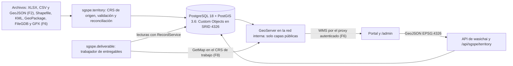
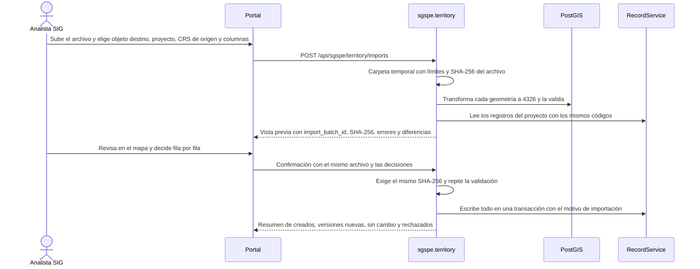
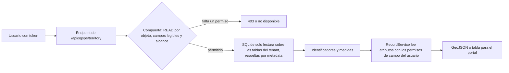
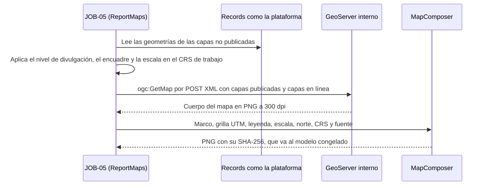

# SIG de SGSPE

Sistema de Gestión Social para Proyectos Extractivos · Fase 0 (descubrimiento) · versión 1.0 · 2026-10-07

Este documento diseña el componente territorial de SGSPE: el rol del SIG, el catálogo de capas `LYR-NN`, los sistemas de
referencia, la importación con reconciliación, las consultas espaciales, el servicio de capas al navegador, el mapa base,
GeoServer y los mapas de informe, la calidad de los datos y las pruebas. Cumple los §6 y §15 del prompt maestro
[PRM-01 §6, §15] sobre wasichai-gis [USR-03].

- Las capas `LYR-NN` se definen aquí (§0.5 del análisis). Los demás IDs se definen en el
  [análisis de requisitos](requirements-analysis.md) y aquí solo se citan.
- Los objetos, campos y estados son los del [modelo de dominio](domain-model.md); el vocabulario, el del
  [glosario](glossary.md). Los valores de catálogo se listan solo en [§10 del análisis](requirements-analysis.md#10-catálogos).
- Ningún ejemplo usa nombres de personas ni coordenadas reales de las fuentes [USR-07] (RQ-SEC-018).
- No están aquí: la lista completa de campos (`database-model.md`), el contrato de los endpoints (`api.md`), los permisos por rol
  (`security.md`), los indicadores del tablero territorial (`dashboards.md`) ni la anatomía de los entregables
  ([entregables](deliverables.md)).
- Las decisiones de arquitectura de esta área se registran en los ADR de SGSPE (`docs/adr/`): ADR-0002 (Geometrías en SRID
  4326 con CRS de trabajo por proyecto), ADR-0015 (Mapas de informe con GeoServer GetMap) y ADR-0019 (Importación geoespacial
  con preparación y reconciliación).

## 1. Rol del SIG

### 1.1 Qué responde

- SGSPE debe responder qué está ocurriendo territorialmente en cada proyecto [PRM-01 §2] (OBJ-01, OBJ-05). El prompt pide no
  reducir el territorio a latitud y longitud y usar PostGIS de verdad [PRM-01 §6]; el usuario pide ver la situación en un SIG
  [USR-02].
- Las fuentes muestran para qué sirve el SIG en la gestión social:
  - el AIDS de DOC-01 se define por los terrenos que necesitan plataformas, accesos y campamento, y una comunidad entra en él
    porque sondajes previstos caen sobre sus terrenos inscritos [DOC-01 §4.1];
  - DOC-02 ubica las concesiones del prospecto sobre el territorio de una comunidad y de dos de sus caseríos, y de eso depende
    el permiso de uso de tierras [DOC-02 p.4, p.6];
  - DOC-03 cruza sondajes, concesiones, predios con propietarios y un polígono de 148 ha [DOC-03];
  - el Anexo 1 de DOC-01 es un mapa de informe con diez capas, grilla UTM, norte y leyenda [DOC-01 Anexo 1].
- De ahí los cuatro usos del SIG de SGSPE:
  1. registrar el territorio y los componentes del proyecto con su CRS de origen y su historia;
  2. cruzar componentes con tierras, comunidades y elementos sensibles, para saber a quién afecta cada actividad;
  3. mostrar en un mapa, con permisos, la situación social de cada localidad y comunidad;
  4. producir los mapas de los entregables ([entregables](deliverables.md)).

### 1.2 Principios

| Principio | Regla | Fuente |
|---|---|---|
| El territorio se modela por relaciones; la geometría es opcional | Una geometría nunca es requerida ni única; una entidad sin geometría propia se dibuja por su relación territorial (localidad, comunidad) | RQ-GIS-006, RQ-GIS-015 |
| Un polígono solo sugiere | La pertenencia a un área de influencia la decide una persona; el cálculo espacial solo propone miembros | RN-TER-004, CON-025 |
| Nunca coordenadas de personas | El mapa no inventa ni muestra la ubicación de una persona; los grupos de interés se agregan por localidad | RQ-GIS-015 [USR-07] |
| Solo lo que el usuario puede leer | Cada capa temática respeta los permisos de objeto y campo, y el alcance por proyecto de RQ-SEC-006; una capa pública exige READ sobre su objeto | RQ-GIS-001, RQ-GIS-017 |
| GeoServer nunca es público | Publica solo capas públicas y se consulta detrás de un proxy autenticado | RQ-SEC-011, ASM-038, CON-054 |
| Sin SRID universal | Se almacena en 4326 y se calcula en el CRS de trabajo; el código lee el SRID de cada campo desde la metadata | RQ-GIS-022, ASM-002, CON-037 |
| Importar nunca sobrescribe en silencio | Un mismo código con otras coordenadas es una versión nueva, con su distancia en un reporte | RQ-GIS-010, CON-023 |
| Las reglas sobre geometrías viven en endpoints | Las guardas de escritura no reciben geometrías, así que validez, área y versión se resuelven en `sgspe.territory` | RQ-GIS-011 [WAS-ADR-0040] |

### 1.3 Qué aporta wasichai y qué construye SGSPE

| Necesidad | wasichai-gis 0.3.2 y `@wasichai/gis` 0.5.0 | SGSPE (`sgspe.territory` y el portal) |
|---|---|---|
| Geometrías | Campo GEOMETRY con su tipo, SRID y dimensión, columna PostGIS tipada e índice GIST propio [WAS-ADR-0019] [WAS-DOC gis/geometry.md] | Convención de SRID 4326 y 2D, CRS de trabajo por proyecto (§3) |
| API | GeoJSON EPSG:4326 con la proyección hecha en SQL [WAS-ADR-0007]; `bbox` y `geometry` en las listas de registros; `/api/gis/objects/{object}/features` [WAS-DOC api/rest.md] | Endpoints `/api/sgspe/territory/**` para capas temáticas filtradas, consultas espaciales y la geometría y los filtros de la ficha territorial, cuyas cifras calcula `sgspe.dashboard` (§5, §6) |
| Cálculos | Ninguno: `RecordService` solo filtra por `bbox` | Área en ha, distancias, buffers, uniones y agregaciones espaciales (§3, §5) |
| Importación | Ninguna (srtm importaba fuera de línea con ogr2ogr) | XLSX, CSV y GeoJSON con CRS de origen y reconciliación en F2; GDAL en F6 (§4) |
| Publicación | Una capa de GeoServer por geometría de objeto, `<tabla física>__<columna>`, sobre una tabla virtual JDBC [WAS-DOC api/rest.md] | Solo capas públicas, estilos SLD y proxy WMS autenticado (§6.2, §7) |
| Interfaz | `MapView`, `GeometryField` (terra-draw), componente de página `MAP` y `wmsTileUrl` [WAS-DOC modules/gis.md] | Mapa territorial con control de capas, leyenda, filtros, calor y ficha contextual (§6.5) |
| Mapa base | `MapView` de 0.5.0 fija las teselas públicas de OpenStreetMap; UPS-13, resuelta en `@wasichai/gis` 1.0.0, trae `basemap` | Mapa base por organización con `GET /api/sgspe/map/settings` (§6.4, ASM-125) |
| Validez | La API valida el tipo declarado [WAS-DOC gis/geometry.md]; las guardas no ven geometrías [WAS-ADR-0040] | Validación en los endpoints propios y listado de calidad (§8) |
| Auditoría | Registra "geometry updated", nunca coordenadas [WAS-DOC modules/gis.md] | Datos de origen de cada importación (RQ-AUD-013, §4.5) |
| MULTI* | La API acepta MULTI*; la interfaz no los dibuja [WAS-DOC gis/geometry.md] | Se aceptan por API e importación (RQ-GIS-020, CON-060) |

### 1.4 Dos etapas, F2 y F6, y los mapas de F8

El territorio con geometrías hace falta desde F2, aunque el prompt ponga el SIG en F6 (CON-036). Por eso:

- **F2 (Release 1):** campos GEOMETRY de los objetos de BC-01, BC-02 y BC-19, `working_crs` por proyecto, importación de XLSX,
  CSV y GeoJSON con reconciliación, área oficial en ha y el mapa básico del proyecto (RQ-GIS-003, RQ-GIS-004, RQ-GIS-006,
  RQ-GIS-007, RQ-GIS-008, RQ-GIS-009, RQ-GIS-010, RQ-GIS-014, RQ-GIS-015, RQ-GIS-016, RQ-GIS-020, RQ-GIS-022).
- **F6 (Release 2), SIG avanzado:** consultas espaciales, mapa territorial con capas temáticas, calor y ficha contextual, GeoServer
  con estilos y proxy WMS, mapa base por organización, importación con GDAL, exportaciones y listado de calidad (RQ-GIS-002,
  RQ-GIS-005, RQ-GIS-011, RQ-GIS-012, RQ-GIS-013, RQ-GIS-017, RQ-GIS-018, RQ-SEC-011, RQ-DSH-029, RF-DSH-006).
- **F8 (Release 3):** mapas de informe de los entregables, entre ellos el del Anexo 1 (RQ-GIS-019, RQ-REP-008, RQ-REP-030).



## 2. Catálogo de capas

### 2.1 Sensibilidad y forma de servicio

Cada capa tiene una sensibilidad que decide cómo se sirve. La regla viene de RQ-SEC-011, ASM-038 y CON-054: GeoServer lee la base
directamente y se salta los permisos de la aplicación, así que solo publica lo que cualquier usuario del tenant puede ver.

| Sensibilidad | Qué incluye | Al navegador | En GeoServer | En los mapas de informe |
|---|---|---|---|---|
| Pública | Datos oficiales o registrales sin datos personales, cuando todos los registros del objeto lo son: límites, centros poblados, vías, territorio comunal, concesiones, instituciones educativas y de salud | GeoJSON por API (F2); WMS por el proxy (F6) | Capa publicada | Por nombre de capa |
| Interna | Datos de gestión del proyecto y sitios culturalmente sensibles: área de interés, áreas de influencia, accesos, sectores comunales, elementos ambientales, capas temáticas | GeoJSON por API, con permisos | No se publica | En línea en la petición GetMap (§7.3) |
| Confidencial | Información técnica de la empresa: sondajes, plataformas, campamento, predios de la empresa | GeoJSON por API, con permisos | No se publica | En línea |
| Datos personales | Predios con titulares o partida; ubicaciones que pueden identificar a una persona (QCS, entregas) | GeoJSON por API con permisos de campo; nunca puntos de personas | No se publica | En línea, sin atributos personales y según el nivel de divulgación (RQ-REP-014) |

Las capas que sirve la API (LYR-01 a LYR-16 desde F2 y, desde el plan 6.2c, las de gestión LYR-17 a LYR-24) heredan el
alcance de lectura por proyecto (desde el plan 4.4) (`security.md` §9.7): se leen como quien mira, así que un objeto de un proyecto que no lee no sale. GeoServer no lo
aplica: ningún objeto de `ProjectScope` (`project`, sus raíces ni sus hijos) se publica, solo maestros de
`ProjectScope.TENANT` sin campos restringidos (`security.md` §10.2).

### 2.2 Capas `LYR-NN`

El catálogo une las capas que pide el prompt para el mapa [PRM-01 §15], las de RQ-GIS-001 y las diez de la leyenda del Anexo 1
de DOC-01 [DOC-01 Anexo 1] (RQ-GIS-019). "Fase" indica desde cuándo hay datos y desde cuándo la capa está en el mapa territorial.

| ID | Capa | Objeto.campo | Geometría | Fuente del dato | Sensibilidad | Cómo se sirve | Fase | Respaldo |
|---|---|---|---|---|---|---|---|---|
| LYR-01 | Límites administrativos: departamento, provincia y distrito | `administrative_unit.boundary` | MULTIPOLYGON | INEI, con el ubigeo (ASM-016) | Pública | GeoJSON por API para seleccionar y consultar; WMS por el proxy | F2 (API), F6 (WMS) | "Límite distrital" del Anexo 1 [DOC-01 Anexo 1]; RF-TER-001, RQ-GIS-019 |
| LYR-02 | Centros poblados y localidades: caseríos, sectores y anexos | `locality.location`; `locality.boundary` | POINT; POLYGON | INEI (código de centro poblado) y trabajo de campo | Pública | GeoJSON por API; WMS por el proxy | F2, F6 | "Centro poblado" del Anexo 1 [DOC-01 Anexo 1] [DOC-02 p.5]; RF-TER-002 |
| LYR-03 | Capital provincial y ciudades | `locality.location` con `locality_type` CIUDAD | POINT | INEI | Pública | Como LYR-02, con símbolo propio | F2, F6 | "Capital provincial" del Anexo 1 [DOC-01 Anexo 1, §4.2] |
| LYR-04 | Vías de acceso entre localidades | `road_access.trace` | LINESTRING | Trabajo de campo y cartografía vial oficial (GAP-011) | Pública | GeoJSON por API; WMS por el proxy | F2, F6 | "Vía" del Anexo 1 [DOC-01 Anexo 1, Tabla 5.5]; RF-LBS-003 |
| LYR-05 | Territorio comunal | `community.territory` | MULTIPOLYGON | Registros públicos de la comunidad y trabajo de campo | Pública (dato registral de la comunidad) | GeoJSON por API; WMS por el proxy | F2, F6 | Territorio comunal del Anexo 1 [DOC-01 Anexo 1] [DOC-02 p.1, p.5]; RF-TER-003 |
| LYR-06 | Sectores comunales | `community_sector.boundary` | POLYGON | Trabajo de campo | Interna | GeoJSON por API; en línea en los mapas de informe | F2 | [DOC-02 p.4–p.5]; RF-TER-004 |
| LYR-07 | Concesiones mineras | `mining_concession.boundary` | MULTIPOLYGON | Catastro minero público (GAP-011) o importación | Pública | GeoJSON por API; WMS por el proxy; las del proyecto (`project_concession`) van en línea con estilo propio | F2, F6 | "Concesión" del Anexo 1 [DOC-01 Anexo 1] [DOC-02 p.4] [DOC-03]; RF-PRJ-006 |
| LYR-08 | Elementos ambientales: microcuencas, fuentes de agua y ríos, cerros, zonas de protección, sitios sagrados y restos arqueológicos | `environmental_feature.boundary`, `.trace` y `.location`; los ríos y quebradas son de tipo FUENTE DE AGUA con `trace` (§2.4) | MULTIPOLYGON, LINESTRING, POINT | Autoridades ambientales y culturales (GAP-011) y trabajo de campo | Interna (incluye sitios sagrados y restos arqueológicos) | GeoJSON por API; en línea en los mapas de informe | F2, F6 | [DOC-01 §4.2, §7.1.2, Tabla 8.1, Tabla 9.4]; RF-TER-008, RQ-REP-008 |
| LYR-09 | Proyecto: ubicación y área de interés | `project.location`; `project.interest_area` | POINT; MULTIPOLYGON | Proyecto | Interna | GeoJSON por API; en línea en los mapas de informe | F2 | "Área de interés" del Anexo 1 [DOC-01 Anexo 1]; RQ-GIS-001 |
| LYR-10 | Pozos programados y sondajes | `project_component.location` con `component_type` SONDAJE; los "pozos programados" del Anexo 1 son los de `component_status` PROGRAMADO | POINT, con cota, azimut e inclinación como atributos | Hojas XLSX o CSV como la de DOC-03 | Confidencial | GeoJSON por API; en línea en los mapas de informe | F2 | "Pozos programados" del Anexo 1 [DOC-01 Anexo 1] [DOC-03]; RF-TER-006 |
| LYR-11 | Plataformas, campamento y captaciones | `project_component.footprint` y `.location` con `component_type` PLATAFORMA, CAMPAMENTO o CAPTACION | POLYGON, POINT | Diseño del proyecto y trabajo de campo | Confidencial | Como LYR-10 | F2 | [DOC-01 §4.1]; RF-TER-006 |
| LYR-12 | Accesos del proyecto | `project_component.trace` con `component_type` ACCESO | LINESTRING | Diseño del proyecto y trabajo de campo | Interna | Como LYR-10 | F2 | [DOC-01 §4.1]; RQ-GIS-002 |
| LYR-13 | Áreas de influencia: AIDS, AIIS, AID y AII ambientales | `area_of_influence.boundary`, más sus miembros dibujados por su relación territorial | MULTIPOLYGON | Estudio o SIG externo, cargado como GeoJSON (§4.1); por defecto la versión aprobada (WF-O) | Interna | GeoJSON por API; en línea en los mapas de informe | F2 | [DOC-01 §4] [DOC-03]; RF-TER-005, CON-025 |
| LYR-14 | Predios de propiedad, posesión y comunales | `land_parcel.boundary` con `tenure_type` PROPIEDAD, POSESION o COMUNAL; titulares en `land_right` | POLYGON | Catastro (COFOPRI), registros públicos y hojas como la de DOC-03 | Datos personales (titulares y partida) | GeoJSON por API con permisos de campo; nunca WMS; en línea en los informes, sin titulares ni partida | F2 | "COFOPRI Propiedad - Posesión" del Anexo 1 [DOC-01 Anexo 1] [DOC-03]; RF-TER-007, RQ-SEC-011 |
| LYR-15 | Predios de la empresa | `land_parcel.boundary` con `tenure_type` PROPIEDAD DE LA EMPRESA | POLYGON | Registros de la empresa | Confidencial | Como LYR-14 | F2 | Predios de la empresa del Anexo 1 [DOC-01 Anexo 1]; RF-TER-007 |
| LYR-16 | Instituciones educativas y establecimientos de salud | `school.location`; `health_facility.location` | POINT | Fuentes oficiales y trabajo de campo | Pública | GeoJSON por API; WMS por el proxy | F2, F6 | [DOC-01 §5.1.5, Tablas 5.4, 5.9]; RF-LBS-003 |
| LYR-17 | Grupos de interés por localidad | Sin geometría propia: conteos de `stakeholder` por `stance` en su `locality`, dibujados en `locality.location` o en un punto sobre `locality.boundary`; un grupo de interés sin localidad no cuenta (`stakeholder` no tiene `community`) | POINT | Registros de SGSPE | Datos personales (solo agregados) | Endpoint agregado de `/api/sgspe/territory/**`; nunca puntos de personas ni WMS; sin permiso para leer `stance`, solo el total | F2 (datos), F6 (capa) | [PRM-01 §15]; RQ-GIS-001, RQ-GIS-015, RQ-DSH-032 |
| LYR-18 | Interacciones, visitas y observaciones | `engagement.location`; `field_visit.route`; `field_observation.location`; o su `locality` o `community` | POINT, LINESTRING | Registros de SGSPE | Interna | GeoJSON por API con filtro de periodo; mapa de calor | F2 (datos), F6 (capa) | [PRM-01 §15]; RF-ENG-001, RF-FLD-001 |
| LYR-19 | Compromisos | `commitment.location` o su `locality` o `community` | POINT | Registros de SGSPE | Interna | GeoJSON por API | F3 (datos), F6 (capa) | [PRM-01 §6, §15]; RF-COM-005 |
| LYR-20 | Quejas, consultas y solicitudes | `location` de `grievance`, `inquiry` y `stakeholder_request`, o su `locality` o `community` | POINT | Registros de SGSPE | Datos personales (el punto puede ser una vivienda); una QCS confidencial solo la ve quien la lee, porque la capa lee como quien llama y hereda su `RecordReadScope` (ASM-095) | GeoJSON por API; mapa de calor; en EXTERNO se generaliza a la localidad | F4 (datos), F6 (capa) | [PRM-01 §6, §15]; RF-GRV-001 |
| LYR-21 | Riesgos sociales | `social_risk.location` o su `locality`, `community` o `area_of_influence` | POINT | Registros de SGSPE | Interna | GeoJSON por API | F4 (datos), F6 (capa) | [PRM-01 §6, §15]; RF-RSK-001 |
| LYR-22 | Incidentes, señales y alertas | `location` de `incident`, `early_warning_signal` y `early_warning`, o su `locality` o `community` | POINT | Registros de SGSPE | Interna | GeoJSON por API; mapa de calor | F4 (datos), F6 (capa) | [PRM-01 §6] [DOC-02 p.2]; RF-EWS-001 |
| LYR-23 | Inversión social: iniciativas, aportes y entregas | `social_initiative.location`, o su `locality` o `community`; `delivery.location` (entregas de compromisos y de aportes); `social_contribution` por su `locality` | POINT | Registros de SGSPE | Interna; las entregas a personas, datos personales | GeoJSON por API; sumas por localidad y por moneda | F5 (datos), F6 (capa) | [PRM-01 §6, §15] [DOC-02 p.4]; RF-INV-001, ASM-063 |
| LYR-24 | Evidencias geolocalizadas | `evidence.location` | POINT | Ubicación del archivo (EXIF) o manual | Según su `classification` | GeoJSON por API, con el control de descarga de RF-DOC-003 | F3 (datos), F6 (capa) | [PRM-01 §5]; RF-DOC-001 |

### 2.3 Correspondencia con el Anexo 1 de DOC-01

El Anexo 1 es el mapa de referencia de los mapas de informe [DOC-01 Anexo 1] (RQ-GIS-019). Cada elemento de su leyenda tiene su
capa; la grilla UTM, el norte y la leyenda son decoraciones del mapa de informe (§7.3).

| Leyenda del Anexo 1 | Capa | Leyenda del Anexo 1 | Capa |
|---|---|---|---|
| Pozos programados | LYR-10 | Concesión del proyecto | LYR-07 (las del proyecto, en línea) |
| Centro poblado | LYR-02 | Territorio de la comunidad campesina | LYR-05 |
| Capital provincial | LYR-03 | Predios COFOPRI, propiedad y posesión | LYR-14 |
| Vía | LYR-04 | Predios de la empresa | LYR-15 |
| Área de interés del proyecto | LYR-09 | Límite distrital | LYR-01 |

### 2.4 Reglas de dibujo

- **Relación antes que coordenada.** Un registro sin geometría propia se dibuja en la ubicación de su `locality` o en el territorio
  de su `community`; una persona nunca es un punto, y los grupos de interés solo se muestran agregados (RQ-GIS-015).
- **Áreas de influencia.** La lista oficial es la de `area_of_influence_member` en la versión `approved`; el polígono es opcional y
  solo ilustra (CON-025, RN-TER-003). El mapa dibuja los miembros por su relación, aunque el área no tenga polígono.
- **Versiones de componentes.** El mapa muestra por defecto la versión vigente de cada `project_component` (la que no está marcada
  `superseded`); las anteriores se ven en la ficha del componente (RQ-GIS-010).
- **Capital provincial.** El modelo no marca capitales: LYR-03 muestra las localidades de tipo CIUDAD, que en el Anexo 1 es la
  capital provincial [DOC-01 Anexo 1]. Si hiciera falta distinguir capitales de otras ciudades, el campo se propone primero en el
  modelo de dominio (regla de cambio de su §1).
- **Ríos y quebradas.** El catálogo "Tipo de elemento ambiental" no tiene un valor para ríos: se registran como
  `environmental_feature` de tipo FUENTE DE AGUA con su `trace`, que es lo que piden RQ-GIS-001 y RQ-REP-008. Si se quiere
  distinguirlos, el valor se agrega como "(propuesto)" en §10 del análisis.
- **MULTI\*.** Las geometrías MULTI* se muestran en el mapa; lo que se dibuja a mano usa tipos de una sola parte (§6.6).

## 3. Sistemas de referencia y áreas

### 3.1 Almacenamiento en SRID 4326 y 2D

- Toda geometría se guarda en un campo GEOMETRY con SRID 4326 y dimensión 2 (RQ-GIS-006, ASM-002). En wasichai cada campo
  declara su propio SRID, igual para todos los registros del tenant [WAS-ADR-0019], y un tenant puede tener proyectos en las zonas
  UTM 17S, 18S y 19S; un SRID UTM fijo por campo no serviría (CON-037).
- La API habla siempre GeoJSON en EPSG:4326, con la conversión en SQL (RNF-INT-005) [WAS-ADR-0007].
- El código nunca supone 4326: lee el SRID de cada campo desde la metadata (RQ-GIS-022). Así, un tenant de una sola zona puede
  aplicar el modelo con un SRID UTM sin cambiar código, que es la forma de revertir ASM-002.
- Nunca se calcula `ST_Area` ni `ST_Length` sobre una columna en 4326: daría grados cuadrados.

### 3.2 CRS de trabajo del proyecto

- Cada `project` tiene un `working_crs` (catálogo "CRS de trabajo": EPSG 32717, 32718 y 32719, WGS 84 UTM 17S, 18S y 19S)
  (RQ-GIS-004, ASM-002). Es requisito para llevar el proyecto a `active` (ASM-062).
- Se usa para: áreas en ha, longitudes, distancias y buffers; coordenadas este y norte mostradas o exportadas; el CRS de los mapas
  de informe; y el CRS que el formulario de importación propone para las hojas en UTM, que el usuario siempre confirma (§4.3).
- Los objetos de un proyecto (`area_of_influence`, `project_component` y las capas temáticas) usan el `working_crs` de su
  proyecto.

### 3.3 Registros que no pertenecen a un solo proyecto

- `community`, `land_parcel` y `mining_concession` son del tenant o pueden vincularse con varios proyectos de zonas distintas: su
  área oficial se calcula en la zona UTM WGS 84 que contiene el centroide de la geometría (ASM-064, RQ-GIS-009).
- La zona sale de la longitud del centroide y, en el hemisferio sur, el SRID es 32700 más la zona. En el Perú resulta 32717, 32718
  o 32719; un centroide que cae fuera de esas tres zonas se marca como fuera de la región esperada (RQ-GIS-007) y no se calcula con
  una zona inesperada.

```sql
-- zona UTM del centroide (ASM-064); en el Perú da 32717, 32718 o 32719
SELECT 32700 + floor((ST_X(ST_Centroid(geom)) + 180) / 6)::int + 1 AS zone_srid;
```

### 3.4 Área oficial, distancias y buffers

- **Área oficial:** el área plana en ha, en el CRS de trabajo o en la zona del centroide, redondeada a dos decimales como en
  DOC-03 ("148.00 Ha") (RQ-GIS-009, ASM-057). Coincide con lo que muestran ArcGIS y QGIS en UTM [DOC-03].
- **Área geodésica:** solo para totales que mezclan zonas UTM, por ejemplo un tablero de varios proyectos (ASM-057).
- **Área registral:** el área declarada en la partida (`registered_area_ha`) se muestra al lado de la calculada
  (`calculated_area_ha`); nunca se reemplazan entre sí (RQ-GIS-009, RQ-REP-025) [DOC-02 p.4].
- **Quién la escribe:** `calculated_area_ha` es un campo derivado: lo escriben los endpoints de importación en su transacción,
  `AreaListener` cuando la geometría cambia por la API genérica y `DerivedFieldsJob` lo corrige si un listener no pudo
  (domain-model §7.4, §7.5).
- **Distancias y buffers:** en metros, en el CRS de trabajo. Las consultas filtran primero con el índice GIST sobre la columna en
  4326 (envolvente ampliada con margen) y miden después en UTM; ningún buffer se guarda como geometría.

```sql
-- área plana oficial en ha (RQ-GIS-009)
SELECT round((ST_Area(ST_Transform(boundary, :working_srid)) / 10000)::numeric, 2) AS calculated_area_ha;

-- área geodésica, solo para totales entre zonas (ASM-057)
SELECT round((ST_Area(boundary::geography) / 10000)::numeric, 2) AS geodesic_area_ha;
```

### 3.5 PSAD56 solo como entrada

- PSAD56 (EPSG 24877, 24878 y 24879, en el catálogo "CRS de origen") se acepta solo como CRS de origen al importar. PostGIS lo
  transforma a 4326 y nunca se guarda (RQ-GIS-007, ASM-002).
- DOC-03 no indica su datum: los valores encajan en UTM 17S, pero no se sabe si son WGS 84 o PSAD56, y confundirlos desplaza los
  puntos cientos de metros (CON-024). Por eso el CRS de origen es obligatorio, la importación se previsualiza en el mapa y se marcan
  las entidades que caen fuera de la zona o región esperada.

### 3.6 Cota, azimut e inclinación

- DOC-03 trae los sondajes como `Point ZM` con cota, azimut e inclinación [DOC-03]. SGSPE los guarda como punto 2D y conserva los
  valores como atributos de `project_component`: `source_elevation`, `azimuth`, `dip` y `depth_m` (RQ-GIS-006).
- La razón: wasichai no tiene dimensión M, y una columna Z obligaría a que toda geometría dibujada en el navegador lleve Z.

### 3.7 Qué CRS usa cada operación

| Operación | CRS | Fuente |
|---|---|---|
| Almacenar | 4326, 2D | RQ-GIS-006 |
| Intercambiar por la API | GeoJSON EPSG:4326 | RNF-INT-005 [WAS-ADR-0007] |
| Área oficial, longitudes, distancias y buffers de un proyecto | `working_crs` del proyecto | RQ-GIS-004, RQ-GIS-009 |
| Área oficial de `community`, `land_parcel` y `mining_concession` | Zona UTM del centroide | ASM-064 |
| Totales entre zonas | Geodésico | ASM-057 |
| Importar | CRS de origen declarado (los EPSG del catálogo "CRS de origen") | RQ-GIS-003, RQ-GIS-007 |
| Mostrar y exportar este y norte | `working_crs`, más latitud y longitud | RQ-GIS-004, RQ-GIS-018 |
| Mapas de informe | `working_crs` | RQ-REP-008, RQ-REP-030 |
| Teselas WMS del mapa web | EPSG:3857, como pide `wmsTileUrl` | [WAS-DOC modules/gis.md] |

## 4. Importación geoespacial

### 4.1 Formatos por fase

| Fase | Entrada | Lectura | Requisitos |
|---|---|---|---|
| F2 | XLSX o CSV de puntos con código, este, norte y, si vienen, tipo de perforación ("Hole Type", que va a `drill_type`), cota, azimut e inclinación, como las tablas de DOC-03; o con latitud y longitud | Apache POI (XLSX) y lector CSV | RQ-GIS-003, ASM-056 [DOC-03] |
| F2 | GeoJSON de puntos, líneas y polígonos, MULTI* incluidos. Hacia un campo POLYGON, un MultiPolygon de una sola parte se convierte en Polygon; hacia uno MULTIPOLYGON, un Polygon se envuelve como MultiPolygon de una parte, porque la API exige el tipo declarado [WAS-DOC gis/geometry.md] | PostGIS | RQ-GIS-003, RQ-GIS-020, ASM-056 |
| F6 | Shapefile (en ZIP), KML y KMZ, GeoPackage, FileGDB (en ZIP) y GPX | `GdalReader`: `ogrinfo` y `ogr2ogr` 3.8 o superior, con los drivers `ESRI Shapefile`, `KML`, `GPKG`, `OpenFileGDB` y `GPX` | RQ-GIS-018, ASM-056, ASM-127 |

Toda importación corre en una carpeta temporal con límites de tamaño y tiempo y con control de rutas dentro de los ZIP
(RQ-SEC-020, ASM-050). En F6 los límites suman `sgspe.territory.import.max-entries` (1000 entradas por ZIP) y
`max-inflated-bytes` (209715200, 200 MiB descomprimidos). La importa un rol con permiso de escritura en el objeto
destino, como `GIS_ANALYST` [DOC-03]; los permisos
por rol están en `security.md`.

**Objeto destino y vía de carga.** La importación con CRS de origen tiene tres destinos, los que guardan los datos de origen de
ASM-060. Las demás geometrías se cargan por otras vías, y las MULTIPOLYGON necesitan GeoJSON porque la interfaz no dibuja MULTI*
(RQ-GIS-020, CON-060):

| Objeto y campo | Geometría | Vía de carga desde F2 | Datos de origen |
|---|---|---|---|
| `project_component.location`, `.trace` y `.footprint` | POINT, LINESTRING, POLYGON | Importación (§4.2) o alta y versión manual con `POST /api/sgspe/project-components`; es `apiOnly` | `source_crs`, `source_reference`, `import_batch_id` y coordenadas originales (ASM-060) |
| `mining_concession.boundary` | MULTIPOLYGON | Importación | `source_crs`, `source_reference` e `import_batch_id` (ASM-060) |
| `land_parcel.boundary` | POLYGON | Importación, o dibujo en el mapa por la API genérica | Los de ASM-060 si se importa |
| `administrative_unit.boundary` | MULTIPOLYGON | Script idempotente del ubigeo, con los límites en GeoJSON por la API genérica (RF-TER-001, ASM-016) | La fuente del script |
| `community.territory` y `environmental_feature.boundary` | MULTIPOLYGON | Desde F6, importación con CRS de origen (ASM-123); antes, GeoJSON en EPSG:4326 por la API genérica o por `/admin` | Desde F6, `source_crs`, `source_reference`, `import_batch_id` y `code` (ASM-123) |
| `project.interest_area` y `area_of_influence.boundary` | MULTIPOLYGON | GeoJSON en EPSG:4326 por la API genérica o por `/admin`, preparado antes en un SIG externo; un Polygon se envuelve como MultiPolygon | Ninguno: estos objetos no tienen campos de origen |
| `locality.location` y `.boundary` | POINT, POLYGON | Dibujo en el mapa; la carga masiva de centros poblados (propuesto), con un script como el del ubigeo por la API genérica | — |
| Demás campos de una sola parte: `community_sector.boundary`, `environmental_feature.location` y `.trace`, `road_access.trace`, `project.location`, `school.location`, `health_facility.location`, `field_visit.route` y el `location` de los registros de gestión | POINT, LINESTRING, POLYGON | Dibujo en el mapa del portal o en `GeometryField`, o GeoJSON por la API genérica | — |
| `evidence.location` | POINT | La propone `sgspe.evidence` desde el EXIF del archivo, o se marca a mano | — |

Llevar la importación con CRS de origen a un objeto sin campos de origen exigía agregarlos primero al modelo de dominio
(regla de cambio de su §1): F6 los agrega a `community` y `environmental_feature` (ASM-123). `project.interest_area` y
`area_of_influence.boundary` siguen sin ellos y se cargan como GeoJSON.

**Formatos de GDAL (F6, ASM-127).** `GdalReader` hace tres cosas, siempre con argumentos fijos y rutas de la
carpeta temporal:

- `ogrinfo -json -so` lista las capas con su tipo de geometría, su cantidad de elementos y su CRS. Si el archivo tiene
  más de una capa con elementos y no vino `layer`, la respuesta es `400 LAYER_REQUIRED` con la lista de capas.
- `ogr2ogr -f GeoJSON` convierte la capa elegida **sin reproyectar**, y ese GeoJSON entra al flujo de F2 con el CRS de
  origen confirmado. El KMZ lo descomprime SGSPE, con los controles de ZIP de F2, y GDAL lee su `doc.kml`.
- El CRS que GDAL detecta (`detectedCrs`, un EPSG del catálogo "CRS de origen" o `null`) es solo una propuesta: la
  persona lo confirma con `sourceCrs`, igual que en F2 (CON-024). KML, KMZ y GPX son siempre EPSG 4326.

Sin GDAL en el servidor, esos formatos responden `422 FORMAT_UNAVAILABLE` y `GET /api/sgspe/territory/imports/formats`
dice cuáles hay. La configuración está en `sgspe.territory.gdal.path` (el ejecutable), `min-version` (`3.8`) y
`timeout`, además de `IMPORT_TIMEOUT` y la concurrencia de F2. El proceso corre sin red y con un entorno limpio, y se
mata al vencer el plazo.

### 4.2 Vista previa y confirmación

La importación no es un objeto: cada registro guarda su `import_batch_id` (ASM-060). Por eso la vista previa no deja estado en el
servidor. La confirmación vuelve a enviar el mismo archivo y el servidor exige el mismo SHA-256 que mostró la vista previa; así
funciona igual con varias réplicas y sin tablas intermedias: el DDL de negocio solo nace de la metadata (RNF-MNT-005), y una tabla
fija del esquema `sgspe` (CON-052) no se justifica para un dato que dura minutos.



- La carga intermedia que pide RQ-GIS-003 es, entonces, el archivo en la carpeta temporal y su lectura validada; nada se escribe en
  los objetos de SGSPE hasta la confirmación.
- La confirmación es `POST /api/sgspe/territory/imports/{importBatchId}/confirm` (domain-model §7.2); el contrato de ambos
  endpoints está en `api.md`.
- Escribe con `RecordService` dentro de una transacción (`TransactionalOperator`) [WAS-ADR-0038]: o se escribe todo el lote, o
  nada. El motivo de cada escritura es `importación <id>` (ASM-051).
- La lectura y las cuentas de PostGIS van antes y fuera de esa transacción: una geometría que PostGIS no procesa es una fila
  rechazada y no aborta el lote. La escritura toma un candado por destino (por proyecto en los componentes) y, si lo
  registrado con los códigos del archivo cambió desde el análisis, no escribe nada (`409 IMPORT_CONFLICT`): dos
  confirmaciones del mismo archivo nunca duplican un predio ni una concesión. Quien importa escribe con su permiso y su
  alcance (`ProjectScopeGuard`), nunca como la plataforma.

### 4.3 Validaciones

| Validación | Regla | Si falla |
|---|---|---|
| CRS de origen | Obligatorio, de los EPSG del catálogo "CRS de origen"; el formulario propone el `working_crs` y el usuario lo confirma | 400; no hay CRS por defecto silencioso (CON-024) |
| Tipo de geometría | Debe coincidir con el `geometryType` del campo destino | Fila rechazada con el motivo |
| Validez | `ST_IsValid` y `ST_IsValidReason`; la reparación (`ST_MakeValid`) solo con consentimiento y mostrando el cambio de área | Fila rechazada o reparada con consentimiento (RQ-GIS-011) |
| Zona y región | El punto o el centroide cae en la zona UTM del CRS declarado y dentro de la envolvente del Perú (configurable) | Fila marcada; exige confirmación explícita (RQ-GIS-007) |
| Ejes | Latitud y longitud invertidas, o este y norte invertidos, se detectan por sus rangos | Fila marcada con la sugerencia de corrección |
| Duplicados | Un código repetido en el mismo archivo | Fila rechazada |
| Código | Obligatorio para componentes, predios, concesiones y, desde F6, comunidades y elementos ambientales; es la clave de la reconciliación | Fila rechazada |

### 4.4 Reconciliación

- **El hallazgo.** En DOC-03 los mismos sondajes tienen coordenadas distintas en la hoja Excel y en la tabla de ArcMap. Las
  diferencias van de ≈ 1 m (FLS_DDH016, una lectura incierta a la resolución de la captura) a ≈ 216 m (FLS_DDH019); por ejemplo,
  FLS_DDH003 ≈ 21 m, FLS_DDH004 ≈ 93 m y FLS_DDH020 ≈ 111 m [DOC-03] (CON-023). Son versiones del programa de perforación y no
  deben pisarse en silencio (RQ-GIS-010).
- **La regla para componentes.** `project_component` es `apiOnly`: solo lo escriben la importación y el endpoint de alta y versión
  manual `POST /api/sgspe/project-components` (domain-model §6.2, §7.2). La distancia se mide en el `working_crs`.

| Caso en la vista previa | Acción propuesta | Qué se escribe al confirmar |
|---|---|---|
| Código nuevo en el proyecto | Crear | `project_component` con `version_number` 1 |
| Mismo código, desplazamiento menor de 1 cm (ruido numérico de la transformación) | Sin cambio | Nada; solo figura en el reporte |
| Mismo código, desplazamiento de 1 cm o más | Versión nueva, o descartar la fila | Registro nuevo con el `version_number` siguiente y `previous_version`; la anterior pasa a `superseded` (derivado) en la misma transacción |
| Mismo código y mismas coordenadas, con otros atributos (estado, cota, azimut) | Actualizar la versión vigente | Cambio de atributos con motivo `importación <id>`; la auditoría guarda los valores antes y después |

- **Predios y concesiones.** `land_parcel` y `mining_concession` no tienen versiones: un mismo `code` con otra geometría es una
  actualización con motivo `importación <id>`, y el reporte muestra el cambio de área y el desplazamiento máximo (distancia de
  Hausdorff en el CRS de cálculo). Desde F3 el archivo original queda como `evidence` (ASM-060).
- **Comunidades y elementos ambientales (F6, ASM-123).** `community` y `environmental_feature` se reconcilian por
  `code`, igual que `mining_concession`, nunca por nombre: dos comunidades pueden llamarse igual. Una fila sin `code` se
  rechaza, y las comunidades ya registradas sin código se completan a mano antes de importar. El alta por importación
  lleva solo `code`, el nombre y la geometría; lo demás se completa en la ficha. `environmental_feature` exige además
  `feature_type`, de una columna o de un valor fijo del formulario.
- **El reporte de diferencias** lista código, coordenadas anteriores y nuevas en el `working_crs`, distancia en metros y acción. Se
  puede descargar como XLSX desde la vista previa.
- **Tolerancia.** El umbral de 1 cm para "sin cambio" es un valor por defecto propuesto y configurable: absorbe el ruido numérico
  de transformar las coordenadas al guardarlas y al compararlas, porque la ida y vuelta UTM ↔ 4326 queda bajo 1 cm (§9).

### 4.5 Trazabilidad y auditoría

- Cada registro importado guarda `source_crs`, `source_reference` (archivo y fila u hoja) e `import_batch_id`; los puntos de
  `project_component` guardan además `source_easting`, `source_northing` y `source_elevation` (RQ-GIS-008, ASM-060).
- Desde F3 el archivo original se guarda como `evidence` con el mismo `import_batch_id`, y en él quedan las coordenadas originales
  de los polígonos (ASM-060).
- La auditoría de wasichai registra "geometry updated" sin coordenadas, así que la historia de las posiciones se reconstruye con
  las versiones de componentes, los datos de origen y el archivo original (RQ-AUD-013) [WAS-DOC modules/gis.md].

### 4.6 Exportaciones (F6)

- `POST /api/sgspe/territory/exports` exporta solo los objetos de LYR-01 a LYR-16 (ASM-124); otro objeto responde `400
  OBJECT_NOT_EXPORTABLE` y las capas de gestión (LYR-17 a LYR-24) no salen como archivo geográfico.
- Formatos: `geojson` y `kml` en 4326; `gpkg` y `shp` (ZIP con `.cpg` en UTF-8) en el CRS elegido con `coordinates`
  (`UTM`, el `working_crs` del proyecto filtrado, o `LATLON`); `csv` y `xlsx` con este y norte, latitud y longitud, y
  `wkt` en líneas y polígonos (RQ-GIS-018, ASM-056). GDAL escribe `kml`, `gpkg` y `shp` desde un GeoJSON temporal.
- Toda exportación exige la acción declarada `EXPORT` y READ sobre el objeto y CREATE sobre `export_log`, antes de leer
  nada; lee como quien exporta, aplica el nivel de divulgación como las exportaciones XLSX (RQ-REP-022, RQ-REP-014),
  deja su fila en `export_log` antes de entregar el archivo (RQ-AUD-011) y respeta el tope
  `sgspe.exports.max-rows` (ASM-124).
- **Divulgación por capa.** Un objeto o filtro fuera del nivel elegido responde `403 DISCLOSURE_NOT_ALLOWED`;
  `land_right` nunca se exporta.

| Nivel | Objetos permitidos | Qué se quita |
|---|---|---|
| PUBLICO | Los de las capas públicas: LYR-01 a LYR-05, LYR-07 y LYR-16 | Lo mismo que EXTERNO, más lo que la regla de PUBLICO ya quita |
| EXTERNO | Los anteriores, `community_sector`, `environmental_feature`, `project` (ubicación y área de interés), los accesos de `project_component` (`component_type` ACCESO), `area_of_influence` y los `land_parcel` de `tenure_type` PROPIEDAD, POSESION o COMUNAL | Fuera de INTERNO: `land_parcel.registry_record`, los cuatro campos registrales de `community` (`legal_entity_record`, `property_record`, `parent_record`, `title_reference`), `source_reference` e `import_batch_id`; `project` sale solo con `code` y `name`; EXTERNO exige `checklistConfirmed`, la lista de verificación de las demás exportaciones |
| INTERNO | Todos los objetos de la lista, también sondajes, plataformas y campamento y los predios de la empresa | Nada más allá de los permisos de campo |

- El WFS autenticado para analistas, que serviría las capas públicas por el mismo proxy que el WMS, queda pospuesto
  (ASM-120): una fase posterior lo suma con la misma lista blanca, `EXPORT` y la divulgación de esta tabla.

## 5. Consultas espaciales

### 5.1 Operaciones

El prompt pide soportar intersects, contains, within, distance, buffer, nearest y spatial aggregation [PRM-01 §6].

| Operación | PostGIS | Nota |
|---|---|---|
| intersects | `ST_Intersects` | Usa el índice GIST de la columna |
| contains, within | `ST_Contains`, `ST_Within`, `ST_Covers` | Para puntos en polígonos y polígonos dentro de áreas |
| distance | `ST_Distance` sobre geometrías transformadas al CRS de trabajo | En metros |
| buffer | `ST_DWithin` con prefiltro por índice; `ST_Buffer` solo para dibujar | Ningún buffer se guarda |
| nearest | `ORDER BY geom <-> :ref LIMIT :k` y medida exacta después en UTM | Vecino más cercano con el índice |
| spatial aggregation | Conteos y sumas por localidad, comunidad o distrito; `ST_Union` para áreas | Sin vistas materializadas |

### 5.2 Patrones de implementación

`RecordService` solo filtra por `bbox` y las uniones espaciales necesitan SQL propio (RQ-GIS-017). Hay dos patrones:

- **(a) Filtrar un objeto por su relación espacial con una geometría de referencia.**
  - SGSPE aporta un `RecordQueryContributor` propio, la extensión de wasichai para filtros de listas [WAS-ADR-0025]
    [WAS-DOC modules/core.md]. Responde a un parámetro de consulta de SGSPE y devuelve un `RecordCriterion` con
    `ST_Intersects` o `ST_DWithin` sobre la columna del objeto listado, en su SRID, como hace `bbox` [WAS-ADR-0027].
  - La geometría de referencia (un área de influencia, un territorio comunal) se lee antes con `RecordService` como el usuario, de
    modo que valen sus permisos de objeto y campo; luego se enlaza como parámetro. Si hace falta, el fragmento
    usa una subconsulta sobre la tabla del mismo tenant, resuelta por metadata [WAS-ADR-0004].
  - `RecordService` sigue aplicando permisos, campos ilegibles y paginación: el patrón no abre ninguna puerta.
- **(b) Uniones y agregaciones entre objetos.**
  - SQL de solo lectura sobre las tablas físicas del tenant, resueltas por metadata como hace srtm (`TablasCore`), detrás de una
    compuerta de permisos.
  - La compuerta exige READ sobre cada objeto de la consulta; que cada campo usado, geometrías incluidas, sea legible
    [WAS-ADR-0019]; y aplica el alcance por proyecto de RQ-SEC-006 (ningún rol usa `own_records_only`, ASM-069). Desde el plan
    4.4 ese alcance es `ProjectReadScope` (`security.md` §9.7, ADR-0029): la compuerta lee como quien consulta, igual que la
    API genérica, y la escritura se acota por `project_assignment`.
  - Devuelve identificadores y medidas. Los atributos personales (titulares, nombres) se leen después con `RecordService`, con
    los permisos de campo del usuario. Si un campo necesario no es legible, el resultado dice "no disponible", nunca cero
    (RQ-DSH-032).
  - Nombres de tabla y columna salen de la metadata y se citan; los valores van enlazados; nunca escribe.
- **`SpatialGate` y `ZoneCriterion` (F6, ASM-122).** `SpatialGate`, en `sgspe.territory`, es la única clase que ejecuta
  SQL de lectura que cruza tablas del tenant.
  - Recibe los objetos y campos que usa la consulta y los revisa con `Readability`: sin READ sobre el objeto principal,
    403; sin READ sobre uno secundario, el componente sale con `available: false` y `missingFields`, nunca cero
    (RQ-DSH-032).
  - Cada tabla entra como subconsulta filtrada por la organización y por la condición de cada `RecordReadScope`
    registrado (hoy `ProjectReadScope` y `ConfidentialAttentionScope`), que se omiten para ADMIN y la plataforma como en
    wasichai; así un alcance nuevo no se deja fuera. `SpatialGateScopeParityTest` exige los mismos ids que `Records`.
  - Devuelve ids y medidas: los titulares y los demás atributos personales se leen después por `Records`, con los
    permisos de campo de quien llama.
  - `ZoneCriterion` resuelve el patrón (a): la zona (`locality`, `community`, `administrative_unit` o
    `area_of_influence`) se lee antes por `Records` como quien llama y su geometría viaja como parámetro, nunca como
    subconsulta a otra tabla.
  - `ArchitectureTest` fija que, dentro de `sgspe.territory`, solo `SpatialGate` y los escritores existentes
    (`TerritoryImports`, `Areas`, `ProjectComponents`, `GeoSql`) usan `DatabaseClient`, y que nadie fuera de ese paquete
    lo agrega.



### 5.3 Casos de uso

Los nueve casos del prompt [PRM-01 §6] y los que salen de los documentos. El contrato de cada endpoint está en `api.md`;
todos tienen una prueba con geometrías sintéticas (RQ-GIS-002, RQ-GIS-021).

| # | Caso | Fuente | Patrón | Cómo se resuelve | Fase |
|---|---|---|---|---|---|
| 1 | Comunidades y localidades dentro de un área de influencia | [PRM-01 §6] [DOC-01 §4] | (a) | `ST_Intersects` de `locality.location` y `community.territory` con `area_of_influence.boundary`; `GET /api/sgspe/areas-of-influence/{id}/member-suggestions` solo sugiere y al aceptar una sugerencia se marca `spatially_suggested` (RN-TER-004) | F6 |
| 2 | Grupos de interés asociados a una zona | [PRM-01 §6] | (a) | Por relación (`stakeholder.locality`, `area_of_influence`) y, si hace falta, localidad dentro de la zona; nunca por la ubicación de una persona | F6 |
| 3 | Compromisos asociados a un territorio | [PRM-01 §6] | (a) | `commitment.locality`, `community` o `location` dentro de la zona | F6 |
| 4 | QCS por zona | [PRM-01 §6] | (b) | Conteos por localidad o distrito, por estado y categoría; mapa de calor | F6 |
| 5 | Riesgos por territorio | [PRM-01 §6] | (a), (b) | `social_risk` por `locality`, `community` o `area_of_influence`; conteos por nivel | F6 |
| 6 | Concentración geográfica de eventos | [PRM-01 §6] | (b) | Mapa de calor de MapLibre sobre interacciones, QCS e incidentes, más conteos por localidad; agrupamiento por densidad más adelante | F6 |
| 7 | Conflictos cercanos al proyecto | [PRM-01 §6] [DOC-01 §5.1.1, §5.2.1] | (b) | `incident` y `local_conflict` (por sus localidades) a menos de una distancia del área de interés o de los componentes; orden por vecino más cercano | F6 |
| 8 | Inversiones sociales | [PRM-01 §6] | (b) | Iniciativas, aportes y entregas por localidad, con sumas por moneda sin mezclar monedas (ASM-063) | F6 |
| 9 | Relación entre proyectos y comunidades | [PRM-01 §6] [DOC-01 §4.1] | (a) | `project.interest_area` y los componentes contra `community.territory`: sugiere miembros de un área de influencia, que una persona confirma | F6 |
| 10 | Componentes × predios: quién debe dar el permiso de uso | [DOC-03] [DOC-01 §4.1] [DOC-02 p.6] | (b) | Por cada sondaje, plataforma o acceso, los predios que corta, su tenencia y la longitud de acceso por predio (`ST_Length(ST_Intersection(...))` en UTM); los titulares de `land_right` se leen con permisos de campo; enlaza con los acuerdos de tipo PERMISO DE USO DE TERRENO o SERVIDUMBRE (`agreement_land_parcel`, RF-AGR-002) | F6 |
| 11 | Componentes × territorio comunal | [DOC-01 §4.1] [DOC-02 p.4–p.6] | (b) | Qué comunidad debe autorizar en asamblea (AUTORIZACION DE ASAMBLEA, RF-AGR-003) y cuántos componentes caen en su territorio | F6 |
| 12 | Concesiones × territorio comunal y caseríos | [DOC-02 p.4] | (b) | En qué comunidades, sectores comunales y caseríos están las concesiones del proyecto | F6 |
| 13 | Distancia a elementos sensibles | [DOC-01 §7.1.2, Tabla 8.1] | (b) | Componentes a menos de una distancia de fuentes de agua, zonas de protección, sitios sagrados o restos arqueológicos | F6 |
| 14 | Localidades dentro de un buffer de componentes | [DOC-01 §4.1] | (a) | `ST_DWithin` en el `working_crs`; insumo para los criterios del AIDS, solo como sugerencia | F6 |
| 15 | Tamaño del área de influencia | [DOC-03] [DOC-01 §4] | (b) | Área plana en ha, localidades por tipo de área y componentes que cruzan tierras comunales o privadas (RQ-DSH-029; KPI-TER-02, KPI-TER-03 y KPI-TER-04 de `dashboards.md`) | F6 |
| 16 | Punto pulsado en el mapa | [PRM-01 §15] | (a) | Punto en polígono: propone `administrative_unit`, `locality` y `community` en los formularios; la persona confirma | F6 |

Todos son `GET` que no escriben, bajo `/api/sgspe/`:

| Caso | Endpoint |
|---|---|
| 1, 9 | `areas-of-influence/{id}/member-suggestions` |
| 15 | `areas-of-influence/{id}/summary` |
| 2, 3, 5 | `territory/zones/{zoneObject}/{id}/records?of=` |
| 4, 6 | `territory/concentration` |
| 7 | `territory/projects/{id}/nearby-conflicts` |
| 8 | La capa LYR-23 de `layers/{layer}` y KPI-INV-03 con el filtro de territorio |
| 10 | `territory/projects/{id}/component-parcels` |
| 11 | `territory/projects/{id}/component-communal-land` |
| 12 | `territory/projects/{id}/concession-territories` |
| 13 | `territory/projects/{id}/sensitive-distances` |
| 14 | `territory/projects/{id}/buffer-localities` |
| 16 | `territory/locate` |
| Ficha (§6.5) | `territory/localities/{id}/card` y `territory/communities/{id}/card` |

**Límites (ASM-126).** `sgspe.territory.queries.*` acota cada consulta: `bufferM` de 1 a 20 000 m (500 por defecto),
`distanceKm` de 0.1 a 50 km (5 por defecto), `limit` hasta 5 000 filas (con `truncated`), periodo de `concentration`
hasta 5 años (12 meses por defecto) y hasta 200 registros relacionados por fila. Fuera de rango, `400 OUT_OF_RANGE`; un
parámetro desconocido, `422`.

### 5.4 Índices y rendimiento

- Los índices espaciales los crea wasichai, uno GIST por columna GEOMETRY [WAS-DOC gis/geometry.md]. SGSPE declara índices
  sobre proyecto, estado, fechas y códigos con `indexes` [WAS-ADR-0036] (RQ-GIS-016).
- Sin vistas materializadas: el DDL solo nace de la metadata (RNF-MNT-005). A escala de proyecto se calcula al vuelo; se mide antes
  de optimizar (GAP-027), y solo se persisten decisiones humanas, como la lista de miembros de un área de influencia.

## 6. Servicio al navegador

### 6.1 Capas temáticas: GeoJSON autenticado

- Las capas se piden como GeoJSON con el token del usuario, por la API de wasichai (listas de registros con `bbox` y filtros de
  igualdad, y `/api/gis/objects/{object}/features`) o por `/api/sgspe/territory/**` cuando hacen falta filtros de periodo,
  agregados o uniones (RQ-GIS-012) [WAS-DOC api/rest.md].
- Toda capa grande se pide por `bbox` y con un tope de elementos; las capas agregadas (LYR-17) devuelven conteos por localidad,
  nunca registros de personas.
- Como pasan por `RecordService` o por la compuerta de §5.2, ninguna capa muestra registros o campos que el usuario no puede leer
  (RQ-GIS-001).

### 6.2 Capas de referencia: WMS por el proxy

- Las capas públicas grandes (LYR-01, LYR-02, LYR-03, LYR-04, LYR-05, LYR-07 y LYR-16) se sirven desde F6 como teselas WMS de
  GeoServer, a través de un proxy autenticado de SGSPE en `sgspe.territory` (RQ-GIS-012, RQ-SEC-011) (domain-model §8.2).
- GeoServer está en la red interna y nunca es público (CON-054) [WAS-ADR-0006]. Sin proxy, GetCapabilities listaría las capas de
  todos los tenants y una GetMap sin autenticación podría servir cualquier capa publicada.
- El proxy:
  - exige el token de wasichai; MapLibre lo agrega a las peticiones de teselas con `transformRequest`;
  - acepta solo las capas de la lista blanca del tenant del token: los nombres `<tabla física>__<columna>` de sus capas públicas,
    resueltos por metadata [WAS-DOC api/rest.md], y solo si el usuario tiene READ sobre el objeto de cada capa;
  - deja pasar GetMap y GetLegendGraphic; arma un GetCapabilities propio con la lista blanca; rechaza GetFeatureInfo,
    DescribeLayer y los parámetros `SLD`, `SLD_BODY`, `CQL_FILTER` y `FILTER`, que permitirían nombrar otras capas o
    leer atributos (ASM-121);
  - aplica filtros fijos por capa si los hubiera, y la caché de teselas de GeoServer (GeoWebCache) para lo público.
- Las teselas usan EPSG:3857, como arma `wmsTileUrl` [WAS-DOC modules/gis.md].
- wasichai no llama a GeoServer en la ruta de una petición y funciona con GeoServer detenido [WAS-ADR-0006]. El proxy de SGSPE es
  la única excepción y está acotado: sirve solo teselas de referencia, y si GeoServer no responde el mapa sigue funcionando sin
  ellas, porque las capas temáticas salen de la API.

### 6.3 Sin teselas vectoriales en el MVP

- No se usan teselas vectoriales ni servidores como Martin o pg_tileserv: leerían las tablas del tenant directamente y se saltarían
  la tenencia y los permisos de wasichai (RQ-GIS-012) [WAS-ADR-0004].
- Si una capa crece demasiado para GeoJSON, las opciones son la extensión de teselas vectoriales de GeoServer para capas públicas
  o un endpoint de SGSPE con `ST_AsMVT` detrás de la compuerta de §5.2, decidido con un ADR [WAS-ADR-0007].

### 6.4 Mapa base

- El mapa base es configurable por organización y nunca usa las teselas públicas de OpenStreetMap en producción, cuya
  política de uso no lo admite (RQ-GIS-013, ASM-048). La cartografía base y sus licencias siguen abiertas en GAP-011.
- Opciones: un proveedor licenciado por URL de estilo, o un extracto PMTiles del Perú autoalojado, con su licencia y atribución,
  que además funciona sin conexión externa.
- Librerías como srtm-ui (ASM-085): MapLibre GL 6.10.0 y `@wasichai/gis` para el mapa, y terra-draw 1.33.0 con
  `terra-draw-maplibre-gl-adapter` 1.4.1 para dibujar geometrías. En desarrollo, el mapa base son las teselas ráster de
  OpenStreetMap con la atribución «© OpenStreetMap contributors» visible, como el mapa de lotes de srtm-ui; en
  producción se usa solo el estilo configurado.
- **Configuración (F6, ASM-125).** `sgspe.map.base-style-url` es el estilo por defecto;
  `sgspe.map.base-style-url-by-organization` (slug → URL), el de cada organización, que mantiene el operador como
  `sgspe.ai.enabled-organizations`; y `sgspe.map.attribution`, la atribución por URL. `GET /api/sgspe/map/settings`
  (autenticado) devuelve `{ basemap, attribution }` para la organización de quien llama, con `basemap` en la forma
  `BasemapSpec` de `@wasichai/gis`: `{ type: 'style', url }` o `{ type: 'none' }` si no hay estilo.
- **En el portal.** UPS-13, resuelta con wasichai-ui#38 en `@wasichai/gis` 1.0.0, hizo que `gisModule` y `MapView`
  acepten `basemap`. El portal pasa el valor a `gisModule({ basemap })` después del login, y a sus mapas propios (S10,
  S24 y el dibujo) por la prop `basemap`, en lugar de la variable de build de F2; así `GeometryField` y el componente
  `MAP` también lo heredan.
- Si no hay estilo, el mapa muestra las capas del proyecto sobre un fondo neutro con el aviso «Sin mapa base», sin
  volver a OpenStreetMap. «Sin fondo» va sobre el propio mapa, junto a ese aviso, porque S10, S24 y el dibujo no tienen
  panel de capas; la atribución del proveedor siempre se ve (`docs/ux/design-system.md` §5, `MapAttribution`; lienzo de
  la etapa 3, página 24).
- La CSP de producción permite el host del estilo configurado y no el dominio de teselas de OpenStreetMap; una prueba
  exige que `application-prod.yml` no lo contenga (RQ-GIS-013).

### 6.5 Mapa territorial del portal y ficha contextual

- **Tecnología.** El mapa territorial usa maplibre-gl 6.10.0, la versión que fija `@wasichai/gis`, directamente y cargado bajo
  demanda, como el mapa de srtm, con `wmsTileUrl` para las capas WMS. Las fichas y los formularios reutilizan el componente `MAP`
  y `GeometryField` de `@wasichai/gis` (RQ-GIS-014) [WAS-ADR-0005] [WAS-DOC modules/gis.md].
- **En F2 (básico):** el mapa del proyecto con las capas de BC-01, BC-02 y BC-19 por API (LYR-01 a LYR-16), selección y edición
  de geometrías de una sola parte.
- **En F6:** control de capas agrupado (Referencia, Proyecto, Tenencia, Gestión), leyenda con la paleta compartida (§7.2), filtros
  de proyecto y periodo, mapa de calor para LYR-18, LYR-20 y LYR-22, y captura PNG (RQ-GIS-014).
- **Ficha contextual (F6).** Al seleccionar una localidad o una comunidad, el panel muestra (RQ-GIS-005) [PRM-01 §15]:
  - grupos de interés por postura (`stance`), con "no disponible" si el usuario no puede leer el campo (RQ-DSH-032);
  - interacciones recientes, por defecto de los últimos 90 días, ajustables con el filtro de periodo;
  - compromisos abiertos y vencidos (`deadline_status` VENCIDO, RN-WFL-001);
  - QCS abiertas; riesgos con `risk_level` ALTO o CRITICO;
  - programas e inversión, con montos por moneda (ASM-063);
  - última actividad registrada.
- **Quién calcula qué.** Las cifras de la ficha son las de KPI-TER-01 de `dashboards.md`: las calcula `sgspe.dashboard`, con el
  mismo código de indicadores que los tableros (RQ-DSH-034) y con conteos por `RecordService` (RQ-DSH-031). `sgspe.territory`
  solo aporta la geometría seleccionada y los filtros espaciales (domain-model §8.2). El tablero territorial que reúne mapa y
  estadísticas también está en `dashboards.md` (RF-DSH-006).

### 6.6 Edición de geometrías y MULTI\*

- La interfaz de wasichai solo dibuja tipos de una sola parte: lo que se edita a mano en el mapa es POINT, LINESTRING o POLYGON;
  las geometrías MULTI* llegan por API o importación y se muestran igual (RQ-GIS-020, CON-060) [WAS-DOC gis/geometry.md].
- Desde F6, el portal valida cada geometría editada con un endpoint de `sgspe.territory` antes de guardarla (motivo de invalidez
  y, con consentimiento, reparación que muestra el cambio de área) y la guarda por la API genérica (RQ-GIS-011); `AreaListener`
  recalcula el área (domain-model §7.5). `project_component` es la excepción: solo se escribe por sus endpoints, porque es
  `apiOnly`.
- Las ediciones en `/admin` no pasan por esa validación, porque la API genérica solo valida el tipo; el listado de calidad de F6
  muestra lo que no cumpla (§8).

## 7. GeoServer y mapas de informe

### 7.1 Qué se publica

- GeoServer publica servicios OGC desde la misma base; wasichai lo deja opcional [WAS-ADR-0006] [WAS-ADR-0027]. En SGSPE
  nunca es público (ASM-038), y desde F6 corre en la red interna con `docker.osgeo.org/geoserver:3.0.1`, en loopback en
  el puerto 8095 (ADR-0026).
- Se publican solo los maestros de `ProjectScope.TENANT` sin campos restringidos, listados en `model/layers.json`
  (ASM-121): las capas públicas LYR-01, LYR-02, LYR-03, LYR-04, LYR-05, LYR-07 y LYR-16 de §2.2. Las capas internas,
  confidenciales y con datos personales no se publican nunca (RQ-SEC-011).
- **`model/layers.json`.** También va en el jar como `model/layers.json`. Es una lista de `{ layer, object, geometry,
  style, label? }` con una entrada por estilo (9) y una capa de GeoServer por geometría de objeto (8): LYR-03 comparte
  la capa `locality.location` con LYR-02 y se distingue por su estilo, con filtro de `locality_type` CIUDAD. `label` es
  el campo TEXT que rotula el SLD.

| Capa | Objeto | Geometría | Estilo | Etiqueta |
|---|---|---|---|---|
| LYR-01 | `administrative_unit` | `boundary` | `sgspe-lyr-01` | `name` |
| LYR-02 | `locality` | `location` | `sgspe-lyr-02-location` | `name` |
| LYR-02 | `locality` | `boundary` | `sgspe-lyr-02-boundary` | `name` |
| LYR-03 | `locality` | `location` | `sgspe-lyr-03` | `name` |
| LYR-04 | `road_access` | `trace` | `sgspe-lyr-04` | — |
| LYR-05 | `community` | `territory` | `sgspe-lyr-05` | `name` |
| LYR-07 | `mining_concession` | `boundary` | `sgspe-lyr-07` | `code` |
| LYR-16 | `school` | `location` | `sgspe-lyr-16-school` | — |
| LYR-16 | `health_facility` | `location` | `sgspe-lyr-16-health` | — |

- El nombre de la capa en GeoServer lo da wasichai: `<tabla física>__<columna>`, en el workspace `sgspe`, con el
  endpoint `POST /api/gis/layers/{object}/{geometry}`, que crea la tabla virtual JDBC con `id`, los campos simples y esa
  geometría [WAS-DOC api/rest.md]. El datastore usa el rol de solo lectura `sgspe_geoserver`.
- **Publicación con `model/publish_layers.py`.** Es un script de Python con la biblioteca estándar, con el patrón de `apply.py`,
  y SGSPE no tiene un endpoint propio para esto:
  - recorre `model/layers.json` y, para cada capa que falte, llama a `POST /api/gis/layers/{object}/{geometry}` con un
    token de `ADMIN` de la organización; una geometría que el tenant no tiene detiene todo antes del primer `POST`;
  - es idempotente, porque antes consulta `GET /api/gis/layers` y no repite lo ya publicado; tiene `--dry-run` y
    `--validate-only`, que además comprueba que cada capa sea un maestro del tenant sin campos restringidos;
  - toma las credenciales de GeoServer del entorno (`WASICHAI_GIS_GEOSERVER_URL`, `WASICHAI_GIS_GEOSERVER_USERNAME` y
    `WASICHAI_GIS_GEOSERVER_PASSWORD`), nunca de un archivo;
  - corre como último paso al aprovisionar cada organización y en cada subida de fase, y se omite con `--skip-layers` si
    el despliegue no tiene GeoServer;
  - en el mismo paso carga o actualiza en GeoServer, con su API REST, los estilos SLD de §7.2. Son únicos por
    despliegue: el proxy WMS y el trabajador de entregables los piden por nombre (`STYLES`), así que no hace falta
    asignarlos a cada capa.
- **Proxy WMS (`WmsProxy`, `GET /api/sgspe/territory/wms`).** Entrega solo imágenes (ASM-121): `GetMap`,
  `GetLegendGraphic` y un `GetCapabilities` armado con la lista blanca, sin reenviarlo a GeoServer; nunca
  `GetFeatureInfo`, `DescribeLayer`, filtros ni SLD del cliente. La lista blanca son las capas publicadas de la
  organización que están en `layers.json`, y cada una exige READ sobre su objeto. Si GeoServer cae o no responde a
  tiempo, `503 GEOSERVER_UNAVAILABLE`.

### 7.2 Estilos y paleta compartida

- Hay un archivo SLD 1.0.0 por estilo de `layers.json` en `model/styles/<estilo>.sld`, con `UserStyle/Name` igual al
  estilo; sirven igual para el WMS del portal, para los mapas de informe y para los analistas que usan QGIS.
- Los colores salen de `model/styles/palette.json`, que también leen las capas MapLibre del portal: se comparte la
  paleta, no el lenguaje de estilos. Tiene la forma `{ description, styles: { <estilo>: { layer, stroke, fill, label,
  halo, … } } }`, y el portal la copia byte a byte en `src/portal/mapa/paleta.json`, con una prueba en su CI que compara
  ambos archivos. La extensión MBStyle de GeoServer puede evaluarse más adelante.
- **Etiquetas.** Los nombres de localidades, centros poblados, comunidades, distritos y provincias que muestran el Anexo 1 y el
  mapa de DOC-02 son reglas de texto de los SLD según la clave `label` de `layers.json`, con la prioridad y el control
  de solapes de GeoServer [DOC-01 Anexo 1] [DOC-02 p.5]. En las capas que viajan en línea, el texto de la etiqueta va
  como atributo de cada elemento.
- **Curvas de nivel.** Las de la captura de DOC-03 quedan fuera de alcance: son cartografía base, que sigue abierta en GAP-011
  [DOC-03].

### 7.3 Cómo se hace un mapa de informe

Los mapas de los entregables salen de GeoServer con un `ogc:GetMap` por POST XML y estilos SLD, en el `working_crs` del
proyecto; las decoraciones las dibuja SGSPE (RQ-REP-008, RQ-REP-030, ASM-038, ASM-134). Los arma JOB-05 con
`ReportMaps`, un puerto con un doble para las pruebas, nunca una petición. La anatomía de cada mapa por entregable está
en [entregables](deliverables.md).

1. **Encuadre** en el `working_crs` del proyecto (sin él, pedir el borrador responde `422
   DELIVERABLE_PARAMETERS_MISSING`): T2 portada, el territorio comunal más la ubicación del proyecto; T2 predio, el
   territorio comunal; T1 áreas, el área de influencia directa y la indirecta aprobadas; T1 Anexo 1, el área de interés
   y las concesiones del proyecto. Margen de 10 % y la escala estándar siguiente (1:10 000, 1:25 000, 1:50 000 o
   1:100 000) para el marco del tipo (16 × 12 cm, o 24 × 16 cm horizontal en el Anexo 1) a 300 dpi.
2. **Capas** (§2.2): las publicadas, por nombre (`<tabla física>__<columna>` de la organización) y con su estilo SLD;
   las demás, leídas con `Records` como la plataforma, transformadas por nivel (en EXTERNO, la divulgación por capa de
   ASM-124: sin LYR-10, LYR-11 ni LYR-15, y los predios sin titulares ni partida) y enviadas en línea. T2 portada:
   LYR-05, 07, 02, 04, 01 y los ríos de LYR-08; T2 predio: LYR-05, 07, 02, 04, 01 y 06; T1 áreas: LYR-13, 02, 10, 05 y
   01; T1 Anexo 1: LYR-10, 02, 03, 04, 09, 07, 05, 14, 15 y 01. Las concesiones del proyecto van en línea con estilo
   propio. Así ninguna capa sensible se publica en GeoServer (RQ-SEC-011, ASM-038).
3. **Petición.** `GetMapRequest` arma un `ogc:GetMap` con un `StyledLayerDescriptor`: las capas publicadas por nombre y
   las demás como `UserLayer` con `InlineFeature` (GML con `srsName="http://www.opengis.net/gml/srs/epsg.xml#<srid>"`,
   como exigió el spike), fondo blanco, PNG y 300 dpi (8.2c comprueba cómo toma la resolución el POST XML; si no la
   toma, el SLD en línea escala grosores y textos). Las geometrías en línea se simplifican a medio píxel, y un mapa con
   más de 5 000 elementos falla con `MAP_TOO_MANY_FEATURES`. Va con `WebClient` a `wasichai.gis.geoserver.url`, con el
   plazo `sgspe.deliverable.maps.timeout` (30 s).
4. **Composición.** GeoServer devuelve solo el cuerpo del mapa. `MapComposer` (Java 2D sin pantalla, con Liberation Sans
   de los recursos y su licencia OFL) lo pone en un lienzo con marco, grilla UTM con etiquetas en el borde (formato
   es-PE, «9,245,000 N»), leyenda de las capas presentes (con «Capas omitidas por nivel de divulgación» cuando EXTERNO
   quitó alguna), barra y escala numérica, norte de cuadrícula, el CRS (por ejemplo, «WGS 84 / UTM zona 17S») y
   `Fuente: Elaboración <organización autora>` (RQ-REP-019, RQ-GIS-019), con los colores de `model/styles/palette.json`,
   que el build copia a los recursos. Ningún diseño de decoración vive en GeoServer.
5. **Resultado.** Un PNG con `pHYs` de 300 dpi y su SHA-256, que va en base64 al modelo congelado del entregable (§7.3
   de [entregables](deliverables.md)) y se inserta como figura numerada con título y fuente (RQ-REP-007).



- El spike de F1 (ADR-0015) confirmó que GeoServer acepta los elementos en línea en EPSG:32717 a 32719 con `srsName` de
  URL, y 300 polígonos por POST XML en menos de 0,5 s; mostró también que la decoración `legend` queda vacía con capas
  en línea y que `scaleline` usa otro dpi: por eso SGSPE dibuja todas las decoraciones (ASM-134). Si GeoServer deja de
  bastar, la alternativa de ASM-038 sigue siendo otro generador de mapas, sin cambiar el modelo de datos.
- Los mapas de informe no usan mapa base en línea en el MVP: usan capas vectoriales de referencia, como el mapa de DOC-02
  [DOC-02 p.5]. Una ortofoto o un sombreado por proyecto pueden agregarse después (GAP-011).

### 7.4 Disponibilidad y fallas

- Generar entregables es trabajo en segundo plano, así que llamar a GeoServer ahí respeta WAS-ADR-0006 (nunca en la ruta de una
  petición) [WAS-ADR-0039].
- Si un mapa falla (GeoServer caído, el plazo vencido o más de 5 000 elementos), su bloque queda como aviso `MAP_FAILED`
  ("mapa no disponible"), el borrador sale LISTO con el aviso y la emisión responde `409 MAP_FAILED` (RQ-REP-030,
  ASM-038, ASM-134).
- GeoServer es una dependencia de despliegue donde se emiten mapas; sin él, el resto de SGSPE funciona (GAP-011).
- **Sin registro de cuerpos de petición.** El GetMap por POST lleva en línea geometrías confidenciales y, en INTERNO, ubicaciones
  que pueden identificar a personas. Por eso el despliegue de GeoServer no registra los cuerpos de las peticiones ni guarda esas
  imágenes en caché, que solo se usa para las teselas públicas del WMS (RQ-SEC-010).

## 8. Calidad de datos

Las guardas de escritura de wasichai no reciben geometrías [WAS-ADR-0040], así que la validez se asegura en dos lugares
(RQ-GIS-011):

- **En los endpoints de `sgspe.territory`** (importación, componentes y la validación que pide el portal antes de guardar): tipo,
  validez con su motivo (`ST_IsValidReason`), reparación solo con consentimiento y mostrando el cambio de área, normalización de
  MultiPolygon de una sola parte y control de zona y región.
  El portal lo llama con `POST /api/sgspe/territory/geometry-checks` (`{ geometry, object, field, project? }`), que no
  escribe y exige READ sobre el objeto.
- **En un listado de calidad (F6)** para lo que entra por la API genérica o `/admin`, que solo valida el tipo
  [WAS-DOC gis/geometry.md]. Es `GET /api/sgspe/territory/data-quality?check=&object=&project=`, que pagina por
  `SpatialGate` las cinco revisiones, y su pantalla es S63 (`/territory/quality`):

| Revisión (`check`) | Qué detecta |
|---|---|
| `INVALID` | Geometrías inválidas: `ST_IsValid` falso, con su motivo |
| `OUT_OF_ZONE` | Fuera de zona o región: centroide fuera de la zona del `working_crs` o fuera de la envolvente del Perú |
| `STALE_AREA` | Áreas desactualizadas: `calculated_area_ha` vacío o distinto del recálculo |
| `NO_TERRITORY` | Sin relación territorial: QCS, compromisos, riesgos o incidentes sin `locality`, `community` ni ubicación |
| `NO_GEOMETRY` | Localidades y comunidades sin geometría: no se pueden dibujar ni servir para ubicar por relación los registros que dependen de ellas, entre ellos los miembros de un área de influencia (RQ-GIS-015) |

## 9. Pruebas

Las pruebas usan geometrías sintéticas y nombres ficticios (RQ-GIS-021, RQ-SEC-018) y corren con `WasichaiIntegrationTest` y la
imagen `postgis/postgis:18-3.6` (RNF-TST-001) [WAS-DOC modules/testing.md]. Como el Docker de desarrollo es remoto, las de
integración corren en CI con Testcontainers o contra una base externa por túnel, con las variables `WASICHAI_TEST_DB_*`.

| Prueba | Qué verifica | Fuente |
|---|---|---|
| Ida y vuelta UTM ↔ 4326 | En 17S, 18S y 19S, error de 1 cm o menos | RQ-GIS-021 |
| Área de un cuadrado | 1 km × 1 km en UTM da 100.00 ha de área plana | RQ-GIS-009, RQ-GIS-021 |
| Zona del centroide | Polígonos en cada zona dan 32717, 32718 o 32719; fuera de ellas, la marca | ASM-064 |
| PSAD56 | Un punto leído como EPSG 24877 cae, frente al mismo número leído como WGS 84, dentro del rango de desplazamiento del fixture (cientos de metros) | RQ-GIS-007 |
| Importación tipo DOC-03 | Hoja con códigos ficticios: código repetido rechazado; mismo código desplazado 216 m da versión nueva con 216 m en el reporte; menos de 1 cm, sin cambio | RQ-GIS-003, RQ-GIS-010 |
| CRS de origen | Sin CRS, 400; ejes invertidos, marca | RQ-GIS-003, RQ-GIS-007 |
| Confirmación | Otro archivo con el mismo `import_batch_id` se rechaza por SHA-256 distinto | RQ-GIS-008 |
| Polígono inválido | Un lazo se rechaza con el motivo de `ST_IsValidReason`; la reparación con consentimiento muestra el cambio de área | RQ-GIS-011, RQ-GIS-021 |
| MULTI* | MultiPolygon por API e importación se acepta; uno de una parte se vuelve Polygon | RQ-GIS-020 |
| Componentes × predios | Una plataforma que corta dos predios y un acceso que cruza tres dan los predios y las longitudes esperadas; los titulares solo salen con permiso de campo | RQ-GIS-002, RQ-GIS-021 |
| Sugerencia de miembros | Devuelve las localidades dentro del área y no escribe nada | RN-TER-004 |
| Compuerta de permisos | Sin READ sobre `land_parcel`, 403; campo ilegible, "no disponible"; otro tenant, invisible | RQ-GIS-017, RQ-GIS-021, RQ-SEC-017 |
| Proxy WMS | Sin token, 401; capa de otro tenant o no pública, 403; sin READ sobre el objeto de la capa, 403; `SLD_BODY`, rechazado; GetCapabilities solo con la lista blanca | RQ-SEC-011 |
| SRID desde la metadata | Un objeto de prueba con SRID 32718 funciona igual que uno en 4326 | RQ-GIS-022 |
| Área derivada | Cambiar la geometría por la API genérica recalcula `calculated_area_ha`; si el listener falla, `DerivedFieldsJob` lo corrige | RQ-GIS-009 |
| Compuerta y alcance (`SpatialGateApiTest`, `SpatialGateScopeParityTest`) | Sin READ sobre `land_parcel`, 403; titular ilegible, "no disponible"; predio de un proyecto no asignado, ausente; QCS confidencial fuera del conteo de quien no la lee; mismos ids que `Records` para ANALYST, ADMIN y sin asignación | ASM-122, RQ-GIS-017 |
| Consultas espaciales (`SpatialQueriesApiTest`) | Los 13 endpoints de §5.3; sugerencias que no escriben; buffer con y sin localidades; vecino más cercano ordenado; límites fuera de rango, 400 | ASM-126, RQ-GIS-002 |
| Proxy WMS de F6 (`WmsProxyApiTest`) | GeoServer de imitación; `SLD_BODY`, `CQL_FILTER` y GetFeatureInfo, 422; formato o tamaño fuera de la lista, 422; GeoServer caído, 503 | ASM-121, RQ-SEC-011 |
| Mapa base (`MapSettingsApiTest`, `MapSettingsProdTest`) | Estilo por organización y por defecto; sin estilo, `{ type: 'none' }`; producción sin OpenStreetMap | ASM-125, RQ-GIS-013 |
| Importación con GDAL (`GdalImportApiTest`, `GdalCommandTest`) | Un fixture sintético por formato; `LAYER_REQUIRED`; CRS detectado propuesto pero exigido; ZIP con `../` rechazado; sin GDAL, `FORMAT_UNAVAILABLE`; destinos `community` y `environmental_feature` con alta, actualización por código y fila sin código rechazada | ASM-123, ASM-127 |
| Exportaciones (`TerritoryExportsApiTest`, `ExportDisclosureTest`) | Cada formato abre y trae los registros; predios en EXTERNO sin `registry_record`; sondajes en EXTERNO, 403; sin `EXPORT`, 403; fila de `export_log`; tope de filas | ASM-124 |
| Capas de gestión (`ManagementLayersApiTest`, `StakeholderLayerApiTest`, `InvestmentLayerApiTest`, `EvidenceLayerApiTest`, `ManagementLayersCapApiTest`, `PlacedSqlTest`, `LocalityAggregateSqlTest`) | Cada registro en su geometría o en el punto de su localidad, comunidad o área, y sin nada que dibujar no sale; QCS confidencial solo para quien la lee; grupos de interés por postura sin una persona y solo el total sin leer la postura; aportes ejecutados por localidad y moneda; evidencias sin el descriptor del archivo; periodo por la fecha de cada fuente y `periodNotApplied`; tope compartido | RQ-GIS-001, RQ-GIS-015, ASM-063, ASM-095 |
| Calidad (`GeometryChecksApiTest`, `DataQualityApiTest`) | Lazo inválido con su motivo y reparación con cambio de área; MultiPolygon de una parte normalizado; fuera de zona; las cinco revisiones | RQ-GIS-011 |
| Modelo (`test_model.py`, `test_publish_layers.py`) | Capas de `layers.json` de `ProjectScope.TENANT`, con geometría declarada y sin campos restringidos; campos nuevos de F6 | ASM-121, ASM-123 |
| GetMap (suite lenta, `slowTest`) | Con capas publicadas y elementos en línea en EPSG:32717, por POST XML contra un GeoServer real, el PNG se decodifica y la leyenda que dibuja `MapComposer` tiene píxeles, sin comparar píxel a píxel. Unitarias: `MapFramingTest` (escala estándar), `MapComposerTest` (grilla, barra y leyenda no vacía) y `GetMapRequestTest` (SLD en línea, `srsName`, nada sensible en EXTERNO) | RQ-REP-030 |

## 10. Fases

| Fase | Qué entrega el SIG |
|---|---|
| F1 | PostGIS en el compose y en las pruebas desde el primer día; spike técnico de GetMap con elementos en línea y decoraciones (ADR-0015), recomendado al inicio |
| F2 | Starter gis; campos GEOMETRY de BC-01, BC-02 y BC-19; `working_crs`; importación XLSX, CSV y GeoJSON con reconciliación; área oficial en ha; mapa básico del proyecto (LYR-01 a LYR-16); mapa base por despliegue |
| F3 | Evidencias geolocalizadas (LYR-24); archivo original de cada importación como `evidence` |
| F4 | QCS, riesgos, incidentes y alertas con ubicación (datos de LYR-20, LYR-21 y LYR-22) |
| F5 | Inversión social con ubicación (datos de LYR-23) |
| F6 | SIG avanzado: `SpatialGate` y consultas espaciales; mapa territorial con capas temáticas (LYR-17 a LYR-24), calor y ficha; GeoServer 3.0.1 en loopback (8095) con `model/layers.json`, estilos, `model/publish_layers.py` y proxy WMS; mapa base por organización; GDAL; exportaciones de LYR-01 a LYR-16; revisión de geometrías y listado de calidad. El WFS queda pospuesto (ASM-120) |
| F8 | Mapas de informe en los entregables, entre ellos el del Anexo 1 y el mapa de ubicación de T2 |

## 11. Decisiones, supuestos y pendientes

- **ADR de SGSPE:** ADR-0002 (Geometrías en SRID 4326 con CRS de trabajo por proyecto), ADR-0015 (Mapas de informe con
  GeoServer GetMap), ADR-0019 (Importación geoespacial con preparación y reconciliación) y ADR-0006 (Autorización por roles y
  alcance por proyecto, para la compuerta de §5.2).
- **Supuestos que este documento aplica:** ASM-002, ASM-016, ASM-038, ASM-048, ASM-050, ASM-051, ASM-056, ASM-057, ASM-060,
  ASM-062, ASM-063, ASM-064 y ASM-069; en F6, ASM-120 a ASM-127.
- **Pendientes:**
  - GAP-011: cartografía base, fuentes oficiales y licencias, y disponibilidad de GeoServer en producción.
  - GAP-012: formatos, volúmenes, CRS y datum reales de los datos que se cargarán.
  - GAP-019: a qué proyecto pertenece DOC-03; sus datos solo sirven como ejemplo de formato (CON-026).
  - CON-041 y GAP-025: alcance de lectura por proyecto en las features y en las consultas. Decidido el 2026-10-10
    (ADR-0029): `ProjectReadScope` en la lectura y `project_assignment` en la escritura. La compuerta de §5.2 lo sigue.
  - UPS-13: resuelta con wasichai-ui#38 en `@wasichai/gis` 1.0.0; SGSPE la adopta en F6 (§6.4, ASM-125).
  - El WFS autenticado para analistas, pospuesto (ASM-120, §4.6).
  - Riesgo aceptado de F6: GAP-011 y GAP-012 siguen abiertas, así que la cartografía base, las fuentes y los formatos
    reales pueden pedir ajustes a las capas publicadas y a los lectores de GDAL.
  - El spike de ADR-0015 (elementos en línea, decoraciones y grilla).
