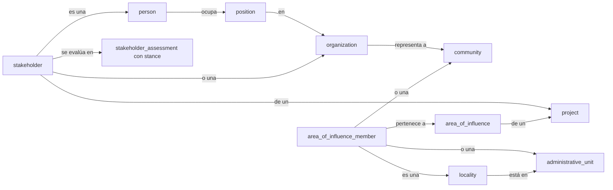

# Glosario de SGSPE

Vocabulario ES ↔ EN · Fase 0 (descubrimiento) · versión 1.1 · 2026-10-07

Este glosario fija los términos del negocio en español y su identificador técnico en inglés [USR-09]. Es una de las dos
fuentes de verdad de la Fase 0, junto con el [análisis de requisitos](requirements-analysis.md), que define todos los IDs
(RF, RNF, RN, RQ, CON, GAP, ASM, UPS) que aquí se citan.

Cómo leer las columnas:

- **Término (ES):** el nombre que usan las fuentes, la interfaz y los documentos.
- **Identificador:** el nombre técnico canónico: un objeto (`name` del catálogo de `domain-model.md`), un campo, un valor
  ENUM o una pieza de la plataforma. "—" si el término no tiene identificador propio.
- **Concepto del prompt (EN):** la entidad o el término del prompt maestro que el término reemplaza o precisa [PRM-01 §5].
- **Fuente:** dónde aparece el concepto, con el formato de citas del análisis (§0.7).
- **Variantes / sinónimos:** otras formas en las fuentes, incluidas las variantes de grafía (CON-004).
- **No confundir con:** el concepto vecino con el que suele mezclarse.

Los valores de catálogo (ENUM) se listan solo en [§10 del análisis](requirements-analysis.md#10-catálogos); aquí cada
término nombra su catálogo.

Ningún ejemplo usa nombres de personas reales: las personas se nombran por su cargo y los lugares por su topónimo
[USR-07].

## Territorio

Incluye el proyecto, que es el ancla del análisis territorial, y la línea base social de las localidades.

| Término (ES) | Identificador | Concepto del prompt (EN) | Definición | Fuente | Variantes / sinónimos | No confundir con |
|---|---|---|---|---|---|---|
| Proyecto | `project` | Project | Proyecto extractivo con código, tipo, etapa, fase de exploración, CRS de trabajo, partes, campañas y equipo | [PRM-01 §5] [DOC-01 §1] [DOC-02 p.2] | prospecto (CON-019) | campaña de exploración (un periodo del proyecto) |
| Prospecto | `project` (fase EXPLORACION INICIAL) | — | Proyecto en exploración inicial; DOC-02 usa "proyecto" y "prospecto" para lo mismo | [DOC-02 p.1, p.2] | proyecto | concesión minera |
| Etapa del proyecto | campo de `project` | ProjectStage | Momento del ciclo de vida del proyecto (catálogo "Etapa del proyecto" de §10) | [PRM-01 §5] | — | estado de workflow (RN-PRJ-001); fase de exploración |
| Fase de exploración | campo de `project` y de `exploration_campaign` | — | Subdivisión de la etapa de exploración (catálogo "Fase de exploración" de §10) | [DOC-01 §1, §2] [DOC-02 p.2] | cateo, perforación diamantina | etapa del proyecto |
| Campaña de exploración | `exploration_campaign` | — | Periodo de actividad del proyecto (p. ej. una campaña de perforación de octubre a diciembre) con su tope de apoyo social | [DOC-01 §1, §9.3.1.2] | campaña | proyecto |
| Parte del proyecto | `project_party` | Project.organization, Project.operator | Organización con un rol en el proyecto (catálogo "Rol de la parte" de §10) | [PRM-01 §5] [DOC-02 p.4, p.6] | titular, operador | parte de un acuerdo (`agreement_party`) |
| Asignación a proyecto | `project_assignment` | — | Usuario de SGSPE asignado a un proyecto con un rol y una vigencia; define el equipo y la fuente del alcance por proyecto | [PRM-01 §7] | equipo del proyecto | rol de wasichai |
| Concesión minera | `mining_concession` (M2M `project_concession`) | — | Derecho minero con código, titular, datum de origen y polígono, vinculado a uno o más proyectos | [DOC-01 Anexo 1] [DOC-02 p.4] [DOC-03] | concesión | predio (propiedad superficial); territorio comunal |
| Unidad administrativa | `administrative_unit` | AdministrativeUnit | División político-administrativa oficial (catálogo "Nivel de unidad administrativa" de §10; DOC-01 llama "región" al departamento) identificada por su ubigeo del INEI; es jurisdicción, sin voluntad ni postura | [DOC-01 §1, §4.2] [PRM-01 §5] | ubigeo, distrito, provincia, región | localidad (asentamiento); comunidad (colectivo con personería); área de influencia (construcción del proyecto); grupo de interés |
| Ubigeo | `administrative_unit` (código) | AdministrativeUnit | Código de ubicación geográfica del INEI de cada unidad administrativa (ASM-016) | [DOC-01 §1] | código INEI | código de centro poblado |
| Localidad | `locality` | — | Asentamiento humano (catálogo "Tipo de localidad" de §10), con localidad padre, estado de reconocimiento y nombres alternativos | [DOC-01 §4.1, §5.1.1, §5.2.1] [DOC-02 p.3, p.5] | lugar, pueblo | comunidad; sector comunal; unidad administrativa; grupo de interés (una localidad nunca lo es, RN-STK-008) |
| Caserío | `locality` (tipo CASERIO) | — | Localidad rural reconocida, con teniente gobernador y agente municipal propios, a menudo dividida en sectores | [DOC-01 §5.1.1, §5.2.1] | — | comunidad campesina, que puede abarcar varios caseríos y superponerse con ellos |
| Sector de caserío | `locality` (tipo SECTOR, con localidad padre) | — | Parte de un caserío; puede estar en proceso de separación para formar un caserío propio (p. ej. el sector Saligualday) | [DOC-01 §4.1, §5.1.1] | parte alta, parte baja | sector comunal (`community_sector`) |
| Centro poblado | `locality` (tipo CENTRO POBLADO) | — | Localidad registrada por el INEI con código propio | [DOC-01 Anexo 1] [DOC-02 p.5] | CCPP | caserío (categoría local, no siempre coincide) |
| Estado de reconocimiento | campo de `locality` | — | Situación legal de una localidad, incluida una separación en curso (catálogo "Estado de reconocimiento" de §10) | [DOC-01 §4.1, §5.1.1] | — | estado orgánico de una comunidad |
| Comunidad campesina o nativa | `community` | Community | Colectivo con personería jurídica, territorio comunal inscrito, junta directiva, asamblea, comuneros y sectores; puede estar reconocida como pueblo indígena u originario | [DOC-01 §4.1, §6.1.3.1] [DOC-02 p.4–p.5] | CC, comunidad | localidad; área de influencia; grupo de interés: como actor participa mediante la `organization` que la representa (RN-STK-008) |
| Pueblo indígena u originario | campo de `community` | — | Reconocimiento oficial de una comunidad como parte de un pueblo indígena (p. ej. de la nación quechua) | [DOC-02 p.4] | comunidad indígena | comunidad nativa (tipo de comunidad) |
| Estado orgánico | campo de `community` | — | Vigencia de la vida orgánica de una comunidad (catálogo "Estado orgánico" de §10); se registra aparte de la inscripción de la junta directiva | [DOC-01 §4.1, §6.1.3.1] | vida orgánica, vida institucional | inscripción de la junta (CON-013) |
| Sector comunal | `community_sector` (M2M `community_sector_locality`) | — | División de una comunidad campesina con delegados ante la asamblea; coincide en parte con caseríos y centros poblados | [DOC-02 p.4–p.5] | sector de la comunidad | sector de caserío (`locality`) |
| Territorio comunal | geometría de `community` | Community.geometry | Área de propiedad comunal inscrita | [DOC-01 §4.1] [DOC-02 p.4] | terreno comunal | predio privado (`land_parcel`) |
| Comunero | — | — | Miembro de una comunidad campesina; el padrón no se guarda nombre por nombre (ASM-018) | [DOC-01 §4.1, §6.1.3.1] | — | republicano; poblador |
| Área de influencia | `area_of_influence` | AreaOfInfluence | Construcción analítica y versionada de un proyecto: tipo, criterios, miembros y geometría opcional; cambia por decisión humana | [DOC-01 §4] [DOC-03] [PRM-01 §5] | área de influencia social | localidad, comunidad y unidad administrativa (el territorio real); grupo de interés |
| AIDS | `area_of_influence` (tipo AIDS) | AreaOfInfluence | Área de influencia directa social: localidades y comunidades con terrenos de interés para plataformas, accesos o campamento, impactos propios de la exploración o expectativas de beneficio | [DOC-01 §4.1] | AID (DOC-01 usa ambos para lo mismo) | AID ambiental; AIIS; los rótulos cruzados de DOC-01 (CON-001) |
| AIIS | `area_of_influence` (tipo AIIS) | AreaOfInfluence | Área de influencia indirecta social: localidades con impactos o permisos viales o percepción de afectación, y el ámbito distrital o provincial cuando aplica | [DOC-01 §4.2] | AII (DOC-01 la rotula a veces "AID", CON-001) | AIDS; AII ambiental |
| AID y AII ambientales | `area_of_influence` (tipos AID AMBIENTAL, AII AMBIENTAL) | AreaOfInfluence | Áreas de influencia de un estudio ambiental; DOC-03 muestra un "AID" como polígono de 148 ha (ASM-039) | [DOC-03] | AID, AII | AIDS y AIIS, sociales y definidas por criterios y listas (CON-025) |
| Área de interés del proyecto | geometría de área de `project` | ProjectArea | Polígono de la zona de trabajo del proyecto, como el "Área de Interés" del Anexo 1 de DOC-01; es un dato del proyecto, no un área de influencia | [DOC-01 Anexo 1] | área del proyecto | área de influencia social |
| Miembro del área de influencia | `area_of_influence_member` | TerritorialRelationship | Localidad, comunidad o unidad administrativa incluida en un área de influencia, con condición (catálogo "Condición de miembro" de §10), justificación y marca de "estudiado en el diagnóstico" (RN-TER-001) | [DOC-01 §4.1] | — | relación espacial calculada, que solo sugiere (RN-TER-004) |
| Criterio de inclusión | campo de `area_of_influence` | AreaOfInfluence.criteria | Razón por la que una localidad integra el área: terrenos para plataformas, accesos, campamento, impactos de la exploración, expectativas de beneficio, ensanchamiento de vías, permisos privados, percepción de afectación | [DOC-01 §4.1, §4.2] | — | motivo de inclusión de un grupo de interés |
| Componente del proyecto | `project_component` | — | Elemento físico del proyecto (catálogo "Tipo de componente" de §10) | [DOC-03] [DOC-01 §4.1] | — | elemento ambiental |
| Sondaje | `project_component` (tipo SONDAJE) | — | Perforación con código, coordenadas este y norte, cota, azimut, inclinación y profundidad | [DOC-03] | pozo programado, taladro, DDH | plataforma de perforación |
| Predio | `land_parcel` | — | Unidad de tierra con su tenencia (catálogo "Tenencia del predio" de §10) | [DOC-03] [DOC-01 Anexo 1] | terreno, parcela | concesión minera; territorio comunal |
| Titularidad del predio | `land_right` | — | Vínculo de una persona u organización con un predio como propietario o posesionario, con vigencia | [DOC-03] | propietario, posesionario | grupo de interés (el titular puede serlo, pero son registros distintos) |
| Elemento ambiental | `environmental_feature` | — | Lugar ambiental o culturalmente sensible (catálogo "Tipo de elemento ambiental" de §10), con base legal y autoridad | [DOC-01 §4.2, §7.1.2, Tabla 9.4, nota 24] | zona de conservación, colchón hídrico | componente del proyecto; área de influencia |
| Microcuenca | `environmental_feature` (tipo MICROCUENCA) | — | Cuenca menor que agrupa caseríos y abastece de agua | [DOC-01 §4.2, §7.1.2] | cuenca | unidad administrativa |
| CRS de trabajo | `working_crs` (campo de `project`) | — | CRS UTM del proyecto (catálogo "CRS de trabajo" de §10) para áreas, distancias, buffers, coordenadas este y norte y mapas de informe (ASM-002) | [PRM-01 §6] [DOC-03] | zona UTM, proyección | SRID de almacenamiento (4326) |
| SRID 4326 | — | — | Sistema WGS 84 en el que se guardan todas las geometrías y que usa la API (GeoJSON) | [WAS-ADR-0007] [WAS-ADR-0019] | WGS 84, EPSG:4326 | CRS de trabajo; PSAD56 |
| PSAD56 | — | — | Datum sudamericano histórico; SGSPE lo acepta solo como CRS de origen al importar y nunca lo almacena (ASM-002). DOC-03 no indica si sus coordenadas están en PSAD56 o en WGS 84 (CON-024) | [DOC-03] | EPSG 24877, 24878, 24879 | WGS 84 (la diferencia es de cientos de metros) |
| Área plana | — | — | Área calculada en el CRS de trabajo del proyecto o, en los registros que no pertenecen a un solo proyecto, en la zona UTM de su centroide (ASM-064); SGSPE la usa como área oficial (ASM-057) y DOC-03 rotula las áreas en hectáreas ("148.00 Ha") | [DOC-03] | área en ha | área geodésica (solo para totales entre zonas UTM); área registral (declarada en la partida) |
| Línea base social | BC-19 | — | Conjunto de datos de contexto de las localidades: perfiles, servicios, festividades, programas, conflictos, percepciones y temas clave | [DOC-01 §5, §7.1, §8] | diagnóstico | línea base de una evaluación (ver Actores) |
| Perfil de localidad | `locality_profile` | — | Datos socioeconómicos fechados de una localidad, con fuente y confiabilidad (p. ej. "referencial") | [DOC-01 §5, nota 2] | ficha de localidad | estudio (`study`) |
| Institución educativa | `school` | — | Institución de nivel inicial, primario o secundario de una localidad | [DOC-01 Tablas 5.4, 5.9] | IE, escuela, colegio | APAFA (organización de padres) |
| Establecimiento de salud | `health_facility` | — | Puesto o centro de salud | [DOC-01 §5.1.5, §5.2.4] | posta | — |
| Vía de acceso | `road_access` | — | Trocha carrozable o camino de herradura que conecta localidades, con estado y medios de transporte | [DOC-01 Tabla 5.5] | trocha, camino de herradura | acceso (componente del proyecto) |
| Festividad | `festivity` | — | Celebración local con fechas y turnos de coorganización | [DOC-01 Tabla 5.6, §9.3.1.2] | fiesta patronal, aniversario | — |
| Programa estatal | `state_program` (M2M `state_program_locality`) | — | Programa social del Estado presente en una localidad | [DOC-01 Tabla 5.10, §5.2.5] | programa social del Estado | programa social de la empresa (`social_program`) |
| Conflicto local | `local_conflict` (M2M `local_conflict_locality`) | — | Disputa entre localidades (catálogo "Tipo de conflicto local" de §10), con estado | [DOC-01 §5.1.1, §5.2.1] | — | incidente (hecho que afecta al proyecto); riesgo social |
| República | dato del perfil de localidad | — | Trabajo comunal para obras de beneficio común; quien no asiste envía reemplazo o paga el equivalente a un jornal | [DOC-01 §5.1.7, §9.3.1.2, nota 1] | faena | mano de obra pagada (RN-INV-001) |
| Republicano | — | — | Persona que participa de las repúblicas de un caserío, aunque no resida en él | [DOC-01 §5.1.7, nota 1] | — | comunero |

## Actores

| Término (ES) | Identificador | Concepto del prompt (EN) | Definición | Fuente | Variantes / sinónimos | No confundir con |
|---|---|---|---|---|---|---|
| Actor | `person`, `organization` | Stakeholder (person, organization, government entity, NGO, association, authority, supplier) | Persona u organización del territorio, registrada una sola vez con independencia de los proyectos | [DOC-01 §6] [PRM-01 §5] | actor social | grupo de interés, que es el actor en relación con un proyecto (CON-038) |
| Persona | `person` | Stakeholder.person | Persona natural; sus datos personales están restringidos por permisos de campo | [DOC-01 §6] [USR-07] | — | cargo; grupo de interés |
| Organización (del dominio) | `organization` | Stakeholder.organization | Organización del territorio o de su entorno (catálogo "Tipo de organización" de §10); una comunidad actúa mediante su organización comunal | [DOC-01 §6] [DOC-02 p.3] | institución | organización tenant de wasichai (ver Plataforma) |
| Medio de contacto | `contact_method` | StakeholderContact | Canal de contacto de una persona u organización (catálogo "Tipo de medio de contacto" de §10), con consentimiento; no hay una tabla genérica de contactos | [PRM-01 §5] [DOC-01 Tabla 9.5] | contacto | participante; interacción |
| Cargo | `position` | — | Puesto en una organización (presidente, teniente gobernador, delegado…), con titular, periodo, mecanismo de elección y estado (catálogo "Estado del cargo" de §10) | [DOC-01 §6, notas 12, 14–16] [DOC-02 p.3] | posición del cargo, puesto | postura (`stance`), que DOC-01 también llama "posición" |
| Postura | `stance` (campo de `stakeholder_assessment` y de `stakeholder`) | StakeholderProfile.sentiment (aproximado) | Posición frente al proyecto (catálogo "Postura" de §10) | [DOC-01 §6] | posición | cargo (`position`); sentimiento de un texto (AI-08) |
| Oposición | — | — | Para los indicadores, las posturas EN CONTRA y EN CONTRA PERO ABIERTO A ESCUCHAR | [DOC-01 Tabla 9.5] | opositores | conflicto |
| Grupo de interés | `stakeholder` | Stakeholder, StakeholderRelationship | Actor en relación con un proyecto, con tipo, ámbito, motivo de inclusión, estado de entrevista, responsable y evaluaciones; un actor puede serlo en varios proyectos | [DOC-01 §6, Tablas 6.1–6.3] [PRM-01 §5] | GI, stakeholder, actor clave | actor; localidad; comunidad; área de influencia (CON-038) |
| Tipo de grupo de interés | campo de `stakeholder` | Stakeholder (tipos) | Tipología de las fuentes (catálogo "Tipo de grupo de interés" de §10) | [DOC-01 Tablas 6.1–6.3, 7.1–7.3] | tipo de actor | grupo de influencia (ESTRATEGICO…), que la Tabla 9.1 también llama "tipo de grupo de interés" |
| Ámbito del grupo de interés | campo de `stakeholder` | — | Ubicación del grupo de interés respecto del proyecto (catálogo "Ámbito del grupo de interés" de §10; ASM-040) | [DOC-01 Tablas 6.1–6.3] | ámbito | ámbito de acción, que es un indicador de poder (CON-016) |
| Estado de entrevista | `interview_status` (campo de `stakeholder`) | — | Resultado del intento de entrevistar (catálogo "Estado de entrevista" de §10) | [DOC-01 notas 13–19] | — | estado de la relación |
| Estado de la relación | `relationship_status` (campo de `stakeholder`) | StakeholderRelationship.relationshipStatus | Situación del vínculo con el grupo de interés (catálogo "Estado de la relación" de §10; ASM-032) | [DOC-02 p.2] [PRM-01 §8] | — | estado de workflow del grupo de interés |
| Evaluación del grupo de interés | `stakeholder_assessment` | StakeholderProfile | Registro fechado e inmutable de interés, poder, grupo de influencia, postura, confianza, razones y expectativas | [DOC-01 §7.2, §9.3.1.1, Anexo 3] | caracterización, perfil | grupo de interés (la relación) |
| Influencia | cálculo en `stakeholder_assessment` | StakeholderProfile.influence | Interés + poder: disposición a intervenir en el proyecto combinada con la capacidad de cambiarlo, paralizarlo o ponerlo en riesgo | [DOC-01 Anexo 3] | — | poder (solo una componente); "poder e influencia" (CON-009) |
| Interés | índice 1–5 de `stakeholder_assessment` | StakeholderProfile.interest | Percepción de utilidad o perjuicio frente al proyecto, con dos componentes: percepción de afectación y percepción de oportunidad | [DOC-01 Anexo 3, Gráfico 10.2, nota 25] | — | postura |
| Percepción de afectación | componente del interés | — | Afectación del medio ambiente y ecosistema; "afecta económicamente mi vida"; afectación de la propiedad o de la posición social o económica | [DOC-01 Gráfico 10.2] | — | percepción (`perception`) de la línea base |
| Percepción de oportunidad | componente del interés | — | Oportunidad de trabajo (personal); de desarrollo (colectiva); de beneficios económicos, como donaciones o aporte directo, o políticos | [DOC-01 Gráfico 10.2] | — | expectativa registrada en la evaluación |
| Poder | índice 1–5 de `stakeholder_assessment` | StakeholderProfile.influence (parcial) | Capacidad de intervenir en el proyecto, con tres componentes: control de recursos, capacidad de acción y movilización de redes | [DOC-01 Anexo 3, Gráfico 10.2, nota 26] | — | influencia |
| Control de recursos | componente del poder | — | Habilidad de acción legal, credibilidad y control de permisos | [DOC-01 Gráfico 10.2] | — | — |
| Capacidad de acción | componente del poder | — | Ámbito de acción (local, regional, nacional), nivel de organización y capacidad de convocatoria | [DOC-01 Gráfico 10.2] | amplitud de redes (nota 26, CON-010) | ámbito del grupo de interés |
| Movilización de redes | componente del poder | — | Pertenencia a redes locales, nacionales o internacionales, participación en acciones grupales de movilización y en otros mecanismos de presión | [DOC-01 Gráfico 10.2] | — | red comunitaria (`community_network`) |
| Grupo de influencia | `influence_group` | StakeholderProfile.classification | Clasificación por cuadrante interés × poder (catálogo "Grupo de influencia" de §10; ASM-003) | [DOC-01 §7.2, Anexo 3] | tipo de grupo de interés (Tabla 9.1) | tipo de grupo de interés por naturaleza; estado de workflow "monitoring" (CON-030) |
| Estratégico | `influence_group` ESTRATEGICO | — | Alto interés y alto poder | [DOC-01 §7.2.1.1] | — | — |
| Político | `influence_group` POLITICO | — | Alto poder e interés limitado | [DOC-01 §7.2.1.2] | — | líder político (tipo de grupo de interés) |
| Para monitoreo | `influence_group` PARA MONITOREO | — | Alto interés y poder limitado | [DOC-01 §7.2.1.3] | de monitoreo | monitoreo participativo (interacción); estado "monitoring" del prompt |
| Vulnerable | `influence_group` VULNERABLE | — | Grupo nombrado pero no definido en la fuente; por defecto, interés y poder bajos (GAP-003, ASM-003) | [DOC-01 §7.2, Tabla 9.1] | — | población vulnerable en sentido social |
| Confianza | campo de `stakeholder_assessment` | — | Grado de confianza o credibilidad del grupo de interés hacia el proyecto, de 1 (mínima) a 5 (máxima) | [DOC-01 §9.3.1.1] | credibilidad | postura; confianza de una sugerencia de IA |
| Línea base de una evaluación | — | — | La evaluación anterior de un grupo de interés, contra la que se mide el cambio de postura y de confianza | [DOC-01 §9.3.1.1] | — | línea base social (BC-19) |
| Prioridad informativa | `prioritization_rule` | — | Prioridad del contacto con un grupo de interés (catálogo "Prioridad informativa" de §10) según su grupo de influencia, postura y ámbito | [DOC-01 §9.1.1.4, Tabla 9.1] | priorización de interacciones | prioridad de un compromiso o de una queja |
| Red comunitaria | `community_network` | — | Conjunto de personas y organizaciones conectadas en torno a un caserío, una institución o un apoyo externo, útil para el acercamiento | [DOC-02 p.3, p.5] | red | relación entre actores |
| Nodo de red | `network_node` | — | Integrante de una red comunitaria con su rol (catálogo "Rol del nodo" de §10) | [DOC-02 p.3] | — | cargo |
| Relación entre actores | `actor_relationship` | — | Vínculo dirigido entre actores (catálogo "Tipo de relación entre actores" de §10) | [DOC-01 §6] [DOC-02 p.3] | — | red comunitaria |
| Afiliación | campo de `organization` | — | Relación de una organización con su federación (catálogo "Afiliación" de §10) | [DOC-01 §5.2.5, §6.1.2.7] | no afiliada, no oficial (CON-005) | relación entre actores |
| Autoridad local | tipo de grupo de interés | Stakeholder.authority | Teniente gobernador, agente municipal o juez de paz de un caserío | [DOC-01 §5.1.7, §6.1.1] | — | organización social |
| Teniente gobernador | cargo (`position`) | — | Autoridad que representa al gobierno nacional en el caserío, elegida por la población y ratificada por la subprefectura | [DOC-01 §5.1.7] | TG, teniente gobernadora | agente municipal |
| Agente municipal | cargo (`position`) | — | Autoridad que representa a la municipalidad en el caserío y gestiona las obras comunales | [DOC-01 §5.1.7] | — | teniente gobernador |
| Ronda campesina | `organization` (tipo RONDA CAMPESINA) | — | Organización de seguridad y justicia comunal, afiliada o no a federaciones distritales, provinciales y regionales | [DOC-01 §5.1.7, §5.2.5] [DOC-02 p.2] | ronda, ronda comunal | comité de autodefensa |
| JASS | `organization` (tipo JASS) | — | Junta Administradora de Servicios de Saneamiento: administra el agua de consumo humano | [DOC-01 §5.1.4] | JAAS, JAS (CON-004) | comité de regantes (agua de riego) |
| Comité de regantes | `organization` (tipo COMITE DE REGANTES) | — | Organización de usuarios del agua de riego | [DOC-01 §5.2.5] | junta de riego, comité de riego | JASS |
| Junta directiva comunal | `organization` y sus cargos (`position`) | — | Órgano que administra los asuntos de la comunidad según los acuerdos de la asamblea | [DOC-02 p.3] [DOC-01 §6.1.3.1] | junta directiva | asamblea comunal |
| Delegado comunal | cargo (`position`) | — | Representante de un sector comunal ante la asamblea comunal | [DOC-02 p.3–p.5] | — | agente municipal |
| Percepción | `perception` | — | Opinión frecuente sobre la minería, el proyecto o la empresa, con ámbito, polaridad y citas atribuidas por cargo | [DOC-01 §7.1] | — | postura de un grupo de interés |

## Relacionamiento

| Término (ES) | Identificador | Concepto del prompt (EN) | Definición | Fuente | Variantes / sinónimos | No confundir con |
|---|---|---|---|---|---|---|
| Interacción | `engagement` (M2M `engagement_stakeholder`) | Engagement | Todo contacto o evento con grupos de interés (catálogo "Tipo de interacción" de §10) | [DOC-01 §9.1.1, Tabla 9.5] [DOC-02 p.2] [PRM-01 §5] | relacionamiento, reunión, actividad | visita de campo (contexto de varias interacciones); tarea |
| Contacto regular | `engagement` (tipo CONTACTO CARA A CARA) | — | Interacción cara a cara, sobre todo la primera, que siempre se registra para un seguimiento uniforme | [DOC-01 §9.1.1.1] | contacto | medio de contacto (`contact_method`) |
| Reunión informativa o taller | `engagement` (tipos REUNION INFORMATIVA, TALLER) | — | Reunión para informar a la población, con protocolo, preguntas y respuestas alineadas; no debe generar compromisos (RN-ENG-001) | [DOC-01 §9.1.1.2] | asamblea extendida | mesa de diálogo |
| Mesa de diálogo | `engagement` (tipo MESA DE DIALOGO) | — | Espacio de concertación en el que se esperan compromisos de mayor alcance (RN-ENG-002) | [DOC-01 §9.1.1.3] | mesa de concertación | taller |
| Asamblea | `engagement` (tipo ASAMBLEA) | — | Reunión del caserío o de la comunidad que toma decisiones y puede autorizar actividades del proyecto | [DOC-01 §6.1.1.7, §9.1.1] | asamblea comunal | junta directiva |
| Monitoreo participativo | `engagement` (tipo MONITOREO PARTICIPATIVO) | — | Monitoreo ambiental, por ejemplo del agua, con participación de grupos de interés y un agente independiente (ASM-029) | [DOC-01 Tabla 9.3, Tabla 9.5] | monitoreo independiente | grupo "para monitoreo"; monitoreo de medios |
| Interlocutor local | campo de `engagement` | — | Autoridad local que convoca una reunión informativa | [DOC-01 §9.1.1.2] | convocante | relacionista comunitario |
| Participante | `engagement_participant` | EngagementParticipant | Asistente a una interacción, con organización, sexo y ámbito; sus datos de contacto están restringidos | [DOC-01 Tabla 9.5] | asistente | grupo de interés vinculado a la interacción |
| Pregunta de la interacción | `engagement_question` | EngagementOutcome | Pregunta o sugerencia planteada en una interacción, con su respuesta en el lugar o posterior, o su derivación a una consulta, solicitud o queja | [DOC-01 §9.1.1.2] | inquietud, sugerencia | consulta (`inquiry`), cuando se deriva |
| Minuta o acta de reunión | campos de `engagement`, documento emitido y `evidence` | MeetingMinute | Registro de temas y acuerdos de una interacción: la minuta interna se revisa y aprueba; el acta firmada por los asistentes es evidencia | [DOC-01 Tabla 9.5] [PRM-01 §5, §8] | acta | acta de entrega; acuerdo |
| Tema | `topic` (M2M `engagement_topic`) | EngagementTopic | Catálogo jerárquico de temas tratados (agua, empleo, medio ambiente…) | [DOC-01 Tabla 9.5, Tabla 10.1] | asunto | tema clave (`key_theme`) |
| Visita de campo | `field_visit` | FieldVisit | Salida al territorio con itinerario y equipo, en la que se realizan interacciones y observaciones | [DOC-01 §3.3] [DOC-02 p.2] | viaje, trabajo de campo | interacción; visita guiada |
| Observación de campo | `field_observation` | FieldObservation, GeoObservation | Observación geolocalizada registrada durante una visita | [DOC-01 §3] [PRM-01 §5] | ficha de observación | evidencia (foto) |
| Plan de relacionamiento | `engagement_plan` | — | Objetivo estratégico, objetivos tácticos, ejes y metas del relacionamiento de un proyecto | [DOC-01 §9] [DOC-02 p.2] | estrategia social, plan de trabajo | plan de acción de un riesgo |
| Actividad planificada | `planned_activity` | FieldActivity (parcial) | Actividad prevista en el plan, con fecha y responsable | [DOC-01 §9.3.1] | — | tarea; interacción (lo ya realizado) |
| Mensaje clave | `key_message` | — | Mensaje que el equipo debe instalar, con justificación, acciones de soporte y público objetivo | [DOC-01 §9.1.2, Tabla 9.2] | — | respuesta alineada |
| Respuesta alineada | `aligned_answer` | — | Respuesta aprobada por el equipo a una pregunta frecuente | [DOC-01 §9.1.1.2] | preguntas frecuentes | mensaje clave |
| Alianza estratégica | `strategic_alliance` | — | Institución con la que conviene aliarse, con razones y acciones posibles | [DOC-01 §9.2, Tabla 9.3] | aliado | acuerdo (cuando la alianza se formaliza) |
| Relacionista comunitario | rol `COMMUNITY_RELATIONS_OFFICER` | — | Integrante del equipo social que se relaciona con los grupos de interés | [DOC-01 §7.1.2] [DOC-02 p.2] | equipo social | grupo de interés |
| Estudio o diagnóstico | `study` | — | Estudio de línea base o diagnóstico social con objetivos, metodología, instrumentos y trabajo de campo | [DOC-01 §2, §3] | diagnóstico social | entregable (el documento que lo presenta) |
| Instrumento de estudio | `study_instrument` | — | Instrumento aplicado a un tema y a un ámbito (catálogo "Tipo de instrumento" de §10) | [DOC-01 §3, Tabla 10.1] | — | evidencia |

## Compromisos y acuerdos

| Término (ES) | Identificador | Concepto del prompt (EN) | Definición | Fuente | Variantes / sinónimos | No confundir con |
|---|---|---|---|---|---|---|
| Compromiso | `commitment` (M2M `commitment_stakeholder`) | Commitment | Obligación que el proyecto asume ante grupos de interés, con descripción, recurso, plazos, monto, responsable, entrega y cierre | [DOC-01 §9.3.1.2] [PRM-01 §5] | compromiso social | aporte social (apoyo sin obligación); acuerdo (instrumento formal); solicitud (pedido) |
| Matriz de compromisos | `commitment` y sus objetos | — | Registro de seguimiento de los compromisos con los campos mínimos de DOC-01 | [DOC-01 §9.3.1.2, Tabla 9.5] | matriz de seguimiento de compromisos | matriz de riesgos |
| Medio de solicitud | campo de `commitment` y de `stakeholder_request` | Commitment.origin | Cómo se pidió el compromiso (catálogo "Medio de solicitud" de §10) | [DOC-01 §9.3.1.2] | — | canal de QCS |
| Acción del compromiso | `commitment_action` | CommitmentAction | Gestión interna o paso para cumplir un compromiso | [DOC-01 §9.3.1.2] [PRM-01 §5] | gestión | acción declarada (permiso de wasichai) |
| Hito del compromiso | `commitment_milestone` | — | Plazo parcial de un compromiso | [DOC-01 §9.3.1.2] | fecha parcial | entrega |
| Reprogramación | `commitment_reschedule` | — | Cambio de la fecha de vencimiento con motivo y con las fechas anterior y nueva (RF-COM-003) | [PRM-01 §8] | — | postergación de una interacción |
| Dependencia | `commitment_dependency` | CommitmentDependency | Relación entre compromisos: uno no se cumple mientras el otro siga abierto | [PRM-01 §5] | — | vínculo de origen |
| Entrega | `delivery` | CommitmentVerification (parcial) | Entrega de lo comprometido o aportado, con fecha, receptores, conformidad, acta y fotos | [DOC-01 §9.3.1.2] [DOC-02 p.4] | — | verificación, que es interna y posterior |
| Conformidad | campo de `delivery` | — | Aceptación de la entrega por las personas que designa el grupo de interés | [DOC-01 §9.3.1.2] | — | aprobación interna |
| Verificación | transición `verify` de WF-D | CommitmentVerification | Comprobación interna, por alguien distinto del responsable, de que el compromiso cumplido tiene la evidencia exigida (ASM-008) | [PRM-01 §5, §8] | — | conformidad del grupo de interés |
| Candidato a compromiso | `commitment_candidate` | CommitmentCandidate | Posible compromiso detectado por una persona o por la IA, con evidencia y confianza; solo es compromiso si una persona lo acepta | [ARQ-02] [PRM-01 §9] | posible compromiso | compromiso |
| Situación de plazo | `deadline_status` | — (OVERDUE del prompt) | Valor derivado que calcula un trabajo programado (catálogo "Situación de plazo" de §10; RN-WFL-001) | [PRM-01 §5] | vencido, por vencer | estado de workflow (CON-028) |
| Tope de apoyo social | campo de `exploration_campaign` | — | Monto máximo de apoyo social definido por adelantado para una campaña (RN-INV-003) | [DOC-01 §9.3.1.2] | presupuesto social | presupuesto de un programa |
| Acuerdo | `agreement` | Agreement | Instrumento formal (catálogo "Tipo de acuerdo" de §10), con partes, cláusulas y vigencia | [PRM-01 §5] [DOC-01 §9.1.1.3, §9.3.1.2] [DOC-02 p.6] | convenio | compromiso (obligación concreta); alianza estratégica (aún informal) |
| Parte del acuerdo | `agreement_party` | AgreementParty | Organización o persona firmante | [PRM-01 §5] | firmante | parte del proyecto (`project_party`) |
| Cláusula | `agreement_clause` | AgreementCommitment | Disposición de un acuerdo que puede originar compromisos | [PRM-01 §5] | — | compromiso |
| Permiso de uso de terreno o servidumbre | `agreement` (tipos) y M2M `agreement_land_parcel` | — | Autorización para usar tierras superficiales comunales o privadas | [DOC-02 p.6] [DOC-01 §9.3.1.2] | permiso de tierras | concesión minera |
| Autorización de asamblea | `agreement` (tipo AUTORIZACION DE ASAMBLEA) | — | Permiso que una asamblea de caserío o comunal otorga para trabajar | [DOC-01 §6.1.1.7] | — | acta de reunión |
| Situación de vigencia | `validity_status` | — (expiryDate) | Valor derivado de la vigencia de un acuerdo (catálogo "Situación de vigencia" de §10; RN-WFL-001) | [PRM-01 §5] | — | estado del workflow del acuerdo |

## QCS

| Término (ES) | Identificador | Concepto del prompt (EN) | Definición | Fuente | Variantes / sinónimos | No confundir con |
|---|---|---|---|---|---|---|
| Quejas, consultas y solicitudes (QCS) | `grievance`, `inquiry`, `stakeholder_request` | Grievance | Los tres tipos de planteamiento que el proyecto atiende, con flujos propios y un reporte unificado (ASM-011, CON-033) | [DOC-01 Tabla 9.5] | grievances | conflicto; incidente |
| Queja | `grievance` | Grievance | Reclamo por una afectación atribuida al proyecto, que se acusa, evalúa, atiende, resuelve y cierra | [DOC-01 Tabla 9.5] [PRM-01 §5, §8] | reclamo, grievance | consulta; solicitud; conflicto |
| Consulta | `inquiry` | — | Pregunta que requiere una respuesta del proyecto | [DOC-01 Tabla 9.5] | inquietud | queja; pregunta respondida en la misma interacción |
| Solicitud | `stakeholder_request` | — | Pedido de apoyo, obra o recurso; si se acepta, origina un compromiso o un aporte | [DOC-01 §9.3.1.2, Tabla 9.5] | pedido, petitorio | compromiso; aporte; queja |
| Canal | campo de QCS | Grievance.origin | Medio por el que llegó el planteamiento (catálogo "Canal de QCS" de §10) | [DOC-01 Tabla 9.5, §9.4.2] | vía de recepción | medio de solicitud de un compromiso |
| Acuse | transición `acknowledge` de WF-E1 | ACKNOWLEDGED | Confirmación de la recepción de una queja dentro del plazo (ASM-005) | [PRM-01 §5, §8] | cargo de queja | resolución |
| Severidad | campo de `grievance` | Grievance.severity | Gravedad de una queja (catálogo "Severidad de queja" de §10; ASM-036) | [PRM-01 §5] | gravedad | nivel de riesgo |
| Absuelta | — | — | Consulta o queja respondida; base del indicador "porcentaje absuelto" | [DOC-01 Tabla 9.5] | respondida | cerrada |

## Riesgos y alertas

| Término (ES) | Identificador | Concepto del prompt (EN) | Definición | Fuente | Variantes / sinónimos | No confundir con |
|---|---|---|---|---|---|---|
| Riesgo social | `social_risk` | SocialRisk | Tema social (problema o conflicto) que puede impedir el normal desarrollo del proyecto; es potencial, todavía no ocurrió | [DOC-01 §9.3.2] [PRM-01 §5] | riesgo | incidente (ya ocurrió); tema clave (hallazgo analítico); alerta |
| Fuente de riesgo | campo de `social_risk` | — | Circunstancia que origina un riesgo, como un conflicto de límites entre comunidades | [DOC-01 §9.3.2.1] | — | riesgo |
| Probabilidad, impacto y relevancia | campos de `social_risk` | SocialRisk.probability, impact, score | Escalas para estimar la relevancia: puntaje P × I y nivel (catálogo "Nivel de riesgo" de §10; ASM-004) | [DOC-01 §9.3.2.1] | severidad | prioridad |
| Revisión de riesgo | `risk_assessment` | RiskAssessment | Evaluación periódica (semanal por defecto) de un riesgo, con su tendencia | [DOC-01 §9.3.2.1] | evaluación del riesgo | evaluación de un grupo de interés |
| Medida de mitigación | `mitigation_measure` | MitigationAction | Acción del plan que reduce la probabilidad o la consecuencia de un riesgo | [DOC-01 §9.3.2.2] | medida de control, plan de acción | acción de un compromiso |
| Riesgo residual | campos de `social_risk` | — | Riesgo que queda después de aplicar las medidas | [DOC-01 §9.3.2.2] | — | — |
| Impacto potencial | `potential_impact` | — | Impacto ambiental o social, real o percibido, positivo o negativo, asociado a un tipo de actividad | [DOC-01 Tabla 9.4] | — | riesgo social |
| Tema clave | `key_theme` | — | Asunto frecuente en el discurso de los actores, con riesgos y oportunidades para el proyecto | [DOC-01 §8, Tabla 8.1] | — | tema (`topic`); riesgo social |
| Incidente | `incident` | — | Hecho social ocurrido (catálogo "Tipo de incidente" de §10) con su respuesta inmediata y sus consecuencias | [DOC-02 p.2] | evento | riesgo (potencial); alerta |
| Mención en medios | `media_mention` | — | Nota de prensa, radio o redes sobre el proyecto, con su tono | [DOC-01 Tabla 9.5, §9.3.2.2] | noticia, recorte | comunicado propio |
| Señal de alerta | `early_warning_signal` | EarlyWarningSignal | Dato que puede anticipar un conflicto, con su fuente (catálogo "Fuente de la señal" de §10) | [DOC-01 §9.3.2.2, §9.4.2] [PRM-01 §5] | señal | alerta temprana |
| Regla de alerta | `early_warning_rule` | EarlyWarningRule | Condición configurable (catálogo "Tipo de regla de alerta" de §10) que convierte señales o datos en una alerta | [PRM-01 §5] | — | regla de negocio (RN) |
| Alerta temprana | `early_warning` | EarlyWarning | Aviso triado que una persona confirma o descarta; nunca lo confirma la IA (RN-EWS-001) | [PRM-01 §5] | alerta | incidente; notificación |
| Conflicto | — | conflict | Oposición activa entre actores o con el proyecto; SGSPE no lo declara de forma automática | [PRM-01 §5] [DOC-01 §5.2.1] | — | conflicto local (entre localidades); riesgo social |

## Inversión

| Término (ES) | Identificador | Concepto del prompt (EN) | Definición | Fuente | Variantes / sinónimos | No confundir con |
|---|---|---|---|---|---|---|
| Aporte social | `social_contribution` | — | Apoyo puntual (catálogo "Tipo de aporte" de §10) entregado con acta de recepción, foto y comprobante, con propósito, condiciones y pagador declarados | [DOC-02 p.3–p.4] [DOC-01 §9.3.1.2] | apoyo, donación | compromiso (obligación asumida); programa social |
| Ítem del aporte | `contribution_item` | — | Bien o servicio que compone un aporte, con cantidad y costo | [DOC-02 p.4] | — | ítem de un compromiso |
| Comprobante | `receipt` | — | Documento de pago del gasto (catálogo "Tipo de comprobante" de §10), con emisor y a nombre de quién se emitió | [DOC-02 p.4] | boleta de venta | evidencia (el archivo escaneado del comprobante) |
| Pagador | campo de `social_contribution` | — | Organización que paga el aporte, por ejemplo el titular de las concesiones (CON-022) | [DOC-02 p.4, p.6] | a nombre de | receptor del aporte |
| Programa social | `social_program` | SocialProgram | Programa de inversión social de la empresa, con socios, presupuesto, beneficiarios, indicadores e hitos | [PRM-01 §5] [DOC-01 §9.2] | programa | programa estatal (`state_program`) |
| Iniciativa social | `social_initiative` | SocialInitiative | Proyecto concreto dentro de un programa | [PRM-01 §5] | — | aporte puntual |
| Grupo de beneficiarios | `beneficiary_group` | BeneficiaryGroup | Población objetivo de un programa o una iniciativa | [PRM-01 §5] [DOC-01 §9.3.1.2] | beneficiarios | grupo de interés |
| Presupuesto del programa | `program_budget` | Budget, BudgetExecution | Monto asignado y ejecutado de un programa | [PRM-01 §5] | — | tope de apoyo social de una campaña |
| Indicador de programa | `program_indicator` | ProgramIndicator | Indicador de resultado o de impacto de un programa (GAP-032) | [PRM-01 §5, §29] | — | indicador de tablero (`indicator`) |
| Medición de programa | `program_measurement` | — | Valor periódico de un indicador de programa | [PRM-01 §5] | — | medición de indicador (`indicator_measurement`) |
| Hito de programa | `program_milestone` | ProgramMilestone | Fecha o logro previsto de un programa | [PRM-01 §5] | — | hito de compromiso |
| Sinergia | `agreement` con `social_program` o `social_contribution` | — | Contribución a proyectos de instituciones reconocidas, formalizada en un acuerdo (RN-INV-004) | [DOC-01 §9.3.1.2] | — | alianza estratégica |
| Lineamiento de apoyo | política del proyecto | — | Regla configurable de compromisos y aportes: empleo limitado y rotativo, no pagar mano de obra, donaciones no monetarias, temas priorizados, tope por campaña | [DOC-01 Tabla 9.2, §9.3.1.2] | directriz, política | regla dura del sistema |

## Evidencias y entregables

| Término (ES) | Identificador | Concepto del prompt (EN) | Definición | Fuente | Variantes / sinónimos | No confundir con |
|---|---|---|---|---|---|---|
| Evidencia | `evidence` | Evidence, Attachment, Document | Archivo inmutable con hash que prueba un hecho (catálogo "Tipo de evidencia" de §10), vinculable a varios registros | [DOC-01 Tabla 9.5] [DOC-02 p.4] [PRM-01 §5] | adjunto, medio de verificación | documento emitido; entregable |
| Documento emitido | documento de wasichai-documents | Document | Documento administrativo de un solo registro (catálogo "Tipo de documento administrativo" de §10), generado desde una plantilla, congelado y numerado (RQ-REP-029) | [WAS-ADR-0023] [DOC-01 §9.3.1.2] | constancia | evidencia (archivo que llega de afuera); entregable (informe de varias secciones) |
| Entregable | `deliverable` | — | Informe de varias secciones (diagnóstico social, informe de campo) que se genera en DOCX y PDF, se revisa, se aprueba y se emite | [USR-01] [DOC-01] [DOC-02] | informe, reporte | documento emitido; evidencia |
| Sección de entregable | `deliverable_section` | — | Parte de un entregable (catálogo "Tipo de sección de entregable" de §10), con su texto y su origen (catálogo "Origen del contenido" de §10) | [USR-01] | capítulo | — |
| Versión de entregable | `deliverable_version` | — | Emisión inmutable de un entregable con los hashes del DOCX, del PDF y del modelo, y su nivel de divulgación | [USR-01] [PRM-01 §18] | emisión | borrador |
| DOCX primero | — | — | Estrategia de generación: el DOCX se construye primero y el PDF se convierte desde ese mismo DOCX (ASM-014) | [USR-01] | — | impresión desde el navegador de wasichai-documents |
| Borrador | estado `draft` de WF-H | — | Versión no emitida de un entregable; su PDF lleva la marca de agua "BORRADOR" | [USR-01] | — | versión emitida |
| Medio de verificación | — | — | Documento o reporte que demuestra un indicador de la Tabla 9.5 (reporte de reuniones, lista de asistentes, matriz de compromisos…) | [DOC-01 Tabla 9.5] | — | evidencia de un registro |
| Acta de entrega o de recepción | `evidence` y documento emitido | — | Documento firmado que deja constancia de una entrega y de su recepción | [DOC-01 §9.3.1.2] [DOC-02 p.4] | acta | acta de reunión |
| Nivel de divulgación | campo de `deliverable_version` y de `export_log` | — | Grado de anonimización de una salida: nominal, con las personas por cargo o código, o solo con agregados (catálogo "Nivel de divulgación" de §10; RQ-REP-014) | [USR-07] | modo de anonimización | clasificación de una evidencia |
| Clasificación de evidencia | campo de `evidence` | DocumentClassification | Sensibilidad de una evidencia (catálogo "Clasificación de evidencia" de §10) | [PRM-01 §5] | — | nivel de divulgación |
| Registro de exportación | `export_log` | — | Registro append-only de cada exportación o emisión con datos personales: quién, qué, nivel y cuándo | [PRM-01 §18] [USR-07] | — | `audit_log` |
| Indicador | `indicator` | — | Indicador de monitoreo o KPI con definición, fórmula, desagregación, meta y frecuencia | [DOC-01 Tabla 9.5] [PRM-01 §16] | KPI | indicador de programa |
| Medición de indicador | `indicator_measurement` | — | Valor oficial de un indicador en un periodo cerrado (ASM-042) | [DOC-01 §9.3.1] | — | medición de programa |
| Anonimización | — | — | Sustitución de datos personales por cargos, códigos o agregados en artefactos versionados y salidas externas | [USR-07] | — | seudonimización antes de un LLM (ver IA) |

## Workflow

| Término (ES) | Identificador | Concepto del prompt (EN) | Definición | Fuente | Variantes / sinónimos | No confundir con |
|---|---|---|---|---|---|---|
| Workflow | metadata de wasichai | WorkflowInstance | Máquina de estados de un objeto, definida en metadata, con estados y transiciones con roles | [WAS-ADR-0013] [PRM-01 §8] | flujo, ciclo de vida | proceso de negocio (P-01 en adelante) |
| Estado | `workflow_state` | status | Situación de un registro en su workflow; nombre en inglés snake_case y etiqueta en español | [WAS-ADR-0013] [USR-09] | — | situación derivada (`deadline_status`) |
| Transición | — | — | Paso entre estados, con roles autorizados y motivo cuando se exige | [WAS-ADR-0013] [WAS-ADR-0041] | — | acción declarada |
| Guarda | `RecordWriteGuard` | — | Regla en código que valida una escritura o transición más allá de los roles | [WAS-ADR-0040] | — | permiso |
| Motivo de cambio | cabecera `X-Change-Reason` | WHY | Texto que explica una escritura y queda en la auditoría | [WAS-ADR-0041] [PRM-01 §18] | razón | comentario |
| Situación derivada | `deadline_status`, `validity_status`, `review_status` | OVERDUE, due soon | Valor que depende del tiempo, lo calcula un trabajo programado y nunca es un estado (RN-WFL-001) | [PRM-01 §8] | vencido, por vencer, revisión pendiente | estado de workflow |
| Tarea | `task` | Task, WorkflowTask | Trabajo asignado a una persona, con vencimiento y un único origen | [PRM-01 §5] | pendiente | actividad planificada; acción de compromiso |
| Aprobación | transición o acción declarada `APPROVE` | Approval | Decisión de un rol autorizado, con segregación de funciones | [PRM-01 §5, §8] [WAS-ADR-0042] | — | conformidad del grupo de interés |
| Segregación de funciones | — | — | Quien aprueba no es quien registra y quien verifica no es el responsable (RN-COM-005) | [PRM-01 §5, §8] | SoD | — |
| Escalamiento | trabajo programado | Escalation | Aviso o tarea a un nivel superior cuando un plazo vence | [PRM-01 §5, §17] | — | reclasificación de una queja |
| Trabajo programado | — | — | Proceso en segundo plano que corre como la plataforma, con un cerrojo de clúster (plazos, revisiones, indicadores) | [WAS-ADR-0039] | job | automatización |
| Automatización | metadata de wasichai | domain event (parcial) | Acción que dispara un cambio de registro o una transición: crear un registro, actualizar un campo, generar un documento | [WAS-ADR-0016] | — | trabajo programado (por tiempo) |
| Listener | — | domain event | Código que reacciona a cambios de registros para derivar valores o notificar | [PRM-01 §12] | — | automatización |
| Notificación | tablas fijas `notification` y `notification_delivery` | Notification | Aviso en la aplicación o por correo de un evento: por vencer, vencido, aprobación pendiente, alerta | [PRM-01 §17] | aviso | alerta temprana |
| Acción declarada | `APPROVE`, `VERIFY`, `ISSUE`, `EXPORT`, `GENERATE` | — | Permiso adicional que declara un objeto y se otorga a roles, como las operaciones CRUD | [WAS-ADR-0042] | — | acción de compromiso (`commitment_action`) |

## IA

| Término (ES) | Identificador | Concepto del prompt (EN) | Definición | Fuente | Variantes / sinónimos | No confundir con |
|---|---|---|---|---|---|---|
| Sugerencia de IA | `ai_suggestion` | AI suggestion | Resultado de la IA (catálogo "Tipo de sugerencia de IA" de §10) guardado aparte, con evidencia y confianza, que una persona acepta o rechaza | [PRM-01 §9] [ARQ-01] | propuesta | comando de dominio; registro de dominio |
| Comando de dominio | — | Domain command | Operación que cambia datos de dominio con autorización y auditoría; solo la ejecuta una persona | [PRM-01 §9] [ARQ-02] | — | sugerencia de IA |
| Interacción con IA | `ai_interaction` | AIInteraction | Registro append-only de cada llamada a un modelo: proveedor, modelo, versión de prompt, tokens, latencia, confianza y validación humana | [PRM-01 §10] | — | interacción con grupos de interés (`engagement`) |
| Versión de prompt | campo de `ai_interaction` | promptVersion | Identificador del prompt versionado en el repositorio | [PRM-01 §10] | — | — |
| Asistente | wasichai-agent | — | Agente de solo lectura de wasichai que responde preguntas como el usuario que pregunta (AI-05) | [WAS-ADR-0014] [WAS-ADR-0015] | agente | agentes propios de SGSPE |
| RAG | tabla fija `knowledge_chunk` (F7) | RAG | Recuperación de fragmentos de documentos, con citas, para responder preguntas (RQ-AI-008) | [PRM-01 §9] | búsqueda semántica | búsqueda por filtros |
| Seudonimización | — | — | Reemplazo de los datos personales por códigos antes de enviar texto a un LLM | [PRM-01 §10] [USR-07] | — | anonimización de artefactos y salidas externas |
| Confianza de la IA | campo de `ai_suggestion` y `commitment_candidate` | confidence | Probabilidad que el modelo asigna a su sugerencia | [PRM-01 §9] | — | confianza de un grupo de interés (1–5) |
| Modelo falso | — | FakeModel, StubModel, MockModel | Modelo guionado para probar la IA sin un LLM real | [PRM-01 §21] | — | — |

## Plataforma

| Término (ES) | Identificador | Concepto del prompt (EN) | Definición | Fuente | Variantes / sinónimos | No confundir con |
|---|---|---|---|---|---|---|
| wasichai | — | — | Plataforma guiada por metadata (Kotlin, Spring Boot WebFlux, PostgreSQL con PostGIS) sobre la que se construye SGSPE, distribuida como librerías y starters | [USR-03] [WAS-ADR-0024] | — | — |
| Organización tenant | `organization_id` de wasichai | — | Cliente de la plataforma: cada organización tiene sus usuarios, su copia del modelo y sus tablas físicas; el tenant sale del token | [WAS-ADR-0004] [WAS-ADR-0010] | tenant, organización usuaria | `organization` del dominio, que es un actor del territorio |
| Custom Object | — | — | Objeto de negocio definido por metadata, con una tabla física por organización | [WAS-ADR-0003] [WAS-ADR-0004] | objeto | entidad JPA (no se usa) |
| Custom Field | — | — | Campo de un Custom Object: TEXT, LONG_TEXT, INTEGER, DECIMAL, BOOLEAN, DATE, DATETIME, ENUM, EMAIL, URL, UUID, RELATION o GEOMETRY | [WAS-DOC domain/metadata-model.md] | campo | — |
| Valor ENUM | — | — | Opción de un campo ENUM; es un dato visible y va en español, en MAYÚSCULAS y sin tildes (ASM-025) | [USR-09] | opción | etiqueta de estado |
| Modelo como código | `model/model.json`, `model/roles.json` | — | Definición versionada de objetos, campos, relaciones, ENUM, workflows y roles, aplicada por REST con `apply.py` (RNF-MNT-002) | [USR-03] | modelo | migraciones Flyway de un esquema |
| `RecordService` | — | — | Servicio de wasichai para leer y escribir registros aplicando permisos y auditoría | [WAS-ADR-0038] | — | repositorio JPA |
| `appendOnly` | flag de objeto | — | Nadie edita ni borra sus registros | [WAS-ADR-0040] | append-only | inmutabilidad en la base (UPS-12) |
| `apiOnly` | flag de objeto | — | La API genérica rechaza escrituras; solo escribe el código propio | [WAS-ADR-0040] | — | — |
| `requiresReason` | flag de objeto | — | Toda escritura exige motivo de cambio | [WAS-ADR-0041] | — | — |
| Registro de auditoría | `audit_log` | AuditEvent | Registro append-only de los cambios de registros con usuario, operación, valores antes y después y motivo | [WAS-ADR-0040] [WAS-ADR-0041] | auditoría | log técnico; `export_log` |
| Rol | rol de wasichai | role | Conjunto de permisos por objeto, acción y campo; SGSPE usa los 17 roles del prompt | [PRM-01 §7] [WAS-ADR-0020] | — | rol en el proyecto (`project_assignment`); rol de una parte (`project_party`) |
| Registros propios | `own_records_only` | — | Restricción de un rol a los registros que creó | [WAS-ADR-0020] | — | alcance por proyecto |
| Alcance por proyecto | — | scope-based authorization | Limitar lo que un usuario lee y escribe a sus proyectos o territorios; requiere UPS-01 | [PRM-01 §7] | scope | tenant |
| Cuenta de servicio | — | — | Usuario técnico de una integración, con credenciales de cliente | [WAS-ADR-0043] | — | persona |
| Portal | `sgspe-ui` en `/` | — | Interfaz propia de SGSPE construida con `@wasichai/ui` | [USR-03] [USR-08] | — | `/admin` |
| Consola de administración | `/admin` (`WasichaiApp`) | — | Administración y constructor de wasichai, con el mismo login que el portal | [USR-03] | admin | portal |
| API propia | `/api/sgspe/**` | /api/projects | Endpoints de SGSPE para comandos y consultas que la API genérica no cubre | [USR-09] [PRM-01 §11] | — | API genérica de wasichai (`/api/objects/**`) |
| GeoServer | — | — | Servidor de mapas WMS; en SGSPE nunca es público | [WAS-ADR-0006] | — | — |
| Gotenberg | — | — | Servicio que convierte DOCX a PDF con LibreOffice (ASM-014) | [USR-01] | — | — |
| Brecha upstream | UPS | — | Capacidad que falta en wasichai y se propone a sus mantenedores (§18.2 del análisis) | [USR-03] | — | gap (pregunta al usuario) |

## Distinciones obligatorias

| Distinción | Qué es cada uno | Regla |
|---|---|---|
| Comunidad, localidad, unidad administrativa, área de influencia y grupo de interés | `community` es un colectivo con personería y territorio; `locality` es un asentamiento; `administrative_unit` es una jurisdicción; `area_of_influence` es una construcción analítica del proyecto; `stakeholder` es un actor en relación con un proyecto | Solo personas y organizaciones son grupos de interés; la comunidad lo es mediante su organización comunal (RN-STK-008, CON-038) |
| Cargo y postura | `position` es el puesto que ocupa una persona en una organización; `stance` es la posición frente al proyecto | DOC-01 llama "posición" a la postura: en SGSPE "posición" nunca se usa como identificador |
| AID, AIDS, AII y AIIS | AIDS y AIIS son las áreas sociales de DOC-01 (directa e indirecta); AID y AII son abreviaturas que DOC-01 usa a veces para lo mismo y que en estudios ambientales nombran otras áreas | Los tipos canónicos están en el catálogo "Tipo de área de influencia" de §10 (CON-001, ASM-039); el área de interés del proyecto es una geometría de `project`, no un área de influencia |
| Documento emitido, evidencia y entregable | El documento emitido sale de un registro con una plantilla de wasichai-documents; la evidencia es un archivo que prueba un hecho; el entregable es un informe de varias secciones en DOCX y PDF | Cada uno tiene su almacenamiento y su ciclo; ninguno reemplaza a otro |
| Organización tenant y `organization` | El tenant es el cliente de la plataforma (`organization_id`); `organization` es un actor del territorio | Un tenant tiene muchas `organization`; nunca se mezclan |

## Índice EN → ES del prompt

Entidades y roles del prompt maestro con su término en español y su destino en SGSPE [PRM-01 §5, §7].

| Concepto del prompt (EN) | Término (ES) | Identificador en SGSPE |
|---|---|---|
| Project | Proyecto | `project` |
| ProjectStage | Etapa del proyecto | campo de `project` |
| AdministrativeUnit | Unidad administrativa | `administrative_unit` |
| Community | Comunidad campesina o nativa | `community` |
| ProjectArea | Área de interés del proyecto | geometrías de `project` |
| AreaOfInfluence | Área de influencia | `area_of_influence` |
| Location | Ubicación | campos GEOMETRY y relación territorial |
| TerritorialRelationship | Miembro del área de influencia | `area_of_influence_member` |
| Stakeholder | Actor y grupo de interés | `person`, `organization`, `stakeholder` |
| StakeholderProfile | Evaluación del grupo de interés | `stakeholder_assessment` |
| StakeholderRelationship | Grupo de interés (relación con el proyecto) | `stakeholder` |
| StakeholderContact | Medio de contacto | `contact_method` |
| Engagement | Interacción | `engagement` |
| EngagementParticipant | Participante | `engagement_participant` |
| EngagementTopic | Tema | `topic` (M2M `engagement_topic`) |
| EngagementOutcome | Resultado y preguntas de la interacción | campos de `engagement`, `engagement_question` |
| MeetingMinute | Minuta o acta de reunión | campos de `engagement`, documento emitido, `evidence` |
| Commitment | Compromiso | `commitment` |
| CommitmentAction | Acción del compromiso | `commitment_action` |
| CommitmentEvidence | Evidencia del compromiso | `evidence` |
| CommitmentVerification | Verificación | transición de WF-D, `delivery` |
| CommitmentDependency | Dependencia | `commitment_dependency` |
| Agreement | Acuerdo | `agreement` |
| AgreementParty | Parte del acuerdo | `agreement_party` |
| AgreementCommitment | Cláusula | `agreement_clause` |
| Grievance | Queja (y QCS) | `grievance`, `inquiry`, `stakeholder_request` |
| GrievanceAction | Tarea de atención | `task` |
| GrievanceEvidence | Evidencia de la queja | `evidence` |
| GrievanceComment | Respuesta y motivo de cambio | campos de `grievance`, `audit_log` |
| SocialRisk | Riesgo social | `social_risk` |
| RiskAssessment | Revisión de riesgo | `risk_assessment` |
| RiskIndicator | Regla de alerta o indicador | `early_warning_rule`, `indicator` |
| MitigationAction | Medida de mitigación | `mitigation_measure` |
| EarlyWarning | Alerta temprana | `early_warning` |
| EarlyWarningRule | Regla de alerta | `early_warning_rule` |
| EarlyWarningSignal | Señal de alerta | `early_warning_signal` |
| SocialProgram | Programa social | `social_program` |
| SocialInitiative | Iniciativa social | `social_initiative` |
| BeneficiaryGroup | Grupo de beneficiarios | `beneficiary_group` |
| Budget, BudgetExecution | Presupuesto del programa | `program_budget` |
| ProgramIndicator | Indicador de programa | `program_indicator` |
| ProgramMilestone | Hito de programa | `program_milestone` |
| ProgramEvidence, PhotoEvidence, Attachment, Evidence | Evidencia | `evidence` |
| FieldVisit | Visita de campo | `field_visit` |
| FieldActivity | Interacción en la visita | `engagement` |
| FieldObservation, GeoObservation | Observación de campo | `field_observation` |
| GPSPosition | Ubicación | campo GEOMETRY |
| Document, DocumentVersion, DocumentRelation, DocumentClassification, DocumentMetadata | Evidencia y documento emitido | `evidence`, documentos de wasichai-documents |
| Task, WorkflowTask | Tarea | `task` |
| WorkflowInstance | Estado del registro | `workflow_state` |
| Approval | Aprobación | transición o acción declarada `APPROVE` |
| Escalation | Escalamiento | trabajo programado |
| Notification | Notificación | `notification`, `notification_delivery` |
| AuditEvent | Registro de auditoría | `audit_log` |
| AIInteraction | Interacción con IA | `ai_interaction` |
| CommitmentCandidate | Candidato a compromiso | `commitment_candidate` |
| `SUPER_ADMIN` | Superadministrador | `ADMIN` de la organización operadora (ASM-024) |
| `ORGANIZATION_ADMIN` | Administrador de la organización | `ADMIN` del tenant (ASM-024) |
| `PROJECT_ADMIN` | Administrador de proyectos | rol declarado |
| `PROJECT_MANAGER` | Jefe de proyecto | rol declarado |
| `SOCIAL_MANAGER` | Gerente social | rol declarado |
| `COMMUNITY_RELATIONS_OFFICER` | Relacionista comunitario | rol declarado |
| `STAKEHOLDER_MANAGER` | Gestor de grupos de interés | rol declarado |
| `COMMITMENT_MANAGER` | Gestor de compromisos | rol declarado |
| `GRIEVANCE_MANAGER` | Gestor de quejas, consultas y solicitudes | rol declarado |
| `SOCIAL_RISK_MANAGER` | Gestor de riesgos sociales | rol declarado |
| `SOCIAL_INVESTMENT_MANAGER` | Gestor de inversión social | rol declarado |
| `GIS_ANALYST` | Analista SIG | rol declarado |
| `FIELD_AGENT` | Agente de campo | rol declarado con `own_records_only` |
| `APPROVER` | Aprobador | rol declarado |
| `AUDITOR` | Auditor | rol declarado con lectura en todo el tenant |
| `ANALYST` | Analista | rol declarado |
| `READ_ONLY` | Solo lectura | rol declarado |
