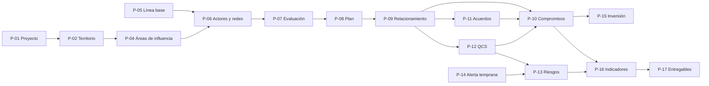
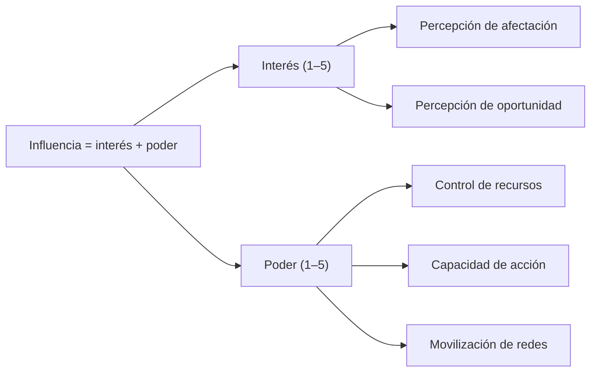
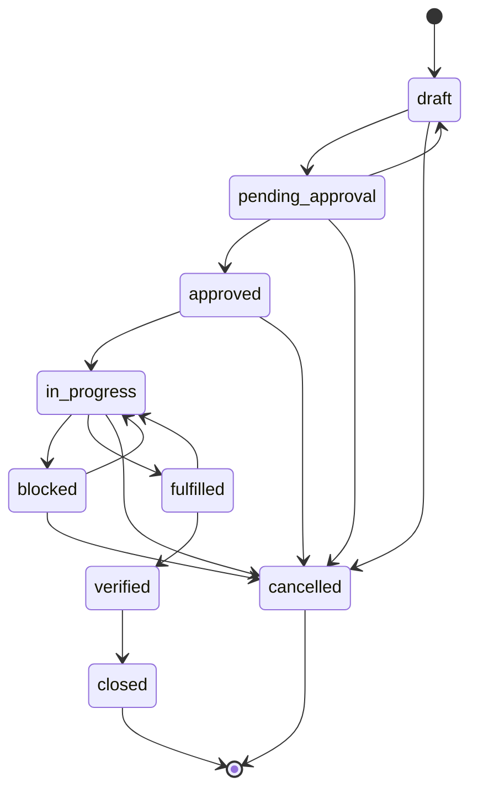

# Análisis de requisitos de SGSPE

Sistema de Gestión Social para Proyectos Extractivos · Fase 0 (descubrimiento) · versión 1.1 · 2026-10-07

Este documento es la **fuente única de los identificadores** de SGSPE. Los requisitos (RF, RNF, RN, RQ), las
contradicciones (CON), los gaps (GAP), los supuestos (ASM) y las brechas de wasichai (UPS) se **definen** aquí, como
primera celda de una fila de tabla. Los demás documentos solo los referencian. El vocabulario ES↔EN está en el
[glosario](glossary.md) y la matriz completa de trazabilidad estará en `requirements-traceability.md`.

## 0. Alcance, fuentes y precedencia

### 0.1 Alcance

- Cubre los pasos 2 y 3 del prompt maestro: inspeccionar las fuentes y producir el análisis de requisitos con las 20
  secciones exigidas [PRM-01 §1, §27].
- SGSPE se construye sobre wasichai y wasichai-ui, como srtm y caja [USR-03]. El marcador `[PLT]` señala lo que la
  plataforma ya resuelve o impone; lo que le falta a wasichai se registra como brecha upstream (UPS, §18.2).
- La Fase 0 no escribe código [PRM-01 §0, §24]. Todo lo que no está en las fuentes pero hace falta se marca como
  `**ASSUMPTION (ASM-NNN):**` en la prosa o con `[ASM]` y su `ASM-NNN` en las tablas, y se registra en §19 con su forma
  de revertirse.
- Las fuentes se citan por su ID y nunca se copian al repositorio. No se escriben nombres de personas reales, DNI,
  teléfonos, números de partida ni datos de comprobantes [USR-07]: las personas se nombran por su cargo ("el Teniente
  Gobernador del caserío El Pollo"). Los topónimos, las comunidades y las instituciones públicas sí se nombran.

### 0.2 Clasificación de las fuentes

El prompt exige no dar a todas las fuentes la misma autoridad y clasificarlas por tipo [PRM-01 §1].

| Fuente | Descripción | Tipo(s) | Autoridad | Justificación |
|---|---|---|---|---|
| DOC-01 | Diagnóstico social de las áreas de influencia del Proyecto Eposuyay (agosto de 2018; distrito y provincia de Otuzco, La Libertad), elaborado por una consultora para una empresa minera. Texto, notas al pie, Anexo 1 (mapa de concesiones) y Gráfico 10.2 (sistema de variables) | proceso de negocio; referencia (**entregable de ejemplo** T1); dato/catálogo; documento histórico | Alta para la semántica del dominio, los catálogos, los métodos (clasificación, priorización, indicadores, matriz de compromisos) y la estructura del entregable T1. Sus recomendaciones son políticas configurables. Sus datos solo inspiran fixtures anonimizados | Estudio de consultoría para un cliente concreto en 2018; USR-01 convierte su estructura en plantilla |
| DOC-02 | Informe de los trabajos de campo y avance en el prospecto "Blanca" (mayo de 2026; comunidad campesina indígena José Carlos Mariátegui, distrito de Inkahuasi, Lambayeque). PDF de 6 páginas con mapa, foto y comprobante | proceso de negocio; referencia (**entregable de ejemplo** T2); dato/catálogo | Alta para la práctica actual (incidente, mapeo de actores, redes comunitarias, apoyos con acta, foto y comprobante, datos legales de la comunidad) y para la plantilla T2 | Evidencia reciente de la operación social real |
| DOC-03 | Captura de ArcMap con hoja Excel: sondajes (código, este, norte, cota, azimut, inclinación), "ÁREA AID 148.00 Ha", concesiones y predios con propietarios | dato/catálogo; requisito técnico implícito | Media para formatos de datos (Excel E/N, `Point ZM`, polígono en ha); baja para reglas de negocio | Imagen sin atribución ni sistema de coordenadas visible |
| PRM-01 | Prompt maestro de arquitectura e implementación (`initial-promp.md`, transitorio, citado por §) | requisito técnico; requisito funcional genérico; proceso de desarrollo | Sus mandatos de proceso son vinculantes (Fase 0, trazabilidad, ASSUMPTION, ADR, DoD, IA con validación humana). Su lista tecnológica queda sustituida por wasichai (CON-039). Sus entidades y estados son hipótesis: el propio prompt pide validarlos contra los documentos [PRM-01 §5] | Es el mandato del proyecto y declara su propio alcance |
| PRM-02 | Prompt maestro de UX/UI (2026-10-07, en la sesión; transitorio, citado por §): visión, principios, design system, pantallas, flujos y handoff del portal | requisito de interfaz; proceso de diseño | Sus principios, su orden de trabajo y sus entregables guían el diseño de la interfaz. Su navegación, sus estados, sus entidades y sus pantallas son hipótesis que ceden ante los requisitos y los diseños de la Fase 0: el propio prompt pide validarlos contra la documentación [PRM-02 §1, §5] | Es el mandato del diseño de la interfaz (`docs/ux/`) |
| ARQ-01 | Boceto `arch-concept.md`: DATA / WORKFLOW / AI convergen en AUDIT | referencia (intención técnica) | Media; coincide con PRM-01 | Boceto del usuario |
| ARQ-02 | Boceto `arch-flow.md`: acta → IA → candidato con evidencia y confianza → revisión humana → compromiso → workflow → tareas, SLA y notificaciones | referencia (intención técnica) | Media; coincide con PRM-01 §9 | Boceto del usuario |
| ARQ-03 | Boceto `arch-init.md`: capas (React, REST, monolito modular, PostgreSQL + PostGIS + pgvector, Spring AI, Embabel) | referencia (intención técnica) | Media; su pgvector contradice PRM-01 §20 (CON-035) | Boceto del usuario |
| ARQ-04 | Racional `tech-landing.txt`: monolito modular, compromisos como contexto central, separación DATA / WORKFLOW / AI | referencia (intención técnica) | Media | Boceto del usuario |
| USR-01..10 | Decisiones del usuario en la sesión (ver §6.0) | requisito funcional; requisito técnico | **Máxima** (no hay normativa); la decisión más reciente prevalece | Las toma el usuario |
| WAS | wasichai 0.3.2 (documentación y ADR 0001–0044) y `@wasichai/*` 0.5.0 | requisito técnico (plataforma) | Vinculante. Sus reglas de stack (sin JPA, DDL solo por metadata, agente de solo lectura) solo cambian mediante un ADR upstream | USR-03 |
| REF | caja-backend y caja-ui (plantilla vigente, wasichai 0.3.2) y srtm-backend y srtm-ui (piezas de GIS e importadores) | referencia (patrón de implementación) | Convención preferida; no aporta dominio | USR-03 pide construir "tal como" esas apps |
| Normativa | Ninguna ley ni reglamento fue proporcionado | normativa | — | Ausencia registrada como GAP-001 |

### 0.3 Reglas de precedencia

- **Asuntos técnicos:** USR > WAS > REF > PRM-01 > ARQ > ASM.
- **Semántica del dominio:** USR > DOC explícito > DOC inferido > PRM-01 (hipótesis) > ASM.
- **Diseño de la interfaz:** USR > requisitos y diseños de la Fase 0 > PRM-02 > ASM.
- **Entre DOC-01 y DOC-02:** DOC-02 (2026) prevalece en la práctica operativa actual; DOC-01 aporta los métodos que DOC-02
  no trata (clasificación interés × poder, priorización, indicadores, matriz de compromisos, riesgos).
- **Texto contra tabla dentro de un documento:** ninguna prevalece. Se registran evaluaciones fechadas con su fuente y se
  advierte la inconsistencia (CON-006).
- **Sin normativa:** ningún requisito se presenta como obligación legal. Las referencias legales se tratan como GAP-001.

### 0.4 Qué cambia porque DOC-01 y DOC-02 son entregables de ejemplo

1. **Requisitos de información:** cada campo o tabla de DOC-01 y DOC-02 es un requisito de *poder registrarlo y producirlo*
   ([EXP]).
2. **Prácticas** como la revisión semanal de riesgos, la evaluación mensual de grupos de interés, la meta de dos reuniones
   al mes o los seis a diez puestos de trabajo eran consejos a un cliente. Se modelan como **políticas configurables por
   proyecto con valores por defecto**, no como reglas fijas (ASM-019).
3. **Valores concretos** (nombres, conteos, números de registro) nunca son requisitos; solo inspiran fixtures ficticios.
4. **La estructura** de DOC-01 y DOC-02 es requisito de plantilla porque USR-01 la vuelve vinculante.

### 0.5 Convenciones de IDs

Un ID se define una sola vez, como primera celda de una fila de tabla de este documento. No se usan rangos: cada ID se
escribe completo. Una obligación tiene un solo ID; los IDs retirados al consolidar duplicados están en §20.4.

| Familia | Formato | Sección |
|---|---|---|
| Requisitos funcionales | `RF-<CTX>-NNN` | §6 |
| Requisitos no funcionales | `RNF-<CAT>-NNN`, con CAT ∈ SEC, PRIV, AUD, PERF, AVL, USA, I18N, OBS, MNT, TST, INT | §7 |
| Reglas de negocio | `RN-<CTX>-NNN` | §8 |
| Requisitos GIS, de reporting y entregables, de dashboards, de seguridad, de auditoría y de IA | `RQ-GIS-NNN`, `RQ-REP-NNN`, `RQ-DSH-NNN`, `RQ-SEC-NNN`, `RQ-AUD-NNN`, `RQ-AI-NNN` | §12 a §16 |
| Contradicciones, gaps y supuestos | `CON-NNN`, `GAP-NNN`, `ASM-NNN` | §17 a §19 |
| Brechas upstream de wasichai | `UPS-NN` | §18.2 |

Reparto entre familias: las obligaciones de GIS, entregables, tableros, seguridad, auditoría e IA viven en las RQ de §12 a
§16; las obligaciones de negocio, en las RF (capacidades) y las RN (reglas). Las RNF de §7 cubren solo lo que no encaja en
esas secciones.

Códigos de contexto `<CTX>` (en inglés):

| Código | Contexto | Código | Contexto |
|---|---|---|---|
| PRJ | proyectos | DOC | documentos y evidencias |
| TER | territorio | WFL | workflow y tareas |
| STK | grupos de interés | NTF | notificaciones |
| ENG | relacionamiento | REP | reportes y entregables |
| COM | compromisos | DSH | dashboards |
| AGR | acuerdos y convenios | IAM | identidad y acceso |
| GRV | quejas, consultas y solicitudes | AUD | auditoría |
| RSK | riesgos sociales | AIK | IA y conocimiento |
| EWS | alerta temprana | LBS | línea base social |
| INV | inversión y programas sociales | CAT | catálogos |
| FLD | operaciones de campo | PLT | plataforma (reservado; los requisitos de plataforma usan `RNF-MNT`) |

Otros identificadores que usan los demás documentos (no son IDs de requisito): objetivos `OBJ-NN` (§3), procesos `P-NN`
(§5), bounded contexts `BC-NN` (§0.8), workflows `WF-A` a `WF-P` (§11), KPIs `KPI-EXE-NN`, `KPI-STK-NN`, `KPI-ENG-NN`,
`KPI-COM-NN`, `KPI-GRV-NN`, `KPI-RSK-NN`, `KPI-INV-NN` y `KPI-TER-NN` (los define `dashboards.md`), capas `LYR-NN` (las
define `gis.md`), pantallas `SNN` (las define `ux/ux-architecture.md`), casos de IA `AI-01` a `AI-08` [PRM-01 §9] y ADRs `ADR-0001` en adelante (`docs/adr/`).

### 0.6 Marcadores de origen

| Marcador | Significado |
|---|---|
| `[EXP]` | Explícito en un documento fuente (DOC-01, DOC-02, DOC-03) |
| `[INF]` | Inferido de un documento fuente; la fila explica la inferencia con una cláusula "porque …" |
| `[PRM]` | Solo en un prompt maestro o en los bocetos (PRM-01, PRM-02, ARQ-01..04) |
| `[USR]` | Decisión del usuario (USR-01..10) |
| `[PLT]` | Provisto o impuesto por wasichai |
| `[ASM]` | Supuesto: necesario para la arquitectura, sin fuente; la fila cita su `ASM-NNN` de §19 |

### 0.7 Formato de citas

`[DOC-01 §9.3.1.2]`, `[DOC-01 Tabla 7.1]`, `[DOC-01 nota 12]` (nota al pie del DOCX), `[DOC-01 Anexo 3]`,
`[DOC-01 portada]`, `[DOC-01 índice]` (índice y listas de tablas y de gráficos), `[DOC-02 p.4]`, `[DOC-03]`, `[PRM-01 §5]`,
`[PRM-02 §12]`,
`[ARQ-02]`, `[USR-01]`, `[WAS-ADR-0040]` (ADR de
wasichai) y `[WAS-DOC api/rest.md]` (documentación de wasichai, ruta relativa a `wasichai/docs`).

### 0.8 Bounded contexts, fases y releases

El prompt propone 18 bounded contexts [PRM-01 §4]. **ASSUMPTION (ASM-045):** BC-11 (operaciones de campo) se fusiona con
BC-04 en el MVP, porque en las fuentes la visita de campo es el contexto de las interacciones; y se agregan BC-19 (línea
base social) y BC-20 (catálogos), que el prompt no tiene. Su detalle está en `domain-model.md`.

| BC | Contexto (ES) | Prompt (EN) | Código |
|---|---|---|---|
| BC-01 | Proyectos | Project Management | PRJ |
| BC-02 | Territorio y SIG | Territory / GIS | TER |
| BC-03 | Grupos de interés | Stakeholder Management | STK |
| BC-04 | Relacionamiento (absorbe Operaciones de campo en el MVP) | Engagement Management | ENG |
| BC-05 | Compromisos | Commitments Management | COM |
| BC-06 | Acuerdos y convenios | Agreements / Conventions | AGR |
| BC-07 | Quejas, Consultas y Solicitudes (QCS) | Grievances / Complaints | GRV |
| BC-08 | Riesgos sociales | Social Risk Management | RSK |
| BC-09 | Alerta temprana e incidentes | Early Warning | EWS |
| BC-10 | Inversión social y programas | Social Investment / Programs | INV |
| BC-11 | Operaciones de campo (fusionado en BC-04; la captura sin conexión queda en GAP-008) | Field Operations | FLD |
| BC-12 | Evidencias y documentos | Documents / Evidence | DOC |
| BC-13 | Tareas y aprobaciones | Workflow / Tasks | WFL |
| BC-14 | Notificaciones | Notifications | NTF |
| BC-15 | Reportes, tableros y entregables | Reporting / BI | REP, DSH |
| BC-16 | Identidad y acceso | Identity / Access Control | IAM |
| BC-17 | Auditoría | Audit | AUD |
| BC-18 | IA y conocimiento | AI / Knowledge | AIK |
| BC-19 | Línea base social (nuevo) | — | LBS |
| BC-20 | Catálogos (nuevo, de soporte) | — | CAT |

Fases del roadmap, en el orden del prompt [PRM-01 §24] [USR-05]: F0 descubrimiento; F1 fundación; F2 proyectos,
territorio, grupos de interés y relacionamiento; F3 compromisos, acuerdos, evidencias, tareas y aprobaciones; F4 QCS,
riesgos, alertas y escalamiento; F5 programas e inversión social; F6 GIS avanzado; F7 IA; F8 dashboards consolidados y
entregables. Cada requisito indica su fase F.

El prompt pide definir un MVP, una Fase 2 y una Fase 3 sin asignarles fases [PRM-01 §4]. **ASSUMPTION (ASM-044):**
Release 1 (MVP) = F1–F4; Release 2 (Fase 2 de producto) = F5–F6; Release 3 (Fase 3 de producto) = F7–F8.

## 1. Resumen ejecutivo

- **Qué es SGSPE.** Una plataforma de *social performance management* para proyectos extractivos en Perú, no un CRM
  [PRM-01 §2]. Debe responder: "¿Cuál es la situación social actual de un proyecto, qué compromisos existen, qué riesgos
  existen, qué está ocurriendo territorialmente y qué acciones deben realizarse?" [PRM-01 §2].
- **Fuentes.** Dos entregables de ejemplo de consultoría social (DOC-01, diagnóstico de 2018; DOC-02, informe de campo de
  2026), una captura SIG (DOC-03), el prompt maestro, cuatro bocetos y nueve decisiones del usuario. No hay ninguna fuente
  normativa (GAP-001).
- **Hallazgos del dominio.**
  - La unidad de gestión es el **grupo de interés de un proyecto**, evaluado en fechas sucesivas por interés y poder
    (índices 1–5 con indicadores definidos en el Gráfico 10.2), postura (cuatro valores) y confianza (1–5)
    [DOC-01 §6, §7.2, §9.3.1.1, Anexo 3].
  - Las **áreas de influencia** se definen por criterios y por listas de localidades y comunidades, no solo por polígonos
    [DOC-01 §4]; la captura SIG las muestra además como polígono con área en hectáreas [DOC-03].
  - Los **compromisos** son el núcleo: DOC-01 fija los campos mínimos de su matriz, incluida la entrega con conformidad,
    acta y fotos [DOC-01 §9.3.1.2]. Los apoyos sociales puntuales con acta, foto y comprobante (DOC-02) son un concepto
    que el prompt no tenía.
  - Las fuentes hablan de **quejas, consultas y solicitudes**, no solo de *grievances* [DOC-01 Tabla 9.5].
  - Aparecen entidades ausentes en el prompt: redes comunitarias, cargos con vacancia, datos legales de la comunidad,
    reconocimiento indígena, incidentes, temas clave, mensajes clave, alianzas, percepciones, concesiones, componentes,
    predios y elementos ambientales [DOC-01] [DOC-02] [DOC-03].
  - La captura SIG trae los **mismos sondajes con coordenadas distintas** entre Excel y ArcMap (de ≈1 m, con lectura dudosa, a unos 216 m), lo que
    obliga a importar con CRS explícito y con reconciliación [DOC-03].
- **Encaje con wasichai.** La plataforma ya resuelve datos por metadata, workflow, auditoría con motivo, permisos por rol,
  objeto, campo y acción, almacenamiento GIS y documentos congelados [USR-03]. Faltan 18 capacidades, registradas como
  brechas upstream (§18.2). La crítica es UPS-01: no existe alcance de lectura por proyecto o territorio.
- **Entregables.** DOCX y PDF del mismo documento: el DOCX con Apache POI y, desde el 2026-10-19, el PDF compuesto con
  LuaLaTeX desde el mismo modelo (antes, Gotenberg), emisión congelada con hash y niveles de divulgación [USR-01] (ASM-014,
  ASM-139).
- **Decisiones pendientes para el checkpoint.** El alcance por proyecto (CON-041, UPS-01) y las preguntas de §18, en
  especial la normativa (GAP-001), la ponderación de interés y poder (GAP-002), la definición de "Vulnerable" (GAP-003),
  las escalas de riesgo (GAP-004), los plazos de QCS (GAP-005) y el modelo de tenant (GAP-009).
- Las cifras por familia de IDs y la trazabilidad por fuente están en §20.

## 2. Contexto del negocio

### 2.1 La gestión social en proyectos extractivos

- La gestión social de un proyecto minero, de hidrocarburos o de energía consiste en conocer el territorio y a sus
  actores, relacionarse con ellos, cumplir los compromisos asumidos, atender sus quejas y pedidos, anticipar riesgos y
  conflictos y demostrar todo ello con evidencias e indicadores [PRM-01 §2].
- Las tres fuentes describen la **etapa de exploración**: cateo, exploración inicial y campañas de perforación diamantina
  [DOC-01 §1] [DOC-02 p.2] [DOC-03]. En esa etapa el proyecto solo invierte, los puestos de trabajo son pocos y el apoyo
  social es limitado [DOC-01 Tabla 9.2].
- El agua es el tema más sensible: la escasez y el temor a la contaminación son la principal fuente de oposición
  [DOC-01 §7.1, Tabla 8.1].

### 2.2 El caso de DOC-01 (Proyecto Eposuyay, Otuzco, 2018)

- El proyecto busca retomar el cateo e iniciar una primera campaña de perforación entre octubre y diciembre de 2018. Tiene
  apoyo de parte de la población del área directa y oposición de rondas campesinas, organizaciones de agua y autoridades
  del área indirecta, además de las federaciones distrital y provincial de rondas [DOC-01 §1].
- **Áreas de influencia social** definidas por criterios [DOC-01 §4]:
  - AIDS: el caserío Pachín Alto, el caserío Machigón y los tres sectores del caserío El Pollo; el sector Saligualday (en
    proceso de separación de Pachín Alto) y la Comunidad Campesina Luis de la Puente Uceda, porque algunos sondajes
    previstos coinciden con sus terrenos inscritos [DOC-01 §4.1].
  - AIIS: once caseríos de dos microcuencas, más el ámbito distrital y provincial de Otuzco por la percepción de
    afectación del agua de consumo de la ciudad [DOC-01 §4.2].
- **Trabajo de campo:** 72 entrevistas semiestructuradas en 15 localidades rurales y en las ciudades de Otuzco y Trujillo,
  más fichas de observación en las localidades del AIDS, entre junio y julio de 2018 [DOC-01 §3.3, Tabla 3.1].
- **Grupos de interés:** 22 en el AIDS, 48 en el AIIS y 5 regionales, de tipos autoridad local, organización social,
  organización comunal, líder local, autoridad provincial y regional, líder político, programa social e iglesia
  [DOC-01 Tablas 6.1–6.3]. Se clasifican en estratégicos, políticos, para monitoreo y vulnerables según interés y poder
  [DOC-01 §7.2, Anexo 3].
- **Estrategia:** campaña de información (contactos regulares, reuniones informativas, mensajes clave, priorización),
  alianzas estratégicas, gestión de impactos y beneficios (monitoreo de grupos de interés, matriz de compromisos,
  lineamientos de apoyo, matriz de riesgos semanal) y necesidades internas (plan de trabajo, equipo, contratistas)
  [DOC-01 §9].

### 2.3 El caso de DOC-02 (prospecto Blanca, Inkahuasi, 2026)

- En julio de 2025 la ronda campesina comunal expulsó del territorio a personal de geología que había ingresado sin
  autorización y retuvo temporalmente su vehículo; la relación con la comunidad quedó seriamente dañada [DOC-02 p.2].
- El informe fija un objetivo estratégico (reconstruir la relación para reingresar) y tres tácticos, y dos estrategias:
  mapeo de actores y estudio de redes comunitarias [DOC-02 p.2].
- Actividades de abril y mayo de 2026: una reunión cancelada por lluvia, cinco redes identificadas (tres de caseríos, la
  junta directiva comunal y redes de apoyo externo), contactos con nuevas autoridades y un apoyo en víveres entregado con
  acta de recepción, foto y comprobante [DOC-02 p.2–p.4].
- La comunidad está reconocida como pueblo indígena u originario, tiene partida registral, título de propiedad, área
  inscrita aún no independizada de una partida matriz y ocho sectores con delegados ante la asamblea comunal; las
  concesiones del prospecto están sobre su territorio [DOC-02 p.4–p.5].
- Recomienda cambiar al titular de las concesiones por riesgo reputacional y sostener la intervención para obtener el
  permiso de uso de tierras [DOC-02 p.6].

### 2.4 El dato técnico de DOC-03

- Una tabla de perforaciones (`Point ZM`, código, tipo DDH, este, norte, cota, azimut, inclinación), la hoja Excel de origen
  (componente, este, norte), un polígono "ÁREA AID 148.00 Ha", concesiones y una tabla de predios con propietarios [DOC-03].

### 2.5 Actores típicos del territorio

Caseríos y sus sectores; comunidades campesinas con junta directiva, delegados y comuneros; tenientes gobernadores y
agentes municipales; rondas campesinas y sus federaciones; JASS, comités y juntas de regantes; municipalidades,
subprefectura, fiscalía, Autoridad Local del Agua, gobierno regional y Defensoría del Pueblo; Iglesia, ONG, medios locales,
programas sociales del Estado y contratistas del proyecto [DOC-01 §5–§6, §9.2, §9.4.2] [DOC-02 p.3]. Sus definiciones están
en el [glosario](glossary.md).

## 3. Objetivos del sistema

| ID | Objetivo | Fuente |
|---|---|---|
| OBJ-01 | Responder la pregunta central sobre la situación social, los compromisos, los riesgos, lo que ocurre en el territorio y las acciones pendientes de cada proyecto | [PRM-01 §2] |
| OBJ-02 | Gestionar el desempeño social de forma integral (territorio, actores, relacionamiento, compromisos, convenios, QCS, riesgos, alertas, inversión, evidencias, indicadores), no como un CRM | [PRM-01 §2] |
| OBJ-03 | Mantener la trazabilidad completa entre territorio, actores, actividades, documentos, compromisos, riesgos, QCS, programas e indicadores | [PRM-01 §29] |
| OBJ-04 | Producir desde los datos entregables como DOC-01 y DOC-02 en DOCX y PDF | [USR-01] |
| OBJ-05 | Mostrar la situación en mapas (GIS) y tableros | [USR-02] [PRM-01 §15, §16] |
| OBJ-06 | Tratar los compromisos como contexto central, con responsable, plazos, evidencia y verificación | [PRM-01 §5] [ARQ-04] [DOC-01 §9.3.1.2] |
| OBJ-07 | Anticipar el conflicto: monitorear posturas, riesgos y señales, siempre con decisión humana | [DOC-01 §9.3] [PRM-01 §5] |
| OBJ-08 | Proteger los datos personales y anonimizar todo artefacto versionado y toda salida externa | [USR-07] |
| OBJ-09 | Usar la IA como complemento con validación humana, nunca como fuente de datos no controlada | [PRM-01 §9] [ARQ-01] [ARQ-02] |
| OBJ-10 | Responder para cada cambio importante quién, qué, cuándo, por qué, desde qué valor y hacia cuál | [PRM-01 §18] |
| OBJ-11 | Construir sobre wasichai para reutilizar una plataforma auditable y guiada por metadata | [USR-03] |

**No objetivos** (lo que SGSPE no hará, salvo nueva decisión):

- No es un CRM comercial ni un sistema contable: registra montos de compromisos y aportes, pero no reemplaza la
  contabilidad de la empresa [PRM-01 §2].
- No decide por las personas: la IA y las reglas sugieren; confirmar un conflicto, aprobar o cerrar es humano
  [PRM-01 §5, §9].
- No se divide en microservicios [PRM-01 §3, §26].
- No certifica cumplimiento legal: sin fuente normativa, ninguna regla se presenta como obligación legal (GAP-001).
- No captura sin conexión en el MVP (GAP-008, ASM-021); su diseño de UX está hecho para una fase posterior (ASM-081).

## 4. Actores

### 4.1 Roles de usuario

Los 17 roles del prompt se conservan con su nombre técnico en inglés y una etiqueta en español [PRM-01 §7] [USR-09]. En
wasichai, SUPER_ADMIN y ORGANIZATION_ADMIN se mapean al rol `ADMIN` y los otros 15 se declaran en `model/roles.json`
(ASM-024). La columna "Descripción" cita la fuente cuando el rol aparece en DOC-01 o DOC-02; los demás roles solo
existen en el prompt [PRM-01 §7]. El detalle de permisos está en `security.md`.

| Rol | Etiqueta | Descripción | Mapeo en wasichai | Permisos desde |
|---|---|---|---|---|
| `SUPER_ADMIN` | Superadministrador | Operador de la plataforma que aprovisiona tenants [PRM-01 §7] | `ADMIN` de la organización operadora | F1 |
| `ORGANIZATION_ADMIN` | Administrador de la organización | Administra usuarios, roles y modelo de un tenant [PRM-01 §7] | `ADMIN` del tenant | F1 |
| `PROJECT_ADMIN` | Administrador de proyectos | Da de alta y aprueba proyectos y su equipo [PRM-01 §7] | Rol declarado | F2 |
| `PROJECT_MANAGER` | Jefe de proyecto | "Jefe del Proyecto" que aprueba la lista de entrevistados [DOC-01 §3.2] | Rol declarado | F2 |
| `SOCIAL_MANAGER` | Gerente social | Responsable de supervisar el plan de trabajo social [DOC-01 §9.4.1] | Rol declarado | F2 |
| `COMMUNITY_RELATIONS_OFFICER` | Relacionista comunitario | "Relacionistas" y "equipo social" [DOC-01 §7.1.2, §9.1] [DOC-02 p.2] | Rol declarado | F2 |
| `STAKEHOLDER_MANAGER` | Gestor de grupos de interés | Mapeo y evaluación de grupos de interés [DOC-01 §6–§7] | Rol declarado | F2 |
| `COMMITMENT_MANAGER` | Gestor de compromisos | Lleva la matriz de compromisos [DOC-01 §9.3.1.2] | Rol declarado | F3 |
| `GRIEVANCE_MANAGER` | Gestor de quejas, consultas y solicitudes | Atiende QCS [DOC-01 Tabla 9.5] | Rol declarado | F4 |
| `SOCIAL_RISK_MANAGER` | Gestor de riesgos sociales | Lleva la matriz de riesgos [DOC-01 §9.3.2] | Rol declarado | F4 |
| `SOCIAL_INVESTMENT_MANAGER` | Gestor de inversión social | Aportes y programas [DOC-01 §9.3.1.2] [DOC-02 p.3–p.4] | Rol declarado | F5 |
| `GIS_ANALYST` | Analista SIG | Prepara mapas e importa coordenadas [DOC-03] | Rol declarado | F2 |
| `FIELD_AGENT` | Agente de campo | Registra en terreno lo que él mismo levanta [PRM-01 §7] | Rol declarado sin `EDIT_ANY`: agrega participantes u observaciones a lo que puede leer y solo cambia o borra lo que creó (ASM-069) | F2 |
| `APPROVER` | Aprobador | Aprueba mediante acciones declaradas como `APPROVE` [PRM-01 §7] | Rol declarado | F3 |
| `AUDITOR` | Auditor | Lee todo el tenant y la auditoría [PRM-01 §7] | Rol declarado con READ a nivel tenant | F1 |
| `ANALYST` | Analista | Lee y reporta por objeto [PRM-01 §7] | Rol declarado | F2 |
| `READ_ONLY` | Solo lectura | Consulta [PRM-01 §7] | Rol declarado | F2 |

### 4.2 Actores del territorio (no son usuarios)

Son personas y organizaciones que SGSPE registra como actores y, en relación con un proyecto, como grupos de interés
(RF-STK-001, RF-STK-003). No inician sesión.

| Tipo de actor | Ejemplos (por cargo) | Fuente |
|---|---|---|
| Autoridad local | Teniente Gobernador y Agente Municipal de cada caserío; Juez de Paz | [DOC-01 §6.1.1, §6.2.1] [DOC-02 p.3] |
| Organización social local | Ronda campesina, JASS, comité o junta de regantes, comité de autodefensa, APAFA, club de madres, asociación de agricultores | [DOC-01 §5.1.7, §6.1.2, Tabla 5.10] [DOC-02 p.3] |
| Organización comunal | Comunidad campesina: junta directiva, vicepresidente, delegados comunales, asamblea | [DOC-01 §6.1.3] [DOC-02 p.3–p.5] |
| Líder local | Líder de oposición de un sector | [DOC-01 Tabla 6.1, nota 13] |
| Organización social distrital, provincial o regional | Federaciones de rondas, comités ambientales, central regional de rondas, federación de comunidades indígenas | [DOC-01 §6.2.2, §6.2.4, §6.3.2] [DOC-02 p.3] |
| Autoridad provincial o regional | Alcalde, unidad de gestión ambiental, fiscalía, Autoridad Local del Agua, subprefectura, gerencia regional de energía y minas, Defensoría del Pueblo, consejero regional | [DOC-01 §6.2.3, §6.3.1] |
| Líder político | Candidatos a la alcaldía provincial | [DOC-01 §6.2.5] |
| Programa social | Núcleo ejecutor de un programa del Estado | [DOC-01 §6.2.6] |
| Iglesia y ONG | Parroquia, diócesis, ONG ambiental, ONG de derechos humanos | [DOC-01 §6.2.3.6, §6.3.3, Tabla 9.3] [DOC-02 p.3] |
| Medios | Radios locales, prensa regional | [DOC-01 Tabla 9.5, nota 20] |
| Contratistas del proyecto | Alertan sobre preocupaciones e incidentes | [DOC-01 §9.4.2] |

### 4.3 Sistemas externos

| Sistema | Uso | Fuente |
|---|---|---|
| wasichai (core, workflow, automation, documents, gis, agent) | Plataforma: metadata, API genérica, workflow, auditoría, documentos, GIS y asistente | [USR-03] |
| GeoServer | Publicación WMS y mapas de informe (opcional en wasichai) | [WAS-ADR-0006] [WAS-ADR-0027] |
| LuaLaTeX (`sgspe-latex`) | Composición del PDF de los entregables desde el modelo congelado | ASM-139 |
| Almacenamiento de objetos (local o S3) | Evidencias y entregables | ASM-013 |
| Servidor SMTP | Notificaciones por correo | [PRM-01 §17] |
| Proveedor de LLM | IA de F7, intercambiable | [PRM-01 §10] |
| Fuentes de datos públicos | INEI para ubigeo y centros poblados (ASM-016); COFOPRI y SUNARP para predios y registros; las demás fuentes cartográficas (concesiones, hidrografía, cartografía base) se definen en GAP-011 | [DOC-01 Anexo 1] [DOC-02 p.4] |

## 5. Procesos

Procesos de negocio identificados en las fuentes. Cada uno se soporta con los requisitos de §6 a §16.

| ID | Proceso | Disparador → resultado | Fuente | BC | Fase |
|---|---|---|---|---|---|
| P-01 | Configuración del proyecto y su equipo | Nuevo proyecto o campaña → proyecto con partes, campañas, concesiones, CRS de trabajo y equipo asignado | [PRM-01 §5, §7] [DOC-01 §1] [DOC-02 p.4] | BC-01 | F2 |
| P-02 | Registro territorial | Llegada a una zona → unidades administrativas, localidades, comunidades, sectores, predios, componentes y elementos ambientales | [DOC-01 §4–§5] [DOC-02 p.4–p.5] [DOC-03] | BC-02 | F2 |
| P-03 | Importación geoespacial con reconciliación | Archivo de coordenadas → registros con CRS de origen y reporte de diferencias | [DOC-03] | BC-02 | F2 (otros formatos y los destinos `community.territory` y `environmental_feature.boundary` en F6, ASM-056 y ASM-123) |
| P-04 | Definición de las áreas de influencia | Criterios y componentes del proyecto → versión aprobada de AIDS y AIIS con sus miembros | [DOC-01 §4] [DOC-03] | BC-02 | F2 |
| P-05 | Estudio de línea base o diagnóstico | Necesidad de conocer el contexto → estudio con instrumentos, trabajo de campo, perfiles de localidad, percepciones y temas clave | [DOC-01 §2–§5, §7.1, §8, Tabla 10.1] | BC-19 | F2 |
| P-06 | Identificación y mapeo de actores y redes | Trabajo de campo o información secundaria → actores, cargos, grupos de interés, redes y relaciones; revisión periódica de la lista | [DOC-01 §6] [DOC-02 p.2–p.3] | BC-03 | F2 |
| P-07 | Evaluación y priorización de grupos de interés | Entrevista o revisión periódica → evaluación fechada (interés, poder, postura, confianza), grupo de influencia y prioridad | [DOC-01 §7.2, §9.1.1.4, §9.3.1.1, Anexo 3] | BC-03 | F2 |
| P-08 | Planificación del relacionamiento | Diagnóstico y objetivos → plan con objetivos, mensajes clave, respuestas alineadas, alianzas, metas y actividades | [DOC-01 §9.1–§9.2] [DOC-02 p.2] | BC-04 | F2 |
| P-09 | Ejecución y registro del relacionamiento | Contacto, reunión, taller, asamblea o visita → interacción con participantes, temas, preguntas, acta y evidencias; o cancelación con motivo | [DOC-01 §9.1.1, Tabla 9.5] [DOC-02 p.2–p.3] | BC-04 | F2 |
| P-10 | Gestión de compromisos | Pedido, acuerdo en reunión o carta → compromiso aprobado, ejecutado, entregado con conformidad, verificado y cerrado | [DOC-01 §9.3.1.2] [PRM-01 §8] | BC-05 | F3 |
| P-11 | Gestión de acuerdos y permisos | Negociación → acuerdo, convenio, permiso de uso de terreno, servidumbre o autorización de asamblea con cláusulas y vigencia | [DOC-01 §6.1.1.7, §9.1.1.3, §9.3.1.2] [DOC-02 p.6] | BC-06 | F3 |
| P-12 | Atención de quejas, consultas y solicitudes | Recepción por un canal → respuesta, resolución o compromiso, cierre y reporte | [DOC-01 Tabla 9.5, §9.3.1.2] [PRM-01 §8] | BC-07 | F4 |
| P-13 | Gestión de riesgos e impactos | Fuente de riesgo identificada → evaluación semanal, decisión de tratamiento, medidas y riesgo residual | [DOC-01 §9.3, §9.3.2] | BC-08 | F4 |
| P-14 | Alerta temprana e incidentes | Señal, regla, noticia o incidente → alerta con triaje y decisión humana, respuesta y cierre | [DOC-02 p.2] [DOC-01 §9.3.2.2] [PRM-01 §5] | BC-09 | F4 |
| P-15 | Inversión social y aportes | Pedido de apoyo o programa → aporte entregado con acta, foto y comprobante, o programa con presupuesto, beneficiarios e indicadores | [DOC-02 p.3–p.4] [DOC-01 §9.3.1.2] [PRM-01 §5] | BC-10 | F5 |
| P-16 | Monitoreo e indicadores | Periodo de corte → indicadores de la Tabla 9.5 y del prompt en tableros | [DOC-01 §9.3.1, Tabla 9.5] [PRM-01 §16] | BC-15 | F2–F8 |
| P-17 | Elaboración y emisión de entregables | Periodo y alcance → borrador DOCX/PDF, revisión, aprobación y emisión congelada | [USR-01] [DOC-01] [DOC-02] | BC-15 | F8 |
| P-18 | Tareas, aprobaciones, vencimientos y notificaciones | Transición o fecha → tarea, aprobación, aviso o escalamiento | [PRM-01 §5, §8, §17] | BC-13, BC-14 | F3–F4 |
| P-19 | Asistencia de IA con validación humana | Documento, acta o pregunta → sugerencia con evidencia y confianza → decisión humana | [PRM-01 §9] [ARQ-02] | BC-18 | F7 |
| P-20 | Administración de la plataforma | Alta de tenant, usuarios, roles, modelo y consulta de auditoría | [PRM-01 §7, §18] [USR-03] | BC-16, BC-17 | F1 |

Cadena principal de valor, según el resultado esperado del prompt [PRM-01 §29]:

## 6. Requisitos funcionales

Columnas: **Fuente** cita el documento; **Origen** usa los marcadores de §0.6; **BC** y **Fase** siguen §0.8. Los
objetos se nombran con el catálogo canónico (ver `domain-model.md`) y los valores de los catálogos solo se listan en §10.
Cuando un requisito usa un objeto que llega en una fase posterior, la fila lo indica ("vínculo desde F3").

### 6.0 Decisiones del usuario y dónde se despliegan

| Decisión | Contenido | Requisitos que la despliegan |
|---|---|---|
| USR-01 | El sistema genera entregables como DOC-01 (DOCX) y DOC-02 (PDF), en ambos formatos | RF-REP-001, RF-REP-002, RQ-REP-001, RQ-REP-002, RQ-REP-015, RQ-REP-017, RQ-REP-026 |
| USR-02 | La situación se visualiza en GIS y en dashboards | RQ-GIS-001, RQ-GIS-005, RQ-GIS-014, RF-DSH-001, RF-DSH-002, RF-DSH-006, RQ-DSH-001 |
| USR-03 | Construir sobre wasichai y wasichai-ui como srtm y caja; la plantilla vigente es caja (wasichai 0.3.2, `@wasichai/*` 0.5.0) | RNF-MNT-001, RNF-MNT-002, RNF-MNT-005, RF-IAM-001 |
| USR-04 | Ejecución F0 → pausa para revisión → F1 | RNF-MNT-007 |
| USR-05 | Se mantiene el orden del roadmap del prompt; los KPIs de cada módulo aparecen cuando el módulo se construye | RNF-MNT-007, RQ-DSH-036 |
| USR-06 | Usuarios locales con la autenticación de wasichai (JWT propio) | RQ-SEC-001 |
| USR-07 | Datos personales anonimizados en todo artefacto versionado | RQ-SEC-018, RQ-SEC-010, RQ-REP-014 |
| USR-08 | Repos `wasichai/sgspe` (backend, documentación y ADRs) y `wasichai/sgspe-ui` (web) | RNF-MNT-006 |
| USR-09 | Nombres técnicos en inglés; etiquetas, documentos y README en español | RNF-MNT-004, RF-CAT-001 |
| USR-10 | El diseño de la interfaz sigue el orden dominio → arquitectura de información → navegación → design system → patrones núcleo → Project 360 y territorio → grupos de interés, relacionamiento y compromisos → QCS, riesgos y programas → tableros → capa de IA, sin empezar por el tablero. Ningún módulo es una aplicación aparte: desde una comunidad en el mapa se pasa a sus grupos de interés, a una interacción, al compromiso que generó y a su evidencia sin perder el contexto del proyecto y del territorio | RNF-USA-001, RF-IAM-002, ASM-075, ASM-076 (`docs/ux/`) |

### 6.1 Proyectos (PRJ)

| ID | Requisito | Fuente | Origen | BC | Fase |
|---|---|---|---|---|---|
| RF-PRJ-001 | Registrar proyectos (`project`) con código único, nombre, descripción, tipo, etapa del ciclo de vida y fase de exploración (catálogos "Tipo de proyecto", "Etapa del proyecto" y "Fase de exploración" de §10), fechas y CRS de trabajo; un "prospecto" es un proyecto en fase inicial de exploración | [PRM-01 §5] [DOC-01 §1] [DOC-02 p.1–p.2] | [EXP] [PRM] | BC-01 | F2 |
| RF-PRJ-002 | Registrar las partes del proyecto (`project_party`), cada una como `organization` con su rol de parte (§10): quien encarga el estudio o el proyecto, quien lo opera, el titular de las concesiones, la consultora y los contratistas | [PRM-01 §5] [DOC-01 portada, §1, §9.4.2] [DOC-02 p.4, p.6] | [EXP] [PRM] | BC-01 | F2 |
| RF-PRJ-003 | Gestionar el ciclo de vida del proyecto con revisión y aprobación (WF-A); la etapa y la fase de exploración son campos, no estados (RN-PRJ-001); la revisión puede omitirse con una variante de WF-A (ASM-010); llegar a `active` exige `working_crs` y una parte CLIENTE u OPERADOR (ASM-062) | [PRM-01 §8] | [PRM] [ASM] | BC-01 | F2 |
| RF-PRJ-004 | Registrar campañas de exploración (`exploration_campaign`): tipo de actividad (§10), fechas planificadas y reales, estado (catálogo "Estado de la campaña" de §10) y tope de apoyo social con su moneda | [DOC-01 §1, §9.3.1.2, Tabla 9.4] | [EXP] | BC-01 | F2 |
| RF-PRJ-005 | Asignar usuarios a proyectos (`project_assignment`) con rol en el proyecto (`role_name`, un rol declarado de wasichai, ASM-070) y vigencia; es el directorio del equipo y la fuente del alcance por proyecto (RQ-SEC-006) (inferido porque DOC-01 describe un equipo de relaciones comunitarias y un responsable del plan de trabajo por proyecto) | [PRM-01 §7] [DOC-01 §3.2, §9.4.1] | [PRM] [INF] [ASM] | BC-01 | F2 |
| RF-PRJ-006 | Registrar concesiones mineras (`mining_concession`): código, titular, datum de origen, área y polígono, vinculadas a uno o más proyectos (M2M `project_concession`) | [DOC-01 Anexo 1] [DOC-02 p.4] [DOC-03] | [EXP] | BC-01 | F2 |

### 6.2 Territorio (TER)

| ID | Requisito | Fuente | Origen | BC | Fase |
|---|---|---|---|---|---|
| RF-TER-001 | Mantener el catálogo de unidades administrativas (`administrative_unit`) con el ubigeo del INEI (catálogo "Nivel de unidad administrativa" de §10), su jerarquía y su límite opcional, cargado desde el archivo público del INEI con un script idempotente (ASM-016) | [DOC-01 §1, §4.2] [DOC-02 p.5] [PRM-01 §5] | [EXP] [PRM] [ASM] | BC-02 | F2 |
| RF-TER-002 | Registrar localidades (`locality`) con su tipo, localidad padre (caserío → sector), código de centro poblado, estado de reconocimiento (tipos y estados en §10), nombres alternativos, historia y ubicación y límite opcionales | [DOC-01 §4.1, §5.1.1, §5.2.1] [DOC-02 p.3, p.5] | [EXP] | BC-02 | F2 |
| RF-TER-003 | Registrar comunidades campesinas y nativas (`community`): datos registrales como tipo de dato (personería, partida de propiedad, partida matriz e independización, título y emisor tal como figura, área inscrita), reconocimiento como pueblo indígena u originario y su pueblo, estado orgánico, inscripción de la junta directiva, número de comuneros, existencia de padrón (sin nombres, ASM-018) y territorio comunal | [DOC-01 §4.1, §6.1.3.1] [DOC-02 p.4] | [EXP] | BC-02 | F2 |
| RF-TER-004 | Registrar sectores comunales (`community_sector`) con número de delegados ante la asamblea y su correspondencia con caseríos y centros poblados (M2M `community_sector_locality`) | [DOC-02 p.4–p.5] | [EXP] | BC-02 | F2 |
| RF-TER-005 | Registrar áreas de influencia por proyecto (`area_of_influence`): tipo (§10, ASM-039), criterios aplicados, versión, estudio de origen, geometría opcional y área calculada en ha; con miembros (`area_of_influence_member`) que son localidades, comunidades o unidades administrativas, cada uno con su condición (§10), justificación y marca de "estudiado en el diagnóstico" | [DOC-01 §3.1, §4, §4.1, §4.2] [DOC-03] | [EXP] [ASM] | BC-02 | F2 |
| RF-TER-006 | Registrar componentes del proyecto (`project_component`) de los tipos de §10, con código, campaña, estado, CRS de origen (catálogos "Estado del componente" y "CRS de origen" de §10) y fuente de origen; los sondajes llevan este, norte, cota, azimut, inclinación y profundidad | [DOC-03] [DOC-01 §4.1] | [EXP] | BC-02 | F2 |
| RF-TER-007 | Registrar predios (`land_parcel`) con su tipo de tenencia (§10) y sus titulares o posesionarios (`land_right`) | [DOC-03] [DOC-01 Anexo 1, Tabla 8.1] | [EXP] | BC-02 | F2 |
| RF-TER-008 | Registrar elementos ambientales y sitios sensibles (`environmental_feature`) de los tipos de §10, con base legal, autoridad y fecha de declaración | [DOC-01 §4.2, §7.1.2, Tabla 8.1, Tabla 9.4, nota 24] | [EXP] | BC-02 | F2 |

### 6.3 Línea base social (LBS)

| ID | Requisito | Fuente | Origen | BC | Fase |
|---|---|---|---|---|---|
| RF-LBS-001 | Registrar estudios y diagnósticos (`study`): tipo, objetivos, alcance, metodología, autor y cliente, periodo de trabajo de campo y conteo de entrevistas por ámbito y localidad; y sus instrumentos (`study_instrument`) como tema → tipo de instrumento → ámbito de aplicación | [DOC-01 §2, §3, Tabla 3.1, Tabla 10.1] | [EXP] | BC-19 | F2 |
| RF-LBS-002 | Registrar perfiles socioeconómicos por localidad (`locality_profile`), fechados, con fuente y confiabilidad (§10): familias, población, miembros por familia, republicanos, migración, actividades económicas, cultivos, ganadería, servicio de agua (fuente, tratamiento, frecuencia, pago, antigüedad, problemas), electricidad, saneamiento, telefonía, religión y proceso electoral (texto sensible y restringido, RQ-SEC-010). Aceptación: cada dato del perfil queda con su fecha, su fuente y su confiabilidad | [DOC-01 §5, Tablas 5.1–5.3, 5.7, 5.8, notas 1–2] | [EXP] | BC-19 | F2 |
| RF-LBS-003 | Registrar instituciones educativas (`school`), establecimientos de salud (`health_facility`) y vías de acceso (`road_access`) por localidad, con nivel, estado, conexiones y ubicación o trazo opcionales | [DOC-01 §5.1.5, §5.1.6, §5.2.4, Tablas 5.4, 5.5, 5.9] | [EXP] | BC-19 | F2 |
| RF-LBS-004 | Registrar el calendario de festividades (`festivity`) por localidad o distrito, con fechas y turnos de coorganización | [DOC-01 §5.1.9, Tabla 5.6, §9.3.1.2] | [EXP] | BC-19 | F2 |
| RF-LBS-005 | Registrar la presencia de programas sociales del Estado (`state_program`, M2M `state_program_locality`) y de otras organizaciones por localidad | [DOC-01 §5.2.5, Tabla 5.10] | [EXP] | BC-19 | F2 |
| RF-LBS-006 | Registrar conflictos entre localidades (`local_conflict`, M2M `local_conflict_locality`) con su tipo y su estado (catálogos "Tipo de conflicto local" y "Estado del conflicto local" de §10) y el recurso o lugar en disputa | [DOC-01 §5.1.1, §5.2.1] | [EXP] | BC-19 | F2 |
| RF-LBS-007 | Registrar percepciones (`perception`) por sujeto, ámbito y polaridad (§10), con citas textuales atribuidas solo por cargo | [DOC-01 §7.1, notas 22–23] | [EXP] | BC-19 | F2 |
| RF-LBS-008 | Registrar temas clave (`key_theme`) con descripción, riesgos y oportunidades (el vínculo con los riesgos sociales, desde F4) | [DOC-01 §8, Tabla 8.1] | [EXP] | BC-19 | F2 |
| RF-LBS-009 | Mantener un catálogo jerárquico de temas (`topic`) que usan interacciones, preguntas, compromisos (vínculo desde F3), QCS (vínculo desde F4), percepciones y temas clave | [DOC-01 Tabla 9.5, Tabla 10.1] [PRM-01 §5] | [EXP] [PRM] | BC-19 | F2 |

### 6.4 Grupos de interés (STK)

El sistema de variables de influencia de DOC-01 (Anexo 3 y Gráfico 10.2, verificado en la imagen del DOCX) se recoge en
RF-STK-006, RF-STK-007, RF-STK-008 y RF-STK-009:

| ID | Requisito | Fuente | Origen | BC | Fase |
|---|---|---|---|---|---|
| RF-STK-001 | Registrar actores: personas (`person`) y organizaciones (`organization`) con los tipos de §10, nivel territorial (catálogo "Nivel territorial de la organización" de §10) y localidad, comunidad o unidad administrativa; y sus medios de contacto (`contact_method`) tipados (catálogo "Tipo de medio de contacto" de §10) y con consentimiento, sin una tabla genérica de contactos | [DOC-01 §6, Tablas 6.1–6.3, 7.1–7.3] [DOC-02 p.3] [PRM-01 §5] | [EXP] [PRM] | BC-03 | F2 |
| RF-STK-002 | Registrar cargos (`position`): organización, persona (vacía si el cargo está vacante), nombre del cargo, sector comunal si aplica, mecanismo de elección, periodo, fechas de inicio y fin, estado (§10) y trayectoria; una persona puede ocupar varios cargos a la vez y un cargo puede estar vacante o previsto | [DOC-01 §6.1–§6.3, notas 12, 14–16] [DOC-02 p.3] | [EXP] | BC-03 | F2 |
| RF-STK-003 | Registrar grupos de interés por proyecto (`stakeholder`): actor (persona u organización), tipo y ámbito (§10, ASM-040), área de influencia y localidad, motivo de inclusión, estado de entrevista (§10), responsable y los valores vigentes de su última evaluación (`stance`, `influence_group`, prioridad, confianza; el último valor informado de la postura y de la confianza, ASM-087) y de su último contacto | [DOC-01 Tablas 6.1–6.3, notas 13–19] | [EXP] [ASM] | BC-03 | F2 |
| RF-STK-004 | Registrar la afiliación de las organizaciones a federaciones y su reconocimiento (valores en §10) | [DOC-01 §5.2.5, §6.1.2.7, §6.2.2.2, §6.2.4.2] | [EXP] | BC-03 | F2 |
| RF-STK-005 | Registrar evaluaciones fechadas e inmutables (`stakeholder_assessment`): índices de interés y poder con sus indicadores, grupo de influencia, postura (`stance`, cuatro valores en §10), razones, preocupaciones, expectativas, apertura al diálogo, conocimiento del proyecto y de la empresa, confianza, base de la evaluación (§10) y, si aplica, el cargo evaluado, ya que una organización puede tener cargos con posturas distintas; una corrección es una evaluación nueva. Aceptación: una evaluación guardada no se edita ni se borra, y la siguiente la toma como línea base (la de la postura es la anterior que la informó, ASM-087) | [DOC-01 §6, §6.2.4.1, §6.2.5, §7.2, §9.3.1.1, Anexo 3] | [EXP] | BC-03 | F2 |
| RF-STK-006 | Evaluar el **interés** con dos componentes y seis indicadores: percepción de afectación (del medio ambiente y ecosistema; "afecta económicamente mi vida"; de la propiedad o de la posición social o económica) y percepción de oportunidad (de trabajo u oportunidad personal; de desarrollo u oportunidad colectiva; de beneficios económicos, como donaciones o aporte directo, o políticos) | [DOC-01 Anexo 3, Gráfico 10.2, nota 25] | [EXP] | BC-03 | F2 |
| RF-STK-007 | Evaluar el **poder** con tres componentes y nueve indicadores: control de recursos (habilidad de acción legal; credibilidad; control de permisos), capacidad de acción (ámbito de acción local, regional o nacional; nivel de organización; capacidad de convocatoria) y movilización de redes (pertenencia a redes locales, nacionales o internacionales; participación en acciones grupales de movilización; participación en otros mecanismos de presión) | [DOC-01 Anexo 3, Gráfico 10.2, nota 26] | [EXP] | BC-03 | F2 |
| RF-STK-008 | Expresar el interés y el poder como índices de 1 (más bajo) a 5 (más alto), calculados a partir de sus indicadores con ponderaciones configurables por proyecto; mientras no se definan (GAP-002) se aplica ASM-031 | [DOC-01 Anexo 3, nota 25] | [EXP] [ASM] | BC-03 | F2 |
| RF-STK-009 | Calcular la **influencia** (interés + poder) y clasificar cada evaluación en uno de cuatro grupos de influencia: estratégico (alto interés y alto poder), político (alto poder e interés limitado), para monitoreo (alto interés y poder limitado) y vulnerable (nombrado sin definición en la fuente: GAP-003, ASM-003), con umbrales por proyecto y ajuste manual justificado | [DOC-01 §7.2, §7.2.1.1, §7.2.1.2, §7.2.1.3, Anexo 3, Gráfico 10.3, Tabla 9.1] | [EXP] [ASM] | BC-03 | F2 |
| RF-STK-010 | Evaluar periódicamente a los grupos de interés (mensual por defecto, como parámetro del proyecto) con la evaluación anterior como línea base (la de la postura, la anterior que la informó, ASM-087): cercanía con el equipo, suficiencia de las formas de comunicación, nivel de conocimiento del proyecto, adecuación de la información, confianza de 1 a 5 y cambio de postura; por seguimiento de metas o por encuesta a una muestra | [DOC-01 §9.3.1.1, Tabla 9.5] | [EXP] | BC-03 | F2 |
| RF-STK-011 | Mantener la matriz de priorización de interacciones (`prioritization_rule`): grupo de influencia × postura × ámbito, con filas por tipo de actor (p. ej. organizaciones distritales o autoridades vinculadas al agua), → prioridad informativa (§10) con su justificación; la prioridad de cada grupo de interés se calcula con ella | [DOC-01 §9.1.1.4, Tabla 9.1] | [EXP] | BC-03 | F2 |
| RF-STK-012 | Registrar redes comunitarias (`community_network`) y sus nodos (`network_node`, con su rol de §10), las redes de apoyo externo, el estado de contacto de cada red (catálogo "Estado de contacto de la red" de §10) y las relaciones entre actores (`actor_relationship`, tipos en §10) | [DOC-02 p.3, p.5] [DOC-01 §6] | [EXP] | BC-03 | F2 |
| RF-STK-013 | Revisar periódicamente la lista de grupos de interés: incorporar o retirar con motivo, porque la lista es un punto de partida y no un listado cerrado | [DOC-01 §6] | [EXP] | BC-03 | F2 |
| RF-STK-014 | Mantener el estado de la relación de cada grupo de interés (`relationship_status`, ASM-032) separado de su ciclo de vida, actualizado por las interacciones o a mano, con una tarea sugerida tras inactividad prolongada (ASM-022; vínculo desde F3) (inferido porque DOC-02 describe una relación "seriamente dañada" que se reconstruye con contactos sucesivos) | [DOC-02 p.2] [PRM-01 §8] | [INF] [PRM] [ASM] | BC-03 | F2 |

### 6.5 Relacionamiento (ENG) y operaciones de campo (FLD)

| ID | Requisito | Fuente | Origen | BC | Fase |
|---|---|---|---|---|---|
| RF-ENG-001 | Registrar interacciones (`engagement`) de los tipos de §10, desde el contacto cara a cara hasta la mesa de diálogo y el monitoreo participativo, con proyecto, fechas programada y real, lugar o ubicación, localidad o comunidad, objetivo, descripción, resultados, grupos de interés (M2M `engagement_stakeholder`) y convocante | [DOC-01 §3, §9.1.1, Tabla 9.5] [DOC-02 p.2–p.3] [PRM-01 §5] | [EXP] [PRM] | BC-04 | F2 |
| RF-ENG-002 | Registrar todos los contactos regulares, en especial los primeros, para que el equipo maneje la información de forma uniforme y dé seguimiento a sus resultados | [DOC-01 §9.1.1.1] | [EXP] | BC-04 | F2 |
| RF-ENG-003 | Soportar el protocolo de reunión informativa: fecha y lugar acordados formalmente, interlocutor local convocante, preguntas con respuestas alineadas, contenidos y apoyo técnico; registrar todas las preguntas y sugerencias (`engagement_question`), si se respondieron en el lugar y la respuesta posterior a las pendientes (la derivación a consultas, solicitudes o quejas: vínculo desde F4) | [DOC-01 §9.1.1.2] | [EXP] | BC-04 | F2 |
| RF-ENG-004 | Registrar la lista de asistentes (`engagement_participant`): nombre, organización o grupo que representa, contacto, correo, sexo y ámbito (datos personales restringidos), y los conteos desagregados por sexo y ámbito | [DOC-01 Tabla 9.5] | [EXP] | BC-04 | F2 |
| RF-ENG-005 | Redactar la minuta o acta de la interacción (temas discutidos, compromisos) con revisión y aprobación interna; el acta firmada por los asistentes se guarda como evidencia (vínculo desde F3) | [DOC-01 Tabla 9.5] [PRM-01 §5, §8] | [EXP] [PRM] | BC-04 | F2 |
| RF-ENG-006 | Cancelar o reprogramar interacciones con motivo (p. ej. lluvia) sin perder el registro del intento | [DOC-02 p.2] | [EXP] | BC-04 | F2 |
| RF-ENG-007 | Registrar el plan de relacionamiento (`engagement_plan`): objetivo estratégico, objetivos tácticos, ejes de acción, meta de reuniones por mes, cronograma de reuniones con grupos políticos y actividades planificadas (`planned_activity`) | [DOC-01 §9, §9.1.1.3, Tabla 9.5] [DOC-02 p.2] | [EXP] | BC-04 | F2 |
| RF-ENG-008 | Registrar mensajes clave (`key_message`): justificación, mensaje, acciones o materiales de soporte (mapas, maquetas, videos, visitas guiadas) y público objetivo | [DOC-01 §9.1.2, Tabla 9.2] | [EXP] | BC-04 | F2 |
| RF-ENG-009 | Mantener respuestas alineadas (`aligned_answer`): preguntas frecuentes con su respuesta aprobada por el equipo | [DOC-01 §9.1.1.2] | [EXP] | BC-04 | F2 |
| RF-ENG-010 | Registrar alianzas estratégicas (`strategic_alliance`): institución, razones, acciones posibles (monitoreo independiente, mesa de diálogo, visitas guiadas, apoyos) y el acuerdo cuando se formaliza (vínculo desde F3) | [DOC-01 §9.2, Tabla 9.3] | [EXP] | BC-04 | F2 |
| RF-ENG-011 | Registrar el resultado agregado de las evaluaciones de los participantes de talleres; los formularios se guardan como evidencia (vínculo desde F3) | [DOC-01 Tabla 9.5] | [EXP] | BC-04 | F2 |
| RF-ENG-012 | Registrar los temas tratados en cada interacción (M2M `engagement_topic`) para medir los temas consultados | [DOC-01 Tabla 9.5] [PRM-01 §5] | [EXP] [PRM] | BC-04 | F2 |
| RF-FLD-001 | Registrar visitas de campo (`field_visit`) con itinerario, equipo, objetivos y observaciones geolocalizadas (`field_observation`), vinculadas a las interacciones realizadas en ellas | [DOC-01 §3.3] [DOC-02 p.2–p.3] [PRM-01 §5] | [EXP] [PRM] | BC-04 | F2 |

### 6.6 Compromisos (COM)

| ID | Requisito | Fuente | Origen | BC | Fase |
|---|---|---|---|---|---|
| RF-COM-001 | Registrar la matriz de compromisos (`commitment`) con al menos los campos de DOC-01: descripción (objetivo, tipo de recurso de §10, unidades, tiempo), grupo de interés solicitante con personas, cargos y documentos de identidad (restringidos), beneficiarios (número y, restringido, nombre, sexo y edad), medio de solicitud (§10), plazos (fecha de acuerdo, fechas parciales y fecha final), monto, estatus de avance, entrega y cierre; los solicitantes van en M2M `commitment_stakeholder`. Aceptación: la exportación de la matriz (RQ-REP-022) contiene todos estos campos salvo el documento de identidad, que es solo un campo restringido y nunca se exporta, en ningún nivel de divulgación (RQ-REP-014) | [DOC-01 §9.3.1.2] | [EXP] | BC-05 | F3 |
| RF-COM-002 | Gestionar el ciclo de vida del compromiso (WF-D): registro, aprobación interna (ASM-008), ejecución, bloqueo, cumplimiento con entrega y evidencia, verificación, cierre y cancelación; el vencimiento sigue RN-WFL-001 | [PRM-01 §5, §8] [DOC-01 §9.3.1.2] | [PRM] [EXP] [ASM] | BC-05 | F3 |
| RF-COM-003 | Cambiar la fecha de vencimiento de un compromiso solo mediante un registro de reprogramación (`commitment_reschedule`) con fecha anterior y nueva, motivo y si se acordó con el grupo de interés | [PRM-01 §8] | [PRM] | BC-05 | F3 |
| RF-COM-004 | Registrar dependencias entre compromisos (`commitment_dependency`); no se registra el cumplimiento mientras haya dependencias bloqueantes abiertas | [PRM-01 §5, §8] | [PRM] | BC-05 | F3 |
| RF-COM-005 | Vincular cada compromiso con su origen y contexto: interacción, acuerdo o cláusula, campaña, territorio (localidad, comunidad, ubicación) y responsable (guardado según ASM-023); los vínculos con solicitud, queja y riesgo, desde F4 | [PRM-01 §5] [DOC-01 §9.3.1.2, Tabla 9.5] | [PRM] [EXP] [ASM] | BC-05 | F3 |
| RF-COM-006 | Registrar acciones (`commitment_action`) e hitos (`commitment_milestone`) del compromiso: gestiones internas y plazos parciales | [DOC-01 §9.3.1.2] [PRM-01 §5] | [EXP] [PRM] | BC-05 | F3 |
| RF-COM-007 | Permitir que el responsable informe oportunamente el riesgo de retraso (campo manual) antes del vencimiento | [DOC-01 §9.3.1.2] | [EXP] | BC-05 | F3 |
| RF-COM-008 | Registrar la entrega (`delivery`): fecha, lugar, receptores, persona o personas que dan conformidad, acta de entrega y registro fotográfico como evidencias | [DOC-01 §9.3.1.2] | [EXP] | BC-05 | F3 |
| RF-COM-009 | Distinguir los compromisos formales (escritos) de los que no lo son y clasificarlos por tema (valores en §10) | [DOC-01 Tabla 9.5] | [EXP] | BC-05 | F3 |
| RF-COM-010 | Registrar candidatos a compromiso (`commitment_candidate`), humanos o de IA, con texto propuesto, evidencia, confianza y origen; solo una persona los acepta (crea el compromiso en borrador), los rechaza o los marca como duplicados | [ARQ-02] [PRM-01 §9] | [PRM] | BC-05 | F3 (humano), F7 (IA) |

### 6.7 Acuerdos y convenios (AGR)

| ID | Requisito | Fuente | Origen | BC | Fase |
|---|---|---|---|---|---|
| RF-AGR-001 | Registrar acuerdos (`agreement`) de los tipos de §10, con partes (`agreement_party`), vigencia, monto, documento firmado como evidencia y cláusulas (`agreement_clause`) que originan compromisos; la vigencia vencida sigue RN-WFL-001 | [PRM-01 §5] [DOC-01 §9.1.1.3, §9.3.1.2] [DOC-02 p.6] | [EXP] [PRM] | BC-06 | F3 |
| RF-AGR-002 | Vincular los permisos de uso de terreno y las servidumbres con los predios afectados (M2M `agreement_land_parcel`) y con la comunidad titular | [DOC-02 p.6] [DOC-01 §4.1, §9.3.1.2] | [EXP] | BC-06 | F3 |
| RF-AGR-003 | Registrar las autorizaciones otorgadas en asamblea (comunal o de caserío) para el trabajo del proyecto | [DOC-01 §6.1.1.7] | [EXP] | BC-06 | F3 |

### 6.8 Quejas, consultas y solicitudes (GRV)

| ID | Requisito | Fuente | Origen | BC | Fase |
|---|---|---|---|---|---|
| RF-GRV-001 | Recibir quejas (`grievance`), consultas (`inquiry`) y solicitudes (`stakeholder_request`), como tres objetos (ASM-011), por los canales de §10 (incluidos los contratistas y las preguntas pendientes de una reunión), con código, fecha, grupo de interés o persona, anonimato y confidencialidad, territorio, categoría, tema, descripción, severidad, prioridad (catálogos "Categoría de QCS", "Severidad de queja" y "Prioridad" de §10), plazos, responsable y respuesta | [DOC-01 Tabla 9.5, §9.1.1.2, §9.4.2] [PRM-01 §5] | [EXP] [PRM] [ASM] | BC-07 | F4 |
| RF-GRV-002 | Gestionar el flujo de quejas (WF-E1): acuse, evaluación, investigación opcional, atención, resolución, verificación opcional y cierre; rechazo con motivo, desistimiento y reapertura si el reclamante no está conforme | [PRM-01 §5, §8] | [PRM] | BC-07 | F4 |
| RF-GRV-003 | Responder y cerrar consultas (WF-E2) y medir el porcentaje absuelto | [DOC-01 Tabla 9.5] | [EXP] | BC-07 | F4 |
| RF-GRV-004 | Evaluar solicitudes (WF-E3): aceptarlas creando un compromiso en borrador o un aporte social (este, vínculo desde F5), o declinarlas con respuesta; el cierre de la solicitud aceptada sigue RN-GRV-001 y ASM-068 (inferido porque DOC-01 trata los compromisos como respuesta a una solicitud, con su "medio de solicitud", y pide consignar su cierre) | [DOC-01 §9.3.1.2] | [EXP] [INF] [ASM] | BC-07 | F4 |
| RF-GRV-005 | Emitir el reporte unificado de quejas, consultas y solicitudes | [DOC-01 Tabla 9.5] | [EXP] | BC-07 | F4 |
| RF-GRV-006 | Aplicar plazos de atención (acuse, respuesta, resolución) con situación de plazo derivada y escalamiento (ASM-005) | [PRM-01 §5, §17] | [PRM] [ASM] | BC-07 | F4 |
| RF-GRV-007 | Reclasificar una queja como consulta o solicitud, o al revés, conservando el vínculo con el registro original (consecuencia de ASM-011) y la fecha de recepción, de la que corren los plazos (ASM-072) | [DOC-01 Tabla 9.5] | [ASM] | BC-07 | F4 |

### 6.9 Riesgos sociales (RSK)

| ID | Requisito | Fuente | Origen | BC | Fase |
|---|---|---|---|---|---|
| RF-RSK-001 | Registrar la matriz de riesgos sociales (`social_risk`): fuente del riesgo, categoría (catálogo "Categoría de riesgo" de §10), probabilidad, nivel y tipo de impacto, relevancia (puntaje y nivel derivados con las escalas de ASM-004 mientras siga abierto GAP-004), territorio, grupos de interés, tema clave, conflicto o incidente de origen y responsable | [DOC-01 §9.3.2, §9.3.2.1] [PRM-01 §5] | [EXP] [ASM] | BC-08 | F4 |
| RF-RSK-002 | Revisar los riesgos periódicamente (semanal por defecto, como parámetro del proyecto) y registrar cada revisión (`risk_assessment`) con su tendencia (§10) | [DOC-01 §9.3.2.1] | [EXP] | BC-08 | F4 |
| RF-RSK-003 | Gestionar el tratamiento: acciones actuales y su adecuación, decisión de mitigar (consecuencias fuertes, mitigación más barata o medidas inadecuadas), plan de acción con medidas (`mitigation_measure`), fuentes de monitoreo (mapeo de actores, medios, observatorios de conflictos), riesgo residual, reconsideración y cierre con motivo | [DOC-01 §9.3.2.2] | [EXP] | BC-08 | F4 |
| RF-RSK-004 | Registrar impactos potenciales por tipo de actividad (`potential_impact`), con su tipo, naturaleza y signo (§10) | [DOC-01 §9.3, Tabla 9.4] | [EXP] | BC-08 | F4 |
| RF-RSK-005 | Registrar los riesgos identificados en el diagnóstico y los reputacionales, como los asociados al titular de las concesiones o a un ingreso no autorizado | [DOC-01 §9.3.2] [DOC-02 p.6] | [EXP] | BC-08 | F4 |

### 6.10 Alerta temprana e incidentes (EWS)

| ID | Requisito | Fuente | Origen | BC | Fase |
|---|---|---|---|---|---|
| RF-EWS-001 | Registrar incidentes sociales (`incident`) de los tipos de §10, con fecha, lugar, actores involucrados, respuesta inmediata y consecuencias | [DOC-02 p.2] [DOC-01 §9.3.2, Tabla 8.1] | [EXP] | BC-09 | F4 |
| RF-EWS-002 | Registrar menciones en medios (`media_mention`): medio, fecha, enlace, tema y tono (§10) | [DOC-01 Tabla 9.5, §9.3.2.2, notas 20–21] | [EXP] | BC-09 | F4 |
| RF-EWS-003 | Registrar señales de alerta (`early_warning_signal`, catálogo "Fuente de la señal" de §10) de reportes externos (observatorios de conflictos, Defensoría del Pueblo), de contratistas (a través del equipo social, ASM-043) y del equipo | [DOC-01 §9.3.2.2, §9.4.2] | [EXP] [ASM] | BC-09 | F4 |
| RF-EWS-004 | Definir reglas de alerta configurables (`early_warning_rule`, catálogos "Tipo de regla de alerta" y "Severidad de alerta" de §10) que generan alertas (`early_warning`) con triaje; solo una persona las confirma o descarta (RN-EWS-001); las reglas se evalúan cada hora (ASM-006) | [PRM-01 §5] | [PRM] [ASM] | BC-09 | F4 |

### 6.11 Inversión social y programas (INV)

| ID | Requisito | Fuente | Origen | BC | Fase |
|---|---|---|---|---|---|
| RF-INV-001 | Registrar aportes sociales puntuales (`social_contribution`) de los tipos de §10, con ocasión o festividad, organización o grupo de interés receptor, propósito y condiciones declarados, ítems (`contribution_item`) con costo, comprobante (`receipt`: tipo, emisor y a nombre de quién), pagador, acta de recepción y fotos; vinculables a una solicitud o a un compromiso | [DOC-02 p.3–p.4] [DOC-01 §9.3.1.2] | [EXP] | BC-10 | F5 |
| RF-INV-002 | Configurar por proyecto los lineamientos de compromisos y de aportes (temas priorizados, empleo, mano de obra, donaciones, topes) como políticas con valores por defecto (ASM-019); desde F5, los temas priorizados de los aportes son el vínculo `project_priority_topic` del proyecto con `topic` (ASM-112) | [DOC-01 Tabla 9.2, §9.3.1.2] | [EXP] | BC-10 | F3 |
| RF-INV-003 | Gestionar programas (`social_program`) e iniciativas sociales (`social_initiative`) con socios, presupuesto (`program_budget`), grupos de beneficiarios (`beneficiary_group`), indicadores (`program_indicator`) con mediciones (`program_measurement`) e hitos (`program_milestone`) (inferido porque DOC-01 recomienda canalizar el apoyo hacia programas de instituciones reconocidas mediante sinergias) | [PRM-01 §5, §24] [DOC-01 §9.2, §9.3.1.2, Tabla 9.3] | [PRM] [INF] | BC-10 | F5 |
| RF-INV-004 | Consolidar la ejecución social (compromisos, aportes y programas, con los montos ejecutados de ASM-063) por campaña y proyecto frente al tope definido por adelantado (inferido porque DOC-01 pide el monto de cada compromiso y un presupuesto máximo de apoyo social por campaña) | [DOC-01 §9.3.1.2] | [EXP] [INF] [ASM] | BC-10 | F5 |

### 6.12 Evidencias y documentos (DOC)

Los documentos administrativos que se emiten desde un registro están en RQ-REP-029.

| ID | Requisito | Fuente | Origen | BC | Fase |
|---|---|---|---|---|---|
| RF-DOC-001 | Guardar evidencias (`evidence`) inmutables de los tipos de §10, con fecha, autor, hash SHA-256, la versión a la que reemplaza y vínculos a varios registros, en almacenamiento de objetos (ASM-013) | [DOC-01 Tabla 9.5, §9.3.1.2] [DOC-02 p.4] [PRM-01 §5] | [EXP] [PRM] [ASM] | BC-12 | F3 |
| RF-DOC-003 | Clasificar cada evidencia (clasificación en §10) y controlar su descarga según esa clasificación (acción `DOWNLOAD_RESTRICTED`, RQ-SEC-004); bajar la clasificación de una evidencia restringida exige la misma acción (ASM-071) | [PRM-01 §5] [USR-07] | [PRM] [USR] [ASM] | BC-12 | F3 |

### 6.13 Tareas y aprobaciones (WFL)

| ID | Requisito | Fuente | Origen | BC | Fase |
|---|---|---|---|---|---|
| RF-WFL-001 | Gestionar tareas (`task`) con responsable (guardado según ASM-023), vencimiento, prioridad (catálogo "Prioridad" de §10), situación de plazo derivada y un único origen (compromiso, QCS, riesgo, alerta, interacción, acuerdo, programa, grupo de interés o entregable, cada uno desde la fase de su objeto); bandeja "mis tareas" | [PRM-01 §5] | [PRM] [ASM] | BC-13 | F3 |
| RF-WFL-002 | Aprobar por rol mediante transiciones y acciones declaradas, con segregación de funciones (RN-COM-005) y motivo (RQ-AUD-002) | [PRM-01 §5, §8] [WAS-ADR-0042] | [PRM] [PLT] | BC-13 | F3 |
| RF-WFL-003 | Registrar el plan de trabajo del equipo social (metas, plazos, responsables y recursos) y su seguimiento | [DOC-01 §9.3.1, §9.4.1] | [EXP] | BC-13 | F3 |
| RF-WFL-004 | Escalar los vencimientos con trabajos programados, nunca con estados: un compromiso vencido escala en dos niveles según los días de atraso, primero a los roles de su transición de verificación y luego a los de su aprobación de nivel superior (`approve_senior`) (ASM-030), y los destinatarios son las asignaciones activas del proyecto con esos roles (ASM-070); las tareas escalan desde F3, y las QCS y las revisiones de riesgo, desde F4, según sus plazos | [PRM-01 §5, §8, §17] | [PRM] [ASM] | BC-13 | F3 |

### 6.14 Notificaciones (NTF)

| ID | Requisito | Fuente | Origen | BC | Fase |
|---|---|---|---|---|---|
| RF-NTF-001 | Notificar en la aplicación y por correo, con la bandeja de wasichai-notifications (ASM-012): compromiso por vencer y vencido, plazo de queja próximo a incumplirse, riesgo escalado, aprobación pendiente, tarea vencida y alerta nueva (queja, riesgo y alerta: vínculos desde F4), sin repetir el mismo aviso; los destinatarios por rol son las asignaciones activas del proyecto (ASM-070) | [PRM-01 §17] | [PRM] [ASM] | BC-14 | F3 |

### 6.15 Reportes y entregables (REP)

Las demás obligaciones de los entregables (formato, emisión, anonimización, exportaciones) están en §13.1.

| ID | Requisito | Fuente | Origen | BC | Fase |
|---|---|---|---|---|---|
| RF-REP-001 | Generar el entregable "Diagnóstico social de áreas de influencia" (T1) con la estructura de DOC-01, en DOCX y PDF (ASM-014). Aceptación: el documento generado con fixtures ficticios contiene los capítulos de DOC-01 en su orden | [USR-01] [DOC-01] | [USR] [ASM] | BC-15 | F8 |
| RF-REP-002 | Generar el entregable "Informe de trabajo de campo y avance" (T2) con la estructura de DOC-02, en DOCX y PDF (ASM-014). Aceptación: el documento generado con fixtures ficticios contiene antecedentes, objetivos, estrategias, actividades, conclusiones y recomendaciones | [USR-01] [DOC-02] | [USR] [ASM] | BC-15 | F8 |

### 6.16 Tableros (DSH)

Cada tablero es una pantalla que reúne indicadores de §13.2; la fila nombra los que muestra.

| ID | Requisito | Fuente | Origen | BC | Fase |
|---|---|---|---|---|---|
| RF-DSH-001 | Tablero ejecutivo con los indicadores RQ-DSH-002 y RQ-DSH-003 y los filtros de RQ-DSH-001 | [PRM-01 §16] [USR-02] | [PRM] [USR] | BC-15 | F8 |
| RF-DSH-002 | Tablero de proyecto: paisaje de grupos de interés (RQ-DSH-004, RQ-DSH-005), relacionamiento (RQ-DSH-011), compromisos (RQ-DSH-018), QCS (RQ-DSH-022), riesgos (RQ-DSH-026), programas e inversión (RQ-DSH-030) y distribución geográfica (RQ-GIS-014) | [PRM-01 §16] [USR-02] | [PRM] [USR] | BC-15 | F8 |
| RF-DSH-003 | Tablero de compromisos con RQ-DSH-018, RQ-DSH-019, RQ-DSH-020 y RQ-DSH-021 | [PRM-01 §16] | [PRM] | BC-15 | F3 (indicadores del módulo), F8 |
| RF-DSH-004 | Tablero de QCS con RQ-DSH-022, RQ-DSH-023, RQ-DSH-024 y RQ-DSH-025 | [PRM-01 §16] [DOC-01 Tabla 9.5] | [PRM] [EXP] | BC-15 | F4, F8 |
| RF-DSH-005 | Tablero de riesgos con RQ-DSH-026 y RQ-DSH-027 | [PRM-01 §16] [DOC-01 §9.3.2.1] | [PRM] [EXP] | BC-15 | F4, F8 |
| RF-DSH-006 | Tablero territorial: el mapa de RQ-GIS-014 con la ficha de RQ-GIS-005 y el indicador RQ-DSH-029 | [PRM-01 §15, §16] [USR-02] | [PRM] [USR] | BC-15 | F6, F8 |
| RF-DSH-007 | Tablero de grupos de interés con RQ-DSH-004, RQ-DSH-005, RQ-DSH-008 y RQ-DSH-010 | [DOC-01 §7.2, §9.3.1.1, Gráfico 10.3] | [EXP] | BC-15 | F2, F8 |
| RF-DSH-008 | Tablero de monitoreo con los indicadores de la Tabla 9.5 (RQ-DSH-006, RQ-DSH-007, RQ-DSH-008, RQ-DSH-009, RQ-DSH-011, RQ-DSH-012, RQ-DSH-013, RQ-DSH-014, RQ-DSH-015, RQ-DSH-016, RQ-DSH-017, RQ-DSH-019 y RQ-DSH-023), desagregados por sexo, ámbito e institución donde la tabla lo pide | [DOC-01 Tabla 9.5] | [EXP] | BC-15 | F8 |
| RF-DSH-009 | Tablero de relacionamiento con RQ-DSH-011, RQ-DSH-012, RQ-DSH-013 y RQ-DSH-014 | [DOC-01 Tabla 9.5] [PRM-01 §16] | [EXP] [PRM] | BC-15 | F2, F8 |
| RF-DSH-010 | Tablero de inversión social con RQ-DSH-030 | [PRM-01 §16, §29] [DOC-01 §9.3.1.2] | [PRM] [EXP] | BC-15 | F5, F8 |

### 6.17 Identidad y acceso (IAM)

| ID | Requisito | Fuente | Origen | BC | Fase |
|---|---|---|---|---|---|
| RF-IAM-001 | Administrar usuarios, roles, permisos y metadata en `/admin` (`WasichaiApp`), con el login compartido con el portal; el portal cubre los flujos principales y `/admin` los catálogos y los objetos de baja frecuencia (ASM-020) | [USR-03] [PRM-01 §14] | [USR] [PLT] [ASM] | BC-16 | F1 |
| RF-IAM-002 | Mostrar en el portal solo las secciones de la navegación principal para las que el usuario tiene permisos | [PRM-01 §14] [WAS-ADR-0020] | [PRM] [PLT] | BC-16 | F1 |

### 6.18 Auditoría (AUD)

Las obligaciones de auditoría están en §15 (RQ-AUD). Los requisitos funcionales que antes tenía esta sección se
consolidaron allí (§20.4).

### 6.19 IA y conocimiento (AIK)

| ID | Requisito | Fuente | Origen | BC | Fase |
|---|---|---|---|---|---|
| RF-AIK-001 | AI-01: extraer de documentos grupos de interés, compromisos, fechas, responsabilidades, entidades, lugares, temas y acuerdos, como sugerencias | [PRM-01 §9] | [PRM] | BC-18 | F7 |
| RF-AIK-002 | AI-02: generar un borrador de acta de reunión | [PRM-01 §9] [ARQ-02] | [PRM] | BC-18 | F7 |
| RF-AIK-003 | AI-03: detectar posibles compromisos en un acta y guardarlos como `commitment_candidate` con evidencia y confianza | [PRM-01 §9] [ARQ-02] | [PRM] | BC-18 | F7 |
| RF-AIK-004 | AI-04: generar el resumen ejecutivo de un proyecto y borradores de secciones narrativas de entregables | [PRM-01 §9] [USR-01] | [PRM] | BC-18 | F7 |
| RF-AIK-005 | AI-05: responder preguntas sobre los datos del sistema con el asistente de solo lectura de wasichai-agent, que actúa como el usuario que pregunta, con los resultados de sus herramientas seudonimizados y los campos restringidos enmascarados, para todo rol con CREATE sobre `ai_interaction` (ASM-130) | [PRM-01 §9] [WAS-ADR-0014] | [PRM] [PLT] [ASM] | BC-18 | F7 |
| RF-AIK-006 | AI-06: RAG documental sobre actas, convenios, informes, estudios, documentos internos y evidencias, con citas y una indexación periódica (ASM-006) | [PRM-01 §9] | [PRM] [ASM] | BC-18 | F7 |
| RF-AIK-007 | AI-07: detectar posibles duplicados de grupos de interés, organizaciones, QCS y compromisos | [PRM-01 §9] | [PRM] | BC-18 | F7 |
| RF-AIK-008 | AI-08: clasificar de forma asistida (categoría de queja, tema, sentimiento de textos, prioridad sugerida) mostrando resultado, evidencia, confianza y modelo | [PRM-01 §9] | [PRM] | BC-18 | F7 |
| RF-AIK-009 | Registrar cada interacción con IA (`ai_interaction`): proveedor, modelo, versión de prompt, fecha, referencia de entrada, salida, tokens, latencia, confianza, validación humana y resultado (aceptada o rechazada) | [PRM-01 §10] | [PRM] | BC-18 | F7 |

### 6.20 Catálogos (CAT)

| ID | Requisito | Fuente | Origen | BC | Fase |
|---|---|---|---|---|---|
| RF-CAT-001 | Mantener los catálogos compartidos como ENUM con valores en español en MAYÚSCULAS (ASM-025), listados solo en §10 (los que no vienen de las fuentes, como propuestos bajo ASM-041), y como objetos catálogo cuando son jerárquicos, largos o editables (`topic`, `administrative_unit`, tipos) (inferido porque las fuentes repiten vocabularios, como tipos de actor, posturas y grupos de influencia, que deben significar lo mismo en todo el sistema) | [USR-09] [DOC-01 §6, §7.2, Tabla 9.1] | [USR] [INF] [ASM] | BC-20 | F2 |

## 7. Requisitos no funcionales

Las obligaciones no funcionales de seguridad, privacidad, auditoría, IA, tableros y entregables viven en las RQ de §12 a
§16, salvo el consentimiento y la retención de datos personales (RNF-PRIV-004), que no tienen RQ propia; esta sección
cubre además mantenibilidad, integración, idioma, pruebas, observabilidad y usabilidad. Volúmenes, rendimiento y
disponibilidad no tienen requisito hasta que se respondan GAP-027 y GAP-022.

| ID | Requisito | Fuente | Origen | BC | Fase |
|---|---|---|---|---|---|
| RNF-MNT-001 | Construir sobre wasichai 0.3.2 y `@wasichai/*` 0.5.0 como srtm y caja: una app Spring Boot con `@WasichaiApplication` y los starters, un modelo de metadata y paquetes propios; la plantilla vigente es caja-backend y caja-ui | [USR-03] [WAS-ADR-0024] | [USR] [PLT] | Transversal | F1 |
| RNF-MNT-002 | Modelo como código: `model/model.json` y `model/roles.json` (y después workflows, automatizaciones, vistas, formularios y páginas) versionados y aplicados de forma idempotente por REST con los scripts `apply.py` y `apply_roles.py`, según el patrón de srtm y caja; `/admin` no es fuente de verdad en producción (GAP-030) | [USR-03] [WAS-ADR-0003] | [USR] [PLT] | Transversal | F1 |
| RNF-MNT-003 | Cada fase deja el sistema ejecutable y cumple la definición de terminado del prompt (backend, API, frontend, validaciones, autorización, modelo o migración, auditoría, tests, documentación, trazabilidad, manejo de errores y observabilidad) | [PRM-01 §24, §25] | [PRM] | Transversal | F1–F8 |
| RNF-MNT-004 | Identificadores técnicos en inglés: objetos, campos, relaciones, estados y transiciones en snake_case; roles y acciones declaradas en UPPER_SNAKE; paquetes `sgspe.*`; rutas `/api/sgspe/**`. Etiquetas, documentos y README en español; los valores ENUM siguen RF-CAT-001 (CON-050) | [USR-09] | [USR] | Transversal | F0 |
| RNF-MNT-005 | Código Kotlin propio solo donde la metadata no alcanza (guardas, cálculos, trabajos programados, comandos multi-registro, API del portal, importadores, análisis espacial, entregables, IA); nunca en el paquete `wasichai`; sin JPA, Hibernate, Envers ni Spring Data; sin APIs internas de la plataforma; el DDL de negocio solo nace de la metadata. Una prueba de arquitectura verifica que no haya código en el paquete `wasichai` ni uso de APIs internas | [USR-03] [WAS-ADR-0003] [WAS-ADR-0024] [WAS-ADR-0025] [PRM-01 §19, §21] | [USR] [PLT] | Transversal | F1 |
| RNF-MNT-006 | Dos repositorios: `wasichai/sgspe` (backend, modelo, documentación y ADRs) y `wasichai/sgspe-ui` (portal y `/admin`) | [USR-08] | [USR] | Transversal | F0 |
| RNF-MNT-007 | Ejecución por fases en el orden del roadmap del prompt, con pausa de revisión del usuario al terminar F0 | [USR-04] [USR-05] [PRM-01 §24] | [USR] | Transversal | F0 |
| RNF-MNT-008 | Toda decisión arquitectónica relevante tiene un ADR; un ADR no se edita para cambiar su decisión, se reemplaza; un ADR de SGSPE no repite una decisión de wasichai, la cita | [PRM-01 §22, §26] | [PRM] | Transversal | F0 |
| RNF-MNT-009 | Trazabilidad documento → requisito → módulo → entidad → API → UI → test, actualizada en cada fase | [PRM-01 §0, §23, §27] | [PRM] | Transversal | F0–F8 |
| RNF-PRIV-004 | Registrar el consentimiento para las fotos de personas y para cada medio de contacto; la retención de los datos personales sigue la política que se defina en GAP-014 (inferido porque las fotos y los datos de contacto y de beneficiarios que piden las fuentes son datos personales, que USR-07 protege) | [USR-07] [DOC-01 §9.3.1.2, Tabla 9.5] [DOC-02 p.4] | [USR] [INF] | Transversal | F3 |
| RNF-INT-001 | Errores HTTP como Problem Details (`application/problem+json`) y paginación, orden y filtros consistentes | [PRM-01 §11] [WAS-DOC api/rest.md] | [PRM] [PLT] | Transversal | F1 |
| RNF-INT-002 | Idempotencia con `Idempotency-Key` en las creaciones del portal: en `/api/sgspe/**`, con la tabla fija `idempotency_key` (ASM-065); en la API genérica, cuando exista UPS-18 | [PRM-01 §11] | [PRM] [ASM] | Transversal | F3 |
| RNF-INT-003 | Control de concurrencia en las escrituras del portal (precondición sobre `updated_at` con `If-Match`, ASM-035) mientras la plataforma no tenga bloqueo optimista (UPS-04) | [PRM-01 §11, §20] | [PRM] [ASM] | Transversal | F2 |
| RNF-INT-004 | API propia bajo `/api/sgspe/**` (recursos en inglés, JSON con los nombres del modelo) junto a la API genérica de wasichai; un parámetro de consulta desconocido devuelve 422 (ASM-054) | [USR-09] [PRM-01 §11] | [USR] [PRM] [ASM] | Transversal | F2 |
| RNF-INT-005 | Geometrías en la API como GeoJSON EPSG:4326 | [WAS-ADR-0007] [WAS-ADR-0019] | [PLT] | BC-02 | F2 |
| RNF-I18N-001 | Interfaz en español por defecto y en inglés, con números y fechas en formato es-PE; las etiquetas de la metadata existen solo en español (CON-051) | [PRM-01 §3, §13] [USR-09] | [PRM] [PLT] | Transversal | F1 |
| RNF-I18N-002 | Moneda PEN por defecto, zona horaria America/Lima (almacenamiento en UTC) y feriados nacionales para los plazos en días hábiles (ASM-017) | [DOC-02 p.4] | [ASM] | Transversal | F2 |
| RNF-TST-001 | Pruebas unitarias de reglas puras; de integración por endpoint con Testcontainers `postgis/postgis:18-3.6`; del modelo con `unittest`; de UI con Vitest; extremo a extremo con Playwright desde F2, y en F1 una prueba de humo que ejecuta el agente (ASM-066); de workflow por transición permitida y denegada; y las pruebas específicas de seguridad (RQ-SEC-017), GIS (RQ-GIS-021) e IA (RQ-AI-007) | [PRM-01 §21] [WAS-ADR-0015] | [PRM] [PLT] [ASM] | Transversal | F1–F8 |
| RNF-OBS-001 | Health checks públicos (liveness y readiness) y logs estructurados en JSON en producción; la correlación de peticiones sigue RQ-AUD-006; las métricas y las trazas distribuidas se difieren (ASM-059) | [PRM-01 §24, §25] | [PRM] [ASM] | Transversal | F1 |
| RNF-USA-001 | Navegación principal del portal con las 13 secciones del prompt en su orden y con etiquetas en español: Dashboard · Proyectos · Territorio · Grupos de interés · Relacionamiento · Compromisos · Quejas, consultas y solicitudes · Riesgos · Programas sociales · Documentos · Tareas · Reportes · Administración | [PRM-01 §14] [USR-09] | [PRM] [USR] | Transversal | F1 |

## 8. Reglas de negocio

Tipo: **Dura** (siempre se aplica), **Configurable** (política por proyecto con valor por defecto), **Parámetro** (valor
por proyecto), **Advertencia** (avisa y pide justificación, no bloquea). Las reglas que repetían un requisito funcional se
consolidaron en ese requisito (§20.4).

| ID | Regla | Fuente | Origen | Tipo | BC |
|---|---|---|---|---|---|
| RN-PRJ-001 | La etapa del proyecto y la fase de exploración son campos que se cambian con motivo, no estados del workflow WF-A (inferido porque las fuentes las describen como características del proyecto y no como decisiones de aprobación) | [DOC-01 §1] [PRM-01 §5] | [INF] | Dura | BC-01 |
| RN-TER-001 | Cada miembro de un área de influencia es exactamente uno de: localidad, comunidad o unidad administrativa (inferido porque DOC-01 incluye en el AIDS caseríos, un sector y una comunidad, y en el AIIS además el ámbito distrital y provincial) | [DOC-01 §4.1, §4.2] | [INF] | Dura | BC-02 |
| RN-TER-003 | Hay una sola versión aprobada de área de influencia por proyecto y tipo; aprobar una nueva reemplaza a la anterior, que se conserva (inferido porque DOC-01 muestra un AIDS que cambia con la separación de un sector y la incorporación de una comunidad) | [DOC-01 §4.1] | [INF] | Dura | BC-02 |
| RN-TER-004 | La pertenencia a un área de influencia la decide una persona; el cálculo espacial solo la sugiere (inferido porque DOC-01 define las áreas por criterios y listas, no por un polígono) | [DOC-01 §4] | [INF] | Dura | BC-02 |
| RN-STK-006 | Un actor es grupo de interés una sola vez por proyecto, y es exactamente una persona o una organización (inferido porque la Tabla 7.1 reúne en una sola fila los dos cargos de una misma persona) | [DOC-01 §6, Tabla 7.1] | [INF] | Dura | BC-03 |
| RN-STK-007 | Para los indicadores, "oposición" son las posturas EN CONTRA y EN CONTRA PERO ABIERTO A ESCUCHAR | [DOC-01 Tabla 9.5] | [EXP] | Dura | BC-03 |
| RN-STK-008 | Una localidad o un área de influencia nunca es grupo de interés; una comunidad participa como actor mediante la `organization` que la representa (inferido porque DOC-01 lista como grupos de interés a las autoridades y organizaciones de los caseríos, y a la comunidad como "organización comunal") | [DOC-01 §6.1.3, Tabla 6.1] [PRM-01 §5] | [INF] | Dura | BC-03 |
| RN-ENG-001 | Los talleres y reuniones informativas no generan compromisos, salvo para absolver preguntas pendientes; registrar uno exige justificación (ASM-007) | [DOC-01 §9.1.1.2] | [EXP] [ASM] | Advertencia | BC-04 |
| RN-ENG-002 | Los compromisos de mayor alcance que surgen de mesas de diálogo o de reuniones con grupos políticos requieren aprobación de nivel superior: `PROJECT_MANAGER`, con la transición `approve_senior` (ASM-067) (inferido porque DOC-01 advierte que en esos espacios se esperan compromisos de mayor alcance y pide que los conduzca alguien con respaldo para decidir) | [DOC-01 §9.1.1.3] | [INF] [ASM] | Configurable | BC-04 |
| RN-ENG-003 | La meta de reuniones al mes se configura por proyecto; por defecto son 2 | [DOC-01 Tabla 9.5] | [EXP] | Parámetro | BC-04 |
| RN-ENG-004 | Solo los tipos formales de interacción (REUNION, REUNION INFORMATIVA, TALLER, ASAMBLEA y MESA DE DIALOGO, del catálogo "Tipo de interacción" de §10) requieren acta aprobada para cerrarse; los contactos y las llamadas se cierran sin acta (ASM-033) | [DOC-01 §9.1.1] [PRM-01 §8] | [ASM] | Configurable | BC-04 |
| RN-ENG-005 | Una interacción formal no se cierra con preguntas pendientes que no estén respondidas o, desde F4, derivadas a una consulta, solicitud o queja (inferido porque DOC-01 pide responder después las preguntas que no se pudieron absolver en la reunión) | [DOC-01 §9.1.1.2] | [INF] | Dura | BC-04 |
| RN-COM-001 | Un compromiso pasa a cumplido solo con entrega con conformidad, acta de entrega y registro fotográfico cuando el recurso es material; la evidencia mínima depende del tipo de recurso (ASM-009) | [DOC-01 §9.3.1.2] | [EXP] [ASM] | Dura | BC-05 |
| RN-COM-002 | El empleo se limita al AIDS, con puestos rotativos y un mínimo ofrecido negociable hasta un máximo (6 y 10 por defecto) | [DOC-01 Tabla 9.2, §9.3.1.2] | [EXP] | Configurable | BC-05 |
| RN-COM-003 | No se ofrecen puestos de trabajo en la negociación de servidumbres | [DOC-01 §9.3.1.2] | [EXP] | Configurable | BC-05 |
| RN-COM-004 | Todo compromiso tiene monto, para contabilizar el aporte social de la etapa | [DOC-01 §9.3.1.2] | [EXP] | Dura | BC-05 |
| RN-COM-005 | Quien aprueba un compromiso no es quien lo registró, y quien lo verifica no es su responsable (ASM-008) | [PRM-01 §5, §8] | [ASM] | Dura | BC-05 |
| RN-INV-001 | No se financia mano de obra, para respetar las repúblicas; la república sí puede ser contraparte de una iniciativa | [DOC-01 Tabla 9.2, §9.3.1.2] | [EXP] | Configurable | BC-10 |
| RN-INV-002 | Las donaciones son no monetarias, de preferencia en una festividad de amplio reconocimiento | [DOC-01 §9.3.1.2] | [EXP] | Configurable | BC-10 |
| RN-INV-003 | El tope de apoyo social por campaña se define por adelantado; la aprobación de compromisos y aportes lo verifica contra la suma de los montos aprobados de la campaña en su moneda (ASM-063) y advierte o bloquea según la política del proyecto; superarlo exige `APPROVE_OVER_CAP` (RQ-SEC-004) | [DOC-01 §9.3.1.2] | [EXP] [ASM] | Configurable | BC-10 |
| RN-INV-004 | Las sinergias con instituciones se formalizan en un acuerdo antes de aprobar el programa o el aporte asociado; como todo lineamiento de DOC-01, es una política del proyecto (ASM-019) | [DOC-01 §9.3.1.2] | [EXP] [ASM] | Configurable | BC-10 |
| RN-INV-005 | Se priorizan los aportes en agua y medio ambiente y los caseríos sin beneficio laboral; la prioridad se mide por los temas priorizados del proyecto (ASM-112) y los caseríos esperan su dato (GAP-033) | [DOC-01 Tabla 9.2, §9.3.1.2] | [EXP] | Advertencia | BC-10 |
| RN-INV-006 | Todo aporte declara propósito, condiciones y pagador; si se aparta de los lineamientos del proyecto, se registra la justificación (inferido porque DOC-02 registra un apoyo con un propósito declarado y un comprobante a nombre del titular de las concesiones, y DOC-01 fija lineamientos para los apoyos) | [DOC-02 p.3–p.4, p.6] [DOC-01 §9.3.1.2] | [INF] | Advertencia | BC-10 |
| RN-GRV-001 | Una solicitud aceptada se cierra cuando se cierra el compromiso que originó o, desde F5, su aporte; si ese compromiso o aporte se cancela o se rechaza, la solicitud se cierra a mano con `close_unfulfilled` (ASM-068) (inferido porque DOC-01 pide "consignar el cierre de la solicitud, al final del proceso" del compromiso) | [DOC-01 §9.3.1.2] | [INF] [ASM] | Dura | BC-07 |
| RN-GRV-002 | Resolver una queja de severidad ALTA o CRITICA requiere al rol `APPROVER` (ASM-036) | [PRM-01 §5] | [ASM] | Configurable | BC-07 |
| RN-RSK-001 | Los riesgos se revisan cada semana por defecto | [DOC-01 §9.3.2.1] | [EXP] | Parámetro | BC-08 |
| RN-RSK-002 | Puntaje = probabilidad × impacto; el nivel sale de umbrales configurables (ASM-004) | [DOC-01 §9.3.2.1] | [ASM] | Configurable | BC-08 |
| RN-RSK-003 | Mitigar exige al menos una medida con responsable; pasar a monitoreo exige evaluar el riesgo residual; cerrar exige motivo (inferido porque DOC-01 pide un plan de acción para los riesgos que se decide mitigar y reconsiderar si siguen siendo un riesgo después de las medidas) | [DOC-01 §9.3.2.2] | [INF] | Dura | BC-08 |
| RN-EWS-001 | Ninguna IA, regla automática ni cuenta de servicio confirma un conflicto o una alerta: la IA puede detectar señales, resumir evidencia y proponer una clasificación, pero solo una persona confirma o descarta, con la acción `CONFIRM_ALERT` (RQ-SEC-004) | [PRM-01 §5] | [PRM] | Dura | BC-09 |
| RN-WFL-001 | Ningún estado de workflow representa el paso del tiempo (vencido, por vencer, expirado, revisión pendiente): son los campos `deadline_status`, `validity_status` y `review_status`, que mantienen trabajos programados | [PRM-01 §8] [WAS-ADR-0013] [WAS-ADR-0039] | [PLT] | Dura | BC-13 |
| RN-NTF-001 | Las notificaciones salen de eventos de aplicación (listeners de cambios y trabajos programados), nunca de las entidades | [PRM-01 §12, §17] | [PRM] | Dura | BC-14 |

## 9. Entidades identificadas

Las entidades se nombran con el catálogo canónico de objetos (nombres técnicos en inglés, USR-09). Sus campos, relaciones,
invariantes y flags se definen en `domain-model.md` y `database-model.md`; el significado de cada término está en el
[glosario](glossary.md).

### 9.1 Objetos por bounded context

| BC | Objetos (`name`) | Por qué existen | Requisitos principales |
|---|---|---|---|
| BC-01 | `project`, `project_party`, `exploration_campaign`, `project_assignment`, `mining_concession` (M2M `project_concession`) | Proyecto con sus partes, campañas, equipo y concesiones | RF-PRJ-001, RF-PRJ-002, RF-PRJ-004, RF-PRJ-005, RF-PRJ-006 |
| BC-02 | `administrative_unit`, `locality`, `community`, `community_sector` (M2M `community_sector_locality`), `area_of_influence`, `area_of_influence_member`, `project_component`, `land_parcel`, `land_right`, `environmental_feature` | Territorio jurisdiccional, poblacional, comunal, analítico, técnico y ambiental | RF-TER-001, RF-TER-002, RF-TER-003, RF-TER-004, RF-TER-005, RF-TER-006, RF-TER-007, RF-TER-008 |
| BC-03 | `person`, `organization`, `contact_method`, `position`, `stakeholder`, `stakeholder_assessment`, `prioritization_rule`, `actor_relationship`, `community_network`, `network_node` | Actores, cargos, grupos de interés por proyecto, evaluaciones y redes | RF-STK-001, RF-STK-002, RF-STK-003, RF-STK-005, RF-STK-011, RF-STK-012 |
| BC-04 | `engagement`, `engagement_participant`, `engagement_question`, `field_visit`, `field_observation`, `engagement_plan`, `key_message`, `aligned_answer`, `strategic_alliance`, `planned_activity` (M2M `engagement_stakeholder`, `engagement_topic`) | Relacionamiento planificado y ejecutado, incluidas las visitas de campo | RF-ENG-001, RF-ENG-003, RF-ENG-004, RF-ENG-007, RF-ENG-008, RF-ENG-009, RF-ENG-010, RF-FLD-001 |
| BC-05 | `commitment`, `commitment_action`, `commitment_milestone`, `commitment_reschedule`, `commitment_dependency`, `delivery`, `commitment_candidate` (M2M `commitment_stakeholder`) | La matriz de compromisos y su ciclo completo | RF-COM-001, RF-COM-003, RF-COM-004, RF-COM-006, RF-COM-008, RF-COM-010 |
| BC-06 | `agreement`, `agreement_party`, `agreement_clause` (M2M `agreement_land_parcel`) | Instrumentos formales, permisos y servidumbres | RF-AGR-001, RF-AGR-002, RF-AGR-003 |
| BC-07 | `grievance`, `inquiry`, `stakeholder_request` | Quejas, consultas y solicitudes, con un workflow cada una (ASM-011) | RF-GRV-001, RF-GRV-002, RF-GRV-003, RF-GRV-004 |
| BC-08 | `social_risk`, `risk_assessment`, `mitigation_measure`, `potential_impact` | Matriz de riesgos con revisiones, medidas e impactos | RF-RSK-001, RF-RSK-002, RF-RSK-003, RF-RSK-004 |
| BC-09 | `incident`, `media_mention`, `early_warning_signal`, `early_warning_rule`, `early_warning` | Hechos ocurridos, medios, señales, reglas y alertas con decisión humana | RF-EWS-001, RF-EWS-002, RF-EWS-003, RF-EWS-004 |
| BC-10 | `social_contribution`, `contribution_item`, `receipt`, `social_program`, `social_initiative`, `beneficiary_group`, `program_budget`, `program_indicator`, `program_measurement`, `program_milestone` | Aportes puntuales y programas sociales | RF-INV-001, RF-INV-003, RF-INV-004 |
| BC-11 | (fusionado en BC-04: `field_visit`, `field_observation`) | Operaciones de campo del MVP (ASM-045) | RF-FLD-001 |
| BC-12 | `evidence` (más los documentos emitidos de wasichai-documents) | Archivos inmutables con hash y documentos administrativos congelados | RF-DOC-001, RF-DOC-003, RQ-REP-029 |
| BC-13 | `task` (más los workflows de wasichai) | Tareas, aprobaciones y escalamientos | RF-WFL-001, RF-WFL-002, RF-WFL-003 |
| BC-14 | Sin tablas propias: avisos de wasichai-notifications (ASM-012, ADR-0018) | Destinatarios y textos de los avisos | RF-NTF-001 |
| BC-15 | `indicator`, `indicator_measurement`, `deliverable`, `deliverable_section`, `deliverable_version`, `export_log` | Indicadores, entregables y exportaciones | RF-REP-001, RF-REP-002, RQ-REP-017, RQ-REP-026, RQ-DSH-037 |
| BC-16 | Usuarios y roles de wasichai más `project_assignment` (BC-01) | Identidad, roles y alcance | RF-IAM-001, RF-PRJ-005, RQ-SEC-006 |
| BC-17 | `audit_log` de wasichai más `export_log` | Auditoría | RQ-AUD-001, RQ-AUD-005, RQ-AUD-011 |
| BC-18 | `ai_suggestion`, `ai_interaction` (más la tabla fija `knowledge_chunk` en F7) | Sugerencias de IA y su registro | RF-AIK-009, RQ-AI-001, RQ-AI-008 |
| BC-19 | `study`, `study_instrument`, `locality_profile`, `school`, `health_facility`, `road_access`, `festivity`, `state_program` (M2M `state_program_locality`), `local_conflict` (M2M `local_conflict_locality`), `perception`, `key_theme`, `topic` | Línea base social y temas | RF-LBS-001, RF-LBS-002, RF-LBS-003, RF-LBS-004, RF-LBS-005, RF-LBS-006, RF-LBS-007, RF-LBS-008, RF-LBS-009 |
| BC-20 | ENUMs compartidos y objetos catálogo (`topic`, tipos) | Vocabularios controlados | RF-CAT-001, RF-TER-001 |

### 9.2 Entidades del prompt y su destino

El prompt propone entidades como punto de partida y pide validarlas contra los documentos [PRM-01 §5].

| Entidad del prompt | Destino en SGSPE | Nota |
|---|---|---|
| Project, ProjectStage | `project` (etapa y fase de exploración como campos) | CON-034 |
| AdministrativeUnit | `administrative_unit` | Ubigeo del INEI |
| Community | `community`; como actor, la `organization` que la representa | RN-STK-008 |
| ProjectArea | Geometrías de `project` (ubicación y área) | RQ-GIS-001 |
| AreaOfInfluence | `area_of_influence` y `area_of_influence_member` | Criterios y lista curada [DOC-01 §4] |
| Location | Campos GEOMETRY de cada objeto y su relación territorial | No es un objeto propio |
| TerritorialRelationship | `area_of_influence_member` más consultas espaciales | RQ-GIS-002 |
| Stakeholder | `person` u `organization` (actor) más `stakeholder` (relación con el proyecto) | CON-038 |
| StakeholderProfile | `stakeholder_assessment` | CON-031 |
| StakeholderRelationship | `stakeholder` | Su estado de relación es `relationship_status` |
| StakeholderContact | `contact_method` | Sin tabla genérica de contactos [PRM-01 §5] |
| Engagement, EngagementParticipant | `engagement`, `engagement_participant` | — |
| EngagementTopic | M2M `engagement_topic` con `topic` | — |
| EngagementOutcome | Resultados de `engagement`, sus `engagement_question` y los registros que origina | — |
| MeetingMinute | Minuta en `engagement`, documento emitido y acta firmada como `evidence` | RF-ENG-005 |
| Commitment, CommitmentAction, CommitmentDependency | `commitment`, `commitment_action`, `commitment_dependency` | — |
| CommitmentEvidence | `evidence` vinculada al compromiso y a su `delivery` | — |
| CommitmentVerification | Transición de verificación de WF-D | CON-027 |
| Agreement, AgreementParty | `agreement`, `agreement_party` | — |
| AgreementCommitment | `agreement_clause` que origina compromisos | — |
| Grievance | `grievance`, `inquiry` y `stakeholder_request` | CON-033 |
| GrievanceAction, GrievanceComment | `task` vinculada y respuesta del registro; los motivos quedan en `audit_log` | — |
| GrievanceEvidence | `evidence` | — |
| SocialRisk, RiskAssessment | `social_risk`, `risk_assessment` | — |
| RiskIndicator | `early_warning_rule` e `indicator` | No es un objeto propio |
| MitigationAction | `mitigation_measure` | — |
| EarlyWarning, EarlyWarningRule, EarlyWarningSignal | `early_warning`, `early_warning_rule`, `early_warning_signal` | Más `incident` y `media_mention` |
| SocialProgram, SocialInitiative, BeneficiaryGroup | `social_program`, `social_initiative`, `beneficiary_group` | — |
| Budget, BudgetExecution | `program_budget` (asignado y ejecutado) | — |
| ProgramIndicator, ProgramMilestone | `program_indicator` (con `program_measurement`), `program_milestone` | — |
| ProgramEvidence, PhotoEvidence, Attachment | `evidence` | — |
| FieldVisit, FieldObservation, GeoObservation | `field_visit`, `field_observation` | BC-11 fusionado en BC-04 |
| FieldActivity | `engagement` realizada durante la visita | — |
| GPSPosition | Campo GEOMETRY | — |
| Document, DocumentVersion, DocumentRelation, DocumentClassification, DocumentMetadata | `evidence` (versión que reemplaza, vínculos, clasificación, metadatos) y documentos emitidos de wasichai-documents | — |
| Task, WorkflowTask | `task` | — |
| WorkflowInstance | Estado `workflow_state` del registro en wasichai | [WAS-ADR-0013] |
| Approval | Transición con rol o acción declarada `APPROVE` | [WAS-ADR-0042] |
| Escalation | Trabajo programado que crea tareas y avisos | RF-WFL-004 |
| Notification | Tablas de wasichai-notifications | ASM-012 |
| AuditEvent | `audit_log` de wasichai | UPS-02, UPS-03 |
| AIInteraction | `ai_interaction` | — |
| CommitmentCandidate [ARQ-02] | `commitment_candidate` | — |

Entidades que **no estaban en el prompt** y salen de las fuentes: `exploration_campaign`, `project_party`,
`mining_concession`, `project_component`, `land_parcel`, `land_right`, `environmental_feature`, `locality`,
`community_sector`, `position`, `prioritization_rule`, `actor_relationship`, `community_network`, `network_node`,
`engagement_question`, `engagement_plan`, `key_message`, `aligned_answer`, `strategic_alliance`, `planned_activity`,
`delivery`, `commitment_milestone`, `commitment_reschedule`, `inquiry`, `stakeholder_request`, `potential_impact`,
`incident`, `media_mention`, `social_contribution`, `contribution_item`, `receipt`, todo BC-19 y los objetos de
entregables de BC-15.

### 9.3 Distinciones obligatorias

El prompt pide no confundir comunidad, área geográfica, área de influencia y grupo de interés [PRM-01 §5]. Las
definiciones están en el glosario; las reglas que sostienen cada distinción son:

- Solo personas y organizaciones son grupos de interés; una comunidad lo es mediante su organización comunal (RN-STK-008).
- Un miembro de un área de influencia es una localidad, una comunidad o una unidad administrativa (RN-TER-001), y su
  pertenencia la decide una persona (RN-TER-004).
- El cargo (`position`) es un puesto en una organización; la postura (`stance`) es la posición frente al proyecto y se
  registra en la evaluación (RF-STK-002, RF-STK-005).
- AIDS y AIIS son las áreas sociales de DOC-01; AID y AII ambientales son otros tipos de área (CON-001, ASM-039).
- El documento emitido sale de un registro (RQ-REP-029), la evidencia es un archivo que prueba un hecho (RF-DOC-001) y el
  entregable es un informe de varias secciones (RF-REP-001, RF-REP-002).
- La organización tenant es el cliente de la plataforma (RQ-SEC-002); `organization` es un actor del territorio
  (RF-STK-001).

## 10. Catálogos

Esta tabla es la **única lista de valores de catálogo**: los requisitos, el glosario y los demás documentos remiten a ella.
**ASSUMPTION (ASM-025):** los valores ENUM son datos visibles y van en español, en MAYÚSCULAS y sin tildes, comas,
barras ni paréntesis, como `AL DIA`; la alternativa en inglés queda como decisión pendiente (CON-050).
**ASSUMPTION (ASM-041):** los valores marcados "(propuesto)" no están en las fuentes y se ajustan con los usuarios.

| Catálogo | Valores | Usado en | Fuente |
|---|---|---|---|
| Postura (`stance`) | A FAVOR · NEUTRAL · EN CONTRA PERO ABIERTO A ESCUCHAR · EN CONTRA | `stakeholder_assessment`, `stakeholder`, `prioritization_rule` | [DOC-01 §6] |
| Grupo de influencia (`influence_group`) | ESTRATEGICO · POLITICO · PARA MONITOREO · VULNERABLE | `stakeholder_assessment`, `stakeholder`, `prioritization_rule` | [DOC-01 §7.2, Anexo 3] |
| Prioridad informativa | MUY ALTA · ALTA · MEDIA | `prioritization_rule`, `stakeholder` | [DOC-01 Tabla 9.1] |
| Ámbito del grupo de interés | AIDS · AIIS · REGIONAL · NACIONAL (propuesto) | `stakeholder`, `prioritization_rule`, `engagement_participant`, `study_instrument`, `perception` | [DOC-01 Tablas 6.1–6.3] (ASM-040) |
| Estado de entrevista | ENTREVISTADO · SE NEGO · NO UBICADO · NO PROGRAMADO (propuesto) | `stakeholder` | [DOC-01 notas 13–19] |
| Base de la evaluación | ENTREVISTA · INFORMACION SECUNDARIA · INFERIDA · ENCUESTA | `stakeholder_assessment` | [DOC-01 §6.2.5, §6.3.2.1, §9.3.1.1] |
| Estado de la relación (`relationship_status`) | SIN CONTACTO · CONTACTO ESTABLECIDO · RELACION ACTIVA · RELACION DETERIORADA · INACTIVA (propuestos, salvo RELACION DETERIORADA) | `stakeholder` | [DOC-02 p.2] (ASM-032) |
| Tipo de grupo de interés | AUTORIDAD LOCAL · ORGANIZACION SOCIAL LOCAL · ORGANIZACION COMUNAL · LIDER LOCAL · ORGANIZACION SOCIAL DISTRITAL · AUTORIDAD PROVINCIAL · ORGANIZACION SOCIAL PROVINCIAL · LIDER POLITICO · PROGRAMA SOCIAL · AUTORIDAD REGIONAL · ORGANIZACION SOCIAL REGIONAL · IGLESIA · OTRO (propuesto) | `stakeholder`, `prioritization_rule` | [DOC-01 Tablas 6.1–6.3, 7.1–7.3] |
| Tipo de organización | RONDA CAMPESINA · JASS · COMITE DE REGANTES · COMITE DE AUTODEFENSA · APAFA · VASO DE LECHE · CLUB DE MADRES · ASOCIACION DE AGRICULTORES · COMUNIDAD CAMPESINA · FEDERACION · MUNICIPALIDAD · ENTIDAD DEL ESTADO · IGLESIA · ONG · EMPRESA · PARTIDO POLITICO · MEDIO DE COMUNICACION · OTRA (propuesto) | `organization` | [DOC-01 §5.1.7, Tabla 5.10, §6, §6.2.5, nota 20] [DOC-02 p.3] |
| Afiliación | AFILIADA · LIBRE · NO RECONOCIDA · ESCINDIDA · EMERGENTE | `organization` | [DOC-01 §5.2.5, §6.1.2.7, §6.2.2.2] |
| Nivel territorial de la organización | LOCAL · DISTRITAL · PROVINCIAL · REGIONAL · NACIONAL · INTERNACIONAL | `organization` | [DOC-01 Tablas 6.1–6.3, §5.2.5, Gráfico 10.2] |
| Estado del cargo | VIGENTE · CONCLUIDO · PREVISTO · VACANTE · EN LICENCIA | `position` | [DOC-01 §6, nota 12, §6.2.4.1] |
| Tipo de medio de contacto | TELEFONO · CORREO ELECTRONICO · MENSAJERIA · DIRECCION · OTRO (propuestos) | `contact_method` | [PRM-01 §5] |
| Nivel de unidad administrativa | DEPARTAMENTO · PROVINCIA · DISTRITO | `administrative_unit` | [DOC-01 §1, Anexo 1] [DOC-02 p.5] (niveles del ubigeo del INEI, ASM-016; DOC-01 llama "región" al departamento) |
| Tipo de localidad | CASERIO · SECTOR · CENTRO POBLADO · ANEXO · CIUDAD | `locality` | [DOC-01 §3.3, §4 (ciudad de Otuzco en el AIIS), §5.2.1 ("no tiene anexos o sectores")] [DOC-02 p.5] |
| Estado de reconocimiento | RECONOCIDO · EN TRAMITE (propuesto) · NO RECONOCIDO · EN SEPARACION | `locality` | [DOC-01 §4.1, §5.1.1, §5.2.1] |
| Tipo de comunidad | COMUNIDAD CAMPESINA · COMUNIDAD NATIVA (propuesto) | `community` | [DOC-01 §4.1] [DOC-02 p.4] [PRM-01 §5] |
| Estado orgánico | ACTIVA (propuesto) · SIN JUNTA ACTIVA · INACTIVA | `community` | [DOC-01 §4.1, §6.1.3.1, §7.2.1.3] |
| Tipo de área de influencia | AIDS · AIIS · AID AMBIENTAL (propuesto) · AII AMBIENTAL (propuesto) | `area_of_influence` | [DOC-01 §4] [DOC-03] (ASM-039) |
| Condición de miembro | INCLUIDO · PROVISIONAL | `area_of_influence_member` | [DOC-01 §4.1] |
| Tipo de componente | SONDAJE · PLATAFORMA · ACCESO · CAMPAMENTO · CAPTACION (propuesto) | `project_component` | [DOC-03] [DOC-01 §4.1] |
| Estado del componente | PROGRAMADO · EN EJECUCION · EJECUTADO · CANCELADO · CERRADO (propuestos, salvo PROGRAMADO) | `project_component` | [DOC-01 Anexo 1] [DOC-03] |
| Tenencia del predio | PROPIEDAD · POSESION · COMUNAL · PROPIEDAD DE LA EMPRESA | `land_parcel`, `land_right` | [DOC-01 Anexo 1] [DOC-03] |
| Tipo de elemento ambiental | ZONA DE PROTECCION · FUENTE DE AGUA · MICROCUENCA · CERRO · SITIO SAGRADO · RESTO ARQUEOLOGICO | `environmental_feature` | [DOC-01 §4.2, §7.1.2, Tabla 9.4] |
| Tipo de conflicto local | AGUA · LIMITES · TERRENOS · SEPARACION · OTRO (propuesto) | `local_conflict` | [DOC-01 §5.1.1, §5.2.1] |
| Estado del conflicto local | ACTIVO · RESUELTO | `local_conflict` | [DOC-01 §5.1.1, §5.2.1] |
| Tipo de proyecto | MINERIA · HIDROCARBUROS · ENERGIA (propuesto) · OTRO (propuesto) | `project` | [PRM-01 §1] [DOC-01 §1] |
| Etapa del proyecto | EXPLORACION · FACTIBILIDAD · CONSTRUCCION · OPERACION · CIERRE · POST CIERRE | `project` | [PRM-01 §5] |
| Fase de exploración | CATEO · EXPLORACION INICIAL · PERFORACION · EXPLORACION AVANZADA | `project`, `exploration_campaign` | [DOC-01 §1, §2] [DOC-02 p.2] |
| Tipo de actividad de campaña | CATEO · PERFORACION | `exploration_campaign`, `potential_impact` | [DOC-01 §1, Tabla 9.4] |
| Estado de la campaña | PREVISTA · EN EJECUCION · SUSPENDIDA · CONCLUIDA · CANCELADA (propuestos, salvo PREVISTA) | `exploration_campaign` | [DOC-01 §1, §4.1] |
| Rol de la parte | CLIENTE · OPERADOR · TITULAR DE CONCESION · CONSULTORA · CONTRATISTA | `project_party` | [DOC-01 portada, §9.4.2] [DOC-02 p.4, p.6] [PRM-01 §5] |
| CRS de trabajo (`working_crs`) | EPSG 32717 · EPSG 32718 · EPSG 32719 (WGS 84 UTM 17S, 18S y 19S; PSAD56 solo como CRS de origen, catálogo "CRS de origen") | `project` | [PRM-01 §6] [DOC-01 Anexo 1] [DOC-03] (ASM-002) |
| CRS de origen | EPSG 32717 · EPSG 32718 · EPSG 32719 · EPSG 24877 · EPSG 24878 · EPSG 24879 · EPSG 4326 (los tres primeros son los CRS de trabajo; los EPSG 248xx, PSAD56 UTM 17S, 18S y 19S, solo de origen, ASM-002; EPSG 4326 para GeoJSON y latitud y longitud, ASM-056) | `mining_concession`, `project_component`, `land_parcel` y, desde F6, `community` y `environmental_feature` (ASM-123) | [DOC-03] [DOC-01 Anexo 1] (CON-024) |
| Tipo de interacción | CONTACTO CARA A CARA · REUNION · REUNION INFORMATIVA · TALLER · ASAMBLEA · MESA DE DIALOGO · VISITA GUIADA · LLAMADA · COMUNICACION FORMAL · ENTREVISTA · FICHA DE OBSERVACION · MONITOREO PARTICIPATIVO · FAENA COMUNITARIA · AUDIENCIA | `engagement` | [DOC-01 §3, §6.2.1.1, §9.1.1, Tabla 9.5] [DOC-02 p.2] [PRM-01 §5] |
| Tipo de recurso | MATERIAL · NO MATERIAL | `commitment` | [DOC-01 §9.3.1.2] |
| Medio de solicitud | CARTA DE SOLICITUD · ACUERDO EN REUNION | `commitment`, `stakeholder_request` | [DOC-01 §9.3.1.2] |
| Formalidad del compromiso | FORMAL · VERBAL (propuesto) | `commitment` | [DOC-01 Tabla 9.5] |
| Tema del compromiso | AMBIENTAL · SOCIAL | `commitment` | [DOC-01 Tabla 9.5] |
| Situación de plazo (`deadline_status`) | AL DIA · POR VENCER · VENCIDO | `commitment`, QCS, `task` | [PRM-01 §8] (RN-WFL-001) |
| Situación de vigencia (`validity_status`) | VIGENTE · POR VENCER · VENCIDO (propuestos) | `agreement` | [PRM-01 §5] (RN-WFL-001) |
| Situación de revisión (`review_status`) | AL DIA · POR REVISAR · REVISION VENCIDA (propuestos) | `social_risk` | [DOC-01 §9.3.2.1] (RN-WFL-001) |
| Prioridad | BAJA · MEDIA · ALTA · MUY ALTA (propuestos; la escala de "Prioridad informativa" más BAJA) | `commitment`, QCS, `task` | [PRM-01 §5] [DOC-01 Tabla 9.1] |
| Canal de QCS | PRESENCIAL · CARTA · REUNION · TELEFONO · CORREO · CONTRATISTA · OTRO (propuestos) | QCS | [DOC-01 Tabla 9.5, §9.4.2] |
| Categoría de QCS | AGUA Y MEDIO AMBIENTE · EMPLEO · TIERRAS · VIAS Y TRANSITO · APOYO SOCIAL · COMPROMISOS · INFORMACION DEL PROYECTO · CONDUCTA DEL PERSONAL · OTRO (propuestos; temas de las fuentes) | QCS | [DOC-01 Tabla 8.1, §9.3.1.2, §9.4.2] |
| Severidad de queja | BAJA · MEDIA · ALTA · CRITICA (propuestos, ASM-036) | `grievance` | [PRM-01 §5] |
| Tipo de acuerdo | ACTA DE ACUERDOS · CONVENIO · PERMISO DE USO DE TERRENO · SERVIDUMBRE · AUTORIZACION DE ASAMBLEA · ALIANZA FORMAL | `agreement` | [DOC-01 §6.1.1.7, §9.1.1.3, §9.3.1.2] [DOC-02 p.6] |
| Categoría de riesgo | AMBIENTAL · EXPECTATIVAS Y BENEFICIOS · TIERRAS Y TERRITORIO · POLITICO ELECTORAL · MOVILIZACION SOCIAL · COMUNICACION · OTRO (propuestos; agrupan los riesgos de DOC-01) | `social_risk` | [DOC-01 Tabla 8.1, §9.3.2] |
| Nivel de riesgo | BAJO · MEDIO · ALTO · CRITICO (propuestos, ASM-004; probabilidad e impacto de 1 a 5) | `social_risk`, `risk_assessment` | [DOC-01 §9.3.2.1] |
| Tendencia del riesgo | AUMENTA · SE MANTIENE (propuesto) · DISMINUYE | `risk_assessment` | [DOC-01 §9.3.2.1] |
| Decisión de tratamiento | MITIGAR · MONITOREAR · ACEPTAR (propuestos) | `social_risk` | [DOC-01 §9.3.2.2] |
| Tipo y naturaleza del impacto | AMBIENTAL · SOCIAL; REAL · PERCIBIDO; POSITIVO · NEGATIVO | `potential_impact`, `social_risk` | [DOC-01 §4, Tabla 9.4] |
| Tipo de incidente | EXPULSION · RETENCION DE VEHICULO O EQUIPOS · BLOQUEO DE VIA · PROTESTA · AMENAZA · OTRO (propuesto) | `incident` | [DOC-02 p.2] [DOC-01 §9.3.2, Tabla 8.1] |
| Tono de la mención | POSITIVO · NEGATIVO · NEUTRO (propuesto) | `media_mention` | [DOC-01 Tabla 9.5] |
| Fuente de la señal | MAPEO DE ACTORES · MEDIOS LOCALES · OBSERVATORIO DE CONFLICTOS · DEFENSORIA DEL PUEBLO · CONTRATISTA · EQUIPO SOCIAL · OTRO (propuesto) | `early_warning_signal` | [DOC-01 §9.3.2.2, §9.4.2] [DOC-02 p.2] |
| Tipo de regla de alerta | CONTEO DE SEÑALES · CONTEO DE QCS · COMPROMISOS VENCIDOS · MENCIONES NEGATIVAS · INCIDENTES · NIVEL DE RIESGO (propuestos; la semántica de cada uno está en `workflows.md`, «Tipos de regla de JOB-04»; CAMBIO DE POSTURA queda fuera del MVP porque la alerta publicaría la postura, un dato restringido, ASM-097) | `early_warning_rule` | [PRM-01 §5] [DOC-01 §9.3.2.2] |
| Severidad de alerta | BAJO · MEDIO · ALTO · CRITICO (propuestos; los valores de "Nivel de riesgo") | `early_warning_rule`, `early_warning` | [PRM-01 §5] |
| Tipo de aporte | DONACION · APOYO EN ESPECIE | `social_contribution` | [DOC-02 p.3] [DOC-01 §9.3.1.2] |
| Tipo de ítem del aporte | BIEN · SERVICIO · DINERO · MANO DE OBRA (propuestos; los leen los lineamientos de apoyo al aprobar, ASM-112) | `contribution_item` | [DOC-01 Tabla 9.2, §9.3.1.2] [DOC-02 p.4] |
| Tipo de comprobante | BOLETA DE VENTA · FACTURA (propuesto) · RECIBO (propuesto) | `receipt` | [DOC-02 p.4] |
| Tipo de evidencia | ACTA · LISTA DE ASISTENTES · ACTA DE ENTREGA · ACTA DE RECEPCION · FOTO · COMPROBANTE · CARTA · CONVENIO · PARTIDA REGISTRAL · MAPA · RECORTE DE PRENSA · FORMULARIO · OTRO (propuesto) | `evidence` | [DOC-01 Tabla 9.5, §9.3.1.2] [DOC-02 p.4] |
| Clasificación de evidencia | PUBLICA · INTERNA · CONFIDENCIAL · DATOS PERSONALES (propuestos) | `evidence` | [PRM-01 §5] [USR-07] |
| Tipo de documento administrativo | ACTA DE ENTREGA · ACTA DE RECEPCION · MINUTA DE REUNION · LISTA DE ASISTENTES · CONSTANCIA · CARGO DE QUEJA (tras UPS-23) · CARTA DE RESPUESTA (tras UPS-23) · FICHA DE GRUPO DE INTERES · FICHA DE LOCALIDAD (propuestos los cinco últimos; el cargo y la carta se suben firmados como evidencia mientras UPS-23 siga abierta, ASM-098) | documentos emitidos de wasichai-documents | [DOC-01 §9.3.1.2, Tabla 9.5] [DOC-02 p.4] |
| Nivel de divulgación | INTERNO · EXTERNO · PUBLICO (propuestos, ASM-037) | `deliverable_version`, `export_log` | [USR-07] |
| Tipo de entregable | DIAGNOSTICO SOCIAL · INFORME DE CAMPO Y AVANCE (los de F8; T3 a T10 siguen probables, ASM-026, y un tipo nuevo se agrega aquí con su clase) | `deliverable` | [USR-01] |
| Tipo de sección de entregable | NARRATIVA · CALCULADA · MIXTA (propuesto) · ANEXO | `deliverable_section` | [DOC-01 índice, Anexos] [DOC-02] (RQ-REP-011, RQ-REP-012) |
| Origen del contenido | HUMANO · CALCULADO · ASISTIDO POR IA (propuestos) | `deliverable_section` | [USR-01] [PRM-01 §9] (RQ-AI-012) |
| Estado de generación del borrador | SIN GENERAR · EN COLA · EN PROCESO · LISTO · FALLIDO (propuestos) | `deliverable` | [USR-01] (RQ-REP-021) |
| Tipo de sugerencia de IA | EXTRACCION · BORRADOR DE ACTA · RESUMEN EJECUTIVO · BORRADOR DE SECCION · DUPLICADO · CLASIFICACION | `ai_suggestion` | [PRM-01 §9] [USR-01] (AI-01, AI-02, AI-04, AI-07, AI-08) |
| Percepción | Sujeto: MINERIA · PROYECTO · EMPRESA. Polaridad: POSITIVA · NEGATIVA | `perception` | [DOC-01 §7.1] |
| Confiabilidad del dato | REFERENCIAL · VERIFICADO (propuesto) | `locality_profile` | [DOC-01 nota 2] |
| Tipo de instrumento | ENTREVISTA SEMIESTRUCTURADA · FICHA DE OBSERVACION LOCAL · ENCUESTA | `study_instrument` | [DOC-01 §3, Tabla 10.1, §9.3.1.1] |
| Rol del nodo | LIDER · SECRETARIO · MIEMBRO | `network_node` | [DOC-02 p.3] |
| Estado de contacto de la red | SIN CONTACTO · CONTACTO ESTABLECIDO · PENETRADA | `community_network` | [DOC-02 p.3, p.5] |
| Tipo de relación entre actores | AFILIADO A · COORDINA CON · APOYA · SE OPONE (propuesto) · ASESORA | `actor_relationship` | [DOC-01 §6] [DOC-02 p.3, p.6] |
| Sexo | FEMENINO · MASCULINO | `person`, `engagement_participant` | [DOC-01 Tabla 9.5] |
| Moneda | PEN · USD (propuesto) | montos | [DOC-02 p.4] (ASM-017) |

Catálogos que son **objetos** y no ENUM porque son jerárquicos, largos o editables: `topic` (temas), `administrative_unit`
(ubigeo) e `indicator` (KPIs).

## 11. Workflows

Principios [WAS-ADR-0013] [WAS-ADR-0041] (detalle, transiciones, roles y guardas en `workflows.md`):

- Un workflow por objeto. Los estados viven en el registro (`workflow_state`) y solo cambian por transiciones, que se
  auditan con su motivo.
- Los estados se nombran en inglés `snake_case` con etiqueta en español (USR-09).
- Ningún estado representa el paso del tiempo: vencido, por vencer, expirado y revisión pendiente son `deadline_status`,
  `validity_status` y `review_status` (RN-WFL-001).
- Las reglas que van más allá de los roles se aplican con guardas; las decisiones de varios registros, con endpoints
  propios.

| WF | Objeto | Estados (`name` · etiqueta) | Validación contra las fuentes | Requisitos |
|---|---|---|---|---|
| WF-A | `project` | `draft` Borrador (inicial) → `in_review` En revisión → `active` Activo ⇄ `suspended` Suspendido → `closed` Cerrado (final); `cancelled` Anulado (final) | El prompt propone Draft → Review → Approval → Active → Suspended → Closed; "Approval" es la transición `approve`. Los documentos no describen la aprobación de proyectos [PRM]; la precondición de `active` es ASM-062, y una organización sin revisión usa una variante sin `submit_for_review` (ASM-010) | RF-PRJ-003, RN-PRJ-001 |
| WF-B | `stakeholder` | `identified` Identificado (inicial) → `profiled` Caracterizado → `assessed` Evaluado; `retired` Retirado (reincorporable) | DOC-01 §6 respalda incorporar y retirar. El "Monitoring" del prompt choca con el grupo "Para monitoreo" (CON-030); el estado de la relación va en `relationship_status` | RF-STK-003, RF-STK-013, RF-STK-014 |
| WF-C | `engagement` | `planned` Planificada (inicial) → `scheduled` Programada → `held` Realizada → `minutes_drafted` Acta en borrador → `minutes_in_review` Acta en revisión → `minutes_approved` Acta aprobada → `closed` Cerrada (final); `postponed` Postergada → `scheduled`; `cancelled` Cancelada (final). Los tipos ligeros pasan de `held` a `closed` | DOC-02 p.2 exige la cancelación con motivo; DOC-01 Tabla 9.5 la minuta; el acta firmada es evidencia, no un estado (CON-032) | RF-ENG-005, RF-ENG-006, RN-ENG-004, RN-ENG-005 |
| WF-D | `commitment` | `draft` Borrador (inicial) → `pending_approval` Pendiente de aprobación → `approved` Aprobado → `in_progress` En ejecución ⇄ `blocked` Bloqueado → `fulfilled` Cumplido → `verified` Verificado → `closed` Cerrado (final); `cancelled` Cancelado (final) | DOC-01 §9.3.1.2 respalda avance, entrega con conformidad y cierre; la aprobación interna y la verificación son [PRM] (ASM-008). "Assigned" es el responsable, no un estado. Vencido es `deadline_status` (CON-027, CON-028). La aprobación de nivel superior de RN-ENG-002 es la transición `approve_senior` de `PROJECT_MANAGER` (ASM-067) | RF-COM-002, RN-COM-001, RN-COM-005, RN-ENG-002, RN-WFL-001 |
| WF-E1 | `grievance` | `received` Recibida (inicial) → `acknowledged` Acusada → `in_assessment` En evaluación → `in_investigation` En investigación (opcional) → `in_action` En atención → `resolved` Resuelta → `verified` Verificada (opcional) → `closed` Cerrada (final); `rejected` Rechazada (final); `withdrawn` Desistida (final); reapertura de `resolved` a `in_assessment` | Unifica las dos listas del prompt (CON-029); DOC-01 solo pide el porcentaje absuelto [PRM] | RF-GRV-002, RN-GRV-002 |
| WF-E2 | `inquiry` | `received` Recibida (inicial) → `answered` Respondida → `closed` Cerrada (final); `referred` Derivada → `closed` | DOC-01 Tabla 9.5 (consultas absueltas) | RF-GRV-003 |
| WF-E3 | `stakeholder_request` | `received` Recibida (inicial) → `under_evaluation` En evaluación → `accepted` Aceptada o `declined` Declinada → `closed` Cerrada (final) | DOC-01 §9.3.1.2 ("Cierre. Consignar el cierre de la solicitud"); el cierre a mano cuando el compromiso o el aporte no se cumplen es `close_unfulfilled` (ASM-068) | RF-GRV-004, RN-GRV-001 |
| WF-F | `social_risk` | `identified` Identificado (inicial) → `assessed` Evaluado → `mitigating` En mitigación o `monitoring` En monitoreo → `closed` Cerrado (final) | DOC-01 §9.3.2.1–§9.3.2.2 respalda evaluar, decidir mitigar y monitorear; la revisión semanal es un trabajo programado, no un estado | RF-RSK-001, RF-RSK-003, RN-RSK-003 |
| WF-G | `social_program` | `draft` Borrador (inicial) → `pending_approval` Pendiente de aprobación → `planned` Planificado → `executing` En ejecución → `monitoring` En monitoreo → `evaluation` En evaluación → `closed` Cerrado (final); `suspended` Suspendido; `cancelled` Cancelado (final) | Ciclo del prompt [PRM]; DOC-01 solo respalda la guarda del acuerdo con el socio (RN-INV-004); GAP-007 | RF-INV-003 |
| WF-H | `deliverable` | `draft` Borrador (inicial) → `in_review` En revisión → `observed` Observado → `approved` Aprobado → `issued` Emitido; `voided` Anulado (final); una nueva revisión vuelve de `issued` a `draft` y las versiones emitidas quedan en `deliverable_version` | USR-01 y el diseño de entregables | RQ-REP-015, RQ-REP-026 |
| WF-I | `agreement` | `draft` Borrador (inicial) → `in_negotiation` En negociación → `active` Vigente → `concluded` Concluido, `terminated` Resuelto o `cancelled` Anulado (finales); `suspended` Suspendido. El vencimiento es `validity_status` | [PRM-01 §5] [DOC-02 p.6] [DOC-01 §9.1.1.3] | RF-AGR-001 |
| WF-J | `early_warning` | `detected` Detectada (inicial) → `in_triage` En triaje → `confirmed` Confirmada o `dismissed` Descartada (final) → `responding` En respuesta → `resolved` Resuelta → `closed` Cerrada (final). Confirmar y descartar solo con roles humanos | [PRM-01 §5] | RF-EWS-004, RN-EWS-001 |
| WF-K | `commitment_candidate` y `ai_suggestion` (un workflow por objeto, misma forma) | `proposed` Propuesto (inicial) → `accepted` Aceptado, `rejected` Rechazado o `duplicate` Duplicado (finales) | [ARQ-02] [PRM-01 §9] | RF-COM-010, RQ-AI-001, RQ-AI-003 |
| WF-L | `field_visit` | `planned` Planificada (inicial) → `in_progress` En curso → `completed` Concluida, `partial` Parcial o `cancelled` Cancelada (finales) | DOC-02 p.2–p.3 (visita con reunión cancelada pero con contactos logrados) | RF-FLD-001 |
| WF-M | `incident` | `reported` Reportado (inicial) → `under_review` En revisión → `responding` En respuesta → `closed` Cerrado (final) | DOC-02 p.2 (respuesta inmediata del equipo social) | RF-EWS-001 |
| WF-N | `task` | `open` Abierta (inicial) → `in_progress` En curso ⇄ `blocked` Bloqueada → `done` Hecha o `cancelled` Cancelada (finales) | [PRM-01 §5]; la tarea vencida es `deadline_status` | RF-WFL-001 |
| WF-O | `area_of_influence` | `draft` Borrador (inicial) → `approved` Aprobada → `superseded` Reemplazada (final) | DOC-01 §4.1 (la composición cambia: sector en separación, comunidad incorporada) | RF-TER-005, RN-TER-003 |
| WF-P | `social_contribution` | `requested` Solicitado (inicial) → `approved` Aprobado → `procured` Adquirido → `delivered` Entregado → `closed` Cerrado (final); `rejected` Rechazado y `cancelled` Anulado (finales) | DOC-02 p.3–p.4 (compra, entrega con acta, foto y comprobante) | RF-INV-001, RN-INV-006 |

Ejemplo: el ciclo de un compromiso conciliado con la matriz de DOC-01 (WF-D). El vencimiento no aparece porque es un
campo derivado.

## 12. Requisitos GIS

El componente territorial es crítico y no se reduce a latitud y longitud [PRM-01 §6]. wasichai-gis aporta el tipo
GEOMETRY, la API GeoJSON, el filtro por `bbox`, la publicación en GeoServer y los componentes de mapa
[WAS-ADR-0019] [WAS-ADR-0027]; lo demás es código propio (`sgspe.territory`).

| ID | Requisito | Fuente | Origen | BC | Fase |
|---|---|---|---|---|---|
| RQ-GIS-001 | Capas del mapa: proyectos (ubicación y área), áreas de influencia, unidades administrativas, comunidades y sectores comunales, localidades y centros poblados, grupos de interés (agregados por localidad), QCS, compromisos, riesgos, programas e inversión, concesiones, componentes, predios, elementos ambientales, incidentes y alertas, evidencias geolocalizadas, vías y ríos de referencia. Aceptación: cada capa se activa en el mapa del proyecto con su leyenda y solo muestra registros que el usuario puede leer | [PRM-01 §15] [USR-02] [DOC-01 Anexo 1] [DOC-02 p.5] [DOC-03] | [PRM] [USR] [EXP] | BC-02 | F2 (básicas), F6 |
| RQ-GIS-002 | Consultas espaciales: comunidades y localidades dentro de un área de influencia (solo como sugerencia, RN-TER-004); grupos de interés, compromisos, QCS y riesgos por zona; concentración de eventos; conflictos cercanos al proyecto; componentes × predios (afectados, titulares y longitud de acceso por predio); componentes × territorio comunal; distancia a elementos sensibles; localidades dentro de un buffer de componentes. Aceptación: cada consulta tiene su endpoint y una prueba con geometrías sintéticas (RQ-GIS-021) (inferido porque DOC-01 define el AIDS por los terrenos de plataformas y accesos, y DOC-02 y DOC-03 cruzan concesiones y sondajes con predios y territorio comunal) | [PRM-01 §6] [DOC-01 §4.1, Tabla 9.2] [DOC-02 p.4] [DOC-03] | [PRM] [EXP] [INF] | BC-02 | F6 |
| RQ-GIS-003 | Importar coordenadas con CRS de origen declarado (catálogo "CRS de origen" de §10) desde XLSX o CSV (código, este, norte, cota, azimut e inclinación, como la hoja de DOC-03) y, además, desde GeoJSON o con latitud y longitud (ASM-056), con carga intermedia, validación, vista previa en el mapa y confirmación, sin un objeto de lote (ASM-060); las diferencias con lo ya registrado siguen RQ-GIS-010, los demás formatos llegan en F6 (RQ-GIS-018) y, desde F6, los destinos `community.territory` y `environmental_feature.boundary` (ASM-123) | [DOC-03] | [EXP] [ASM] | BC-02 | F2 |
| RQ-GIS-004 | CRS de trabajo por proyecto (`working_crs`, valores en §10; ASM-002) para áreas en ha, distancias, buffers, coordenadas este y norte mostradas o exportadas y mapas de informe; los registros que no pertenecen a un solo proyecto usan la zona UTM de su centroide (ASM-064) | [PRM-01 §6] [DOC-01 Anexo 1] [DOC-03] | [PRM] [EXP] [ASM] | BC-01 | F2 |
| RQ-GIS-005 | Ficha contextual al seleccionar una localidad o una comunidad en el mapa: grupos de interés por postura, interacciones recientes, compromisos abiertos y vencidos, QCS abiertas, riesgos altos, programas, inversión y última actividad | [PRM-01 §15] [USR-02] | [PRM] [USR] | BC-02 | F6 |
| RQ-GIS-006 | Guardar toda geometría en SRID 4326 y 2D; la cota, el azimut y la inclinación son atributos; una geometría nunca es obligatoria ni única (ASM-002) | [WAS-ADR-0019] [DOC-03] | [PLT] [ASM] | BC-02 | F2 |
| RQ-GIS-007 | Aceptar PSAD56 (sus códigos EPSG están en el catálogo "CRS de origen" de §10) solo como CRS de origen, transformado por PostGIS y nunca almacenado (ASM-002); marcar las entidades que caen fuera de la zona o región esperada (inferido porque DOC-03 no indica el datum y confundir PSAD56 con WGS 84 desplaza los puntos, CON-024) | [DOC-03] | [INF] [ASM] | BC-02 | F2 |
| RQ-GIS-008 | Conservar en cada entidad importada su CRS de origen, sus coordenadas originales, su fuente y el vínculo con la importación (`import_batch_id`, ASM-060) (inferido porque DOC-03 trae dos versiones de las mismas coordenadas y hay que poder rastrear de dónde viene cada una) | [DOC-03] | [INF] [ASM] | BC-02 | F2 |
| RQ-GIS-009 | Usar como área oficial el área plana y el área geodésica solo para totales entre zonas UTM (ASM-057); el área plana es la calculada en el CRS de trabajo del proyecto o, en los registros que no pertenecen a un solo proyecto, la calculada en la zona UTM de su centroide (ASM-064); mostrar el área registral declarada junto a la calculada | [DOC-03] [DOC-02 p.4] | [EXP] [ASM] | BC-02 | F2 |
| RQ-GIS-010 | Reconciliar componentes al importar: un mismo código con coordenadas distintas genera un reporte de diferencias con la distancia y una nueva versión, nunca una sobrescritura silenciosa | [DOC-03] | [EXP] | BC-02 | F2 |
| RQ-GIS-011 | Validar las geometrías en los endpoints propios (motivo de invalidez; reparar solo con consentimiento y mostrando el cambio de área) y ofrecer un listado de calidad de datos (inferido porque las guardas de escritura de wasichai no reciben las geometrías) | [WAS-ADR-0040] | [PLT] [INF] | BC-02 | F6 |
| RQ-GIS-012 | Servir las capas temáticas como GeoJSON autenticado (API de wasichai y `/api/sgspe/territory/**`) y las capas de referencia como WMS en las condiciones de RQ-SEC-011; sin teselas vectoriales en el MVP (inferido porque GeoServer y los servidores de teselas leen la base directamente y no aplican los permisos de la aplicación) | [WAS-ADR-0006] [WAS-ADR-0007] | [PLT] [INF] | BC-02 | F2, F6 |
| RQ-GIS-013 | Mapa base configurable por organización, sin usar las teselas públicas de OpenStreetMap en producción (ASM-048; la cartografía base y sus licencias quedan en GAP-011) | [PRM-01 §15] | [ASM] | BC-02 | F6 |
| RQ-GIS-014 | Mapa territorial del portal con control de capas agrupado, leyenda de paleta compartida, filtros de proyecto y periodo, mapa de calor y captura PNG, con MapLibre 6.10.0, la versión que fija `@wasichai/gis` | [PRM-01 §15] [USR-02] [WAS-DOC modules/gis.md] | [PRM] [USR] [PLT] | BC-02 | F2 (básico), F6 |
| RQ-GIS-015 | Dibujar una entidad sin geometría propia mediante su relación territorial (localidad, comunidad); el mapa nunca inventa coordenadas de personas (inferido porque las fuentes no ubican a las personas y USR-07 protege sus datos) | [USR-07] | [USR] [INF] | BC-02 | F2 |
| RQ-GIS-016 | Usar los índices espaciales que crea wasichai y declarar índices por proyecto, estado, fechas y códigos; sin vistas materializadas | [PRM-01 §6, §20] [WAS-ADR-0036] | [PRM] [PLT] | BC-02 | F2 |
| RQ-GIS-017 | Resolver las consultas espaciales con criterios sobre las tablas del propio tenant a través de `RecordService`, o con SQL de agregación detrás de una compuerta de permisos (READ por objeto y por campo, registros propios y el alcance de RQ-SEC-006) (inferido porque `RecordService` solo filtra por `bbox` y las uniones espaciales necesitan SQL propio) | [WAS-ADR-0004] [WAS-ADR-0038] | [PLT] [INF] | BC-02 | F6 |
| RQ-GIS-018 | En F6, importar con GDAL Shapefile, KML/KMZ, GeoPackage, FileGDB y GPX (ASM-127) y exportar GeoJSON, CSV y XLSX (en UTM y en latitud y longitud), KML, Shapefile y GeoPackage de las capas LYR-01 a LYR-16 (ASM-124); el WFS autenticado para analistas se pospone (ASM-120); los lotes de importación siguen ASM-060 | [DOC-03] | [ASM] | BC-02 | F6 |
| RQ-GIS-019 | Reproducir las capas del Anexo 1 de DOC-01: pozos programados, centros poblados, capital provincial, vías, área de interés del proyecto, concesiones, territorio comunal, predios de COFOPRI (propiedad y posesión), predios de la empresa y límite distrital, con grilla UTM, norte y leyenda | [DOC-01 Anexo 1] | [EXP] | BC-02 | F6, F8 |
| RQ-GIS-020 | Aceptar geometrías MULTI* por API e importación aunque la UI de wasichai no las dibuje | [PRM-01 §6] [WAS-DOC gis/geometry.md] | [PLT] | BC-02 | F2 |
| RQ-GIS-021 | Pruebas GIS con geometrías sintéticas, entre ellas la ida y vuelta UTM ↔ 4326, el área de un cuadrado de dimensiones conocidas, el desplazamiento de un punto en PSAD56, el reporte sondaje × predio, el rechazo de un polígono inválido con su motivo y el aislamiento de tenant | [PRM-01 §21] | [PRM] | BC-02 | F2, F6 |
| RQ-GIS-022 | No asumir un SRID universal: el código lee el SRID de cada campo desde la metadata | [PRM-01 §6] | [PRM] | BC-02 | F2 |

## 13. Requisitos de reporting

### 13.1 Entregables (DOCX y PDF)

**ASSUMPTION (ASM-014):** DOCX primero. Apache POI construye el DOCX sobre la plantilla Word de la organización y
Gotenberg (LibreOffice) convierte ese mismo DOCX a PDF. El ADR de entregables está en `docs/adr/`. Desde el 2026-10-19 el
PDF se compone con LuaLaTeX desde el mismo modelo congelado (ASM-139, ADR-0030).

| ID | Requisito | Fuente | Origen | BC | Fase |
|---|---|---|---|---|---|
| RQ-REP-001 | El mismo entregable existe como DOCX editable y como PDF, y el PDF se genera desde ese DOCX (ASM-014) | [USR-01] [DOC-01] [DOC-02] | [USR] [ASM] | BC-15 | F8 |
| RQ-REP-002 | Tipos de entregable: T1 y T2 confirmados (RF-REP-001, RF-REP-002) y, como probables (ASM-026), los medios de verificación de la Tabla 9.5 convertidos en tipos: T3 reporte mensual de reuniones, T4 reporte de QCS, T5 cobertura de grupos de interés contactados, T6 sistematización de percepciones y posición, T7 matriz de seguimiento de compromisos (XLSX y resumen DOCX), T8 matriz de riesgos (XLSX y mapa de calor en DOCX), T9 monitoreos participativos de agua y T10 reporte de reuniones informativas y de sugerencias; las minutas y las listas de asistentes salen como documentos del registro (RQ-REP-029); F8 genera solo T2 y T1, y los probables quedan fuera (ASM-026). Aceptación: cada tipo es una clase con sus secciones y una prueba con fixtures ficticios | [USR-01] [DOC-01 §9.3.2, Tabla 9.5] [DOC-02] | [USR] [EXP] [ASM] | BC-15 | F8 |
| RQ-REP-003 | Portada con título, proyecto o prospecto, "Preparado para" (cliente), "Suscrito por" (organización autora con su dirección), fecha mes-año, logo y mapa de ubicación opcional | [DOC-01 portada] [DOC-02 p.1] | [EXP] | BC-15 | F8 |
| RQ-REP-004 | Índice de contenidos, lista de tablas y lista de gráficos, con número de página | [DOC-01 índice] | [EXP] | BC-15 | F8 |
| RQ-REP-005 | Títulos con numeración jerárquica | [DOC-01] | [EXP] | BC-15 | F8 |
| RQ-REP-006 | Tablas numeradas por capítulo ("Tabla 5.1") con título arriba y línea "Fuente: …" abajo; celdas combinadas para agrupar (ámbito, tipo de grupo de interés); matrices con marcas X | [DOC-01 Tablas 5.10, 6.1, 7.1] | [EXP] | BC-15 | F8 |
| RQ-REP-007 | Figuras numeradas (gráficos, mapas, fotos) con título y fuente | [DOC-01 Gráfico 10.2] [DOC-02 p.5] | [EXP] | BC-15 | F8 |
| RQ-REP-008 | Mapas estáticos (áreas de influencia, comunidades, sectores, concesiones, distritos, centros poblados, vías, ríos, sondajes, predios) con leyenda, norte, grilla y fuente, en el CRS UTM del proyecto; la escala gráfica es propuesta (ASM-038) | [USR-01] [DOC-01 Anexo 1] [DOC-02 p.1, p.5] [DOC-03] | [EXP] [USR] [ASM] | BC-15 | F8 |
| RQ-REP-009 | Clasificación interés × poder (estratégicos, políticos, para monitoreo, vulnerables), distribución de posturas, mapa de calor probabilidad × impacto y tendencias de indicadores | [DOC-01 §7.2, §9.3, Anexo 3] [PRM-01 §16] | [EXP] [PRM] | BC-15 | F8 |
| RQ-REP-010 | Fotos de evidencia de a dos por fila, vinculadas a la actividad que prueban; como toda figura, llevan título y fuente (RQ-REP-007) | [DOC-02 p.4] [DOC-01] | [EXP] | BC-15 | F8 |
| RQ-REP-011 | Secciones narrativas escritas por personas: antecedentes, objetivos, estrategias, percepciones, conclusiones, recomendaciones, historia de localidades y perfiles de grupos de interés; el texto que sugiera la IA sigue RQ-AI-012 | [DOC-01] [DOC-02 p.2, p.5–p.6] [PRM-01 §9] | [EXP] [PRM] | BC-15 | F8 |
| RQ-REP-012 | Contenido calculado desde los datos: grupos de interés por ámbito, clasificación y postura; entrevistas por ámbito y localidad; actividades del periodo; compromisos; QCS; riesgos; indicadores de la Tabla 9.5; priorización de la Tabla 9.1 | [DOC-01 Tabla 3.1, Tablas 6.1–7.3, Tabla 9.1, Tabla 9.5] | [EXP] | BC-15 | F8 |
| RQ-REP-013 | Filtro de periodo (p. ej. abril–mayo de 2026) y de alcance (proyecto, área de influencia, comunidad o localidad) | [DOC-02 p.2] | [EXP] | BC-15 | F8 |
| RQ-REP-014 | Niveles de divulgación del catálogo de §10 (ASM-037), aplicados al modelo de datos antes de generar: en EXTERNO las personas se citan por cargo o código, se excluyen las fotos sin consentimiento y los puntos de vivienda se generalizan a la localidad; PUBLICO solo con agregados; el DNI y los teléfonos nunca aparecen. Aceptación: un entregable EXTERNO generado con fixtures no contiene ningún nombre de persona | [USR-07] [DOC-01 §7.1] | [USR] [EXP] [ASM] | BC-15 | F8 |
| RQ-REP-015 | Workflow WF-H con los estados de §11, roles por transición y motivo en cada movimiento (inferido porque un entregable para terceros se revisa y se aprueba antes de emitirse, como el prompt pide para los demás flujos con aprobación) | [USR-01] [PRM-01 §8] | [USR] [PRM] [INF] | BC-15 | F8 |
| RQ-REP-016 | Código de documento y esquema de revisión configurables (borradores A, B…; emitidos 0, 1…) (ASM-027) | [DOC-01] | [ASM] | BC-15 | F8 |
| RQ-REP-017 | Versiones emitidas inmutables (`deliverable_version`) con sus archivos en campos `FILE` (ASM-133) y el SHA-256 del DOCX, del PDF y del modelo congelado, tomado del último borrador (ASM-061); PDF/A-2b al emitir (ASM-014) | [USR-01] [PRM-01 §18] | [USR] [PRM] [ASM] | BC-15 | F8 |
| RQ-REP-019 | Marca por organización: logos, razón social y dirección (como la portada de DOC-01), plantillas Word por organización en `deliverable_template`, con marcadores fijos, y la plantilla base de SGSPE (ASM-014, ASM-135), y línea de fuente (`Fuente: Elaboración <organización>`) | [DOC-01 portada] [DOC-02 p.5] | [EXP] [ASM] | BC-15 | F8 |
| RQ-REP-020 | Formato es-PE ("Mayo, 2026", separadores numéricos peruanos); inglés opcional | [DOC-01] [DOC-02 p.1] | [EXP] | BC-15 | F8 |
| RQ-REP-021 | Generación asíncrona con estado consultable (catálogo "Estado de generación del borrador" de §10) en los campos `draft_*` de `deliverable` (ASM-061), vista previa del PDF en la aplicación, descarga del DOCX de los borradores y las versiones INTERNO (los borradores y las versiones EXTERNO y PUBLICO se sirven solo en PDF), marca de agua "BORRADOR" en todo lo no emitido y registro de cada descarga en `export_log` (RQ-AUD-011); un documento de unas 100 páginas con fotos se genera sin superar el tiempo de espera de conversión configurado (ASM-014) | [USR-01] [DOC-01] | [USR] [ASM] | BC-15 | F8 |
| RQ-REP-022 | Exportaciones XLSX (matriz de compromisos con los campos de DOC-01 §9.3.1.2, registro de grupos de interés, QCS, riesgos) con los mismos niveles de divulgación y registro de cada exportación en `export_log`; el documento de identidad nunca se exporta (RF-COM-001) | [DOC-01 §9.3.1.2, Tabla 9.5] | [EXP] | BC-15 | F2–F4 |
| RQ-REP-023 | Anexos y recursos estáticos por tipo (instrumentos, diagramas metodológicos) | [DOC-01 Anexos 1–3] | [EXP] | BC-15 | F8 |
| RQ-REP-024 | Número de página en cada página y código del documento en el encabezado o el pie (ASM-027) | [DOC-02 p.1–p.6] [DOC-01] | [EXP] [ASM] | BC-15 | F8 |
| RQ-REP-025 | Datos registrales impresos desde campos estructurados (partida, título, área inscrita frente a calculada) | [DOC-02 p.4] | [EXP] | BC-15 | F8 |
| RQ-REP-026 | Solo se emite un entregable aprobado; lo emitido es el modelo congelado del borrador aprobado (`draft_model_sha256`, ASM-061), y volver a generar una versión emitida usa ese modelo, nunca datos vivos (inferido porque wasichai congela un documento al emitirlo y un entregable emitido debe poder reproducirse tal cual) | [USR-01] [PRM-01 §18] [WAS-ADR-0023] | [USR] [PLT] [INF] [ASM] | BC-15 | F8 |
| RQ-REP-027 | Retención: solo se conserva el último borrador, cuyos archivos reemplazados borra la limpieza de wasichai-files, y lo emitido se guarda siempre (ASM-028, ASM-133); `deliverable` referencia solo el último borrador (ASM-061) | [USR-01] | [ASM] | BC-15 | F8 |
| RQ-REP-028 | Texto alternativo en las imágenes de los entregables y PDF etiquetado opcional (ASM-047) | [PRM-01 §14] | [ASM] | BC-15 | F8 |
| RQ-REP-029 | Documentos administrativos de un registro (tipos en §10, como acta de entrega, acta de recepción, minuta de reunión y lista de asistentes), congelados y con número correlativo, emitidos con wasichai-documents | [DOC-01 §9.3.1.2, Tabla 9.5] [DOC-02 p.4] [WAS-ADR-0023] | [EXP] [PLT] | BC-12 | F3 |
| RQ-REP-030 | Mapas de informe con GeoServer (GetMap y estilos SLD) en el CRS del proyecto, con la leyenda, la grilla, la escala, el norte y la fuente dibujados por SGSPE (ASM-134); si un mapa falla, el borrador muestra un aviso y la emisión se bloquea (ASM-038) | [DOC-01 Anexo 1] [DOC-02 p.5] [WAS-ADR-0006] | [EXP] [ASM] | BC-15 | F8 |
| RQ-REP-031 | Gráficos de informe nativos de Word en la primera versión de los entregables: tabla sombreada para probabilidad × impacto, cuadrante para interés × poder, tablas de distribución y gráficos nativos para tendencias (ASM-014) | [DOC-01 §7.2, §9.3.2, Gráfico 10.3] | [EXP] [ASM] | BC-15 | F8 |
| RQ-REP-032 | Editar en la aplicación las secciones narrativas de cada entregable (`deliverable_section`), con su historial de cambios (inferido porque las secciones narrativas de DOC-01 y DOC-02 las escriben personas y se revisan antes de emitir) | [DOC-01] [DOC-02] | [INF] | BC-15 | F8 |
| RQ-REP-033 | Insertar las menciones de personas en la narrativa como referencias, para que los niveles EXTERNO y PUBLICO las sustituyan por cargo o código; una exportación EXTERNO exige una lista de verificación (ASM-037) | [USR-07] [DOC-01 §7.1] | [USR] [ASM] | BC-15 | F8 |

### 13.2 Dashboards e indicadores

Los KPIs se identifican en `dashboards.md` con las familias `KPI-EXE`, `KPI-STK`, `KPI-ENG`, `KPI-COM`, `KPI-GRV`,
`KPI-RSK`, `KPI-INV` y `KPI-TER`. Los números "#n" son los indicadores de la Tabla 9.5 de DOC-01 en su orden.

| ID | Requisito | Fuente | Origen | BC | Fase |
|---|---|---|---|---|---|
| RQ-DSH-001 | Filtros comunes: organización (implícita), proyectos del usuario, periodo, territorio y ámbito (AIDS, AIIS, regional); cálculo en vivo | [PRM-01 §16] [USR-02] | [PRM] [USR] | BC-15 | F2–F8 |
| RQ-DSH-002 | Indicadores ejecutivos: proyectos activos, compromisos abiertos, compromisos vencidos, QCS abiertas, riesgos altos, inversión social ejecutada frente a presupuesto, interacciones del periodo y alertas activas | [PRM-01 §16] | [PRM] | BC-15 | F8 |
| RQ-DSH-003 | Tendencia temporal por mes de las interacciones, las quejas recibidas frente a las cerradas y los compromisos vencidos al cierre de cada mes, derivada de las fechas de los eventos | [PRM-01 §16] | [PRM] | BC-15 | F8 |
| RQ-DSH-004 | Grupos de interés por grupo de influencia y ámbito, y distribución de posturas | [DOC-01 §7.2, Tablas 7.1–7.3] | [EXP] | BC-15 | F2 |
| RQ-DSH-005 | Matriz interés × poder: dispersión de índices 1–5 con cuadrantes y umbral configurable (3 por defecto, ASM-003) | [DOC-01 Anexo 3, Gráfico 10.3] | [EXP] [ASM] | BC-15 | F2 |
| RQ-DSH-006 | #1 Grupos de interés contactados en el periodo (al menos una participación), por sexo, ámbito e institución | [DOC-01 Tabla 9.5] | [EXP] | BC-15 | F2 |
| RQ-DSH-007 | #2 Porcentaje de grupos de interés de oposición que aceptaron conversar con la empresa (RN-STK-007) | [DOC-01 Tabla 9.5] | [EXP] | BC-15 | F2 |
| RQ-DSH-008 | #3 Porcentaje de grupos de interés de oposición que cambiaron de postura frente a la línea base | [DOC-01 Tabla 9.5, §9.3.1.1] | [EXP] | BC-15 | F2 |
| RQ-DSH-009 | #4 Porcentaje de grupos de interés que aceptaron más de un contacto | [DOC-01 Tabla 9.5] | [EXP] | BC-15 | F2 |
| RQ-DSH-010 | Confianza promedio (1–5) y su tendencia, desde las evaluaciones mensuales | [DOC-01 §9.3.1.1] | [EXP] | BC-15 | F2 |
| RQ-DSH-011 | #5 Reuniones sostenidas al mes con la línea de meta (2 por defecto, RN-ENG-003) | [DOC-01 Tabla 9.5] | [EXP] | BC-15 | F2 |
| RQ-DSH-012 | #7 Asistentes por reunión informativa y su porcentaje por sexo y ámbito, con la organización que representan | [DOC-01 Tabla 9.5] | [EXP] | BC-15 | F2 |
| RQ-DSH-013 | #8 Temas consultados durante las reuniones y su frecuencia | [DOC-01 Tabla 9.5] | [EXP] | BC-15 | F2 |
| RQ-DSH-014 | #9 Porcentaje de inquietudes resueltas en reuniones informativas (preguntas absueltas / preguntas efectuadas) | [DOC-01 Tabla 9.5] | [EXP] | BC-15 | F2 |
| RQ-DSH-015 | #11 Monitoreos ambientales de agua participativos y con agente independiente (ASM-029) | [DOC-01 Tabla 9.5] | [EXP] [ASM] | BC-15 | F4 |
| RQ-DSH-016 | #12 Comunicados en medios sobre compromisos cumplidos (ASM-029) | [DOC-01 Tabla 9.5] | [EXP] [ASM] | BC-15 | F4 |
| RQ-DSH-017 | #13 Porcentaje de medios con información positiva y negativa | [DOC-01 Tabla 9.5] | [EXP] | BC-15 | F4 |
| RQ-DSH-018 | Estado de compromisos: total, abiertos, vencidos, por vencer (parámetro del proyecto, ASM-006), cumplidos en el periodo y bloqueados | [PRM-01 §16] | [PRM] | BC-15 | F3 |
| RQ-DSH-019 | Desgloses de compromisos por responsable, proyecto, localidad o comunidad y categoría; #10 compromisos formales (escritos) por tema | [PRM-01 §16] [DOC-01 Tabla 9.5] | [PRM] [EXP] | BC-15 | F3 |
| RQ-DSH-020 | Porcentaje de compromisos cumplidos a tiempo | [PRM-01 §16] | [PRM] | BC-15 | F3 |
| RQ-DSH-021 | Monto comprometido frente a ejecutado, con las definiciones de ASM-063 y sin sumar monedas distintas | [DOC-01 §9.3.1.2] | [EXP] [ASM] | BC-15 | F3 |
| RQ-DSH-022 | Flujo de QCS: recibidas, resueltas, cerradas, rechazadas, abiertas y fuera de plazo | [PRM-01 §16] | [PRM] | BC-15 | F4 |
| RQ-DSH-023 | #6 Porcentaje de quejas, consultas o solicitudes absueltas | [DOC-01 Tabla 9.5] | [EXP] | BC-15 | F4 |
| RQ-DSH-024 | Desgloses de QCS por severidad, categoría, territorio y grupo de interés, y recibidas frente a cerradas por mes | [PRM-01 §16] | [PRM] | BC-15 | F4 |
| RQ-DSH-025 | Tiempo de resolución de QCS: mediana de días y porcentaje dentro de plazo (plazos de ASM-005) | [PRM-01 §16, §17] | [PRM] [ASM] | BC-15 | F4 |
| RQ-DSH-026 | Mapa de calor 5 × 5 probabilidad × impacto de los riesgos activos según su última evaluación | [PRM-01 §16] [DOC-01 §9.3.2.1] | [PRM] [EXP] | BC-15 | F4 |
| RQ-DSH-027 | Riesgos por territorio y por proyecto, su evolución desde las revisiones semanales y el avance de la mitigación (medidas hechas frente a planificadas) | [PRM-01 §16] [DOC-01 §9.3.2.1] | [PRM] [EXP] | BC-15 | F4 |
| RQ-DSH-029 | Área de influencia: superficie en ha (plana, RQ-GIS-009), localidades por tipo de área y componentes que cruzan tierras comunales o privadas (inferido porque DOC-03 muestra el área en hectáreas y DOC-01 define las áreas por sus localidades) | [DOC-03] [DOC-01 §4] | [EXP] [INF] | BC-15 | F6 |
| RQ-DSH-030 | Indicador de inversión social: la ejecución consolidada de RF-INV-004 (montos de ASM-063) frente al presupuesto y al tope, y los beneficiarios; la consolidación de programas por proyecto usa PEN por defecto (RNF-I18N-002), y los montos en otra moneda no se suman y se marcan como advertencia, con la regla de ASM-063 | [PRM-01 §16, §29] [DOC-01 §9.3.1.2] | [PRM] [EXP] [ASM] | BC-15 | F5 |
| RQ-DSH-031 | Arquitectura de consulta: conteos a través de `RecordService`; agregación en Kotlin de conjuntos pequeños; SQL agregado solo donde una medición lo justifique y detrás de una compuerta de permisos; sin vistas materializadas ni tablas de snapshot; la historia sale de las fechas de los eventos y de evaluaciones append-only (inferido porque wasichai solo crea tablas desde la metadata y `RecordService` aplica los permisos) | [WAS-ADR-0036] [WAS-ADR-0038] [PRM-01 §20] | [PLT] [INF] | BC-15 | F2–F8 |
| RQ-DSH-032 | Si un indicador necesita un campo que el usuario no puede leer, se muestra "no disponible", nunca cero (inferido porque `RecordService` omite los campos que el usuario no puede leer) | [WAS-ADR-0020] | [PLT] [INF] | BC-15 | F2–F8 |
| RQ-DSH-034 | Tableros y entregables usan el mismo código de indicadores, para que sus cifras coincidan (inferido porque los entregables de USR-01 repiten los indicadores que muestran los tableros de USR-02) | [USR-01] [USR-02] | [USR] [INF] | BC-15 | F8 |
| RQ-DSH-035 | ECharts como única biblioteca de gráficos, cargada solo en las rutas de tableros (ASM-046), con colores de los tokens del tema, etiquetas ARIA y una tabla "Ver datos" bajo cada gráfico (ASM-047) | [PRM-01 §16] | [ASM] | BC-15 | F2 |
| RQ-DSH-036 | Los indicadores de cada módulo aparecen cuando el módulo se construye (F2 grupos de interés y relacionamiento, F3 compromisos, F4 QCS y riesgos, F5 inversión, F6 territorio) y se consolidan en F8 | [USR-05] | [USR] | BC-15 | F2–F8 |
| RQ-DSH-037 | Catálogo de indicadores (`indicator`) con definición, fórmula, desagregación, meta, frecuencia y medio de verificación, y mediciones por periodo (`indicator_measurement`, append-only) para metas y cierres oficiales de periodo (ASM-042, ASM-136) | [DOC-01 §9.3.1, Tabla 9.5] [PRM-01 §16] | [EXP] [PRM] [ASM] | BC-15 | F8 |

## 14. Requisitos de seguridad

| ID | Requisito | Fuente | Origen | BC | Fase |
|---|---|---|---|---|---|
| RQ-SEC-001 | Usuarios locales con el login de wasichai: JWT HS256 (8 h por defecto, configurable) guardado en `localStorage`; TTL corto en producción y CSP en el proxy; OIDC, en el futuro, solo reemplaza el decodificador y el login; el transporte en cookie HttpOnly queda como propuesta upstream | [USR-06] [WAS-ADR-0010] | [USR] [PLT] | BC-16 | F1 |
| RQ-SEC-002 | El tenant es el `organization_id` del token (la empresa cliente, ASM-001); cada organización tiene sus tablas físicas y su propia copia del modelo; un usuario pertenece a una sola organización | [WAS-ADR-0004] [WAS-ADR-0010] | [PLT] [ASM] | BC-16 | F1 |
| RQ-SEC-003 | Los 17 roles del prompt: `SUPER_ADMIN` y `ORGANIZATION_ADMIN` se mapean al `ADMIN` de wasichai (ASM-024) y los otros 15 se declaran en `model/roles.json` con etiqueta en español | [PRM-01 §7] [USR-09] | [PRM] [ASM] | BC-16 | F1 |
| RQ-SEC-004 | Permisos por (rol, objeto, acción) con READ, CREATE, UPDATE, DELETE y MANAGE_METADATA; acciones declaradas en inglés UPPER_SNAKE con este catálogo definitivo: `APPROVE`, `VERIFY`, `ISSUE`, `EXPORT`, `GENERATE`, `CONFIRM_ALERT` (RN-EWS-001), `APPROVE_OVER_CAP` (RN-INV-003), `DOWNLOAD_RESTRICTED` (RF-DOC-003, ASM-071 y los borradores y versiones INTERNO de los entregables), `READ_CONFIDENTIAL` (ASM-095) y `EDIT_ANY` (ASM-069), con sus objetos y roles en `security.md`; permisos por campo, sin `own_records_only` (ASM-069); el alcance por proyecto sigue RQ-SEC-006 | [PRM-01 §7] [WAS-ADR-0020] [WAS-ADR-0042] | [PRM] [PLT] [ASM] | BC-16 | F1 |
| RQ-SEC-005 | Autorización centralizada: el código no compara nombres de rol, decide con permisos y acciones declaradas, y los destinatarios por rol salen de la definición del workflow (ASM-070); una prueba de arquitectura lo verifica en el backend y en la UI | [PRM-01 §7] | [PRM] [ASM] | BC-16 | F1 |
| RQ-SEC-006 | Alcance por proyecto en todas las rutas de lectura (listas, detalle, relacionados, historial, auditoría, transiciones, features GIS, archivos, documentos, agente y endpoints propios de indicadores, exportaciones y análisis espacial) y de escritura, con `project_assignment` como fuente: `ProjectReadScope` y `ProjectScopeGuard` (ASM-106, ADR-0029). Territorio y región siguen sin fuente de datos en el modelo (UPS-01) | [PRM-01 §7] | [PRM] | BC-16 | F2 |
| RQ-SEC-007 | `AUDITOR` lee todo el tenant, incluida la auditoría; `ANALYST` y `READ_ONLY` leen por objeto, sin acceso a la auditoría | [PRM-01 §7] [WAS-DOC api/rest.md] | [PRM] [PLT] | BC-16 | F1 |
| RQ-SEC-008 | `FIELD_AGENT` puede agregar participantes u observaciones a cualquier interacción o visita que pueda leer, y solo cambia o borra los registros que creó: la guarda `EditAnyGuard` rechaza cambiar o borrar un registro ajeno a quien no tiene la acción declarada `EDIT_ANY` en ese objeto, sin `own_records_only` ni nombres de rol en el código, y no detiene los conteos derivados que un listener actualiza (ASM-069) (inferido porque un agente de campo registra lo que él mismo levanta en el terreno) | [PRM-01 §7] | [PRM] [INF] [ASM] | BC-16 | F2 |
| RQ-SEC-010 | Datos personales y sensibles bajo permisos de campo y minimización: documento de identidad, teléfono, correo, nombre y edad de beneficiarios, opinión política, religión, proceso electoral, postura y evaluaciones de personas (GAP-024; la ley de datos personales es parte de GAP-001); los logs no contienen datos personales | [USR-07] [DOC-01 §5.1.8, §9.3.1.2, Tabla 9.5] | [USR] [EXP] | Transversal | F2 |
| RQ-SEC-011 | GeoServer nunca es público: WMS a través de un proxy autenticado con lista blanca por tenant y solo capas no sensibles; los predios con titulares y los grupos de interés no se publican (ASM-038) | [WAS-ADR-0006] | [PLT] [ASM] | BC-02 | F6 |
| RQ-SEC-014 | Las integraciones (p. ej. un canal de contratistas, si así se decide en GAP-020) usan cuentas de servicio con credenciales de cliente, que nunca confirman alertas; mientras tanto, los contratistas reportan a través del equipo social (ASM-043) (inferido porque DOC-01 pide que los contratistas alerten sobre preocupaciones e incidentes) | [WAS-ADR-0043] [DOC-01 §9.4.2] | [PLT] [INF] [ASM] | BC-16 | F4 |
| RQ-SEC-015 | Revocación de tokens, límite de intentos de login y política de contraseñas (UPS-09); mientras tanto, limitación de tasa en el proxy (ASM-049) | [WAS-ADR-0010] | [ASM] | BC-16 | F1 |
| RQ-SEC-016 | En producción: sin datos semilla de desarrollo y sin secreto JWT por defecto, de modo que el arranque falla si falta (inferido porque el usuario semilla y el secreto por defecto de wasichai son solo para desarrollo) | [WAS-ADR-0010] | [PLT] [INF] | BC-16 | F1 |
| RQ-SEC-017 | Pruebas de seguridad: aislamiento de tenants, respuestas 401 y 403, permisos por campo, roles y alcance | [PRM-01 §21] | [PRM] | BC-16 | F1 |
| RQ-SEC-018 | Ningún nombre real de las fuentes, DNI, teléfono, número de partida ni dato de comprobante en artefactos versionados (documentos, seeds, fixtures, tests); los fixtures usan nombres ficticios y topónimos reales; antes de cada commit, una búsqueda local contra una lista de nombres reales que vive fuera del repositorio da cero coincidencias | [USR-07] | [USR] | Transversal | F0–F8 |
| RQ-SEC-019 | Validar las plantillas Word que suben las organizaciones: sin macros, con los estilos requeridos y solo con fuentes conocidas (ASM-055); sin objetos OLE, controles de contenido ni vínculos externos y solo con los marcadores fijos (ASM-135) | [USR-01] | [ASM] | BC-15 | F8 |
| RQ-SEC-020 | Procesar las importaciones de archivos en una carpeta temporal con límites de tamaño y tiempo y control de rutas dentro de los ZIP; no descargar en el servidor las URL de medios (ASM-050) | [DOC-03] [DOC-01 Tabla 9.5] | [ASM] | BC-02 | F2 |

## 15. Requisitos de auditoría

El sistema debe responder para cada modificación importante QUIÉN, QUÉ, CUÁNDO, POR QUÉ, DESDE y HACIA, sin depender
solo de logs [PRM-01 §18]. La plataforma ya registra las escrituras de registros con motivo [WAS-ADR-0040]
[WAS-ADR-0041]; sus brechas son UPS-02, UPS-03, UPS-05 y UPS-12.

| ID | Requisito | Fuente | Origen | BC | Fase |
|---|---|---|---|---|---|
| RQ-AUD-001 | Toda escritura de registros (alta, cambio, baja, vínculo, transición, emisión de documento) queda en el `audit_log` append-only con usuario o cuenta de servicio, objeto, registro, operación, fecha, cambios antes y después (filtrados por permisos de campo) y motivo | [PRM-01 §5, §18] [WAS-ADR-0040] [WAS-ADR-0041] | [PRM] [PLT] | BC-17 | F1 |
| RQ-AUD-002 | Motivo de cambio obligatorio (`requiresReason`, cabecera `X-Change-Reason`, hasta 500 caracteres) en los objetos críticos y en las transiciones de devolver, rechazar, suspender, cancelar, retirar y reabrir (ASM-058) | [PRM-01 §18] [WAS-ADR-0041] [WAS-DOC api/rest.md] | [PRM] [PLT] [ASM] | BC-17 | F2 |
| RQ-AUD-003 | Objetos de historia `appendOnly`: evaluaciones de grupos de interés y de riesgos, reprogramaciones, mediciones, versiones de entregable, registro de exportaciones e interacciones con IA (inferido porque esos registros documentan lo que ocurrió y no deben cambiar después) | [WAS-ADR-0040] [WAS-ADR-0044] | [PLT] [INF] | BC-17 | F2 |
| RQ-AUD-004 | Las escrituras con reglas de negocio pasan por endpoints propios: objetos `apiOnly` más `RecordWriteGuard` | [WAS-ADR-0040] | [PLT] | BC-17 | F2 |
| RQ-AUD-005 | Consulta de auditoría: `/api/audit` para quien lee todo el tenant (`AUDITOR`) y, para quien lee el objeto, el historial de cada registro visible en su ficha | [PRM-01 §18] [WAS-DOC api/rest.md] | [PRM] [PLT] | BC-17 | F1 (`/admin`), F2 (fichas del portal) |
| RQ-AUD-006 | `X-Correlation-Id` en cada petición, respuesta y línea de log (ASM-034), y en las filas de auditoría cuando exista UPS-03 | [PRM-01 §5, §11] | [PRM] [ASM] | BC-17 | F1 |
| RQ-AUD-007 | Origen del cambio (portal, `/admin`, importación, automatización, trabajo programado, IA aceptada) en cada fila de auditoría; hasta UPS-03 se codifica en el motivo con una convención (`importación <id>`, `automation '<nombre>'`) (ASM-051) | [PRM-01 §5] [WAS-DOC api/rest.md] | [PRM] [ASM] | BC-17 | F2 |
| RQ-AUD-008 | Auditar la administración de usuarios, roles, permisos y metadata (UPS-02) | [PRM-01 §18, §26] | [PRM] | BC-17 | F1 |
| RQ-AUD-009 | Paginación y filtros por fecha y por usuario en la consulta de auditoría (UPS-05) (inferido porque la consulta de wasichai solo filtra por objeto, registro y operación, y así no se puede responder quién cambió qué en un periodo, como pide el prompt) | [PRM-01 §18] [WAS-DOC api/rest.md] | [INF] | BC-17 | F1 |
| RQ-AUD-010 | Inmutabilidad del `audit_log` a nivel de base de datos (UPS-12) (inferido porque el prompt exige una auditoría append-only y hoy solo el código de la plataforma lo garantiza) | [PRM-01 §5] | [INF] | BC-17 | F1 |
| RQ-AUD-011 | Registro append-only (`export_log`) de cada exportación, cada emisión y cada descarga de archivos de entregables (borradores y versiones, en todos los niveles), con su tipo (`export_kind`: exportación, emisión o descarga): quién, qué, nivel de divulgación, filtros y cuándo; la generación, la revisión y la emisión de entregables quedan además en `audit_log` | [PRM-01 §18] [USR-07] | [PRM] [USR] | BC-17 | F2 |
| RQ-AUD-012 | Las decisiones sobre sugerencias de IA (aceptar, rechazar, duplicado) quedan auditadas con la persona que decide y el comando que ejecutó | [ARQ-01] [PRM-01 §10] | [PRM] | BC-17 | F7 |
| RQ-AUD-013 | La auditoría de wasichai registra "geometry updated" sin coordenadas, así que la historia de las coordenadas se conserva con los datos de origen de cada importación (RQ-GIS-008) (inferido porque, sin coordenadas en la auditoría, no se puede reconstruir un cambio de posición) | [WAS-DOC modules/gis.md] [DOC-03] | [PLT] [INF] | BC-17 | F2 |
| RQ-AUD-014 | La auditoría de negocio vive en la base de datos, no solo en los logs | [PRM-01 §18] | [PRM] | BC-17 | F1 |

## 16. Requisitos de IA

La IA complementa el sistema y no reemplaza decisiones de negocio [PRM-01 §9]. Llega en F7 [USR-05].

| ID | Requisito | Fuente | Origen | BC | Fase |
|---|---|---|---|---|---|
| RQ-AI-001 | Separar la sugerencia del comando de dominio: ningún agente escribe datos de dominio; el asistente de wasichai-agent es de solo lectura y actúa como el usuario; los agentes propios devuelven datos estructurados que el código de SGSPE guarda como `ai_suggestion` o `commitment_candidate`, aparte de los registros de dominio; DATA, WORKFLOW y AI convergen en la auditoría | [PRM-01 §9, §26] [ARQ-01] [ARQ-04] [WAS-ADR-0014] [WAS-ADR-0015] | [PRM] [PLT] | BC-18 | F7 |
| RQ-AI-003 | Solo una persona acepta una sugerencia, mediante un endpoint o una acción declarada que ejecuta el comando de dominio con su autorización y queda auditado | [PRM-01 §9, §26] [ARQ-02] | [PRM] | BC-18 | F7 |
| RQ-AI-004 | Toda salida de IA muestra resultado, evidencia (cita o fragmento), confianza y modelo usado; la cita (`evidence_quote`) se guarda seudonimizada, la API genérica solo devuelve marcadores y se re-identifica al mostrarla solo a quien puede leer esos campos y descargar la evidencia de origen (RQ-AI-009, RQ-SEC-010) | [PRM-01 §9] | [PRM] | BC-18 | F7 |
| RQ-AI-005 | El proveedor es intercambiable (Anthropic, OpenAI u otros compatibles) sin reescribir el dominio, mediante la abstracción de wasichai-agent | [PRM-01 §10] [WAS-ADR-0015] | [PRM] [PLT] | BC-18 | F7 |
| RQ-AI-006 | Prompts versionados en el repositorio y referenciados en cada `ai_interaction`; nunca se guardan secretos | [PRM-01 §10] | [PRM] | BC-18 | F7 |
| RQ-AI-007 | Pruebas sin LLM real: modelos falsos, stub y mock, más pruebas de integración específicas | [PRM-01 §21] [WAS-ADR-0015] | [PRM] [PLT] | BC-18 | F7 |
| RQ-AI-008 | RAG diferido a F7 y pgvector solo con justificación arquitectónica medida; fragmentos en la tabla fija `knowledge_chunk`; recuperación filtrada por tenant, proyecto, clasificación y permisos del usuario, con citas | [PRM-01 §9, §20] [ARQ-03] | [PRM] | BC-18 | F7 |
| RQ-AI-009 | Seudonimizar antes de llamar al LLM, también los resultados de las herramientas del asistente (ASM-130); la IA viene desactivada por defecto y se activa por organización con la lista del despliegue (ASM-015, ASM-128); los secretos nunca se guardan ni se registran; el proveedor es la API de Anthropic y los datos seudonimizados se procesan fuera del Perú (GAP-015) | [PRM-01 §10] [USR-07] | [PRM] [USR] [ASM] | BC-18 | F7 |
| RQ-AI-011 | Tratar el contenido de documentos y textos como datos, nunca como instrucciones, y limitar los agentes a herramientas de solo lectura, para resistir la inyección de prompts (ASM-052) | [PRM-01 §26] | [ASM] | BC-18 | F7 |
| RQ-AI-012 | El texto que la IA sugiere para un entregable solo se usa si una persona lo copia o lo edita en la sección con motivo; cada sección registra su origen (catálogo "Origen del contenido" de §10) y la versión emitida, qué secciones tuvieron asistencia (RQ-REP-032) | [PRM-01 §9] [USR-01] | [PRM] [USR] | BC-15 | F8 |
| RQ-AI-013 | Herramientas de agente bien definidas: buscar grupos de interés, compromisos, proyecto y territorio; listar compromisos vencidos; recuperar un documento; las herramientas `createDraftCommitment` y `createDraftMeetingSummary` del prompt producen sugerencias según RQ-AI-001 | [PRM-01 §9] | [PRM] | BC-18 | F7 |
| RQ-AI-014 | Flujos agénticos explícitos con Embabel: documento → extracción → entidades → candidatos → validación → aprobación humana → comando de dominio | [PRM-01 §9] [WAS-ADR-0015] | [PRM] [PLT] | BC-18 | F7 |
| RQ-AI-015 | La detección de duplicados propone fusiones o vínculos y nunca fusiona sola (ASM-053) | [PRM-01 §9] | [PRM] [ASM] | BC-18 | F7 |

## 17. Contradicciones

Cada contradicción tiene una resolución o queda como **decisión pendiente (checkpoint)**. Estado: Resuelta; Resuelta con
supuesto, gap o brecha (enlazados); Pendiente.

### 17.1 Dentro de las fuentes

| ID | Contradicción | Fuentes | Resolución | Estado |
|---|---|---|---|---|
| CON-001 | DOC-01 intercambia los rótulos AID y AII: §3.1 llama "Área de Influencia Indirecta (AID)" al área indirecta, la Tabla 3.1 rotula "Área de Influencia Directa (AII)", §4.2 dice que "el AID … comprende" las dos cuencas del área indirecta y §7.2.2 presenta "los grupos de interés del AID" en la clasificación del AIIS | [DOC-01 §3.1, Tabla 3.1, §4.2, §7.2.2] | Tipos canónicos de área de influencia (AIDS, AIIS…) con sinónimos en el glosario; los rótulos de la fuente no se usan como dato | Resuelta |
| CON-002 | §4.2 anuncia "la cuenca El Pollo, con tres caseríos" y lista cuatro; el total de once caseríos confirma que son cuatro | [DOC-01 §3.1, §4.2] | Los miembros se registran uno por uno y los conteos siempre se calculan | Resuelta |
| CON-003 | La composición del AIDS varía: §3.1 habla de "tres caseríos y un sector"; §4.1 detalla los sectores de El Pollo, el sector Saligualday en separación y la Comunidad Campesina Luis de la Puente Uceda; §5.1 excluye a la comunidad del diagnóstico | [DOC-01 §3.1, §4.1, §5.1] | Miembros heterogéneos (localidad, comunidad, unidad administrativa) con condición y marca de "estudiado en el diagnóstico" (RF-TER-005) | Resuelta |
| CON-004 | Variantes de grafía: Machigón y Machingón; Chagahuara y Chagahuará; JASS, JAAS y JAS; Eposuyay y Eposusay; Sinsicap y Sincicap; Suyupampa y Syupampa | [DOC-01 §4.1, Tabla 5.5, §6.2.1, Tabla 7.1, Tabla 9.2] [DOC-02 p.3] | Nombres alternativos en `locality` y `organization`, sinónimos en el glosario y detección de duplicados (RF-AIK-007) | Resuelta |
| CON-005 | La Tabla 6.1 lista 22 grupos de interés del AIDS y la Tabla 7.1 clasifica 20: omite al Teniente Gobernador de Machingón (cargo vacante, nota 12) y a la ronda de Pachín Alto que la Tabla 6.1 llama "(No afiliada)", §6.1.2.7 "(No oficial)" y la Tabla 7.1 distingue de la "(reconocida)" | [DOC-01 Tabla 6.1, §6.1.2.7, Tabla 7.1, nota 12] | La lista de grupos de interés no es su clasificación: un cargo vacante o un grupo aún no evaluado existe sin evaluación; afiliación y reconocimiento son datos distintos (RF-STK-002, RF-STK-004) | Resuelta |
| CON-006 | Posturas distintas entre texto y tabla: la Junta de Riego del sector Saligualday está "en contra, pero abierto a escuchar" en §6.1.2.9 y "A favor" en la Tabla 7.1; el Agente Municipal de El Pollo no tiene postura en §6.1.1.2 y aparece "A favor" en la Tabla 7.1 | [DOC-01 §6.1.1.2, §6.1.2.9, Tabla 7.1] | Evaluaciones fechadas con su fuente y su base, y advertencia cuando dos evaluaciones cercanas difieren (RF-STK-005) | Resuelta |
| CON-007 | Conteo del AIIS: 48 grupos de interés en §6.2 y la Tabla 6.2; 49 según el texto de §7.2.2 (21 + 14 + 14); 50 filas en la Tabla 7.2 (22 + 14 + 14, verificado) | [DOC-01 §6.2, Tabla 6.2, §7.2.2, Tabla 7.2] | Los conteos se calculan siempre desde los registros | Resuelta |
| CON-008 | El grupo "Vulnerables" se nombra (§7.2, Anexo 3, Tabla 9.1) pero no se define ni se asigna a nadie | [DOC-01 §7.2, Anexo 3, Tabla 9.1] | GAP-003 con el valor por defecto de ASM-003 | Resuelta con supuesto |
| CON-009 | El capítulo 7 evalúa "según su poder e influencia", mientras el método clasifica por interés y poder | [DOC-01 §7, §7.2.1, Anexo 3] | Glosario: influencia = interés + poder (RF-STK-009) | Resuelta |
| CON-010 | La nota 26 define el poder con tres subvariables (control de recursos, amplitud de redes, movilización de redes) y el Gráfico 10.2 con otras tres (control de recursos, capacidad de acción, movilización de redes) | [DOC-01 Anexo 3, nota 26, Gráfico 10.2] | Se sigue el Gráfico 10.2, más detallado; la "amplitud de redes" de la nota corresponde al indicador "pertenencia a redes" (RF-STK-007) | Resuelta |
| CON-011 | §9.3.2.1 remite la metodología de riesgos al "Anexo 2", pero el Anexo 2 trata de temas e instrumentos: no hay escalas de riesgo | [DOC-01 §9.3.2.1, Anexo 2] | GAP-004 con el valor por defecto de ASM-004 | Resuelta con supuesto |
| CON-012 | El Anexo 3 menciona el "contexto social relacionado al PRB", resto de la plantilla de otro proyecto | [DOC-01 Anexo 3] | Se ignora; no genera requisitos | Resuelta |
| CON-013 | §4.1 dice que la comunidad no tiene vida orgánica ni junta directiva activa, pero §6.1.3.1 entrevista a su vicepresidente (diez años en el cargo) y a un delegado, y señala que la junta no se inscribe desde hace diez años | [DOC-01 §4.1, §6.1.3.1] | Estado orgánico e inscripción de la junta son datos separados (RF-TER-003) | Resuelta |
| CON-014 | La matriz de compromisos pide los documentos de identidad de los solicitantes y el nombre, sexo y edad de los beneficiarios, frente a USR-07 | [DOC-01 §9.3.1.2] [USR-07] | Campos restringidos en tiempo de ejecución por permisos de campo, nunca en artefactos versionados, y exportaciones anonimizadas (RQ-SEC-010) | Resuelta |
| CON-015 | Problemas editoriales: la Tabla 5.3 existe pero falta en la lista de tablas; "6.2.1" se repite en el índice; los números de página difieren entre índices; el título de §6.2.1.15 nombra Carnachique y su texto, Cuyunday | [DOC-01 índice, §5.1.4, §6.2.1] | Sin impacto en el modelo; el generador de entregables numera de forma consistente (RQ-REP-004, RQ-REP-006) | Resuelta |
| CON-016 | El ámbito del grupo de interés es AIDS, AIIS o regional en las Tablas 6.1–6.3, pero la Tabla 9.5 desagrega por ámbito "local, regional, nacional" y el poder usa el "ámbito de acción" | [DOC-01 Tablas 6.1–6.3, Tabla 9.5, Gráfico 10.2] | Dos datos distintos: ámbito respecto del proyecto y ámbito de acción como indicador de poder (ASM-040) | Resuelta con supuesto |
| CON-017 | DOC-02 cita el mismo número de partida para la propiedad del territorio y para la personería jurídica | [DOC-02 p.4] | Dos campos y una marca de verificación; los números nunca se copian a la documentación | Resuelta |
| CON-018 | DOC-02 atribuye un título de 1980 al "Ministerio de Desarrollo Agrario (MIDAGRI)", nombre que el ministerio tiene desde 2020 | [DOC-02 p.4] | Se guarda el emisor tal como figura y además un emisor normalizado | Resuelta |
| CON-019 | DOC-02 usa "Proyecto" y "Prospecto" Blanca indistintamente | [DOC-02 p.1, p.2] | Un `project` en etapa de exploración y fase inicial; "prospecto" es sinónimo en el glosario | Resuelta |
| CON-020 | DOC-02 nombra de dos formas a la misma federación: "…de Comunidades Indígenas de Lambayeque" y "…de Pueblos Indígenas" | [DOC-02 p.3, p.6] | Una `organization` con nombres alternativos | Resuelta |
| CON-021 | DOC-02 entrega un apoyo "sin ningún compromiso salvo" que se le facilite información, en un aniversario escolar, frente a los lineamientos de DOC-01 (donaciones no monetarias en festividades amplias, temas priorizados, montos definidos) | [DOC-02 p.3–p.4] [DOC-01 §9.3.1.2] | Lineamientos configurables por proyecto; propósito y condiciones declarados obligatorios; advertencia si el aporte se aparta (RN-INV-006, ASM-019) | Resuelta |
| CON-022 | El comprobante del apoyo se emitió a nombre del titular de las concesiones, cuyo reemplazo DOC-02 recomienda por riesgo reputacional (verificado en la imagen del PDF) | [DOC-02 p.4, p.6] | Pagador explícito en el aporte y en su comprobante, vinculable a un riesgo reputacional (RF-INV-001, RF-RSK-005) | Resuelta |
| CON-023 | En DOC-03 varios sondajes tienen coordenadas distintas en el Excel y en la tabla de ArcMap: las diferencias van de ≈ 1 m (FLS_DDH016, lectura dudosa a la resolución de la captura) a ≈ 216 m (FLS_DDH019); por ejemplo, FLS_DDH003 ≈ 21 m, FLS_DDH004 ≈ 93 m y FLS_DDH020 ≈ 111 m | [DOC-03] | Importación con reporte de diferencias y versiones; nunca una sobrescritura silenciosa (RQ-GIS-010, RQ-GIS-003) | Resuelta |
| CON-024 | DOC-03 no muestra CRS ni datum: los valores encajan en UTM 17S, pero no se sabe si son WGS 84 o PSAD56 | [DOC-03] | CRS de origen obligatorio al importar (RQ-GIS-007, RQ-GIS-003) | Resuelta |
| CON-025 | DOC-03 representa el AID como un polígono de 148 ha y DOC-01 define el AIDS por criterios y listas de localidades | [DOC-03] [DOC-01 §4] | Ambas representaciones: lista curada de miembros (oficial) y geometría opcional con área plana (RF-TER-005, RQ-GIS-009) | Resuelta |
| CON-026 | DOC-03 pertenece a un tercer proyecto no identificado (prefijo FLS, entre 9 076 000 y 9 078 500 N en UTM 17S), distinto de Eposuyay y de Blanca | [DOC-03] | GAP-019; sus datos solo sirven como ejemplo de formato | Resuelta con gap |

### 17.2 El prompt y los bocetos frente a las fuentes

| ID | Contradicción | Fuentes | Resolución | Estado |
|---|---|---|---|---|
| CON-027 | El prompt ordena el compromiso FULFILLED → VERIFIED en §5 y Verification → Fulfilled en §8 (WF-D) | [PRM-01 §5, §8] [DOC-01 §9.3.1.2] | Se sigue DOC-01: entrega con conformidad (cumplido), luego verificación interna, luego cierre (WF-D) | Resuelta |
| CON-028 | El prompt propone OVERDUE como estado almacenado del compromiso; las fuentes describen avance, entrega con conformidad y cierre | [PRM-01 §5] [DOC-01 §9.3.1.2] | El vencimiento es `deadline_status`, calculado por un trabajo programado (RN-WFL-001) | Resuelta |
| CON-029 | Los estados de queja de §5 (RECEIVED, ACKNOWLEDGED, UNDER_REVIEW, INVESTIGATION, ACTION_REQUIRED, RESOLVED, CLOSED, REJECTED) no coinciden con los pasos de §8 (Assessment, Action, Resolution, Verification) | [PRM-01 §5, §8] | Una lista unificada en WF-E1 | Resuelta |
| CON-030 | El estado "Monitoring" del workflow B choca con el grupo de influencia "Para monitoreo" | [PRM-01 §8] [DOC-01 §7.2] | WF-B sin estado de monitoreo: el grupo de influencia va en la evaluación y la relación en `relationship_status` | Resuelta |
| CON-031 | El perfil del prompt (influence, interest, legitimacy, relevance, sentiment, relationshipLevel) no coincide con DOC-01 (interés y poder de 1 a 5, cuatro posturas, confianza) | [PRM-01 §5] [DOC-01 §6, §7.2, §9.3.1.1] | Se sigue DOC-01; la legitimidad queda en GAP-029 y el sentimiento solo se aplica a textos (AI-08, medios) | Resuelta |
| CON-032 | WF-C exige acta aprobada para toda interacción, pero hay contactos ligeros y cancelaciones | [PRM-01 §8] [DOC-01 §9.1.1.1] [DOC-02 p.2] | El flujo depende del tipo de interacción (RN-ENG-004, ASM-033); la cancelación es un estado final con motivo | Resuelta |
| CON-033 | El prompt habla de grievances; DOC-01, de quejas, consultas y solicitudes | [PRM-01 §4, §5] [DOC-01 Tabla 9.5] | BC-07 QCS con tres objetos y reporte unificado (ASM-011) | Resuelta |
| CON-034 | ProjectStage empieza en "exploration"; las fuentes distinguen cateo, exploración inicial, prospecto y perforación | [PRM-01 §5] [DOC-01 §1] [DOC-02 p.2] | Etapa y fase de exploración como campos separados (RF-PRJ-001) | Resuelta |
| CON-035 | ARQ-03 incluye pgvector desde el inicio; el prompt pide no introducirlo hasta justificarlo | [ARQ-03] [PRM-01 §20] | pgvector solo en F7 y con justificación medida (RQ-AI-008) | Resuelta |
| CON-036 | El GIS está en F6, pero el territorio con geometrías se necesita desde F2 | [PRM-01 §24] | wasichai-gis aporta en F2 los campos GEOMETRY y el mapa básico; F6 es el GIS avanzado (USR-05) | Resuelta |
| CON-037 | El prompt pide un SRID configurable según el contexto territorial; wasichai fija un SRID por campo para todo el tenant, y un tenant puede tener proyectos en 17S, 18S y 19S | [PRM-01 §6] [WAS-ADR-0019] | Almacenamiento en 4326 y CRS de trabajo por proyecto; el código lee el SRID de la metadata (ASM-002, RQ-GIS-022) | Resuelta |
| CON-038 | El prompt trata como "Stakeholder" a personas, organizaciones, comunidades y entidades; las fuentes distinguen actor, cargo, grupo de interés por proyecto, comunidad y área de influencia | [PRM-01 §5] [DOC-01 §6] | Actor (`person`, `organization`) ≠ `stakeholder` (relación con un proyecto) ≠ `community` ≠ `area_of_influence` (RN-STK-008) | Resuelta |

### 17.3 El prompt y las decisiones del usuario frente a wasichai

| ID | Contradicción | Fuentes | Resolución | Estado |
|---|---|---|---|---|
| CON-039 | El stack del prompt (Spring Web, Spring Data JPA, Hibernate, Flyway para todo, OpenAPI, ArchUnit, auditoría y RBAC propios) frente a USR-03 y wasichai (Kotlin 2.4.20, WebFlux, sin JPA, plataforma de metadata con auditoría y permisos; Spring AI y Embabel dentro de wasichai-agent) | [PRM-01 §3, §19, §20] [USR-03] [WAS-ADR-0001] [WAS-ADR-0003] | wasichai sustituye la lista técnica del prompt y se usan las versiones de su BOM (RNF-MNT-001, RNF-MNT-005) | Resuelta |
| CON-040 | El prompt pide package-by-domain con lógica por módulo (controladores, servicios, repositorios); wasichai no admite código por Custom Object | [PRM-01 §3, §19] [WAS-ADR-0003] | Metadata primero; paquetes `sgspe.*` por capacidad solo donde la metadata no alcanza (RNF-MNT-005) | Resuelta |
| CON-041 | El prompt pide limitar la autorización por organización, proyecto, región y territorio; wasichai no tiene alcance de lectura por registro | [PRM-01 §7] [WAS-ADR-0020] | **Decidido: opción B del lado de SGSPE con `RecordReadScope` (WAS-ADR-0048), ADR-0029.** Decisión del usuario del 2026-10-10: la lectura por proyecto la acota `ProjectReadScope` en todas las rutas de wasichai y `IssueDocumentFilter` en los documentos; `ProjectScopeGuard` sigue en la escritura (ASM-106). Territorio y región, sin fuente de datos (UPS-01) | Resuelta |
| CON-042 | El prompt pide máquinas de estado explícitas y testeables en código; wasichai guarda el estado en el registro y define el workflow en metadata | [PRM-01 §8, §19] [WAS-ADR-0013] [WAS-ADR-0018] | Workflows en metadata, guardas `RecordWriteGuard` y pruebas por transición (RNF-TST-001) | Resuelta |
| CON-043 | El prompt pide eventos de dominio y eventos temporales (por vencer, vencido, escalamiento); las automatizaciones de wasichai no tienen disparadores temporales | [PRM-01 §12, §17] [WAS-ADR-0016] [WAS-ADR-0039] | Listeners y automatizaciones para los cambios; trabajos programados con `ClusterLock` para el tiempo (RN-WFL-001, RF-WFL-004) | Resuelta |
| CON-044 | Las herramientas `createDraftCommitment` y `createDraftMeetingSummary` del prompt frente al agente de wasichai, que es de solo lectura | [PRM-01 §9] [WAS-ADR-0014] | Producen sugerencias que guarda el código de SGSPE, nunca registros (RQ-AI-013) | Resuelta |
| CON-045 | USR-01 pide DOCX y PDF con mapas; wasichai-documents emite una plantilla HTML congelada que se imprime desde el navegador | [USR-01] [WAS-ADR-0023] | Paquete propio DOCX primero (POI) con PDF por Gotenberg y, desde el 2026-10-19, por LuaLaTeX (ASM-139); wasichai-documents queda para documentos de un registro (ASM-014, RQ-REP-029) | Resuelta |
| CON-046 | Las evidencias necesitan archivos y wasichai no tenía campos FILE ni IMAGE | [PRM-01 §5] [WAS-DOC domain/metadata-model.md] | Desde wasichai 0.6.0, `evidence.file` es un campo `FILE` de wasichai-files y `evidence` sigue inmutable con `EvidenceWriteGuard` (ASM-013, UPS-07) | Resuelta |
| CON-047 | El prompt pide bloqueo optimista; en wasichai el PUT reemplaza el registro y `version` es un nombre reservado sin columna | [PRM-01 §11, §20] | Precondición sobre `updated_at` con `If-Match` (ASM-035) y UPS-04 | Resuelta con brecha |
| CON-048 | El prompt propone rutas `/api/projects/...`; las apps de wasichai usan la API genérica más `/api/<app>/**` | [PRM-01 §11] | API genérica de wasichai más `/api/sgspe/**` con recursos en inglés (RNF-INT-004) | Resuelta |
| CON-049 | Identificadores técnicos en inglés (prompt y USR-09) frente a srtm y caja, que los usan en español | [USR-09] [PRM-01 §5] | Inglés (USR-09, RNF-MNT-004) | Resuelta |
| CON-050 | Valores de ENUM en español MAYÚSCULAS (como srtm y caja, porque wasichai muestra el valor tal cual) o en inglés con etiquetas en la interfaz (propuesta de un borrador previo del diseño) | [USR-09] [WAS-ADR-0003] | **Decisión pendiente (checkpoint).** Recomendado y aplicado en estos documentos: español MAYÚSCULAS (ASM-025). Cambiarlo después exige migrar datos | Pendiente |
| CON-051 | El prompt pide i18n; las etiquetas de la metadata de wasichai tienen un solo idioma | [PRM-01 §3, §13] [WAS-ADR-0003] | Interfaz en español e inglés; etiquetas de metadata solo en español (RNF-I18N-001) | Resuelta |
| CON-052 | El prompt pide versionar cada cambio de esquema con Flyway; en wasichai el DDL nace en tiempo de ejecución desde la metadata | [PRM-01 §20] [WAS-ADR-0003] [WAS-ADR-0026] | El esquema versionado es `model/*.json` aplicado con `apply.py`; Flyway solo para las tablas fijas del esquema `sgspe` (RNF-MNT-002) | Resuelta |
| CON-053 | El prompt pone en F1 seguridad, usuarios, roles y auditoría, que la plataforma ya provee | [PRM-01 §24] [USR-03] | F1 se enfoca en el arranque de la app, roles como datos, pruebas de contrato con la plataforma, observabilidad y CI (RNF-MNT-003) | Resuelta |
| CON-054 | El prompt quiere capas con datos sensibles en el mapa; GeoServer lee la base directamente y se salta los permisos de la aplicación | [PRM-01 §15] [WAS-ADR-0006] | Solo capas no sensibles en GeoServer, con proxy autenticado; las sensibles van como GeoJSON con permisos (RQ-SEC-011, RQ-GIS-012) | Resuelta |
| CON-055 | El prompt lista OpenAPI; srtm y caja documentan su API en Markdown con un cliente propio | [PRM-01 §3] | Se sigue a caja y srtm: `api.md` en Markdown; OpenAPI queda como opción futura | Resuelta |
| CON-056 | Una decisión anterior del usuario pedía sesión con cookie HttpOnly y CSRF; wasichai usa su propio JWT guardado en `localStorage` | [USR-06] [WAS-ADR-0010] | El usuario aceptó el JWT de wasichai con mitigaciones (USR-06); la cookie queda como propuesta upstream (RQ-SEC-001) | Resuelta |
| CON-057 | El prompt pide registrar en la auditoría `source` y `correlationId` y auditar toda acción crítica; wasichai no audita la administración, no guarda correlation id ni origen, no pagina la consulta y no protege `audit_log` en la base | [PRM-01 §5, §18] [WAS-DOC api/rest.md] | Brechas UPS-02, UPS-03, UPS-05 y UPS-12; mientras tanto, correlation id propio en logs y convención de motivo (RQ-AUD-006, RQ-AUD-007) | Resuelta con brecha |
| CON-058 | El prompt pide notificaciones in-app y por correo; wasichai no tiene módulo de notificaciones | [PRM-01 §17] | El módulo wasichai-notifications (UPS-11 resuelta); SGSPE decide destinatarios y textos (ASM-012) | Resuelta |
| CON-059 | El prompt separa SUPER_ADMIN y ORGANIZATION_ADMIN; en wasichai la administración de usuarios y la provisión de tenants dependen del mismo permiso del `ADMIN` | [PRM-01 §7] | Ambos se mapean a `ADMIN` (ASM-024); separar la provisión de tenants es UPS-10 | Resuelta con brecha |
| CON-060 | El prompt evalúa geometrías MultiPoint, MultiPolygon y MultiLineString; la UI de wasichai no dibuja geometrías MULTI* | [PRM-01 §6] [WAS-DOC gis/geometry.md] | Se aceptan por API e importación (RQ-GIS-020) | Resuelta |

## 18. Gaps

### 18.1 Preguntas para el usuario

Cada gap lleva su pregunta y el valor por defecto con el que se diseña mientras no haya respuesta.

| ID | Gap | Pregunta para el usuario | Valor por defecto | Afecta a |
|---|---|---|---|---|
| GAP-001 | No hay fuente normativa: participación ciudadana en minería, consulta previa, Ley 29733 de protección de datos personales y su reglamento, rondas campesinas, comunidades campesinas | ¿Qué normas deben modelarse como requisitos (plazos, registros, formatos, consentimientos) y quién las proporciona? | Ninguna regla se presenta como obligación legal; las políticas son configurables (ASM-019, ASM-037) | RQ-SEC-010, RQ-REP-014, RF-AGR-003 |
| GAP-002 | El Gráfico 10.2 da los indicadores de interés y poder, pero no sus pesos, la forma de agregarlos ni el umbral de "alto" (la nota 25 dice que los pesos dependen del contexto del proyecto) | ¿Qué peso tiene cada indicador y desde qué valor un índice es "alto"? ¿Cambian por proyecto? | Pesos iguales y umbral 3 (ASM-031, ASM-003) | RF-STK-008, RF-STK-009 |
| GAP-003 | "Vulnerable" no está definido | ¿Qué es un grupo vulnerable: bajo interés y bajo poder, o un criterio social (pobreza, género, edad, pueblo indígena)? | Bajo interés y bajo poder (ASM-003) | RF-STK-009 |
| GAP-004 | No hay escalas de riesgo (el Anexo 2 citado no las contiene) | ¿Qué escalas de probabilidad e impacto, tipos de impacto y niveles se usan? | Escalas 1–5 y P × I con cuatro niveles (ASM-004) | RF-RSK-001, RN-RSK-002 |
| GAP-005 | No hay plazos de QCS, reglas de anonimato ni instancia de apelación | ¿Qué plazos de acuse, respuesta y resolución aplican? ¿Se aceptan quejas anónimas? ¿Hay apelación? | 5, 15 y 30 días (ASM-005); anónimas permitidas; sin apelación formal | RF-GRV-001, RF-GRV-006 |
| GAP-006 | No hay matriz de autoridad para aprobar montos | ¿Quién aprueba compromisos, aportes y programas según su monto? | Un solo nivel (`APPROVER`) más la acción declarada `APPROVE_OVER_CAP` para superar el tope (RN-INV-003, RQ-SEC-004) | RF-WFL-002, RN-INV-003 |
| GAP-007 | No se conoce la estructura de los programas sociales; las fuentes solo mencionan sinergias | ¿Qué programas gestiona la empresa y con qué ciclo, presupuesto e indicadores? | El ciclo del prompt (WF-G) | RF-INV-003 |
| GAP-008 | No se sabe si hace falta captura móvil sin conexión | ¿El trabajo de campo debe poder operar sin conexión? | El usuario decidió diseñarla (ASM-081); su implementación sigue fuera del MVP (ASM-021) | §3 (no objetivos), RF-FLD-001 |
| GAP-009 | No se sabe quién es el tenant ni con qué marca salen los entregables | ¿Usa el sistema la empresa titular, la operadora o una consultora por cliente? ¿Con qué marca se emiten los entregables? | Tenant = empresa cliente (ASM-001) | RQ-SEC-002, RQ-REP-019 |
| GAP-010 | No hay plantillas corporativas y no se sabe si el DOCX se edita fuera del sistema | ¿Hay una plantilla Word por organización? ¿Se puede editar fuera del sistema un DOCX emitido? | Resuelta por la decisión del usuario del 2026-10-13: cada organización sube sus plantillas Word, validadas, y sin plantilla rige la de SGSPE (ASM-135); solo se emite lo que genera el sistema y un DOCX emitido nunca se reimporta | RQ-REP-001, RQ-REP-019 |
| GAP-011 | No están definidos el mapa base, las fuentes de concesiones e hidrografía, sus licencias ni la disponibilidad de GeoServer | ¿Qué cartografía base y qué fuentes de concesiones e hidrografía se usan, y con qué licencias? ¿Habrá GeoServer en producción? | Capas vectoriales de referencia; concesiones e hidrografía importadas desde archivos del cliente (RQ-GIS-003); GeoServer necesario para emitir mapas (ASM-038) | RQ-REP-030, RQ-GIS-013, RQ-GIS-003 |
| GAP-012 | No hay archivos reales de importación ni se conocen volúmenes, CRS ni datum de los datos de origen | ¿Qué formatos, volúmenes y CRS (datum y zona) tienen los datos que se cargarán? | XLSX, CSV y GeoJSON en F2, con CRS obligatorio | RQ-GIS-003, RQ-GIS-007 |
| GAP-013 | No se sabe si el contenido o los entregables deben estar en quechua u otra lengua | ¿Se requieren contenidos o materiales en quechua? | Interfaz del portal en español, inglés y quechua (ASM-084); entregables, `/admin` y metadata en español; idioma preferido como dato del actor | RNF-I18N-001, ASM-084 |
| GAP-014 | No hay política de retención ni de consentimiento (fotos, menores, beneficiarios) | ¿Cuánto tiempo se guardan los datos personales y cómo se registra el consentimiento? | Consentimiento por foto y por medio de contacto, confirmado por la decisión del usuario del 2026-10-13: una foto entra en EXTERNO solo si no muestra personas identificables o tiene consentimiento, y un dato vacío cuenta como identificable sin consentimiento (ASM-037); la retención sigue abierta | RNF-PRIV-004, RQ-REP-014 |
| GAP-015 | No hay proveedor de IA ni política de residencia de datos | ¿Qué proveedor de LLM se usa y dónde pueden procesarse los datos? | Resuelta por la decisión del usuario del 2026-10-12: la API de Anthropic, proveedor por defecto de `wasichai-spring-boot-starter-agent`, con seudonimización antes de cada llamada y la IA desactivada por defecto (ASM-015, ASM-128); los datos seudonimizados se procesan fuera del Perú, una consecuencia aceptada (`ai-architecture.md` §11) | RQ-AI-005, RQ-AI-009 |
| GAP-016 | No se especifica el registro de empleo local ni de compras locales | ¿Hay que registrar a los trabajadores locales rotativos y las compras locales? | Fuera de alcance; solo la política RN-COM-002 | RN-COM-002 |
| GAP-017 | No se especifica la gestión de tierras (servidumbres, compensaciones, negociación) | ¿Se gestionan en SGSPE las negociaciones y los pagos por uso de tierras? | Acuerdos de tipo permiso o servidumbre, sin libro de pagos | RF-AGR-002 |
| GAP-018 | No hay metas ni frecuencias para los indicadores | ¿Qué meta y frecuencia tiene cada indicador? | Resuelta por la decisión del usuario del 2026-10-13: los valores de DOC-01 (2 reuniones al mes, evaluación mensual, revisión semanal; los indicadores de la Tabla 9.5, mensuales), cargados en `indicator` y editables (ASM-136) | RQ-DSH-037, RN-ENG-003 |
| GAP-019 | No se sabe a qué proyecto pertenece DOC-03 | ¿Qué proyecto es y si debe tratarse como un tercer caso? | Solo como ejemplo de formato | CON-026 |
| GAP-020 | No se sabe si los contratistas tendrán acceso | ¿Los contratistas reportan con usuario propio, con una cuenta de servicio o a través del equipo social? | A través del equipo social (ASM-043) | RQ-SEC-014, RF-EWS-003 |
| GAP-021 | No hay servidor de correo definido | ¿Qué servicio SMTP se usa? | SMTP configurable; servidor de prueba en desarrollo | RF-NTF-001 |
| GAP-022 | No están definidos el despliegue, el almacenamiento de objetos ni los respaldos | ¿Dónde se despliega SGSPE y con qué almacenamiento y respaldo? | Compose y almacenamiento compatible con S3 | §4.3 (sistemas externos) |
| GAP-023 | No se sabe si el monitoreo de medios es manual o integrado | ¿Las menciones se registran a mano o llegan de una fuente automática? | A mano | RF-EWS-002 |
| GAP-024 | Los datos sensibles de personas (opinión política, religión, postura) no tienen política de acceso | ¿Qué roles pueden ver los datos sensibles de personas? | Solo `SOCIAL_MANAGER` y `STAKEHOLDER_MANAGER`, por permisos de campo | RQ-SEC-010 |
| GAP-025 | No se sabe si el alcance de lectura por proyecto es imprescindible en el MVP | ¿Basta en el MVP, con un solo cliente, la lectura a nivel de tenant con escritura acotada por `project_assignment` (opción A), o se espera la extensión UPS-01 (opción B)? | Resuelta por la decisión del usuario del 2026-10-10: alcance de lectura por proyecto antes de F5 (plan 4.4, ASM-106, ADR-0029) | RQ-SEC-006 |
| GAP-026 | No hay operador definido para dar de alta ni de baja tenants | ¿Quién crea las organizaciones y les aplica el modelo? Al dar de baja un tenant, ¿qué pasa con sus filas en las tablas fijas `sgspe.*` y con sus archivos en el almacenamiento de objetos? | El `ADMIN` de la organización operadora, con un procedimiento documentado; la baja borra las filas del tenant en las tablas fijas `sgspe.*`, y sus archivos se conservan hasta que se defina la retención (GAP-014) | RQ-SEC-003 |
| GAP-027 | No hay volúmenes ni metas de rendimiento | ¿Cuántos proyectos, grupos de interés, interacciones y usuarios se esperan? | Escala de proyecto; se mide antes de optimizar | RQ-DSH-031 |
| GAP-028 | No se sabe cuánto puede cambiarse wasichai | ¿Quién aprueba y desarrolla las brechas UPS, y en qué plazo? | Issues upstream solo con aprobación del usuario | §18.2 |
| GAP-029 | El prompt pide legitimidad y relevancia del grupo de interés; las fuentes no las usan | ¿Se mide la legitimidad o la relevancia? ¿Cómo? | No se registran (CON-031) | RF-STK-005 |
| GAP-030 | No se sabe si se permitirá editar la metadata en `/admin` en producción | ¿Puede un administrador cambiar el modelo en producción o solo el repositorio? | Solo el repositorio; `apply.py` resincroniza | RNF-MNT-002 |
| GAP-031 | wasichai no audita lecturas | ¿Hay que registrar quién consulta datos personales sensibles? | No se auditan lecturas; las exportaciones, las emisiones y las descargas sí (RQ-AUD-011) | RQ-AUD-001 |
| GAP-032 | No se define cómo medir el impacto de los programas sociales | ¿Qué indicadores de impacto, con qué línea base y con qué meta? | Indicadores de programa con línea base y meta | RF-INV-003 |
| GAP-033 | RN-INV-005 prioriza «los caseríos sin beneficio laboral», pero ningún objeto registra qué caseríos tienen beneficio laboral | ¿Qué caseríos no tienen beneficio laboral, quién lo registra y cada cuánto cambia? | No se evalúa: la prioridad de RN-INV-005 se mide solo por tema (ASM-112) | RN-INV-005 |

### 18.2 Brechas upstream de wasichai (UPS)

Capacidades que wasichai 0.3.2 no ofrece. Los issues upstream se abren solo con la aprobación del usuario en el checkpoint.

| ID | Brecha | Impacto en SGSPE | Mientras tanto | Necesaria en | Requisitos |
|---|---|---|---|---|---|
| UPS-01 | Alcance de lectura por proyecto, territorio o región en todas las rutas de lectura (listas, detalle, relacionados, historial, features GIS, agente) y su aplicación en escritura | Sin ella no se cumple la autorización por ámbito del prompt | Resuelta por proyecto del lado de SGSPE con el SPI `RecordReadScope` de wasichai 0.6.0 (WAS-ADR-0048): `ProjectReadScope` (ASM-106, ADR-0029). Queda abierta solo por territorio y región, que no tienen fuente de datos en el modelo; wasichai#48 se comenta con el resultado y no se cierra sin el usuario | Territorio y región: sin fecha | RQ-SEC-006, RQ-GIS-017 |
| UPS-02 | Auditoría de la administración de usuarios, roles, permisos y metadata | No se sabe quién cambió permisos o el modelo | Modelo y roles solo desde el repositorio (RNF-MNT-002) | F1 | RQ-AUD-008 |
| UPS-03 | Correlation id y origen del cambio en las filas de auditoría | Una fila no se relaciona con su petición ni con su origen | Adoptada en wasichai 0.6.0, 2026-10-09: `correlation_id` y `source` en `audit_log`; JOB-02 y JOB-03 escriben con `source = job:…`; el motivo conserva el nombre del trabajo (ASM-051) | F1 | RQ-AUD-006, RQ-AUD-007 |
| UPS-04 | Bloqueo optimista y semántica de actualización parcial | Las escrituras concurrentes se pisan (gana la última) | Precondición sobre `updated_at` con `If-Match` (ASM-035) | F2 | RNF-INT-003 |
| UPS-05 | Paginación y filtros por fecha y usuario en `/api/audit` | La consulta devuelve como máximo 500 filas y sin filtros | Historial por registro | F1 | RQ-AUD-009 |
| UPS-06 | Capacidades a nivel de tenant (y, cuando exista, el alcance) en `/me/permissions` | La interfaz no puede saber qué capacidades globales tiene el usuario | El portal las deduce de los permisos por objeto; si quien llama lee todos los proyectos lo dice `READ_ALL_PROJECTS` en `objects.project` (ASM-106), y qué proyectos concretos ve, leer `project`, que ya viene acotado | F2 | RF-IAM-002, RQ-SEC-007 |
| UPS-07 | Campo FILE (e IMAGE) | Evidencias y fotos sin tipo de campo propio | Resuelta en wasichai 0.6.0 (WAS-ADR-0061): `evidence.file` es un campo `FILE` y la descarga la controla SGSPE (ASM-013) | F3 | RF-DOC-001 |
| UPS-08 | UI de reglas de escritura en wasichai-ui: pedir el motivo en objetos `requiresReason` | Editar en `/admin` un objeto con motivo obligatorio falla con 400 | Escrituras críticas desde el portal | F2 | RQ-AUD-002 |
| UPS-09 | Revocación de tokens, límite de intentos de login y política de contraseñas | Un token robado sigue siendo válido hasta su vencimiento | Adoptada en wasichai 0.6.0, 2026-10-09: revocación, límite de intentos y política de contraseñas en `application-prod.yml`; TTL corto y límite del proxy como defensa extra | Antes de producción | RQ-SEC-015 |
| UPS-10 | Separar la provisión de tenants del permiso de administración de la organización | Quien administra usuarios también podría crear organizaciones | Resuelta con wasichai 0.6.0 (WAS-ADR-0055): `separate-provisioning` encendido en producción y `MANAGE_TENANTS` solo en el `ADMIN` de la organización operadora (ASM-109) | Operación multi-cliente | RQ-SEC-003 |
| UPS-11 | Módulo de notificaciones | Cada app construye su propia bandeja | Resuelta en wasichai 0.4.0 y 0.6.0 (WAS-ADR-0046, WAS-ADR-0060): bandeja, correo y fuentes del módulo; SGSPE decide destinatarios y textos (ASM-012) | F3–F4 | RF-NTF-001 |
| UPS-12 | Inmutabilidad de `audit_log` en la base de datos | Un acceso directo a la base podría alterar la auditoría | Ningún código de SGSPE escribe en la auditoría | Endurecimiento | RQ-AUD-010 |
| UPS-13 | Mapa base configurable en `MapView` de `@wasichai/gis`, hoy fijo en teselas de OpenStreetMap | Las vistas con `MapView` no cumplen ASM-048 en producción | Resuelta con wasichai-ui#38 en `@wasichai/gis` 1.0.0 (`basemap` e `initialView` en `gisModule` y en `MapView`); SGSPE la adopta en F6 (ASM-125) | Antes de producción | RQ-GIS-013 |
| UPS-14 | Puntos de extensión en wasichai-agent para seudonimizar los resultados de las herramientas antes del LLM, activarse por organización e informar los tokens de cada respuesta | AI-05 envía al proveedor, sin seudonimizar, lo que la persona puede leer, en contra de RQ-AI-009, y su `ai_interaction` queda sin tokens | Resuelta en wasichai (WAS-ADR-0056, wasichai/wasichai#59): wasichai 1.2.0 trae `AgentAccessPolicy`, `AgentResultFilter`, `AgentAnswerFilter` y `AgentRunListener`. SGSPE la adopta en F7 (ASM-130): AI-05 para todo rol con CREATE sobre `ai_interaction` en una organización activada, con los resultados de las herramientas seudonimizados, los campos restringidos enmascarados, la respuesta restaurada y la `ai_interaction` con tokens; `POST /api/agent/ask` sigue cerrado por HTTP | F7 | RF-AIK-005, RF-AIK-009, RQ-AI-009 |
| UPS-15 | `defaultValue` se guarda; desde wasichai 0.5.0 se aplica a un alta que omite el campo, no a un cambio ni a un `null` explícito, y no hay DEFAULT de columna | Un parámetro limpiado (`null`) o creado antes de 0.5.0 queda vacío aunque la metadata declare un valor por defecto | El código de SGSPE sigue leyendo un parámetro vacío con el mismo valor (ASM-019); un proyecto nuevo guarda el valor por defecto | F2 | RNF-I18N-002, RF-INV-002 |
| UPS-16 | Lectura de las autorrelaciones desde el lado destino en el endpoint de registros relacionados | En una autorrelación (unidad o localidad padre, afiliación, versión anterior, duplicado), el listado de relacionados devuelve el registro apuntado, pero no los que lo apuntan | Se leen filtrando la lista por el campo, por ejemplo `?parent_locality=<id>` | F2 | RF-TER-001, RF-TER-002, RF-STK-004, RQ-GIS-010 |
| UPS-17 | Forma soportada para que los trabajos en segundo plano listen los tenants | wasichai no documenta cómo enumerar las organizaciones: caja usa un repositorio interno que la plataforma reserva para su arranque | Adoptada en wasichai 0.6.0, 2026-10-09: `TenantDirectory.organizationsWithObject` en `sgspe.common.Organizations`, vigilado por `ArchitectureTest` | Antes de producción | RN-WFL-001, RF-WFL-004, RF-NTF-001 |
| UPS-18 | Idempotencia en la API genérica (`Idempotency-Key`) | Un reintento de una creación por la API genérica puede duplicar el registro | Resuelta en wasichai 0.6.0 para el alta genérica (WAS-ADR-0058); los comandos de `/api/sgspe/**` usan la tabla fija `idempotency_key` con el mismo contrato (ASM-065) | F3 | RNF-INT-002 |
| UPS-19 | Elegir qué temas usa «Según el sistema» (por ejemplo, `config.systemThemes = { light, dark }`) o el tema inicial de una app | `resolveTheme` de `@wasichai/core` lleva la preferencia `system` y las desconocidas a `light` o `dark`, así que un portal con temas propios abre en los de la plataforma | Ninguno automático: la preferencia del servidor manda (`{ "theme": "system" }` sin fila, WAS-ADR-034) y pisa la copia local, así que un usuario sin preferencia ve Claro u Oscuro de wasichai y elige un tema de SGSPE en Perfil › Tema; no se escribe la preferencia en el primer ingreso, porque no distingue a quien eligió «Según el sistema» (ASM-086). Pedida en wasichai/wasichai-ui#39 | F1 | RNF-USA-001 |
| UPS-20 | Borrar un registro que tiene hijos de una relación MANY_TO_ONE obligatoria: wasichai 0.3.2 declara la columna NOT NULL con ON DELETE SET NULL, así que la base rechaza el borrado y la API responde 500 en vez de 409 | Borrar un padre con hijos obligatorios falla con un 500 sin causa legible, en vez de un error de regla que nombre al dependiente | `DependentsDeleteGuard` consulta las tablas físicas del tenant y responde 409 `HAS_DEPENDENTS` (riesgo 3 de `architecture.md` §14) | F2 | RNF-INT-001 |
| UPS-21 | Buscar un usuario por correo dentro de una organización sin ser administrador: wasichai 0.3.2 solo ofrece `UserRepository.findByEmail`, global y con `.one()`, y `AdminService.listUsers`, que exige `MANAGE_ORGANIZATION` | Validar una referencia a usuario (`*_user_id`/`*_user_email`) falla con 500 si el mismo correo existe en dos tenants | `UserReferenceGuard` consulta la tabla `users` de la metadata por organización y correo (riesgo 3 de `architecture.md` §14); falta un buscador por organización como `RoleDirectory` | F2 | RNF-INT-001 |
| UPS-22 | Que las escrituras de la API genérica (`RecordService.create`, `update` y `delete`) corran en una transacción de la petición, a la que se unan las guardas y los listeners ([WAS-ADR-0038]), o que ofrezcan un gancho para que una guarda retenga un candado hasta el commit | Una guarda que lee el estado de otro registro con un candado lo suelta al volver, y la escritura ocurre después: un miembro entra en una versión de área de influencia recién aprobada, o sale de una aprobada y la deja sin miembros (RN-TER-003); lo mismo ocurre con un cambio de la identidad de un borrador (proyecto, tipo o número de versión) que se confirma justo después de la aprobación | `TerritoryWriteGuard` y la aprobación toman el mismo candado `area_of_influence:<id>`, lo que estrecha la ventana sin cerrarla (riesgo 16 de `architecture.md` §14); el mismo caso se repetirá en toda guarda que lea otro registro | F2 | RN-TER-003, RNF-INT-003 |
| UPS-23 | Que un documento emitido de wasichai-documents congele solo lo que su plantilla nombra, o respete los permisos de campo de quien lo lee: hoy su copia guarda todos los campos del registro y todas las columnas de las tablas relacionadas, y `GET /api/documents/{id}` la devuelve a todo rol con READ sobre el objeto | Un documento de un objeto con campos restringidos los entrega a quien no los lee: el acta de entrega de `delivery` (`recipients`, `conformity_by`) o una lista de asistentes con la tabla de `engagement_participant` (RQ-SEC-010) | Los tipos de documento solo se declaran sobre objetos sin campos restringidos (`security.md` §11.4): el acta de entrega (AUT-03) espera, y el acta firmada se sube como evidencia ACTA DE ENTREGA; la lista de asistentes deja filas en blanco para los nombres y las firmas | F3 | RQ-REP-029, RQ-SEC-010 |
| UPS-24 | Un enganche de lectura para el descriptor de un campo `FILE`, que deje ocultar o reemplazar `name` según el registro que lo lee (por ejemplo, su clasificación) o un permiso de campo: wasichai-files 0.6.0 devuelve `{ id, name, contentType, size, sha256 }` a todo rol con READ sobre el objeto, en el registro, su historial y la lista | El nombre original del archivo de una evidencia CONFIDENCIAL o de DATOS PERSONALES puede llevar datos personales, y su huella SHA-256 identifica el archivo; los lee todo rol con READ sobre `evidence`, aunque la descarga exija `DOWNLOAD_RESTRICTED` (RQ-SEC-010) | Resuelta en wasichai 1.0.0 (WAS-ADR-065, wasichai/wasichai#102, que cierra wasichai/wasichai#90) y adoptada el 2026-10-11: `EvidenceFileReadPolicy` implementa `FileDescriptorReadPolicy`; si la evidencia es CONFIDENCIAL o de DATOS PERSONALES, o le falta la clasificación (falla cerrado, como la descarga), quien no tiene `DOWNLOAD_RESTRICTED` sobre `evidence` lee el descriptor sin `name` ni `sha256` (quedan `id`, `contentType` y `size`) en el registro, la lista, los vínculos, las respuestas de escritura, la historia y `/api/audit`; ADMIN lo lee entero. El nombre neutro del portal queda como defensa adicional (ASM-093, `security.md` §14) | F3 | RF-DOC-003, RQ-SEC-010 |
| UPS-25 | Candidata: un alta pública acotada por tenant y objeto, sin usuario, con su cadena de seguridad, captcha y límite de tasa de la plataforma, para que alguien sin cuenta registre una QCS en un proyecto. Hoy la cadena de seguridad de wasichai solo abre el login, el token y la salud, y toda escritura HTTP lleva un usuario o una cuenta de servicio | Quien no se acerca al equipo social no puede plantear una QCS | Solo el equipo social registra QCS, por el canal en que llegaron (ASM-104); sin issue hasta la aprobación del usuario | Después del MVP | RF-GRV-001 |
| UPS-26 | Candidata: avisos de wasichai-notifications a destinatarios que no son usuarios (correo, SMS o WhatsApp). Hoy `DeliveryChannel` (WAS-ADR-0060) entrega solo a usuarios de la organización | Quien plantea una QCS no recibe por un canal electrónico el acuse ni la respuesta | El cargo y la carta se entregan en papel y, firmados, se suben como evidencia de la QCS (ASM-098); sin issue hasta la aprobación del usuario | Después del MVP | RF-GRV-001, RF-NTF-001 |
| UPS-27 | Que `DynamicForm` de `@wasichai/core` use un huso fijo (America/Lima) en los campos `DATETIME`, en lugar del huso del navegador | En las ediciones genéricas, un navegador con otro huso muestra y guarda la hora de Lima corrida (por ejemplo, `received_at` de una QCS), y con ella sus plazos | El portal convierte la hora de Lima en sus propias pantallas; en las ediciones genéricas rige el huso del navegador, un riesgo aceptado. Pedida en wasichai/wasichai-ui#46 | F4 | RNF-I18N-002 |
| UPS-28 | Candidata: que wasichai-documents aplique `RecordReadScope` en `GET /api/objects/{objeto}/records/{id}/documents`, `GET /api/documents/{id}` y en la emisión, y no devuelva el `snapshot` de un registro fuera del alcance | Sin ella, el documento emitido de un registro de otro proyecto se lee por su ruta | `IssueDocumentFilter` (`sgspe.scope`) lee el registro como quien llama y responde `404` si no lo lee (ADR-0029); sin issue hasta la aprobación del usuario | F4 (plan 4.4) | RQ-SEC-006 |
| UPS-29 | Que `MetadataService` guarde las definiciones de objeto (invalidadas por sus propias escrituras, con un TTL corto o una versión del modelo para varios nodos, sin guardar ausencias), que las consultas de rol (`hasPermission`, `fieldAccess`, `ownRecordsOnly`) se memoricen por petición y que un evento avise los cambios del modelo. Abierta como wasichai/wasichai#105 el 2026-10-11 | Quien no es `ADMIN` paga en cada operación la definición del objeto y tres consultas de rol, repetidas dentro de una misma petición: una lista de una analista cuesta 10 consultas frente a las 6 a 7 del admin, y el alta de una entrega con tres evidencias, 188 (de 7,5 a 8,7 s por el túnel) | Resuelta en wasichai 1.1.0 (wasichai/wasichai#106, ADR-066 de wasichai) y adoptada el 2026-10-11: SGSPE retira `ObjectDefinitions.recent`, deja el memo por petición (`ObjectDefinitions.current`) y fija `wasichai.metadata.cache.ttl: 30s`; `RequestMemoFilter` sigue abriendo el memo del comando en las escrituras de `/api/sgspe/`. Medido en local: la lista de una analista, de 9 a 10 consultas a 5 a 6 (admin, 3 a 4), y el alta de una entrega con tres evidencias, de 178 a 81 | Antes de producción | RNF-PERF-001 |
| UPS-30 | Que wasichai responda desde la caché de definiciones (o una con las mismas reglas de invalidación) las lecturas del modelo que todavía hace en cada operación: workflows por objeto, relación y objeto por nombre al vincular (`RelatedRecordService`), los campos `FILE` de un objeto (`StoredFileRepository`), la definición del destino de una relación (`RelationTargets`), y las reglas de notificación y automatizaciones del objeto. Abierta como wasichai/wasichai#108 el 2026-10-11 | Con wasichai 1.1.0, el alta de una entrega con tres evidencias cuesta 81 consultas y 31 son de modelo sin caché (15 de `workflows`); toda lista, también la del admin, lee el workflow del objeto | Resuelta en wasichai 1.2.0 (wasichai/wasichai#109, ADR-067 de wasichai) y adoptada el 2026-10-11, sin cambios de código en SGSPE. Medido en local: el alta de una entrega con tres evidencias, de 81 a 48 a 52 consultas; la lista de una analista, de 5 a 6 a 4 a 5 (admin, de 3 a 4 a 2 a 3) | Antes de producción | RNF-PERF-001 |
| UPS-31 | Que wasichai-files deje a la plataforma, dentro de `asPlatform`, subir (`FileService.stage`) y adjuntar un archivo en la misma escritura de la plataforma (con `created_by` vacío y `StoredFileGuard` aceptando la subida de esa corrida) y abrir uno (`FileService.open`) sin usuario: wasichai-files 1.2.0 dice «Only a person can upload: the platform (`asPlatform`) and automations cannot attach a file». Abierta como wasichai/wasichai#111 el 2026-10-13 | JOB-05 corre como la plataforma: no puede adjuntar los siete archivos del borrador (ASM-133) ni abrir las fotos de las evidencias por wasichai-files | Resuelta en wasichai 1.3.0 (wasichai/wasichai#113, ADR-068 de wasichai) y en uso desde el plan 8.2b (2026-10-15): JOB-05 sube los siete archivos del borrador sin `created_by` y los adjunta con LISTO en una sola escritura, todo dentro del mismo bloque `asPlatform` (`PlatformDraftFiles`). JOB-05 y JOB-07 siguen leyendo las fotos y las evidencias con `StoredFiles` (`FileStore.open("<organización>/<id del archivo>")` y el SHA-256 comparado con el descriptor); pasarlos a `FileService.open` queda para otro plan. El respaldo de claves propias (`draft_storage_key` y un paso de borradores en JOB-08) no se usa | F8 | RQ-REP-017, RQ-REP-021, RQ-REP-027 |
| UPS-32 | Que wasichai-documents congele una tabla relacionada (`relatedTable`) cuyas filas traen campos nulos: `RelatedSnapshot.rows` es `List<Map<String, Any?>>` y con jackson-module-kotlin 3 (StrictNullChecks) la lectura de la copia falla con `InvalidNullException` (`Document.kt:13`, `DocumentRepository.kt:143`). Abierta en wasichai/wasichai#112 | `deliverable_version` siempre trae campos opcionales vacíos (`docx`, `model`, `model_sha256`, `derived_from`...), así que AUT-12 no puede emitir la constancia de un entregable con la tabla de sus versiones; la CI lo detectó en `IssueCertificateApiTest` | Resuelta en wasichai 1.3.0 (wasichai/wasichai#115, que cierra #112) y adoptada en el plan 8.2b (2026-10-15): la «Constancia de emisión» vuelve a llevar el `relatedTable` de `deliverable_version_deliverable` en `model/document-types/deliverable.json`, con todas las versiones y sus SHA-256 (`DeliverableIssueApiTest`). Hasta entonces se emitía sin la tabla: código, título, tipo y revisión vigente | F8 | RQ-REP-029, RQ-REP-027 |

## 19. Assumptions

Supuestos reversibles que el diseño necesita y las fuentes no sustentan. En la prosa se marcan como
`**ASSUMPTION (ASM-NNN):**` y en las tablas con `[ASM]` y su ID. "Afecta a" lista los requisitos, procesos y secciones
que dependen del supuesto, y cada uno lo cita; también nombra los objetos y guardas del modelo de dominio que lo
implementan. Las contradicciones, gaps y pedidos upstream que originan un supuesto lo citan en su resolución.

| ID | Supuesto | Por qué hace falta | Cómo revertirlo | Afecta a |
|---|---|---|---|---|
| ASM-001 | El tenant es la empresa cliente (titular u operadora del proyecto); una consultora usa un tenant por cliente | Las fuentes muestran consultoras que trabajan para una empresa (GAP-009) | Si una consultora opera varios clientes en un tenant, registrar el cliente como parte del proyecto y filtrar con el alcance de UPS-01 | RQ-SEC-002 |
| ASM-002 | Toda geometría se guarda en SRID 4326 y cada proyecto tiene un CRS de trabajo UTM; PSAD56 se acepta solo como CRS de origen al importar y nunca se almacena | Un tenant puede tener proyectos en varias zonas UTM, wasichai fija el SRID por campo y DOC-03 no indica el datum | Un tenant de una sola zona puede aplicar el modelo con SRID UTM, porque el código lee el SRID de la metadata | RQ-GIS-004, RQ-GIS-006, RQ-GIS-007 |
| ASM-003 | Un índice es "alto" si es 3 o más en la escala 1–5; VULNERABLE = interés y poder bajos; el ajuste manual exige justificación | DOC-01 no define umbrales ni el grupo vulnerable (GAP-002, GAP-003) | Umbrales y definición son parámetros por proyecto; se recalculan las clasificaciones vigentes | RF-STK-009, RQ-DSH-005 |
| ASM-004 | Probabilidad e impacto de 1 a 5; puntaje P × I; los niveles del catálogo «Nivel de riesgo» de §10 corresponden, de menor a mayor, a los puntajes 1–4, 5–9, 10–14 y 15–25 | DOC-01 no trae escalas (CON-011, GAP-004) | Tabla de niveles configurable; las evaluaciones anteriores conservan su escala | RF-RSK-001, RN-RSK-002 |
| ASM-005 | Acuse de quejas en 5 días hábiles, respuesta a consultas en 15 días y resolución de quejas en 30 días | Las fuentes no fijan plazos (GAP-005) | Plazos como parámetros por proyecto y tipo | RF-GRV-006, RQ-DSH-025 |
| ASM-006 | Los trabajos de plazos (JOB-01 de `workflows.md`) y de reglas de alerta (JOB-04) corren cada hora, y la indexación documental para RAG (JOB-07) corre periódicamente, con frecuencia configurable y solo en las organizaciones con la IA activada; "por vencer" significa 7 días o menos, como parámetro del proyecto que también usa el tablero | Las fuentes no fijan el aviso previo ni la frecuencia de los trabajos | Cambiar el parámetro o la frecuencia; cada trabajo recalcula | RQ-DSH-018, RF-EWS-004, RF-AIK-006 |
| ASM-007 | RN-ENG-001 es una advertencia con justificación, no un bloqueo | DOC-01 la formula como recomendación | Cambiar la política del proyecto a bloqueo | RN-ENG-001 |
| ASM-008 | Compromisos, aportes y programas tienen aprobación interna con segregación de funciones | DOC-01 no describe la aprobación interna; el prompt sí | Desactivar la transición de aprobación por proyecto | RF-COM-002, RN-COM-005 |
| ASM-009 | La evidencia mínima para "cumplido" depende del tipo de recurso: si es MATERIAL, acta de entrega y foto; si es NO MATERIAL, la conformidad registrada en la entrega (`delivery.conformity_given` verdadero y `conformity_by` lleno) y al menos una evidencia vinculada de tipo ACTA, CARTA u OTRO, sin un tipo de evidencia nuevo | DOC-01 la detalla solo para bienes materiales | Tabla de evidencias por tipo de recurso, configurable | RN-COM-001 |
| ASM-010 | La revisión de proyectos es opcional: una organización que no revisa proyectos aplica una variante de la definición de WF-A, sin `submit_for_review` ni `return_to_draft`, en la que `approve` sale de `draft` con los mismos roles y la misma guarda. WF-A no se desactiva, porque un workflow con `enabled: false` deja los registros nuevos sin estado | Las fuentes no describen la aprobación de proyectos, y sin estado los proyectos dejarían de contar como activos (RQ-DSH-002) | Aplicar la definición completa de WF-A en la organización | RF-PRJ-003, WF-A |
| ASM-011 | Quejas, consultas y solicitudes son tres objetos con un workflow cada uno y un reporte unificado | wasichai admite un workflow por objeto y los tres flujos difieren | Unificar en un objeto con tipo si los flujos convergen, migrando los registros | RF-GRV-001, RF-GRV-007 |
| ASM-012 | Los avisos los entrega el módulo wasichai-notifications (bandeja, SSE, correo y preferencias); SGSPE publica con una clave estable por aviso, a personas concretas que resuelve por las asignaciones del proyecto (ASM-070), y no tiene tablas de avisos propias | Decisión D2 del usuario (2026-10-09) al llegar el módulo upstream (UPS-11) | Volver a tablas fijas propias si el módulo no alcanza | RF-NTF-001, ADR-0018 |
| ASM-013 | Las evidencias guardan su archivo en el campo `FILE` de wasichai-files, en almacenamiento compatible con S3, con SHA-256; la descarga de las restringidas la controla SGSPE por las dos rutas | Decisión D1 del usuario (2026-10-09) al llegar el campo FILE (UPS-07) | Volver a un puerto de almacenamiento propio | RF-DOC-001, RF-DOC-003, ADR-0014 |
| ASM-014 | Entregables DOCX primero: Apache POI construye el DOCX sobre la plantilla Word de la organización y Gotenberg (LibreOffice) convierte ese mismo DOCX a PDF (PDF/A-2b al emitir, marca de agua BORRADOR en los borradores, tiempo de espera de conversión configurable); los gráficos de informe son nativos de Word en la primera versión y los mapas salen de GeoServer GetMap tras un spike. Reemplaza la ruta HTML → PDF de srtm | USR-01 pide DOCX y PDF del mismo documento y wasichai no genera documentos en el servidor (CON-045) | Si el spike falla, un ADR nuevo reemplaza al de entregables (otra biblioteca DOCX u otra conversión); el modelo de datos del entregable no cambia | RF-REP-001, RF-REP-002, RQ-REP-001, RQ-REP-017, RQ-REP-019, RQ-REP-021, RQ-REP-031 |
| ASM-015 | La IA viene desactivada por defecto y se seudonimiza antes de llamar al LLM | Datos personales hacia un proveedor externo (GAP-015, resuelta con la API de Anthropic) | Activarla por organización con la lista del despliegue (ASM-128) | RQ-AI-009, ASM-128 |
| ASM-016 | El catálogo territorial es el ubigeo del INEI con límites administrativos públicos (licencia por confirmar) | Hace falta un catálogo territorial oficial | Reemplazar la fuente del catálogo | RF-TER-001 |
| ASM-017 | Moneda PEN por defecto, zona horaria America/Lima y feriados nacionales | Los proyectos están en Perú | Parámetros por organización | RNF-I18N-002 |
| ASM-018 | El padrón de comuneros no se guarda nombre por nombre: solo su existencia y los conteos | Minimizar datos personales (USR-07) | Agregar un objeto de padrón si se requiere | RF-TER-003 |
| ASM-019 | Los lineamientos de DOC-01 son políticas configurables por proyecto con valores por defecto | Eran consejos a un cliente | Fijar una política como regla dura | RF-INV-002, RN-INV-004 |
| ASM-020 | El portal cubre los flujos principales y `/admin` los catálogos y los objetos de baja frecuencia | Patrón de srtm y caja | Agregar pantallas al portal | RF-IAM-001 |
| ASM-021 | La captura sin conexión queda fuera del MVP; su diseño de UX ya existe (ASM-081) | Las fuentes no la piden (GAP-008) | Incorporarla en una fase posterior | §3 (no objetivos) |
| ASM-022 | Tras 90 días sin contacto con un grupo de interés se sugiere una tarea, sin cambiar su estado; el seguimiento (JOB-03 de `workflows.md`) corre una vez al día, con frecuencia configurable | Las fuentes no fijan un plazo de inactividad ni la frecuencia del seguimiento | Plazo por proyecto y frecuencia configurable | RF-STK-014 |
| ASM-023 | El responsable de un registro se guarda como UUID y correo del usuario de wasichai, validados por una guarda | wasichai no tiene relaciones con usuarios | Migrar a una relación cuando exista | RF-COM-005, RF-WFL-001 |
| ASM-024 | `SUPER_ADMIN` y `ORGANIZATION_ADMIN` se mapean al `ADMIN` de wasichai | El mismo permiso cubre la administración de usuarios y la provisión de tenants (CON-059) | Separarlos cuando exista UPS-10 | RQ-SEC-003 |
| ASM-025 | Los valores ENUM van en español, en MAYÚSCULAS y sin tildes, comas, barras ni paréntesis (como `AL DIA`) | wasichai muestra el valor tal cual; decisión pendiente CON-050 | Renombrar opciones con un script de migración de datos, porque `apply.py` no renombra | RF-CAT-001 |
| ASM-026 | Los tipos de entregable T3 a T10 son probables, deducidos de los medios de verificación de la Tabla 9.5, y quedan fuera de F8: F8 genera solo T2 y T1 (decisión del usuario del 2026-10-12) | Solo T1 y T2 están confirmados (USR-01) | Agregar o quitar tipos: cada uno es una clase propia | RQ-REP-002 |
| ASM-027 | El código y la revisión de los entregables siguen un esquema configurable (borradores A, B…; emitidos 0, 1…), deducido del nombre de archivo de DOC-01 | No hay norma documental | Cambiar el esquema por organización | RQ-REP-016, RQ-REP-024 |
| ASM-028 | Se conserva solo el último borrador de cada entregable (N = 1: un borrador nuevo reemplaza los archivos del anterior, ASM-133) y todas las versiones emitidas, sin bloqueo WORM en F8 | No hay política de retención, y se aprueba y se emite el último borrador (RQ-REP-026) | Conservar más borradores exigiría un objeto de generación (ASM-061) | RQ-REP-027, ASM-133 |
| ASM-029 | Los monitoreos participativos de agua se registran como interacciones de tipo MONITOREO PARTICIPATIVO con sus evidencias, y los comunicados de prensa como `media_mention` | Los indicadores #11 y #12 no tienen objeto propio | Crear objetos propios si se requiere más detalle | RQ-DSH-015, RQ-DSH-016 |
| ASM-030 | Un vencimiento escala en dos niveles, a los 7 y a los 15 días de atraso como parámetros por proyecto: el primer nivel son los roles de la transición de verificación o de revisión del objeto, y el segundo, los de su transición de aprobación de nivel superior (`approve_senior`). Los objetos sin aprobación superior propia (QCS, riesgos y tareas) usan en el nivel 2 los roles de `approve_senior` de WF-D, y los que no tienen `verify` propio toman como nivel 1 la transición de referencia que fija `workflows.md` («Destinatarios por rol»): las consultas, `verify` de WF-E1; los riesgos, la transición de tratamiento que sigue; las tareas, la de su registro vinculado. Ambos se resuelven con las asignaciones del proyecto (ASM-070), sin nombres de rol fijos | El prompt pide escalamiento sin umbrales ni destinatarios, y el código no puede fijar nombres de rol (RQ-SEC-005) | Cambiar los parámetros, o los roles de esas transiciones en la metadata del workflow | RF-WFL-004 |
| ASM-031 | Cada indicador de interés y de poder se califica de 1 a 5; cada componente es el promedio de sus indicadores y el índice de interés o de poder es el promedio de sus componentes, con pesos iguales | Faltan los pesos (GAP-002) | Pesos configurables por proyecto; se recalculan las evaluaciones nuevas | RF-STK-008 |
| ASM-032 | El estado de la relación toma los valores de §10 y lo actualizan las interacciones o una persona | Solo DOC-02 describe una relación "seriamente dañada" | Cambiar el catálogo | RF-STK-014 |
| ASM-033 | Solo las interacciones formales necesitan acta aprobada; contactos y llamadas se cierran sin acta | El prompt exige acta para todo (CON-032) | Política por tipo de interacción | RN-ENG-004 |
| ASM-034 | SGSPE genera y propaga su propio `X-Correlation-Id` hasta que exista UPS-03; adoptada en wasichai 0.6.0, 2026-10-09: la plataforma lo guarda en la auditoría y `CorrelationIdFilter` usa el suyo | wasichai no tenía correlation id | Retirar el filtro propio cuando la plataforma lo provea | RQ-AUD-006 |
| ASM-035 | El portal envía como `If-Match` el `updatedAt` que leyó y el servidor lo compara antes de escribir (en los comandos propios, dentro de su transacción; en la API genérica, con una guarda de `sgspe.common`), como precondición de escritura hasta que exista UPS-04 (`api.md` §3.6) | wasichai no tiene bloqueo optimista | Usar el mecanismo upstream cuando exista | RNF-INT-003 |
| ASM-036 | La severidad de las quejas usa el catálogo «Severidad de queja» de §10, y resolver ALTA o CRITICA requiere `APPROVER` | El prompt pide severidad sin escala | Escala y regla configurables | RN-GRV-002 |
| ASM-037 | Los niveles de divulgación son los del catálogo «Nivel de divulgación» de §10, con la Ley 29733 de protección de datos personales como referencia a falta de fuente normativa; las menciones de personas en textos libres se insertan como referencias que EXTERNO sustituye (ASM-137), y una exportación o una emisión EXTERNO exige una lista de verificación. T1 y T2 preparan INTERNO y EXTERNO (decisión del usuario del 2026-10-13): EXTERNO sale solo en PDF; una foto entra en EXTERNO solo si `people_identifiable` es falso o `photo_consent_given` es verdadero, y un valor vacío cuenta como identificable sin consentimiento; la imagen de un comprobante nunca va en EXTERNO. PUBLICO queda para las exportaciones con agregados: ningún tipo de F8 lo prepara | USR-07 pide anonimizar y no hay normativa (GAP-001) | Ajustar los niveles y el procedimiento cuando se reciba la normativa | RQ-REP-014, RQ-REP-033, ASM-137 |
| ASM-038 | GeoServer es necesario donde se emiten mapas de informe (GetMap, con la leyenda, la escala, el norte y la fuente dibujados por SGSPE, ASM-134), nunca es público y nunca publica capas sensibles | wasichai lo deja opcional y su WMS no tiene autenticación | Reemplazar el generador de mapas si GeoServer deja de bastar | RQ-REP-008, RQ-REP-030, RQ-SEC-011, ASM-134 |
| ASM-039 | Además de las áreas sociales de DOC-01, existen los tipos ambientales del catálogo «Tipo de área de influencia» de §10 | DOC-03 muestra un "AID" en hectáreas, distinto del AIDS social de DOC-01 | Ajustar el catálogo | RF-TER-005 |
| ASM-040 | El ámbito del grupo de interés usa el catálogo «Ámbito del grupo de interés» de §10; el ámbito de acción es un indicador de poder aparte | CON-016 | Unificarlos si el usuario lo decide | RF-STK-003 |
| ASM-041 | Los valores de catálogo y los tipos de documento marcados "(propuesto)" en §10 no vienen de las fuentes | Hace falta un vocabulario inicial completo | Ajustarlos con los usuarios en F2, agregando o renombrando opciones | RF-CAT-001 |
| ASM-042 | Las cifras oficiales por periodo se congelan en `indicator_measurement` solo si se cierra el periodo (opcional, F8); los indicadores de postura, los que no tienen valor escalar y los que quien cierra no tiene completos nunca se congelan (ASM-136, `dashboards.md` §10) | Los indicadores se calculan en vivo | Prescindir del cierre o volverlo obligatorio | RQ-DSH-037, ASM-136 |
| ASM-043 | Los contratistas reportan preocupaciones e incidentes a través del equipo social, sin usuario propio, mientras GAP-020 siga abierto | DOC-01 solo pide que alerten | Darles usuario o cuenta de servicio | RF-EWS-003, RQ-SEC-014 |
| ASM-044 | Release 1 (MVP) = F1–F4; Release 2 (Fase 2 de producto) = F5–F6; Release 3 (Fase 3 de producto) = F7–F8 | El prompt pide definir un MVP, una Fase 2 y una Fase 3, pero no les asigna fases [PRM-01 §4]; el reparto sigue el orden del roadmap (USR-05) | Reasignar las fases a los releases en el checkpoint; los requisitos conservan su fase F | §0.8 |
| ASM-045 | BC-11 (operaciones de campo) se fusiona con BC-04 en el MVP, y se agregan BC-19 (línea base social) y BC-20 (catálogos) | En las fuentes la visita de campo es el contexto de las interacciones [DOC-01 §3.3] [DOC-02 p.2]; la línea base de DOC-01 (capítulos 3, 5, 7.1 y 8) y los vocabularios compartidos no tienen contexto en el prompt | Separar BC-11 cuando llegue la captura sin conexión (GAP-008); repartir BC-19 entre BC-02 y BC-03 si se prefiere | §0.8, §9.1 |
| ASM-046 | ECharts es la única biblioteca de gráficos de los tableros y se carga solo en sus rutas | Ni wasichai-ui ni las apps de referencia traen una biblioteca de gráficos, y los tableros necesitan mapa de calor, dispersión con cuadrantes y series [PRM-01 §16] | Cambiar la biblioteca detrás de un envoltorio propio delgado | RQ-DSH-035 |
| ASM-047 | Accesibilidad: tabla de datos y etiquetas ARIA en cada gráfico, texto alternativo en las imágenes de los entregables y PDF etiquetado opcional | El prompt pide una experiencia enterprise [PRM-01 §14] sin fijar una norma de accesibilidad | Ajustar a la norma que indique el cliente | RQ-DSH-035, RQ-REP-028 |
| ASM-048 | El mapa base es configurable por organización y nunca usa las teselas públicas de OpenStreetMap en producción | La política de uso de esas teselas no admite un uso de producción y la cartografía base está pendiente (GAP-011). El mapa base por organización se sirve por `GET /api/sgspe/map/settings` (ASM-125) y UPS-13 está resuelta (wasichai-ui#38); la regla sigue en pie | Configurar el proveedor que se licencie | RQ-GIS-013, ASM-125, UPS-13 (resuelta) |
| ASM-049 | Revocación de tokens, límite de intentos de login y política de contraseñas (UPS-09): adoptada en wasichai 0.6.0, 2026-10-09, en el perfil de producción; el proxy conserva su limitación de tasa como defensa extra | wasichai no los ofrecía y la autenticación es local (USR-06) | Aceptar el comportamiento actual de wasichai si el usuario lo decide | RQ-SEC-015 |
| ASM-050 | Las importaciones de archivos corren en una carpeta temporal con límites de tamaño y tiempo y control de rutas en los ZIP, y el servidor no descarga URL de medios | Los archivos y las URL externas son superficies de ataque | Relajar los límites según el volumen real (GAP-012) | RQ-SEC-020 |
| ASM-051 | El origen del cambio se codifica en el motivo (`importación <id>`, `automation '<nombre>'`); desde wasichai 0.6.0 (2026-10-09, UPS-03 adoptada) los trabajos también lo escriben en `audit_log.source` (`job:…`) | wasichai no registra el origen y el prompt lo pide [PRM-01 §5] | Usar el campo upstream cuando exista | RQ-AUD-007 |
| ASM-052 | El contenido de documentos y textos se trata como datos, nunca como instrucciones, y los agentes solo usan herramientas de solo lectura | La IA de F7 lee actas e informes de terceros | Relajarlo solo para textos internos curados | RQ-AI-011 |
| ASM-053 | La detección de duplicados nunca fusiona sola: propone fusiones o vínculos que acepta una persona | Fusionar registros es un comando de dominio y la IA no ejecuta comandos [PRM-01 §9] | Permitir fusiones automáticas de coincidencias exactas si el usuario lo decide | RQ-AI-015 |
| ASM-054 | Un parámetro de consulta desconocido en `/api/sgspe/**` devuelve 422 | Es la convención de srtm y caja para detectar errores del cliente | Ignorar los parámetros desconocidos | RNF-INT-004 |
| ASM-055 | Las plantillas Word que suben las organizaciones se validan: sin macros, con los estilos requeridos y solo con fuentes conocidas | Con DOCX primero (ASM-014), las plantillas son archivos de terceros que pueden traer código o fuentes sin licencia | Usar solo plantillas mantenidas por SGSPE | RQ-SEC-019 |
| ASM-056 | Además del Excel de DOC-03, se importa GeoJSON y coordenadas en latitud y longitud desde F2; en F6 se agregan con GDAL los formatos de ASM-127 (Shapefile, KML/KMZ, GeoPackage, FileGDB y GPX) y se exporta GeoJSON, CSV, XLSX, KML, Shapefile y GeoPackage; el WFS autenticado se pospone (ASM-120) | Los formatos reales están pendientes (GAP-012) y DOC-03 muestra un flujo de trabajo en ArcMap | Limitar los formatos a los que confirme GAP-012 | RQ-GIS-003, RQ-GIS-018, P-03, ASM-120, ASM-127 |
| ASM-057 | El área oficial es el área plana en el CRS de trabajo; el área geodésica solo se usa para totales entre zonas UTM | DOC-03 informa un área en hectáreas sobre un mapa UTM y las cifras deben ser comparables con las del SIG del cliente | Usar el área geodésica si el usuario lo prefiere | RQ-GIS-009 |
| ASM-058 | Exigen motivo (`requiresReason`) los objetos que registran decisiones o compromisos con terceros (compromisos, acuerdos, QCS, riesgos, evaluaciones de grupos de interés, aportes y entregables) y las transiciones de devolver, rechazar, suspender, cancelar, retirar y reabrir | El prompt pide el porqué de cada cambio importante [PRM-01 §18] sin decir cuáles lo son | Ajustar el flag de cada objeto en `model.json` | RQ-AUD-002 |
| ASM-059 | La observabilidad de F1 son health checks públicos y logs estructurados en JSON; las métricas y las trazas distribuidas se difieren | El prompt pide observabilidad sin detallarla [PRM-01 §24, §25] | Agregar métricas y trazas en una fase posterior | RNF-OBS-001 |
| ASM-060 | Los lotes de importación no son un objeto: cada registro importado guarda `import_batch_id` (UUID), `source_crs` y `source_reference`, y desde F3 el archivo original se guarda como `evidence` con ese `import_batch_id`, creada por la confirmación en la misma transacción, `DATOS PERSONALES` salvo la de componentes (`INTERNA`); lo que `evidence.file` no admite (un ZIP, un GeoPackage) va adjunto en un PDF (`gis.md` §4.5) | Hay que rastrear cada registro hasta su importación (RQ-GIS-008), pero ningún requisito pide gestionar los lotes como registros propios | En F6, un ADR puede agregar un objeto de importación; los registros ya traen su `import_batch_id` para enlazarse | RQ-GIS-003, RQ-GIS-008, RQ-GIS-018, `project_component`, `land_parcel`, `mining_concession` |
| ASM-061 | Los borradores de entregable no son un objeto: son campos derivados `draft_*` de `deliverable` (estado, instante de congelamiento, SHA-256 del modelo, letra de revisión, avisos y los siete campos `FILE` del último borrador, ASM-133) que solo escribe el proceso de generación | La aprobación y la emisión usan el último borrador generado (RQ-REP-026), y el registro inmutable es lo emitido (`deliverable_version`, RQ-REP-017) | Un ADR puede agregar un objeto de generación con un registro por borrador | RQ-REP-017, RQ-REP-021, RQ-REP-026, RQ-REP-027, ASM-133, `deliverable` |
| ASM-062 | Un proyecto pasa a `active` solo si tiene `working_crs` y al menos una `project_party` con rol CLIENTE u OPERADOR | El workflow A del prompt da los estados, no las precondiciones [PRM-01 §8]; sin CRS de trabajo no hay áreas ni distancias (ASM-002), y sin cliente u operador el proyecto no tiene una organización responsable | Desactivar la precondición con un parámetro del proyecto | RF-PRJ-003, WF-A, `project`, `project_party`, `ProjectWriteGuard` |
| ASM-063 | Monto ejecutado: en un compromiso, la suma de `delivered_amount` de sus `delivery`; en un aporte social, su `total_amount` desde que llega a `delivered`, también en `closed`; en un programa, el monto registrado en `program_budget`. Solo se suman montos de la misma moneda: los que están en una moneda distinta de la de la campaña no se suman y se muestran como advertencia, también en RQ-DSH-021. El tope de la campaña (`exploration_campaign.social_support_cap`, RN-INV-003) se verifica al aprobar contra la suma de los montos aprobados (comprometidos) de los compromisos y aportes de esa campaña | DOC-01 pide el monto de cada compromiso y un tope de apoyo por campaña, pero no dice qué cuenta como ejecutado ni contra qué monto se compara el tope [DOC-01 §9.3.1.2], y un monto puede estar en otra moneda que la de la campaña | Comparar el tope contra los montos ejecutados, con un interruptor configurable; para sumar otras monedas, registrar un tipo de cambio | RN-INV-003, RF-INV-004, RQ-DSH-021, RQ-DSH-030, `commitment`, `delivery`, `social_contribution`, `program_budget`, `exploration_campaign`, `SupportPolicyGuard` (guarda del tope) |
| ASM-064 | Los registros que no pertenecen a un solo proyecto calculan su área plana oficial en ha en la zona UTM WGS 84 que contiene el centroide de la geometría (EPSG 32717, 32718 o 32719): `community`, `land_parcel`, `mining_concession` y, en general, las geometrías del tenant. Una concesión puede vincularse a varios proyectos con `working_crs` distintos, así que su área oficial siempre usa la zona de su centroide | Sin un solo proyecto no hay un `working_crs` que fije la zona; extiende ASM-002 y ASM-057 a esos registros | Tomar la zona de un valor por defecto del tenant | RQ-GIS-004, RQ-GIS-009, `community`, `land_parcel`, `mining_concession`, campos `calculated_area_ha` (§7.4 del modelo de dominio) |
| ASM-065 | Las claves de idempotencia de los comandos `/api/sgspe/**` se guardan en una tabla fija `idempotency_key` del esquema `sgspe`, con el contrato de la cabecera nativa de wasichai (respuesta guardada, `422` para otra petición, `409` con `Retry-After` en curso, el mismo plazo), escritas en la transacción del comando y purgadas por JOB-08 | La cabecera nativa (UPS-18, WAS-ADR-0058) solo cubre el alta genérica; decisión D3 del usuario (2026-10-09) | Retirar la tabla cuando la plataforma ofrezca la clave a las rutas de una app | RNF-INT-002, tabla fija `idempotency_key` |
| ASM-066 | Pruebas extremo a extremo automatizadas con Playwright desde F2; en F1, una prueba de humo que ejecuta el agente | El prompt pide flujos E2E críticos sin fijar herramienta ni fase [PRM-01 §21], y las primeras pantallas propias del portal llegan en F2 | Adelantar Playwright a F1 o cambiar de herramienta | RNF-TST-001 |
| ASM-067 | El "nivel superior" de RN-ENG-002 es `PROJECT_MANAGER`, que aprueba con la transición separada `approve_senior` de WF-D | DOC-01 pide que esos espacios los conduzca alguien con respaldo para decidir, sin nombrar el cargo [DOC-01 §9.1.1.3] | Cambiar el rol de `approve_senior` en la metadata del workflow | RN-ENG-002, WF-D, `commitment` |
| ASM-068 | Desde F5, una solicitud aceptada también se cierra cuando se cierra su aporte; la solicitud cuyo compromiso o aporte se cancela o se rechaza se cierra a mano con la transición `close_unfulfilled` | RN-GRV-001 solo cubre el cierre por el compromiso, y DOC-01 pide consignar el cierre de toda solicitud [DOC-01 §9.3.1.2] | Cerrar solo por el compromiso, como dice RN-GRV-001, y dejar el resto a mano | RN-GRV-001, RF-GRV-004, WF-E3, `stakeholder_request` |
| ASM-069 | `FIELD_AGENT` no usa `own_records_only`: puede agregar participantes u observaciones a cualquier interacción o visita que pueda leer, y solo cambia o borra los registros que creó, porque la guarda `EditAnyGuard` rechaza cambiar o borrar un registro ajeno a quien no tiene la acción declarada `EDIT_ANY` en ese objeto, sin nombres de rol en el código. Los conteos derivados que un listener actualiza en la interacción ajena llevan la marca de SGSPE y la guarda no los detiene | Con `own_records_only`, un valor RELATION que el agente escriba debe apuntar a un registro que él creó, así que no podría vincular lo que captura a un proyecto, una localidad o un grupo de interés que registró otra persona [WAS-DOC api/rest.md] | Volver a `own_records_only` si la plataforma deja de exigir esa condición | RQ-SEC-004, RQ-SEC-008, §4.1 |
| ASM-070 | `project_assignment.role_name` (TEXT) guarda el nombre de un rol declarado de wasichai, que una guarda valida contra `model/roles.json` cargado como configuración. Los destinatarios de escalamientos, aprobaciones y alertas son las asignaciones activas del proyecto cuyo `role_name` está en la lista de roles de la transición siguiente, tomada de la definición del workflow y nunca de literales en el código | wasichai no tiene roles por proyecto [WAS-ADR-0020], y el código no puede comparar nombres de rol (RQ-SEC-005) | Reemplazar `role_name` por un catálogo propio de roles de proyecto, o por una relación con los roles si la plataforma los expone como registros | RF-PRJ-005, RF-WFL-004, RF-NTF-001, RQ-SEC-005, `project_assignment` |
| ASM-071 | Bajar la clasificación de una evidencia restringida (CONFIDENCIAL o DATOS PERSONALES) exige la acción declarada `DOWNLOAD_RESTRICTED` | Sin esa condición, quien no puede descargar una evidencia restringida podría bajar su clasificación y descargarla | Exigir en su lugar una aprobación de segunda persona | RF-DOC-003, RQ-SEC-004, `evidence` |
| ASM-072 | Reclasificar una QCS conserva la fecha de recepción: el registro nuevo copia `received_at` del primer registro de la cadena, y sus plazos corren desde esa fecha | El grupo de interés planteó el caso una sola vez, y una decisión interna no debe reiniciar sus plazos | `QcsDueDatesListener` toma como inicio la fecha de reclasificación | RF-GRV-007, `QcsDueDatesListener`, KPI-GRV-05 |
| ASM-073 | El asistente de IA no es una sección de la navegación principal: es un panel lateral que se abre desde la barra superior (global) o desde una ficha (contextual, con el registro y el contexto de proyecto y territorio), y las propuestas de IA se revisan en la bandeja de revisión del proyecto | RNF-USA-001 fija 13 secciones en orden y PRM-02 pide un asistente global y contextual además de una entrada propia [PRM-02 §5, §22] | Agregar una sección "Asistente" si cambia RNF-USA-001 | RNF-USA-001, RF-AIK-005, RQ-AI-004, `docs/ux/ux-architecture.md` §7.5 |
| ASM-074 | El "ejecutivo" de PRM-02 no es un rol: es una persona con `READ_ONLY` o `ANALYST` cuyo inicio es la revisión ejecutiva de 5 minutos | Los 17 roles no incluyen un ejecutivo [PRM-01 §7] y PRM-02 lo nombra como usuario principal [PRM-02 §3, §41] | Declarar un rol `EXECUTIVE` de solo lectura en `model/roles.json` | RF-DSH-001, RF-IAM-002, `docs/ux/ux-architecture.md` §5 |
| ASM-075 | Las rutas del portal van en inglés y kebab-case. La ficha de un registro con proyecto vive bajo `/projects/:projectId/…`; actores y territorio, que son del tenant, en `/actors/…` y `/territory/…`. El filtro de territorio, los filtros, la vista previa y la selección van en la consulta de la URL, y el rastro de navegación en el estado del historial | USR-09 fija nombres técnicos en inglés y USR-10 pide no perder el contexto de proyecto y territorio; un enlace compartido debe abrir la misma vista | Rutas planas por objeto con el proyecto como filtro | RNF-USA-001, RNF-MNT-004, `docs/ux/ux-architecture.md` §6 y §8 |
| ASM-076 | Una misma página de lista y de ficha sirve a la sección global y a la pestaña del proyecto; solo cambia el alcance. La sección global muestra por defecto los proyectos con asignación activa de la persona, con la misma regla que los filtros de los tableros (`dashboards.md` §3.1) | USR-10: ningún módulo es una aplicación aparte | Páginas separadas por contexto | RNF-USA-001, RF-PRJ-005, `docs/ux/ux-architecture.md` §6.1 |
| ASM-077 | Dirección visual "Pino y piedra": IBM Plex Sans y Plex Mono, neutros de piedra, un acento pino, tonos semánticos apagados, violeta solo para la IA y arena para el territorio. Los tokens se aplican como una capa sobre `@wasichai/ui/theme.css` y su correspondencia exacta de nombres se confirma en F1 | Ni las fuentes ni el usuario definen una marca o un design system para el portal, y `@wasichai/ui` trae temas por tokens [WAS-ADR-0035] | La marca propia de SGSPE (ASM-082) adopta esta dirección; adoptar los valores por defecto de `@wasichai/ui` cambiando solo `docs/ux/tokens.css` | RNF-MNT-001, RQ-DSH-035, ASM-082, `docs/ux/design-system.md` §2 y §3 |
| ASM-078 | Cada rol tiene un inicio por defecto (por ejemplo, "Mis tareas" para el relacionista y "Atención requerida" para la gerencia social) que la persona puede cambiar; el orden de las secciones no cambia por rol | PRM-02 pide adaptar la navegación, los tableros y las acciones por rol [PRM-02 §3] y RNF-USA-001 fija el orden | Un inicio único para todos | RNF-USA-001, RF-IAM-002, `docs/ux/ux-architecture.md` §5 y §7.2 |
| ASM-079 | Las vistas guardadas de las listas son de dos clases: las del sistema, definidas en el código del portal por rol, y las personales, guardadas en el navegador en el MVP; compartirlas entre personas o dispositivos espera una decisión | PRM-02 pide vistas guardadas [PRM-02 §13, §15, §25] y el modelo de dominio no tiene un objeto para ellas | Reemplazada por ASM-083: las vistas personales se pueden compartir | RF-WFL-001, ASM-083, `docs/ux/design-system.md` §6.4 |
| ASM-080 | La jefatura de un proyecto ("Project owner" de PRM-02) son sus asignaciones activas (`project_assignment`) con el rol `PROJECT_MANAGER`: si hay varias se muestran todas, y si no hay ninguna el portal lo marca como "sin jefatura asignada" | `project` no tiene un responsable propio y las asignaciones ya definen el alcance y los destinatarios por rol (ASM-070) [PRM-02 §10] | Agregar un campo de responsable a `project` | RF-PRJ-005, ASM-070, `docs/ux/screens.md` S06, S08 y S11 |
| ASM-081 | La captura de campo sin conexión se diseña ahora (decisión del usuario en el diseño de UX, que responde GAP-008): el teléfono guarda en una cola local cifrada las interacciones, sus participantes y preguntas, las observaciones y las fotos, cada elemento con un `Idempotency-Key` creado en el dispositivo; al volver la señal los envía en orden por los mismos endpoints y guardas que en línea, y lo que el servidor rechaza (`412`, `409`, `403`) queda en la cola con su razón para que la persona decida, sin sobrescribir nada. El paquete descargado no incluye campos restringidos. Su implementación sigue en una fase posterior al MVP (Release 3, como ASM-021), y la arquitectura de la sincronización (almacenamiento local, orden, reintentos, cifrado) se fija en un ADR antes de implementarla | El usuario pidió diseñar la captura sin conexión; las fuentes no la exigen y el MVP no la incluye (ASM-021) | Mantener solo el diseño en línea hasta que una fuente la pida | RF-FLD-001, ASM-021, ASM-069, RNF-INT-002, GAP-008, `docs/ux/screens.md` §15, `docs/ux/flows.md` (flujo de campo) |
| ASM-082 | SGSPE tiene marca propia (decisión del usuario en el diseño de UX, que reemplaza la marca provisional de ASM-077): la dirección «Sendero», un isotipo de cerros en pino con un sendero en arena y el logotipo «SGSPE» en IBM Plex Sans, con una variante simplificada para 24 px o menos. La paleta de marca es la de «Pino y piedra» (pino #1D5C52, pino profundo #123D36, arena #C9B48A solo en gráficos, arena oscura #8A6E35 sobre blanco, piedra #F5F6F3, tinta #18211D) y los tokens semánticos no cambian. La marca del cliente solo aparece en sus entregables, donde SGSPE figura como «Preparado con SGSPE» | El usuario eligió una marca propia de SGSPE y no la del cliente | Adoptar la marca del cliente cambiando solo `docs/ux/tokens.css` y los recursos de marca | RNF-MNT-001, ASM-077, `docs/ux/design-system.md` §2.1 |
| ASM-083 | Las vistas guardadas se pueden compartir (decisión del usuario en el diseño de UX, que reemplaza el guardado en el navegador de ASM-079): cada vista personal tiene una visibilidad, solo yo, equipo del proyecto u organización; solo quien la creó la cambia o la borra, y los demás pueden guardar una copia u ocultarla. Una vista guarda filtros, columnas y orden, nunca datos, y cada persona ve solo lo que su rol permite. Compartir con la organización queda para la gerencia social y la administración. Necesita un objeto o una tabla fija `saved_view` (propietario, objeto, alcance, proyecto, definición) que diseña la sesión de implementación | El usuario pidió poder compartir las vistas y el modelo de dominio no tiene un objeto para ellas (ASM-079) | Mantener solo vistas personales en el navegador | RF-WFL-001, ASM-079, `docs/ux/design-system.md` §6.4, `docs/ux/screens.md` (Gestionar vistas) |
| ASM-084 | La interfaz del portal está en español, inglés y quechua (decisión del usuario en el diseño de UX, que responde GAP-013): español por defecto, el idioma se elige en el perfil, en el login y en «Más» del teléfono, y se guarda en las preferencias de la cuenta. Los textos se traducen con un catálogo i18n del portal (i18next, como srtm-ui) por traducción profesional, nunca automática; los valores de ENUM se siguen guardando en español (ASM-025) y el portal los traduce con una clave por valor. `/admin`, las vistas generadas por metadata (CON-051) y los entregables quedan en español, y los datos que escriben las personas se muestran en su idioma original. La variante del quechua (por ejemplo, Cusco-Collao o Chanka) se confirma con el traductor; una traducción faltante cae al español con su marca de idioma | El usuario pidió una interfaz multiidioma y las fuentes no fijan la lengua de las comunidades (GAP-013) | Limitar la interfaz a español e inglés (RNF-I18N-001) | RNF-I18N-001, GAP-013, CON-051, ASM-025, `docs/ux/design-system.md` §9.1 |
| ASM-085 | El mapa del portal usa las mismas librerías que srtm-ui (MapLibre GL, `@wasichai/gis` y terra-draw para dibujar). En desarrollo el mapa base son las teselas ráster de OpenStreetMap con su atribución visible, como srtm-ui; en producción el estilo se configura por despliegue y luego por organización (proveedor licenciado o extracto propio), y si no hay uno configurado el mapa muestra solo las capas del proyecto, sin volver a OpenStreetMap | El usuario pidió seguir a srtm y ASM-048 prohíbe las teselas públicas de OpenStreetMap en producción; el mapa base por organización se sirve por `GET /api/sgspe/map/settings` (ASM-125) y UPS-13 está resuelta (wasichai-ui#38), sin invalidar esta decisión | Fijar un único proveedor de mapa base para todas las organizaciones | RQ-GIS-013, ASM-048, ASM-125, GAP-011, UPS-13 (resuelta), `docs/gis.md` §6.4 |
| ASM-086 | SGSPE ofrece tres temas propios sobre el sistema de temas de wasichai (WAS-ADR-034, WAS-ADR-035), sin modificar sus paquetes (decisión del usuario en el diseño de UX): Pino y piedra (`sgspe-pino`, el predeterminado), Cielo (`sgspe-cielo`, fondo blanco y azul) y Pino de noche (`sgspe-noche`, oscuro, distinto del oscuro de wasichai). Cada uno fija los 28 tokens de `@wasichai/ui`, la fuente y los radios, y cumple WCAG 2.2 AA (texto 4.5:1, foco 3:1); Claro y Oscuro de wasichai siguen en el selector, y hasta UPS-19 son el tema inicial de quien no eligió otro | El usuario pidió tres temas, uno blanco y azul, el actual y uno oscuro, basados en los temas que soporta wasichai | Ofrecer solo Pino y piedra y los dos temas de wasichai | RNF-USA-001, RNF-MNT-001, RQ-DSH-035, UPS-19, `docs/ux/design-system.md` §3.9, `docs/ux/themes.css` |
| ASM-087 | El valor vigente de la postura y de la confianza de un grupo de interés es el último informado: una evaluación que no los informa no los borra, y la línea base de la postura es la evaluación anterior más reciente que la informó. Los demás valores vigentes (grupo, índices, prioridad, fecha) son los de la última evaluación por fecha | CON-006: la fuente puede no dar la postura, y vaciar el valor vigente haría perder la información y contaría al grupo como sin evaluar en los tableros | Que la última evaluación mande en todos los valores vigentes | RF-STK-003, RF-STK-005, RF-STK-010, KPI-STK-06, KPI-STK-08, `docs/domain-model.md` §7.4, el endpoint de evaluaciones (`stance_changed`, `baseline_assessment`) |
| ASM-088 | Una salida de nivel PUBLICO no revela nada de una sola persona. Cada desglose se arma sobre la grilla completa de los valores del catálogo (más «SIN EVALUAR» y «no disponible»), con las combinaciones que no tienen ningún grupo de interés; un valor que no está en el catálogo se cuenta como «no disponible», y un catálogo vacío rechaza la salida (`409` `CATALOGUE_UNAVAILABLE`). Todo conteo menor que 5, el cero incluido, sale con la misma marca neutra «reservado», que no dice qué valor esconde. Como restar un total (el de otra hoja del mismo archivo, o lo que suman las celdas visibles) despejaría una celda oculta, y una población de una sola postura se publicaría celda por celda, en cada tabla se marca también la menor de las visibles, con la misma marca, mientras lo oculto sume menos de 5, el cero incluido. Ninguna hoja de PUBLICO lleva totales. Rige para todo desglose de una salida PUBLICO, incluido grupo de influencia por postura. La supresión es por archivo: no se publican dos salidas PUBLICO que difieran en pocas personas (por ejemplo, con y sin retirados), porque la diferencia entre celdas visibles las delataría. | La Ley 29733 es la referencia mientras no haya fuente normativa (GAP-001) y ninguna fuente fija un tamaño mínimo de celda; una celda de uno es la postura (dato sensible) de una persona identificable, p. ej. la única autoridad de una localidad, y los filtros por localidad, tipo o ámbito pueden dejar esa celda; si solo se listaran las combinaciones presentes, la presencia de una fila ya diría a qué categoría pertenece la persona | Cambiar el umbral (`SmallCells.MIN`), o no aceptar en PUBLICO los filtros que más acotan | RQ-REP-014, RQ-REP-022, RQ-REP-033, ASM-037, `docs/deliverables.md` §9.1, `docs/security.md` §11.2 y §11.4, `sgspe.privacy` (`SmallCells`) |
| ASM-089 | D6 de WF-D (políticas de empleo y de servidumbres, RN-COM-002 y RN-COM-003) no se verifica en F3: ningún campo del modelo dice que un compromiso ofrece puestos de trabajo ni cuántos, y el registro de empleo está fuera de alcance (GAP-016) | Una guarda no puede evaluar un dato que el modelo no guarda | Agregar a `commitment` un dato de puestos ofrecidos y la regla D6 en `CommitmentWriteGuard` | RN-COM-002, RN-COM-003, GAP-016, WF-D |
| ASM-090 | Un tipo de documento de wasichai-documents solo se declara sobre un objeto sin campos restringidos y sin tablas relacionadas de objetos que los tengan: en F3, la «Minuta de reunión» y la «Lista de asistentes» de `engagement`, esta con el total de asistentes y filas en blanco para los nombres y las firmas; el «Acta de entrega» de `delivery` y AUT-03 esperan, y el acta firmada se sube como evidencia ACTA DE ENTREGA | Un documento emitido congela el registro entero y cada columna de las tablas relacionadas que nombra la plantilla, sin permisos de campo, y se lee con READ sobre el objeto (UPS-23, WAS-ADR-0023, `security.md` §11.4) | Que wasichai-documents congele solo lo que la plantilla nombra o aplique los permisos de campo de quien lee (UPS-23) | RQ-REP-029, RQ-SEC-010, UPS-23, AUT-03, AUT-05 |
| ASM-091 | Un cliente no conserva una versión leída de un registro más de 7 días: los saltos de versión de las escrituras de solo derivados (`sgspe.derived_version`), con los que `If-Match` tolera los derivados que se escribieron después de lo leído, se guardan 7 días (`sgspe.concurrency.derived-versions-retention`) y JOB-08 los purga. Pasado el plazo, una versión seguida de derivados responde `412` y el portal recarga (falla cerrado) | El JWT dura 8 horas y la clave de idempotencia 24; ninguna fuente fija cuánto puede durar una edición abierta, y sin purga la tabla crece con cada escritura de derivados | Otro plazo, o atarlo a `wasichai.idempotency.ttl` | RNF-INT-003, ASM-035, UPS-04, ADR-0027, `docs/api.md` §3.6, `docs/database-model.md` §22 y §26 |
| ASM-092 | Un monto que alguien escribe (`exploration_campaign.social_support_cap`, `commitment.amount`, `delivery.delivered_amount`, `agreement.amount` y, desde F5, los de ASM-118) es un número de 0 a 999 999 999 999 999,9999: nunca negativo, con 15 dígitos enteros y 4 decimales como máximo tras quitar los ceros finales; otro valor se rechaza en el alta y en todo cambio de su valor, y un valor guardado que la escritura no toca no se vuelve a juzgar | DECIMAL de wasichai es un `numeric` sin escala ni mínimo, y un tope negativo o con más decimales deja a `SupportPolicyGuard` sin poder sumar contra él en cada aprobación de la campaña (`CAP_DATA_INVALID`) | Escala y mínimo por campo en el modelo, si wasichai los ofrece | RN-INV-003, RN-COM-004, RF-AGR-001, ASM-063 |
| ASM-093 | El backend oculta el nombre y la huella del archivo de una evidencia CONFIDENCIAL o de DATOS PERSONALES (o sin clasificación) a quien no tiene `DOWNLOAD_RESTRICTED`: `EvidenceFileReadPolicy` entrega el descriptor sin `name` ni `sha256`, también para una evidencia subida antes o por la API con su nombre original. El portal conserva, como defensa adicional, la subida de las restringidas con un nombre neutro (`evidencia-<aaaammdd-hhmmss>.<ext>`, la hora de Lima), que reserva el nombre y la huella y muestra «Archivo reservado» | wasichai 1.0.0 ofrece el SPI `FileDescriptorReadPolicy` (UPS-24, WAS-ADR-065); ya no queda el riesgo aceptado del nombre visible. La respuesta de la subida (201, sin registro aún) no cambia: devuelve el descriptor de quien acaba de subir el archivo | Retirar el nombre neutro del portal si deja de hacer falta | RF-DOC-003, RQ-SEC-010, UPS-24, `docs/security.md` §14, `docs/api.md` §4.9 |
| ASM-094 | Una tarea vencida sin asignado y sin un registro vinculado que tenga transición de referencia (solo su `project`) no avisa a nadie en los niveles 0 y 1: el primer aviso es el del nivel 2, a los roles de `approve_senior` de WF-D | El nivel 0 va al asignado y el nivel 1 a los roles de la transición de referencia del registro vinculado (ASM-030); sin ninguno de los dos no hay a quién avisar sin fijar un rol en el código (RQ-SEC-005) | Avisar en el nivel 1 a los roles de una transición fija de WF-N o a quien creó la tarea | RF-WFL-004, RF-NTF-001, ASM-030, ASM-070, `docs/workflows.md` («Destinatarios por rol») |
| ASM-095 | Una QCS con `confidential` verdadero la leen solo `ADMIN`, quien tiene la acción declarada `READ_CONFIDENTIAL` sobre el objeto (hoy `GRIEVANCE_MANAGER`), su responsable, quien la recibió y, si es una queja ALTA o CRITICA, quien tiene `APPROVE` sobre `grievance` (`APPROVER`, que debe resolverla). Lo aplica `ConfidentialAttentionScope`, un `RecordReadScope` de `sgspe.scope` que wasichai usa en listas, detalle, relacionados, historial, auditoría, transiciones, features y agente, y que falla cerrado. Quien registra una QCS confidencial queda como quien la recibió, salvo que tenga `READ_CONFIDENTIAL`; quitar la marca o cambiar su responsable o quien la recibió exige esa acción; marcar confidencial una QCS existente lo hace su receptor o su responsable guardados, o quien tiene esa acción (D-3 del 2026-10-10, `403 CONFIDENTIAL_MARK_FORBIDDEN`). Los trabajos leen sin el alcance y filtran lo que avisan; los tableros y el reporte leen como quien llama y dicen `confidentialHidden` sin el número de excluidas; las exportaciones, como dice ASM-101 | Decisión del usuario del 2026-10-09, que reabre la respuesta del checkpoint «sin restringir en el MVP»: wasichai 0.6.0 ofrece ahora `RecordReadScope` (WAS-ADR-0048), y `confidential` no restringía la lectura | Quitar el alcance y volver al riesgo residual de `security.md` §11.3, o generalizarlo con la opción B de CON-041 | RF-GRV-001, RQ-SEC-004, RQ-SEC-010, CON-041, UPS-01, `docs/security.md` §9.6 |
| ASM-096 | Un día es hábil si es de lunes a viernes y no es un feriado nacional de la lista de su año en `sgspe.calendar.holidays`, una por despliegue (no por organización); si falta el año, ese año cuenta de lunes a viernes y se advierte en el log una vez por año y proceso, y al arrancar si falta el año en curso. El acuse de una queja vence el n-ésimo día hábil posterior a la fecha de recepción en Lima, que no cuenta; los plazos se calculan al recibir y no se recalculan si después cambia la lista o un parámetro | ASM-005 mide el acuse en días hábiles y wasichai no tiene calendario; GAP-005 no fija feriados | Un catálogo de feriados por organización (ASM-017), o días calendario para todo | RF-GRV-006, RNF-I18N-002, ASM-005, ASM-017 |
| ASM-097 | JOB-04 evalúa seis tipos de regla (CONTEO DE SEÑALES, CONTEO DE QCS, COMPROMISOS VENCIDOS, MENCIONES NEGATIVAS, INCIDENTES y NIVEL DE RIESGO) con la semántica de `workflows.md` («Tipos de regla de JOB-04»): `threshold` entero, ventana de `window_days` días de Lima (7 si está vacía), disparo con el valor medido mayor o igual que el umbral; una regla del proyecto reemplaza a la del tenant del mismo tipo; `window_days` es también el silencio tras una alerta de la misma regla y proyecto; una regla del tenant crea una alerta por proyecto. CAMBIO DE POSTURA queda fuera del MVP | Las fuentes no definen qué cuenta cada tipo; CAMBIO DE POSTURA leería `stance`, restringido (GAP-024), y la alerta lo publicaría a todos los lectores de `early_warning` | Otra semántica por tipo, parámetros propios por regla, o CAMBIO DE POSTURA cuando la alerta pueda llevar campos restringidos o un alcance propio | RF-EWS-004, RN-EWS-001, GAP-024, ASM-006 |
| ASM-098 | «Cargo de queja» y «Carta de respuesta» no se emiten mientras UPS-23 siga abierta, porque las tres QCS restringen `person`: AUT-06, AUT-07 y AUT-08 esperan; el cargo y la carta se imprimen fuera de SGSPE, se entregan en papel y, firmados, se suben como evidencia FORMULARIO (cargo) o CARTA (carta) vinculada a la QCS. Sin avisos a quien plantea en el MVP (UPS-26). Amplía ASM-090 | Un documento emitido congela el registro entero sin permisos de campo (UPS-23) | Emitirlos cuando wasichai-documents congele solo lo que la plantilla nombra | RQ-REP-029, RF-GRV-002, RF-GRV-003, RF-GRV-004, UPS-23, UPS-26, ASM-090 |
| ASM-099 | Una revisión de riesgo (`risk_assessment`) es `appendOnly` y `apiOnly` y se corrige con otra; `assess` es una transición de comando que aplica el endpoint de revisiones en la primera revisión, que no puede ser residual; las revisiones de un tipo, residual o no, van en orden de fecha; la cadencia cuenta días desde la última revisión (`next_review_date` = fecha de la revisión + `review_every_days` o `risk_review_days`); `review_status` pasa a POR REVISAR el día anterior a `next_review_date` y a REVISION VENCIDA el día siguiente; JOB-01 crea la tarea `risk_review:<id>:<next_review_date>`, asignada al responsable, con esa fecha | RN-RSK-001 pide la revisión semanal sin fijar cómo se cuenta ni quién la hace | Cadencia por semanas de calendario, o revisiones editables por un plazo | RN-RSK-001, RN-RSK-002, RF-RSK-001, RF-RSK-002 |
| ASM-100 | Los plazos de las QCS se miden desde la fecha de recepción en Lima: el acuse en días hábiles (ASM-096), la respuesta y la resolución en días calendario; no se pausan en `in_investigation`; las solicitudes no tienen plazo en el MVP, y su `response_due_date` y su `deadline_status` quedan vacíos; `grievance.response_due_date` queda siempre vacío. POR VENCER empieza `due_soon_days` antes del plazo, pero nunca más de la mitad de los días calendario del plazo, redondeada hacia abajo | ASM-005 fija los plazos sin decir cómo se cuentan; con 7 días de aviso, un acuse de 5 días hábiles nacería POR VENCER | Pausar el plazo en la investigación o dar un plazo a las solicitudes (GAP-005) | RF-GRV-006, RN-WFL-001, RQ-DSH-022, ASM-005, ASM-006 |
| ASM-101 | `attention-register` exige READ y `EXPORT` sobre las tres QCS y `risk-register`, sobre `social_risk`; en EXTERNO no salen las QCS confidenciales (aunque quien exporta las lea), el texto libre, la persona, quien recibió ni el responsable; en PUBLICO salen conteos sobre la grilla completa con celdas pequeñas, y «Notas» dice si incluyen las confidenciales. El contenido de cada nivel está en `deliverables.md` §10 | Las fuentes no fijan el contenido de estas salidas; un registro unificado con un tipo de menos engañaría | Otro reparto de columnas por nivel | RQ-REP-022, RQ-REP-014, RF-GRV-005, ASM-037, ASM-088 |
| ASM-102 | Un aviso sobre una QCS confidencial (`qcs_deadline`, `approval_pending` de una queja grave y `task_overdue` de una tarea vinculada a ella) solo llega a quien la vería: su responsable, quien la recibió, los asignados cuyo rol tiene `READ_CONFIDENTIAL` sobre el objeto y, en una queja ALTA o CRITICA, los que tienen `APPROVE` sobre `grievance`. En el nivel 2, los roles de `approve_senior` de WF-D que no la ven reciben `qcs_confidential_overdue`, un aviso genérico sin código, título, tipo, fecha ni enlace. Las tareas automáticas de una QCS confidencial (escalamiento de los niveles 1 y 2 y acuse de una queja) son genéricas: la huella en lugar del id en la clave, un texto que solo nombra el proyecto y ningún vínculo con la QCS; al marcarla después, las abiertas se vuelven genéricas (D-1 del 2026-10-10). Una queja ALTA o CRITICA en `in_action` avisa a los roles de `resolve_high_severity` | El escalamiento no puede quedarse sin aviso, y el aviso con datos le mostraría la QCS a quien no la lee | Sin aviso de nivel 2 para quien no la ve, o un rol de escalamiento propio de las QCS | RF-NTF-001, RF-WFL-004, RN-GRV-002, ASM-030, ASM-070, ASM-095 |
| ASM-103 | Los incidentes no tienen severidad, motivo obligatorio (`requiresReason`) ni escalamiento en el MVP: escalan las QCS y los riesgos que originan | DOC-02 relata incidentes sin escala de gravedad, y WF-M no tiene plazos | Agregar severidad y plazos a `incident` | RF-EWS-001 |
| ASM-104 | Solo el equipo social (`COMMUNITY_RELATIONS_OFFICER` y `GRIEVANCE_MANAGER`) registra QCS, por el canal en que llegaron (`CONTRATISTA` incluido, ASM-043); no hay canal público ni recepción en línea en el MVP | Un canal público necesita una cadena de seguridad propia, captcha y límite de tasa que la plataforma no ofrece (UPS-25) | Un formulario público cuando exista UPS-25 | RF-GRV-001, ASM-043, UPS-25 |
| ASM-105 | Quien tiene `DOWNLOAD_RESTRICTED` sobre `evidence` y no ve la QCS confidencial a la que está vinculada una evidencia restringida puede bajar su clasificación: `EvidenceWriteGuard` lee los vínculos como quien escribe, y la QCS que no ve no aparece entre ellos. Se acepta el riesgo; el cambio exige motivo y queda en `audit_log` | Decisión del usuario del 2026-10-10 (D-2): leer la QCS como la plataforma dentro de una petición no es posible en wasichai 0.6.0, y negar toda bajada de clasificación a quien no ve las QCS frenaría el trabajo con las evidencias de otros objetos | Juzgar la bajada con un vínculo leído sin el alcance, si la plataforma lo ofrece | RF-DOC-003, RQ-SEC-010, ASM-071, ASM-095, `docs/security.md` §9.6 |
| ASM-106 | Alcance de lectura por proyecto (`security.md` §9.7, ADR-0029): una persona lee `project`, las raíces con `project` y sus hijos solo de sus asignaciones vigentes (`active` y, si las tiene, hoy en Lima entre `start_date` y `end_date`); las raíces y los hijos sin proyecto (`evidence`, `early_warning_rule`, `export_log`, `locality_profile` sin estudio y, hasta F4, `delivery` sin compromiso; desde F5 la entrega se lee por su compromiso o su aporte, ASM-114) los lee todo quien tiene READ; cada persona ve sus propias asignaciones aunque estén vencidas y las vigentes de sus equipos; la acción declarada `READ_ALL_PROJECTS` sobre `project` exime (en `roles.json`, `AUDITOR` y `PROJECT_ADMIN`, confirmado por el usuario el 2026-10-10); `ANALYST`, `SOCIAL_MANAGER`, `GIS_ANALYST` y `READ_ONLY` leen sus proyectos; compone con ASM-095 por AND; los trabajos leen como la plataforma, sin alcance | Decisión del usuario del 2026-10-10: equipos separados por proyecto dentro de un cliente antes de F5 (la opción A de CON-041 no lo permite) | Quitar `ProjectReadScope`: vuelve la opción A de `security.md` §9.2 | RQ-SEC-005, RQ-SEC-006, CON-041, GAP-025, UPS-01, ADR-0029 |
| ASM-107 | Los maestros del tenant (`ProjectScope.TENANT`: territorio, actores, línea base y `topic`) se comparten entre los proyectos de un cliente: un grupo de interés de un proyecto apunta a una persona u organización que leen los demás, con sus campos restringidos protegidos por los permisos de campo | Decisión del usuario del 2026-10-10 (decisión 3): acotarlos exigiría un vínculo con el proyecto que el modelo no tiene | Agregar al modelo un vínculo de cada maestro con sus proyectos y sumarlo a `ProjectReadCondition` | RQ-SEC-006, RQ-SEC-010, ASM-106 |
| ASM-108 | Semántica de errores del alcance por proyecto: un registro fuera del alcance responde `404` (detalle, cambio, borrado, transición, historial, documentos y `POST .../related` con un extremo ilegible); un campo `RELATION` que nombra un registro ilegible responde el `400` de wasichai sobre ese campo (`"no record with this id"`); `403 NOT_ASSIGNED` queda para quien lee sin estar asignado; `409 HAS_DEPENDENTS` y los únicos del tenant quedan como oráculos aceptados de sí o no, sin datos (el detalle de `HAS_DEPENDENTS` no nombra el dependiente) | wasichai trata como inexistente lo que el alcance oculta (WAS-ADR-0048); contar los dependientes como quien llama dejaría registros huérfanos (`ON DELETE SET NULL`) | Ninguna sin cambiar wasichai: es su comportamiento | RQ-SEC-006, ASM-106, `docs/api.md` §3.3 |
| ASM-109 | Varios clientes en una instalación: `wasichai.organizations.separate-provisioning` encendido en producción; `MANAGE_TENANTS` solo en el rol `ADMIN` de la organización operadora, sembrado fuera de banda antes de encender el interruptor y nunca en `roles.json`; el alta y la subida de fase de cada tenant, con `provision_tenant.py` y `upgrade_tenants.py` sobre un inventario que no se versiona; los trabajos recorren los tenants en serie y se miden | Decisión del usuario del 2026-10-10 (decisión 1): el `ADMIN` de un cliente no crea ni borra tenants (WAS-ADR-0055) | Apagar el interruptor: el `ADMIN` de cada tenant vuelve a crear y borrar tenants | RQ-SEC-002, RQ-SEC-003, UPS-10 |
| ASM-110 | El monto de un aporte es `total_amount`, la suma de `line_amount` de sus ítems, que se cargan en `requested`; la aprobación (`approve` o `approve_direct`) exige ítems (P9) y compara esa suma, leída en la transacción, con el tope de la campaña. Fuera de `requested` los ítems no se crean, cambian ni borran (`409 ITEMS_FROZEN`) y tampoco cambian los términos que juzgó la aprobación (`currency`, `contribution_type`, `topic`, `exploration_campaign`, `has_institutional_synergy`, `agreement`, `guideline_deviation_justification` y `project`, `409 CONTRIBUTION_FROZEN`): un cambio es otro aporte. Cuentan como comprometidos los aportes en `approved`, `procured`, `delivered` y `closed`, y el tope de la campaña suma los compromisos y los aportes comprometidos en su moneda, con el mismo candado `exploration_campaign:<id>` | Decisión del usuario del 2026-10-11 (decisión 1): WF-P exigía los ítems en `register_procurement`, después de aprobar, así que el tope se comparaba con un monto vacío | Guardar el monto aprobado en un campo propio y dejar que los ítems cambien después, con su propio control | RF-INV-001, RN-INV-003, RN-INV-006, ASM-063, `social_contribution`, `contribution_item`, `InvestmentWriteGuard`, `ContributionCapRule`, `CampaignCommitted`, `SupportPolicyGuard` |
| ASM-111 | Un aporte tiene como máximo una `delivery` (único `social_contribution`): se captura solo con el aporte en `procured` (`POST /api/sgspe/social-contributions/{id}/deliveries`), se corrige con `PATCH /api/sgspe/deliveries/{id}` mientras siga en `procured` y queda congelada, con sus vínculos de evidencia, desde `delivered` y en `cancelled` (`409 DELIVERY_FROZEN` sobre `social_contribution`). No lleva `delivered_amount` (`400 FIELD_NOT_ALLOWED`): el ejecutado de un aporte es su `total_amount`. Lo que se entrega en partes son aportes distintos | Decisión del usuario del 2026-10-11 (decisión 2): DOC-02 registra una entrega con su acta, foto y comprobante, y varias entregas pedirían un ejecutado parcial que ASM-063 no tiene | Varias entregas por aporte, con un ejecutado por entrega | RF-INV-001, ASM-063, `delivery`, `social_contribution`, `InvestmentWriteGuard` |
| ASM-112 | Los lineamientos de apoyo de un aporte se evalúan solos al aprobar. Cada ítem declara su tipo (`item_kind`: BIEN, SERVICIO, DINERO o MANO DE OBRA) y el aporte, su tema (`topic`); los temas priorizados del proyecto son el vínculo `project_priority_topic`, y un tema cuenta si es priorizado o desciende de uno (`parent_topic`, hasta 10 niveles). `policy_no_paid_labor` se incumple con un ítem MANO DE OBRA (`PAID_LABOR`), `policy_non_monetary_donations` con un ítem DINERO en una DONACION (`MONETARY_DONATION`) y `policy_priority_warning` con un aporte sin tema o con un tema que no cuenta (`PRIORITY_NOT_MET`); un proyecto sin temas priorizados no evalúa la prioridad y lo advierte (`PRIORITIES_NOT_CONFIGURED`). Cada incumplimiento bloquea sin `guideline_deviation_justification` y es advertencia con ella, que los cubre a todos; `contribution_type` se exige al aprobar. La sinergia no es un lineamiento: con `has_institutional_synergy` y `policy_synergy_requires_agreement` activa, el aporte exige un acuerdo en `active` y no VENCIDO (P6), sin justificación posible | Decisión del usuario del 2026-10-11 (decisión 3): RN-INV-001, RN-INV-002 y RN-INV-005 no tenían datos que leer | Una lista de lineamientos que marca a mano quien aprueba | RF-INV-002, RN-INV-001, RN-INV-002, RN-INV-004, RN-INV-005, RN-INV-006, CON-021, GAP-033, `contribution_item`, `social_contribution`, `project`, `topic`, `ContributionGuidelines`, `InvestmentWriteGuard` |
| ASM-113 | El ejecutado de un programa es el `executed_amount` que se registra a mano en cada `program_budget`, por año y moneda; KPI-INV-02 lo compara con `allocated_amount` sin convertir monedas. `social_program.total_budget` suma solo los presupuestos en la moneda del programa (sin moneda del programa, queda vacío), y los de otra moneda se muestran aparte. Un aporte no se vincula a un programa | Decisión del usuario del 2026-10-11 (decisión 4), que refuerza ASM-063: las fuentes no dicen cómo se ejecuta un programa | Derivar el ejecutado de un programa de los aportes o compromisos vinculados a él | RF-INV-003, RF-INV-004, RQ-DSH-030, ASM-063, `program_budget`, `social_program`, `ProgramTotalsListener` |
| ASM-114 | El alcance de lectura por proyecto (ASM-106) cubre los hijos de hijos y los hijos con varios padres. Un hijo cuyo padre es otro hijo se lee si la cadena, de a lo sumo dos saltos y sin ciclos, llega a una raíz de mis proyectos (`program_measurement` → `program_indicator` → `social_program`); los nietos no copian `project`. Un hijo con varios padres posibles, de los que lleva exactamente uno (`delivery`: `commitment` o `social_contribution`), se lee por el padre que tiene, nunca «sin padre, todos»: una entrega sin ninguno de los dos solo la leen `ADMIN` y quien tiene `READ_ALL_PROJECTS`. «Sin padre, del tenant» queda solo para `locality_profile`. La escritura (`ProjectResolver`) y los vínculos (`ProjectLinks`) suben la misma cadena | Con `program_measurement` y la entrega de un aporte, la regla del plan 4.4, vigente hasta F4 (el padre de un hijo es una raíz; `delivery` sin compromiso, del tenant), no clasificaría las mediciones y abriría las entregas de aportes a todo el tenant | Copiar `project` en los nietos y en `delivery`, con una regla que lo mantenga igual al del padre | RQ-SEC-006, ASM-106, ADR-0029, `ProjectScope`, `ProjectReadCondition`, `ProjectReadScope`, `ProjectResolver`, `ProjectLinks`, `ArchitectureTest`, `docs/security.md` §9.7 |
| ASM-115 | Un programa con `partner_organization` y con `policy_synergy_requires_agreement` activa llega a `planned` (`approve` o `plan_direct`) solo con un `agreement` en `active`, con `validity_status` distinto de VENCIDO y con un `agreement_party` cuya `organization` es el socio (`409 SYNERGY_AGREEMENT_REQUIRED` sobre `agreement`); un programa sin socio no lo exige | RN-INV-004 pide formalizar la sinergia en un acuerdo sin decir qué hace vigente al acuerdo ni quién debe ser parte | Exigir solo un acuerdo vinculado, en cualquier estado | RN-INV-004, RF-INV-003, `social_program`, `agreement`, `agreement_party`, `InvestmentWriteGuard` |
| ASM-116 | El documento «Acta de recepción» y AUT-04 esperan a UPS-23, como el acta de entrega (amplía ASM-090): `delivery` restringe `recipients` y `conformity_by`. Mientras tanto el acta se imprime fuera de SGSPE, se firma en la entrega y se sube como evidencia ACTA DE RECEPCION vinculada a la entrega, con clasificación DATOS PERSONALES por defecto si lleva nombres o firmas. `receipt` es opcional: `register_delivery` (P8) exige las evidencias ACTA DE RECEPCION, FOTO y COMPROBANTE, y ninguna regla compara `receipt.amount` con `total_amount` | Un documento emitido congela el registro entero (UPS-23), y el comprobante estructurado no siempre se tiene al entregar | Emitir el acta desde SGSPE cuando wasichai-documents respete los permisos de campo (UPS-23) | RF-INV-001, RQ-REP-029, UPS-23, ASM-090, AUT-04, `delivery`, `receipt`, `evidence` |
| ASM-117 | Aceptar una solicitud como aporte (`POST /api/sgspe/stakeholder-requests/{id}/accept` con `creates` igual a `social_contribution`) exige, además del rol de `accept` y UPDATE sobre `stakeholder_request`, CREATE sobre `social_contribution`: `COMMITMENT_MANAGER`, que tiene `accept` pero no ese CREATE, recibe `403` y acepta solo como compromiso. El aporte nace en `requested` con el proyecto de la solicitud, y lo «registró» quien aceptó (P5). `created_contribution` es un campo de comando (`403 COMMAND_ONLY`). Cerrar el aporte (`close` de WF-P) cierra la solicitud en la misma transacción (`RequestClosureListener`, ASM-068); con el aporte en `rejected` o `cancelled`, la solicitud se cierra a mano con `close_unfulfilled` | El diseño decía «desde F5» sin fijar quién crea el aporte ni cómo se protege el vínculo | Dar CREATE sobre `social_contribution` a `COMMITMENT_MANAGER` | RF-GRV-004, RN-GRV-001, ASM-068, `stakeholder_request`, `social_contribution`, `RequestClosureListener`, `AttentionCommandFieldsGuard` |
| ASM-118 | Los montos y conteos de F5 siguen ASM-092: `contribution_item.line_amount` y `unit_cost`, `receipt.amount` y `program_budget.allocated_amount` y `executed_amount` se validan en el alta y en todo cambio de su valor (`400 INVALID_NUMBER` u `OUT_OF_RANGE`); `contribution_item.quantity`, `program_indicator.baseline_value` y `target_value` y `program_measurement.measured_value` no son dinero. `beneficiaries_count`, `target_count` y `reached_count` son enteros no negativos, `budget_year` va de 2000 a 2100 y la fecha final de una medición, un programa o una iniciativa no es anterior a la inicial (`400 OUT_OF_RANGE`) | DECIMAL e INTEGER de wasichai no tienen mínimo, máximo ni escala | Escala, mínimo y máximo por campo en el modelo, si wasichai los ofrece | ASM-092, RF-INV-001, RF-INV-003, `AmountFieldsGuard`, `InvestmentWriteGuard` |
| ASM-119 | La autoridad para superar un tope que bloquea difiere por objeto: en compromisos la tiene `PROJECT_MANAGER` (`APPROVE_OVER_CAP` sobre `commitment`, en `approve_senior` de WF-D) y en aportes, `SOCIAL_MANAGER` (`APPROVE_OVER_CAP` sobre `social_contribution`, en `approve` de WF-P). Un aporte que registró o aceptó un `SOCIAL_MANAGER` y supera un tope que bloquea solo lo aprueba otro `SOCIAL_MANAGER` | GAP-006 sigue abierta, y `security.md` §7.5 y §7.7 y `workflows.md` D7 y P1 ya la nombraban por separado | Un solo rol con `APPROVE_OVER_CAP` en los dos objetos, o la matriz de autoridad que responda GAP-006 | RN-INV-003, GAP-006, ASM-067, RQ-SEC-004, `SupportPolicyGuard`, `ContributionCapRule` |
| ASM-120 | El WFS autenticado para analistas (RQ-GIS-018, ASM-056) se pospone: F6 entrega el proxy WMS de las capas públicas y las exportaciones geográficas de LYR-01 a LYR-16 cubren a quien trabaja con QGIS o ArcGIS con archivos, no con una conexión viva; `GET /api/sgspe/territory/wfs` sale de F6 | Un WFS entrega atributos y geometrías vectoriales: necesita los mismos filtros de alcance, campos y divulgación que las exportaciones, y ningún usuario lo pidió para F6 (decisión del usuario del 2026-10-11) | Una fase posterior suma el WFS detrás del mismo proxy, con la lista blanca de capas, `EXPORT` sobre el objeto y la divulgación por capa de ASM-124 | RQ-GIS-018, ASM-056, `api.md` §4, `gis.md` §4.6 y §10, `security.md` §10.2, `roadmap.md` F6 |
| ASM-121 | GeoServer publica solo maestros de `ProjectScope.TENANT` sin campos restringidos, listados en `model/layers.json` (LYR-01, 02, 03, 04, 05, 07 y 16), y el proxy solo entrega imágenes: `GetMap`, `GetLegendGraphic` y `GetCapabilities` armado con la lista blanca; nunca `GetFeatureInfo`, `DescribeLayer`, filtros ni SLD del cliente | GeoServer lee la base sin los permisos de la aplicación (CON-054); con solo imágenes de objetos que todos los roles del tenant leen, nada sale de GeoServer que la API no daría | Publicar otra capa exige que sea un maestro TENANT sin campos restringidos (`test_model.py`, `ArchitectureTest`); servir atributos exige el WFS de ASM-120 | RQ-GIS-012, CON-054, `security.md` §10.2, `gis.md` §7.1, `model/layers.json`, `publish_layers.py`, `WmsProxy` |
| ASM-122 | `SpatialGate` es la única vía de SQL de lectura que cruza tablas del tenant: compone todos los `RecordReadScope` registrados (hoy `ProjectReadScope` y `ConfidentialAttentionScope`) como subconsultas filtradas, los omite para ADMIN y la plataforma como wasichai, revisa READ y la legibilidad de cada objeto y campo, y devuelve ids y medidas; las geometrías de referencia de los filtros por zona se leen antes como quien llama y viajan como parámetro (`ZoneCriterion`), nunca como subconsulta a otra tabla | wasichai no ofrece cruces espaciales entre objetos con los permisos de quien llama (CON-054); copiar los alcances dejaría fuera uno nuevo | Si wasichai suma consultas espaciales con permisos, `SpatialGate` las delega; `SpatialGateScopeParityTest` detecta si wasichai cambia cuándo pide los alcances | RQ-GIS-002, RQ-GIS-017, RQ-DSH-032, `gis.md` §5.2, `architecture.md` §5, `ArchitectureTest`, KPI-TER-04 |
| ASM-123 | Dos destinos nuevos de importación con CRS de origen: `community.territory` y `environmental_feature.boundary` (MULTIPOLYGON), con `code` (único, opcional), `source_crs`, `source_reference` e `import_batch_id` en los dos objetos; se reconcilian por `code` como `mining_concession`, nunca por nombre: sin `code`, la fila se rechaza, y las comunidades ya registradas sin código se completan a mano antes de importar | El territorio comunal y los elementos ambientales llegan en Shapefile o GeoPackage de registros públicos y autoridades (decisión del usuario del 2026-10-11); reconciliar por nombre confundiría comunidades homónimas | Reconciliar por otra clave (partida registral) con su campo único | RQ-GIS-003, RQ-GIS-008, RF-TER-003, RF-TER-008, `gis.md` §4.1 y §4.4, `database-model.md` (`community`, `environmental_feature`) |
| ASM-124 | Las exportaciones geográficas (`POST /api/sgspe/territory/exports`) son solo de los objetos de LYR-01 a LYR-16, con `EXPORT` y READ sobre el objeto, CREATE sobre `export_log` y divulgación por capa: PUBLICO, las capas públicas; EXTERNO, además `community_sector`, `environmental_feature`, `project` (ubicación y área de interés), los accesos de `project_component`, `area_of_influence` y los predios PROPIEDAD, POSESION o COMUNAL sin `registry_record`, con la lista de verificación; INTERNO, todos; `land_right` nunca; las capas de gestión (LYR-17 a LYR-24) no salen como archivo geográfico | Las capas de gestión tienen datos personales y su propia exportación tabular con nivel de divulgación (F2 a F5); un archivo geográfico de ellas no tiene pedido (decisión del usuario del 2026-10-11) | Agregar un objeto de gestión exige su regla de divulgación por capa en `ExportDisclosure` y su `EXPORT` en la matriz | RQ-GIS-018, RQ-SEC-011, RF-REP-002, `api.md` §4, `security.md` §7.8, `gis.md` §4.6 |
| ASM-125 | El mapa base es por organización: `sgspe.map.base-style-url` por defecto y `sgspe.map.base-style-url-by-organization` (slug → URL), con `sgspe.map.attribution` por URL; `GET /api/sgspe/map/settings` lo devuelve como `BasemapSpec` de `@wasichai/gis` (`{ type: 'style', url }` o `{ type: 'none' }`, más `attribution`), y el portal lo aplica a `gisModule({ basemap })` después del login y a sus mapas propios por la prop `basemap`, en lugar de la variable de build de F2 | RQ-GIS-013 pide el mapa base por organización y UPS-13 ya está resuelta (wasichai-ui#38); producción nunca usa las teselas públicas de OpenStreetMap | Guardar el mapa por organización en un objeto del tenant si un administrador lo debe cambiar sin despliegue | RQ-GIS-013, ASM-048, ASM-085, UPS-13, `gis.md` §6.4, `api.md` §4 |
| ASM-126 | Las consultas espaciales tienen límites configurables (`sgspe.territory.queries.*`): `bufferM` de 1 a 20 000 m (500 por defecto), `distanceKm` de 0.1 a 50 km (5 por defecto), `limit` hasta 5 000 filas (con `truncated`), periodo de `concentration` hasta 5 años (12 meses por defecto) y hasta 200 registros relacionados por fila; fuera de rango, `400 OUT_OF_RANGE`; parámetro desconocido, `422` | Un buffer o una distancia sin tope convierten una consulta del mapa en un barrido del tenant; los valores salen del caso de uso de `gis.md` §5.3 | Cambiar los valores por despliegue en `application.yml` | RQ-GIS-002, RQ-GIS-017, `api.md` §4, `gis.md` §5.3 |
| ASM-127 | La importación con GDAL exige `ogrinfo` y `ogr2ogr` 3.8 o superior (`sgspe.territory.gdal.path`, `min-version`), solo con los drivers `ESRI Shapefile`, `KML`, `GPKG`, `OpenFileGDB` y `GPX` (el KMZ lo descomprime SGSPE), con un entorno de proceso limpio y sin red, argumentos fijos y rutas del espacio de trabajo, plazo `IMPORT_TIMEOUT`; el CRS que GDAL detecta es una propuesta que la persona confirma (CON-024); KML, KMZ y GPX son EPSG 4326; sin GDAL, esos formatos responden `422 FORMAT_UNAVAILABLE` y `GET /api/sgspe/territory/imports/formats` dice cuáles hay | GDAL es una dependencia nativa con versiones distintas entre la CI, el desarrollo y un despliegue; un driver o una opción del cliente abriría lecturas de red o de disco | Empaquetar GDAL en la imagen del backend con la versión fijada; sumar drivers solo con su prueba | RQ-GIS-018, GAP-012, `gis.md` §4.1, `security.md` §10, `architecture.md` §10 |
| ASM-128 | La IA se activa por organización con la lista `sgspe.ai.enabled-organizations` (slugs) de la configuración del despliegue, que el operador mantiene junto con la clave del proveedor (`ANTHROPIC_API_KEY`, solo por variable de entorno); `GET /api/sgspe/ai/status` responde siempre `{ enabled, providerAvailable, useCases[] }`, y sin activación, sin proveedor o con el proveedor sin responder `runs`, `assistant/questions` y `knowledge/questions` responden `503 AI_UNAVAILABLE`, mientras aceptar, rechazar y marcar duplicado siguen funcionando | El modelo de dominio no tiene un objeto de ajustes de la organización y activar la IA depende del contrato con el proveedor (decisión del usuario del 2026-10-12); activar o desactivar pide redesplegar la configuración | Un objeto de ajustes del tenant con la marca, que un `ADMIN` cambie sin desplegar | RQ-AI-009, ASM-015, GAP-015, `ai-architecture.md` §12.1, `api.md` §3.3 y §4.14, ADR-0003 |
| ASM-129 | Un solo proveedor por despliegue, la API de Anthropic (GAP-015), con el modelo de cada caso en la configuración (`sgspe.ai.models.<caso>`, con valor por defecto en `application.yml`; en AI-05, el `wasichai.agent.model` del asistente, con el mismo criterio): `claude-haiku-5-5` para AI-07 y AI-08, y el modelo más capaz que reconozca el catálogo de Embabel 1.5.3 para AI-01 a AI-06; el plan 7.2a anota el elegido. SGSPE reemplaza el catálogo de Embabel por uno propio (`models/anthropic-models.yml`) con los mismos modelos más `claude-haiku-5-5` | Comparar pares y clasificar son tareas cortas que un modelo pequeño resuelve con menos costo y latencia; extraer, redactar y responder con citas piden el más capaz (decisión del usuario del 2026-10-12). El catálogo de Embabel 1.5.3 no conoce los modelos Claude 5, y Embabel 1.5.3 manda `thinking` «disabled» en cada llamada: Haiku 5.5 lo acepta, Opus 5.5 y Sonnet 5.5 lo rechazan con 400 (decisión del usuario del 2026-10-17) | Sumar Opus 5.5 y Sonnet 5.5 al catálogo propio y cambiar `sgspe.ai.models.<caso>` cuando Embabel deje de mandar `thinking` «disabled»; al subir Embabel, volver a copiar su catálogo; otro proveedor es otro starter de Embabel (RQ-AI-005) | RQ-AI-004, RQ-AI-005, `ai-architecture.md` §8 y §11, `architecture.md` §14 (riesgo 15), ADR-0003 |
| ASM-130 | AI-05 se ofrece a todo rol con CREATE sobre `ai_interaction` en una organización con la IA activada (`AiAgentAccess`, la `AgentAccessPolicy` de SGSPE, sin literales de rol): los resultados de las herramientas y el resumen de cada paso pasan por el `Pseudonymizer` con una tabla de equivalencias por pregunta; el valor de todo campo restringido de RQ-SEC-010 del objeto leído se reemplaza siempre por su marcador tipado, según `RestrictedFields` (la misma lista de los agentes propios, comparada con `security.md` §7.9); la respuesta se restaura salvo esos campos; sin tabla, el filtro falla cerrado y nada sale hacia el modelo; la `ai_interaction` lleva modelo y tokens. El diccionario de nombres es el de quien pregunta, y AI-05 no exige leer los nombres de `person` | UPS-14 está resuelta (WAS-ADR-0056) y el usuario decidió el 2026-10-12 ofrecer AI-05 a todos, seudonimizado; con la matriz de `security.md` §7.8 quedan fuera los roles sin CREATE sobre `ai_interaction` (entre ellos `READ_ONLY`, `AUDITOR` y `PROJECT_ADMIN`). Riesgo residual: un nombre escrito en un texto libre que no está registrado como `person` puede llegar al proveedor (RQ-REP-033) | Quitar CREATE sobre `ai_interaction` a un rol en `model/roles.json`; volver a una lista de roles exigiría una acción declarada nueva | RF-AIK-005, RF-AIK-009, RQ-AI-009, RQ-SEC-010, UPS-14, `ai-architecture.md` §8, `security.md` §11.5, `api.md` §4.14 |
| ASM-131 | Las corridas de IA son síncronas, dentro de la petición, con límites del servidor (`sgspe.ai.limits.*`): tamaño del texto de entrada (200 000 caracteres por defecto), tokens de salida, acciones (llamadas al modelo) por corrida, bytes del archivo de una evidencia y propuestas por llamada. Una entrada más grande responde `422 AI_INPUT_TOO_LARGE` antes de llamar al modelo; una corrida que se queda sin margen de tokens o de acciones responde `502 AI_RUN_TRUNCATED`; en los dos casos no se guarda ninguna sugerencia ni candidato, y la `ai_interaction` de cada llamada hecha queda registrada | Una corrida dentro de la petición tiene que terminar en un tiempo acotado, y un documento largo puede pasar el contexto del modelo; F7 no tiene corridas asíncronas (`ai-architecture.md` §16) | Cambiar los valores por despliegue en `application.yml`; una variante asíncrona necesita un ADR que conserve el principio de leer como quien pide | RQ-AI-011, RQ-AI-014, `ai-architecture.md` §6.2 y §16, `api.md` §3.3 y §4.14 |
| ASM-132 | `TextExtraction` lee el texto de los PDF con capa de texto (Apache PDFBox) y de los DOCX (Apache POI), sin OCR: un PDF sin texto o un formato distinto responde `422 AI_NO_TEXT` en `POST /api/sgspe/ai/runs`, y JOB-07 no lo indexa. PDFBox pasa a dependencia de `main` en F7 (F8 lo preveía solo en pruebas); POI (`poi-ooxml`) ya está en `main` desde F2 por las exportaciones XLSX, y F8 reutiliza los dos | Las actas, convenios e informes llegan como PDF o Word generados; el OCR suma una dependencia nativa y errores de lectura que la cita literal (`CitationCheck`) no tolera | Sumar OCR con su prueba y marcar como reconocido el texto que produzca | RF-AIK-001, RF-AIK-003, RF-AIK-006, RQ-AI-008, `ai-architecture.md` §13.2 y §16, `roadmap.md` F7 y F8, `platform-fit.md` §6 |
| ASM-133 | Los archivos de los entregables viven en wasichai-files, el `FileStore` de las evidencias (ADR-0014). El borrador son siete campos `FILE` derivados de `deliverable`: `draft_model` (el modelo congelado), `draft_internal_docx`, `draft_internal_pdf` y `draft_external_pdf` (con la marca BORRADOR) y `draft_candidate_internal_docx`, `draft_candidate_internal_pdf` y `draft_candidate_external_pdf` (sin marca, para emitir), más `draft_revision` (la letra) y `draft_warnings` (avisos, sin datos personales); un borrador nuevo reemplaza los siete en una sola escritura y `StoredFileCleanup` borra los bytes reemplazados pasado `wasichai.files.cleanup.delay` (24 h), así que solo se conserva el último y el historial guarda sus descriptores. Lo emitido son los campos `FILE` `docx` (vacío fuera de INTERNO), `pdf` y `model` (vacío en la versión derivada) de `deliverable_version`, que sube quien emite con `FileService.stage` copiando las candidatas; los `*_sha256` se conservan y `DeliverableWriteGuard` los compara con los descriptores. Las plantillas son el campo `file` del objeto `deliverable_template` (`apiOnly`, `appendOnly`, de todo el tenant). SGSPE atiende las rutas nativas de archivos de los tres objetos: los borradores y las versiones, con las comprobaciones y el `export_log` de sus rutas propias; las candidatas y los modelos, `404`; la subida y el reemplazo, `403 FILE_WRITE_NOT_ALLOWED`. Desaparecen `draft_storage_key` y los `*_storage_key` | Decisión del usuario del 2026-10-13: un solo almacenamiento con el SHA-256, el historial, los permisos, la limpieza y la descarga de la plataforma, sin claves propias, SQL propio, migración ni purga; el borrador anterior no hace falta, porque se aprueba y se emite el último (RQ-REP-026) | Claves propias en el `FileStore` (`draft_storage_key`) y un paso de borradores en JOB-08, el respaldo de UPS-31 si wasichai no la resuelve | RQ-REP-017, RQ-REP-019, RQ-REP-027, ASM-028, ASM-061, UPS-31, `deliverable`, `deliverable_version`, `deliverable_template`, `deliverables.md` §8 y §11, `api.md` §4.12, ADR-0014 |
| ASM-134 | Los mapas de informe se piden a GeoServer con un `ogc:GetMap` por POST XML en el `working_crs` del proyecto: las capas publicadas por nombre con su estilo SLD y las demás como `UserLayer` con `InlineFeature` (GML con `srsName="http://www.opengis.net/gml/srs/epsg.xml#<srid>"`), leídas como la plataforma y transformadas por nivel con la divulgación por capa de las exportaciones geográficas (ASM-124): en EXTERNO, sin LYR-10, LYR-11 ni LYR-15, y los predios sin titulares ni partida. GeoServer devuelve solo el cuerpo del mapa; marco, grilla UTM con etiquetas, leyenda de las capas presentes, barra y escala numérica, norte de cuadrícula, CRS y fuente los dibuja SGSPE (`MapComposer`) con los colores de `model/styles/palette.json`. Las geometrías en línea se simplifican a medio píxel y un mapa con más de 5 000 elementos falla (`MAP_TOO_MANY_FEATURES`); un mapa fallido deja el aviso `MAP_FAILED` en el borrador y bloquea la emisión (`409 MAP_FAILED`); sin mapa base (GAP-011) | El spike de F1 mostró que la decoración `legend` de GeoServer queda vacía con capas en línea y que `scaleline` usa otro dpi (ADR-0015), y el POST XML no tiene el límite de largo de una URL; decisión del usuario del 2026-10-13 | Las decoraciones de GeoServer si una versión las resuelve para capas en línea, u otro generador de mapas (ASM-038) | RQ-REP-008, RQ-REP-030, RQ-GIS-019, ASM-038, ASM-124, `gis.md` §7.3, `deliverables.md` §7.8, ADR-0015 |
| ASM-135 | Cada organización sube sus plantillas Word (.dotx o .docx) con `POST /api/sgspe/deliverable-templates`, que exige `MANAGE_METADATA` sobre `deliverable`; `TemplateValidator` rechaza con `422 TEMPLATE_INVALID` y `violations[]` las macros (`vbaProject.bin`, .dotm, .docm), los objetos OLE, ActiveX, los controles de contenido, las relaciones `TargetMode="External"`, los marcadores desconocidos, los estilos requeridos faltantes (`TemplateStyles`) y toda fuente fuera de la lista (Carlito, Caladea, Liberation Sans y Liberation Serif) en un estilo o en el texto; una fuente que solo figura en la tabla de fuentes es un aviso. La portada, el encabezado y el pie llevan solo los marcadores fijos `{{titulo}}`, `{{proyecto}}`, `{{preparado_para}}`, `{{suscrito_por}}`, `{{direccion_autora}}`, `{{fecha}}`, `{{codigo}}`, `{{revision}}`, `{{nivel}}` y `{{mapa_portada}}`, sin lenguaje de expresiones. Sin `template_key` rige la plantilla base de SGSPE, con solo fuentes libres; subir otra con la misma clave la reemplaza para los borradores siguientes, y un DOCX emitido nunca se reimporta. Las leyendas de tablas y figuras llevan número literal y marcador, con listas propias de `PAGEREF`, y el índice es el campo TOC | Decisión del usuario del 2026-10-13 (GAP-010): la plantilla aporta el aspecto, nunca lógica ni código; el spike de F1 mostró que LibreOffice no numera por capítulo con `STYLEREF` y `SEQ` (ADR-0013) | Usar solo la plantilla base de SGSPE (ASM-055), o ampliar la lista de fuentes con una imagen de Gotenberg propia | RQ-REP-004, RQ-REP-006, RQ-REP-019, RQ-SEC-019, ASM-055, GAP-010, `deliverables.md` §7.5 y §7.6, `api.md` §4.12, ADR-0013 |
| ASM-136 | El cierre de periodo (`POST /api/sgspe/indicators/{id}/measurements`) calcula el KPI como quien cierra y guarda una cifra completa o ninguna: responde `409 INDICATOR_NOT_CLOSABLE` si el KPI lee la postura (razón `STANCE`: KPI-STK-02, KPI-STK-05 y KPI-STK-06), si no tiene valor escalar (`NO_SCALAR_VALUE`: KPI-TER-01, KPI-EXE-03 y los que solo dan series), si quien cierra no lo tiene disponible o, en un KPI que lee QCS, no lee la marca `confidential` de los tres objetos (`UNAVAILABLE`) o si es un KPI que no depende del periodo (la foto de hoy) y el periodo no es un mes calendario entero, el pasado o el actual en Lima (`NOT_PERIOD_BOUND`; en la práctica, el mes pasado, porque el actual aún no terminó y el cierre lo rechaza antes con `PERIOD_NOT_ENDED`); `400 PERIOD_NOT_ENDED` si el periodo no terminó (se comprueba primero); `409 MEASUREMENT_EXISTS` si ya se cerró; y el cierre de todo el tenant lo hace, por ahora, solo un administrador (`ADMIN`): `READ_ALL_PROJECTS` no basta (decisión conservadora del plan 8.2a). Los KPI que leen QCS se congelan siempre sin las QCS confidenciales, quien sea que cierre: la cifra oficial las excluye y no revela cuántas son; el tablero no la muestra a quien se le ocultan. El desglose principal solo se congela si es agregado; uno por registro no se congela y la medición lleva solo el valor. Las metas y frecuencias iniciales son las de DOC-01 (KPI-ENG-02, dos reuniones al mes; las evaluaciones de grupos de interés y los indicadores de la Tabla 9.5, mensuales; las revisiones de riesgo, semanales; los demás, sin meta), cargadas por `model/load_indicators.py` desde `model/indicators.json` y editables en `indicator`: el script nunca sobrescribe `target_value` ni `frequency`. Un proyecto nuevo guarda 2 como `meetings_per_month_target`, porque wasichai aplica el `defaultValue` al crearlo (UPS-15, desde 0.5.0): la meta del catálogo de KPI-ENG-02 rige solo para los proyectos cuyo parámetro se limpió (o se creó antes de 0.5.0) y para las filas «sin meta» del tablero `monitoring`. Manda el parámetro del proyecto si existe, y el tablero dice el origen (`targetSource`: `PROJECT`, `CATALOG`, `DEFAULT` o `NONE`); la cifra oficial se muestra solo cuando el pedido coincide con la medición (mismo proyecto o todo el tenant, mismo periodo, sin filtros de territorio) | Decisión del usuario del 2026-10-13 (GAP-018): una cifra oficial parcial o recortada por permisos engañaría, y una de postura saldría a roles que no la leen (`security.md` §7.9). | Cerrar con la cifra parcial y marcarla; publicar los de postura agregados (ASM-042) | RQ-DSH-037, ASM-042, GAP-018, `dashboards.md` §10, `api.md` §4.11, `security.md` §8.2 |
| ASM-137 | La narrativa de un entregable cita personas con tokens Markdown `[[person:<id>]]`, `[[position:<id>]]` o `[[stakeholder:<id>]]`: INTERNO los resuelve al nombre; EXTERNO, al cargo y la organización o al código `GI-`, y sin cargo, a «una persona de <localidad>». Al adoptar una sugerencia de IA, `[PERSONA:<id>]` pasa a `[[person:<id>]]` y un `[PERSONA]` sin id responde `422 UNRESOLVED_PSEUDONYM`. El ensamblado avisa con `POSSIBLE_PERSONAL_DATA` y la clave de la sección donde encuentra, en la narrativa o en los textos de registro, nombres de `person` del proyecto, números de 8 dígitos, teléfonos o correos: una ayuda determinista para la lista de verificación de EXTERNO, no una garantía. Una sección con `content_origin` ASISTIDO POR IA no vuelve a otro origen ni se borra en toda la vida del entregable (`422 AI_ORIGIN_LOCKED`; decisión del usuario del 2026-10-15: la asistencia queda registrada aunque personas reescriban la sección después), así que una versión de una revisión siguiente declara asistida también una sección que personas reescribieron, y `ai_assisted_sections` nunca omite una sección asistida | RQ-REP-033 pide menciones como referencias y RQ-AI-012 que la asistencia quede registrada; un nombre tecleado no se puede detectar siempre (riesgo residual aceptado) | Quitar el aviso o el cerrojo; las menciones como referencias se mantienen (ASM-037) | RQ-REP-033, RQ-AI-012, RF-AIK-004, ASM-037, `deliverables.md` §7.4 y §9.3, `api.md` §4.14 |
| ASM-138 | El tope de los archivos que sube el servidor es de 64 MB (`wasichai.files.max-bytes`, y `maxBytes` en los campos `FILE` de entregables) y el de lo que sube el navegador sigue en 20 MB (`spring.webflux.multipart.max-disk-usage-per-part`), así que evidencias, importaciones y plantillas siguen en 20 MB por HTTP; un artefacto de entregable más grande deja el borrador FALLIDO con `FILE_TOO_LARGE`. Se rompe a propósito la regla de `application.yml` de tener los tres topes iguales | Un T1 de unas 100 páginas con 40 fotos, y su modelo congelado con los mapas en base64, puede pasar de 20 MB; wasichai-files sostiene el archivo en memoria mientras lo valida | Volver a 20 MB y reducir más las fotos | RQ-REP-021, ASM-133, `api.md` §3.10, `deliverables.md` §11, ADR-0014 |
| ASM-139 | El PDF de los entregables se compone con LuaLaTeX desde el mismo modelo congelado y por nivel que el DOCX, y ya no se convierte desde el DOCX: `LatexWriter` arma un paquete (`main.tex`, la clase `sgspe-informe.cls` versionada en el backend, las fotos reducidas, los mapas y el logo) y lo compone el servicio `sgspe-latex` (imagen propia sobre Debian fijada por digest, solo loopback, en desarrollo el puerto 8097, sin red de salida en producción (red interna), de solo lectura, sin `shell-escape`, con `--nosocket`, `openout_any=p`, un plazo y a lo más dos composiciones a la vez (`LATEX_CONCURRENCY`)); todo texto del modelo pasa por `LatexText`, que escapa los caracteres especiales de TeX. Un pedido por nivel devuelve la candidata (PDF/A-2b) y el borrador con la marca BORRADOR, compuesto en una pasada más sobre los auxiliares de la candidata. El DOCX sale solo en INTERNO, con Apache POI sobre la plantilla Word. El DOCX y el PDF tienen el mismo contenido (títulos, leyendas con el mismo número literal, tablas y textos) y pueden paginar distinto; una prueba de paridad lo vigila. Gotenberg se retira | Decisión del usuario del 2026-10-19: el PDF debe tener calidad de editorial profesional, y LibreOffice no compone párrafos ni tablas con esa calidad (ADR-0030) | Volver a convertir el DOCX con Gotenberg (ADR-0013), o componer con Typst | RF-REP-001, RF-REP-002, RQ-REP-001, RQ-REP-004, RQ-REP-017, RQ-REP-021, RQ-REP-026, ASM-014, `deliverables.md` §7, ADR-0013, ADR-0030 |
| ASM-140 | La marca de un entregable en PDF es la clase de SGSPE más, por organización, un logo (PNG o JPEG, sin SVG) y un color de acento (`RRGGBB`), campos opcionales `logo` y `accent_color` de `deliverable_template` que se suben con la plantilla y se validan (bytes mágicos y dimensiones); el borrador congela el id y el SHA-256 del logo y el acento. Ningún tenant sube código TeX. Sin `template_key`, el PDF sale sin logo y con el acento de SGSPE. La plantilla Word sigue dando el aspecto del DOCX (ASM-135) | Decisión del usuario del 2026-10-19: una clase por tenant ejecutaría código TeX de terceros (RQ-SEC-019); la marca y el tenant siguen abiertos en GAP-009 | Una clase por tenant validada, o el PDF sin marca del tenant | RQ-REP-019, RQ-SEC-019, ASM-135, GAP-009, `deliverable_template`, `deliverables.md` §7.6, ADR-0030 |
| ASM-141 | El diseño tipográfico de los entregables es uno solo para el PDF y el DOCX (`ReportDesign`): A4 con márgenes de 2,5 cm (3 cm abajo), cuerpo de 10,5 pt con interlineado de 1,12 a 1,2, espacio entre párrafos, títulos en el color de acento que no quedan solos al pie, tablas sin filetes verticales (al estilo booktabs) con letra de 9 pt, relleno de celda, el ancho de la página y el de cada columna según su contenido (`ColumnWidths`: las cifras, angostas y a la derecha), y la fuente de cada tabla o figura en 8,5 pt. El PDF usa Source Serif 4 en el cuerpo y Source Sans 3 en títulos, tablas, encabezado y pie (OFL, incrustadas en la imagen); el DOCX de la plantilla base, Caladea y Carlito (la lista de ASM-135), y `PdfChecks` admite en el PDF solo las fuentes de la clase | Decisión del usuario del 2026-10-19: el texto abarrotado y los anchos de las tablas dificultaban la lectura del T1 de demostración | Otra pareja de fuentes libres; los anchos por tabla con `ColumnSpec` cuando el cálculo no baste | RQ-REP-006, RQ-REP-019, RQ-REP-028, ASM-135, `deliverables.md` §7.5 y §7.6, ADR-0030 |
| ASM-142 | Toda cuenta autenticada lee el nombre visible de las personas de su organización por su correo (`GET /api/sgspe/people`, hasta 100 correos): los registros guardan al responsable por id y correo (ASM-023) y el directorio de usuarios de wasichai exige `MANAGE_ORGANIZATION`, así que sin esto el portal solo podía mostrar el correo, que quien mira ya ve. Un correo desconocido o de otro tenant no sale; los usuarios deshabilitados sí, para los registros viejos | Revisión de UX del portal del 2026-10-19 (sgspe#128): las listas y fichas mostraban correos donde la persona busca un nombre | Que wasichai exponga el nombre de los usuarios referidos o un directorio legible por alcance | ASM-023, RF-COM-005, RF-WFL-001, `docs/api.md` §4.1 |

## 20. Matriz de trazabilidad (resumen; la matriz completa está en `requirements-traceability.md`)

Este resumen se obtiene de las tablas de §6 a §19. La matriz completa (requisito → fuente → módulo → entidad → API → UI →
test, con fase y estado) la produce `requirements-traceability.md` [PRM-01 §23].

### 20.1 IDs definidos por familia

| Familia | Cantidad |
|---|---|
| `RF-PRJ` | 6 |
| `RF-TER` | 8 |
| `RF-LBS` | 9 |
| `RF-STK` | 14 |
| `RF-ENG` | 12 |
| `RF-FLD` | 1 |
| `RF-COM` | 10 |
| `RF-AGR` | 3 |
| `RF-GRV` | 7 |
| `RF-RSK` | 5 |
| `RF-EWS` | 4 |
| `RF-INV` | 4 |
| `RF-DOC` | 2 |
| `RF-WFL` | 4 |
| `RF-NTF` | 1 |
| `RF-REP` | 2 |
| `RF-DSH` | 10 |
| `RF-IAM` | 2 |
| `RF-AIK` | 9 |
| `RF-CAT` | 1 |
| `RNF-MNT` | 9 |
| `RNF-PRIV` | 1 |
| `RNF-INT` | 5 |
| `RNF-I18N` | 2 |
| `RNF-TST` | 1 |
| `RNF-OBS` | 1 |
| `RNF-USA` | 1 |
| `RN-PRJ` | 1 |
| `RN-TER` | 3 |
| `RN-STK` | 3 |
| `RN-ENG` | 5 |
| `RN-COM` | 5 |
| `RN-INV` | 6 |
| `RN-GRV` | 2 |
| `RN-RSK` | 3 |
| `RN-EWS` | 1 |
| `RN-WFL` | 1 |
| `RN-NTF` | 1 |
| `RQ-GIS` | 22 |
| `RQ-REP` | 32 |
| `RQ-DSH` | 35 |
| `RQ-SEC` | 17 |
| `RQ-AUD` | 14 |
| `RQ-AI` | 13 |
| `CON` | 60 |
| `GAP` | 33 |
| `UPS` | 32 |
| `ASM` | 142 |
| Total | 565 |

### 20.2 Requisitos por bounded context

| Bounded context | RF | RNF | RN | RQ |
|---|---|---|---|---|
| BC-01 | 6 | 0 | 1 | 1 |
| BC-02 | 8 | 1 | 3 | 23 |
| BC-03 | 14 | 0 | 3 | 0 |
| BC-04 | 13 | 0 | 5 | 0 |
| BC-05 | 10 | 0 | 5 | 0 |
| BC-06 | 3 | 0 | 0 | 0 |
| BC-07 | 7 | 0 | 2 | 0 |
| BC-08 | 5 | 0 | 3 | 0 |
| BC-09 | 4 | 0 | 1 | 0 |
| BC-10 | 4 | 0 | 6 | 0 |
| BC-12 | 2 | 0 | 0 | 1 |
| BC-13 | 4 | 0 | 1 | 0 |
| BC-14 | 1 | 0 | 1 | 0 |
| BC-15 | 12 | 0 | 0 | 68 |
| BC-16 | 2 | 0 | 0 | 12 |
| BC-17 | 0 | 0 | 0 | 14 |
| BC-18 | 9 | 0 | 0 | 12 |
| BC-19 | 9 | 0 | 0 | 0 |
| BC-20 | 1 | 0 | 0 | 0 |
| Transversal | 0 | 19 | 0 | 2 |

### 20.3 Trazabilidad inversa por fuente

| Fuente | Requisitos que la citan |
|---|---|
| DOC-01 §1 | RF-PRJ-001, RF-PRJ-002, RF-PRJ-004, RF-TER-001, RN-PRJ-001 |
| DOC-01 §2 | RF-LBS-001 |
| DOC-01 §3 | RF-PRJ-005, RF-TER-005, RF-LBS-001, RF-ENG-001, RF-FLD-001, RQ-REP-012 |
| DOC-01 §4 | RF-TER-001, RF-TER-002, RF-TER-003, RF-TER-005, RF-TER-006, RF-TER-008, RF-AGR-002, RN-TER-001, RN-TER-003, RN-TER-004, RQ-GIS-002, RQ-DSH-029 |
| DOC-01 §5 | RF-TER-002, RF-LBS-002, RF-LBS-003, RF-LBS-004, RF-LBS-005, RF-LBS-006, RF-STK-004, RQ-REP-006, RQ-SEC-010 |
| DOC-01 §6 | RF-TER-003, RF-STK-001, RF-STK-002, RF-STK-003, RF-STK-004, RF-STK-005, RF-STK-012, RF-STK-013, RF-AGR-003, RF-CAT-001, RN-STK-006, RN-STK-008, RQ-REP-006, RQ-REP-012 |
| DOC-01 §7 | RF-TER-008, RF-LBS-007, RF-STK-001, RF-STK-005, RF-STK-009, RF-DSH-007, RF-CAT-001, RN-STK-006, RQ-REP-006, RQ-REP-009, RQ-REP-012, RQ-REP-014, RQ-REP-031, RQ-REP-033, RQ-DSH-004 |
| DOC-01 §8 | RF-TER-007, RF-TER-008, RF-LBS-008, RF-EWS-001 |
| DOC-01 §9 (general) | RF-ENG-007 |
| DOC-01 §9.1 | RF-STK-009, RF-STK-011, RF-ENG-001, RF-ENG-002, RF-ENG-003, RF-ENG-007, RF-ENG-008, RF-ENG-009, RF-AGR-001, RF-GRV-001, RF-INV-002, RF-CAT-001, RN-ENG-001, RN-ENG-002, RN-ENG-004, RN-ENG-005, RN-COM-002, RN-INV-001, RN-INV-005, RQ-GIS-002, RQ-REP-012 |
| DOC-01 §9.2 | RF-ENG-010, RF-INV-003 |
| DOC-01 §9.3 | RF-PRJ-004, RF-TER-008, RF-RSK-004, RQ-REP-009 |
| DOC-01 §9.3.1 | RF-WFL-003, RQ-DSH-037 |
| DOC-01 §9.3.1.1 | RF-STK-005, RF-STK-010, RF-DSH-007, RQ-DSH-008, RQ-DSH-010 |
| DOC-01 §9.3.1.2 | RF-PRJ-004, RF-LBS-004, RF-COM-001, RF-COM-002, RF-COM-005, RF-COM-006, RF-COM-007, RF-COM-008, RF-AGR-001, RF-AGR-002, RF-GRV-004, RF-INV-001, RF-INV-002, RF-INV-003, RF-INV-004, RF-DOC-001, RF-DSH-010, RNF-PRIV-004, RN-COM-001, RN-COM-002, RN-COM-003, RN-COM-004, RN-INV-001, RN-INV-002, RN-INV-003, RN-INV-004, RN-INV-005, RN-INV-006, RN-GRV-001, RQ-REP-022, RQ-REP-029, RQ-DSH-021, RQ-DSH-030, RQ-SEC-010 |
| DOC-01 §9.3.2 | RF-RSK-001, RF-RSK-002, RF-RSK-003, RF-RSK-005, RF-EWS-001, RF-EWS-002, RF-EWS-003, RF-DSH-005, RN-RSK-001, RN-RSK-002, RN-RSK-003, RQ-REP-002, RQ-REP-031, RQ-DSH-026, RQ-DSH-027 |
| DOC-01 Tabla 9.5 (RF, RNF, RN) | RF-LBS-009, RF-STK-010, RF-ENG-001, RF-ENG-004, RF-ENG-005, RF-ENG-007, RF-ENG-011, RF-ENG-012, RF-COM-005, RF-COM-009, RF-GRV-001, RF-GRV-003, RF-GRV-005, RF-GRV-007, RF-EWS-002, RF-DOC-001, RF-DSH-004, RF-DSH-008, RF-DSH-009, RNF-PRIV-004, RN-STK-007, RN-ENG-003 |
| DOC-01 Tabla 9.5 (RQ) | RQ-REP-002, RQ-REP-012, RQ-REP-022, RQ-REP-029, RQ-DSH-006, RQ-DSH-007, RQ-DSH-008, RQ-DSH-009, RQ-DSH-011, RQ-DSH-012, RQ-DSH-013, RQ-DSH-014, RQ-DSH-015, RQ-DSH-016, RQ-DSH-017, RQ-DSH-019, RQ-DSH-023, RQ-DSH-037, RQ-SEC-010, RQ-SEC-020 |
| DOC-01 §9.4 | RF-PRJ-002, RF-PRJ-005, RF-GRV-001, RF-EWS-003, RF-WFL-003, RQ-SEC-014 |
| DOC-01 §10 | RF-LBS-001, RF-LBS-009 |
| DOC-01 (general) | RF-REP-001, RQ-REP-001, RQ-REP-005, RQ-REP-010, RQ-REP-011, RQ-REP-016, RQ-REP-020, RQ-REP-021, RQ-REP-024, RQ-REP-032 |
| DOC-01 Anexos | RF-PRJ-006, RF-TER-007, RF-STK-005, RF-STK-006, RF-STK-007, RF-STK-008, RF-STK-009, RF-DSH-007, RQ-GIS-001, RQ-GIS-004, RQ-GIS-019, RQ-REP-007, RQ-REP-008, RQ-REP-009, RQ-REP-023, RQ-REP-030, RQ-REP-031, RQ-DSH-005 |
| DOC-01 notas | RF-TER-008, RF-LBS-002, RF-LBS-007, RF-STK-002, RF-STK-003, RF-STK-006, RF-STK-007, RF-STK-008, RF-EWS-002 |
| DOC-01 portada e índice | RF-PRJ-002, RQ-REP-003, RQ-REP-004, RQ-REP-019 |
| DOC-02 (general) | RF-REP-002, RQ-REP-001, RQ-REP-002, RQ-REP-032 |
| DOC-02 p.1 | RF-PRJ-001, RQ-REP-003, RQ-REP-008, RQ-REP-020, RQ-REP-024 |
| DOC-02 p.2 | RF-PRJ-001, RF-STK-014, RF-ENG-001, RF-ENG-006, RF-ENG-007, RF-FLD-001, RF-EWS-001, RQ-REP-011, RQ-REP-013, RQ-REP-024 |
| DOC-02 p.3 | RF-TER-002, RF-STK-001, RF-STK-002, RF-STK-012, RF-ENG-001, RF-FLD-001, RF-INV-001, RN-INV-006, RQ-REP-024 |
| DOC-02 p.4 | RF-PRJ-002, RF-PRJ-006, RF-TER-003, RF-TER-004, RF-INV-001, RF-DOC-001, RNF-PRIV-004, RNF-I18N-002, RN-INV-006, RQ-GIS-002, RQ-GIS-009, RQ-REP-010, RQ-REP-024, RQ-REP-025, RQ-REP-029 |
| DOC-02 p.5 | RF-TER-001, RF-TER-002, RF-TER-004, RF-STK-012, RQ-GIS-001, RQ-REP-007, RQ-REP-008, RQ-REP-011, RQ-REP-019, RQ-REP-024, RQ-REP-030 |
| DOC-02 p.6 | RF-PRJ-002, RF-AGR-001, RF-AGR-002, RF-RSK-005, RN-INV-006, RQ-REP-011, RQ-REP-024 |
| DOC-03 | RF-PRJ-006, RF-TER-005, RF-TER-006, RF-TER-007, RQ-GIS-001, RQ-GIS-002, RQ-GIS-003, RQ-GIS-004, RQ-GIS-006, RQ-GIS-007, RQ-GIS-008, RQ-GIS-009, RQ-GIS-010, RQ-GIS-018, RQ-REP-008, RQ-DSH-029, RQ-SEC-020, RQ-AUD-013 |
| USR-01 | RF-REP-001, RF-REP-002, RF-AIK-004, RQ-REP-001, RQ-REP-002, RQ-REP-008, RQ-REP-015, RQ-REP-017, RQ-REP-021, RQ-REP-026, RQ-REP-027, RQ-DSH-034, RQ-SEC-019, RQ-AI-012 |
| USR-02 | RF-DSH-001, RF-DSH-002, RF-DSH-006, RQ-GIS-001, RQ-GIS-005, RQ-GIS-014, RQ-DSH-001, RQ-DSH-034 |
| USR-03 | RF-IAM-001, RNF-MNT-001, RNF-MNT-002, RNF-MNT-005 |
| USR-04 | RNF-MNT-007 |
| USR-05 | RNF-MNT-007, RQ-DSH-036 |
| USR-06 | RQ-SEC-001 |
| USR-07 | RF-DOC-003, RNF-PRIV-004, RQ-GIS-015, RQ-REP-014, RQ-REP-033, RQ-SEC-010, RQ-SEC-018, RQ-AUD-011, RQ-AI-009 |
| USR-08 | RNF-MNT-006 |
| USR-09 | RF-CAT-001, RNF-MNT-004, RNF-INT-004, RNF-I18N-001, RNF-USA-001, RQ-SEC-003 |
| ARQ-01 | RQ-AUD-012, RQ-AI-001 |
| ARQ-02 | RF-COM-010, RF-AIK-002, RF-AIK-003, RQ-AI-003 |
| ARQ-03 | RQ-AI-008 |
| ARQ-04 | RQ-AI-001 |
| PRM-01 | 133 requisitos (detalle en `requirements-traceability.md`) |
| WAS | 42 requisitos (detalle en `requirements-traceability.md`) |

### 20.4 IDs consolidados

Cada obligación tiene un solo ID. Estos IDs de la versión 1.0 se retiraron porque repetían una obligación que ya tenía
otro ID, o porque no eran verificables hasta que se responda un gap; ningún documento debe citarlos.

| Obligación | Retirado | Vigente |
|---|---|---|
| Autenticación con el JWT de wasichai | RNF-SEC-001 | RQ-SEC-001 |
| Autorización por rol, objeto, acción y alcance | RNF-SEC-002 | RQ-SEC-004, RQ-SEC-006 |
| Aislamiento por organización | RNF-SEC-003 | RQ-SEC-002 |
| GeoServer nunca público | RNF-SEC-004 | RQ-SEC-011 |
| Sin datos personales en artefactos versionados | RNF-PRIV-001 | RQ-SEC-018 |
| Permisos de campo, exportaciones anonimizadas y logs sin datos personales | RNF-PRIV-002 | RQ-SEC-010, RQ-REP-014 |
| Seudonimización e IA desactivable | RNF-PRIV-003, RQ-SEC-012 | RQ-AI-009 |
| Auditoría con motivo de cambio | RNF-AUD-001, RN-WFL-002 | RQ-AUD-001, RQ-AUD-002 |
| Objetos de historia inmutables | RNF-AUD-002 | RQ-AUD-003, RQ-AUD-004 |
| Identificador de correlación | RNF-INT-006 | RQ-AUD-006 |
| Historial visible de cada registro | RF-AUD-001 | RQ-AUD-005 |
| Registro de exportaciones, emisiones y descargas | RF-AUD-002, RQ-REP-018 | RQ-AUD-011 |
| Niveles de divulgación y citas por cargo | RF-REP-004, RN-REP-001, RQ-SEC-013 | RQ-REP-014 |
| Emisión congelada y reproducible | RF-REP-003, RN-REP-002 | RQ-REP-026 |
| Mapas en los entregables | RF-REP-005 | RQ-REP-008 |
| Medios de verificación de la Tabla 9.5 | RF-REP-006 | RQ-REP-002 |
| Exportaciones XLSX | RF-REP-007 | RQ-REP-022 |
| Documentos administrativos de un registro | RF-DOC-002 | RQ-REP-029 |
| La IA sugiere y una persona ejecuta | RN-AIK-001, RQ-AI-002, RF-AIK-010 | RQ-AI-001, RQ-AI-003 |
| Decisión humana ante un conflicto | RQ-AI-010 | RN-EWS-001 |
| Segregación de funciones | RQ-SEC-009 | RN-COM-005 |
| Clasificación por grupo de influencia | RN-STK-001 | RF-STK-009 |
| Prioridad por la matriz | RN-STK-002 | RF-STK-011 |
| Evaluación periódica con línea base | RN-STK-003 | RF-STK-010 |
| Cargos simultáneos y vacantes | RN-STK-004 | RF-STK-002 |
| Evaluaciones inmutables | RN-STK-005 | RF-STK-005 |
| Vencimiento como situación derivada | RN-COM-006 | RN-WFL-001 |
| Fecha de vencimiento solo por reprogramación | RN-COM-007 | RF-COM-003 |
| Dependencias bloqueantes | RN-COM-008 | RF-COM-004 |
| Tope de apoyo social | RN-COM-009 | RN-INV-003 |
| Escalamiento de compromisos vencidos | RF-COM-011 | RF-WFL-004 |
| Sinergias formalizadas en un acuerdo | RF-AGR-004 | RN-INV-004 |
| Importación con CRS y reporte de diferencias | RN-TER-002 | RQ-GIS-003, RQ-GIS-010 |
| Carga del ubigeo del INEI | RF-CAT-002 | RF-TER-001 |
| Ficha territorial | RQ-DSH-028 | RQ-GIS-005 |
| Alcance en los endpoints de indicadores | RQ-DSH-033 | RQ-SEC-006 |
| Accesibilidad | RNF-USA-002 | RQ-DSH-035, RQ-REP-028 |
| Pruebas de arquitectura | RNF-TST-002 | RNF-MNT-005, RQ-SEC-005 |
| Generación asíncrona de entregables | RNF-PERF-002 | RQ-REP-021 |
| Volúmenes y rendimiento (sin requisito hasta responder el gap) | RNF-PERF-001 | GAP-027, RQ-DSH-031 |
| Despliegue y disponibilidad (sin requisito hasta responder el gap) | RNF-AVL-001 | GAP-022 |
| Captura sin conexión (no es requisito del MVP) | RF-FLD-002 | GAP-008 |
| Idioma y formatos regionales (renumerados) | RNF-USA-003, RNF-USA-004 | RNF-I18N-001, RNF-I18N-002 |

Observaciones:

- Todo requisito (RF, RNF, RN, RQ) cita al menos una fuente y un marcador de origen; cada `[INF]` explica su inferencia
  con una cláusula "porque …" y cada `[ASM]` cita su supuesto de §19.
- Los IDs de F4 (ASM-095 a ASM-104 y UPS-25 a UPS-27) no retiran ninguno: ASM-098 amplía ASM-090, y ASM-095 reemplaza
  la respuesta del checkpoint «sin restringir en el MVP» sobre la protección de quien plantea una QCS.
- El ID del plan corto de la caché del esquema (UPS-29) no retira ninguno.
- El ID del plan corto de wasichai 1.1.0 (UPS-30) no retira ninguno.
- Los IDs de F5 (ASM-110 a ASM-119 y GAP-033) no retiran ninguno: ASM-113 refuerza ASM-063, ASM-114 amplía ASM-106
  (que desde F5 ya no lee en todo el tenant una entrega sin compromiso), ASM-116 amplía ASM-090 y ASM-118 amplía
  ASM-092.
- Los IDs de F6 (ASM-120 a ASM-127) no retiran ninguno: ASM-120 pospone el WFS de ASM-056 y de RQ-GIS-018, y
  ASM-125 adopta UPS-13 ya resuelta.
- Los IDs de F7 (ASM-128 a ASM-132) no retiran ninguno: ASM-128 fija el mecanismo de activación de ASM-015, y
  ASM-130 adopta UPS-14 ya resuelta.
- Los IDs de F8 (ASM-133 a ASM-138, UPS-31 y UPS-32) no retiran ninguno: ASM-133 reemplaza la parte de almacenamiento de
  ASM-061 y deja ASM-028 en un borrador, ASM-134 cambia las decoraciones de ASM-038, ASM-135 detalla ASM-055 y resuelve
  GAP-010, y ASM-136 detalla ASM-042 y resuelve GAP-018.
- Los IDs del PDF de imprenta (ASM-139 a ASM-141, 2026-10-19) no retiran ninguno: ASM-139 reemplaza la conversión a PDF
  de ASM-014 (que sigue rigiendo el DOCX), ASM-140 limita al DOCX la plantilla de ASM-135 y ASM-141 fija el diseño común.
- ASM-142 (2026-10-19, revisión de UX del portal) no retira ninguno: abre a quien no administra solo el nombre visible de
  las personas de su organización, por su correo.
- Las nueve decisiones del usuario (USR-01 a USR-09) están desplegadas según §6.0; USR-04 y USR-08 se cumplen en el
  proceso y en los repositorios (RNF-MNT-007, RNF-MNT-006).
- Los capítulos de DOC-01 con más requisitos son el 9 (estrategias: relacionamiento, compromisos, riesgos e indicadores),
  el 6 (grupos de interés) y el 4 (áreas de influencia).
