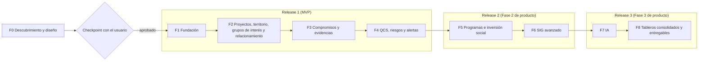

# Roadmap de SGSPE

Sistema de Gestión Social para Proyectos Extractivos · Fase 0 (descubrimiento) · versión 1.0 · 2026-10-07

Este documento cumple el paso 12 del prompt maestro: el plan de implementación conciso, con los releases MVP, Fase 2 y Fase 3
frente a las fases F0 a F8 [PRM-01 §4, §24, §27]. Mantiene el orden del roadmap del prompt [USR-05] y la pausa de revisión al
terminar F0 [USR-04] (RNF-MNT-007). No define requisitos: los IDs (RF, RNF, RN, RQ, CON, GAP, ASM, UPS) se definen solo en el
[análisis de requisitos](requirements-analysis.md), y aquí se citan. La matriz completa de requisito, fuente, módulo, entidad,
API, interfaz y prueba está en `requirements-traceability.md`.

## Propósito y fuentes

- Fija, para cada fase de F1 a F8: el alcance, los objetos del catálogo canónico, los starters y capacidades de wasichai, el
  código propio de SGSPE (paquetes, guardas, listeners, trabajos y endpoints), los workflows, los KPIs, la cobertura de los
  entregables, la definición de terminado, los riesgos y los IDs abiertos que la bloquean o la condicionan.
- Detalla la Fase 1 sobre las pistas 0, A, B y C del plan aprobado (`docs/superpowers/plans/2026-10-06-sgspe-fase-0-y-1.md`),
  actualizadas con lo que cambió en la Fase 0.
- Reúne las decisiones pendientes para el checkpoint y el registro de riesgos.
- Toma los datos de los documentos de diseño, que son la fuente de verdad. Si este roadmap los contradice, ganan ellos y este
  se corrige (RNF-MNT-009):

| Tema | Documento |
|---|---|
| Fases y releases de cada bounded context; objetos y paquetes | [Modelo de dominio](domain-model.md) §5, §6 y §8 |
| Fase de cada objeto (índice de fichas) | [Modelo de datos](database-model.md) §5 |
| Starters por fase, paquetes, trabajos, frontend, entornos y riesgos | [Arquitectura](architecture.md) §5, §8, §9, §11 y §14 |
| Mandatos del prompt, brechas upstream y versiones | [Encaje con wasichai](platform-fit.md) §2, §4 y §6 |
| Endpoints por fase | [API](api.md) §4 y §5 |
| Workflows, automatizaciones, trabajos, listeners y pruebas | [Workflows](workflows.md) |
| Roles, matriz de permisos y pruebas de seguridad | [Seguridad](security.md) §6, §7 y §14 |
| Capas y fases del SIG | [SIG](gis.md) §1.4 y §10 |
| Tipos de entregable y fases | [Entregables](deliverables.md) §3, §10 y §14 |
| Casos de IA y fases | [Arquitectura de IA](ai-architecture.md) §4 y §17 |
| KPIs y tableros por fase | [Tableros](dashboards.md) §4, §5 y §11 |
| Decisiones de arquitectura | [Índice de ADR](adr/README.md) |

## Releases y fases

El prompt pide un MVP, una Fase 2 y una Fase 3 sin asignarles fases [PRM-01 §4]. **ASSUMPTION (ASM-044):** Release 1 (MVP) =
F1–F4; Release 2 (Fase 2 de producto) = F5–F6; Release 3 (Fase 3 de producto) = F7–F8. Cada requisito conserva su fase F
aunque el checkpoint reasigne las fases a los releases.

| Fase | Contenido (orden del prompt) | Release | Fuente |
|---|---|---|---|
| F0 | Descubrimiento y diseño: solo documentación, sin código | — (previa a los releases) | [PRM-01 §0, §24] [USR-04] |
| F1 | Fundación: arranque de la app, roles como datos, contrato con la plataforma, observabilidad y CI | Release 1 (MVP) | [PRM-01 §24] CON-053 |
| F2 | Proyectos, territorio, grupos de interés y relacionamiento (con línea base social, catálogos y mapa básico) | Release 1 (MVP) | [PRM-01 §24] [USR-05] CON-036 |
| F3 | Compromisos y evidencias (con acuerdos, tareas, aprobaciones y notificaciones) | Release 1 (MVP) | [PRM-01 §24] [USR-05] |
| F4 | Quejas, consultas y solicitudes, riesgos y alertas (con incidentes y escalamiento) | Release 1 (MVP) | [PRM-01 §24] [USR-05] |
| F5 | Programas e inversión social | Release 2 (Fase 2 de producto) | [PRM-01 §24] [USR-05] |
| F6 | SIG avanzado | Release 2 (Fase 2 de producto) | [PRM-01 §24] [USR-05] |
| F7 | IA | Release 3 (Fase 3 de producto) | [PRM-01 §24] [USR-05] |
| F8 | Tableros consolidados y entregables DOCX y PDF | Release 3 (Fase 3 de producto) | [PRM-01 §24] [USR-01] [USR-05] |

Dos reglas cruzan todas las fases:

- Cada fase deja el sistema compilando y ejecutable, y cumple la definición de terminado del prompt y la de wasichai
  ([Encaje con wasichai §2.17](platform-fit.md#217-25-definición-de-terminado)) (RNF-MNT-003).
- Los indicadores y las exportaciones de cada módulo llegan con su módulo; F8 consolida tableros y genera los entregables
  (RQ-DSH-036, RQ-REP-022) [USR-05].

### Bounded contexts por release y fase

| BC | Contexto | Release | Fase |
|---|---|---|---|
| BC-01 | Proyectos | Release 1 | F2 |
| BC-02 | Territorio y SIG | Release 1 (datos y mapa básico); Release 2 (SIG avanzado) | F2, F6 |
| BC-03 | Grupos de interés | Release 1 | F2 |
| BC-04 | Relacionamiento (absorbe BC-11) | Release 1 | F2 |
| BC-05 | Compromisos | Release 1 | F3 (candidatos de IA en F7) |
| BC-06 | Acuerdos y convenios | Release 1 | F3 |
| BC-07 | Quejas, Consultas y Solicitudes (QCS) | Release 1 | F4 |
| BC-08 | Riesgos sociales | Release 1 | F4 |
| BC-09 | Alerta temprana e incidentes | Release 1 | F4 |
| BC-10 | Inversión social y programas | Release 2 | F5 (lineamientos y tope en F3) |
| BC-11 | Operaciones de campo | Release 1 dentro de BC-04; la captura sin conexión, Release 3, con diseño de UX hecho (ASM-081) | F2 (visitas); sin conexión: sin fase |
| BC-12 | Evidencias y documentos | Release 1 | F3 |
| BC-13 | Tareas y aprobaciones | Release 1 | F3 (escalamiento de QCS y riesgos en F4) |
| BC-14 | Notificaciones | Release 1 | F3–F4 |
| BC-15 | Reportes, tableros y entregables | Release 3 (consolidado); exportaciones e indicadores por módulo desde Release 1 | F8 (indicadores F2–F6; exportaciones F2–F4) |
| BC-16 | Identidad y acceso | Release 1 | F1 (asignaciones en F2) |
| BC-17 | Auditoría | Release 1 | F1 (`export_log` en F2) |
| BC-18 | IA y conocimiento | Release 3 | F7 |
| BC-19 | Línea base social | Release 1 | F2 |
| BC-20 | Catálogos | Release 1 | F2 |

Fuente: [Modelo de dominio §5](domain-model.md#5-bounded-contexts) (ASM-044, ASM-045).

### Resumen por fase

| Fase | Objetos nuevos | Starters (backend) | Paquetes `sgspe.*` nuevos | Workflows | KPIs | Requisitos con esa fase |
|---|---|---|---|---|---|---|
| F1 | Ninguno (`model.json` sin objetos) | core, `-views`, `-forms`, `-pages` | `sgspe.common`, `sgspe.observability` | — | — | 24 |
| F2 | 48 | + `-gis`, + `-workflow` | `sgspe.scope`, `sgspe.stakeholder`, `sgspe.engagement`, `sgspe.territory`, `sgspe.dashboard`, `sgspe.privacy` | WF-A, WF-B, WF-C, WF-L, WF-O | KPI-STK, KPI-ENG (cinco) | 88 |
| F3 | 12, más la tabla fija `idempotency_key` | + `-automation`, + `-documents`, + `-files`, + `-notifications` | `sgspe.commitment`, `sgspe.agreement`, `sgspe.evidence`, `sgspe.deadline`, `sgspe.notification`, `sgspe.investment` (`SupportPolicyGuard`) | WF-D, WF-I, WF-K (candidatos), WF-N | KPI-COM | 27 |
| F4 | 12 | — | `sgspe.attention`, `sgspe.risk`, `sgspe.warning` | WF-E1, WF-E2, WF-E3, WF-F, WF-J, WF-M | KPI-GRV, KPI-RSK, KPI-ENG (tres) | 26 |
| F5 | 10 | — | `sgspe.investment` completo | WF-G, WF-P | KPI-INV | 4 |
| F6 | Ninguno | GeoServer y GDAL (no son starters) | Análisis espacial de `sgspe.territory` | — | KPI-TER | 8 |
| F7 | 2, más la tabla fija `knowledge_chunk` | + `-agent` | `sgspe.ai` | WF-K (sugerencias) | — | 22 |
| F8 | 5 | Gotenberg (no es starter) | `sgspe.deliverable` | WF-H | KPI-EXE | 41 |

- Los objetos nuevos suman los 89 del catálogo canónico; la fase de cada uno está en el índice de fichas del
  [modelo de datos §5](database-model.md#5-cómo-leer-las-fichas).
- "Requisitos con esa fase" cuenta los RF, RNF y RQ cuya columna Fase del análisis tiene esa sola fase. Otros abarcan varias
  (por ejemplo, RNF-TST-001 y RNF-MNT-003 en F1–F8, o RQ-REP-022 en F2–F4); las RN siguen la fase de su bounded context.

## F0 · Descubrimiento y diseño

| Elemento | Contenido |
|---|---|
| Alcance | Inspección de las fuentes y del repositorio, análisis de requisitos, modelo de dominio, arquitectura, modelo de datos, workflows, IA, tableros, trazabilidad, ADR, este roadmap y la validación de consistencia: los pasos 1 a 13 del orden de ejecución [PRM-01 §27] |
| Artefactos | [Glosario](glossary.md), [análisis de requisitos](requirements-analysis.md), [modelo de dominio](domain-model.md), [arquitectura](architecture.md), [encaje con wasichai](platform-fit.md), [API](api.md), [modelo de datos](database-model.md), [workflows](workflows.md), [seguridad](security.md), [SIG](gis.md), [entregables](deliverables.md), [IA](ai-architecture.md), [tableros](dashboards.md), `requirements-traceability.md`, este roadmap y los 26 ADR del [índice](adr/README.md) |
| Código | Ninguno [PRM-01 §0] |
| Definición de terminado | Los verificadores locales dan cero errores y cero coincidencias de nombres reales (RQ-SEC-018); la revisión de consistencia de la Tarea 7 queda limpia ("Validación de la Fase 0"); commits Conventional Commits en la rama `fase-0/descubrimiento`, sin archivos transitorios versionados |
| Salida | El checkpoint con el usuario: sin su aprobación no empieza F1 [USR-04] |
| IDs abiertos | Las decisiones de la sección "Decisiones pendientes para el checkpoint" |

## F1 · Fundación (detalle)

F1 no reimplementa seguridad, usuarios, roles ni auditoría, que ya trae wasichai: se concentra en el arranque de la app, los
roles como datos, las pruebas de contrato con la plataforma, la observabilidad y la CI (CON-053) [USR-03]. Se trabaja en la
rama `feat/fase-1-fundacion` de los dos repositorios [USR-08] (RNF-MNT-006), con TDD y subagentes; las pistas A y B corren en
paralelo, cada una en su propio worktree.

| Elemento | Contenido |
|---|---|
| Alcance | App Spring Boot `sgspe` con `@WasichaiApplication`; `model/` con los 17 roles (15 declarados y 2 mapeados a `ADMIN`); pruebas de contrato con la plataforma; identificador de correlación y perfil de producción; pruebas de arquitectura; CI de los dos repositorios; `sgspe-ui` con portal y `/admin` y login compartido |
| Objetos | Ninguno: `model.json` existe sin objetos; los objetos de negocio nacen en F2 |
| Starters y capacidades | Backend: `wasichai-spring-boot-starter` (core), `-views`, `-forms`, `-pages`; `wasichai-test` en pruebas. Frontend: `@wasichai/core`, `@wasichai/ui`, `@wasichai/views`, `@wasichai/forms`, `@wasichai/pages`, `@wasichai/testing`. Capacidades: JWT HS256, tenant por `organization_id`, roles y permisos, `audit_log`, Problem Details, Actuator ([Arquitectura §5.1](architecture.md#51-starters-de-wasichai-por-fase)) |
| Código SGSPE | `sgspe.common` (marca `SgspeWrite`, envoltura de `RecordService`, filtros estrictos con 422, fechas en America/Lima; sus guardas transversales entran en uso con los objetos de F2) y `sgspe.observability` (filtro `X-Correlation-Id` antes de la cadena de seguridad, línea de acceso por petición, logs ECS). Sin endpoints propios: API genérica de wasichai más el filtro de correlación ([API §5](api.md#5-endpoints-por-fase)) |
| Workflows | Ninguno; `apply.py --workflows` existe y se ejecuta en el orden de aprovisionamiento, sin definiciones |
| Portal | Dashboard (bienvenida y mapa de módulos por fase) y Administración (enlace a `/admin`) |
| KPIs | Ninguno: el inicio del portal no tiene indicadores ([Tableros §11](dashboards.md#11-fases)) |
| Entregables | Spike técnico de ADR-0013 (Apache POI, Gotenberg, fuentes e índice) y de ADR-0015 (GetMap), recomendado al inicio de F1 si el checkpoint lo aprueba ([Entregables §14](deliverables.md#14-fases), [SIG §10](gis.md#10-fases)) |
| Roles con permisos | `SUPER_ADMIN` y `ORGANIZATION_ADMIN` (como `ADMIN`) y `AUDITOR` (`"*": ["READ"]`); los otros 14 existen con su etiqueta y sin permisos ([Seguridad §6](security.md#6-roles)) |
| Requisitos de la fase | RF-IAM-001, RF-IAM-002, RNF-MNT-001, RNF-MNT-002, RNF-MNT-005, RNF-INT-001, RNF-I18N-001, RNF-OBS-001, RNF-USA-001, RQ-SEC-001, RQ-SEC-002, RQ-SEC-003, RQ-SEC-004, RQ-SEC-005, RQ-SEC-007, RQ-SEC-015, RQ-SEC-016, RQ-SEC-017, RQ-AUD-001, RQ-AUD-006, RQ-AUD-008, RQ-AUD-009, RQ-AUD-010, RQ-AUD-014; además RQ-AUD-005 en `/admin`, y RNF-MNT-003 y RNF-TST-001, que rigen de F1 a F8 |
| Estado | Pistas 0, A, B y C en verde en local y en la CI de wasichai/sgspe#2 y wasichai/sgspe-ui#1 el 2026-10-07, y spike hecho; falta cargar `PACKAGES_TOKEN` como secreto de Dependabot (T0.4); plan ejecutable en `docs/superpowers/plans/2026-10-07-fase-1-fundacion.md` |

### Pista 0 · Precondiciones

| Paso | Acción | Requiere aprobación |
|---|---|---|
| T0.1 | `.git/info/exclude` con los insumos transitorios y rama `feat/fase-1-fundacion` en `sgspe` y `sgspe-ui` | No |
| T0.2 | Comprobar `gh auth status` con el alcance `read:packages` | No |
| T0.3 | BD de desarrollo en el VPS: `docker compose up -d`, túnel `ssh -fN -L 5435:…` y base `sgspe_test` (su nombre termina en `_test`, como exige el modo externo `WASICHAI_TEST_DB_*`) | Sí: infraestructura compartida |
| T0.4 | Secreto `PACKAGES_TOKEN` (PAT con `read:packages`) en Actions y en Dependabot de `sgspe-ui`, porque los paquetes npm `@wasichai/*` son internos, y en Dependabot de `sgspe`, para leer `wasichai/wasichai` ([desarrollo local](develop/README.md#1-requisitos)) | Sí: lo carga el usuario |
| T0.5 | Spike de entregables (POI y Gotenberg) y de GetMap, con Gotenberg y GeoServer levantados solo para él ([Arquitectura §11](architecture.md#11-entornos)) | Sí: decisión del checkpoint |

Gradle se invoca con las credenciales de GitHub Packages en variables de entorno, nunca en archivos del repositorio:
`GITHUB_ACTOR=<usuario-github> GITHUB_TOKEN=$(gh auth token) ./gradlew …` (prefijo `GH=` en las tablas siguientes).

### Pista A · `sgspe` (backend en la raíz, como caja-backend)

| Paso | Contenido | Verificación |
|---|---|---|
| A1 | Wrapper de Gradle copiado de caja (9.8.0); `settings.gradle.kts` y `build.gradle.kts` con Kotlin 2.4.20, Spring Boot 4.1.1, ktlint 1.7.1 (versión del plan aprobado, que no fija ningún documento de diseño), `wasichai-bom:0.3.2`, los starters core, `-views`, `-forms` y `-pages`, y las tareas `test` e `integrationTest` con la imagen `postgis/postgis:18-3.6`; `SgspeApplication.kt` con `@WasichaiApplication` en el paquete `sgspe`; `application.yml` en el puerto 8094. Test primero: `SgspeSmokeTest` (nombre del plan aprobado) | `GH= ./gradlew build`; integración en CI o con la BD externa |
| A2 | `compose.yml` solo con `postgis/postgis:18-3.6` en el puerto 5435 y un volumen con nombre, sin bind mounts; `develop/example.env`; `docs/develop/README.md`. Los demás servicios llegan en su fase: almacenamiento S3 y SMTP de prueba en F3, GeoServer en F6 y Gotenberg en F8 | `docker compose config -q`; `bootRun` con `/actuator/health/liveness` y `/actuator/health/readiness` en UP |
| A3 | `package.json`, commitlint, husky, prettier y `.editorconfig` de 160 columnas | `yarn format:check`; commitlint rechaza un mensaje inválido |
| A4 | `model/` copiado de caja: `apply.py`, `apply_roles.py`, `core_client.py`, `fake_core.py` y sus pruebas. `model.json` sin objetos. `roles.json` con los 15 roles declarados y su etiqueta en español, más `mappedToAdmin` [`SUPER_ADMIN`, `ORGANIZATION_ADMIN`] (17 en total); sin permisos salvo `AUDITOR` con `"*": ["READ"]`; ningún rol con `ownRecordsOnly`, tampoco `FIELD_AGENT` (ASM-069). `apply_roles.py` entiende la abreviatura `u` y la clave `"derived": true` del modelo. Orden de aprovisionamiento: `apply.py` → `apply_roles.py` → `apply.py --workflows`. Tests primero: `test_apply.py` (con un caso de tenant nuevo que recorre ese orden) y `test_apply_roles.py` | `python3 -m unittest -v`; `apply_roles.py` crea 15 y luego informa "15 skipped" |
| A5 | Pruebas de contrato con la plataforma sobre la clase base `SgspeApiTest`: `TenantIsolationApiTest`, `SecurityApiTest`, `RolesApiTest`, `AuditApiTest` (quién, qué, cuándo, por qué, desde y hacia; `requiresReason`; `appendOnly` con 409) y `ErrorContractApiTest` (Problem Details) | Integración en verde |
| A6 | `sgspe.observability`: filtro `X-Correlation-Id` (el `CorrelationIdFilter` del plan) que acepta el valor si cumple `^[A-Za-z0-9._-]{1,64}$`, si no lo genera, y lo devuelve en toda respuesta, también en un 401 (ASM-034); `application-prod.yml` con `wasichai.seed.dev: false`, `WASICHAI_JWT_SECRET` obligatorio, TTL menor que 8 horas y logs ECS; base de `sgspe.common`. Tests primero: `ObservabilityApiTest` y `ProdProfileTest` | `GH= ./gradlew build` e integración |
| A7 | `ArchitectureTest`: nada bajo el paquete `wasichai`; sin `RecordStore`, `PhysicalTableRecordStore`, `AuditService` ni `ObjectSchemaManager`; sin literales de rol; los paquetes de dominio no dependen de `sgspe.dashboard`, `sgspe.deliverable` ni `sgspe.ai` | `GH= ./gradlew test` |
| A8 | `.github/workflows/ci.yml`, `.github/workflows/commits.yml` y `dependabot.yml` copiados de caja, con acciones fijadas por SHA | CI en el PR |
| A9 | README, CLAUDE.md y `docs/HISTORY.md`; columna Estado de las filas de F1 en `requirements-traceability.md`; borradores de issues upstream solo de las brechas que apruebe el checkpoint (en F1 importan UPS-02, UPS-03 y UPS-05) | `yarn format:check` |

### Pista B · `sgspe-ui` (`../sgspe-ui`, como caja-ui)

| Paso | Contenido |
|---|---|
| B1 | Scaffold con Vite 8 en el puerto 5182 y proxy `/api` → 8094 (mismo origen, sin CORS); `.npmrc` con la línea del scope `@wasichai` y el token en una variable de entorno; Tailwind con `@wasichai/ui/theme.css`; `tsconfig`; prettier, commitlint y husky; versiones fijadas como caja-ui, con Node 26 o superior y Yarn 1 (`yarn.lock` v1) ([Encaje con wasichai §6](platform-fit.md#6-versiones-fijadas)) |
| B2 | `/admin`: `WasichaiApp` con `basename: '/admin'`, los módulos de los starters instalados (pages, views y forms) y `storagePrefix: 'sgspe'`; nunca un módulo sin su starter ni `agentModule()` |
| B3 | Portal con sesión y login compartidos (token `sgspe.token` en `localStorage`), `RequireSession` y `safeNext`, que solo acepta rutas internas después del login |
| B4 | Temas claro y oscuro con el script de arranque de `index.html`, el único script en línea, autorizado por su hash en la CSP |
| B5 | Shell y árbol de navegación con las 13 secciones del prompt en su orden y su fase; una hoja se dibuja solo si tiene pantalla y el usuario tiene los permisos que pide, deducidos de `GET /api/auth/me/permissions` mientras no exista UPS-06; Administración solo para quien administra |
| B6 | i18n: español por defecto e inglés, números y fechas es-PE; las etiquetas de la metadata existen solo en español (CON-051) |
| B7 | Inicio (Dashboard de F1): usuario, organización, roles y mapa de módulos por fase, sin indicadores |
| B8 | CI con `PACKAGES_TOKEN`: lint, typecheck, tests y build; `boundaries.test` sin literales de rol en la interfaz |
| B9 | README y CLAUDE.md |

Cada paso de la interfaz escribe primero su test con Vitest, Testing Library y `mockFetch` de `@wasichai/testing`, con
usuarios ficticios `@sgspe.test` (RQ-SEC-018), por ejemplo `RequireSession.test.tsx` y `Navigation.test.tsx`.

### Pista C · Verificación final de F1

1. Con el túnel activo: `docker compose up -d`, `GH= ./gradlew bootRun` y el aprovisionamiento en su orden: `apply.py`,
   `apply_roles.py` y `apply.py --workflows` ([Seguridad §4.1](security.md#41-alta-de-un-tenant)).
2. `yarn dev` en `sgspe-ui` y prueba de humo que ejecuta el agente con Playwright MCP (ASM-066):
   - login con el administrador semilla de desarrollo;
   - el Dashboard muestra la organización y el rol;
   - `/admin` → Roles muestra los 15 roles declarados con su etiqueta en español;
   - con un usuario `AUDITOR`: ve la auditoría, no ve Administración y recibe 403 en usuarios;
   - las respuestas traen `X-Correlation-Id`, también un 401.
3. `GH= ./gradlew build`, `integrationTest` (en CI o con la BD externa), `python3 -m unittest` y `yarn lint typecheck test build`.
4. Push y PR de los dos repositorios con la CI en verde, con aprobación del usuario; cierre con
   `superpowers:finishing-a-development-branch`.

### Definición de terminado de F1

- Pistas A, B y C en verde, con la definición de terminado de
  [Encaje con wasichai §2.17](platform-fit.md#217-25-definición-de-terminado) aplicada a lo que existe en F1.
- `TenantIsolationApiTest`, `SecurityApiTest`, `RolesApiTest`, `AuditApiTest`, `ErrorContractApiTest`, `ObservabilityApiTest`,
  `ProdProfileTest`, `ArchitectureTest`, `boundaries.test`, `test_apply.py` y `test_apply_roles.py` en verde
  ([Seguridad §14](security.md#14-pruebas-de-seguridad)).
- Las filas de F1 de `requirements-traceability.md` con su estado actualizado (RNF-MNT-009) y cero coincidencias de nombres
  reales (RQ-SEC-018).
- `tools/check_traceability.py` en la CI verifica que toda RF, RNF, RN y RQ del análisis tiene su fila en la matriz
  (RNF-MNT-009).

### Riesgos de F1

| Riesgo | Mitigación |
|---|---|
| Docker remoto: Testcontainers no alcanza sus contenedores | Integración en CI o contra la BD externa por túnel (`WASICHAI_TEST_DB_*`) |
| Credenciales de GitHub Packages | Variables de entorno y `PACKAGES_TOKEN` en la CI; nunca en archivos |
| Desfase entre wasichai 0.3.2 y `@wasichai/*` 0.5.0 | Versiones exactas, actualizadas juntas; las pruebas de contrato detectan la deriva |
| La administración de usuarios y roles no se audita (UPS-02) | Roles solo desde `model/roles.json`; pocos usuarios `ADMIN` |
| wasichai 0.3.2 no borra permisos de campo: un PUT con lista vacía no hace nada y no hay DELETE (candidato a issue upstream) | `apply_roles.py` neutraliza la entrada con lectura y escritura en verdadero; `test_apply_roles.py` lo fija |
| La CSP rompe el portal o el mapa base | Primero en modo `Content-Security-Policy-Report-Only`, ajustada con sus informes ([Seguridad §3.2](security.md#32-endurecimiento-de-sgspe)) |

### IDs abiertos que condicionan F1

- Bloquean: T0.3 y T0.4 (decisión del checkpoint).
- Condicionan: CON-053; UPS-02, UPS-03, UPS-05, UPS-09, UPS-10 y UPS-12 (con mitigaciones de F1); GAP-009 (tenant y marca),
  GAP-013 (idioma de los contenidos), GAP-022 (despliegue), GAP-026 (alta y baja de tenants), GAP-028 (cambios en wasichai),
  GAP-030 (edición de metadata en producción) y GAP-031 (auditoría de lecturas); supuestos ASM-024, ASM-034, ASM-049,
  ASM-059 y ASM-066.

### Cambios respecto del plan aprobado

El plan aprobado pedía revisar el bloque de F1 con lo que cambiara en F0. Estos son los cambios, todos ya aplicados en las
pistas de arriba o en las fases siguientes:

| # | El plan aprobado decía | Ahora | Referencia |
|---|---|---|---|
| 1 | A4: `FIELD_AGENT` con `ownRecordsOnly` | Ningún rol usa `ownRecordsOnly`. `FIELD_AGENT` no tiene la acción `EDIT_ANY`, y `EditAnyGuard` (de `sgspe.scope`, F2) le permite cambiar o borrar solo lo que creó, sin nombres de rol en el código | ASM-069; [Seguridad §5.5 y §6.3](security.md#55-edición-de-lo-propio-edit_any-en-lugar-de-own_records_only) |
| 2 | A4: roles con sus permisos desde F1 | Los roles existen desde F1 con su etiqueta y sin permisos, salvo `AUDITOR`; las concesiones llegan en la fase de cada rol y de cada objeto | [Seguridad §6.1 y §6.3](security.md#63-reglas-de-modelrolesjson) |
| 3 | Aprovisionamiento con `apply.py` y luego `apply_roles.py` | Orden fijo `apply.py` → `apply_roles.py` → `apply.py --workflows`, porque wasichai rechaza un workflow que nombra un rol inexistente; `test_apply.py` recorre el orden sobre un tenant nuevo | [Arquitectura §5.4](architecture.md#54-modelo-como-código-model); [Seguridad §4.1](security.md#41-alta-de-un-tenant) |
| 4 | A4: `apply_roles.py` copiado tal cual | `apply_roles.py` expande `u` en UPDATE más entradas de solo lectura para los campos sin `"derived": true`, y ningún derivado usa `editable: false` | [Arquitectura §5.4](architecture.md#54-modelo-como-código-model); [Seguridad §6.3](security.md#63-reglas-de-modelrolesjson) |
| 5 | A5: una sola suite `SgspeApiTest` | `SgspeApiTest` es la clase base; las pruebas de contrato son `TenantIsolationApiTest`, `SecurityApiTest`, `RolesApiTest`, `AuditApiTest` y `ErrorContractApiTest`, más `ObservabilityApiTest` y `ProdProfileTest` | [Seguridad §14](security.md#14-pruebas-de-seguridad); [Workflows, Pruebas](workflows.md#pruebas) |
| 6 | A6: `CorrelationIdFilter` | El filtro vive en `sgspe.observability`, antes de la cadena de seguridad; valida el formato, responde también en un 401 y propaga el identificador en el contexto de Reactor | ASM-034; [Arquitectura §5.2 y §12](architecture.md#12-observabilidad) |
| 7 | A6: `application-prod.yml` sin semilla ni secreto | Además, TTL del token menor que 8 horas y CSP en el proxy, primero en modo de solo informe | RQ-SEC-001, RQ-SEC-016; [Seguridad §3.2](security.md#32-endurecimiento-de-sgspe) |
| 8 | A7: `ArchitectureTest` del backend | También `boundaries.test` en la interfaz, y la regla de que los paquetes de dominio no dependen de tableros, entregables ni IA | RQ-SEC-005, RNF-MNT-005; [Arquitectura §5.3](architecture.md#53-reglas-de-dependencia-entre-paquetes) |
| 9 | Sin código propio en F1 | `sgspe.common` y `sgspe.observability` nacen en F1 | [Arquitectura §5.2](architecture.md#52-paquetes-sgspe) |
| 10 | A2: `compose.yml` con PostGIS | Los servicios de apoyo se agregan por fase: S3 y SMTP de prueba en F3, GeoServer en F6 y Gotenberg en F8; el spike de F1 los levanta solo para probar la ruta de entregables | [Arquitectura §11](architecture.md#11-entornos) |
| 11 | Spike de entregables y de GetMap opcional | Recomendado al inicio de F1, sujeto a la aprobación del checkpoint | ASM-014, ASM-038; [Entregables §14](deliverables.md#14-fases); [SIG §10](gis.md#10-fases) |
| 12 | Pista C: smoke con Playwright MCP | Se mantiene como prueba de humo que ejecuta el agente; las pruebas extremo a extremo automatizadas con Playwright empiezan en F2 | ASM-066; [Arquitectura §13](architecture.md#13-estrategia-de-pruebas) |
| 13 | A9: ADR de F1 | Los ADR se escribieron en F0: 26 en lugar de 19 (se agregan los de autenticación, reglas de workflow, QCS en tres objetos, separación de actores y territorio, interfaz, concurrencia y topología) | [Índice de ADR](adr/README.md) |
| 14 | Brechas upstream U1 a U12 | Dieciocho brechas, de UPS-01 a UPS-18 en el análisis; en F1 importan UPS-02, UPS-03 y UPS-05 | [Análisis §18.2](requirements-analysis.md#182-brechas-upstream-de-wasichai-ups) |
| 15 | B5: `NAV_TREE` con las 13 secciones | Una hoja se dibuja solo si tiene pantalla y permisos; las capacidades se deducen de `/api/auth/me/permissions` mientras falte UPS-06 | RF-IAM-002; [Arquitectura §9.1](architecture.md#91-una-aplicación-dos-partes) |
| 16 | B2: `/admin` con pages, views y forms | `/admin` registra solo los módulos de los starters instalados y nunca `agentModule()` | [Arquitectura §5.1 y §9.1](architecture.md#51-starters-de-wasichai-por-fase) |
| 17 | Gradle con un usuario de GitHub fijo | `GITHUB_ACTOR=<usuario-github>`: ningún nombre de cuenta ni token en documentos versionados | [USR-07]; RQ-SEC-018 |
| 18 | Riesgo U1: el checkpoint decide si F2 espera la extensión o arranca solo con organización y rol | Decidido el 2026-10-10 (plan 4.4): `ProjectReadScope` en la lectura y `project_assignment` en la escritura (ADR-0029) | CON-041, GAP-025; [Seguridad §9.5](security.md#95-recomendación) |
| 19 | Roadmap: F3 con solicitudes | `stakeholder_request` es de BC-07 y llega en F4; F3 trae además el tope y los lineamientos de apoyo (RF-INV-002), las notificaciones y el candidato a compromiso registrado por personas (RF-COM-010) | [Modelo de dominio §5](domain-model.md#5-bounded-contexts); [Modelo de datos §5](database-model.md#5-cómo-leer-las-fichas) |
| 20 | KPIs con prefijos EJE, GI, REL, COM, QUE, RSG y TER | KPI-EXE, KPI-STK, KPI-ENG, KPI-COM, KPI-GRV, KPI-RSK, KPI-INV y KPI-TER | [Tableros §4](dashboards.md#4-catálogo-de-kpis) |
| 21 | Ciclo de vida del entregable con estados en español | WF-H con `draft`, `in_review`, `observed`, `approved`, `issued` y `voided`, con etiqueta en español | [USR-09]; [Modelo de dominio §7.3](domain-model.md#73-estados-de-workflow) |
| 22 | Niveles de divulgación INTERNO, EXTERNO y PÚBLICO | Valores ENUM sin tilde: INTERNO, EXTERNO y PUBLICO | ASM-025, ASM-037 |
| 23 | Apache POI solo en F8 | Apache POI llega en F2 con las exportaciones XLSX | RQ-REP-022; [Encaje con wasichai §6](platform-fit.md#6-versiones-fijadas) |
| 24 | Releases sin asignar | Release 1 (MVP) = F1–F4; Release 2 = F5–F6; Release 3 = F7–F8 | ASM-044 |
| 25 | `Idempotency-Key` sin fase | Se honra desde F3 con la tabla fija `idempotency_key`; en F2 la cabecera se ignora | ASM-065, UPS-18; [API §3.5](api.md#35-idempotencia-idempotency-key) |

## F2 · Proyectos, territorio, grupos de interés y relacionamiento

| Elemento | Contenido |
|---|---|
| Alcance | Proyectos con partes, campañas, asignaciones y concesiones; territorio (ubigeo, localidades, comunidades y sectores, áreas de influencia versionadas, componentes, predios y titularidades, elementos ambientales) con importación XLSX, CSV y GeoJSON con CRS de origen y reconciliación, área oficial en ha y mapa básico; línea base social; catálogos; grupos de interés con evaluaciones fechadas de interés × poder, postura y confianza, priorización y redes; relacionamiento con plan, mensajes clave, alianzas y visitas de campo; exportación del registro de grupos de interés con `export_log` [PRM-01 §24] [USR-05] (CON-036) |
| Objetos (48) | BC-01: `project`, `project_party`, `exploration_campaign`, `project_assignment`, `mining_concession`. BC-02: `administrative_unit`, `locality`, `community`, `community_sector`, `area_of_influence`, `area_of_influence_member`, `project_component`, `land_parcel`, `land_right`, `environmental_feature`. BC-03: `person`, `organization`, `contact_method`, `position`, `stakeholder`, `stakeholder_assessment`, `prioritization_rule`, `actor_relationship`, `community_network`, `network_node`. BC-04: `engagement`, `engagement_participant`, `engagement_question`, `field_visit`, `field_observation`, `engagement_plan`, `key_message`, `aligned_answer`, `strategic_alliance`, `planned_activity`. BC-19: `study`, `study_instrument`, `locality_profile`, `school`, `health_facility`, `road_access`, `festivity`, `state_program`, `local_conflict`, `perception`, `key_theme`, `topic`. BC-15 y BC-17: `export_log` |
| Starters y capacidades | + `-gis` (campos GEOMETRY en SRID 4326, filtro `bbox`, features, componente `MAP`) y + `-workflow`; frontend + `@wasichai/gis` con `maplibre-gl` 6.10.0 y + `@wasichai/workflow`; React Hook Form y Zod; ECharts 6 en los tableros de módulo; Apache POI para XLSX; vistas, formularios y páginas por metadata |
| Código SGSPE | `sgspe.scope`: `ProjectScopeGuard`, `ProjectWriteGuard`, `AssignmentRoleGuard`, `EditAnyGuard`. `sgspe.stakeholder`: `InfluenceClassifier`, `Prioritizer`, `StakeholderWriteGuard`, `StakeholderFollowUpJob` (JOB-03). `sgspe.engagement`: `EngagementWriteGuard`, `AttendanceCountsListener`. `sgspe.territory`: importación, área en ha, `TerritoryWriteGuard`, `AreaListener`. `sgspe.dashboard`: indicadores de módulo. `sgspe.privacy`: exportaciones y `export_log`. `sgspe.common`: guardas transversales (`DerivedFieldsGuard`, `TransitionReasonGuard`, `ExactlyOneGuard`, `UserReferenceGuard`, `FieldChangeReasonGuard`, `CommandTransitionGuard`) y `DerivedFieldsJob` (JOB-02). Script Python del ubigeo |
| Endpoints | `POST /api/sgspe/transition-checks`; `POST /api/sgspe/territory/imports`; `POST /api/sgspe/territory/imports/{importBatchId}/confirm`; `POST /api/sgspe/project-components`; `PATCH /api/sgspe/project-components/{id}`; `POST /api/sgspe/areas-of-influence/{id}/approve`; `GET /api/sgspe/territory/layers/{layer}` (básicas); `POST /api/sgspe/stakeholders/{id}/assessments`; `POST /api/sgspe/stakeholders/{id}/assessments/preview`; `GET /api/sgspe/dashboards/indicators`; `GET /api/sgspe/dashboards/indicators/{code}` (desde aquí, para los indicadores de cada fase); `GET /api/sgspe/dashboards/{dashboard}` (`stakeholders`, `engagement`); `POST /api/sgspe/exports/{kind}` (`stakeholder-register`) |
| Workflows | WF-A (`project`), WF-B (`stakeholder`), WF-C (`engagement`), WF-L (`field_visit`), WF-O (`area_of_influence`); sin automatizaciones hasta F3 |
| Portal | Proyectos, Territorio (datos y mapa básico con las dieciséis capas básicas de [SIG §10](gis.md#10-fases)), Grupos de interés, Relacionamiento (con visitas de campo) y Reportes (exportaciones) |
| Roles con permisos desde F2 | `PROJECT_ADMIN`, `PROJECT_MANAGER`, `SOCIAL_MANAGER`, `COMMUNITY_RELATIONS_OFFICER`, `STAKEHOLDER_MANAGER`, `GIS_ANALYST`, `FIELD_AGENT`, `ANALYST`, `READ_ONLY` |
| KPIs | KPI-STK-01, KPI-STK-02, KPI-STK-03, KPI-STK-04, KPI-STK-05, KPI-STK-06, KPI-STK-07, KPI-STK-08, KPI-ENG-01, KPI-ENG-02, KPI-ENG-03, KPI-ENG-04, KPI-ENG-05; tableros `stakeholders` y `engagement` |
| Entregables | Exportación `stakeholder-register` con niveles de divulgación; los datos de T1 y T2 de la sección "Cobertura de entregables por fase" |
| Definición de terminado | La general, más: `ProjectWorkflowApiTest`, `StakeholderWorkflowApiTest`, `EngagementWorkflowApiTest`, `FieldVisitWorkflowApiTest` y `AreaOfInfluenceWorkflowApiTest`; `test_model.py`; las pruebas GIS de [SIG §9](gis.md#9-pruebas) que no dependen de F6; las de seguridad de F2 (matriz de permisos, permisos de campo, edición de lo propio, alcance de escritura, destinatarios por rol, importaciones); primeras pruebas extremo a extremo con Playwright (ASM-066) |
| Riesgos | Lectura a nivel de tenant hasta el plan 4.4 (ADR-0029); escrituras concurrentes (UPS-04); valores por defecto no aplicados (UPS-15); autorrelaciones (UPS-16); enumeración de tenants en JOB-02 y JOB-03 (UPS-17); CRS y datum desconocidos de los datos reales (CON-024, GAP-012); renombrar ENUM exige migrar datos (ASM-025) |
| IDs abiertos | Bloquean: CON-041 y GAP-025 (diseño final de `ProjectScopeGuard`), CON-050 (valores ENUM antes del primer `model.json`). Condicionan: GAP-002, GAP-003, GAP-011, GAP-012, GAP-018, GAP-019, GAP-024, GAP-029; UPS-01, UPS-04, UPS-06, UPS-08, UPS-13, UPS-15, UPS-16, UPS-17; ASM-003, ASM-031, ASM-041, ASM-062, ASM-070 |

## F3 · Compromisos y evidencias

| Elemento | Contenido |
|---|---|
| Alcance | Compromisos con la matriz de DOC-01 (acciones, hitos, reprogramaciones, dependencias, entregas con conformidad y candidatos registrados por personas); acuerdos y convenios con cláusulas y permisos de uso de terreno; evidencias inmutables en almacenamiento de objetos; tareas y aprobaciones; notificaciones en la aplicación y por correo; situación de plazo y vigencia; escalamiento en dos niveles; tope de apoyo social por campaña y lineamientos (RF-INV-002); documentos emitidos de un registro [PRM-01 §24] [DOC-01 §9.3.1.2] |
| Objetos (12) | BC-05: `commitment`, `commitment_action`, `commitment_milestone`, `commitment_reschedule`, `commitment_dependency`, `delivery`, `commitment_candidate`. BC-06: `agreement`, `agreement_party`, `agreement_clause`. BC-12: `evidence` (archivo en un campo `FILE`). BC-13: `task`. Tabla fija: `idempotency_key` (transversal). BC-14 sin tablas propias: los avisos son del módulo wasichai-notifications (ASM-012) |
| Starters y capacidades | + `-automation` (con `AutomationDrain`), + `-documents`, + `-files` (campo `FILE`, almacenamiento compatible con S3 con MinIO solo en desarrollo) y + `-notifications` (bandeja, SSE, correo y preferencias); frontend + `@wasichai/automation` y + `@wasichai/documents`; SMTP de prueba en el compose; AWS SDK v2 |
| Código SGSPE | `sgspe.commitment`: `CommitmentWriteGuard`, `CommitmentDerivationsListener`, reprogramación, entregas, alta, aceptación y duplicado de candidatos. `sgspe.agreement`: `AgreementWriteGuard`. `sgspe.evidence`: `EvidenceWriteGuard`, alta y vínculos, y la descarga controlada por las dos rutas. `sgspe.deadline`: `DeadlineJob` (JOB-01) para compromisos, acuerdos y tareas, y la fuente de avisos de plazo. `sgspe.notification`: destinatarios por asignación y textos de los avisos sobre wasichai-notifications. `sgspe.investment`: `SupportPolicyGuard`. `sgspe.common`: `Idempotency-Key` de los comandos con la tabla fija `idempotency_key` y el contrato nativo. `StakeholderFollowUpJob` (JOB-03) empieza a crear tareas de evaluación periódica y de inactividad. `RetentionJob` (JOB-08) purga desde F3, con SQL propio y sin `asPlatform`, las claves vencidas (ASM-065, RNF-INT-002) |
| Endpoints | `POST /api/sgspe/commitments/{id}/reschedules`; `POST /api/sgspe/commitments/{id}/deliveries`; `PATCH /api/sgspe/deliveries/{id}`; `POST /api/sgspe/commitment-candidates`; `POST /api/sgspe/commitment-candidates/{id}/accept`; `POST /api/sgspe/commitment-candidates/{id}/duplicate`; `POST /api/sgspe/evidence`; `GET /api/sgspe/evidence/{id}/content`; `PATCH /api/sgspe/evidence/{id}`; `POST /api/sgspe/evidence/{id}/links`; `DELETE /api/sgspe/evidence/{id}/links/{object}/{recordId}`; tablero `commitments`; exportación `commitment-matrix`. De wasichai: subida de archivos (`POST /api/objects/evidence/files/file`), bandeja (`/api/auth/me/notifications`) y documentos emitidos |
| Workflows | WF-D (`commitment`), WF-I (`agreement`), WF-K (`commitment_candidate`, registrado por personas), WF-N (`task`); automatizaciones AUT-01, AUT-05 y AUT-10, y AUT-03 cuando se resuelva UPS-23 |
| Portal | Compromisos, Documentos (evidencias y documentos emitidos), Tareas (bandeja y avisos) y Reportes (matriz de compromisos) |
| Roles con permisos desde F3 | `COMMITMENT_MANAGER`, `APPROVER` |
| KPIs | KPI-COM-01, KPI-COM-02, KPI-COM-03, KPI-COM-04, KPI-COM-05, KPI-COM-06, KPI-COM-07, KPI-COM-08, KPI-COM-09, KPI-COM-10, KPI-COM-11 (serie); tablero `commitments`; los datos del tope que usará KPI-INV-01 |
| Entregables | Exportación `commitment-matrix` sin el documento de identidad de los solicitantes (RQ-REP-022, CON-014); documentos emitidos «Minuta de reunión» y «Lista de asistentes» (RQ-REP-029), y «Acta de entrega» cuando se resuelva UPS-23 (hasta entonces, el acta firmada es una evidencia ACTA DE ENTREGA); datos de T1 §9.3.1.2 y de las conclusiones de T2 (acuerdos) |
| Definición de terminado | La general, más: `CommitmentWorkflowApiTest`, `AgreementWorkflowApiTest`, `CommitmentCandidateWorkflowApiTest`, `TaskWorkflowApiTest`; pruebas de trabajos, listeners, automatizaciones y destinatarios de [Workflows, Pruebas](workflows.md#pruebas); descargas de evidencias restringidas con `DOWNLOAD_RESTRICTED` (ASM-071); `FileStoreContractTest` (almacén local y S3 contra MinIO); `AutomationsApiTest` (AUT-01, AUT-05 y AUT-10) |
| Riesgos | Escalamientos sin asignaciones que coincidan (el aviso no se crea y queda una advertencia en el log); el nivel 2 reutiliza `approve_senior` de WF-D; la descarga nativa de un campo `FILE` no conoce la clasificación (SGSPE la reemplaza para `evidence`); un documento emitido congela el registro entero sin permisos de campo (UPS-23), así que los tipos de documento solo se declaran sobre objetos sin campos restringidos y el «Acta de entrega» espera (ASM-090); el descriptor de una evidencia restringida se lee sin nombre ni huella salvo con `DOWNLOAD_RESTRICTED` (`EvidenceFileReadPolicy`, UPS-24 resuelta en wasichai 1.0.0, ASM-093) |
| IDs abiertos | Condicionan: GAP-001 (RF-AGR-003), GAP-006, GAP-014, GAP-016, GAP-017, GAP-021, GAP-022; UPS-23; ASM-008, ASM-009, ASM-023, ASM-030, ASM-063, ASM-067, ASM-070, ASM-089, ASM-090, ASM-094 |
| Estado | Modelo, backend y portal integrados en `main` (planes 3.1 y 3.2, wasichai/sgspe#13; plan 3.3, wasichai/sgspe-ui#5); pendientes: actualizar el tenant de desarrollo de F2 a F3 y comprobar MinIO (necesitan el túnel; F4 los incluye en su definición de terminado) y el original de cada importación como evidencia (ASM-060), que pasa a F6 |

## F4 · Quejas, consultas y solicitudes, riesgos y alertas

| Elemento | Contenido |
|---|---|
| Alcance | QCS en tres objetos con flujo propio, reclasificación, aceptación de solicitudes y reporte unificado; derivación de preguntas de reuniones a QCS; riesgos con revisión semanal (puntaje, nivel, tendencia y residual), medidas e impactos potenciales; alerta temprana con incidentes, menciones en medios, señales, reglas de seis tipos (ASM-097) y alertas con decisión humana; escalamiento de QCS y riesgos (los incidentes no escalan, ASM-103); confidencialidad por registro de las QCS (ASM-095); días hábiles con feriados configurados (ASM-096); registro de QCS solo por el equipo social (ASM-104) [PRM-01 §24] [DOC-01 §9.3.2] (ASM-011) |
| Objetos (12) | BC-07: `grievance`, `inquiry`, `stakeholder_request`. BC-08: `social_risk`, `risk_assessment`, `mitigation_measure`, `potential_impact`. BC-09: `incident`, `media_mention`, `early_warning_signal`, `early_warning_rule`, `early_warning` |
| Starters y capacidades | Ninguno nuevo: automatizaciones y documentos emitidos de F3 aplicados a QCS, riesgos y alertas |
| Código SGSPE | `sgspe.attention`: `QcsDueDatesListener`, `QcsTransitionDatesListener`, `RequestClosureListener`, reclasificación (conserva `received_at` del primer registro, ASM-072), aceptación de solicitudes, reporte unificado; guarda `AttentionWriteGuard`. `sgspe.risk`: endpoint de revisiones y `RiskWriteGuard`. `sgspe.warning`: `WarningRulesJob` (JOB-04) y `WarningWriteGuard`. `sgspe.deadline`: JOB-01 suma QCS y riesgos. `sgspe.engagement`: derivación de preguntas y `referred_at`. `sgspe.common`: `HolidayCalendar`, `BusinessDays` y `AttentionCounting`. `sgspe.scope`: `ProjectLinkGuard` y `ConfidentialAttentionScope`. `sgspe.notification`: `RiskNoticeListener`, `WarningNoticeListener`, `approval_pending` de una queja grave y el filtro de destinatarios de las QCS confidenciales. `sgspe.privacy`: `attention-register` y `risk-register` |
| Endpoints | `POST /api/sgspe/engagement-questions/{id}/referral`; `POST /api/sgspe/grievances/{id}/reclassify`; `POST /api/sgspe/inquiries/{id}/reclassify`; `POST /api/sgspe/stakeholder-requests/{id}/reclassify`; `POST /api/sgspe/stakeholder-requests/{id}/accept` (como compromiso); `GET /api/sgspe/attention/report`; `POST /api/sgspe/social-risks/{id}/assessments`; tableros `attention` y `risks`; exportaciones `attention-register` y `risk-register` |
| Workflows | WF-E1 (`grievance`), WF-E2 (`inquiry`), WF-E3 (`stakeholder_request`), WF-F (`social_risk`), WF-J (`early_warning`), WF-M (`incident`); automatizaciones AUT-02, AUT-09 y AUT-11, y AUT-06, AUT-07 y AUT-08 cuando se resuelva UPS-23 (ASM-098) |
| Portal | Quejas, consultas y solicitudes; Riesgos (con alertas e incidentes); Reportes |
| Roles con permisos desde F4 | `GRIEVANCE_MANAGER`, `SOCIAL_RISK_MANAGER` |
| KPIs | KPI-GRV-01, KPI-GRV-02, KPI-GRV-03, KPI-GRV-04, KPI-GRV-05, KPI-GRV-06, KPI-GRV-07, KPI-GRV-08, KPI-GRV-09, KPI-GRV-10, KPI-RSK-01, KPI-RSK-02, KPI-RSK-03, KPI-RSK-04, KPI-RSK-05, KPI-ENG-06, KPI-ENG-07, KPI-ENG-08; tableros `attention` y `risks`; datos de KPI-EXE-02 |
| Entregables | Exportaciones `attention-register` y `risk-register` en INTERNO, EXTERNO y PUBLICO (ASM-101); «Cargo de queja» y «Carta de respuesta» cuando se resuelva UPS-23 (hasta entonces se entregan en papel y, firmados, se suben como evidencia FORMULARIO o CARTA, ASM-098); datos de T1 §9.3, §9.3.1 y §9.3.2 y de T2 (incidente y riesgo reputacional) |
| Definición de terminado | La general, más: `GrievanceWorkflowApiTest`, `InquiryWorkflowApiTest`, `StakeholderRequestWorkflowApiTest`, `SocialRiskWorkflowApiTest`, `EarlyWarningWorkflowApiTest`, `IncidentWorkflowApiTest`; `ConfidentialAttentionScopeTest` y `ConfidentialAttentionApiTest`; `BusinessDaysTest` y `QcsDueDatesApiTest`; `AttentionDashboardApiTest` y `RisksDashboardApiTest`; `AttentionRegisterApiTest` y `RiskRegisterApiTest`; cuentas de servicio que no confirman ni descartan alertas (RN-EWS-001); el tenant de desarrollo actualizado de F2 a F4 y MinIO comprobado; cierre de la Release 1 (MVP); plan 4.4: `ProjectReadScopeApiTest`, `SeparateProvisioningApiTest` y las columnas «otro proyecto» y «no asignado» de las matrices en verde; el cierre de la Release 1 exige 4.4a y 4.4b integrados, el tenant de desarrollo con `READ_ALL_PROJECTS`, la medición de la especificación 4.4 §3.10 anotada aquí y la siembra de `MANAGE_TENANTS` documentada |
| Riesgos | Plazos y escalas por defecto sin norma (GAP-004, GAP-005); el vínculo `stakeholder` de una QCS no confidencial sigue sin restringir ([Seguridad §11.3](security.md#113-minimización)); el alcance de las QCS confidenciales en las escrituras y en la respuesta de un alta, que prueba la primera tarea de integración del plan 4.2a; un año sin feriados configurados cuenta de lunes a viernes (ASM-096); doce objetos más alargan el aprovisionamiento y la matriz de permisos por el túnel; canal de contratistas por el equipo social (GAP-020, ASM-043) |
| IDs abiertos | Condicionan: GAP-004, GAP-005, GAP-020, GAP-023, GAP-024; UPS-01, UPS-23, UPS-25, UPS-26, UPS-27; ASM-004, ASM-005, ASM-011, ASM-036, ASM-043, ASM-072, ASM-095 a ASM-104 |
| Estado | Modelo, backend y portal integrados en `main` (planes 4.0 a 4.3; plan 4.4, alcance de lectura por proyecto y separación de tenants: 4.4a en wasichai/sgspe#27 y 4.4b en wasichai/sgspe-ui#15); Release 1 (MVP) cerrada; medición del plan 4.4 (2026-10-10): lista de 50 evaluaciones con alcance 6 a 8 ms frente a 1 ms sin él, y la página con su conteo 19 ms frente a 24 ms, sin barrido secuencial sobre el padre; JOB-01 1,4 s y JOB-04 0,2 s por tenant con tres tenants; sin tarea de backlog para paralelizar. Quedan en el backlog la caché del esquema que resuelve la condición (unas 6 consultas por petición, unos 0,3 s por el túnel) y el peor caso de una persona con proyectos casi vacíos (250 a 350 ms con 50 000 filas) |

## F5 · Programas e inversión social

| Elemento | Contenido |
|---|---|
| Alcance | Aportes sociales con ítems por tipo cargados antes de aprobar, tema, comprobante y una sola entrega con acta, foto y comprobante [DOC-02 p.3–p.4] (ASM-110, ASM-111); lineamientos de apoyo evaluados al aprobar con los temas priorizados del proyecto (ASM-112); programas sociales, iniciativas, grupos de beneficiarios, presupuesto por año con el ejecutado registrado a mano (ASM-113), indicadores con línea base y meta, mediciones inmutables e hitos; consolidación de lo comprometido y lo ejecutado frente a topes y presupuestos (ASM-063); aceptación de una solicitud como aporte y cierre de la solicitud al cerrar su aporte (ASM-068, ASM-117); alcance por proyecto de hijos de hijos y de la entrega con dos padres (ASM-114) |
| Objetos (10) | BC-10: `social_contribution`, `contribution_item`, `receipt`, `social_program`, `social_initiative`, `beneficiary_group`, `program_budget`, `program_indicator`, `program_measurement`, `program_milestone` |
| Starters y capacidades | Ninguno nuevo |
| Código SGSPE | `sgspe.investment` completo: `InvestmentWriteGuard` (P1 a P9 de WF-P, G1 a G4 de WF-G, ítems y términos congelados, entrega única), `ContributionCapRule` y `ContributionGuidelines`, `SupportCap` y `CampaignCommitted` (también en `SupportPolicyGuard`), `ContributionDeliveries`, `ContributionTotalsListener`, `ProgramTotalsListener` y sus recalculadores. `sgspe.scope`: `ProjectScope` con cadenas y padres alternativos, `ProjectReadCondition`, `ProjectResolver`, `ProjectLinks` y `ProjectLinkGuard` con BC-10 y los orígenes de la tarea. `sgspe.attention`: aceptación como aporte, `created_contribution` como campo de comando, `RequestClosureListener` en `close` de WF-P y `close_unfulfilled` con el aporte. `sgspe.notification`: avisos de aprobación de WF-G y del alta del aporte. `sgspe.dashboard`: `InvestmentKpis`. `sgspe.common`: montos y conteos de F5 (ASM-118) y orígenes de tareas |
| Endpoints | `POST /api/sgspe/social-contributions/{id}/deliveries`; `PATCH /api/sgspe/deliveries/{id}` también para la entrega de un aporte; `POST /api/sgspe/stakeholder-requests/{id}/accept` como aporte; tablero `investment` |
| Workflows | WF-G (`social_program`), WF-P (`social_contribution`); WF-E3 y WF-N suman `SOCIAL_INVESTMENT_MANAGER`; AUT-04 cuando se resuelva UPS-23 (ASM-116) |
| Portal | Programas sociales (con los aportes): S42, S43 y S44; S57 acepta como aporte; S11 con los temas priorizados; S48 con las aprobaciones de programas y aportes; tablero de inversión social |
| Roles con permisos desde F5 | `SOCIAL_INVESTMENT_MANAGER` |
| KPIs | KPI-INV-01, KPI-INV-02, KPI-INV-03, KPI-INV-04; tablero `investment` |
| Entregables | Datos de la sección «Apoyo entregado» de T2; el «Acta de recepción» cuando se resuelva UPS-23 (hasta entonces, el acta firmada se sube como evidencia ACTA DE RECEPCION, ASM-116) |
| Definición de terminado | La general, más: `SocialProgramWorkflowApiTest`, `SocialContributionWorkflowApiTest` y el caso de `StakeholderRequestWorkflowApiTest` que cierra la solicitud al cerrar su aporte; los objetos nuevos clasificados en `ProjectScope` (`ArchitectureTest`); `delivery` con dos padres, leída por el padre que tenga, nunca «sin padre, todos», y `program_measurement` por la cadena de su indicador (`ProjectReadScopeApiTest`, security.md §9.7); las columnas «otro proyecto» y «no asignado» de `PermissionMatrixApiTest` y `WorkflowMatrixApiTest` en verde con los diez objetos y la entrega de un aporte; `InvestmentDashboardApiTest`; la medición de las subconsultas anotada en «Estado»; el tenant de desarrollo en F5 (`upgrade_tenants.py`) |
| Riesgos | Estructura real de los programas y de sus indicadores desconocida (GAP-007, GAP-032); montos en otra moneda que no se suman (ASM-063); AUT-04 pospuesta mientras UPS-23 siga abierta (ASM-116); costo de las subconsultas anidadas y de la disyunción de `delivery` (lo decide la medición de la especificación de F5 §7, con la reescritura `UNION ALL` como respaldo); un único sobre una relación opcional de `delivery` que wasichai quizá no admita (queda la regla con candado); diez objetos más alargan el aprovisionamiento y la matriz de permisos por el túnel |
| IDs abiertos | Condicionan: GAP-006, GAP-007, GAP-032, GAP-033; UPS-23; ASM-019, ASM-063, ASM-068, ASM-110 a ASM-119 |
| Estado | Cerrada (2026-10-11). Diseñada: especificación `docs/superpowers/specs/2026-10-11-fase-5-design.md` y documentos al día (plan 5.0). Integrados los planes 5.1 (modelo y alcance), 5.2a (aportes), 5.2b (programas y tablero), la caché del esquema (plan corto `2026-10-11-cache-esquema`, wasichai/sgspe#40) y 5.3 (portal, wasichai/sgspe-ui#22, con las correcciones de su recorrido a mano en wasichai/sgspe-ui#24, 2026-10-11). Decisiones del usuario del 2026-10-11: el tablero cuenta los programas solo desde «Planificado» (wasichai/sgspe#39) y el comprobante (`receipt`) de un aporte se congela desde `delivered`. Medición del plan 5.2b (2026-10-11), con 50 001 mediciones y 25 002 entregas: página de 50 mediciones con la cadena de dos saltos 15 ms frente a 24 ms sin alcance y su conteo 12 ms frente a 13 ms; página de 50 entregas con la disyunción de dos padres 34 ms frente a 14 ms y su conteo 19 ms frente a 6 ms, sin barrido secuencial sobre los padres; la disyunción se queda (con UNION ALL, 33 ms y 47 ms, no mejora; el usuario aceptó el 2026-10-11 que las entregas pasen el 20 % por 13 a 20 ms); por la API el costo estaba en las consultas de metadata de cada petición, no en el SQL del alcance; tenant de desarrollo en F5. Medición de la caché del esquema (2026-10-11, base de la medición de 5.2b por el túnel): una lista de 50 mediciones o entregas como analista, de 18 a 19 consultas a 10 y de 700 a 900 ms a 400 a 480 ms (el admin, 6 a 7 consultas y 200 a 500 ms; la diferencia que queda son las tres consultas de rol de wasichai y la de `READ_ALL_PROJECTS`); `transition-checks` de `register_delivery`, de 134 a 143 consultas a 43 a 49 y de unos 4 s a 1,7 a 2,6 s; el alta de una entrega con tres evidencias, de 325 a 188 consultas (−42 %) y de 13,2 s a 7,5 a 8,7 s, con la repetición de `Assignments.isAssigned` resuelta (de unas 7 lecturas de `project_assignment` por alta a una: `RequestMemoFilter` abre el memo del comando en las escrituras de `/api/sgspe/`). Quedan en el backlog: del lado de SGSPE, un memo de las lecturas de registro por petición (en ese alta las guardas y los listeners releen el aporte 10 veces y la entrega 6, cada vez con la condición del alcance); upstream, la caché de definiciones y el memo de las consultas de rol de wasichai (en ese alta, `my_roles` 14 y `own_records_only` 16 consultas, y su propia definición en cada operación), wasichai/wasichai#105 (UPS-29, abierta el 2026-10-11) |

## F6 · SIG avanzado

| Elemento | Contenido |
|---|---|
| Alcance | Consultas espaciales; mapa territorial con capas temáticas, calor y ficha contextual; GeoServer con estilos y proxies WMS y WFS autenticados; mapa base por organización; importación con GDAL (Shapefile, KML/KMZ, GeoPackage, FileGDB y GPX); exportaciones geográficas; listado de calidad; sugerencias de miembros de áreas de influencia [PRM-01 §6, §15] (ASM-056) |
| Objetos | Ninguno nuevo; cada objeto de una capa que se exporte declara `EXPORT` |
| Starters y capacidades | GeoServer (`docker.osgeo.org/geoserver:3.0.1`) en la red interna, nunca público; GDAL en la imagen del backend; `model/publish_layers.py` publica solo capas no sensibles y carga los estilos SLD |
| Código SGSPE | Análisis espacial, proxies WMS y WFS y validación de geometrías en `sgspe.territory`; KPI-TER en `sgspe.dashboard` |
| Endpoints | `GET /api/sgspe/areas-of-influence/{id}/member-suggestions`; `GET /api/sgspe/areas-of-influence/{id}/summary`; `GET /api/sgspe/territory/locate`; `GET /api/sgspe/territory/localities/{id}/card`; `GET /api/sgspe/territory/communities/{id}/card`; `GET /api/sgspe/territory/concentration`; `GET /api/sgspe/territory/data-quality`; `GET /api/sgspe/territory/projects/{id}/buffer-localities`; `GET /api/sgspe/territory/projects/{id}/component-communal-land`; `GET /api/sgspe/territory/projects/{id}/component-parcels`; `GET /api/sgspe/territory/projects/{id}/concession-territories`; `GET /api/sgspe/territory/projects/{id}/nearby-conflicts`; `GET /api/sgspe/territory/projects/{id}/sensitive-distances`; `GET /api/sgspe/territory/zones/{zoneObject}/{id}/records`; `GET /api/sgspe/territory/wms`; `GET /api/sgspe/territory/wfs`; `POST /api/sgspe/territory/exports`; `POST /api/sgspe/territory/geometry-checks`; formatos GDAL en `POST /api/sgspe/territory/imports`; tablero `territory` |
| Workflows | Ninguno nuevo |
| Portal | Territorio: mapa territorial y ficha contextual |
| KPIs | KPI-TER-01, KPI-TER-02, KPI-TER-03, KPI-TER-04; tablero `territory` |
| Entregables | Estilos y publicación en GeoServer; capas del Anexo 1 de DOC-01, que usará el mapa de T1 en F8 |
| Definición de terminado | La general, más: las pruebas de [SIG §9](gis.md#9-pruebas) de F6 (proxy WMS, compuerta de permisos, componentes × predios, sugerencia de miembros, mapa base); las de seguridad de F6 (proxy WMS, importaciones); objetos nuevos clasificados en `ProjectScope` (`ArchitectureTest`) |
| Riesgos | GeoServer lee la base sin los permisos de la aplicación (CON-054); mapa base fijo en `MapView` (UPS-13); licencias de cartografía (GAP-011) |
| IDs abiertos | Condicionan: GAP-011, GAP-012; UPS-01 (territorio y región), UPS-13; ASM-038, ASM-048, ASM-056, ASM-057, ASM-064 |

## F7 · IA

| Elemento | Contenido |
|---|---|
| Alcance | Casos AI-01, AI-02, AI-03, AI-04 (solo el resumen ejecutivo), AI-05, AI-06, AI-07 y AI-08; candidatos a compromiso propuestos por la IA; sugerencias con cita y confianza; registro de cada interacción; seudonimización con marcadores; activación por organización; bandeja de revisión; prompts versionados; RAG en etapa 1 con búsqueda de texto completo; pgvector solo con justificación medida [PRM-01 §9, §10] (CON-035, CON-044) |
| Objetos (2) | BC-18: `ai_suggestion`, `ai_interaction`; tabla fija `knowledge_chunk` |
| Starters y capacidades | + `-agent` (Embabel 1.5.2): asistente de solo lectura que actúa como la persona; sin paquete nuevo de frontend y sin `agentModule()` en `/admin` |
| Código SGSPE | `sgspe.ai`: agentes Embabel, `Pseudonymizer`, `SuggestionWriter`, aceptación de sugerencias, `KnowledgeIndexJob` (JOB-07) y filtro que cierra `POST /api/agent/ask` por HTTP |
| Endpoints | `GET /api/sgspe/ai/status`; `POST /api/sgspe/ai/runs`; `POST /api/sgspe/ai/assistant/questions`; `POST /api/sgspe/ai/knowledge/questions`; `POST /api/sgspe/ai-suggestions/{id}/accept`; `POST /api/sgspe/commitment-candidates/{id}/accept` para candidatos de IA |
| Workflows | WF-K para `ai_suggestion`; WF-K de `commitment_candidate` recibe candidatos de IA |
| Portal | Asistente y bandeja de revisión por proyecto |
| KPIs | Ninguno nuevo; el resumen ejecutivo de AI-04 lee los KPIs existentes |
| Entregables | Resumen ejecutivo asistido; los borradores de sección esperan a `deliverable_section` en F8 (RQ-AI-012) |
| Definición de terminado | La general, más: `AiSuggestionWorkflowApiTest`; las suites de [IA §15](ai-architecture.md#15-pruebas) con FakeModel, StubModel y MockModel, sin llamadas reales al LLM (RQ-AI-007); la prueba de seguridad de IA de [Seguridad §14](security.md#14-pruebas-de-seguridad); objetos nuevos clasificados en `ProjectScope` (`ArchitectureTest`) |
| Riesgos | AI-05 envía al proveedor, sin seudonimizar, lo que la persona puede leer (UPS-14); la seudonimización es un esfuerzo razonable, no una garantía; inyección de instrucciones en documentos; catálogo de modelos de Embabel |
| IDs abiertos | Bloquean: GAP-015 (proveedor y residencia de datos). Condicionan: GAP-013; UPS-14; ASM-015, ASM-052, ASM-053 |

## F8 · Tableros consolidados y entregables

| Elemento | Contenido |
|---|---|
| Alcance | Tableros ejecutivo, de proyecto y de monitoreo de la Tabla 9.5; consolidación de los tableros de módulo; catálogo `indicator` y cierres de periodo; entregables DOCX y PDF, primero T2 y después T1, con WF-H, emisión congelada con SHA-256, niveles de divulgación, plantillas Word por organización y mapas de informe por GetMap; borradores de sección asistidos por IA (AI-04) cuando existe `deliverable_section`, y cada versión emitida lista sus secciones asistidas en `ai_assisted_sections` (RQ-AI-012, RF-AIK-004); T3, T4, T5, T6, T7, T8, T9 y T10 solo si se confirman [USR-01] [USR-02] (ASM-014, ASM-026) |
| Objetos (5) | BC-15: `indicator`, `indicator_measurement`, `deliverable`, `deliverable_section`, `deliverable_version` |
| Starters y capacidades | Gotenberg (`gotenberg/gotenberg:8-libreoffice`) solo alcanzable por la app; Apache POI y commonmark-java; PDFBox en pruebas; GetMap de GeoServer |
| Código SGSPE | `sgspe.deliverable`: una clase por tipo, ensamblado y congelamiento del modelo, DOCX con POI, PDF con Gotenberg, mapas con GetMap, `DeliverableGenerationJob` (JOB-05), `RetentionJob` (JOB-08), que desde F8 también purga los borradores, emisión y `DeliverableWriteGuard`. `sgspe.dashboard`: consolidación y cierre de periodo. `sgspe.privacy`: niveles de divulgación aplicados al modelo |
| Endpoints | `POST /api/sgspe/deliverables/{id}/drafts`; `GET /api/sgspe/deliverables/{id}/draft`; `GET /api/sgspe/deliverables/{id}/draft/content`; `POST /api/sgspe/deliverables/{id}/issue`; `GET /api/sgspe/deliverables/{id}/versions/{versionNumber}/content`; `GET /api/sgspe/deliverable-templates`; `POST /api/sgspe/deliverable-templates`; `POST /api/sgspe/indicators/{id}/measurements`; tableros `executive`, `project` y `monitoring` |
| Workflows | WF-H (`deliverable`); automatización AUT-12, opcional |
| Portal | Dashboard consolidado y Reportes (entregables) |
| KPIs | KPI-EXE-01, KPI-EXE-02, KPI-EXE-03; KPI-COM-11 en el tablero ejecutivo; los trece indicadores de la Tabla 9.5 en el tablero `monitoring` |
| Entregables | T2 y T1 completos; la sección "Cobertura de entregables por fase" detalla de dónde sale cada capítulo |
| Definición de terminado | La general, más: `DeliverableWorkflowApiTest`; un borrador de sección de IA se adopta solo por decisión humana y queda en `ai_assisted_sections` de la versión emitida; las pruebas de [Entregables §13.3](deliverables.md#133-pruebas) (lectura del DOCX, PDF con PDFBox, guardas, almacenamiento y la suite lenta de GetMap y 100 páginas); las de seguridad de salidas, descargas y plantillas Word; tableros y entregables dan las mismas cifras (RQ-DSH-034); objetos nuevos clasificados en `ProjectScope` (`ArchitectureTest`) |
| Riesgos | Fidelidad de LibreOffice y licencias de fuentes; GeoServer como dependencia para emitir mapas; tiempos de Gotenberg en documentos largos; datos personales en la narrativa o en fotos |
| IDs abiertos | Condicionan: GAP-001, GAP-009, GAP-010, GAP-011, GAP-014, GAP-018; ASM-014, ASM-026, ASM-027, ASM-028, ASM-037, ASM-038, ASM-042, ASM-055, ASM-061 |

## Cobertura de entregables por fase

La generación de los entregables llega en F8, pero sus datos se registran desde la fase de cada módulo. Las tablas nombran
los objetos principales de cada capítulo; la lista completa está en el modelo de dominio. Siguen
[Modelo de dominio §10](domain-model.md#10-cobertura-de-entregables-doc-01doc-02) y [Entregables §3, §10 y §14](deliverables.md#3-tipos-de-entregable).

### T1 · Diagnóstico social de áreas de influencia (DOC-01)

| Capítulo de DOC-01 | Objetos principales | Datos desde | Generable |
|---|---|---|---|
| Portada e índices | `deliverable`, `project`, `organization` | F2 | F8 |
| 1 Introducción | `project`, `exploration_campaign`, `project_party` | F2 | F8 |
| 2 Objetivos y 3 Metodología | `study`, `study_instrument`, `engagement`, `field_visit`, `area_of_influence_member` | F2 | F8 |
| 4 Áreas de influencia social | `area_of_influence`, `area_of_influence_member`, `locality`, `community`, `administrative_unit`, `project_component`, `environmental_feature` | F2 (mapa de informe en F8) | F8 |
| 5 Contexto socioeconómico | `locality`, `locality_profile`, `school`, `health_facility`, `road_access`, `festivity`, `state_program`, `local_conflict`, `organization` | F2 | F8 |
| 6 Identificación de grupos de interés | `stakeholder`, `person`, `organization`, `position`, `community` | F2 | F8 |
| 7.1 Percepciones y 7.2 Clasificación por interés y poder | `perception`, `stakeholder_assessment`, `stakeholder` | F2 | F8 |
| 8 Temas clave | `key_theme`, `topic` | F2 | F8 |
| 9.1 Información y comunicación; 9.4 Necesidades internas | `engagement_plan`, `prioritization_rule`, `key_message`, `aligned_answer`, `project_assignment`, `planned_activity` | F2 | F8 |
| 9.2 Alianzas estratégicas | `strategic_alliance`, `agreement` | F2 (acuerdo desde F3) | F8 |
| 9.3 Impactos y expectativas | `potential_impact`, `exploration_campaign` | F4 | F8 |
| 9.3.1 Monitoreo (Tabla 9.5) y 9.3.1.1 Evaluación de grupos de interés | `indicator`, `stakeholder_assessment`, `engagement`, `commitment`, QCS, `media_mention` | F2–F4 | F8 (consolidado) |
| 9.3.1.2 Seguimiento de compromisos | `commitment` y sus hijos, `delivery`, `evidence` | F3 | F8; la matriz XLSX desde F3 |
| 9.3.2 Riesgos sociales | `social_risk`, `risk_assessment`, `mitigation_measure` | F4 | F8; la matriz XLSX desde F4 |
| 10 Anexos 1 a 3 | `mining_concession`, `project_component`, `land_parcel`, `study_instrument`, `stakeholder_assessment` | F2 (mapa con capas de F6) | F8 |

### T2 · Informe de trabajo de campo y avance (DOC-02)

| Sección de DOC-02 | Objetos principales | Datos desde | Generable |
|---|---|---|---|
| Portada | `deliverable`, `project` | F2 | F8 |
| Antecedentes | `incident`, `stakeholder` | F2 (incidente desde F4) | F8 |
| Objetivos y estrategias de intervención | `engagement_plan`, `community_network` | F2 | F8 |
| Actividades del periodo | `engagement`, `field_visit`, `engagement_participant`, `network_node`, `position` | F2 | F8 |
| Apoyo entregado | `social_contribution`, `contribution_item`, `receipt`, `delivery`, `evidence` | F5 | F8 |
| Identificación del predio | `community`, `community_sector`, `mining_concession`, `land_parcel` | F2 (mapa de informe en F8) | F8 |
| Conclusiones y recomendaciones | `deliverable_section`, `agreement`, `social_risk` | F3 (acuerdo), F4 (riesgo) | F8 |

### Exportaciones XLSX y tipos probables

| Salida | `{kind}` o tipo | Fase | Requisitos |
|---|---|---|---|
| Registro de grupos de interés | `stakeholder-register` | F2 | RQ-REP-022 |
| Matriz de compromisos | `commitment-matrix` | F3 | RQ-REP-022, RF-COM-001 |
| Quejas, consultas y solicitudes | `attention-register` | F4 | RQ-REP-022, RF-GRV-005 |
| Matriz de riesgos | `risk-register` | F4 | RQ-REP-022 |
| Documentos emitidos de un registro | Tipos de wasichai-documents | F3 a F5, con su automatización | RQ-REP-029 |
| T2 y después T1 | DOCX y PDF | F8 | RF-REP-001, RF-REP-002 |
| T3, T4, T5, T6, T7, T8, T9 y T10 | Probables, solo si se confirman | F8 (los XLSX de T7 y T8 ya existen en F3 y F4) | RQ-REP-002, ASM-026 |

Todas las salidas aplican el nivel de divulgación y dejan su fila en `export_log` (RQ-REP-014, RQ-AUD-011).

## Brechas upstream por fase

Los issues upstream se abren solo con la aprobación del checkpoint (GAP-028). Fase en que hace falta cada brecha, según el
[análisis §18.2](requirements-analysis.md#182-brechas-upstream-de-wasichai-ups):

| Fase o momento | Brechas |
|---|---|
| F1 | UPS-02, UPS-03, UPS-05 |
| F2 | UPS-04, UPS-06, UPS-08, UPS-15, UPS-16 |
| F3 | UPS-23 (UPS-24, resuelta en wasichai 1.0.0) |
| F4 | UPS-27, UPS-28 |
| F5 | UPS-23 (AUT-04, ASM-116) |
| F7 | UPS-14 |
| Antes de producción | UPS-09, UPS-13, UPS-17; UPS-01 solo para territorio y región (proyectos, resuelto en el plan 4.4, ADR-0029) |
| Operación multicliente | UPS-10 (resuelta con wasichai 0.6.0, ASM-109) |
| Endurecimiento | UPS-12 |
| Después del MVP (candidatas, sin issue hasta la aprobación del usuario) | UPS-25, UPS-26 |

Los issues de UPS-01 a UPS-18 se abrieron el 2026-10-07, tras el checkpoint; los de UPS-24 y UPS-27, después, cuando
se detectó cada brecha:

| Brecha | Issue |
|---|---|
| UPS-01 | [wasichai#48](https://github.com/wasichai/wasichai/issues/48) |
| UPS-02 | [wasichai#49](https://github.com/wasichai/wasichai/issues/49) |
| UPS-03 | [wasichai#50](https://github.com/wasichai/wasichai/issues/50) |
| UPS-04 | [wasichai#51](https://github.com/wasichai/wasichai/issues/51) |
| UPS-05 | [wasichai#52](https://github.com/wasichai/wasichai/issues/52) |
| UPS-06 | [wasichai#53](https://github.com/wasichai/wasichai/issues/53) |
| UPS-07 | [wasichai#54](https://github.com/wasichai/wasichai/issues/54) |
| UPS-08 | Comentario en [wasichai-ui#24](https://github.com/wasichai/wasichai-ui/issues/24), que ya lo cubría |
| UPS-09 | [wasichai#55](https://github.com/wasichai/wasichai/issues/55) |
| UPS-10 | [wasichai#56](https://github.com/wasichai/wasichai/issues/56) |
| UPS-11 | [wasichai#57](https://github.com/wasichai/wasichai/issues/57) |
| UPS-12 | [wasichai#58](https://github.com/wasichai/wasichai/issues/58) |
| UPS-13 | [wasichai-ui#38](https://github.com/wasichai/wasichai-ui/issues/38) |
| UPS-14 | [wasichai#59](https://github.com/wasichai/wasichai/issues/59) |
| UPS-15 | [wasichai#60](https://github.com/wasichai/wasichai/issues/60) |
| UPS-16 | [wasichai#61](https://github.com/wasichai/wasichai/issues/61) |
| UPS-17 | [wasichai#62](https://github.com/wasichai/wasichai/issues/62) |
| UPS-18 | [wasichai#63](https://github.com/wasichai/wasichai/issues/63) |
| UPS-24 | [wasichai#90](https://github.com/wasichai/wasichai/issues/90), cerrado por [wasichai#102](https://github.com/wasichai/wasichai/pull/102) (1.0.0) |
| UPS-27 | [wasichai-ui#46](https://github.com/wasichai/wasichai-ui/issues/46) |

## Decisiones pendientes para el checkpoint

Cada decisión tiene una recomendación con la que se diseñó la Fase 0; la respuesta del usuario se registra antes de abrir F1.

| Decisión | Opciones | Recomendación | IDs afectados | Fase bloqueada |
|---|---|---|---|---|
| Aprobar los documentos de la Fase 0, hacer push de la rama `fase-0/descubrimiento` y abrir el PR | Aprobar; pedir cambios | Aprobar tras la validación de la Tarea 7 | RNF-MNT-007 | F1 completa [USR-04] |
| Alcance de lectura por proyecto | A: lectura a nivel de tenant y escritura acotada por `project_assignment` con `ProjectScopeGuard`. B: esperar la SPI de lectura upstream | Decidido el 2026-10-10: B del lado de SGSPE con el SPI de wasichai 0.6.0 (ADR-0029) | CON-041, GAP-025, UPS-01, RQ-SEC-006, RQ-GIS-017 | F2 (diseño de `sgspe.scope`); la producción con varios proyectos |
| Abrir los issues upstream | Abrir todos; abrir solo los críticos; no abrir y mantener las mitigaciones | Abrir UPS-01 y los de F1 a F3 primero; los demás antes de su fase | UPS-01, UPS-02, UPS-03, UPS-04, UPS-05, UPS-06, UPS-07, UPS-08, UPS-09, UPS-10, UPS-11, UPS-12, UPS-13, UPS-14, UPS-15, UPS-16, UPS-17, UPS-18, GAP-028 | Ninguna: todas tienen mitigación; ver "Brechas upstream por fase" |
| BD de desarrollo en el VPS y secreto `PACKAGES_TOKEN` | Prepararlos ahora; integración solo en CI | Prepararlos (T0.3 y T0.4) | RNF-TST-001, RNF-MNT-006 | F1 (integración local y CI de `sgspe-ui`) |
| Spike de entregables (POI y Gotenberg) y de GetMap | Al inicio de F1; al inicio de F8; omitirlo | Al inicio de F1, porque un fallo cambia ADR-0013 o ADR-0015 sin tocar el modelo de datos | ASM-014, ASM-038, RQ-REP-001, RQ-REP-030, GAP-011 | F8 (y la aceptación de ADR-0013 y ADR-0015) |
| Valores de ENUM | Español en MAYÚSCULAS (como srtm y caja); inglés con etiquetas en la interfaz | Español en MAYÚSCULAS, como ya aplican los documentos; cambiarlo después exige migrar datos | CON-050, ASM-025, RF-CAT-001 | F2 (primer `model.json` con objetos) |
| Asistente AI-05 hasta que exista UPS-14 | Solo roles sin acceso a campos restringidos; ampliarlo aceptando que el proveedor reciba esos datos | Solo `ANALYST` | UPS-14, RF-AIK-005, RQ-AI-009, GAP-015 (decisión registrada para el checkpoint, sin GAP ni CON) | F7 |
| Plazos de una QCS reclasificada | Contar desde la primera recepción de la cadena; contar desde la reclasificación | Desde la primera recepción: el registro nuevo copia `received_at` | ASM-072, RF-GRV-007 (decisión registrada para el checkpoint, sin GAP ni CON) | F4 |
| Escalamiento en dos niveles de los objetos sin transición superior propia | Reutilizar los roles de `approve_senior` de WF-D en el nivel 2 de QCS, riesgos y tareas; crear una transición superior en cada workflow; una lista de roles de escalamiento por proyecto | Reutilizar `approve_senior` de WF-D, como fija [Workflows, Avisos](workflows.md#avisos) en «Escalamiento (ASM-030, ASM-070)» y en ASM-030, que elige la transición de nivel 1 de los objetos sin `verify` propio; los destinatarios salen de las asignaciones, sin nombres de rol en el código | ASM-030, ASM-067, ASM-070, RF-WFL-004, RQ-SEC-005 (decisión registrada para el checkpoint, sin GAP ni CON) | F3 (compromisos y tareas), F4 (QCS y riesgos) |
| Releases | Release 1 = F1–F4, Release 2 = F5–F6, Release 3 = F7–F8; otro reparto | El reparto propuesto | ASM-044 (decisión registrada para el checkpoint, sin GAP ni CON) | Ninguna |
| Normativa | Recibir las normas que deben modelarse; seguir sin obligaciones legales | Ninguna regla como obligación legal hasta recibir la normativa | GAP-001 | Condiciona F2, F3 y F8 |
| Ponderación de interés y poder | Pesos y umbral del usuario; pesos iguales y umbral 3 | Pesos iguales y umbral 3, configurables | GAP-002, ASM-031, ASM-003 | F2 |
| Grupo "Vulnerable" | Interés y poder bajos; criterio social | Interés y poder bajos | GAP-003, ASM-003 | F2 |
| Escalas de riesgo | Escalas del usuario; 1–5 con P × I y cuatro niveles | 1–5 con P × I y cuatro niveles, configurables | GAP-004, ASM-004 | F4 |
| Plazos de QCS, anonimato y apelación | Plazos del usuario; 5, 15 y 30 días con quejas anónimas y sin apelación | 5, 15 y 30 días como parámetros por proyecto | GAP-005, ASM-005 | F4 |
| Tenant y marca de los entregables | Empresa cliente; consultora con varios clientes en un tenant | Tenant = empresa cliente | GAP-009, ASM-001 | F1 (modelo de tenant), F8 (marca) |
| Datos sensibles de personas | Solo `SOCIAL_MANAGER` y `STAKEHOLDER_MANAGER`; incluir a `AUDITOR` u otros | Solo esos dos roles | GAP-024 | F2 |
| Indicadores de postura para más roles | Mostrar KPI-STK-02, KPI-STK-05 y KPI-STK-06 solo a quien lee la postura; publicar su cifra oficial agregada en `indicator_measurement` para más roles | Solo a quien lee la postura: hoy el cierre de periodo responde 409 para esos indicadores, y publicarlos agregados es la opción ya prevista ([Tableros §10](dashboards.md#10-catálogo-indicator-y-cierres-de-periodo), [Seguridad §7.9](security.md#79-campos-restringidos)) | ASM-042, RQ-DSH-037, GAP-024 | F2 (tableros de módulo), F8 (cierres de periodo) |
| Duración y transporte del token en producción | TTL menor que las 8 horas por defecto; cookie HttpOnly u OIDC | TTL menor que 8 horas, fijado al desplegar; la cookie y OIDC quedan como propuestas futuras, fuera del MVP | RQ-SEC-001, CON-056, UPS-09 | Ninguna (antes de producción) |
| Protección de quien plantea una QCS | Restringir el vínculo `stakeholder` de las QCS a quien lee su `person`; aceptar el riesgo residual | Sin restringir en el MVP | GAP-005, GAP-024 | F4 |
| Autoridad sobre montos | Matriz por monto; un nivel más `APPROVE_OVER_CAP` | Un nivel más `APPROVE_OVER_CAP` (`PROJECT_MANAGER` en compromisos, `SOCIAL_MANAGER` en aportes) | GAP-006, RN-INV-003 | F3 |
| Proveedor de IA y residencia de datos | Elegir proveedor; mantener la IA desactivada | Decidir antes de F7; IA desactivada por defecto | GAP-015, ASM-015 | F7 |

### Preguntas de §18.1 del análisis que no bloquean

Las demás preguntas del análisis tienen un valor por defecto con el que se diseña. El checkpoint puede responderlas ahora o
antes de la fase que condicionan:

| Gap | Valor por defecto | Fase que condiciona |
|---|---|---|
| GAP-007 | El ciclo del prompt (WF-G) | F5 |
| GAP-008 | Captura sin conexión fuera del MVP; diseñada (ASM-081) | Release 3, sin fase; ADR de sincronización antes de implementarla |
| GAP-010 | Solo se emite lo que genera el sistema | F8 |
| GAP-011 | Capas vectoriales de referencia; GeoServer necesario para emitir mapas | F2, F6, F8 |
| GAP-012 | XLSX, CSV y GeoJSON en F2 con CRS obligatorio | F2, F6 |
| GAP-013 | Contenido en español | F1 en adelante |
| GAP-014 | Consentimiento por foto y por medio de contacto | F3, F8 |
| GAP-016 | Fuera de alcance; solo la política RN-COM-002 | F3 |
| GAP-017 | Acuerdos de tipo permiso o servidumbre, sin libro de pagos | F3 |
| GAP-018 | Los valores de DOC-01 | F2, F8 |
| GAP-019 | DOC-03 solo como ejemplo de formato | F2 |
| GAP-020 | Contratistas a través del equipo social | F4 |
| GAP-021 | SMTP configurable; servidor de prueba en desarrollo | F3 |
| GAP-022 | Compose y almacenamiento compatible con S3 | F3; antes de producción |
| GAP-023 | Menciones en medios registradas a mano | F4 |
| GAP-026 | `ADMIN` de la organización operadora con procedimiento documentado | F1 |
| GAP-027 | Escala de proyecto; medir antes de optimizar | F2 a F8 |
| GAP-028 | Issues upstream solo con aprobación | Todas |
| GAP-029 | Legitimidad y relevancia no se registran | F2 |
| GAP-030 | El modelo se cambia solo desde el repositorio | F1 |
| GAP-031 | No se auditan lecturas; sí exportaciones, emisiones y descargas | F1 |
| GAP-032 | Indicadores de programa con línea base y meta | F5 |
| GAP-033 | La prioridad de los aportes se mide solo por tema; los caseríos sin beneficio laboral no se evalúan (ASM-112) | F5 |

## Registro de riesgos

| # | Riesgo | Impacto | Mitigación | IDs |
|---|---|---|---|---|
| 1 | La extensión de alcance por proyecto no llega antes de la producción con varios proyectos | Un usuario lee proyectos que no le corresponden | Mitigado en el plan 4.4: `ProjectReadScope` sobre el SPI `RecordReadScope` de wasichai 0.6.0 (ADR-0029); territorio y región siguen sin fuente | CON-041, GAP-025, UPS-01, ASM-106 |
| 2 | wasichai en versiones 0.x con líneas de backend (0.3.2) y frontend (0.5.0) independientes | Cambios de contrato | Versiones exactas, actualizadas juntas; pruebas de contrato de F1 | RNF-MNT-001 |
| 3 | Acoplamiento a detalles de la plataforma: tablas físicas y enumeración de tenants | Una actualización rompe consultas o trabajos | Resolución de tablas por la metadata; enumeración aislada en `sgspe.common` | UPS-17, RQ-DSH-031 |
| 4 | Deriva del modelo por ediciones en `/admin` | Producción distinta del repositorio, sin auditoría | `apply.py` y `apply_roles.py` resincronizan; el repositorio es la fuente de verdad | GAP-030, UPS-02 |
| 5 | Escrituras concurrentes por la API genérica | Se pierden cambios | Precondición sobre `updatedAt` en el portal y en los comandos | UPS-04, ASM-035 |
| 6 | Listeners no atómicos por la API genérica | Derivados desactualizados por un rato | Recalculadores idempotentes y `DerivedFieldsJob` | RQ-AUD-004 |
| 7 | Docker de desarrollo remoto | Pruebas de integración lentas o imposibles en local | CI y modo de base externa por túnel | RNF-TST-001 |
| 8 | Fidelidad DOCX → PDF de LibreOffice y licencias de fuentes | Entregables distintos de DOC-01 | Spike en F1; constructos de Word acotados; Carlito, Caladea y Liberation | ASM-014, ASM-055 |
| 9 | GeoServer necesario para emitir mapas y sin autenticación propia | Emisión bloqueada si cae; fuga si se expone | Red interna, proxy autenticado con lista blanca, solo capas no sensibles | ASM-038, RQ-SEC-011, CON-054 |
| 10 | Gotenberg tarda o falla con entregables largos | Borradores fallidos o lentos | Generación en segundo plano, tiempo de espera configurable, fotos reducidas | RQ-REP-021 |
| 11 | Token en `localStorage` y sin revocación | Sesión robada válida hasta que vence | CSP, TTL corto y límite de tasa en el proxy; revocación pedida upstream | RQ-SEC-001, RQ-SEC-015, UPS-09 |
| 12 | Datos personales en documentos, fixtures, logs o exportaciones | Incumple USR-07 | Verificación de nombres reales antes de cada commit; niveles de divulgación; logs sin datos personales | RQ-SEC-018, RQ-SEC-010, RQ-REP-014 |
| 13 | La seudonimización no detecta nombres no registrados en textos libres | Datos personales hacia el proveedor de LLM | IA desactivada por defecto, proveedor decidido antes, solo fragmentos necesarios | RQ-AI-009, GAP-015 |
| 14 | AI-05 no seudonimiza mientras falte UPS-14 | El proveedor recibe lo que la persona puede leer | AI-05 solo para roles sin campos restringidos; `POST /api/agent/ask` cerrado por HTTP | UPS-14, RF-AIK-005 |
| 15 | La cita (`evidence_quote`) de una sugerencia de IA o de un candidato a compromiso deja ver texto de una evidencia restringida | Texto de fuentes CONFIDENCIAL o DATOS PERSONALES visible para quien no puede descargarlas; los marcadores revelan que había un dato restringido; quien no tiene `DOWNLOAD_RESTRICTED` revisa sin la cita | Mitigado: un permiso de campo ([Seguridad §7.9](security.md#79-campos-restringidos)) oculta `evidence_quote` a los roles sin `DOWNLOAD_RESTRICTED`, también en la API genérica; queda el riesgo menor de los marcadores | RF-DOC-003, RQ-AI-009, RQ-SEC-010, ASM-071 |
| 16 | Escalamientos que no encuentran asignaciones con el rol de la transición | Nadie recibe el aviso | Advertencia en el log; la tarea de escalamiento se crea igual; `role_name` al día | ASM-070, RF-WFL-004 |
| 17 | Trabajos horarios sobre todos los tenants sin volúmenes conocidos | Vueltas largas | Procesar solo lo cambiado; medir antes de optimizar | GAP-027 |
| 18 | Coordenadas de origen sin CRS ni datum, o distintas entre fuentes | Geometrías desplazadas o versiones duplicadas | CRS de origen obligatorio y reconciliación con reporte de diferencias | CON-023, CON-024, GAP-012 |
| 19 | Renombrar valores ENUM después de cargar datos | Migración de datos | Decidir CON-050 en el checkpoint; script de migración | CON-050, ASM-025 |
| 20 | Mapa base fijo en `MapView` | Mapas de edición sin mapa base en producción | Mapa territorial propio con mapa base configurable | UPS-13, ASM-048 |
| 21 | Sin normativa de datos personales ni de participación | Obligaciones legales no modeladas | Políticas configurables; ninguna regla presentada como ley | GAP-001, ASM-037 |
| 22 | Licencia AGPL de MinIO | Restricción en producción | MinIO solo en desarrollo; cualquier almacenamiento compatible con S3 en producción | GAP-022 |
| 23 | Inconsistencias entre los catorce documentos y los 26 ADR escritos en paralelo | Decisiones contradictorias en F1 | Fuente de verdad fijada en la Ola 1; verificadores automáticos y revisión de la Tarea 7 | RNF-MNT-009 |

## Validación de la Fase 0

Cerrada el 2026-10-07 (Tarea 7, paso 13 del prompt).

- **Verificadores automáticos.** `check_docs.py` en la etapa `all` da 0 errores. Comprueba:
  - las 20 secciones del análisis;
  - los IDs definidos frente a los citados (480 IDs);
  - los 89 objetos del catálogo y sus fichas en el modelo de datos;
  - los workflows sin estados de vencido;
  - los 17 roles;
  - el índice y las secciones de los 26 ADR;
  - una fila de trazabilidad por cada RF y RQ;
  - los enlaces relativos;
  - que ningún archivo transitorio esté en el stage ni versionado.

  La búsqueda de nombres reales de las fuentes da 0 coincidencias en 47 archivos. Ningún documento cita los números
  internos de las decisiones de coordinación.
- **Revisión de consistencia.** Una revisión independiente de todo el conjunto pasó la lista de comprobación del plan sin
  fallas en sus doce puntos:
  - contextos delimitados en la arquitectura, el catálogo, los roles y el roadmap;
  - un estado inicial único y estados finales por workflow, con roles existentes;
  - ningún objeto `appendOnly` con relaciones M2M;
  - endpoint propio para cada objeto `apiOnly`;
  - geometrías en SRID 4326, nunca requeridas ni únicas;
  - ninguna capa sensible en GeoServer;
  - resolución o decisión pendiente para cada CON, reversión para cada ASM y pregunta para cada GAP;
  - ADR de wasichai citados que existen;
  - pgvector solo en F7;
  - mandatos del prompt y pedidos USR cubiertos;
  - versiones iguales en todos los documentos;
  - diagramas Mermaid válidos.
- **Correcciones.**
  - La revisión verificó 31 pendientes de las tareas anteriores y encontró 7 hallazgos nuevos, todos menores. 24 pendientes
    seguían abiertos, 5 de ellos importantes:
    - el nivel 2 de escalamiento de los objetos sin aprobación superior propia (ASM-030);
    - el permiso de importación sobre predios y concesiones;
    - supuestos sin ID en los workflows;
    - la purga de `idempotency_key`, ahora JOB-08 desde F3;
    - el permiso de campo sobre `evidence_quote`.
  - Se corrigieron en los documentos que son dueños de cada tema. Una segunda revisión acotada confirmó el cierre y dejó 6
    menores, que también se corrigieron.
- **Commits.** Todos los asuntos de la rama son Conventional Commits, y `git ls-files` no contiene insumos transitorios.

## Respuestas del checkpoint

Respondido el 2026-10-07. F1 queda autorizada.

| Decisión | Respuesta |
|---|---|
| Documentos de la Fase 0, push y PR | Aprobados; push de la rama y PR hacia `main` |
| Issues upstream | Abrir los 18 (UPS-01 a UPS-18) |
| BD de desarrollo en el VPS | Prepararla (T0.3); la integración corre también en CI |
| Spike de entregables y GetMap | Hacerlo al inicio de F1 |
| `PACKAGES_TOKEN` | Lo carga el usuario en Actions y Dependabot de `sgspe-ui` (T0.4) |
| Protección de quien plantea una QCS (reabierta el 2026-10-09, antes de F4) | Ya no «sin restringir en el MVP»: una QCS confidencial la leen solo `ADMIN`, `GRIEVANCE_MANAGER` (`READ_CONFIDENTIAL`), su responsable, quien la recibió y, si es una queja ALTA o CRITICA, `APPROVER` (`RecordReadScope`, ASM-095, [Seguridad §9.6](security.md#96-qcs-confidenciales-recordreadscope-f4)); el vínculo `stakeholder` de una QCS no confidencial sigue sin restringir |
| Decisiones de F4 (2026-10-09) | Solo el equipo social registra QCS (ASM-104); cargo y carta tras UPS-23 (ASM-098); seis tipos de regla de alerta sin CAMBIO DE POSTURA (ASM-097); días hábiles con feriados por año en configuración (ASM-096); exportaciones en tres niveles (ASM-101); sin avisos a quien plantea (UPS-26); una queja grave avisa también a `APPROVER` (ASM-102). UPS-25 y UPS-26 quedan como candidatas sin issue |
| Valores por defecto | Aceptados todos, cada uno reversible como dice su ASM o su decisión: <ul><li>alcance A;</li><li>ENUM en español;</li><li>AI-05 solo para `ANALYST`;</li><li>plazos desde la primera recepción (ASM-072);</li><li>nivel 2 de escalamiento con `approve_senior` de WF-D;</li><li>releases (ASM-044);</li><li>los valores por defecto de GAP-001 a GAP-009 y de las demás filas de la tabla anterior</li></ul> |
