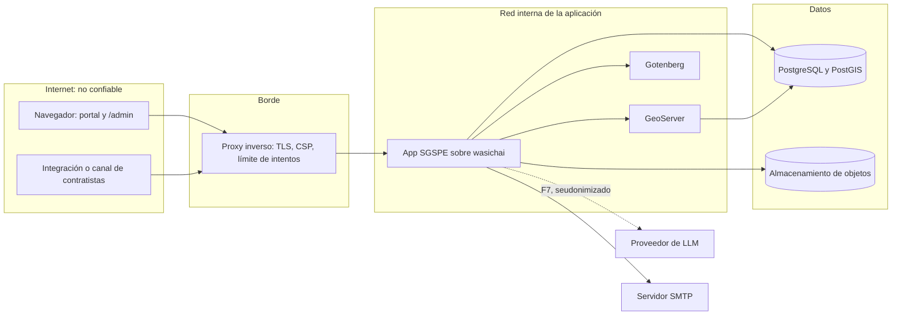

# Seguridad de SGSPE

Sistema de Gestión Social para Proyectos Extractivos · Fase 0 (descubrimiento) · versión 1.0 · 2026-10-07

Este documento fija cómo SGSPE autentica a sus usuarios, separa a sus clientes, autoriza cada operación, protege los datos
personales y deja rastro de cada cambio, sobre la plataforma wasichai [USR-03] [USR-06]. Responde a la sección de roles y
seguridad del prompt maestro: RBAC con autorización por ámbito y sin comprobaciones de rol dispersas por el código
[PRM-01 §7, §22].

- Los IDs (RF, RNF, RN, RQ, CON, GAP, ASM, UPS) se definen solo en el [análisis de requisitos](requirements-analysis.md);
  aquí solo se citan.
- Los nombres de objetos, campos, estados, guardas, listeners y paquetes son los del [modelo de dominio](domain-model.md),
  y el vocabulario ES ↔ EN está en el [glosario](glossary.md).
- Las decisiones de arquitectura se registran en los ADR de SGSPE ([índice](adr/README.md)): ADR-0006 (autorización y
  alcance), ADR-0011 (auditoría), ADR-0017 (datos personales y anonimización) y ADR-0020 (autenticación).
- Ningún ejemplo usa nombres de personas reales: las personas se nombran por su cargo [USR-07].

## 1. Alcance y principios

### 1.1 Qué cubre

- El modelo de amenazas (§2).
- La autenticación (§3) y el aislamiento entre clientes, o tenancy (§4).
- El modelo de autorización de wasichai y cómo lo usa SGSPE (§5), los 17 roles del prompt (§6), la matriz inicial de
  permisos con los campos restringidos (§7) y lo que exigen los listeners y los endpoints propios (§8).
- El alcance por proyecto, territorio y región (§9), GeoServer (§10), los datos personales (§11) y la anonimización de
  los artefactos versionados (§12).
- La auditoría (§13), las pruebas de seguridad (§14) y las decisiones pendientes (§15).

Otros documentos completan lo que aquí se decide: `workflows.md` fija los roles de cada transición, `api.md` los contratos
de los endpoints, `database-model.md` los campos, `gis.md` el catálogo de capas, `deliverables.md` los niveles de
divulgación de cada entregable y `ai-architecture.md` la seudonimización y la defensa contra la inyección de instrucciones.

### 1.2 Principios

| Principio | Qué significa en SGSPE | Fuente |
|---|---|---|
| La plataforma decide | SGSPE no reimplementa el login, la tenancy, los permisos ni la auditoría: usa los de wasichai y solo agrega lo que falta (guardas, endpoints propios, `export_log`) | [USR-03] [USR-06] RNF-MNT-005 [WAS-ADR-0010] [WAS-ADR-0040] |
| Autorización centralizada | El código decide con permisos y acciones declaradas, nunca comparando nombres de rol | RQ-SEC-005 [PRM-01 §7] |
| Denegado por defecto | Un rol declarado nace sin permisos y los recibe por fase, solo sobre los objetos que necesita | RQ-SEC-003 [WAS-DOC security/authentication.md] |
| Minimización | Se guarda, muestra y exporta el mínimo de datos personales; lo sensible queda bajo permiso de campo | [USR-07] RQ-SEC-010 |
| La persona decide | Ninguna IA, regla automática ni cuenta de servicio aprueba ni confirma una alerta, y ningún agente de IA escribe datos de dominio | RQ-AI-001, RN-EWS-001 |
| Todo cambio importante deja rastro | Quién, qué, cuándo, por qué, desde qué valor y hacia cuál, en la base de datos y no solo en los logs | [PRM-01 §18] RQ-AUD-001, RQ-AUD-014 |
| Sin obligaciones legales declaradas | Mientras no haya normativa, ningún control se presenta como cumplimiento legal | GAP-001 |

## 2. Modelo de amenazas

### 2.1 Activos

| Activo | Por qué importa | Dónde vive |
|---|---|---|
| Posturas y evaluaciones de grupos de interés | Dicen quién está a favor o en contra del proyecto y por qué; filtradas, dañan relaciones y exponen a dirigentes en un territorio con conflictos | `stakeholder.stance`, `stakeholder_assessment` [DOC-01 §6, §7.2] |
| Comunidades campesinas e indígenas | Reconocimiento como pueblo indígena, territorio comunal, datos registrales, junta directiva, sectores, redes y sus líderes | `community`, `community_sector`, `position`, `community_network`, `network_node` [DOC-02 p.3–p.5] |
| Tenencia de la tierra | Predios, titulares y partidas: la base de las negociaciones de uso de terreno y servidumbres | `land_parcel`, `land_right`, `agreement` [DOC-03] [DOC-02 p.6] |
| Datos personales | Identificación, contacto, asistentes, beneficiarios, receptores y fotos de personas | `person`, `contact_method`, `engagement_participant`, `commitment`, `delivery`, `evidence` [DOC-01 §9.3.1.2, Tabla 9.5] |
| Quejas y canal de contratistas | Quejas, consultas y solicitudes anónimas o confidenciales, y señales que llegan de terceros | `grievance`, `inquiry`, `stakeholder_request`, `early_warning_signal` [DOC-01 §9.4.2] |
| Decisiones humanas | Aprobaciones, verificaciones, confirmación de alertas y emisión de entregables | transiciones de workflow, `deliverable_version` |
| Montos y aportes | Compromisos, aportes y comprobantes, con riesgo reputacional | `commitment`, `social_contribution`, `receipt` (CON-022) |
| Rastro de auditoría | Prueba de quién hizo qué y por qué | `audit_log`, `export_log`, `ai_interaction` |
| Secretos | Firma de tokens, cuentas de servicio, base de datos, GeoServer, almacenamiento de objetos, SMTP y proveedor de LLM | variables de entorno del despliegue |

### 2.2 Fronteras de confianza



- Todo lo que llega del navegador o de una integración es no confiable: textos, archivos, coordenadas y documentos.
- GeoServer lee la base directamente y no aplica ningún permiso de wasichai (CON-054) [WAS-ADR-0006]: por eso nunca es
  público (§10).
- Gotenberg convierte a PDF los DOCX armados sobre plantillas que suben las organizaciones (RQ-SEC-019) y corre aislado,
  sin salida a internet.
- El proveedor de LLM queda fuera de la frontera y solo recibe texto seudonimizado, desde F7 (RQ-AI-009).

### 2.3 Amenazas

Clasificadas con STRIDE: S (suplantación), T (manipulación), R (repudio), I (divulgación), D (denegación de servicio) y
E (elevación de privilegios).

| Nº | STRIDE | Amenaza | Mitigación en SGSPE | Brecha o decisión |
|---|---|---|---|---|
| 1 | S | Robo del JWT guardado en `localStorage` mediante un script inyectado (texto, archivo subido o salida de IA) | CSP estricta en el proxy, textos en Markdown sin HTML, evidencias servidas como adjunto, salidas de IA como texto y TTL corto (§3.2) | UPS-09: sin revocación de tokens |
| 2 | S | Adivinación de contraseñas o abuso de `/api/auth/login` y `/api/auth/token` | Límite de intentos en el proxy (§3.2) | UPS-09 (RQ-SEC-015) |
| 3 | S | Secreto filtrado de una cuenta de servicio del canal de contratistas o de una integración | Cuenta nunca `ADMIN`, token de 15 minutos, rotación y deshabilitación, permisos mínimos, sin confirmar alertas (§3.3) | GAP-020 |
| 4 | S | Arranque en producción con el usuario semilla o un secreto de desarrollo | Perfil de producción sin semilla y sin secreto por defecto (RQ-SEC-016) | — |
| 5 | T | Reescribir la historia: editar una evaluación, una reprogramación, una medición o una versión emitida | Objetos `appendOnly` (409 para todos), motivo obligatorio y guardas (RQ-AUD-003, RQ-AUD-002) | UPS-12: `audit_log` alterable desde la base |
| 6 | T | Saltarse las reglas de negocio por la API genérica o por `/admin` | Objetos `apiOnly`, guardas y marca de escritura de SGSPE (RQ-AUD-004) | UPS-08 |
| 7 | T | Coordenadas confundidas o manipuladas: un mismo sondaje con dos posiciones | Importación con CRS obligatorio, reporte de diferencias y versiones, sin sobrescritura silenciosa (RQ-GIS-010, CON-023) | GAP-012 |
| 8 | R | Negar una aprobación, una verificación o la confirmación de una alerta | `audit_log` con usuario o cuenta de servicio, motivo y cambio de estado; segregación de funciones (RN-COM-005) | UPS-02, UPS-03 |
| 9 | I | Un usuario lee posturas, razones de postura, religión o proceso electoral que no necesita | Permisos de campo (§7.9) | GAP-024 |
| 10 | I | Un usuario lee datos de proyectos en los que no trabaja | Escritura acotada por asignación y lectura por proyecto con `ProjectReadScope` (§9.7) | UPS-01, CON-041 |
| 11 | I | GeoServer sirve capas con columnas sensibles o de otro tenant | Nunca público; proxy autenticado con lista blanca por tenant; solo capas no sensibles (§10) | GAP-011 |
| 12 | I | Titulares y partidas de predios expuestos en un mapa, una exportación o un entregable | `registry_record` y `holder_person` bajo permiso de campo; predios nunca publicados en GeoServer; nivel EXTERNO sin titulares (§7.9, §10, §11.4) | — |
| 13 | I | Exposición de líderes, redes comunitarias y territorio de comunidades indígenas | Nombres y documentos bajo permiso de campo, citas por cargo, redes nunca publicadas como capa (§10, §11) | GAP-001 |
| 14 | I | Exportaciones, entregables o documentos emitidos con nombres, DNI o fotos sin consentimiento | Niveles de divulgación, `export_log`, plantillas sin campos restringidos (§11.4) | GAP-014 |
| 15 | I | Datos personales enviados al proveedor de LLM | IA desactivada por defecto, seudonimización en los agentes propios y asistente solo para roles sin campos restringidos (§11.5) | GAP-015 |
| 16 | I | Datos personales en logs, avisos o artefactos versionados | Logs sin datos personales, avisos sin valores restringidos y búsqueda de nombres antes de cada commit (§11.6, §12) | — |
| 17 | D | Ráfagas contra el login, el token, las importaciones, la generación de entregables o los mapas | Límites en el proxy; importaciones con límites de tamaño y tiempo (RQ-SEC-020); generación asíncrona (RQ-REP-021) | GAP-027 |
| 18 | E | Un administrador de la organización se concede cualquier permiso | `ORGANIZATION_ADMIN` es `ADMIN` por diseño; pocos administradores; roles solo desde el repositorio (§6.2) | UPS-02, UPS-10 |
| 19 | E | Inyección de instrucciones en actas, informes o documentos que procesa la IA | El contenido es dato y nunca instrucción; herramientas de solo lectura; una persona acepta cada sugerencia (§11.5) | — |
| 20 | E | Una cuenta de servicio, una regla o la IA confirma una alerta o aprueba un compromiso | `WarningWriteGuard`; ninguna cuenta de servicio recibe roles de transición ni acciones de aprobación (RN-EWS-001, RQ-SEC-014) | — |
| 21 | E | Un entregable, que se genera como la plataforma, muestra datos que quien lo pide no puede leer | `GENERATE`, `APPROVE`, `ISSUE` y `DOWNLOAD_RESTRICTED` solo para los roles que leen los campos sensibles; borradores y versiones INTERNO solo con `DOWNLOAD_RESTRICTED` (§11.4) | GAP-024 |
| 22 | T, E | Plantilla Word con macros o archivo de importación con rutas fuera de su carpeta | Validación de plantillas (RQ-SEC-019); carpeta temporal y control de rutas (RQ-SEC-020); Gotenberg aislado | — |
| 23 | T | Un agente de campo cambia o borra lo que capturó otra persona | `EditAnyGuard`: sin `EDIT_ANY` solo se cambia o borra lo propio (§5.5) | ASM-069 |
| 24 | I | Identificar a quien plantea una QCS confidencial por su grupo de interés, que no está restringido | `person` bajo permiso de campo; QCS anónima sin `person` ni `stakeholder` (§7.9, §11.3) | Riesgo residual; decisión en §15 |
| 25 | I | Una sugerencia de IA guarda valores restringidos o cita una evidencia que quien la mira no puede descargar | Salidas y citas guardadas con marcadores; la API genérica solo devuelve marcadores; se re-identifican al mostrar solo para quien lee el campo, y la cita solo para quien puede descargar la fuente (§7.8) | GAP-015; riesgo residual: un marcador revela que había un dato restringido |
| 26 | I | El nombre original del archivo de una evidencia CONFIDENCIAL o de DATOS PERSONALES, que puede llevar datos personales, y su huella SHA-256 los lee todo rol con READ sobre `evidence` | `EvidenceFileReadPolicy` (UPS-24, wasichai 1.0.0) entrega el descriptor sin `name` ni `sha256` a quien no tiene `DOWNLOAD_RESTRICTED`; el portal sube toda evidencia restringida con un nombre neutro como defensa adicional (§11.6) | Resuelta (UPS-24, ASM-093) |
| 27 | E, I | Quien tiene `DOWNLOAD_RESTRICTED` sobre `evidence` y no ve la QCS confidencial a la que está vinculada una evidencia baja su clasificación, y la evidencia deja de estar reservada | La regla de la evidencia vinculada a una QCS confidencial (`409 EVIDENCE_NOT_RESTRICTED`) frena a quien sí ve la QCS; el cambio queda en `audit_log` con usuario y motivo; `DOWNLOAD_RESTRICTED` solo para los roles que escriben evidencias (§9.6) | Riesgo aceptado (ASM-105, D-2) |

## 3. Autenticación

### 3.1 Lo que provee wasichai

- `POST /api/auth/login` verifica un hash BCrypt y emite un JWT HS256 con `sub` (usuario), `org` (organización), `email`,
  `roles`, `iss` y `exp`. El backend lo valida como servidor de recursos WebFlux [WAS-ADR-0010]
  [WAS-DOC security/authentication.md].
- El token vive 8 horas por defecto (`wasichai.security.jwt.ttl`), un valor configurable (RQ-SEC-001).
- No hay secreto por defecto: la aplicación no arranca si `wasichai.security.jwt.secret` (variable `WASICHAI_JWT_SECRET`)
  falta o tiene menos de 32 bytes [WAS-DOC security/authentication.md].
- El usuario semilla de desarrollo (`admin@wasichai.local`) existe solo con `wasichai.seed.dev=true`
  [WAS-DOC security/authentication.md].
- El navegador guarda el token en `localStorage` bajo el prefijo de almacenamiento de la app, y un 401 a mitad de sesión
  devuelve al login [WAS-DOC security/authentication.md]. En SGSPE el portal y `/admin` comparten el login y la clave del
  token (RF-IAM-001).
- Las rutas públicas son `/api/auth/login`, `/api/auth/token`, `/api/health` y `/actuator/health/**`; todo lo demás exige
  token [WAS-DOC security/authentication.md].
- Pasar a OIDC cambia solo el decodificador y el endpoint de login; el modelo de permisos no se mueve [WAS-ADR-0010].

### 3.2 Endurecimiento de SGSPE

| Medida | Detalle | Fuente |
|---|---|---|
| TTL corto en producción | `wasichai.security.jwt.ttl` fijado en `PT4H` por `application-prod.yml`; el despliegue puede cambiarlo (`WASICHAI_SECURITY_JWT_TTL`), nunca a 8 horas o más; una sesión vencida vuelve al login | RQ-SEC-001 |
| Perfil de producción | `wasichai.seed.dev=false` y `WASICHAI_JWT_SECRET` sin valor por defecto en `application-prod.yml`, y la guarda `ProdGuard` (abajo); pruebas en §14 | RQ-SEC-016 |
| Guarda de arranque | Con el perfil `prod`, el arranque falla, con un mensaje que nombra la propiedad y la variable, si `wasichai.seed.dev` es verdadero (`WASICHAI_SEED_DEV`), si `wasichai.security.jwt.secret` falta o es el secreto de desarrollo de `application.yml` (`WASICHAI_JWT_SECRET`) o si `wasichai.security.jwt.ttl` es de 8 horas o más (`WASICHAI_SECURITY_JWT_TTL`) | RQ-SEC-016, RQ-SEC-001 |
| CSP en el proxy | La política del bloque siguiente, desplegada primero en modo `Content-Security-Policy-Report-Only` y ajustada con sus informes | RQ-SEC-001 |
| Revocación de tokens | `wasichai.security.jwt.revocation: true` y `revocation-cache: PT5S` en `application-prod.yml`. Deshabilitar a un usuario, cambiar sus roles o su clave, rotar o deshabilitar una cuenta de servicio y `POST /api/auth/logout` rechazan sus tokens anteriores; otra réplica tarda como mucho los 5 segundos de la caché en enterarse. Una cuenta borrada pierde sus tokens al instante | RQ-SEC-015 (UPS-09) [WAS-ADR-0059] |
| Límite de intentos | `wasichai.security.login.enabled: true` en `application-prod.yml`: 5 intentos por correo y dirección (`max-attempts`), 20 por correo desde cualquier dirección (`account-max-attempts`) y 5 por id de cliente en `/api/auth/token`, en ventanas fijas de 15 minutos (`window: PT15M`). Pasado el límite responde `429` con `Retry-After`, aun con la clave correcta. `application-prod.yml` fija `server.forward-headers-strategy: framework` para que la dirección del cliente sea la que reenvía el proxy; condición obligatoria del despliegue: el proxy sobrescribe, nunca agrega, `X-Forwarded-For` y `X-Forwarded-Proto` (architecture §10.2). El proxy conserva su propio límite por IP y por cuenta como defensa extra | RQ-SEC-015, ASM-049 [WAS-ADR-0059] |
| Política de contraseñas | `wasichai.security.password.*` en `application-prod.yml`: 12 caracteres como mínimo (`min-length`), con mayúscula, minúscula, dígito y símbolo, y distinta del correo. Se aplica al crear un usuario, cambiar la clave y dar de alta una organización (`400` con una entrada por regla incumplida). No hay caducidad. Los secretos de las cuentas de servicio son generados y no se juzgan | RQ-SEC-015 [WAS-ADR-0059] |
| Un solo origen | El proxy sirve el portal y `/admin` y reenvía `/api/**`; no hace falta CORS. La topología de despliegue la fija ADR-0026 | RF-IAM-001 |
| Cabeceras | `Strict-Transport-Security`, `X-Content-Type-Options: nosniff`, `Referrer-Policy: no-referrer` y `Cache-Control: no-store` en las respuestas de `/api/**` | RQ-SEC-001, RQ-SEC-010 |
| Sin contenido activo | Textos largos en Markdown sin HTML; evidencias servidas como adjunto, con su tipo MIME y `nosniff`; la redirección posterior al login solo acepta rutas internas | RF-DOC-001, RF-DOC-003 |
| Secretos fuera del repositorio | Secreto JWT, claves de base de datos, GeoServer, almacenamiento, SMTP, proveedor de LLM y cuentas de servicio en variables de entorno o en el almacén de secretos del despliegue; nunca en el repositorio, en los logs ni en `ai_interaction` | RQ-AI-006, RQ-AI-009 |

`ProdGuard` (`sgspe.prod`) es un `EnvironmentPostProcessor` con el último orden: corre con la configuración ya cargada y antes de
crear el contexto, es decir, antes de Flyway. Importa porque en wasichai 0.3.2 la semilla es una migración de Flyway
(`wasichai.seed.dev`): una variable de entorno `WASICHAI_SEED_DEV=true`, que `develop/example.env` trae, gana a
`application-prod.yml` y crearía `admin@wasichai.local` en la base antes de que cualquier chequeo posterior pudiera impedirlo.
La guarda solo actúa con el perfil `prod`: que el despliegue lo active (`SPRING_PROFILES_ACTIVE=prod`) es una condición
operativa.

Política de contenido inicial, que se ajusta en F1 con el modo de solo informe:

```text
default-src 'self';
script-src 'self' 'sha256-<hash del script de arranque de temas de index.html>';
style-src 'self';
img-src 'self' data: blob: <proveedor del mapa base>;
connect-src 'self' <proveedor del mapa base>;
worker-src 'self' blob:;
font-src 'self';
object-src 'none'; base-uri 'self'; form-action 'self'; frame-ancestors 'none'
```

- El script de arranque de temas de `index.html` es el único script en línea y se autoriza por su hash.
- MapLibre necesita `worker-src blob:`; el mapa base se configura por organización (ASM-048, ASM-125; UPS-13 resuelta
  en `@wasichai/gis` 1.0.0) y el host del estilo que devuelve `GET /api/sgspe/map/settings` entra en `img-src`
  y `connect-src`.
- Los mapas WMS llegan por el proxy WMS del mismo origen (§10), así que no hace falta abrir GeoServer en la política.

### 3.3 Cuentas de servicio

- Una cuenta de servicio es la identidad de un sistema, no de una persona: se autentica con id y secreto de cliente en
  `POST /api/auth/token`, su secreto (256 bits) se muestra una sola vez y se guarda como hash, y su token vive 15 minutos
  (`wasichai.security.jwt.service-account-ttl`) [WAS-ADR-0043].
- Nunca es `ADMIN`, y toda comprobación de administración de la organización la rechaza aunque sus roles la concedan
  [WAS-ADR-0043]. Su rastro de auditoría la nombra en `serviceAccount` [WAS-DOC api/rest.md].
- Deshabilitar o rotar corta los tokens nuevos, no los ya emitidos, que viven hasta su vencimiento [WAS-ADR-0043]. Para
  conservar la auditoría legible se deshabilita, no se borra [WAS-DOC api/rest.md].
- En SGSPE se usan para las integraciones y, si GAP-020 lo decide, para el canal de contratistas (RQ-SEC-014). Mientras
  tanto, los contratistas reportan a través del equipo social (ASM-043, RF-EWS-003).
- Una cuenta de servicio recibe roles declarados, como un usuario [WAS-DOC api/rest.md], y ninguno de los 15 encaja con
  el canal de contratistas. Abrirlo (GAP-020) exige un rol declarado nuevo, fuera de los 17 del prompt, que tenga solo:
  - READ sobre `project` y los maestros que sus registros referencian;
  - CREATE sobre `early_warning_signal` con fuente CONTRATISTA y sobre las QCS por el canal CONTRATISTA (RF-EWS-003,
    RF-GRV-001);
  - una `project_assignment` como cualquier usuario (§9.2);
  - nunca UPDATE sobre `early_warning` ni roles de transición de WF-J o WF-K: `WarningWriteGuard` rechaza además confirmar o
    descartar una alerta sin usuario o con cuenta de servicio (RN-EWS-001).

### 3.4 Brechas y camino futuro

- **UPS-09:** adoptada con wasichai 0.6.0 en el perfil de producción (§3.2). Fuera de él, o con otro perfil, un token robado
  sigue siendo válido hasta que vence y deshabilitar a un usuario no corta su token vigente [WAS-ADR-0043]. Con la revocación
  encendida, el límite que queda es la caché de 5 segundos. El límite de intentos tiene un precio aceptado: quien adivine 20
  veces la clave de una cuenta la bloquea también para su dueño hasta que cierre la ventana. Los contadores viven en la memoria
  de cada réplica (`InMemoryLoginAttemptStore`): con varias réplicas el límite efectivo se multiplica, y el del proxy lo cubre.
- **OIDC** es el camino futuro y no entra en el MVP: cambia el decodificador y el login, no los permisos [WAS-ADR-0010].
- **Cookie HttpOnly:** llevar el token en una cookie con protección CSRF queda como propuesta upstream (CON-056,
  RQ-SEC-001).
- Ningún issue upstream se abre sin la aprobación del usuario (GAP-028).

## 4. Tenancy

- El tenant es el `organization_id` del claim `org` del token, nunca un dato de la petición. Toda consulta filtra por él y
  las tablas físicas son por organización y objeto: un token de una organización no puede nombrar una tabla de otra
  (RQ-SEC-002) [WAS-ADR-0004] [WAS-DOC security/authentication.md].
- El tenant es la empresa cliente; una consultora usa un tenant por cliente (ASM-001, GAP-009). Un usuario pertenece a
  una sola organización (RQ-SEC-002).
- No existe un listado de organizaciones: un tenant no puede enumerar a los demás [WAS-DOC api/rest.md].
- El trabajo en segundo plano corre con `RecordService.asPlatform(organizationId)`: una organización, sin usuario, sin
  permisos, y nunca dentro de una petición [WAS-ADR-0039].
- Cada tenant tiene su propia copia del modelo y de los roles (RQ-SEC-002).
- Las tablas fijas del esquema `sgspe` (`idempotency_key` y `derived_version` desde F3 y, en F7, `knowledge_chunk`)
  llevan `organization_id`, y el código que las lee filtra por él (RQ-AI-008, ASM-065, ASM-091). Los avisos los guarda
  wasichai-notifications, por organización (ADR-0018).
- La organización tenant no es el objeto `organization`, que es un actor del territorio ([glosario](glossary.md)).

### 4.1 Alta de un tenant

Procedimiento operativo (GAP-026):

1. El `ADMIN` de la organización operadora (`SUPER_ADMIN`) llama `POST /api/organizations` con el nombre, el slug y el
   primer administrador (`adminEmail` y `adminPassword`). wasichai crea la organización, su rol `ADMIN` y esa cuenta, que
   es el `ORGANIZATION_ADMIN` [WAS-DOC api/rest.md]. La contraseña inicial la fija el operador, así que el cliente la
   cambia en su primer acceso: wasichai no tiene política de contraseñas (UPS-09) y, sin ese cambio, el operador conserva
   una contraseña de administrador del tenant.
2. `apply.py --email <correo del administrador>` aplica en el tenant nuevo, desde `model/model.json`, los objetos con sus
   campos y flags, las acciones declaradas, las relaciones y los índices (RNF-MNT-002).
3. `apply_roles.py` crea los 15 roles declarados con sus permisos y permisos de campo, sin `own_records_only` (ASM-069), y
   les concede las acciones declaradas que `apply.py` declaró en cada objeto (RQ-SEC-003, RQ-SEC-004).
4. `apply.py --workflows` aplica, cada uno desde su fase, los workflows y después los tipos de documento, las
   automatizaciones y las vistas, formularios y páginas. Va después de los roles porque wasichai rechaza un workflow que
   nombra un rol que la organización no tiene.
5. Los scripts idempotentes cargan los catálogos de referencia: el ubigeo del INEI en `administrative_unit`
   (RF-TER-001), los temas en `topic` y, desde F8, los indicadores en `indicator` (ASM-020, `database-model.md` §25).
6. Desde F6, `model/publish_layers.py` publica en GeoServer solo las capas de `model/layers.json`, con un token de
   `ADMIN` y de forma idempotente, y carga los estilos SLD con las credenciales del despliegue (§10.2). Se omite con
   `--skip-layers` en un despliegue sin GeoServer.
7. El administrador crea los usuarios y les asigna roles; desde F2, `PROJECT_ADMIN` registra las `project_assignment`,
   cada una con su `role_name` (RF-PRJ-005, ASM-070).
8. Se verifica con `apply.py --validate-only`, `apply_roles.py --dry-run` y la prueba de aislamiento de tenants (§14);
   `test_apply.py` recorre el orden completo sobre un tenant nuevo. Una subida de fase repite los pasos 2 a 6, que son
   idempotentes.

Desde el plan 4.4 (ASM-109), el paso 1 lo da la persona del operador que tiene `MANAGE_TENANTS`
(`wasichai.organizations.separate-provisioning` está encendido en producción; el `ADMIN` de un cliente recibe `403` en
`POST /api/organizations` y `DELETE /api/organizations/current`), y los pasos 1 a 6 los corre
`model/provision_tenant.py`; una subida de fase los repite en cada tenant con `model/upgrade_tenants.py` sobre un
inventario que no se versiona. La siembra de `MANAGE_TENANTS` y el uso de los scripts están en `docs/develop/README.md`
§5.

Dos reglas de operación:

- `model/roles.json` es la fuente de verdad: volver a correr `apply_roles.py` reescribe lo editado a mano en `/admin`
  (RNF-MNT-002, GAP-030).
- La pantalla de roles de wasichai-ui borra las acciones declaradas de un rol al guardarlo [WAS-ADR-0042]. Por eso los
  roles se administran solo desde el repositorio.

## 5. Modelo de autorización

### 5.1 Dimensiones del prompt y dónde viven

El prompt pide limitar la autorización por organización, proyecto, región, territorio, módulo y operación [PRM-01 §7].

| Dimensión | Mecanismo | Estado |
|---|---|---|
| Organización | Tenant del token (§4) | Nativo (RQ-SEC-002) |
| Proyecto | `project_assignment` y `ProjectScopeGuard` para escribir; `ProjectReadScope` para leer (§9.7) | Diseñado (RQ-SEC-006, ADR-0029) |
| Región y territorio | Sin fuente de datos en el modelo: `project_assignment` solo asigna proyectos | Pendiente (UPS-01, §9) |
| Módulo | Permisos por objeto; el portal muestra una sección solo si el usuario tiene permisos sobre sus objetos | Nativo (RF-IAM-002) [WAS-ADR-0020] |
| Operación | READ, CREATE, UPDATE, DELETE y acciones declaradas | Nativo (RQ-SEC-004) [WAS-ADR-0042] |
| Campo y edición de lo propio (además del prompt) | Permisos de campo; `EditAnyGuard` con la acción `EDIT_ANY` (§5.5) | El campo es nativo (RQ-SEC-010); la edición de lo propio es una guarda de SGSPE (RQ-SEC-008, ASM-069) |

### 5.2 Permisos por rol, objeto y acción

- Un permiso es `(rol, objeto, acción)`, con las acciones READ, CREATE, UPDATE, DELETE y MANAGE_METADATA. Un permiso sin
  objeto vale para todos los objetos de la organización. `ADMIN` pasa todas las comprobaciones, acciones declaradas
  incluidas [WAS-DOC security/authentication.md].
- Una comprobación sin objeto exige un permiso de todo el tenant. Es el caso de `GET /api/audit`, que solo atiende a
  quien lee todo el tenant: `AUDITOR` y `ADMIN` (RQ-SEC-007, RQ-AUD-005) [WAS-DOC api/rest.md].
- Ningún rol declarado recibe MANAGE_METADATA ni la administración de la organización: el modelo cambia solo desde el
  repositorio (RNF-MNT-002, GAP-030).

### 5.3 Acciones declaradas

Un objeto declara sus verbos además del CRUD. Se conceden por objeto, como cualquier permiso; el código los comprueba con
`CurrentUser.requirePermission(user, "<acción>", objectId)`; `GET /api/auth/me/permissions` los lista; y quitar la
declaración quita sus concesiones [WAS-ADR-0042]. Este es el catálogo definitivo de SGSPE (RQ-SEC-004): `domain-model.md`
§8.1.1 lo replica, y `workflows.md` y `api.md` usan estos nombres tal cual.

| Acción | Objetos que la declaran | Qué habilita | Dónde se comprueba | Roles que la tienen (§7) | Fuente |
|---|---|---|---|---|---|
| `APPROVE` | `project`, `area_of_influence`, `commitment`, `social_contribution`, `social_program`, `deliverable`, `grievance` | Aprobar por segunda persona: llevar el registro a `active` (WF-A), `approved` (WF-O, WF-D, WF-P, WF-H) o `planned` (WF-G), y resolver una queja de severidad ALTA o CRITICA. No la exigen los desvíos por política sin aprobación interna (ASM-008) | Guarda de cada paquete en esas transiciones (`ProjectWriteGuard`, `CommitmentWriteGuard`, `InvestmentWriteGuard`, `DeliverableWriteGuard`, `AttentionWriteGuard`) y el endpoint `POST /api/sgspe/areas-of-influence/{id}/approve` | `project`: `PROJECT_ADMIN`. `area_of_influence`: `SOCIAL_MANAGER`, `PROJECT_MANAGER`. `commitment`: `APPROVER`, `PROJECT_MANAGER`. `social_contribution`: `APPROVER`, `SOCIAL_MANAGER`. `social_program` y `grievance`: `APPROVER`. `deliverable`: `SOCIAL_MANAGER`, `STAKEHOLDER_MANAGER` | RF-WFL-002, RN-GRV-002, ASM-008, ASM-036, ASM-067 |
| `VERIFY` | `commitment` | Llegar a `verified` | `CommitmentWriteGuard`, junto con la segregación de funciones | `COMMITMENT_MANAGER`, `SOCIAL_MANAGER` | RN-COM-005, ASM-008 |
| `ISSUE` | `deliverable` | Emitir una versión | `POST /api/sgspe/deliverables/{id}/issue` | `SOCIAL_MANAGER`, `STAKEHOLDER_MANAGER` | RQ-REP-026 |
| `EXPORT` | `stakeholder`, `commitment`, `grievance`, `inquiry`, `stakeholder_request`, `social_risk`, `deliverable` y, desde F6, los 13 objetos de las capas LYR-01 a LYR-16 (`gis.md` §2.2 y §4.6) que se exportan por `POST /api/sgspe/territory/exports` (§7.8) | Exportar a XLSX y, en F6, a formatos GIS; en `deliverable`, descargar las versiones EXTERNO y PUBLICO | Endpoints de exportación de `sgspe.privacy` y `sgspe.territory` y de descarga de `sgspe.deliverable`, que además escriben `export_log` | Ver la matriz; las concesiones de F6, en §7.8 | RQ-REP-022, RQ-GIS-018, RQ-AUD-011 |
| `GENERATE` | `deliverable` | Pedir un borrador | `POST /api/sgspe/deliverables/{id}/drafts` | `SOCIAL_MANAGER`, `STAKEHOLDER_MANAGER` | RQ-REP-021 |
| `CONFIRM_ALERT` | `early_warning` | Llevar una alerta a `confirmed` o `dismissed` | `WarningWriteGuard`, que además rechaza a las cuentas de servicio | `SOCIAL_RISK_MANAGER`, `SOCIAL_MANAGER` | RN-EWS-001 |
| `APPROVE_OVER_CAP` | `commitment`, `social_contribution` | Aprobar aunque se supere el tope de apoyo social de la campaña cuando `policy_cap_blocks_approval` bloquea | `SupportPolicyGuard` hacia `approved` | `commitment`: `PROJECT_MANAGER`, en `approve_senior` de WF-D. `social_contribution`: `SOCIAL_MANAGER`, en `approve` de WF-P | RN-INV-003, GAP-006, ASM-067 |
| `DOWNLOAD_RESTRICTED` | `evidence`, `deliverable` | Descargar evidencias CONFIDENCIAL o DATOS PERSONALES y bajar su clasificación; descargar borradores y versiones INTERNO de un entregable | `GET /api/sgspe/evidence/{id}/content`, el cambio de clasificación de `evidence` (`EvidenceWriteGuard`) y las descargas de `sgspe.deliverable` | `evidence`: quienes la escriben, salvo `PROJECT_ADMIN` y `FIELD_AGENT`. `deliverable`: `SOCIAL_MANAGER`, `STAKEHOLDER_MANAGER` | RF-DOC-003, RQ-REP-014, ASM-071 |
| `EDIT_ANY` | `engagement`, `engagement_participant`, `field_visit`, `field_observation`, `evidence` | Cambiar, transicionar, vincular o borrar un registro que creó otra persona. Agregar participantes u observaciones a una interacción o visita ajena no la exige | `EditAnyGuard` (`sgspe.scope`, §5.5) | Todo rol que escribe esos objetos, salvo `FIELD_AGENT` | RQ-SEC-008, ASM-069 |
| `READ_CONFIDENTIAL` | `grievance`, `inquiry`, `stakeholder_request` | Leer toda QCS confidencial del objeto; quitarle la marca `confidential` o cambiar su responsable o quien la recibió; registrar una confidencial recibida por otra persona; marcar confidencial una QCS existente de la que no es receptor ni responsable | `ConfidentialAttentionScope` (`sgspe.scope`, §9.6), `AttentionWriteGuard` y el filtro de destinatarios de `sgspe.notification` | `GRIEVANCE_MANAGER` | RQ-SEC-004, RQ-SEC-010, ASM-095, ASM-102 |
| `READ_ALL_PROJECTS` | `project` | Leer todos los proyectos del tenant sin asignación: `ProjectReadScope` no acota a quien la tiene, y sus tableros, reporte y exportaciones toman todos los proyectos por defecto. No da escritura: `ProjectScopeGuard` sigue exigiendo la asignación | `ProjectReadScope` y `ProjectReach` (§9.7) | `AUDITOR`, `PROJECT_ADMIN` (confirmado por el usuario el 2026-10-10); el `*` READ de `AUDITOR` no concede acciones declaradas | RQ-SEC-005, RQ-SEC-006, ASM-106 |

Las mismas acciones, por objeto, para replicarlas en el modelo:

| Objeto | Acciones declaradas |
|---|---|
| `project` | `APPROVE`, `READ_ALL_PROJECTS` |
| `area_of_influence`, `social_program` | `APPROVE` |
| `stakeholder`, `social_risk` | `EXPORT` |
| `inquiry`, `stakeholder_request` | `EXPORT`, `READ_CONFIDENTIAL` |
| `engagement`, `engagement_participant`, `field_visit`, `field_observation` | `EDIT_ANY` |
| `commitment` | `APPROVE`, `VERIFY`, `EXPORT`, `APPROVE_OVER_CAP` |
| `grievance` | `APPROVE`, `EXPORT`, `READ_CONFIDENTIAL` |
| `early_warning` | `CONFIRM_ALERT` |
| `social_contribution` | `APPROVE`, `APPROVE_OVER_CAP` |
| `evidence` | `DOWNLOAD_RESTRICTED`, `EDIT_ANY` |
| `deliverable` | `APPROVE`, `GENERATE`, `ISSUE`, `EXPORT`, `DOWNLOAD_RESTRICTED` |
| Desde F6, `administrative_unit`, `locality`, `road_access`, `community`, `community_sector`, `mining_concession`, `environmental_feature`, `project`, `project_component`, `area_of_influence`, `land_parcel`, `school` y `health_facility` (`gis.md` §2.2 y §4.6; nunca `land_right`) | `EXPORT` |

- **Doble llave en las decisiones.** Los roles de cada transición de aprobación, verificación o confirmación de alerta están
  en la metadata del workflow (`workflows.md`), y la guarda del paquete exige además `APPROVE`, `VERIFY` o
  `CONFIRM_ALERT`. Los roles de esas transiciones son exactamente los que tienen la acción en la matriz (§7), y una prueba
  del modelo lo verifica (§14). Así basta quitar la acción en `roles.json` para retirar la capacidad, y
  `/api/auth/me/permissions` la informa al portal.
- Una regla que depende del rol se resuelve con dos transiciones entre los mismos estados y roles distintos, y la guarda
  decide cuál admite según el registro (`workflows.md`): la aprobación de nivel superior de RN-ENG-002 es la transición
  `approve_senior` de `PROJECT_MANAGER` (ASM-067), y la resolución de una queja ALTA o CRITICA (RN-GRV-002) es
  `resolve_high_severity`, de `APPROVER`. Ninguna compara nombres de rol en el código (RQ-SEC-005).
- Superar el tope de la campaña es otra regla: lo permite `APPROVE_OVER_CAP` en la transición de aprobación (GAP-006). En
  `commitment` la tiene `PROJECT_MANAGER` y la usa en `approve_senior` (ASM-067); en `social_contribution` la tiene
  `SOCIAL_MANAGER` y la usa en `approve` de WF-P: la diferencia entre los dos objetos es aceptada (ASM-119). Quien
  tiene la acción necesita también un rol de esa transición.

### 5.4 Permisos de campo

- Un permiso de campo es una restricción, no una concesión: un rol sin entrada para un campo conserva el acceso completo,
  y entre varios roles gana la unión más permisiva [WAS-DOC HISTORY.md].
- Un campo que el usuario no puede leer no llega a ninguna respuesta: ni al registro, ni a las listas, ni al historial,
  ni a los cambios de la auditoría. Escribir un campo que no puede escribir se rechaza nombrando el campo
  [WAS-DOC security/authentication.md] [WAS-DOC api/rest.md].
- Consecuencia: restringir un campo exige una entrada explícita para cada rol que no debe verlo, y un usuario con dos
  roles lo ve si uno de ellos puede.
- Los campos restringidos y los roles que conservan acceso están en §7.9 (RQ-SEC-010).
- No filtran dos salidas, que se tratan en §11.4: los documentos emitidos de wasichai-documents y los entregables, que se
  generan como la plataforma.

### 5.5 Edición de lo propio: `EDIT_ANY` en lugar de `own_records_only`

- wasichai ofrece `own_records_only`, una marca del rol: el usuario restringido (todos sus roles la llevan) lee y escribe
  solo lo que creó, y los demás registros le responden 404 [WAS-DOC security/authentication.md] [WAS-DOC HISTORY.md]. Pero
  todo valor RELATION que escriba debe apuntar a un registro que él creó, y un vínculo exige que ambos registros sean suyos
  [WAS-DOC api/rest.md]. Con esa marca, un agente de campo no podría vincular lo que captura a un proyecto, una localidad o
  un grupo de interés que registró otra persona.
- Por eso SGSPE no usa `own_records_only` (ASM-069). "Solo edita lo que creó" (RQ-SEC-008) lo aplica `EditAnyGuard`
  (`sgspe.scope`):
  1. vale para los objetos que declaran `EDIT_ANY`: `engagement`, `engagement_participant`, `field_visit`,
     `field_observation` y `evidence` (§5.3);
  2. a quien no tiene `EDIT_ANY` sobre el objeto le rechaza cambiar, transicionar, vincular o borrar un registro que creó
     otra persona (`created_by`);
  3. crear no es cambiar: sin la acción se pueden agregar participantes u observaciones a cualquier interacción o visita
     que se pueda leer (RQ-SEC-008, ASM-069);
  4. deja pasar la escritura que lleva la marca de escritura de SGSPE y solo cambia campos derivados: al agregar un
     participante a una interacción ajena, `AttendanceCountsListener` actualiza sus conteos (§8.1);
  5. decide con `Permissions.has(user, "EDIT_ANY", objectName)` y `created_by`, sin nombres de rol (RQ-SEC-005); `ADMIN`
     tiene siempre la acción [WAS-ADR-0042];
  6. tienen `EDIT_ANY` todos los roles que escriben esos objetos, menos `FIELD_AGENT` (matriz §7).
- Consecuencias para `FIELD_AGENT`:
  - captura interacciones, visitas y evidencias; agrega participantes, preguntas y observaciones a cualquier interacción
    o visita que puede leer; y solo cambia o borra lo que creó;
  - lee el contexto que necesita para capturar (proyecto, territorio, actores, grupos de interés, temas y línea base) y
    lo vincula con su `u` sobre `stakeholder` y `topic`. Esas lecturas se acotan a sus proyectos, salvo los maestros del
    tenant (§9.7);
  - ve su bandeja y completa sus tareas como los demás roles operativos, porque `task` no declara `EDIT_ANY`;
  - pasa `ProjectScopeGuard`, que lee su `project_assignment`;
  - si además tiene otro rol con `EDIT_ANY`, edita todo lo que ese otro rol permite.

### 5.6 Destinos de RELATION y vínculos

- Un valor RELATION debe nombrar un registro de la organización que quien escribe puede leer; si no, la escritura
  responde 400 sobre el campo, con la misma respuesta que para un registro inexistente. `ADMIN`, la plataforma y las
  automatizaciones solo comprueban la organización [WAS-DOC api/rest.md].
- Vincular o desvincular dos registros (relación MANY_TO_MANY) escribe en ambos: exige UPDATE sobre los dos objetos y que
  ambos registros sean visibles (404 si no); responde 409 si un extremo es `appendOnly`, 403 por la API genérica si uno es
  `apiOnly`, y pide motivo si uno es `requiresReason` [WAS-DOC api/rest.md].
- Consecuencia para la matriz: quien vincula (grupos de interés a una interacción, evidencias a un compromiso, predios a
  un acuerdo, temas a una interacción) necesita UPDATE sobre ambos objetos. La notación `u` de §7.1 da ese UPDATE sin
  campos de negocio editables.

### 5.7 Transiciones de workflow

- Aplicar una transición exige UPDATE sobre el objeto y uno de los roles de la transición (sin roles, basta UPDATE;
  `ADMIN` siempre puede), sobre un registro visible para quien la aplica. Queda en la auditoría como un UPDATE con el
  cambio de estado y su motivo [WAS-DOC modules/workflow.md] [WAS-DOC api/rest.md].
- Los roles de cada transición son metadata y los fija `workflows.md`. La matriz da UPDATE, o `u`, a todo rol que tenga
  una transición, y una prueba del modelo lo cruza (§14).
- `apiOnly` no rechaza transiciones [WAS-DOC modules/workflow.md]. Las transiciones de comando (aceptar un candidato o
  una solicitud, aprobar un área de influencia, emitir un entregable) las protege `CommandTransitionGuard`, que solo deja
  pasar las que llegan desde su endpoint.
- Un trabajo programado nunca aplica una transición [WAS-ADR-0039] (RN-WFL-001).

### 5.8 Endpoints propios y guardas: actúan como el usuario

- Los endpoints `/api/sgspe/**` escriben con `RecordService` en proceso, como el usuario, en una transacción y con la marca
  de escritura de SGSPE [WAS-ADR-0038]; `apiOnly` solo cierra la puerta de la API genérica [WAS-ADR-0040]. Por eso el
  usuario necesita los permisos de cada objeto que el comando escribe, más la acción declarada que el endpoint comprueba
  (tabla en §8.2).
- Las guardas también leen como el usuario, porque `asPlatform` no corre dentro de una petición [WAS-ADR-0039]. Un rol
  necesita READ sobre lo que consulta la guarda de su escritura: `CommitmentWriteGuard` lee `delivery` y `evidence`,
  `EngagementWriteGuard` lee `engagement_question` y las QCS con `origin_question`, y `ProjectScopeGuard` lee
  `project_assignment`.

### 5.9 Qué sabe el cliente

- `GET /api/auth/me/permissions` devuelve, por cada objeto legible, las acciones de registro y las acciones declaradas que
  el usuario tiene. Preguntar no concede nada: cada escritura se vuelve a comprobar donde ocurre [WAS-ADR-0020]
  [WAS-ADR-0042].
- No informa los permisos de campo (los dan las definiciones) ni las capacidades de todo el tenant (UPS-06). Las
  acciones declaradas sí, `EDIT_ANY` incluida, así que el portal sabe a quién ofrecer la edición de registros ajenos.
- El portal oculta las secciones sin permisos (RF-IAM-002), y el listado de transiciones de un registro explica por qué
  un botón está desactivado [WAS-DOC api/rest.md].

### 5.10 Sin nombres de rol en el código

- Los nombres de rol existen solo como metadata: en `model/roles.json` (roles, permisos, acciones declaradas, entradas
  de campo y la lista `mappedToAdmin`) y en los roles de cada transición del workflow (RQ-SEC-005) [PRM-01 §7].
- Las guardas y los endpoints deciden con `requirePermission` (CRUD o acción declarada), con la marca `isAdmin` y con
  `serviceAccount`; nunca comparan nombres de rol.
- Una prueba de arquitectura (`ArchitectureTest`, que escanea el código fuente) falla ante un literal de nombre de rol en
  el código principal del backend, y `boundaries.test` hace lo mismo en `sgspe-ui/src` (RQ-SEC-005, RNF-MNT-005).
- Lo que va "al rol X" sale de datos y de la metadata, nunca de un literal (ASM-070):
  - `project_assignment.role_name` nombra un rol declarado de wasichai, y `AssignmentRoleGuard` (`sgspe.scope`) lo valida
    contra `model/roles.json`, cargado como configuración;
  - los destinatarios de escalamientos (como el de compromisos vencidos, ASM-030), aprobaciones pendientes y alertas son
    las asignaciones activas del proyecto cuyo `role_name` está entre los roles de la transición siguiente, tomados de
    la definición del workflow. `ApprovalNoticeListener` los resuelve como quien envía, y por eso todo rol que aplica
    transiciones lee `project_assignment` (matriz §7.2); los avisos de plazo de `DeadlineNotices` los resuelve la
    plataforma;
  - `role_name` no concede permisos: quien recibe un aviso actúa solo con sus roles de wasichai. Si su asignación nombra
    un rol que no tiene, recibe el aviso pero no puede aplicar la transición, y por eso un aviso nunca lleva valores
    restringidos (§11.6);
  - una cuenta de servicio no recibe avisos por rol aunque tenga una asignación (§3.3): se la reconoce por su correo de
    respaldo, `<id>@service-accounts.invalid` [WAS-ADR-0043].
- El portal decide con `/api/auth/me/permissions` y con el listado de transiciones.

Orden en que wasichai y SGSPE deciden una escritura [WAS-DOC api/rest.md] [WAS-ADR-0040]:

```mermaid
flowchart LR
    TOK["Token válido"] --> TEN["Tenant del token"]
    TEN --> API["apiOnly: puerta genérica cerrada"]
    API --> PER["Permiso rol objeto acción"]
    PER --> CAM["Permisos de campo"]
    CAM --> PRO["Registro visible"]
    PRO --> APO["appendOnly: 409"]
    APO --> MOT["requiresReason: motivo"]
    MOT --> REL["Destinos RELATION legibles"]
    REL --> GUA["Guardas de SGSPE: alcance, edición de lo propio, acciones declaradas y reglas"]
    GUA --> ESC["Escritura, audit_log y listeners"]
```



## 6. Roles

### 6.1 Los 17 roles del prompt

Los roles conservan su nombre técnico en inglés y una etiqueta en español [PRM-01 §7] [USR-09]. "Permisos desde" es la
fase en que el rol recibe sus primeras concesiones (§4.1 del análisis); sobre cada objeto, el rol recibe permisos desde
la fase más tardía entre la suya y la del objeto (§7.1). En "Ámbito que necesita", la organización es nativa y el
proyecto lo pone `ProjectReadScope` desde el plan 4.4 (§9.7): leen la organización entera solo `ADMIN` y quien tiene
`READ_ALL_PROJECTS` (`AUDITOR` y `PROJECT_ADMIN`); `SOCIAL_MANAGER` se asigna a cada proyecto que conduce y `ANALYST`
lee sus proyectos. El territorio y la región siguen sin fuente de datos (UPS-01).

| Rol | Descripción | Mapeo en wasichai | Permisos desde | Ámbito que necesita |
|---|---|---|---|---|
| `SUPER_ADMIN` | Superadministrador: operador de la plataforma que aprovisiona tenants [PRM-01 §7] | `ADMIN` de la organización operadora | F1 | Organización operadora; no ve los datos de los tenants que aprovisiona, porque wasichai no los lista ni cruza organizaciones, siempre que el cliente cambie la contraseña inicial de su administrador (§4.1) |
| `ORGANIZATION_ADMIN` | Administrador de la organización: usuarios, roles y modelo de un tenant [PRM-01 §7] | `ADMIN` del tenant | F1 | Organización |
| `PROJECT_ADMIN` | Administrador de proyectos: da de alta y aprueba proyectos y su equipo [PRM-01 §7] | Rol declarado | F2 | Organización para crear proyectos y asignar equipos; proyecto para lo demás |
| `PROJECT_MANAGER` | Jefe de proyecto: el "Jefe del Proyecto" que aprueba la lista de entrevistados [DOC-01 §3.2] | Rol declarado | F2 | Proyecto |
| `SOCIAL_MANAGER` | Gerente social: supervisa el plan de trabajo social [DOC-01 §9.4.1] | Rol declarado | F2 | Proyecto; región si conduce varios proyectos |
| `COMMUNITY_RELATIONS_OFFICER` | Relacionista comunitario: los "relacionistas" y el "equipo social" [DOC-01 §7.1.2, §9.1] [DOC-02 p.2] | Rol declarado | F2 | Proyecto y territorio |
| `STAKEHOLDER_MANAGER` | Gestor de grupos de interés: mapeo y evaluación [DOC-01 §6–§7] | Rol declarado | F2 | Proyecto |
| `COMMITMENT_MANAGER` | Gestor de compromisos: lleva la matriz de compromisos [DOC-01 §9.3.1.2] | Rol declarado | F3 | Proyecto |
| `GRIEVANCE_MANAGER` | Gestor de quejas, consultas y solicitudes [DOC-01 Tabla 9.5] | Rol declarado | F4 | Proyecto y territorio |
| `SOCIAL_RISK_MANAGER` | Gestor de riesgos sociales: lleva la matriz de riesgos [DOC-01 §9.3.2] | Rol declarado | F4 | Proyecto y territorio |
| `SOCIAL_INVESTMENT_MANAGER` | Gestor de inversión social: aportes y programas [DOC-01 §9.3.1.2] [DOC-02 p.3–p.4] | Rol declarado | F5 | Proyecto |
| `GIS_ANALYST` | Analista SIG: prepara mapas e importa coordenadas [DOC-03] | Rol declarado | F2 | Organización para los maestros del territorio; proyecto para componentes y áreas de influencia |
| `FIELD_AGENT` | Agente de campo: registra en terreno lo que él mismo levanta [PRM-01 §7] | Rol declarado sin `EDIT_ANY`: solo actualiza lo que creó (ASM-069) | F2 | Proyecto y territorio; solo cambia lo que capturó (§5.5) |
| `APPROVER` | Aprobador: aprueba mediante acciones declaradas como `APPROVE` [PRM-01 §7] | Rol declarado | F3 | Proyecto |
| `AUDITOR` | Auditor: lee todo el tenant y la auditoría [PRM-01 §7] | Rol declarado con READ en todo el tenant (`*`) | F1 | Organización |
| `ANALYST` | Analista: lee y reporta por objeto [PRM-01 §7] | Rol declarado | F2 | Proyecto u organización, solo lectura por objeto |
| `READ_ONLY` | Solo lectura: consulta [PRM-01 §7] | Rol declarado | F2 | Proyecto, solo lectura por objeto |

### 6.2 Por qué `SUPER_ADMIN` y `ORGANIZATION_ADMIN` son `ADMIN`

- En wasichai, administrar usuarios y roles y aprovisionar tenants dependen del mismo permiso de administración de la
  organización, que tiene el rol `ADMIN` (CON-059). Quien puede editar roles puede concederse cualquier permiso, así que
  un `ORGANIZATION_ADMIN` separado sería `ADMIN` en la práctica (ASM-024, RQ-SEC-003).
- `SUPER_ADMIN` es el `ADMIN` de la organización operadora: aprovisiona tenants con `POST /api/organizations` sin
  verlos después [WAS-DOC api/rest.md], salvo que el cliente conserve la contraseña inicial que el operador le fijó al
  primer administrador (§4.1, UPS-09). `ORGANIZATION_ADMIN` es el `ADMIN` de cada tenant, que nace con el tenant.
- Separar la provisión de tenants de la administración de la organización era UPS-10, resuelta con wasichai 0.6.0
  (WAS-ADR-0055, ASM-109): en producción, crear y borrar tenants exige `MANAGE_TENANTS`, que solo tiene el `ADMIN` de la
  organización operadora, sembrado fuera de banda; el `ADMIN` de un cliente conserva usuarios, roles, cuentas de
  servicio y el nombre de su tenant.
- `ADMIN` pasa los permisos, los permisos de campo y las acciones declaradas, pero no las reglas de los objetos
  (`appendOnly`, `apiOnly`, `requiresReason`) ni las guardas de SGSPE [WAS-ADR-0040]. `ProjectScopeGuard` lo exime
  (§9.2).
- Consecuencias de operación: pocos usuarios `ADMIN`, el trabajo diario con roles declarados y conciencia de que los
  cambios de usuarios y roles no se auditan (UPS-02).

### 6.3 Reglas de `model/roles.json`

- 15 roles declarados más 2 en `mappedToAdmin` suman los 17 del prompt; `apply_roles.py` rechaza declarar `ADMIN`,
  `SUPER_ADMIN` u `ORGANIZATION_ADMIN`, y una prueba lo verifica (RQ-SEC-003).
- Solo `AUDITOR` tiene un permiso de todo el tenant (`"*": ["READ"]`, que se envía sin objeto).
- Ningún rol lleva `ownRecordsOnly`; `FIELD_AGENT` es el único rol que escribe los objetos de §5.5 sin `EDIT_ANY`
  (RQ-SEC-008, ASM-069).
- Ningún rol tiene MANAGE_METADATA ni la administración de la organización.
- Las entradas de campo de §7.9 se declaran por rol; una acción declarada se concede siempre con el objeto que la
  declara [WAS-ADR-0042].
- `u` (§7.1) no es un permiso de wasichai: `apply_roles.py` lo expande en UPDATE más una entrada de campo de solo lectura
  para cada campo no derivado del objeto en `model/model.json`. Falla si `roles.json` nombra un campo que el modelo no
  tiene, y se vuelve a generar en cada fase, para que un campo nuevo no quede escribible por defecto: un permiso de campo
  es una restricción, no una concesión (§5.4).
- Un campo derivado se reconoce por la clave `"derived": true` de su definición en `model/model.json`. Solo la leen las
  herramientas de SGSPE (`apply_roles.py` y las pruebas); `apply.py` no la envía a wasichai. Nunca se marca un derivado con
  `editable: false`: wasichai omite los campos no editables en toda escritura, también en las de la plataforma, y el
  derivado no se podría escribir (`PhysicalTableRecordStore.kt`, líneas 40 y 86, en el código de wasichai-core 0.3.2;
  `database-model.md` §3.1).
- Los roles existen desde F1 con su etiqueta en español y sin permisos, salvo `AUDITOR`; las concesiones se agregan en
  cada fase (RNF-MNT-002).

## 7. Matriz inicial de permisos

### 7.1 Cómo leerla

- Hay una tabla por grupo de bounded contexts. Las filas son los 89 objetos del catálogo y las columnas, los 14 roles
  declarados distintos de `AUDITOR`.
- `AUDITOR` no tiene columna: lee todo el tenant (`*` READ y `READ_ALL_PROJECTS` sobre `project`, §9.7), incluida
  `/api/audit`, no escribe nada y no ve los campos restringidos (§7.9) mientras no se responda GAP-024.
- `SUPER_ADMIN` y `ORGANIZATION_ADMIN` tampoco tienen columna: son `ADMIN` (§6.2).
- Un rol recibe un permiso desde la fase más tardía entre la suya (tabla siguiente) y la del objeto (encabezado de cada
  tabla).
- Es la matriz inicial: `model/roles.json` la implementa fase a fase y se ajusta en el checkpoint y en cada fase.

| Abrev. | Rol | Permisos desde | Qué escribe, en resumen |
|---|---|---|---|
| PAD | `PROJECT_ADMIN` | F2 | Proyectos, partes, campañas, asignaciones y concesiones |
| PMG | `PROJECT_MANAGER` | F2 | Proyecto y campañas; aprobaciones de nivel superior y por encima del tope en compromisos, y de áreas de influencia; acuerdos |
| SMG | `SOCIAL_MANAGER` | F2 | Plan, mensajes, alianzas, áreas de influencia, evaluaciones, acuerdos, compromisos, solicitudes, riesgos, aportes (también por encima del tope), programas y entregables |
| CRO | `COMMUNITY_RELATIONS_OFFICER` | F2 | Territorio, actores, interacciones, compromisos, recepción de QCS, incidentes, aportes con sus ítems, comprobantes y entregas, y secciones de entregables |
| SHM | `STAKEHOLDER_MANAGER` | F2 | Actores, grupos de interés, evaluaciones, línea base y entregables (preparar, aprobar y emitir) |
| CMM | `COMMITMENT_MANAGER` | F3 | Compromisos, entregas y verificación |
| GVM | `GRIEVANCE_MANAGER` | F4 | Quejas, consultas y solicitudes |
| SRM | `SOCIAL_RISK_MANAGER` | F4 | Riesgos, incidentes, señales y alertas |
| SIM | `SOCIAL_INVESTMENT_MANAGER` | F5 | Aportes y programas sociales; único dueño de los datos de los programas |
| GAN | `GIS_ANALYST` | F2 | Maestros del territorio, importaciones y áreas de influencia |
| FAG | `FIELD_AGENT` | F2 | Interacciones, participantes, preguntas, visitas, observaciones y evidencias, y solo cambia lo que creó |
| APR | `APPROVER` | F3 | Aprobaciones de compromisos, aportes y programas, y resolución de quejas graves |
| ANL | `ANALYST` | F2 | Secciones de entregables, exportaciones de lo que puede leer, descarga de versiones EXTERNO y PUBLICO y preguntas al asistente (AI-05) |
| RDO | `READ_ONLY` | F2 | Nada |

Notación de las celdas:

| Notación | Significado |
|---|---|
| R, C, U, D | READ, CREATE, UPDATE, DELETE |
| `u` | UPDATE sin campos de negocio editables: `apply_roles.py` lo expande en UPDATE más entradas de campo de solo lectura para los campos no derivados (§6.3). Sirve para aplicar transiciones, vincular registros (§5.6) y dejar que listeners y endpoints escriban los campos derivados |
| `APPROVE`, `VERIFY`… | Acción declarada concedida sobre ese objeto (§5.3) |
| — | Sin permiso |

Criterios con que se armó:

- DELETE solo en hijos sin historia propia (acciones, hitos, ítems, participantes, nodos…). Las raíces con workflow se
  cancelan o anulan con motivo (RQ-AUD-002, ASM-058), y los objetos `appendOnly` nunca se cambian ni se borran
  [WAS-ADR-0040].
- Quien decide no edita: `APPROVER` y los permisos de solo vínculo usan `u`.
- Un endpoint de comando exige los permisos de todo lo que escribe (§8.2), y una guarda, READ sobre lo que lee (§5.8).
- Los objetos reservados (`contact_method`, `export_log`, `ai_interaction`, `ai_suggestion`) solo los lee quien los
  necesita; el resto de los roles operativos lee todo lo demás de sus proyectos (§9.7) y los maestros del tenant.
- `PROJECT_ADMIN` lee solo proyectos, territorio, organizaciones, temas, evidencias y tareas: no necesita grupos de
  interés, compromisos ni quejas.
- `FIELD_AGENT` escribe solo sus objetos de captura y, sin `EDIT_ANY`, solo cambia lo que creó; lee el contexto que
  necesita para capturar (§5.5, ASM-069).
- Los campos restringidos (§7.9) no se leen ni se escriben con un R o un U sobre el objeto.

### 7.2 BC-01 Proyectos y BC-02 Territorio y SIG (F2; análisis espacial en F6)

| Objeto | PAD | PMG | SMG | CRO | SHM | CMM | GVM | SRM | SIM | GAN | FAG | APR | ANL | RDO |
|---|---|---|---|---|---|---|---|---|---|---|---|---|---|---|
| `project` | CRU `APPROVE` `READ_ALL_PROJECTS` | RU `EXPORT` | R `EXPORT` | R | R | R | R | R | R | Ru `EXPORT` | R | R | R | R |
| `project_party` | CRUD | CRUD | R | R | R | R | R | R | R | R | — | R | R | R |
| `exploration_campaign` | CRU | CRU | R | R | R | R | R | R | R | R | R | R | R | R |
| `project_assignment` | CRUD | R | R | R | R | R | R | R | R | R | R | R | R | R |
| `mining_concession` | CRU | R `EXPORT` | R `EXPORT` | R | R | R | R | R | R | CRU `EXPORT` | — | R | R | R |
| `administrative_unit` | R | R `EXPORT` | R `EXPORT` | R | R | R | R | R | R | R `EXPORT` | R | R | R | R |
| `locality` | R | R `EXPORT` | R `EXPORT` | CRU | R | R | R | R | R | CRU `EXPORT` | R | R | R | R |
| `community` | R | R `EXPORT` | RU `EXPORT` | CRU | R | R | R | R | R | CRU `EXPORT` | R | R | R | R |
| `community_sector` | R | R `EXPORT` | R `EXPORT` | CRUD | R | R | R | R | R | CRUD `EXPORT` | R | R | R | R |
| `area_of_influence` | R | Ru `APPROVE` `EXPORT` | CRU `APPROVE` `EXPORT` | R | R | R | R | R | R | CRU `EXPORT` | R | R | R | R |
| `area_of_influence_member` | R | R | CRUD | R | R | R | R | R | R | CRUD | R | R | R | R |
| `project_component` | R | R `EXPORT` | R `EXPORT` | R | R | R | R | R | R | CRU `EXPORT` | R | R | R | R |
| `land_parcel` | R | R `EXPORT` | Ru `EXPORT` | Ru | R | R | R | R | R | CRU `EXPORT` | — | R | R | R |
| `land_right` | R | R | R | R | R | R | R | R | R | CRUD | — | R | R | R |
| `environmental_feature` | R | R `EXPORT` | R `EXPORT` | CRU | R | R | R | R | R | CRU `EXPORT` | R | R | R | R |

- `administrative_unit` y `topic` son catálogos (BC-20): los carga un script o el `ADMIN` desde `/admin` (RF-TER-001).
- `u` de `GIS_ANALYST` sobre `project` sirve para vincular concesiones (`project_concession`); el de `SOCIAL_MANAGER` y
  `COMMUNITY_RELATIONS_OFFICER` sobre `land_parcel`, para vincular predios a acuerdos (`agreement_land_parcel`).
- `project_component` es `apiOnly`: se escribe solo con los endpoints de importación y de versión (RQ-GIS-010).

### 7.3 BC-03 Grupos de interés (F2)

| Objeto | PAD | PMG | SMG | CRO | SHM | CMM | GVM | SRM | SIM | GAN | FAG | APR | ANL | RDO |
|---|---|---|---|---|---|---|---|---|---|---|---|---|---|---|
| `person` | — | R | R | CRU | CRU | R | CRU | R | R | R | R | R | R | R |
| `organization` | R | R | R | CRU | CRU | R | R | R | CRU | R | R | R | R | R |
| `contact_method` | — | — | R | CRUD | CRUD | R | CRU | — | R | — | — | — | — | — |
| `position` | — | R | R | CRUD | CRUD | R | R | R | R | R | R | R | R | R |
| `stakeholder` | — | R | RU `EXPORT` | CRU | CRU `EXPORT` | Ru | R | Ru | R | R | Ru | R | R `EXPORT` | R |
| `stakeholder_assessment` | — | R | CR | R | CR | R | R | R | R | R | — | R | R | R |
| `prioritization_rule` | — | R | CRUD | R | CRUD | R | R | R | R | R | — | R | R | R |
| `actor_relationship` | — | R | R | CRUD | CRUD | R | R | R | R | R | — | R | R | R |
| `community_network` | — | R | R | CRU | CRU | R | R | R | R | R | R | R | R | R |
| `network_node` | — | R | R | CRUD | CRUD | R | R | R | R | R | R | R | R | R |

- `stakeholder_assessment` es `appendOnly` y `apiOnly`: solo lo crea el endpoint de evaluaciones, que además actualiza el
  `stakeholder` (§8.2).
- El `u` de `COMMITMENT_MANAGER` y `SOCIAL_RISK_MANAGER` sobre `stakeholder` sirve para vincular solicitantes, riesgos e
  incidentes (`commitment_stakeholder`, `social_risk_stakeholder`, `incident_stakeholder`).
- Evaluar escribe `stance` en el grupo de interés (§8.2), así que solo pueden hacerlo los roles con acceso a ese campo
  (§7.9).

### 7.4 BC-04 Relacionamiento (con BC-11) y BC-19 Línea base social (F2)

| Objeto | PAD | PMG | SMG | CRO | SHM | CMM | GVM | SRM | SIM | GAN | FAG | APR | ANL | RDO |
|---|---|---|---|---|---|---|---|---|---|---|---|---|---|---|
| `engagement` | — | R | RU `EDIT_ANY` | CRU `EDIT_ANY` | CRU `EDIT_ANY` | R | R | R | R | R | CRU | R | R | R |
| `engagement_participant` | — | R | R | CRUD `EDIT_ANY` | CRUD `EDIT_ANY` | R | R | R | R | R | CRUD | R | R | R |
| `engagement_question` | — | R | RU | CRU | CRU | R | Ru | R | R | R | CR | R | R | R |
| `field_visit` | — | R | RU `EDIT_ANY` | CRU `EDIT_ANY` | R | R | R | R | R | R | CRU | R | R | R |
| `field_observation` | — | R | R | CRUD `EDIT_ANY` | R | R | R | R | R | R | CRUD | R | R | R |
| `engagement_plan` | — | R | CRUD | R | R | R | R | R | R | R | R | R | R | R |
| `key_message` | — | R | CRUD | R | R | R | R | R | R | R | R | R | R | R |
| `aligned_answer` | — | R | CRUD | R | R | R | R | R | R | R | R | R | R | R |
| `strategic_alliance` | — | R | CRUD | R | R | R | R | R | R | R | — | R | R | R |
| `planned_activity` | — | R | CRUD | RU | R | R | R | R | R | R | R | R | R | R |
| `study` | — | R | CRU | R | CRU | R | R | R | R | R | R | R | R | R |
| `study_instrument` | — | R | CRUD | R | CRUD | R | R | R | R | R | R | R | R | R |
| `locality_profile` | — | R | CRU | CRU | CRU | R | R | R | R | R | R | R | R | R |
| `school` | — | R `EXPORT` | R `EXPORT` | CRUD | R | R | R | R | R | CRU `EXPORT` | R | R | R | R |
| `health_facility` | — | R `EXPORT` | R `EXPORT` | CRUD | R | R | R | R | R | CRU `EXPORT` | R | R | R | R |
| `road_access` | — | R `EXPORT` | R `EXPORT` | CRUD | R | R | R | R | R | CRU `EXPORT` | R | R | R | R |
| `festivity` | — | R | R | CRUD | R | R | R | R | R | R | R | R | R | R |
| `state_program` | — | R | R | CRU | R | R | R | R | R | R | R | R | R | R |
| `local_conflict` | — | R | R | CRU | R | R | R | R | R | R | R | R | R | R |
| `perception` | — | R | R | CRU | CRUD | R | R | R | R | R | R | R | R | R |
| `key_theme` | — | R | CRU | R | CRU | R | R | R | R | R | R | R | R | R |
| `topic` | Ru | Ru | R | Ru | Ru | R | R | R | R | R | Ru | R | R | R |

- El `u` de `COMMUNITY_RELATIONS_OFFICER`, `STAKEHOLDER_MANAGER` y `FIELD_AGENT` sobre `topic` sirve para vincular temas
  a las interacciones (`engagement_topic`); el de `FIELD_AGENT` sobre `stakeholder`, para vincular grupos de interés.
  El de `PROJECT_ADMIN` y `PROJECT_MANAGER`, desde F5, sirve para vincular los temas priorizados del proyecto (§7.7).
- `FIELD_AGENT` captura interacciones y visitas, y agrega participantes, preguntas y observaciones a cualquier interacción
  o visita que puede leer; sin `EDIT_ANY`, `EditAnyGuard` limita a lo que creó sus cambios y sus bajas (ASM-069). Sus
  preguntas se registran con su respuesta en el lugar o la responde después otro rol del equipo.
- `SOCIAL_MANAGER` aprueba las actas (`minutes_approved`) con su UPDATE sobre `engagement` y el rol de esa transición.
- El `u` de `GRIEVANCE_MANAGER` sobre `engagement_question` (F4) sirve para derivar preguntas a QCS (§8.2): solo deja
  escribir `referred_at`, el derivado que pone el endpoint de derivación con la marca; el texto, la respuesta y la
  interacción de la pregunta quedan de solo lectura para él.

### 7.5 BC-05 Compromisos, BC-06 Acuerdos, BC-12 Evidencias y BC-13 Tareas (F3)

| Objeto | PAD | PMG | SMG | CRO | SHM | CMM | GVM | SRM | SIM | GAN | FAG | APR | ANL | RDO |
|---|---|---|---|---|---|---|---|---|---|---|---|---|---|---|
| `commitment` | — | Ru `APPROVE` `APPROVE_OVER_CAP` | CRU `VERIFY` `EXPORT` | CRU | R | CRU `VERIFY` `EXPORT` | R | R | R | R | — | Ru `APPROVE` | R `EXPORT` | R |
| `commitment_action` | — | R | R | CRU | R | CRUD | R | R | R | R | — | R | R | R |
| `commitment_milestone` | — | R | R | R | R | CRUD | R | R | R | R | — | R | R | R |
| `commitment_reschedule` | — | R | R | R | R | CR | R | R | R | R | — | R | R | R |
| `commitment_dependency` | — | R | R | R | R | CRUD | R | R | R | R | — | R | R | R |
| `delivery` | — | R | R | CRU | R | CRU | R | R | CRU | R | — | R | R | R |
| `commitment_candidate` | — | R | CRU | CRU | R | CRU | R | R | R | R | — | R | R | R |
| `agreement` | — | Ru | CRU | CRU | R | R | R | R | R | R | — | R | R | R |
| `agreement_party` | — | R | CRUD | CRUD | R | R | R | R | R | R | — | R | R | R |
| `agreement_clause` | — | R | CRUD | CRUD | R | R | R | R | R | R | — | R | R | R |
| `evidence` | CRU `EDIT_ANY` | R | CRU `EDIT_ANY` `DOWNLOAD_RESTRICTED` | CRU `EDIT_ANY` `DOWNLOAD_RESTRICTED` | CRU `EDIT_ANY` `DOWNLOAD_RESTRICTED` | CRU `EDIT_ANY` `DOWNLOAD_RESTRICTED` | CRU `EDIT_ANY` `DOWNLOAD_RESTRICTED` | CRU `EDIT_ANY` `DOWNLOAD_RESTRICTED` | CRU `EDIT_ANY` `DOWNLOAD_RESTRICTED` | CRU `EDIT_ANY` `DOWNLOAD_RESTRICTED` | CRU | R | R | R |
| `task` | RU | CRU | CRU | CRU | CRU | CRU | CRU | CRU | CRU | CRU | CRU | RU | R | R |

- `COMMUNITY_RELATIONS_OFFICER` registra compromisos acordados en reuniones; `COMMITMENT_MANAGER` y `SOCIAL_MANAGER` los
  llevan, verifican y cierran; `APPROVER` los aprueba, y `PROJECT_MANAGER` aprueba los de nivel superior y los que superan
  el tope de la campaña, con `approve_senior` y `APPROVE_OVER_CAP` (ASM-067); desde F4, `SOCIAL_MANAGER` y
  `COMMITMENT_MANAGER` los crean al aceptar una solicitud.
- La segregación de funciones la aplica `CommitmentWriteGuard`: quien aprueba no es quien registró y quien verifica no es
  el responsable (RN-COM-005).
- La descarga de una evidencia CONFIDENCIAL o DATOS PERSONALES exige READ y `DOWNLOAD_RESTRICTED`, también a quien la
  subió; las PUBLICA e INTERNA se descargan con READ (RF-DOC-003). Bajar la clasificación de una evidencia restringida
  exige `DOWNLOAD_RESTRICTED`, para que un cambio de clasificación no abra la descarga; lo comprueba `EvidenceWriteGuard`
  (ASM-071).
- `PROJECT_ADMIN` trabaja las tareas que le asignan (RU) pero no las crea: una tarea lleva exactamente un origen
  (`ExactlyOneGuard`) y `PROJECT_ADMIN` no lee ninguno, así que wasichai le rechazaría el alta (§5.6).
  `test_apply_roles.py` comprueba que quien crea un objeto con «exactamente uno de» lee algún destino de cada grupo.
- `FIELD_AGENT` sube evidencias de su captura y, sin `EDIT_ANY`, solo cambia o vincula las que subió (§5.5); sin
  `DOWNLOAD_RESTRICTED`, no descarga las CONFIDENCIAL ni las de DATOS PERSONALES.

### 7.6 BC-07 QCS, BC-08 Riesgos sociales y BC-09 Alerta temprana e incidentes (F4)

| Objeto | PAD | PMG | SMG | CRO | SHM | CMM | GVM | SRM | SIM | GAN | FAG | APR | ANL | RDO |
|---|---|---|---|---|---|---|---|---|---|---|---|---|---|---|
| `grievance` | — | R | RU `EXPORT` | CRU | R | R | CRU `EXPORT` `READ_CONFIDENTIAL` | R | R | R | R | Ru `APPROVE` | R `EXPORT` | R |
| `inquiry` | — | R | R `EXPORT` | CRU | R | R | CRU `EXPORT` `READ_CONFIDENTIAL` | R | R | R | R | R | R `EXPORT` | R |
| `stakeholder_request` | — | R | RU `EXPORT` | CRU | R | RU | CRU `EXPORT` `READ_CONFIDENTIAL` | R | RU | R | R | R | R `EXPORT` | R |
| `social_risk` | — | R | RU `EXPORT` | R | R | R | R | CRU `EXPORT` | R | R | — | R | R `EXPORT` | R |
| `risk_assessment` | — | R | R | R | R | R | R | CR | R | R | — | R | R | R |
| `mitigation_measure` | — | R | R | R | R | R | R | CRUD | R | R | — | R | R | R |
| `potential_impact` | — | R | R | R | R | R | R | CRUD | R | R | — | R | R | R |
| `incident` | — | R | RU | CRU | R | R | R | CRU | R | R | — | R | R | R |
| `media_mention` | — | R | R | CRU | R | R | R | CRU | R | R | — | R | R | R |
| `early_warning_signal` | — | R | R | CRU | R | R | R | CRU | R | R | — | R | R | R |
| `early_warning_rule` | — | R | R | R | R | R | R | CRUD | R | R | — | R | R | R |
| `early_warning` | — | R | RU `CONFIRM_ALERT` | RU | R | R | R | CRU `CONFIRM_ALERT` | R | R | — | R | R | R |

- `APPROVER` resuelve las quejas de severidad ALTA o CRITICA (RN-GRV-002, ASM-036).
- El UPDATE de `COMMITMENT_MANAGER` y `SOCIAL_MANAGER` sobre `stakeholder_request` es el que exigen la aceptación de
  solicitudes y `RequestClosureListener` al cerrar un compromiso (§8.1); `SOCIAL_INVESTMENT_MANAGER` lo usa desde F5 para
  aceptar solicitudes como aporte, que exige además CREATE sobre `social_contribution`: `COMMITMENT_MANAGER` no lo
  tiene y acepta solo como compromiso (ASM-117).
- Las alertas las crean una persona o `WarningRulesJob` (JOB-04) en `detected`; confirmarlas o descartarlas es siempre
  humano (RN-EWS-001).
- CREATE sobre las QCS es solo de `COMMUNITY_RELATIONS_OFFICER` y `GRIEVANCE_MANAGER`: solo el equipo social registra
  QCS, sin canal público (ASM-104, UPS-25).
- `READ_CONFIDENTIAL` sobre las tres QCS es solo de `GRIEVANCE_MANAGER` (ASM-095): con ella lee toda QCS confidencial.
  Los demás roles con READ ven una confidencial solo si son su responsable o quien la recibió, y `APPROVER`, por su
  `APPROVE` sobre `grievance`, también una queja ALTA o CRITICA (§9.6).
- Nadie tiene D sobre las raíces de F4. `SOCIAL_RISK_MANAGER` borra medidas, impactos y reglas; una regla con alertas no
  se borra (`409 HAS_DEPENDENTS`) y se desactiva con `enabled` en falso.

### 7.7 BC-10 Inversión social y programas (F5; lineamientos y tope desde F3)

| Objeto | PAD | PMG | SMG | CRO | SHM | CMM | GVM | SRM | SIM | GAN | FAG | APR | ANL | RDO |
|---|---|---|---|---|---|---|---|---|---|---|---|---|---|---|
| `social_contribution` | — | R | CRU `APPROVE` `APPROVE_OVER_CAP` | CRU | R | R | R | R | CRU | R | — | Ru `APPROVE` | R | R |
| `contribution_item` | — | R | CRUD | CRUD | R | R | R | R | CRUD | R | — | R | R | R |
| `receipt` | — | R | R | CRU | R | R | R | R | CRU | R | — | R | R | R |
| `social_program` | — | R | RU | R | R | R | R | R | CRU | R | — | Ru `APPROVE` | R | R |
| `social_initiative` | — | R | R | R | R | R | R | R | CRUD | R | — | R | R | R |
| `beneficiary_group` | — | R | R | R | R | R | R | R | CRUD | R | — | R | R | R |
| `program_budget` | — | R | R | R | R | R | R | R | CRU | R | — | R | R | R |
| `program_indicator` | — | R | R | R | R | R | R | R | CRUD | R | — | R | R | R |
| `program_measurement` | — | R | R | R | R | R | R | R | CR | R | — | R | R | R |
| `program_milestone` | — | R | R | R | R | R | R | R | CRUD | R | — | R | R | R |

- Registran el aporte, con sus ítems antes de aprobar, `SOCIAL_MANAGER`, `COMMUNITY_RELATIONS_OFFICER` y
  `SOCIAL_INVESTMENT_MANAGER` (CRUD sobre `contribution_item`); fuera de `requested`, `InvestmentWriteGuard` congela los
  ítems (ASM-110). `COMMUNITY_RELATIONS_OFFICER` y `SOCIAL_INVESTMENT_MANAGER` registran la entrega y su comprobante
  (CRU sobre `delivery` y `receipt`).
- Crean el aporte al aceptar una solicitud `SOCIAL_MANAGER` y `SOCIAL_INVESTMENT_MANAGER`, que tienen CREATE sobre
  `social_contribution`; `COMMITMENT_MANAGER`, que tiene `accept` pero no ese CREATE, acepta solo como compromiso
  (`403`, ASM-117).
- Aprueban los aportes `APPROVER` y `SOCIAL_MANAGER`; si el aporte supera el tope de la campaña y la política bloquea,
  hace falta `APPROVE_OVER_CAP`, que tiene `SOCIAL_MANAGER` (GAP-006). En compromisos la tiene `PROJECT_MANAGER`: la
  diferencia es aceptada (ASM-119).
- El tope de apoyo social por campaña lo verifica `SupportPolicyGuard` desde F3 (RN-INV-003, RF-INV-002) y, desde F5,
  `ContributionCapRule` en los aportes, con lo comprometido de los dos objetos (ASM-110).
- En los programas, `SOCIAL_MANAGER` conserva RU sobre `social_program` y R sobre sus hijos: conduce la evaluación, la
  suspensión y el cierre. Los datos del programa (presupuesto y ejecutado, indicadores, mediciones, iniciativas, hitos y
  beneficiarios) tienen un solo dueño, `SOCIAL_INVESTMENT_MANAGER`, que borra iniciativas, grupos, indicadores e hitos;
  un indicador con mediciones no se borra (`409` de wasichai sin código, porque `program_measurement` es `appendOnly`).
- Desde F5, `PROJECT_ADMIN` y `PROJECT_MANAGER`, que editan las políticas del proyecto, vinculan sus temas priorizados
  (`project_priority_topic`, ASM-112): el vínculo exige UPDATE sobre `project` y sobre `topic` (§5.6), así que pasan de
  R a `Ru` sobre `topic`.

### 7.8 BC-15 Reportes, tableros y entregables (F2–F8) y BC-18 IA y conocimiento (F7)

| Objeto | PAD | PMG | SMG | CRO | SHM | CMM | GVM | SRM | SIM | GAN | FAG | APR | ANL | RDO |
|---|---|---|---|---|---|---|---|---|---|---|---|---|---|---|
| `indicator` | — | R | RU | R | R | R | R | R | R | R | — | R | R | R |
| `indicator_measurement` | — | R | CR | R | R | R | R | R | R | R | — | R | R | R |
| `deliverable` | — | R `EXPORT` | CRU `GENERATE` `APPROVE` `ISSUE` `EXPORT` `DOWNLOAD_RESTRICTED` | R | CRU `GENERATE` `APPROVE` `ISSUE` `EXPORT` `DOWNLOAD_RESTRICTED` | R | R | R | R | R | — | R | R `EXPORT` | R |
| `deliverable_section` | — | R | CRUD | CRU | CRU | R | R | R | R | R | — | R | CRU | R |
| `deliverable_version` | — | R | CR | R | CR | R | R | R | R | R | — | R | R | R |
| `export_log` | — | C | CR | — | C | C | C | C | — | C | — | — | C | — |
| `ai_interaction` | — | — | CR | CR | CR | CR | CR | CR | — | — | — | — | CR | — |
| `ai_suggestion` | — | — | CRU | CRU | CRU | CRU | CRU | CRU | — | — | — | — | — | — |

- `export_log` lo crean como el usuario los endpoints de exportación, de emisión y de descarga. Toda exportación, toda
  emisión y toda descarga de un archivo de entregable (borrador o versión, de cualquier nivel) deja una fila con su
  `export_kind`: exportación, emisión o descarga (RQ-AUD-011). Por eso tiene CREATE cada rol con `EXPORT` sobre algún
  objeto o con `ISSUE` o `DOWNLOAD_RESTRICTED` sobre `deliverable`, y como el objeto es `apiOnly`, nadie puede escribirlo
  por la API genérica.
- `GENERATE`, `APPROVE`, `ISSUE` y `DOWNLOAD_RESTRICTED` sobre `deliverable` son solo de los roles que leen los campos
  sensibles (`SOCIAL_MANAGER` y `STAKEHOLDER_MANAGER`, GAP-024), porque un entregable INTERNO se genera como la plataforma y
  los incluye (§11.4). `COMMUNITY_RELATIONS_OFFICER` y `ANALYST` escriben secciones narrativas. `EXPORT` sobre
  `deliverable` permite descargar las versiones EXTERNO y PUBLICO para llevarlas fuera de la organización.
- Formatos que se sirven: un borrador o una versión INTERNO, en PDF o DOCX; uno EXTERNO o PUBLICO, solo en PDF, y pedir
  otro formato responde 404. El modelo congelado (`model.json`) nunca se sirve por la API en el MVP: es interno, para
  volver a generar y comprobar hashes. Si algún día se sirviera, exigiría READ y `DOWNLOAD_RESTRICTED` en todos los
  niveles, porque contiene datos que el archivo de cada nivel omite.
- `EXPORT` de las capas territoriales (F6, `POST /api/sgspe/territory/exports`; `gis.md` §2.2 y §4.6). Desde F6, estos
  13 objetos declaran `EXPORT`: `administrative_unit`, `locality`, `road_access`, `community`, `community_sector`,
  `mining_concession`, `environmental_feature`, `project`, `project_component`, `area_of_influence`, `land_parcel`,
  `school` y `health_facility` (nunca `land_right`). La reciben sobre los 13: `GIS_ANALYST` (por defecto, y gana CREATE
  sobre `export_log`), `SOCIAL_MANAGER` (ya exporta los objetos de F2 a F4 y administra las áreas de influencia) y
  `PROJECT_MANAGER` (ya crea filas de `export_log` y exporta entregables). `AUDITOR`, `ANALYST` y los demás roles no
  tienen `EXPORT` territorial. Además de `EXPORT`, cada exportación exige READ sobre el objeto, CREATE sobre
  `export_log` y la divulgación por capa de ASM-124 (§11.4). Las celdas de §7.2, §7.4 y §7.8 los muestran desde que el
  modelo de F6 está aplicado (plan 6.1); hasta entonces las tablas no cambian.
- Reglas de la IA sobre los datos restringidos (`ai-architecture.md` §12.2):
  - pedir una corrida (`POST /api/sgspe/ai/runs`) o una pregunta documental (AI-06, `POST /api/sgspe/ai/knowledge/questions`)
    exige poder leer los nombres de `person` (fila de nombres de §7.9), porque la seudonimización y la re-identificación
    los necesitan; si no, el endpoint responde 403 antes de llamar al modelo. Por eso solo crean `ai_suggestion` los roles
    que leen esos nombres, y `ANALYST`, que no los lee, usa solo el asistente (AI-05, §11.5). `test_apply_roles.py` lo
    comprueba (§14);
  - las salidas (`ai_suggestion` y `commitment_candidate`), `evidence_quote` incluida, se guardan seudonimizadas: una
    persona registrada queda como referencia (`[PERSONA:<id>]`); los nombres de participantes y beneficiarios y los no
    registrados, como `[PERSONA]` sin id; y lo detectado por formato, como marcador sin valor (`[DOCUMENTO]`,
    `[TELEFONO]`, `[CORREO]`). La comprobación de que la cita es literal se hace sobre el fragmento seudonimizado;
  - la API genérica devuelve solo los marcadores. La interfaz re-identifica al mostrar, con los permisos de quien mira:
    quien no puede leer el nombre ve el cargo, si puede leerlo, o solo "persona". Los marcadores sin valor no se
    re-identifican;
  - un permiso de campo (§7.9) oculta `evidence_quote` a los roles sin `DOWNLOAD_RESTRICTED` sobre `evidence`, también en
    la API genérica; además, la interfaz solo la muestra, y la re-identifica, a quien puede abrir esa fuente: descargar la
    evidencia fuente (READ y, si es CONFIDENCIAL o DATOS PERSONALES, `DOWNLOAD_RESTRICTED`, RF-DOC-003) o, si la fuente es
    la minuta de una interacción, leerla;
  - riesgo residual: un marcador no revela el valor, pero sí que en ese lugar había un dato restringido, como una persona
    o un teléfono citados en un acta;
  - aceptar una sugerencia escribe los valores que la persona revisó en la petición, así que ningún marcador llega a un
    registro de dominio.
- Los tableros no tienen permisos propios: cada indicador se calcula con los permisos de quien lo mira y muestra "no
  disponible" si le falta un campo (RQ-DSH-031, RQ-DSH-032). `FIELD_AGENT` no recibe tableros: solo lee el contexto de su
  captura (§5.5).

### 7.9 Campos restringidos

Los campos marcados "(restringido)" en el modelo de dominio (§4.9 y §6 del modelo) llevan, para todo rol que no figure
en la tercera columna, una entrada de campo sin lectura ni escritura. `ADMIN` los ve todos (RQ-SEC-010).

| Campo | Dato | Roles que conservan acceso | Fuente |
|---|---|---|---|
| `stakeholder.stance` | Postura frente al proyecto (sensible) | `SOCIAL_MANAGER`, `STAKEHOLDER_MANAGER` | GAP-024 |
| `stakeholder_assessment.stance`, `stance_reasons`, `concerns`, `expectations` | Postura, sus razones, preocupaciones y expectativas (sensibles) | `SOCIAL_MANAGER`, `STAKEHOLDER_MANAGER` | GAP-024, RF-STK-005 |
| `locality_profile.religion`, `electoral_process` | Religión y proceso electoral (sensibles) | `SOCIAL_MANAGER`, `STAKEHOLDER_MANAGER` | GAP-024, RF-LBS-002 |
| `person.id_document_number` | Documento de identidad; nunca se exporta, en ningún nivel de divulgación (§11.4) | `SOCIAL_MANAGER`, `COMMUNITY_RELATIONS_OFFICER`, `STAKEHOLDER_MANAGER`, `COMMITMENT_MANAGER` | RF-COM-001, CON-014 |
| `person.given_names`, `surnames` | Nombres de personas | `PROJECT_MANAGER`, `SOCIAL_MANAGER`, `COMMUNITY_RELATIONS_OFFICER`, `STAKEHOLDER_MANAGER`, `COMMITMENT_MANAGER`, `GRIEVANCE_MANAGER`, `SOCIAL_RISK_MANAGER`, `SOCIAL_INVESTMENT_MANAGER`, `GIS_ANALYST`, `FIELD_AGENT`, `APPROVER` | RF-STK-001, RF-TER-007 |
| `contact_method.contact_value` | Teléfono, correo o dirección | `SOCIAL_MANAGER`, `COMMUNITY_RELATIONS_OFFICER`, `STAKEHOLDER_MANAGER`, `COMMITMENT_MANAGER`, `GRIEVANCE_MANAGER`, `SOCIAL_INVESTMENT_MANAGER` | RF-STK-001, RNF-PRIV-004 |
| `engagement_participant.participant_name`, `phone`, `email` | Datos de los asistentes | `SOCIAL_MANAGER`, `COMMUNITY_RELATIONS_OFFICER`, `STAKEHOLDER_MANAGER`, `FIELD_AGENT` | RF-ENG-004 |
| `commitment.beneficiaries_detail` | Nombre, sexo y edad de beneficiarios | `SOCIAL_MANAGER`, `COMMUNITY_RELATIONS_OFFICER`, `COMMITMENT_MANAGER` | RF-COM-001, CON-014 |
| `delivery.recipients`, `conformity_by` | Receptores y quienes dan conformidad | `SOCIAL_MANAGER`, `COMMUNITY_RELATIONS_OFFICER`, `COMMITMENT_MANAGER`, `SOCIAL_INVESTMENT_MANAGER` | RF-COM-008 |
| `land_parcel.registry_record` | Partida registral del predio | `SOCIAL_MANAGER`, `COMMUNITY_RELATIONS_OFFICER`, `GIS_ANALYST` | RF-TER-007 |
| `land_right.holder_person` | Persona titular o posesionaria del predio | `SOCIAL_MANAGER`, `COMMUNITY_RELATIONS_OFFICER`, `GIS_ANALYST` | RF-TER-007 |
| `person` de `grievance`, `inquiry` y `stakeholder_request` | Persona que plantea la QCS | `SOCIAL_MANAGER`, `COMMUNITY_RELATIONS_OFFICER`, `GRIEVANCE_MANAGER` | RF-GRV-001 |
| `ai_suggestion.evidence_quote`, `commitment_candidate.evidence_quote` | Cita de una evidencia que puede ser restringida | Los roles con `DOWNLOAD_RESTRICTED` sobre `evidence`: `SOCIAL_MANAGER`, `COMMUNITY_RELATIONS_OFFICER`, `STAKEHOLDER_MANAGER`, `COMMITMENT_MANAGER`, `GRIEVANCE_MANAGER`, `SOCIAL_RISK_MANAGER`, `SOCIAL_INVESTMENT_MANAGER`, `GIS_ANALYST` | RF-DOC-003, RQ-AI-004, ASM-071 |

- Un permiso de campo vale para todos los registros del objeto: la postura de una organización queda tan restringida
  como la de una persona, porque la plataforma no distingue registros dentro de un campo (GAP-024).
- Todo rol que conserva una RELATION restringida a `person` (`land_right.holder_person` y la `person` de las QCS) lee
  también los nombres de las personas, para identificar a quien vincula: por eso `GIS_ANALYST`, que registra los
  titulares de los predios, está en la fila de nombres (RF-TER-007). `test_apply_roles.py` lo comprueba (§14).
- La `person` de una QCS está restringida, pero la protección de quien la plantea es parcial: ver §11.3.
- `FIELD_AGENT` necesita los datos de los asistentes para capturarlos. Sin `own_records_only` (ASM-069) también lee los de
  las interacciones de otros, solo en sus proyectos (§9.7).
- Los indicadores que usan un campo restringido, como la distribución de posturas o la oposición (RQ-DSH-004, RQ-DSH-007,
  RQ-DSH-008), dicen "no disponible" a quien no tiene el campo (RQ-DSH-032). `indicator_measurement` no tiene campos
  restringidos, así que el cierre de un periodo no congela esos indicadores: el endpoint responde 409 (§8.2). Si el
  checkpoint quiere
  mostrarlos agregados a más roles, esa publicación es la opción ya prevista (ASM-042).
- Los listeners y endpoints que escriben un campo derivado restringido (por ejemplo, `stakeholder.stance` desde una
  evaluación) lo hacen como el usuario, así que solo pueden dispararlos los roles con acceso a ese campo.

### 7.10 Escrituras de la plataforma

No tienen permisos porque corren como la plataforma, con `ClusterLock` y un motivo que nombra al trabajo, y solo
escriben campos derivados o crean registros nuevos (domain-model §8.3) [WAS-ADR-0039]: `DeadlineJob` (JOB-01),
`DerivedFieldsJob` (JOB-02), `StakeholderFollowUpJob` (JOB-03), `WarningRulesJob` (JOB-04), `DeliverableGenerationJob`
(JOB-05) y `KnowledgeIndexJob` (JOB-07), que crea `ai_interaction` y escribe la tabla fija `knowledge_chunk`.
JOB-08 (`RetentionJob`) borra, desde F3, las claves vencidas de la tabla fija `idempotency_key` y los saltos vencidos de
`derived_version` con SQL propio (ASM-065, ASM-091) y, desde F8, los archivos de borradores
sin referencia en el almacenamiento de objetos, nunca lo que referencia una `deliverable_version` o `draft_storage_key`;
ninguno de los dos escribe registros de wasichai. Las automatizaciones de la metadata también actúan
como la plataforma, y escribirlas exige MANAGE_METADATA, que solo tiene `ADMIN` [WAS-DOC api/rest.md]. Las escrituras
de un trabajo llevan además su origen en la columna `source` de la auditoría (`job:<nombre>`, WAS-ADR-0050, §13.2). La
clave `generator_key` de las tareas de un trabajo solo la escribe la plataforma: una persona que la fija, la cambia o la
vacía recibe `403` (`GeneratorKeyGuard`), porque una clave escrita a mano suprimiría en silencio la tarea que el
trabajo debe crear.

## 8. Permisos que exigen los listeners y los endpoints

### 8.1 Listeners

Un listener corre como quien escribió y necesita sus permisos (domain-model §7.5). La matriz concede UPDATE a los roles
que escriben cada fuente; bajo `u`, los campos derivados siguen escribibles. `EditAnyGuard` no frena la escritura de un
listener, que lleva la marca de escritura de SGSPE y solo cambia campos derivados, aunque el registro sea ajeno (§5.5).

| Listener (paquete) | Escribe en | Permiso que exige | Roles que escriben la fuente | Cómo lo cubre la matriz | `FIELD_AGENT`, sin `EDIT_ANY` |
|---|---|---|---|---|---|
| `QcsDueDatesListener` (`sgspe.attention`) | Los `*_due_date` de la misma QCS | UPDATE sobre la QCS, con motivo | `GRIEVANCE_MANAGER`, `COMMUNITY_RELATIONS_OFFICER` | Ambos tienen CRU sobre `grievance`, `inquiry` y `stakeholder_request` | Solo lee las QCS; no las escribe |
| `AttendanceCountsListener` (`sgspe.engagement`) | Conteos de asistentes de `engagement` | UPDATE sobre `engagement` | `COMMUNITY_RELATIONS_OFFICER`, `STAKEHOLDER_MANAGER`, `FIELD_AGENT` | Los tres tienen U sobre `engagement` | Agrega participantes a cualquier interacción que lee, y el listener actualiza los conteos de la interacción ajena: escritura derivada con la marca, que `EditAnyGuard` no frena (ASM-069) |
| `AreaListener` (`sgspe.territory`) | `calculated_area_ha` del mismo registro | UPDATE sobre ese objeto | `GIS_ANALYST`; `SOCIAL_MANAGER` (`area_of_influence`, `community` y vínculos de `land_parcel`); `COMMUNITY_RELATIONS_OFFICER` (`community` y vínculos de `land_parcel`); `PROJECT_ADMIN` (`mining_concession`) | Todos tienen U o `u`, y en `u` los derivados siguen escribibles | No escribe esos objetos |
| `ContributionTotalsListener` (`sgspe.investment`) | `total_amount` de `social_contribution`, con cada ítem y en `approve` y `approve_direct` (ASM-110) | UPDATE sobre `social_contribution`, con motivo | Ítems: `SOCIAL_INVESTMENT_MANAGER`, `SOCIAL_MANAGER`, `COMMUNITY_RELATIONS_OFFICER`; aprobación: `APPROVER`, `SOCIAL_MANAGER`, `SOCIAL_INVESTMENT_MANAGER` | CRU sobre `social_contribution`; `APPROVER` tiene `u`, y bajo `u` el derivado sigue escribible | Sin permisos sobre BC-10 |
| `ProgramTotalsListener` (`sgspe.investment`) | `total_budget` de `social_program` (ASM-113) | UPDATE sobre `social_program` | `SOCIAL_INVESTMENT_MANAGER`, el único que escribe presupuestos | CRU sobre `social_program` | Sin permisos sobre BC-10 |
| `CommitmentDerivationsListener` (`sgspe.commitment`) | `requires_senior_approval`, `fulfilled_date`, `closed_date` y `cancelled_date`; borra `fulfilled_date` en `reopen_execution` | UPDATE sobre `commitment`, con motivo | Alta y origen: `COMMITMENT_MANAGER`, `COMMUNITY_RELATIONS_OFFICER`, `SOCIAL_MANAGER`; `register_fulfillment`: esos tres; `reopen_execution` y `close`: `COMMITMENT_MANAGER`, `SOCIAL_MANAGER`; `cancel_draft`: `COMMITMENT_MANAGER`, `COMMUNITY_RELATIONS_OFFICER`, `SOCIAL_MANAGER`; las otras cuatro `cancel_*`: `APPROVER`, `PROJECT_MANAGER` | U o `u` sobre `commitment`: `APPROVER` y `PROJECT_MANAGER` tienen `u`, y bajo `u` las fechas derivadas siguen escribibles | No tiene permisos sobre `commitment` |
| `QcsTransitionDatesListener` (`sgspe.attention`) | `resolved_date` (queja) y `closed_date` de la misma QCS, en la transacción de la transición; si falla, la transición se revierte | UPDATE sobre la QCS, con motivo | `resolve`, `reopen`, los cierres de quejas y consultas, y `reject_*` y `withdraw_*` de la queja: `GRIEVANCE_MANAGER`; `withdraw_*`: también `COMMUNITY_RELATIONS_OFFICER`; `resolve_high_severity`: `APPROVER`; `close` de consulta: también `COMMUNITY_RELATIONS_OFFICER`; cierres de solicitudes: `GRIEVANCE_MANAGER`, `SOCIAL_MANAGER`, `COMMITMENT_MANAGER` y `SOCIAL_INVESTMENT_MANAGER` | Todos tienen U o `u` sobre su QCS; `APPROVER` tiene `u` sobre `grievance` | No aplica transiciones de QCS |
| `RequestClosureListener` (`sgspe.attention`) | Transición a `closed` de la `stakeholder_request` que originó el compromiso o, desde F5, el aporte (ASM-068) | UPDATE sobre `stakeholder_request`, un rol de esa transición de WF-E3 y motivo | `COMMITMENT_MANAGER` y `SOCIAL_MANAGER`, que cierran compromisos; `SOCIAL_INVESTMENT_MANAGER` y `SOCIAL_MANAGER`, que cierran aportes | UPDATE sobre `stakeholder_request`; `workflows.md` les da esa transición (`close_accepted`) | No cierra compromisos ni aportes |
| `DeadlineStatusListener` (`sgspe.deadline`) | `deadline_status` del compromiso que se reprograma, en la transacción de la reprogramación | UPDATE sobre `commitment`, con motivo | `COMMITMENT_MANAGER`, que reprograma | CRU sobre `commitment` | No reprograma |
| `ApprovalNoticeListener` (`sgspe.notification`) | El módulo wasichai-notifications (`publish` y `resolve`), en la transacción de la transición; no escribe registros de wasichai | Lee `project_assignment` como quien envía, para resolver los destinatarios (ASM-070) | Los de las transiciones de envío: `submit_for_review` de WF-A, `submit_minutes` de WF-C, `submit` de WF-D y, desde F5, `submit` de WF-G (`SOCIAL_INVESTMENT_MANAGER`); desde F5, también quienes crean un `social_contribution` (`SOCIAL_MANAGER`, `COMMUNITY_RELATIONS_OFFICER`, `SOCIAL_INVESTMENT_MANAGER`), por la API genérica o al aceptar una solicitud | Todo rol que aplica transiciones lee `project_assignment` (§7.2); los avisos de plazo de `DeadlineNotices` los resuelve la plataforma | No envía a aprobación |

- Si un listener de derivados no puede escribir, registra el error y `DerivedFieldsJob` corrige el valor en la hora
  siguiente; si falla un listener sobre una transición, la transición se revierte (domain-model §7.5).
- El estado de la relación y el último contacto de un grupo de interés no usan listener: los mantiene
  `StakeholderFollowUpJob`, para que cerrar una interacción no exija escribir el grupo de interés. Así la cierra también
  `FIELD_AGENT`, que sobre `stakeholder` solo tiene `u` (domain-model §7.2).
- Si el compromiso o el aporte se cancela o se rechaza, la solicitud que lo originó no se cierra sola: la cierra a mano
  `close_unfulfilled`, de `GRIEVANCE_MANAGER` o `SOCIAL_MANAGER`, que tienen UPDATE sobre `stakeholder_request` (ASM-068).

### 8.2 Endpoints propios

| Endpoint (paquete) | Qué escribe como el usuario | Permisos que exige | Roles de la matriz | Fase |
|---|---|---|---|---|
| `POST /api/sgspe/stakeholders/{id}/assessments` (`sgspe.stakeholder`) | Crea `stakeholder_assessment`, actualiza los derivados de `stakeholder` (incluida `stance`) y aplica la transición a `assessed` | CREATE `stakeholder_assessment`; UPDATE `stakeholder` con acceso a `stance`; rol de esa transición de WF-B | `SOCIAL_MANAGER`, `STAKEHOLDER_MANAGER` (ver la nota) | F2 |
| `POST /api/sgspe/areas-of-influence/{id}/approve` (`sgspe.territory`) | Lleva la versión nueva a `approved` y la anterior a `superseded` | UPDATE `area_of_influence`; `APPROVE` | `SOCIAL_MANAGER`, `PROJECT_MANAGER` | F2 |
| `POST /api/sgspe/territory/imports`, su confirmación y `POST /api/sgspe/project-components` (`sgspe.territory`) | Crea, versiona o actualiza el objeto destino (`project_component`, `land_parcel` o `mining_concession`); guardar el archivo original como `evidence` (ASM-060) sigue pendiente | CREATE y UPDATE sobre el objeto destino | `GIS_ANALYST` (los tres destinos); `PROJECT_ADMIN` (`mining_concession`) | F2 |
| `POST /api/sgspe/commitments/{id}/reschedules` (`sgspe.commitment`) | Crea `commitment_reschedule` y cambia `due_date`; `DeadlineStatusListener` recalcula `deadline_status` | CREATE `commitment_reschedule`; UPDATE `commitment` | `COMMITMENT_MANAGER` | F3 |
| `POST /api/sgspe/commitments/{id}/deliveries` (`sgspe.commitment`) | Solo captura datos: crea la `delivery`, la vincula con sus evidencias y actualiza `executed_amount`; el cumplimiento es después la transición humana `register_fulfillment` | CREATE `delivery`; UPDATE `commitment` y `evidence` | `COMMITMENT_MANAGER`, `COMMUNITY_RELATIONS_OFFICER` | F3 |
| `PATCH /api/sgspe/deliveries/{id}` (`sgspe.commitment`) | Corrige la entrega y recalcula `executed_amount`; nunca la de un compromiso cumplido o cancelado. Desde F5 corrige también la de un aporte en `procured`, sin recalcular ningún ejecutado (ASM-111) | UPDATE `delivery` y, en la de un compromiso, `commitment`; en la de un aporte, `social_contribution` | `COMMITMENT_MANAGER`, `COMMUNITY_RELATIONS_OFFICER`; desde F5, también `SOCIAL_INVESTMENT_MANAGER` | F3 |
| `POST /api/sgspe/commitment-candidates`, `.../{id}/accept` y `.../{id}/duplicate` (`sgspe.commitment`) | Registra un candidato; al aceptarlo crea el compromiso en `draft` y lo vincula; al marcarlo como duplicado escribe `duplicate_of` | CREATE `commitment_candidate`; para aceptar, UPDATE `commitment_candidate`, CREATE `commitment` y el rol de `accept`; para el duplicado, UPDATE y el rol de `mark_duplicate`. Decide una persona: una cuenta de servicio recibe `403` aunque tenga el rol (RQ-AI-003) | `COMMUNITY_RELATIONS_OFFICER`, `COMMITMENT_MANAGER`, `SOCIAL_MANAGER`, para registrar y para aceptar | F3 |
| `POST /api/sgspe/evidence`, `GET /api/sgspe/evidence/{id}/content` y la ruta nativa de descarga de `evidence` (`sgspe.evidence`) | Registra la evidencia con el archivo que la misma persona subió por wasichai-files (que calcula el SHA-256) y la vincula; la descarga según su clasificación, por las dos rutas | CREATE `evidence` (también para subir el archivo); UPDATE `evidence` y del destino para vincular; `DOWNLOAD_RESTRICTED` para descargar CONFIDENCIAL y DATOS PERSONALES, o si quien llama no lee la clasificación | Los que tienen CRU sobre `evidence` | F3 |
| `PATCH /api/sgspe/evidence/{id}` (`sgspe.evidence`) | Cambia los datos descriptivos, nunca el archivo | UPDATE `evidence`; `EDIT_ANY` si la subió otra persona; `DOWNLOAD_RESTRICTED` para bajar la clasificación de una CONFIDENCIAL o DATOS PERSONALES (`EvidenceWriteGuard`, ASM-071) | Los que tienen CRU sobre `evidence` | F3 |
| `POST /api/sgspe/stakeholder-requests/{id}/accept` (`sgspe.attention`) | Aplica `accepted` y crea el compromiso en `draft` o, desde F5, el aporte en `requested` | UPDATE `stakeholder_request` y rol de la transición; CREATE del objeto que crea, `commitment` o, desde F5, `social_contribution` | Como compromiso: `SOCIAL_MANAGER`, `COMMITMENT_MANAGER`. Como aporte, desde F5: `SOCIAL_MANAGER`, `SOCIAL_INVESTMENT_MANAGER`; `COMMITMENT_MANAGER`, sin CREATE sobre `social_contribution`, recibe `403` (ASM-117) | F4 |
| `POST /api/sgspe/grievances/{id}/reclassify` y sus pares (`sgspe.attention`) | Crea el registro de destino y conserva el vínculo con el original | CREATE del destino; UPDATE del origen | `GRIEVANCE_MANAGER` | F4 |
| `POST /api/sgspe/engagement-questions/{id}/referral` (`sgspe.attention`) | Crea la QCS con `origin_question` | CREATE de la QCS; UPDATE (`U` o `u`) sobre `engagement_question`, porque escribe `referred_at` | `COMMUNITY_RELATIONS_OFFICER`, `GRIEVANCE_MANAGER` | F4 |
| `POST /api/sgspe/social-risks/{id}/assessments` (`sgspe.risk`) | Crea `risk_assessment`, actualiza los valores vigentes de `social_risk` y, en la primera revisión, aplica `assessed` | CREATE `risk_assessment`; UPDATE `social_risk`; rol de la transición | `SOCIAL_RISK_MANAGER` | F4 |
| `POST /api/sgspe/social-contributions/{id}/deliveries` (`sgspe.investment`) | Solo captura datos, con el aporte en `procured`: crea su única entrega y vincula las evidencias ACTA DE RECEPCION, FOTO y COMPROBANTE; llevar el aporte a `delivered` es después la transición humana `register_delivery` (ASM-111) | CREATE `delivery`; UPDATE `social_contribution` y `evidence` | `SOCIAL_INVESTMENT_MANAGER`, `COMMUNITY_RELATIONS_OFFICER` | F5 |
| Exportaciones XLSX (`sgspe.privacy`) | Lee con `RecordService` como el usuario y crea `export_log` | READ del objeto; `EXPORT`; CREATE `export_log` | Ver la matriz | F2–F4 |
| `POST /api/sgspe/deliverables/{id}/drafts` (`sgspe.deliverable`) | Escribe `generation_requested_at` | UPDATE `deliverable`; `GENERATE` | `SOCIAL_MANAGER`, `STAKEHOLDER_MANAGER` | F8 |
| `POST /api/sgspe/deliverables/{id}/issue` (`sgspe.deliverable`) | Aplica `issued`, crea la `deliverable_version`, apunta a ella y registra la emisión | UPDATE `deliverable`; CREATE `deliverable_version` y `export_log`; `ISSUE` | `SOCIAL_MANAGER`, `STAKEHOLDER_MANAGER` | F8 |
| `GET /api/sgspe/deliverables/{id}/draft/content` (`sgspe.deliverable`) | Registra la descarga en `export_log`. El archivo lleva siempre la marca de agua BORRADOR; si es INTERNO, en PDF o DOCX, y si es EXTERNO o PUBLICO, solo en PDF | READ y `DOWNLOAD_RESTRICTED` sobre `deliverable`; CREATE `export_log` | `SOCIAL_MANAGER`, `STAKEHOLDER_MANAGER` | F8 |
| `GET /api/sgspe/deliverables/{id}/versions/{versionNumber}/content` (`sgspe.deliverable`) | Registra la descarga en `export_log`. Una versión INTERNO se sirve en PDF o DOCX; una EXTERNO o PUBLICO, solo en PDF. El modelo congelado nunca se sirve | INTERNO: READ y `DOWNLOAD_RESTRICTED` sobre `deliverable`. EXTERNO y PUBLICO: READ y `EXPORT`. En ambos casos, CREATE `export_log` | INTERNO: `SOCIAL_MANAGER`, `STAKEHOLDER_MANAGER`. EXTERNO y PUBLICO: los que tienen `EXPORT` sobre `deliverable` | F8 |
| `POST /api/sgspe/indicators/{id}/measurements` (`sgspe.dashboard`) | Crea la cifra oficial de un periodo. Responde 409 para los indicadores que nunca se congelan: los de postura (KPI-STK-02, KPI-STK-05 y KPI-STK-06) y KPI-TER-01, que no tiene valor propio (`dashboards.md` §10) | CREATE `indicator_measurement` | `SOCIAL_MANAGER` | F8 |
| `POST /api/sgspe/ai-suggestions/{id}/accept` (`sgspe.ai`) | Aplica `accepted` y ejecuta el comando de dominio | UPDATE `ai_suggestion`; los permisos del comando que ejecuta | Quien tenga ambos | F7 |

Las evaluaciones las aplican solo `STAKEHOLDER_MANAGER` y `SOCIAL_MANAGER`, con la transición `assess` de WF-B y el
endpoint de evaluaciones, porque evaluar escribe `stance`, un campo que solo ellos leen (§7.9, GAP-024).
`COMMUNITY_RELATIONS_OFFICER` aporta lo que observa a través del relacionamiento.

## 9. Alcance por proyecto, territorio y región

### 9.1 El problema

- El prompt pide limitar la autorización por proyecto, región y territorio [PRM-01 §7]. wasichai ofrece de forma nativa
  la organización, el módulo, la operación, el campo y los registros propios (que SGSPE no usa, §5.5), pero no el alcance
  por proyecto, territorio ni región. Es la brecha UPS-01 (CON-041, GAP-025), resuelta para
  proyectos con el SPI `RecordReadScope` de wasichai 0.6.0 (§9.7, ADR-0029); territorio y región siguen sin fuente.
- No se puede resolver solo del lado de la app:
  - `RecordQueryContributor` con su `RecordCriterion` solo estrecha las listas, y solo cuando llega su parámetro de
    consulta [WAS-ADR-0025] [WAS-ADR-0027];
  - el filtro de registros propios solo distingue "lo creé yo" [WAS-DOC security/authentication.md];
  - `RecordWriteGuard` cubre las escrituras, no las lecturas [WAS-ADR-0040];
  - leer las tablas físicas desde SGSPE es API interna de la plataforma (RNF-MNT-005) [WAS-ADR-0024].
- Las rutas de lectura que habría que cubrir son las listas, el detalle, los registros relacionados, el historial, las
  features GIS, el asistente, la comprobación de destinos RELATION y las agregaciones propias de indicadores y análisis
  espacial (UPS-01, RQ-SEC-006, RQ-GIS-017).

### 9.2 Opción A: lectura de todo el tenant y escritura acotada por asignación (hasta F4)

Rigió hasta F4. Desde el plan 4.4, la lectura la acota `ProjectReadScope` (§9.7); la escritura de esta sección sigue
igual, como segunda línea.

- **Lectura:** de todo el tenant, filtrada por los permisos de objeto y de campo. El filtro "mis proyectos" del portal
  (RQ-DSH-001) es una comodidad, no una frontera de seguridad.
- **Escritura:** `ProjectScopeGuard` (`sgspe.scope`), con `project_assignment` como fuente (RF-PRJ-005):
  1. se aplica a altas, cambios, bajas, transiciones y vínculos de los objetos de un proyecto: las raíces con `project`
     (domain-model §4.7) y sus hijos, a través de su raíz;
  2. quien escribe debe tener una asignación vigente a ese proyecto (`active` y, si las tiene, fecha de hoy entre
     `start_date` y `end_date`, en America/Lima);
  3. una escritura que cambia el `project` de un registro exige asignación a ambos proyectos;
  4. los objetos que también pueden ser del tenant (`evidence`, `early_warning_rule`, `indicator_measurement`,
     `export_log`, `ai_suggestion`, `ai_interaction`) y `locality_profile`, cuyo `study` es opcional, se comprueban solo
     cuando tienen proyecto (un `locality_profile` sin `study` es del tenant);
  5. quedan exentos `ADMIN`, la plataforma y las automatizaciones; el alta de un `project`, que todavía no tiene equipo;
     y la escritura de `project_assignment` por quien tiene permiso sobre ella, para formar los equipos;
  6. las cuentas de servicio se asignan como cualquier usuario, con el id de su usuario de respaldo;
  7. la guarda lee las asignaciones como el usuario (§5.8), por eso todo rol que escribe en objetos de proyecto lee
     `project_assignment`;
  8. la guarda falla cerrado: un registro cuyo proyecto no se resuelve (su relación obligatoria está vacía o su padre no
     tiene proyecto) solo lo escribe `ADMIN`; el error es 403 y `errors[0].message` trae `NOT_ASSIGNED`. un alta sin su relación
     obligatoria no es de alcance: la rechaza wasichai con su 400 «is required» (y la base con NOT NULL). es defensa en profundidad: `DependentsDeleteGuard` impide borrar un padre con dependientes
     obligatorios (409 `HAS_DEPENDENTS`), así que por la API no quedan registros sin dueño.
- **Riesgo residual de las asignaciones:** `PROJECT_ADMIN`, al formar equipos, puede asignarse a sí mismo o a cualquier
  usuario de la organización a cualquier proyecto y escribir allí con sus roles; lo mitiga la auditoría de
  `project_assignment`, no la guarda.
- Las agregaciones con SQL propio de `sgspe.territory` y `sgspe.dashboard` aplican READ por objeto y por campo detrás de
  su compuerta de permisos (RQ-GIS-017, RQ-DSH-031).
- **Riesgo residual:** quien tiene READ sobre un objeto lo lee en todos los proyectos del tenant, también en los mapas,
  los tableros, el historial y el asistente. Es aceptable en un piloto de un solo proyecto o en un tenant cuyos equipos
  trabajan en todos sus proyectos; no lo es con equipos separados por proyecto.

### 9.3 Opción B: SPI de alcance de lectura en wasichai

Diseño de la extensión upstream (UPS-01), tomado del diseño de la Fase 1 y del blueprint del dominio; wasichai 0.6.0 lo
adoptó como `RecordReadScope` y SGSPE lo usa desde el plan 4.4 (§9.7):

- **Un criterio por usuario.** Para cada usuario autenticado y cada objeto, SGSPE devuelve un `RecordCriterion`, el tipo
  de fragmento `WHERE` que la plataforma ya tiene y que siempre va entre paréntesis, de modo que solo puede estrechar la
  consulta [WAS-ADR-0025].
- **Aplicado en todas las rutas de lectura:** `RecordService` (listas, detalle y filas), registros relacionados,
  historial, features GIS, herramientas del asistente y la comprobación de destinos RELATION.
- **Aplicado en la escritura:** `RecordWriteGuards` usa el mismo criterio; `ProjectScopeGuard` queda como segunda línea.
- **Informado al cliente:** `/api/auth/me/permissions` agrega los ámbitos del usuario (UPS-06).
- **No aplica** a `ADMIN` ni a la plataforma; `/api/audit` sigue siendo de todo el tenant para `AUDITOR`.
- **Implementación en SGSPE:** el proveedor vive en `sgspe.scope` y lee `project_assignment`. Los criterios de territorio
  y región (por ejemplo, las unidades administrativas o las áreas de influencia del proyecto) se agregan cuando se
  definan: hoy no tienen fuente de datos.
- **Acota también lo que lee `FIELD_AGENT`:** con B, su lectura puede limitarse a sus proyectos; su escritura ya la limitan
  `ProjectScopeGuard` y `EditAnyGuard` (§5.5).
- **Costo:** un ADR y un issue en wasichai, que se abre solo con la aprobación del usuario (GAP-028), y pruebas de
  contrato en SGSPE (§14).

### 9.4 Alternativas descartadas

| Alternativa | Por qué se descarta |
|---|---|
| Un tenant por proyecto | Un usuario pertenece a una sola organización, las vistas entre proyectos serían imposibles y los maestros de actores y territorio se duplicarían (RQ-SEC-002) |
| Leer las tablas físicas desde SGSPE con un filtro propio | Es API interna de la plataforma (RNF-MNT-005), y la API genérica y `/admin` quedarían abiertas |
| Filtrar solo en el portal | Un filtro de interfaz no es una frontera: la API genérica sigue respondiendo |

### 9.5 Decisión

| Criterio | Opción A | Opción B |
|---|---|---|
| Rutas de lectura cubiertas | Ninguna por proyecto | Todas |
| Escritura por proyecto | Sí, con `ProjectScopeGuard` | Sí, con el mismo criterio y la guarda |
| Depende de wasichai | No | Sí: ADR e issue upstream (GAP-028) |
| Reversible | Sí: la guarda sigue siendo útil con B | — |
| Adecuada para | Piloto de un proyecto o equipos que trabajan en todos los proyectos | Producción con varios proyectos y equipos separados |

- **Decidido el 2026-10-10 (CON-041, GAP-025, ADR-0029):** la opción B del lado de SGSPE, con el SPI `RecordReadScope`
  de wasichai 0.6.0 en lugar de una extensión upstream nueva. A rigió hasta F4; `ProjectScopeGuard` se queda.

### 9.6 QCS confidenciales: `RecordReadScope` (F4)

wasichai 0.6.0 trae el SPI `RecordReadScope` (WAS-ADR-0048): para cada usuario y objeto, la app devuelve un criterio que
la plataforma aplica en listas, detalle, relacionados, historial, auditoría, transiciones, features GIS y agente, y que
no se aplica al `ADMIN` ni a la plataforma. F4 lo adopta **solo** para las QCS confidenciales (ASM-095, decisión del
usuario del 2026-10-09). Desde el plan 4.4 el alcance por proyecto usa el mismo SPI (§9.7): los dos criterios se
componen por AND, así que `READ_CONFIDENTIAL` no abre otros proyectos y `READ_ALL_PROJECTS` no abre las confidenciales;
la regla del sistema `ConfidentialRelease` no se extiende, porque la solicitud y el compromiso son siempre del mismo
proyecto (`ProjectLinkGuard`). La decisión, sus alternativas y sus consecuencias están en
[ADR-0028](adr/0028-qcs-confidenciales-con-recordreadscope.md).

| Quien llama | Ve una QCS confidencial (`grievance`, `inquiry`, `stakeholder_request`) |
|---|---|
| `ADMIN` (también `SUPER_ADMIN` y `ORGANIZATION_ADMIN`) | Siempre: wasichai no aplica los `RecordReadScope` al `ADMIN` |
| Con `READ_CONFIDENTIAL` sobre el objeto (`GRIEVANCE_MANAGER`) | Siempre |
| Su responsable (`owner_user_id` igual a quien llama) | Siempre |
| Quien la recibió (`received_by_user_id` igual a quien llama) | Siempre |
| Con `APPROVE` sobre `grievance` (`APPROVER`) | Solo una queja con `severity` ALTA o CRITICA, que debe resolver (RN-GRV-002) |
| Cualquier otro rol con READ | Nunca |

Una QCS sin `confidential` verdadero la ven todos los que tienen READ, como hasta F3.

- **Componente.** `ConfidentialAttentionScope` (`sgspe.scope`) implementa `RecordReadScope.criterion(user, definition)`:
  para un objeto que no es una de las tres QCS, o con `READ_CONFIDENTIAL` sobre el objeto, no restringe; si no, devuelve
  `confidential IS NOT TRUE OR owner_user_id = <quien llama> OR received_by_user_id = <quien llama>` y, en `grievance`
  con `APPROVE`, además `OR severity IN ('ALTA', 'CRITICA')`, con los nombres de columna de la definición y valores
  enlazados, nunca concatenados. Las acciones de quien llama salen de la misma consulta de permisos de
  `sgspe.common.Permissions`, memorizada por petición (`RequestMemo`).
- **Falla cerrado.** Si la definición no trae `confidential`, `owner_user_id` o `received_by_user_id`, o si la consulta
  de permisos falla, devuelve una condición que no admite ningún registro del objeto y deja una advertencia en el log
  sin datos del registro.
- **Escrituras.** Quien no lee una QCS no la cambia ni la transiciona: wasichai la trata como inexistente.
  `AttentionWriteGuard` cubre la marca y el responsable: el alta de una confidencial lleva `received_by_user_id` igual a
  quien escribe, salvo con `READ_CONFIDENTIAL` o en el alta que hace la reclasificación, que conserva el receptor del
  original (`api.md` §4.6) (`400 CONFIDENTIAL_RECEIVER_REQUIRED`), y quitar la marca o cambiar
  `owner_user_id` o `received_by_user_id` de una confidencial exige esa acción (`403 ACTION_REQUIRED`). Así quien
  registra siempre la ve, no la pierde al guardarla y los listeners, que escriben como esa persona, la pueden
  actualizar. Marcar confidencial una QCS existente (de falso a verdadero) lo hace su receptor o su responsable
  guardados, o quien tiene `READ_CONFIDENTIAL` (D-3 del 2026-10-10); los demás reciben
  `403 CONFIDENTIAL_MARK_FORBIDDEN` sobre `confidential`, también si se ponen de responsable en la misma escritura. Así
  nadie oculta a los demás una QCS que no le toca, y quien la marca la sigue viendo.
- **Reposición de derivados.** Un PUT que no trae los derivados los vacía y `DerivedFieldsKeeper` los repone, como
  quien escribe; pero la escritura puede volver la QCS ilegible para esa persona (el responsable la marca y la pasa a
  otro en el mismo PUT). Por eso la lectura y la escritura de la reposición corren con `DerivedRestore` (`sgspe.common`),
  con el que `ConfidentialAttentionScope` admite además ese registro, por su `id`, solo en su objeto y solo mientras dura
  la reposición; nada de lo leído vuelve al cliente, y los plazos no se pierden. `ArchitectureTest` vigila que solo
  `DerivedFieldsKeeper` construya un `DerivedRestore`.
- **Excepción: el cierre automático de una solicitud (`ConfidentialRelease`).** `RequestClosureListener` cierra la
  solicitud aceptada al cerrarse su compromiso aunque quien cierra no la lea (RN-GRV-001): es la única excepción al
  alcance dentro de una petición. Como wasichai no deja ser la plataforma en una petición ni aplicar una transición sin
  usuario, corre como quien cierra dentro de `ConfidentialRelease` (`sgspe.common`), con el que
  `ConfidentialAttentionScope` admite además, mientras dura el cierre, las solicitudes cuyo `created_commitment` es ese
  compromiso, y solo ellas; la auditoría lleva el origen `listener:request-closure` y el motivo «RN-GRV-001: compromiso
  <código> cerrado». `ArchitectureTest` vigila que nadie más lo use. La decisión, aceptada por el usuario el 2026-10-09,
  está en [ADR-0028](adr/0028-qcs-confidenciales-con-recordreadscope.md).
- **Vínculos desde otros objetos.** Una tarea, una evidencia, un compromiso (`origin_grievance`) o una pregunta pueden
  apuntar a una QCS que quien lee no ve: el id es visible y el registro no, y el portal muestra «Registro reservado».
  Los títulos de las tareas automáticas solo llevan el código de la QCS, salvo las de una confidencial, que son
  genéricas (D-1 del 2026-10-10): las de escalamiento de los niveles 1 y 2 de JOB-01 y la de acuse de una queja
  (`ConfidentialTasksListener`, en lugar de AUT-02, que no corre en una confidencial) llevan la huella en lugar del id
  en su clave, un texto que solo nombra el proyecto y ningún vínculo con la QCS; al marcar confidencial una QCS
  existente, sus tareas automáticas abiertas se vuelven genéricas y las cerradas quedan como historia (`workflows.md`,
  «Avisos» y «Listeners»). Quedan residuales aceptados: la tarea de acuse que AUT-02 crea después de que la queja se
  marcó (su ejecución corre fuera de la petición); la tarea vieja cuya genérica ya existía porque la marca se quitó y se
  volvió a poner; el historial y la auditoría de una tarea reescrita, que conservan su versión anterior (el código y el
  vínculo, que quien lee `task` ya veía) y así revelan que esa QCS pasó a ser confidencial; la tarea de AUT-02 cuyo
  título se editó o cuya QCS cambió de código, que no se reconoce y queda como estaba; y la marca que coincide con
  JOB-01 creando la genérica de la misma clave, o cuya genérica ya existe pero quien marca no la lee, que choca con el
  único de `generator_key` y se revierte (409: falla cerrado, sin filtrar datos). Una evidencia vinculada a una QCS confidencial debe ser CONFIDENCIAL o DATOS PERSONALES
  (`409 EVIDENCE_NOT_RESTRICTED`); quien tiene `DOWNLOAD_RESTRICTED` y no ve la QCS puede, aun así, bajar la
  clasificación de la evidencia, porque `EvidenceWriteGuard` lee los vínculos como quien escribe y la QCS que no ve no
  aparece entre ellos: es un riesgo aceptado (D-2, ASM-105, amenaza 27).
- **Trabajos.** JOB-01, JOB-02, JOB-04 y `DeadlineNotices` leen como la plataforma, sin el alcance: lo que producen se
  filtra en la salida (avisos, ASM-102) o es agregado (conteos de JOB-04).
- **Indicadores, reporte y exportaciones.** Leen como quien llama y excluyen lo que no ve. El tablero `attention`, cada
  KPI-GRV, KPI-ENG-05, el reporte unificado y, desde el plan 6.2c, `concentration` con `of` en una QCS y la capa LYR-20 llevan
  `confidentialHidden: true` cuando quien llama no es `ADMIN` ni tiene
  `READ_CONFIDENTIAL` sobre los tres objetos; nunca el número de excluidas. EXTERNO excluye toda QCS confidencial,
  también para `GRIEVANCE_MANAGER` (§11.4).
- **Capa LYR-20.** Lee como quien llama: hereda el alcance (`gis.md` §2.2).
- **Capa LYR-24 (residual aceptado).** Dibuja la ubicación de una evidencia a quien lee `evidence`, aunque sea CONFIDENCIAL
  o DATOS PERSONALES (también la vinculada a una QCS confidencial), igual que la API genérica: el descriptor del archivo no
  sale y la descarga sigue exigiendo `DOWNLOAD_RESTRICTED`. Lo mismo vale para el punto exacto de una QCS en LYR-20 y de
  una entrega en LYR-23 para quien las lee; la generalización a la localidad queda para los mapas de informe de F8.

Las decisiones D-1, D-2 y D-3 del usuario del 2026-10-10 (tareas genéricas, riesgo aceptado de las evidencias y quién
marca una QCS existente) extienden [ADR-0028](adr/0028-qcs-confidenciales-con-recordreadscope.md) sin cambiarlo: el
alcance de lectura sigue siendo el mismo.

### 9.7 Alcance de lectura por proyecto: `ProjectReadScope` (plan 4.4)

El segundo `RecordReadScope` de SGSPE (ASM-106, [ADR-0029](adr/0029-alcance-de-lectura-por-proyecto.md)). wasichai lo
pide para toda persona y cuenta de servicio que no es `ADMIN`, nunca para la plataforma ni para las automatizaciones, y
lo aplica en listas, totales, búsqueda, detalle, cambios, bajas, transiciones, relacionados (y `POST/DELETE
.../related`), destinos de `RELATION`, historial, `/api/audit`, features GIS, archivos y agente.

| Objeto | Lo lee quien llama si… |
|---|---|
| `project` | Está entre «mis proyectos»: los de sus asignaciones vigentes (`active` y, si las tiene, hoy en Lima entre `start_date` y `end_date`) |
| `project_assignment` | Es suya (aunque esté vencida) o es de uno de mis proyectos |
| Las raíces de `ProjectScope.ROOTS` (31 hasta F4; 33 desde F5, con `social_contribution` y `social_program`) | Su `project` es de mis proyectos; `evidence`, `early_warning_rule` y `export_log` sin `project`, siempre |
| Los hijos de `ProjectScope.CHILDREN` (19 hasta F4; 27 desde F5) | El padre que tienen es de mis proyectos, subiendo la cadena si ese padre es a su vez un hijo (`program_measurement`, ASM-114); `locality_profile` sin estudio, siempre; `delivery` sin compromiso, siempre hasta F4, y desde F5, sin compromiso ni aporte, solo para los exentos |
| Los 20 maestros de `ProjectScope.TENANT` (territorio, actores, línea base, `topic`) | Siempre (ASM-107) |

- **Maestros del tenant (`ProjectScope.TENANT`):** `administrative_unit`, `locality`, `community`, `community_sector`,
  `mining_concession`, `land_parcel`, `land_right`, `environmental_feature`, `person`, `organization`, `contact_method`,
  `position`, `actor_relationship`, `school`, `health_facility`, `road_access`, `festivity`, `state_program`,
  `local_conflict`, `topic`. Son los únicos objetos que GeoServer puede publicar, y solo si no tienen campos
  restringidos (§10.2).
- **Exentos:** `ADMIN` (wasichai) y quien tiene la acción declarada `READ_ALL_PROJECTS` sobre `project` (`AUDITOR` y
  `PROJECT_ADMIN`). `ProjectReach` (`sgspe.common`) lo decide también para los tableros, el reporte y las exportaciones.
- **SQL puro:** «mis proyectos» es una subconsulta sobre la tabla de `project_assignment`, con valores enlazados; leerla
  con `Records` dispararía el mismo alcance sobre sí misma. Los nombres de tabla y columna salen de la definición.
- **Falla cerrado:** un objeto sin clasificar en `ProjectScope`, una definición sin sus columnas o un error al consultar
  permisos o definiciones no admiten ningún registro. `ArchitectureTest` exige que todo objeto de `model.json` esté en
  un solo grupo.
- **Definiciones en caché (planes cortos de la caché del esquema y de wasichai 1.1.0):** las tablas y columnas de la
  condición salen de `ObjectDefinitions.current` (`sgspe.common`), un memo por petición sobre la caché de definiciones de
  wasichai 1.1.0 (`wasichai.metadata.cache.ttl`, 30 s; ADR-066 de wasichai). En el nodo que recibe un cambio del modelo,
  la petición siguiente ya lo ve; en otro nodo, a lo sumo el ttl después (D49 de wasichai). Una definición vieja tras
  `apply.py` solo puede dejar la condición incompleta, acotarla por menos padres o hacer fallar el SQL: una persona ve
  menos registros, nunca más. Ninguna ausencia se guarda. Las guardas, `WriteView`, `TenantModel` y los comandos leen la
  misma definición de la petición, y los permisos nunca se guardan entre peticiones (wasichai memoriza lo que los roles
  dicen de un objeto solo por petición). `0s` lee siempre de la base. `ArchitectureTest` exige que solo `ObjectDefinitions`
  (y `Records` en el camino de la plataforma) llame a `MetadataService.loadDefinition`.
- **Hijos con padre opcional:** un hijo con un único padre opcional, sin él, se lee en todo el tenant.
  `ArchitectureTest` fija la lista exacta (hasta F4, `delivery` y `locality_profile`; desde F5, solo
  `locality_profile`) y exige que ninguno tenga otra relación hacia un objeto de proyecto.
- **Cadenas y padres alternativos (desde F5, ASM-114):** `ProjectScope.CHILDREN` da, por hijo, sus padres posibles en
  orden, como pares (campo RELATION, objeto padre); `ProjectScope.chain(child, field)` da los saltos hasta la raíz y
  `ProjectScope.parentOf(record)`, el padre presente. Un padre puede ser a su vez un hijo si la cadena llega a una raíz
  en a lo sumo dos saltos y sin ciclos (`program_measurement` → `program_indicator` → `social_program`): la condición
  anida una subconsulta por salto, con un alias por salto (`t1`, `t2`), valores enlazados y los nombres de tabla y
  columna de la definición. Un hijo con varios padres (`delivery`: `commitment` o `social_contribution`, exactamente uno
  por `ExactlyOneGuard`) se lee por la disyunción de un término por padre posible, cada uno entre paréntesis; un `NULL`
  en el campo de un término no lo cumple, así que una entrega huérfana (los dos vacíos, por el `ON DELETE SET NULL` de
  wasichai) solo la leen `ADMIN` y quien tiene `READ_ALL_PROJECTS`. Una definición de la cadena sin la columna de su
  salto o sin `project` no admite ningún registro (falla cerrado). `ReadColumns.parent` pasa a `parents`, una lista de
  `ParentPath` con la columna del hijo y los saltos (tabla y columna de cada uno) hasta la columna `project` de la raíz.
  `ProjectResolver` (escritura) toma el padre presente antes y después y sube la misma cadena leyendo como quien
  escribe: un registro existente con varios padres posibles y ninguno es `unresolved`, y un alta sin ninguno la rechaza
  antes `ExactlyOneGuard` (`400 EXACTLY_ONE`). `ProjectLinks.linkedProject` (vínculos) sube la cadena igual; un salto
  que no se lee es `NotReadable`.
- **`ArchitectureTest` desde F5:** (1) todo objeto de `model.json` está en un solo grupo y `ProjectScope` no nombra
  objetos ausentes; (2) los objetos con relación `project` son exactamente `ROOTS` más `project_assignment`; (3) cada
  padre posible `(f, P)` de un hijo es una relación `(hijo, f, P)` del modelo, con `P` en `ROOTS` o en `CHILDREN`; (4)
  desde cada hijo, toda cadena llega a una raíz en a lo sumo dos saltos y ningún objeto es su propio ancestro; (5) un
  hijo que es padre de otro (`program_indicator`) tiene un solo padre posible, con relación obligatoria; (6) un hijo con
  varios padres tiene todas esas relaciones opcionales, que forman exactamente un grupo de `ExactlyOneGuard` de ese
  objeto, y no tiene otra relación hacia un objeto de proyecto (hoy, solo `delivery`); (7) los hijos con un único padre
  opcional son exactamente `locality_profile`, sin otra relación hacia un objeto de proyecto.
- **Documentos emitidos:** wasichai-documents solo pide READ sobre el objeto (UPS-28); `IssueDocumentFilter` lee el
  registro del documento como quien llama en `GET .../records/{id}/documents` y `GET /api/documents/{id}` (y en su
  `HEAD`, que WebFlux sirve con los mismos `@GetMapping`) y responde `404` si no lo lee.
- **Escritura:** `ProjectScopeGuard` (§9.2) sigue como segunda línea: frena a quien lee todo sin estar asignado.
- **Errores (ASM-108):** fuera del alcance, `404`; un `RELATION` hacia un registro ilegible, el `400` de wasichai sobre
  el campo (`"no record with this id"`); un vínculo M2M con un extremo ilegible, `404`; `NOT_ASSIGNED`, para quien lee
  sin estar asignado; `409 HAS_DEPENDENTS` y los únicos del tenant son oráculos aceptados de sí o no.
- **Riesgos aceptados:** maestros compartidos (ASM-107); el texto de los avisos viejos en la bandeja de quien deja un
  proyecto; cifras que dependen de quién llama. GeoServer no publica objetos de proyecto (§10.2).

## 10. GeoServer

### 10.1 Por qué es un riesgo

- GeoServer publica desde la misma base PostGIS. Cada capa es una tabla virtual que selecciona el `id`, todas las
  columnas simples del objeto y una geometría, y se llama como la tabla física del tenant más la columna
  [WAS-DOC gis/geometry.md]. Publicar un objeto publica todos sus campos, restringidos o no.
- GeoServer lee la base directamente: no aplica permisos de objeto ni de campo, ni el alcance (CON-054)
  [WAS-ADR-0006]. Su WMS no tiene autenticación (ASM-038), y un `GetCapabilities` abierto listaría las capas de todos los
  tenants.
- wasichai nunca lo llama en la ruta de una petición y funciona con GeoServer detenido [WAS-ADR-0006].

### 10.2 Reglas

1. **Nunca público.** GeoServer vive en la red interna, sin ruta pública; su consola y su API REST se alcanzan solo desde
   la red de la aplicación, con credenciales del despliegue y nunca con las de desarrollo (RQ-SEC-011, ASM-038).
2. **Proxy autenticado** en `sgspe.territory` (`WmsProxy`, `GET /api/sgspe/territory/wms`; RQ-SEC-011, RQ-GIS-012,
   ASM-121):
   - exige el token de wasichai (`401` sin él);
   - la capa pedida debe estar en la lista blanca: las capas publicadas de la organización del token que están en
     `model/layers.json`, con el nombre `<tabla física>__<columna>`. La lista de capas publicadas sale de la REST de
     GeoServer con una caché de 60 s, y como el nombre lleva la tabla física del tenant, impide pedir capas de otro
     tenant;
   - el usuario debe tener READ sobre el objeto de cada capa (`403` si no);
   - solo deja pasar `GetMap`, `GetLegendGraphic` y `GetCapabilities`, y este último lo arma SGSPE con la lista blanca:
     nunca es el de GeoServer;
   - los parámetros van en una lista blanca, sin distinguir mayúsculas y cada uno una sola vez; `STYLES` admite solo los
     de `layers.json`, `FORMAT` solo `image/png` o `image/jpeg`, y `WIDTH` y `HEIGHT` hasta 2048;
   - lo demás se rechaza con `422 WMS_REQUEST_NOT_ALLOWED` o `WMS_PARAMETER_NOT_ALLOWED`: `GetFeatureInfo`,
     `DescribeLayer`, WCS, WPS, la API REST, los parámetros `SLD` y `SLD_BODY` y los filtros que vengan del navegador;
     aplica solo los estilos y filtros fijos de cada capa;
   - GeoServer caído, vencido (`sgspe.territory.wms.timeout`, 5 s) o que no responde una imagen, `503
     GEOSERVER_UNAVAILABLE`;
   - solo copia el `Content-Type` y agrega `Cache-Control: private, max-age=300`. El límite de peticiones por persona va
     en el proxy inverso.
3. **Solo capas públicas en GeoServer.** Se publican únicamente las capas que cualquier usuario del tenant puede ver: datos
   oficiales o registrales sin datos personales y de objetos sin campos restringidos (§7.9). Las publica
   `model/publish_layers.py`, al aprovisionar y en cada actualización de F6, con `POST /api/gis/layers/{object}/{geometry}`
   y un token de `ADMIN`, solo para la lista de capas de `model/layers.json`; en el mismo paso carga los estilos SLD con
   las credenciales del despliegue. SGSPE no tiene un endpoint propio para publicar. Nunca se publican las capas
   internas, confidenciales o con datos personales que clasifica `gis.md`, como áreas de influencia, componentes, predios,
   grupos de interés, QCS, compromisos, incidentes, alertas, evidencias y observaciones de campo (RQ-SEC-011). Esas capas
   se sirven como GeoJSON autenticado por la API de wasichai o `/api/sgspe/territory/**`, que aplican permisos
   (RQ-GIS-012).
4. **Mapas de informe** (F8): el trabajador de entregables pide `GetMap` por la red interna. Usa las capas públicas por
   nombre y envía las demás en línea dentro de la petición, después de leerlas con `RecordService` y aplicarles el nivel de
   divulgación, así que ninguna capa sensible se publica (RQ-REP-030, ASM-038).
5. **WFS para analistas:** pospuesto (ASM-120). F6 no lo sirve; las exportaciones geográficas de LYR-01 a LYR-16
   cubren el trabajo con archivos (ASM-124).
6. **Datastore de solo lectura:** GeoServer se conecta a la base con un rol que solo puede leer. wasichai configura el
   usuario de ese datastore por separado [WAS-DOC modules/gis.md].
7. **Sin servidores de teselas vectoriales** que lean la base en el MVP (RQ-GIS-012).
8. **Ningún objeto de proyecto.** GeoServer lee la base con sus credenciales, sin permisos ni alcance (WAS-ADR-0048):
   solo publica maestros de `ProjectScope.TENANT` sin campos restringidos; ningún `project`, raíz ni hijo de
   `ProjectScope`. `publish_layers.py` publica solo lo de `model/layers.json`, que `test_model.py` y `ArchitectureTest`
   exigen formado por maestros TENANT sin campos restringidos (§9.7, ASM-106, ASM-121). Las credenciales de GeoServer
   van solo por variables de entorno, y el datastore se conecta con el rol de solo lectura `sgspe_geoserver`.
9. **GDAL en las importaciones** (F6, ASM-127): `ogrinfo` y `ogr2ogr` 3.8 o superior, solo con los drivers
   `ESRI Shapefile`, `KML`, `GPKG`, `OpenFileGDB` y `GPX` (el KMZ lo descomprime SGSPE), con un entorno de proceso
   limpio, sin red, argumentos fijos y rutas del espacio de trabajo. Un ZIP no puede traer rutas con `../` ni más de
   `sgspe.territory.import.max-entries` entradas o `max-inflated-bytes` descomprimidos.
10. **SQL propio:** `SpatialGate` es la única vía de lectura que cruza tablas del tenant (ASM-122). Compone los
    `RecordReadScope` registrados y revisa READ y la legibilidad de cada objeto y campo. `ArchitectureTest` exige que,
    en `sgspe.territory`, solo `SpatialGate` y los escritores `TerritoryImports`, `Areas`, `ProjectComponents` y
    `GeoSql` usen `DatabaseClient`.

El catálogo de capas (`LYR-NN`) y cuáles van a la lista blanca los fija `gis.md` con estas reglas.

## 11. Datos personales

### 11.1 Marco: la Ley 29733 como gap

- No se recibió ninguna fuente normativa. La Ley 29733 de protección de datos personales y su reglamento son parte de
  GAP-001, así que ningún control de este documento se presenta como cumplimiento legal.
- El diseño toma la ley como referencia para los niveles de divulgación (ASM-037) y aplica buenas prácticas de finalidad,
  minimización, consentimiento y seguridad. Las obligaciones concretas que traiga la respuesta a GAP-001 (formatos de
  consentimiento, atención de los derechos de los titulares u otras) se incorporarán entonces.
- El consentimiento se registra para las fotos de personas y para cada medio de contacto (RNF-PRIV-004); la retención
  queda pendiente de GAP-014.

### 11.2 Inventario

| Categoría | Campos y objetos | Fuente |
|---|---|---|
| Identificación | `person.given_names`, `surnames`, `id_document_number`; `engagement_participant.participant_name` | RF-STK-001, RF-ENG-004 |
| Contacto | `contact_method.contact_value`; `engagement_participant.phone`, `email` | RF-STK-001, RF-ENG-004 |
| Sensibles | `stance` de `stakeholder` y de `stakeholder_assessment`; `stance_reasons`, `concerns`, `expectations`; `locality_profile.religion`, `electoral_process` | RQ-SEC-010, GAP-024 |
| Beneficiarios y entregas | `commitment.beneficiaries_detail`; `delivery.recipients`, `conformity_by` | RF-COM-001, RF-COM-008 |
| Tierras | `land_parcel.registry_record`; `land_right.holder_person` | RF-TER-007 |
| Quejas | `person` de las QCS; `anonymous` y `confidential` | RF-GRV-001 |
| Imágenes | `evidence` con `people_identifiable` y `photo_consent_given` | RNF-PRIV-004 |
| Comunidades | Datos registrales de `community` como tipo de dato; líderes en `network_node` y `position` | RF-TER-003, RF-STK-012 |
| Ubicación | No hay puntos de personas: lo que no tiene geometría propia se dibuja por su relación territorial | RQ-GIS-015 |

### 11.3 Minimización

- El padrón comunal no se guarda nombre por nombre: solo su existencia y los conteos (ASM-018).
- Una asamblea grande se registra sin nombres, con filas de asistentes que representan a un grupo
  (`represented_people_count`) (RF-ENG-004).
- Las citas y las preguntas se atribuyen por cargo (`attributed_role`, `raised_by_role`), nunca por nombre (RF-LBS-007).
- Una QCS anónima no lleva `person` ni `stakeholder`, y `AttentionWriteGuard` lo exige (RF-GRV-001).
- **QCS confidenciales (ASM-095).** Una QCS con `confidential` verdadero la leen solo `ADMIN`, `GRIEVANCE_MANAGER`
  (`READ_CONFIDENTIAL`), su responsable, quien la recibió y, si es una queja ALTA o CRITICA, `APPROVER`; el alcance rige
  en todas las rutas de lectura de wasichai (§9.6). Su `person` está además restringida (§7.9).
- **Riesgo residual del MVP:** en una QCS **no** confidencial, el vínculo `stakeholder` no está restringido, y de él
  puede inferirse la persona cuando el grupo de interés la representa; los roles con READ sobre esos objetos,
  `FIELD_AGENT` incluido, leen las QCS no confidenciales de sus proyectos (§9.7). Quien teme esa exposición pide que su
  QCS se registre como confidencial o anónima.
- El mapa nunca inventa coordenadas de personas (RQ-GIS-015).
- El DNI y los teléfonos nunca aparecen en un entregable (RQ-REP-014).
- Las URL de medios se guardan como dato y el servidor nunca las descarga (ASM-050).
- La IA viene desactivada (ASM-015).

### 11.4 Salidas: exportaciones, entregables y documentos emitidos

- **Exportaciones XLSX** (RQ-REP-022): se arman en la petición, como el usuario, con `RecordService`, así que respetan
  sus permisos de objeto y de campo. Sobre eso se aplica el nivel de divulgación. Exigen `EXPORT` y cada una queda en
  `export_log` con su `export_kind`, quién, qué, nivel, filtros, cuándo y cuántas filas (RQ-AUD-011). Una exportación
  EXTERNO exige una lista de verificación (ASM-037, RQ-REP-033).
  Todo texto que una exportación XLSX o CSV escribe de datos del usuario o de archivos importados neutraliza el prefijo de
  fórmula (`=`, `+`, `-`, `@`, tabulador o retorno de carro) con un apóstrofo, con `safeCell` de `sgspe.common`
  (RQ-SEC-020).
- **Niveles de divulgación** (catálogo "Nivel de divulgación"; RQ-REP-014, ASM-037):
  - INTERNO: nominal, solo para quien puede leer los datos;
  - EXTERNO: las personas se citan por cargo o código, se excluyen las fotos sin consentimiento y los puntos de vivienda
    se generalizan a la localidad;
  - PUBLICO: solo agregados, con las celdas de menos de 5 reservadas (`reservado`) y, cuando hace falta para que no se
    despejen por resta, también las visibles más chicas; sin totales que permitan despejarlas y sin publicar dos salidas
    que difieran en pocas personas (ASM-088);
  - en ningún nivel aparecen el DNI ni los teléfonos de un entregable. El documento de identidad, además, es solo un campo
    restringido: nunca sale en una exportación, en ningún nivel de divulgación (RF-COM-001, RQ-REP-014).
  - el código `GI-` de EXTERNO es un **seudónimo**, no anonimato: son los 12 primeros dígitos hexadecimales del id del
    grupo de interés, el mismo en todas las salidas, así que la organización lo revierte con su registro y quien reciba
    varias salidas EXTERNO puede enlazarlas. Sigue siendo dato personal para quien responde por el registro (§11.1).
- **QCS y riesgos (F4, ASM-101).** `attention-register` exige READ y `EXPORT` sobre las tres QCS, y `risk-register`,
  sobre `social_risk`. INTERNO incluye las QCS confidenciales que quien exporta lee. EXTERNO excluye toda QCS
  confidencial, también para `GRIEVANCE_MANAGER`, y todo texto libre: en las QCS `description`, `response`, `resolution`
  y `requested_resource`; en los riesgos `risk_source`, `treatment_rationale`, `current_controls`, `monitoring_sources`
  y `close_reason`; en las revisiones `notes`; en medidas e impactos `description`. Tampoco lleva la persona, quien
  recibió, el responsable ni correos, y cita los grupos de interés por código `GI-`. PUBLICO cuenta sobre la grilla
  completa con `SmallCells`, y la hoja «Notas» de `attention-register` dice si el conteo incluye las confidenciales
  (`deliverables.md` §10). Residual aceptado de PUBLICO: `SmallCells` completa la supresión dentro de cada tabla, no
  entre las hojas de un archivo, y las hojas comparten un total: el tipo en `attention-register` y el nivel de riesgo en
  `risk-register` («Por nivel y categoría» y «Por tratamiento y nivel»). Una celda reservada de esa fila se puede
  despejar restando la misma fila de la otra hoja si allí todo es visible. Se acepta porque se cuentan planteamientos y
  riesgos, no personas (ronda branchfix de 4.2b).
- **Entregables:** se generan como la plataforma (domain-model §8.3), así que su contenido lo define su tipo y no los
  permisos de campo de quien lo pide. Por eso:
  - `GENERATE`, `APPROVE`, `ISSUE` y `DOWNLOAD_RESTRICTED` sobre `deliverable` se conceden solo a los roles que leen los
    campos sensibles, `SOCIAL_MANAGER` y `STAKEHOLDER_MANAGER` (GAP-024), porque preparar, aprobar o emitir exige ver todo
    lo que el tipo incluye en el nivel INTERNO;
  - los borradores llevan siempre la marca de agua BORRADOR, y antes de emitir no existe ninguna descarga sin ella
    (RQ-REP-021);
  - los borradores y las versiones INTERNO se descargan con READ sobre `deliverable` y `DOWNLOAD_RESTRICTED`;
  - las versiones EXTERNO y PUBLICO, que salen de la organización, con READ y `EXPORT` sobre `deliverable`;
  - toda descarga de un archivo de entregable, borrador o versión de cualquier nivel, queda en `export_log` (RQ-AUD-011);
  - los borradores y las versiones EXTERNO y PUBLICO se sirven solo en PDF. El modelo congelado nunca se sirve por la API
    en el MVP; si algún día se sirviera, exigiría READ y `DOWNLOAD_RESTRICTED` en todos los niveles (§7.8);
  - las menciones de personas en la narrativa son referencias que EXTERNO y PUBLICO sustituyen (RQ-REP-033);
  - cada emisión queda en `export_log` y en `audit_log` (RQ-AUD-011).
- **Documentos emitidos** de wasichai-documents (RQ-REP-029): no se filtran por permisos de campo, porque quien ve el
  documento lo ve entero [WAS-DOC api/rest.md] [WAS-ADR-0023]. Además, la copia congelada lleva **todos** los campos del
  registro y todas las columnas de cada tabla relacionada que nombra la plantilla, aunque no los imprima, y
  `GET /api/documents/{id}` la devuelve a todo rol con READ sobre el objeto (código de wasichai-documents 0.6.0,
  UPS-23).
  Regla: un tipo de documento solo se declara sobre un objeto sin campos restringidos y sin tablas relacionadas de
  objetos con campos restringidos; `test_model.py` lo comprueba. Por eso, hasta UPS-23, el acta de entrega (`delivery`
  restringe `recipients` y `conformity_by`) no es un documento emitido, y la lista de asistentes imprime el total y deja
  filas en blanco para los nombres y las firmas en lugar de la tabla de `engagement_participant`. Por la misma regla, el
  «Cargo de queja» y las «Carta de respuesta» de consultas y solicitudes esperan a UPS-23, porque las tres QCS
  restringen `person`: el cargo y la carta se entregan en papel y, firmados, se suben como evidencia FORMULARIO o CARTA
  vinculada a la QCS, con clasificación DATOS PERSONALES por defecto (ASM-098).
- **Quién emite a mano:** wasichai-documents 0.6.0 emite con `POST /api/objects/{objeto}/records/{id}/documents/{tipo}`
  y solo pide READ sobre el objeto, y **cada emisión archiva el documento vigente anterior del mismo tipo**, incluida la
  minuta que AUT-05 congeló al aprobarse el acta. Emitir es, por eso, editar ese registro, y SGSPE pide lo mismo que
  para cambiarlo: **UPDATE sobre el objeto, una asignación vigente al proyecto del registro y, en los objetos que
  declaran `EDIT_ANY`, esa acción o haber creado el registro** (como `ProjectScopeGuard` en §9.2 y `EditAnyGuard` en
  §5.5). Como wasichai-documents no ofrece un SPI ni una guarda para la emisión, lo hace `IssueDocumentFilter`
  (`sgspe.scope`), un filtro de WebFlux sobre esa ruta y solo sobre ella, que corre después de la cadena de seguridad,
  en el orden de las guardas:
  1. sin UPDATE sobre el objeto, `403` `ACTION_REQUIRED` sobre `record`;
  2. lee el registro como quien llama y resuelve su proyecto con `ProjectResolver`; si no lo puede leer (o no existe),
     `403` `OBJECT_NOT_READABLE` sobre `record`, y si el proyecto no se resuelve, `403` `NOT_ASSIGNED` (falla cerrado);
  3. sin una asignación vigente a ese proyecto, `403` `NOT_ASSIGNED` sobre el campo de alcance (`project` en las
     raíces); `ADMIN` y los objetos sin alcance por proyecto no necesitan asignación;
  4. en un objeto que declara `EDIT_ANY`, quien no la tiene y no creó el registro recibe `403` `NOT_OWN_RECORD` sobre
     `record`, con la misma regla de `EditAnyGuard` (`OwnRecords`);
  5. un error al decidir sale como el problem+json del manejador de wasichai (`500` sin detalle), nunca como un pase.

  Así `ANALYST`, `READ_ONLY`, `APPROVER` y los demás roles que solo leen interacciones ya no emiten ni reemplazan
  «Minuta de reunión» o «Lista de asistentes»; `COMMUNITY_RELATIONS_OFFICER`, `STAKEHOLDER_MANAGER` y `SOCIAL_MANAGER`,
  que las editan con `EDIT_ANY`, emiten en los proyectos a los que están asignados, y `FIELD_AGENT`, sin `EDIT_ANY`, solo
  en las interacciones que registró. Las automatizaciones (AUT-05) emiten como la plataforma, sin pasar por HTTP, así que
  el filtro no las toca. El permiso de emisión por tipo de documento sigue siendo una brecha upstream. Lo prueban
  `IssueDocumentFilterTest`, `OwnRecordsTest` e `IssueDocumentApiTest`.

### 11.5 IA

- La IA viene desactivada y se activa por organización (ASM-015, RQ-AI-009). El proveedor y la residencia de los datos
  se deciden en GAP-015.
- Los agentes propios de `sgspe.ai` seudonimizan todo texto antes de llamar al LLM: nombres, documentos y contactos se
  reemplazan por marcadores (RQ-AI-009). Pedirles una corrida exige leer los nombres de `person`. Lo que se guarda lleva
  referencias o marcadores, que la interfaz re-identifica al mostrar solo para quien puede leer el campo, y la cita de la
  fuente solo la ve quien puede descargar la evidencia (§7.8).
- El asistente de wasichai-agent (AI-05) actúa como el usuario que pregunta, así que se aplican sus permisos y su
  visibilidad de campos, y no tiene herramientas de escritura [WAS-ADR-0014]. Pero no tiene dónde seudonimizar lo que leen
  sus herramientas (UPS-14). Mientras tanto se ofrece solo en organizaciones con la IA activada y a roles sin acceso a
  ningún campo restringido de §7.9 que puedan registrar la `ai_interaction`: hoy, solo `ANALYST`. `READ_ONLY`, `AUDITOR`
  y `PROJECT_ADMIN` tampoco leen campos restringidos, pero no tienen CREATE sobre `ai_interaction`.
- Los secretos nunca se guardan ni se registran (RQ-AI-006).
- La recuperación de fragmentos (`knowledge_chunk`, F7) se filtra por tenant, proyecto, clasificación y permisos del
  usuario, con la misma regla de clasificación que la descarga de evidencias (RQ-AI-008, RF-DOC-003).
- **Inyección de instrucciones:** el contenido de actas, informes y documentos se trata como dato, nunca como
  instrucción, y los agentes solo tienen herramientas de solo lectura (RQ-AI-011, ASM-052). Lo que devuelven lo guarda
  código determinista como `ai_suggestion` o `commitment_candidate`, y solo una persona lo acepta, con su propia
  autorización (RQ-AI-001, RQ-AI-003). Cada llamada queda en `ai_interaction` (RF-AIK-009). La salida se muestra como
  texto, nunca como HTML.
- El detalle está en `ai-architecture.md`.

### 11.6 Logs, avisos, retención y respaldos

- Los logs no contienen datos personales (RQ-SEC-010). La línea de acceso registra método, ruta sin la cadena de
  consulta, estado, duración e identificador de correlación (RQ-AUD-006), porque un parámetro `q` puede llevar un nombre.
- Los avisos (bandeja y correo de wasichai-notifications) no pasan por los permisos de campo: su título y su cuerpo
  nombran el registro y el evento, nunca valores restringidos (RF-NTF-001); su enlace al registro lo quita la bandeja a
  quien no lo lee. Los documentos emitidos tampoco pasan por los permisos de campo: por eso un tipo de documento solo se
  declara sobre un objeto sin campos restringidos (§11.4, UPS-23, ASM-090).
- **La respuesta guardada de una clave de idempotencia** (`sgspe.idempotency_key`, `api.md` §3.5) lleva lo que quien
  llamó podía leer, campos restringidos incluidos (por ejemplo, `recipients` y `conformity_by` de una entrega), y se
  guarda hasta 24 h (`wasichai.idempotency.ttl`). Un reenvío con la misma clave se la devuelve a esa misma persona
  aunque después haya perdido la lectura o la entrega se haya corregido. Es un límite aceptado: no entrega a nadie un
  dato que no recibió ya, y es el mismo contrato de la clave nativa (WAS-ADR-0058).
- **El nombre y la huella del archivo de una evidencia restringida** se ocultan en el backend (UPS-24, wasichai 1.0.0):
  `EvidenceFileReadPolicy` entrega el descriptor del campo `FILE` sin `name` ni `sha256` a quien no tiene
  `DOWNLOAD_RESTRICTED` sobre `evidence`, cuando la evidencia es CONFIDENCIAL o de DATOS PERSONALES o le falta la
  clasificación (falla cerrado, como la descarga). La plataforma lo aplica en el registro, la lista, los vínculos, las
  respuestas de escritura, la historia y `/api/audit`; ADMIN lo lee entero. Vale también para una evidencia subida
  antes o por la API con su nombre original. El portal sube toda restringida con un nombre neutro
  (`evidencia-<aaaammdd-hhmmss>.<ext>`) y muestra «Archivo reservado»: queda como defensa adicional (ASM-093).
- Retención: no hay política (GAP-014). En los entregables se purgan los borradores y se conserva todo lo emitido
  (RQ-REP-027, ASM-028).
- Los respaldos y el almacenamiento de objetos contienen datos personales: su retención y su cifrado dependen del
  despliegue (GAP-022).
- Las lecturas no se auditan (GAP-031); las exportaciones, las emisiones y las descargas de entregables sí (RQ-AUD-011).

## 12. Anonimización de artefactos versionados

- **Regla** (RQ-SEC-018) [USR-07]: ningún nombre real de las fuentes, DNI, teléfono, número de partida ni dato de
  comprobante en documentos, semillas, fixtures, pruebas, prompts ni ejemplos. Las personas se nombran por su cargo, y los
  fixtures usan nombres claramente ficticios ("Persona Ejemplo 1"), correos de un dominio de prueba y topónimos reales.
- **Fuentes fuera del repositorio:** `initial-promp.md`, los bocetos `arch-*.md`, `tech-landing.txt` y los documentos
  fuente nunca se versionan; los insumos transitorios van en `.git/info/exclude` y `git add` se hace siempre con rutas
  explícitas.
- **Verificación antes de cada commit:** un script compara, sin tildes ni mayúsculas, cada archivo versionado o no
  ignorado contra una lista local de nombres reales. La lista vive fuera del repositorio, porque ella misma contiene los
  nombres, y el resultado debe ser cero coincidencias (RQ-SEC-018).
- **Propuesta, diferida a F2:** un hook previo al commit que corra esa verificación cuando la lista existe en la máquina, y
  una comprobación en CI de patrones genéricos (secuencias de ocho dígitos como un DNI y de nueve dígitos que empiezan con 9
  como un celular) en documentos y fixtures. F1 no las implementó: usó la verificación manual de arriba, con 0 coincidencias
  (RQ-SEC-018).
- Las pruebas de IA usan modelos falsos con textos ficticios (RQ-AI-007), y las capturas o entregables de ejemplo que
  entren al repositorio salen solo de fixtures.

## 13. Auditoría

### 13.1 Quién, qué, cuándo, por qué, desde y hacia

El prompt exige responder estas seis preguntas para cada cambio importante sin depender solo de logs [PRM-01 §18].
wasichai las responde para toda escritura de registros [WAS-ADR-0040] [WAS-ADR-0041] (RQ-AUD-001).

| Pregunta | Campo de `audit_log` en la API | Qué contiene | Fuente |
|---|---|---|---|
| WHO (quién) | `userEmail`, `serviceAccount` | El usuario o la cuenta de servicio; sin usuario, la plataforma o una automatización, con el motivo `automation '<nombre>'`. Para una cuenta de servicio, `serviceAccount` lleva su nombre y `userEmail` es la dirección de su usuario de respaldo, `<id>@service-accounts.invalid`; ninguno sobrevive al borrado de la cuenta, por eso se deshabilita (§3.3) | [WAS-DOC api/rest.md] [WAS-ADR-0043] [WAS-ADR-0039] |
| WHAT (qué) | `objectName`, `recordId`, `operation` | CREATE, UPDATE, DELETE e ISSUE (documento emitido, con `documentId`); un vínculo es un UPDATE en ambos registros con la clave `rel:<relación>`; una transición, un UPDATE con el cambio de estado | [WAS-DOC api/rest.md] [WAS-ADR-0025] |
| WHEN (cuándo) | `occurredAt` | Momento del cambio | [WAS-DOC api/rest.md] |
| WHY (por qué) | `reason` | El `X-Change-Reason` de la escritura (hasta 500 caracteres, en la forma `UTF-8''` para textos con tildes), obligatorio en los objetos `requiresReason` y en las transiciones de devolver, rechazar, suspender, cancelar, retirar y reabrir | RQ-AUD-002, ASM-058 [WAS-ADR-0041] |
| FROM y TO (desde y hacia) | `changes` con `field`, `before` y `after` | Solo los campos que cambiaron, filtrados por los permisos de campo de quien consulta; una geometría figura como cambiada, sin coordenadas | RQ-AUD-013 [WAS-DOC api/rest.md] |

### 13.2 Lo que agrega SGSPE

- `export_log` (`appendOnly`, `apiOnly`): cada exportación, cada emisión y cada descarga de un archivo de entregable
  (borradores y versiones, en todos los niveles), con su `export_kind` (exportación, emisión o descarga), quién, qué,
  nivel de divulgación, filtros, cuándo y cuántas filas, y la `deliverable_version` cuando corresponde (RQ-AUD-011).
- `deliverable_version`: SHA-256 del PDF, del DOCX cuando lo tiene (siempre en las versiones INTERNO; las EXTERNO y
  PUBLICO derivadas pueden ser solo PDF) y del modelo congelado (RQ-REP-017).
- `ai_interaction` y las decisiones sobre sugerencias, con la persona que decide (RF-AIK-009, RQ-AUD-012).
- Objetos de historia `appendOnly`: `stakeholder_assessment`, `commitment_reschedule`, `risk_assessment`,
  `program_measurement`, `indicator_measurement`, `deliverable_version`, `export_log` e `ai_interaction` (RQ-AUD-003).
- `evidence` inmutable, con el SHA-256 que calcula wasichai-files al subir el archivo (RF-DOC-001).
- `X-Correlation-Id` en cada petición, respuesta y línea de log (RQ-AUD-006, ASM-034).
- El origen del cambio (RQ-AUD-007, ASM-051): wasichai lo guarda en `audit_log.source` y SGSPE lo usa en los trabajos
  (`job:deadline` para JOB-01, `job:derived-fields` para JOB-02 y `job:stakeholder-follow-up` para JOB-03, filtrables
  con `GET /api/audit?source=`). El motivo sigue diciéndolo en palabras: `importación <id>`, `automation '<nombre>'` o
  `derivado: <regla>`, y el nombre del trabajo programado en sus escrituras.
- Los datos de origen de cada importación, porque la auditoría no guarda coordenadas (RQ-AUD-013, RQ-GIS-008).

### 13.3 Quién consulta la auditoría

- `GET /api/audit` exige leer todo el tenant: lo usan `AUDITOR` y `ADMIN`. Devuelve hasta 500 filas, sin paginación ni
  filtros por fecha o usuario (UPS-05) (RQ-AUD-005, RQ-AUD-009).
- El historial de un registro lo ve quien lee su objeto, en la ficha del registro (RQ-AUD-005).
- `AUDITOR` no ve los campos restringidos por defecto, así que tampoco ve sus cambios: decidirlo es parte de GAP-024.
- `export_log` lo leen `SOCIAL_MANAGER` y `AUDITOR`.

### 13.4 Brechas

| Brecha | Qué falta | Mientras tanto |
|---|---|---|
| UPS-02 | No se audita la administración de usuarios, roles, permisos ni metadata | Modelo y roles solo desde el repositorio, con su historia en git (RNF-MNT-002, RQ-AUD-008) |
| UPS-03 | Resuelta con wasichai 0.6.0: la fila lleva `correlation_id` y `source`. Falta etiquetar con un origen propio las importaciones y las automatizaciones | Convención de motivo (ASM-051) |
| UPS-05 | `/api/audit` sin paginación ni filtros por fecha y usuario | Historial por registro y filtros por objeto, registro y operación (RQ-AUD-009) |
| UPS-08 | La interfaz de wasichai no pide el motivo, así que editar en `/admin` un objeto `requiresReason` falla con 400 | Las escrituras críticas se hacen desde el portal (RQ-AUD-002) |
| UPS-12 | `audit_log` se puede alterar con acceso directo a la base | Ningún código de SGSPE escribe en la auditoría y el acceso directo a la base se limita a la operación (RQ-AUD-010) |
| GAP-031 | No se auditan las lecturas | Se registran en `export_log` las exportaciones, las emisiones y las descargas de entregables (RQ-AUD-011) |

## 14. Pruebas de seguridad

Las pide el prompt [PRM-01 §21] y las fijan RQ-SEC-017 y RNF-TST-001. Las de integración corren con Testcontainers y la
imagen `postgis/postgis:18-3.6`, en CI o contra una base externa.

| Prueba | Qué fija | Tipo | Fase | Requisitos |
|---|---|---|---|---|
| `TenantIsolationApiTest` | El administrador de otra organización recibe 404 sobre los objetos y registros de la primera, y su auditoría no la ve | Integración | F1 | RQ-SEC-002, RQ-SEC-017 |
| `SecurityApiTest` | Contraseña errada, usuario deshabilitado y token alterado o vencido responden 401; `/api/auth/me` con un token válido | Integración | F1 | RQ-SEC-001, RQ-SEC-017 |
| `ProdProfileTest` | El perfil de producción no tiene semilla ni secreto por defecto | Unitaria | F1 | RQ-SEC-016 |
| `ProdStartupTest` y `ProdGuardTest` | Con el perfil `prod`, la app no arranca sin secreto, con el secreto de desarrollo, con la semilla encendida ni con un token de 8 horas o más, y cada caso cae por su causa, antes de Flyway | Unitaria | F1 | RQ-SEC-016, RQ-SEC-001 |
| `LoginRateLimitTest` (propuesto) | Contra el proxy inverso del despliegue: superar el límite de intentos en `POST /api/auth/login` y `POST /api/auth/token` responde 429; hasta UPS-09 el límite lo pone el proxy (ASM-049) | Despliegue | Con el proxy de producción (ADR-0026, GAP-022) | RQ-SEC-015 |
| `RolesApiTest` | `/api/roles` muestra los 15 roles declarados y `ADMIN`, con sus etiquetas; `AUDITOR` lee `/api/audit` y los demás reciben 403; un rol declarado recibe 403 en usuarios y roles | Integración | F1 | RQ-SEC-003, RQ-SEC-007 |
| `test_apply_roles.py` | 15 declarados y 2 mapeados, que suman los 17 del prompt; solo `AUDITOR` con permiso de todo el tenant; ningún rol con `ownRecordsOnly` y `FIELD_AGENT` sin `EDIT_ANY`; ningún permiso de administración; las acciones declaradas solo en los objetos del catálogo de §5.3; los roles de cada transición tienen UPDATE y los de cada decisión, su acción (`APPROVE`, `VERIFY`, `CONFIRM_ALERT`); `u` se expande en entradas de solo lectura para todos los campos sin `"derived": true`, y ningún derivado usa `editable: false`; todo rol que conserva una RELATION restringida a `person` lee sus nombres; ningún rol tiene CREATE sobre `ai_suggestion` sin leer los nombres de `person`; `evidence_quote` sin lectura para los roles sin `DOWNLOAD_RESTRICTED` sobre `evidence` | Modelo | F1–F8 | RQ-SEC-003, RQ-SEC-004, RQ-SEC-010, RQ-AI-009 |
| Matriz de permisos | Parametrizada desde `roles.json`: cada rol, objeto y acción responde según la matriz (permitido o 403) | Integración | F2–F8 | RQ-SEC-004, RQ-SEC-017 |
| Permisos de campo | Los campos de §7.9 no aparecen en registros, listas, historial, auditoría ni exportaciones para los roles sin acceso, y escribirlos se rechaza | Integración | F2 | RQ-SEC-010 |
| Edición de lo propio | Sin `EDIT_ANY`, cambiar, transicionar, vincular o borrar un registro ajeno de los objetos que la declaran se rechaza; con `EDIT_ANY`, se permite; `FIELD_AGENT` agrega un participante a una interacción ajena y sus conteos se actualizan, y vincula su captura a un proyecto o un grupo de interés que registró otra persona | Integración | F2 | RQ-SEC-008, ASM-069 |
| Acciones declaradas | Los endpoints rechazan sin la acción, y `/api/auth/me/permissions` las lista | Integración | F2–F8 | RQ-SEC-004 |
| Transiciones | Cada transición, permitida y denegada por rol; segregación de funciones; las transiciones de comando se rechazan por la ruta genérica | Integración | F2–F8 | RNF-TST-001, RN-COM-005 |
| Alcance, escritura | Un usuario sin asignación no escribe en el proyecto y uno asignado sí; `ADMIN` queda exento; quien lee todo sin estar asignado recibe `403 NOT_ASSIGNED` (`ProjectScopeApiTest`) | Integración | F2, 4.4 | RQ-SEC-006 |
| Alcance, lectura | Dos proyectos: quien está asignado a uno no lee el otro en listas, totales, detalle, relacionados, historial, auditoría, transiciones, features, archivos, documentos, indicadores, exportaciones y capas; asignación vencida; exenciones; cuenta de servicio; composición con las QCS confidenciales (`ProjectReadScopeApiTest`); condición y componente sin base (`ProjectReadConditionTest`, `ProjectReadScopeTest`, `ProjectReachTest`); clasificación de los objetos (`ArchitectureTest`); columnas «otro proyecto» y «no asignado» de las matrices | Unitaria e integración | 4.4 | RQ-SEC-006, RQ-GIS-017 |
| Destinatarios por rol | Un `role_name` que no es un rol declarado se rechaza (`AssignmentRoleGuard`); un aviso de aprobación pendiente llega solo a las asignaciones activas cuyo `role_name` está entre los roles de la transición siguiente (`ApprovalNoticesApiTest`) | Integración | F2, F3 | RQ-SEC-005, ASM-070 |
| Tareas de un trabajo | Una persona no fija, cambia ni vacía `generator_key` (`TaskWorkflowApiTest`) | Integración | F3 | RF-WFL-004 |
| Alta de un tenant | `test_apply.py` aplica sobre un tenant nuevo `apply.py`, `apply_roles.py` y `apply.py --workflows`, en ese orden y sin errores | Integración | F1–F8 | RNF-MNT-002, RQ-SEC-003 |
| Alta de tenants separada | Con `separate-provisioning`, el `ADMIN` de un cliente recibe `403` al crear o borrar tenants y el de la operadora, con `MANAGE_TENANTS`, crea uno (`SeparateProvisioningApiTest`, `ProdProfileTest`) | Integración y unitaria | 4.4 | RQ-SEC-003 |
| Listeners | La escritura derivada de un listener sobre un registro ajeno pasa `EditAnyGuard` y solo cambia campos derivados; `DerivedFieldsJob` completa lo pendiente; `CommitmentDerivationsListener` (también en `reopen_execution`), `QcsTransitionDatesListener` y `RequestClosureListener` revierten la transición si no pueden escribir | Integración | F2–F5 | RQ-SEC-008 |
| `AuditApiTest` | Quién, qué, cuándo, por qué, desde y hacia; motivo obligatorio; motivo con tildes de ida y vuelta; `appendOnly` responde 409 sin auditar | Integración | F1 | RQ-AUD-001, RQ-AUD-002 |
| `ErrorContractApiTest` | Problem Details para 400, 401, 403, 404 y 409 | Integración | F1 | RNF-INT-001 |
| `ObservabilityApiTest` | El identificador de correlación también en un 401 | Integración | F1 | RQ-AUD-006 |
| `ArchitectureTest` y `boundaries.test` | Sin literales de rol, sin código bajo `wasichai` ni APIs internas, en el backend y en la UI | Unitaria | F1 | RQ-SEC-005, RNF-MNT-005 |
| Cuentas de servicio | No confirman ni descartan alertas, se rechazan en la administración y quedan auditadas con `serviceAccount` | Integración | F4 | RQ-SEC-014, RN-EWS-001 |
| `ConfidentialAttentionScopeTest` | La condición de `ConfidentialAttentionScope` por caso (con `READ_CONFIDENTIAL`, responsable, quien la recibió, `APPROVE` en una queja grave, otro rol), con valores enlazados, y que falla cerrado sin las columnas o sin la consulta de permisos | Unitaria | F4 | RQ-SEC-010, ASM-095 |
| `ConfidentialReleaseTest` | Dentro de `ConfidentialRelease`, `ConfidentialAttentionScope` admite además las solicitudes cuyo `created_commitment` es el compromiso que se cierra, y solo ellas; fuera del bloque, nada cambia; `ArchitectureTest` vigila que solo `RequestClosureListener` lo use | Unitaria | F4 | RF-GRV-001, RN-GRV-001, RQ-SEC-004 |
| `ConfidentialAttentionApiTest` | Un relacionista que no es responsable ni la recibió no ve una QCS confidencial en lista, detalle, historial, relacionados ni transiciones; el responsable, quien la recibió, el gestor de quejas y el `ADMIN` sí; el aprobador solo la grave; el tablero la excluye con `confidentialHidden`; EXTERNO la excluye también para el gestor; un aviso con datos no llega a quien no la ve y el aviso genérico del nivel 2 no lleva código, título ni enlace; quitar la marca sin la acción responde `403` | Integración | F4 | RQ-SEC-010, RQ-SEC-004, ASM-095, ASM-102 |
| Proxy WMS (`WmsProxyApiTest`) | Sin token responde 401; una capa de otro tenant, fuera de la lista o de un objeto que el usuario no lee se rechaza; el `GetCapabilities` propio lista solo las capas de la lista blanca del tenant; `GetFeatureInfo`, `SLD` y `SLD_BODY`, un parámetro repetido o desconocido y un `FORMAT` o un tamaño fuera de la lista blanca responden `422`; GeoServer caído o vencido responde `503 GEOSERVER_UNAVAILABLE` | Integración | F6 | RQ-SEC-011 |
| Importaciones GDAL (`GdalImportApiTest`) | Un ZIP con `../` o con demasiadas entradas se rechaza; con GDAL ausente o de versión menor la importación responde el error del contrato y las demás siguen; el KMZ lo descomprime SGSPE | Integración | F6 | RQ-SEC-020, RQ-GIS-018 |
| Exportaciones territoriales (`TerritoryExportsApiTest`) | Sin `EXPORT` o sin READ sobre el objeto responde `403`; la divulgación por capa de ASM-124 (PUBLICO, EXTERNO e INTERNO) y `land_right` nunca; cada exportación deja un `export_log` | Integración | F6 | RQ-GIS-018, RQ-AUD-011 |
| Consultas espaciales (`SpatialGateApiTest`, `SpatialGateScopeParityTest`) | `SpatialGate` aplica el alcance, `READ` y los campos restringidos a cada objeto que cruza; sus resultados coinciden con los de la lectura por `RecordService` bajo los mismos `RecordReadScope` | Integración | F6 | RQ-SEC-006, RQ-GIS-017 |
| Salidas | Una exportación y un entregable EXTERNO generados con fixtures no contienen nombres ni fotos sin consentimiento; ninguna exportación, de ningún nivel, contiene el documento de identidad; cada exportación deja un `export_log` | Integración | F2–F8 | RQ-REP-014, RQ-AUD-011, RF-COM-001 |
| Descargas | Un borrador siempre lleva la marca BORRADOR y antes de emitir no hay descarga sin ella; borradores y versiones INTERNO exigen `DOWNLOAD_RESTRICTED`, y las EXTERNO y PUBLICO, `EXPORT`; toda descarga de un archivo de entregable, de cualquier nivel, deja un `export_log`; los borradores y las versiones EXTERNO y PUBLICO se sirven solo en PDF y el modelo congelado nunca se sirve; una evidencia CONFIDENCIAL o DATOS PERSONALES exige `DOWNLOAD_RESTRICTED` para descargarla, también a quien la subió y también por la ruta nativa de wasichai-files (`EvidenceApiTest`), y para bajar su clasificación | Integración | F3, F8 | RF-DOC-003, RQ-REP-021, RQ-AUD-011, ASM-071 |
| IA | El modelo falso recibe el texto sin nombres; instrucciones inyectadas en un documento no producen escrituras; la IA nace desactivada; una corrida o una pregunta documental de quien no lee los nombres de `person` responde 403; una sugerencia guarda referencias y marcadores, también en su cita; la API genérica solo devuelve marcadores; la interfaz los muestra resueltos solo a quien lee el campo, y la cita solo a quien puede descargar la evidencia fuente | Unitaria e integración | F7 | RQ-AI-009, RQ-AI-011, RQ-AI-007, RF-DOC-003 |
| Importaciones | ZIP con rutas fuera de su carpeta, archivo demasiado grande y tiempo excedido | Integración | F2, F6 | RQ-SEC-020 |
| Plantillas Word | Una plantilla con macros o fuentes desconocidas se rechaza | Unitaria | F8 | RQ-SEC-019 |
| Nombres reales | La verificación de §12 da cero coincidencias antes de cada commit | Local | F0–F8 | RQ-SEC-018 |

Las pruebas de extremo a extremo automatizadas, con Playwright, empiezan en F2; en F1 basta el smoke que ejecuta el agente
(ASM-066).

## 15. Decisiones pendientes y brechas

| Tema | IDs | Qué se decide | Valor por defecto en este documento |
|---|---|---|---|
| Alcance por proyecto | CON-041, GAP-025, UPS-01 | Decidido el 2026-10-10: opción B del lado de SGSPE (§9.7, ADR-0029) | `READ_ALL_PROJECTS` solo para `AUDITOR` y `PROJECT_ADMIN`; territorio y región, sin fuente (UPS-01) |
| Datos sensibles | GAP-024 | Quién ve postura, religión y proceso electoral, `AUDITOR` incluido | `SOCIAL_MANAGER` y `STAKEHOLDER_MANAGER` (§7.9); son también los únicos que evalúan grupos de interés (§8.2) y que preparan, aprueban, emiten y descargan entregables INTERNO (§11.4) |
| Canal de contratistas | GAP-020, ASM-043 | Cuenta de servicio, con un rol declarado propio fuera de los 17 del prompt, o reporte por el equipo social | Por el equipo social (§3.3) |
| Protección de quien plantea una QCS | GAP-005, GAP-024, ASM-095 | ¿Se restringe el vínculo `stakeholder` de las QCS a los roles que leen su `person`? | Decidido el 2026-10-09: una QCS confidencial solo la leen quienes fija §9.6 (`RecordReadScope`, ADR-0028); el vínculo `stakeholder` de una QCS no confidencial sigue sin restringir (§11.3) |
| Normativa | GAP-001 | Qué obligaciones de la Ley 29733 se modelan | Ninguna se presenta como obligación legal (§11.1) |
| Retención y consentimiento | GAP-014 | Plazos y forma del consentimiento | Consentimiento por foto y por medio de contacto (§11.6) |
| Proveedor de IA | GAP-015 | Proveedor y residencia de datos | IA desactivada (§11.5) |
| Asistente AI-05 | UPS-14, RF-AIK-005 | Hasta UPS-14, wasichai-agent no seudonimiza: ¿se acepta ofrecer AI-05 solo a roles sin acceso a campos restringidos, o se amplía aceptando que el proveedor reciba esos datos? | Solo `ANALYST` (§11.5) |
| Autoridad sobre montos | GAP-006 | Quién aprueba según el monto y quién supera el tope de la campaña | Un nivel de aprobación más `APPROVE_OVER_CAP`: `PROJECT_MANAGER` en los compromisos y `SOCIAL_MANAGER` en los aportes (§5.3) |
| TTL de producción | RQ-SEC-001 | Duración del token | `PT4H`, fijado por `application-prod.yml` como tope provisional de F1; el despliegue puede cambiarlo, siempre por debajo de 8 horas (§3.2) |
| Transporte del token | CON-056 | Cookie HttpOnly u OIDC | Propuestas a futuro, fuera del MVP (§3.4) |
| Brechas upstream | UPS-01, UPS-02, UPS-03, UPS-05, UPS-06, UPS-08, UPS-09, UPS-10, UPS-12, UPS-14, UPS-23 (UPS-13, resuelta con wasichai-ui#38 en `@wasichai/gis` 1.0.0); UPS-25 y UPS-26, candidatas posteriores al MVP sin issue | Aprobar la apertura de los issues | Mitigaciones de este documento mientras tanto (GAP-028) |
| Nombre y huella del archivo de una evidencia restringida | UPS-24, ASM-093 | ¿Se acepta que su nombre lo lean todos los lectores de `evidence` hasta UPS-24, o se renombra en el servidor y se pierde el original? | Resuelta en wasichai 1.0.0: `EvidenceFileReadPolicy` oculta `name` y `sha256` a quien no descarga; el nombre neutro del portal queda como defensa adicional (§11.6) |
