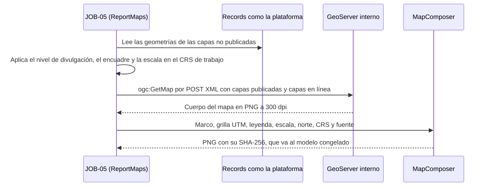

# SGSPE · Fase 8, plan 8.0 (documentos): plan de implementación

> **Para agentes:** SUB-SKILL OBLIGATORIA: usar superpowers:subagent-driven-development (recomendada) o
> superpowers:executing-plans para ejecutar este plan tarea por tarea. Los pasos usan casillas (`- [ ]`) para el
> seguimiento. Cada tarea sigue el ciclo de superpowers:test-driven-development aplicado a documentos: una comprobación
> que falla, los cambios, la comprobación y las pruebas del modelo en verde, commit.

**Goal:** Dejar `docs/` al día con la especificación de F8 antes de tocar el modelo y el código: los IDs nuevos (ASM-133
a ASM-138 y UPS-31, con §20.1 en 560), GAP-010 y GAP-018 resueltas; los entregables en wasichai-files con
`deliverable_template`, el borrador de siete campos `FILE` y sin JOB-08 de borradores; mapas de informe con
decoraciones de SGSPE; plantillas con marcadores fijos; cierre de periodo «completo o nada»; AUT-12 activa con su
constancia; los contratos y errores de F8 en `api.md`; ADR-0013, ADR-0015 y ADR-0016 aceptados y ADR-0014 al día;
Gotenberg en el puerto 8096; el roadmap, la trazabilidad, las pantallas y `CLAUDE.md` al día. Los planes 8.1, 8.2a,
8.2b, 8.2c y 8.3 leen estos documentos como fuente de verdad.

**Architecture:** Solo documentos. Cada tarea trae el texto actual exacto que se reemplaza y el texto nuevo exacto (los
bloques nuevos ya vienen envueltos a 120 columnas; si una línea editada pasa de 120, se reenvuelve sin cambiar
palabras), y una comprobación en Python de solo biblioteca estándar que falla mientras falte el cambio. Cuando un texto
actual cruza un salto de línea del documento, se busca sin tener en cuenta el salto ni la sangría; en los reemplazos de
una línea, el texto va entre comillas invertidas simples o dobles del Markdown, y las comillas invertidas interiores son
parte del texto (en caso de duda manda la búsqueda `grep -n` de una parte sin comillas). Las comprobaciones normalizan
los espacios (`' '.join(texto.split())`), así que el reenvuelto no las rompe. Ningún archivo de `src/`, de `model/` ni
de `tools/` cambia. `model/design_docs.py` lee las fichas de `database-model.md` (§6 a §21) y su §4, los catálogos de
`requirements-analysis.md` §10, la matriz de `security.md` §7.1 a §7.9 y su §9.7, los estados de `domain-model.md` §7.3,
las tablas de `workflows.md` (WF-*, automatizaciones y tipos de documento) y las capas de `gis.md` §2.2; por eso la
suite del modelo corre en cada tarea y la «Comprobación del lector» de «Global Constraints» exige que nada de eso cambie
salvo AUT-12 y la fila de la constancia, que son de F8 y `test_model.py` (`PHASE = "F6"` o `"F7"`) no compara.

**Tech Stack:** Markdown (sin prettier: `.prettierignore` excluye `*.md` y `docs/`); Python 3.11 o superior, solo
biblioteca estándar (`model/` y `tools/`); prettier 3.9.9 como compuerta del repositorio; husky y commitlint para los
mensajes; `gh` para el PR.

**Spec:** `docs/superpowers/specs/2026-10-13-fase-8-design.md`, §6 («Cambios en los documentos (plan 8.0)»), y las
secciones de las que §6 sale: §1 (alcance y lo que queda fuera), §2.1 (decisiones del usuario del 2026-10-12 y
2026-10-13, vinculantes), §2.2 (elecciones 1 a 17), §3.1 a §3.10 (contratos y nombres de las piezas), §4 (modelo y
permisos, que este plan solo describe), §5 (pruebas), §7 (reparto, paralelismo, definición de terminado y orden de
despliegue) y §8 (riesgos y consecuencias aceptadas).

## Global Constraints

- **Repositorio y rama.** Todo en el worktree `~/IdeaProjects/sgspe-wt/f8-spec`, en la rama
  `docs/fase-8-especificacion`, que ya tiene la especificación (`5e163d7`) y este plan. La Tarea 1 la rebasa sobre
  `origin/main` con el plan 7.0 integrado (PR wasichai/sgspe#56, `be5f3e3`); las demás tareas van en orden, una detrás
  de otra, en la misma rama. No se cambia de rama ni se crean otros worktrees, y `~/IdeaProjects/sgspe` no se toca.
- **El diseño manda.** `docs/` es la fuente de verdad y `docs/requirements-analysis.md` el único lugar donde se definen
  IDs: ASM-133 a ASM-138 y UPS-31 los define la Tarea 1 y las demás solo los citan. Ningún GAP ni CON nuevo.
- **Versiones** (especificación, «Restricciones globales»): wasichai `1.2.0` exacto hasta que 8.2b suba a la versión que
  resuelva UPS-31 (también exacta); Kotlin `2.4.20`, Spring Boot `4.1.1`, JDK `25`, Gradle `9.8.0`, Apache POI `5.5.1`
  (ya en `build.gradle.kts`), PDFBox en `main` desde F7; Gotenberg `gotenberg/gotenberg:8-libreoffice`, que 8.2c fija en
  la etiqueta 8.x exacta publicada.
- **Nombres fijos de la especificación** (los documentos los usan tal cual): `KpiReader`, `ExecutiveKpis`, `Dashboards`,
  `MonitoringTable`, `IndicatorMeasurements`, `IndicatorWriteGuard`, `DashboardDeliverableParityTest`, `ReportModel`,
  `CanonicalJson`, `ReportDisclosure`, `DeliverableGenerationJob`, `DocxWriter`, `PdfConverter`, `GotenbergConverter`,
  `TemplateValidator`, `TemplateStyles`, `DeliverableTemplates`, `DeliverableFiles`, `DeliverableContent`,
  `DeliverableIssue`, `DeliverableWriteGuard`, `DeliverableSections`, `FieldReportType`, `SocialDiagnosisType`,
  `ReportMaps`, `GetMapRequest`, `MapComposer`; de wasichai-files, `FileService.stage`, `FileService.open`,
  `StoredFileGuard` y `StoredFileCleanup`; los objetos `indicator`, `indicator_measurement`, `deliverable`,
  `deliverable_section`, `deliverable_version`, `deliverable_template` y `export_log`; los siete campos `draft_model`,
  `draft_internal_docx`, `draft_internal_pdf`, `draft_external_pdf`, `draft_candidate_internal_docx`,
  `draft_candidate_internal_pdf` y `draft_candidate_external_pdf`, más `draft_revision` y `draft_warnings`; los campos
  `docx`, `pdf` y `model` de `deliverable_version` y `file` de `deliverable_template`; la configuración
  `sgspe.deliverable.generation.poll` (5 s), `sgspe.deliverable.generation.stale-after` (15 min),
  `sgspe.deliverable.gotenberg.url`, `sgspe.deliverable.gotenberg.timeout` (180 s), `sgspe.deliverable.maps.timeout`
  (30 s), `sgspe.dashboards.executive.max-projects` (25), `wasichai.files.max-bytes` (64 MB),
  `spring.webflux.multipart.max-disk-usage-per-part` (20 MB) y `wasichai.files.cleanup.delay` (24 h); el puerto 8096
  (`SGSPE_GOTENBERG_PORT`); las etiquetas de prueba `gotenberg` y `slowTest`; `model/indicators.json` y
  `model/load_indicators.py`.
- **Errores de F8** (decisiones 4 y 5 de este plan; los mismos en todos los documentos): `422
  DELIVERABLE_PARAMETERS_MISSING`, `409 SECTIONS_CHANGED`, `409 MODEL_MISMATCH`, `409 MAP_FAILED`, `400
  CHECKLIST_REQUIRED`, `422 TEMPLATE_INVALID`, `403 FILE_WRITE_NOT_ALLOWED`, `409 INDICATOR_NOT_CLOSABLE`, `400
  PERIOD_NOT_ENDED`, `409 MEASUREMENT_EXISTS`, `422 SECTION_NOT_ASSISTED`, `422 UNRESOLVED_PSEUDONYM` y `422
  AI_ORIGIN_LOCKED`; los avisos del borrador (`draft_warnings`, no son estados HTTP) `MAP_FAILED`,
  `MAP_TOO_MANY_FEATURES`, `PDF_CONVERTER_UNAVAILABLE`, `PDF_CHECK_FAILED`, `FILE_TOO_LARGE` y `POSSIBLE_PERSONAL_DATA`.
- **Idioma.** Español (es-PE) en documentos, comentarios y mensajes; nombres técnicos en inglés (ADR-0009); valores ENUM
  en español MAYÚSCULAS sin tildes; prosa envuelta a 120 columnas; filas de tabla en una sola línea.
- **Datos.** Ningún nombre real de persona; ejemplos ficticios («Proyecto Ejemplo A», «Comunidad Ejemplo», «Persona
  Ejemplo 1», «Asociación Ejemplo», `@sgspe.test`) y topónimos reales (RQ-SEC-018).
- **Lo que este plan no toca** (lo lee `model/design_docs.py` y cambia en el mismo paso que `model.json`): las fichas de
  `database-model.md` §6 a §21 y su §4, las celdas de la matriz de `security.md` §7.2 a §7.9 y su frase «Las filas son
  los 89 objetos» de §7.1, el bullet «Maestros del tenant» de `security.md` §9.7 y el catálogo «Tipo de entregable» de
  `requirements-analysis.md` §10. Los cambia el plan 8.1 (entregables) o el 8.2a (indicadores); la lista exacta está en
  «Interfaces con los otros planes de F8».
- **Compuertas de cada tarea** (desde `~/IdeaProjects/sgspe-wt/f8-spec`):

  ```bash
  (cd model && python3 -m unittest test_model test_apply_roles && python3 apply.py --validate-only) && \
    python3 tools/check_traceability.py && \
    git ls-files -z | xargs -0 yarn -s prettier --check --ignore-unknown
  ```

  Esperado: `Ran 114 tests` y `OK` (si el plan 7.1 llegó a `main` antes que este, otra cifra, siempre `OK`), nada de
  `apply.py --validate-only` (sale con 0), `ok: 298 requisitos, todos con su fila` y `All matched files use Prettier
  code style!`. Además, cada tarea corre `yarn -s prettier --check` sobre sus archivos: como `.prettierignore` excluye
  `*.md` y `docs/`, responde `All matched files use Prettier code style!` sin revisar nada, y confirma que la tarea no
  tocó otro tipo de archivo.
- **Comprobación del lector** (Tareas 3, 6 y 10; compara lo que lee `design_docs.py` con `origin/main`):

```bash
cd ~/IdeaProjects/sgspe-wt/f8-spec && rm -rf /tmp/sgspe-f8-base && mkdir -p /tmp/sgspe-f8-base && \
  git archive origin/main docs | tar -x -C /tmp/sgspe-f8-base && python3 - /tmp/sgspe-f8-base/docs <<'PY'
import sys
sys.path.insert(0, 'model')
import design_docs as d
def snap():
    cards = {n: ([(f['name'], f['type'], f['required'], f['derived'], f['restricted'], f['phase']) for f in c.fields],
                 sorted(c.actions), sorted(c.flags.items()), sorted(c.content_types.items()))
             for n, c in d.cards().items()}
    return {'fichas': cards, 'claves ENUM': d.enum_keys(), 'catálogos': d.catalogs(), 'roles': d.role_phases(),
            'matriz': d.matrix(), 'restringidos': d.restricted_fields(), 'estados': d.workflow_states(),
            'maestros del tenant': d.tenant_objects(), 'capas públicas': d.public_layers(),
            'WF-H': d.workflow_transitions('H'),
            'automatizaciones': [a for a in d.automations() if a['id'] != 'AUT-12'],
            'tipos de documento': [t for t in d.document_types() if t['object'] != 'deliverable']}
now = snap()
aut12 = next(a for a in d.automations() if a['id'] == 'AUT-12')
types = [(t['label'], t['name'], t['prefix'], t['phase'], t['after'])
         for t in d.document_types() if t['object'] == 'deliverable']
d.DOCS = sys.argv[1]
base = snap()
bad = [f'cambió lo que lee design_docs: {k}' for k in now if now[k] != base[k]]
if (aut12['name'], aut12['object'], aut12['trigger'], aut12['state'], aut12['phase'], aut12['after']) != \
        ('aut-12-issue-certificate', 'deliverable', 'STATE_ENTERED', 'issued', 'F8', None):
    bad.append(f'AUT-12 distinta: {aut12}')
if types not in ([], [('Constancia de emisión', 'deliverable-issue-certificate', 'CE', 'F8', None)]):
    bad.append(f'tipos de documento de deliverable: {types}')
print('\n'.join(bad) or 'ok')
raise SystemExit(1 if bad else 0)
PY
```

Esperado: `ok`. Una línea `cambió lo que lee design_docs: …` significa que la tarea tocó una ficha, una celda, un
catálogo o un estado: se deshace ese cambio y, si hacía falta, se anota para el plan 8.1 o el 8.2a.

- **Commits.** Conventional Commits con asunto en español; cuerpo de 100 columnas como máximo (contadas en caracteres);
  al final, tras una línea en blanco, `Co-Authored-By: Claude Opus 5.5 (1M context) <noreply@anthropic.com>` y
  `Claude-Session: https://claude.ai/code/session_01RmiD2JE3gkHdBNUraZkjgM`. `git add` solo con rutas explícitas. Nunca
  se versionan `initial-promp.md`, `arch-*.md`, `tech-landing.txt`, `.playwright-mcp/` ni nada de `~/Documents/gspe`.
- **Push y PR** solo en la Tarea 10.

## Review Focus

1. **Un mismo error con dos estados o dos campos.** 8.2a, 8.2b, 8.2c y 8.3 copian los códigos de `api.md` §3.3, §4.11,
   §4.12 y §4.14, de los ASM y de `deliverables.md`; un estado distinto en uno de ellos se vuelve una prueba roja o un
   contrato roto con el portal. El caso que ya existe es `CHECKLIST_REQUIRED`, `400` en las exportaciones desde F2. Se
   espera cada código de «Global Constraints» con un solo estado en todos los documentos. Prueba: la comprobación de la
   Tarea 4 y la cruzada de la Tarea 10, que busca cada código precedido de un estado en todo `docs/`.
2. **Un resto del almacenamiento viejo.** Quien lea para 8.1 o 8.2b `draft_storage_key`, `pdf_storage_key`, «los últimos
   N borradores», «el paso de borradores de JOB-08», `deliverables/<id>/…` o «`FileStore` del mismo módulo o puerto
   propio» construirá el modelo o JOB-08 al revés. Se espera que ninguna línea vigente fuera de las fichas de
   `database-model.md` (que cambia 8.1) los nombre, salvo las que dicen que desaparecieron o el respaldo de UPS-31.
   Prueba: la búsqueda cruzada de la Tarea 10, Paso 1.
3. **Decoraciones de GeoServer o leyendas con `SEQ` y `STYLEREF` como camino vigente.** 8.2c las implementaría y
   fallarían como en el spike de F1. Se espera que `gis.md` §7.3, `deliverables.md` §7.5 y §7.8 y ADR-0015 digan que
   SGSPE dibuja leyenda, escala, norte y grilla (`MapComposer`) y que las leyendas llevan número literal, marcador y
   `PAGEREF`. Prueba: las comprobaciones de las Tareas 2, 5 y 7 y la búsqueda cruzada de la Tarea 10.
4. **IDs y totales.** §20.1 suma 560 (UPS 31, ASM 138); cada ASM nuevo se define una vez y lo cita al menos otro
   documento; UPS-31 nombra wasichai/wasichai#111 en el análisis y en el roadmap; GAP-010 y GAP-018 dicen «Resuelta» y
   nadie las da por abiertas. Pruebas: la comprobación de la Tarea 1 y la cruzada de la Tarea 10.
5. **El lector de documentos del modelo.** Una fila de tabla rota (una barra de más, una fila partida en dos líneas) en
   `workflows.md`, `security.md`, `domain-model.md` o el análisis rompe `test_model.py` o `test_apply_roles.py`, y una
   celda cambiada adelanta el modelo de 8.1. Se espera la suite del modelo en verde en cada tarea y la «Comprobación del
   lector» en `ok`. Prueba: las compuertas de «Global Constraints» en el último paso de cada tarea.

## Decisiones de este plan frente a la especificación y los documentos

| # | Hallazgo | Decisión |
|---|---|---|
| 1 | §6 pide seis ASM y una UPS sin número; con 7.0 en `main` el último ASM es ASM-132 y la última UPS, UPS-30 | ASM-133 (archivos en wasichai-files), ASM-134 (mapas de informe), ASM-135 (plantillas), ASM-136 (cierre de periodo y metas), ASM-137 (menciones y asistencia de IA), ASM-138 (topes de archivo) y UPS-31 (la plataforma adjunta archivos); §20.1 pasa a UPS 31, ASM 138 y total 560 (Tarea 1) |
| 2 | §2.2.2 y §7 dicen que el issue de la UPS se abre con la aprobación del usuario; ya está abierto como wasichai/wasichai#111 («Files: let the platform stage, attach and open files inside asPlatform») | UPS-31 lo cita como abierto el 2026-10-13; el roadmap lo suma a la tabla de issues; la tarea del coordinador pasa a «seguir wasichai#111 hasta su release» (Tareas 1 y 8) |
| 3 | §6 pide la fila de `deliverable_template` en `security.md` §7.8, el catálogo de §7.1 en 90 objetos y (por §4.2) el catálogo «Tipo de entregable» con dos valores, los campos `FILE` en las fichas y los maestros de `ProjectScope.TENANT`; `design_docs.py` lee esas tablas y `test_model.py` las compara con `model.json` | Van al plan 8.1 (fila de `deliverable_template`, la frase de §7.1, el catálogo, las fichas de `deliverable`, `deliverable_version`, `deliverable_template` y `export_log`, y `deliverable_template` en §9.7) y al 8.2a (`indicator` en §9.7), en el mismo commit que `model.json`. Este plan cambia la prosa: `domain-model.md` §6.15 (que `design_docs.py` no lee), los «89 objetos» fuera de `security.md` §7.1 y `database-model.md` §25 a §27 (Tareas 3 y 8) |
| 4 | `CHECKLIST_REQUIRED` ya existe como `400` sobre `checklistConfirmed` en las exportaciones (`api.md` §3.3, §4.13); §3.5 de la especificación lo da como `422` en la emisión | Un código, un estado: la emisión responde `400 CHECKLIST_REQUIRED` (`checklistConfirmed`), como las exportaciones (Tareas 2, 4 y 6) |
| 5 | La especificación nombra los códigos nuevos pero no siempre su campo, y deja sin código cuatro respuestas | Campos: `DELIVERABLE_PARAMETERS_MISSING`, uno por parámetro faltante (`project`, `community`, `study`, `area_of_influence`, `period_start_date`, `period_end_date`, `cutoff_date` o `project.working_crs`); `SECTIONS_CHANGED`, uno por sección (`deliverable_section.<section_key>`); `MODEL_MISMATCH`, `draftModelSha256`; `MAP_FAILED`, `draft`; `TEMPLATE_INVALID`, `file`, con `violations[]` en el cuerpo; `FILE_WRITE_NOT_ALLOWED`, el campo `FILE`; `INDICATOR_NOT_CLOSABLE`, `indicator`, con el miembro `reason` (`STANCE`, `NO_SCALAR_VALUE`, `UNAVAILABLE`, `CONFIDENTIAL_HIDDEN`); `PERIOD_NOT_ENDED`, `attributes.period_end_date`; `MEASUREMENT_EXISTS`, `attributes.period_start_date`; `SECTION_NOT_ASSISTED`, `target.recordId`; `UNRESOLVED_PSEUDONYM`, `attributes.content`; `AI_ORIGIN_LOCKED`, `content_origin`. Sin código en la especificación: pedir un borrador fuera de `draft` u `observed` y emitir fuera de `approved` o con el borrador sin LISTO, `409 STATE_MISMATCH` (`state`, o `draft` para el borrador); cerrar todo el tenant sin `READ_ALL_PROJECTS`, `403 ACTION_REQUIRED` (`project`); un `format` desconocido, el `422` de validación sobre `format`, sin código (Tarea 4) |
| 6 | §2.2.15 suma tres razones para no cerrar; `dashboards.md` §10, `api.md` §4.11, `domain-model.md` §7.2 y `security.md` §8.2 solo nombran la postura y KPI-TER-01 | Los cuatro dicen las cuatro razones de ASM-136 con los mismos KPI (Tareas 3, 4, 5 y 6) |
| 7 | La tabla de §7 de la especificación da a 8.0 la rama `docs/fase-8-0-documentos`; el coordinador ejecuta 8.0 en `docs/fase-8-especificacion`, que ya trae la especificación | El PR sale de `docs/fase-8-especificacion` con la especificación, este plan y los commits de las Tareas 1 a 9 (Tarea 10) |
| 8 | §6 no fija el número de la pantalla de plantillas ni su ruta; S63 es la última | S64 · Plantillas de entregables, en `/reports/templates`, enlazada desde Administración (S53) y desde Reportes (S49), solo para `ADMIN`; el catálogo de indicadores no es pantalla nueva: el monitoreo enlaza la lista de `indicator` (Tarea 9) |
| 9 | `api.md` §4.12 da `GET /api/sgspe/deliverable-templates` como `[{ templateKey, fileName, uploadedAt, sha256 }]` y la especificación no fija la forma | `200 [{ id, templateKey, name, sha256, createdAt, warnings[] }]`, la más reciente de cada clave; el `POST` responde `201 { id, templateKey, sha256, warnings[] }` (§3.3 de la especificación) (Tarea 4) |
| 10 | La trazabilidad §8 cuenta estados por fila; RQ-REP-019 dice «Decisión pendiente (GAP-009)» y GAP-009 sigue abierta | Ninguna fila cambia de estado: se actualizan módulo, entidades y pruebas de RQ-GIS-019, RQ-REP-002, RQ-REP-012, RQ-REP-013, RQ-REP-017, RQ-REP-019, RQ-REP-027, RQ-REP-030, RQ-DSH-034, RQ-DSH-037 y RQ-AI-012, y la fila de RQ-REP-027 de §7. RQ-REP-019 nombra `deliverable_template` en el análisis (Tarea 1) para que §7.2 de la trazabilidad siga diciendo «ninguno» con 90 objetos (Tarea 8) |
| 11 | ASM-038 y RQ-REP-030 dicen «GetMap con leyenda, escala, norte y fuente» de GeoServer; §6 no los nombra | Se ajustan a ASM-134 (C5): las decoraciones las dibuja SGSPE (Tarea 1) |
| 12 | §6 pide `docs/develop/README.md` con Gotenberg por el túnel; la especificación no nombra la variable de entorno | `SGSPE_DELIVERABLE_GOTENBERG_URL` (`http://localhost:8096`, enlace relajado de `sgspe.deliverable.gotenberg.url`), servicio `gotenberg` y contenedor `sgspe-gotenberg`; `./gradlew slowTest` llega con 8.2c (Tarea 9) |
| 13 | `database-model.md` §25 a §27 (semillas, retención y decisiones abiertas) hablan de N borradores y de `load_indicators.py` sin nombre; no son fichas | Se actualizan en este plan; las fichas de §19 (BC-15) las cambia 8.1 (Tarea 3) |

---

## Mapa de archivos

| Ruta | Qué cambia | Tarea |
|---|---|---|
| `docs/requirements-analysis.md` | RQ-REP-002, RQ-REP-017, RQ-REP-019, RQ-REP-027, RQ-REP-030, RQ-SEC-019, RQ-DSH-037; §18.1 (GAP-010, GAP-014, GAP-018); §18.2 (UPS-31); §19 (ASM-026, ASM-028, ASM-037, ASM-038, ASM-042, ASM-061, ASM-133 a ASM-138); §20.1; §20.4 | 1 |
| `docs/deliverables.md` | Encabezado, §3, §4, §7.1 a §7.8, §8.1 a §8.6, §9.1, §9.2, §9.4, §9.5, §11, §12, §13, §14, §15 | 2 |
| `docs/domain-model.md`, `docs/workflows.md`, `docs/database-model.md` (§25 a §27) | Catálogo de 90 objetos, §6.15, §7.2, §7.4, §8.2, §8.3, §9.7; WF-H, AUT-12, la constancia, JOB-05, JOB-08 y sus pruebas; semillas, retención y decisiones | 3 |
| `docs/api.md` | §3.3 (estados y códigos de F8), §3.10, §4.11, §4.12, §5 | 4 |
| `docs/dashboards.md`, `docs/gis.md` | §4.9, §5.1, §5.2, §5.5, §10, §11; §7.3 y §7.4 | 5 |
| `docs/security.md` | §4.1, §7.8 (solo los bullets bajo la tabla), §7.10, §8.2, §11.4, §14, §15 | 6 |
| `docs/adr/0013-entregables-docx-primero.md`, `docs/adr/0014-almacenamiento-de-objetos.md`, `docs/adr/0015-mapas-de-informe-con-geoserver.md`, `docs/adr/0016-kpis-en-vivo-y-echarts.md`, `docs/adr/0026-topologia-puertos-y-observabilidad.md`, `docs/adr/0007-el-modelo-como-codigo.md`, `docs/adr/README.md` | Estados, decisión, consecuencias y seguimiento | 7 |
| `docs/roadmap.md`, `docs/requirements-traceability.md`, `docs/platform-fit.md`, `docs/architecture.md`, `docs/README.md`, `docs/ai-architecture.md` (~l. 58) | F8 con su reparto y su definición de terminado; brechas e issues; trazabilidad; encaje y versiones; Gotenberg en el compose y la CI; 90 objetos | 8 |
| `docs/develop/README.md`, `docs/ux/screens.md`, `docs/ux/ux-architecture.md`, `docs/ux/README.md`, `CLAUDE.md`, `docs/HISTORY.md` | Gotenberg por el túnel y `slowTest`; S64 y las pantallas de F8; «Dónde está cada cosa» y el orden de aprovisionamiento; la entrada del plan 8.0 | 9 |

## Interfaces con los otros planes de F8

Lo que este plan deja para los siguientes (todos parten de `main` con 8.0 integrado):

- **8.1 (modelo de entregables).** Cambia, en el mismo commit que `model/model.json` y `model/roles.json`: las fichas de
  `database-model.md` §19 de `deliverable` (sin `draft_storage_key`; los siete `FILE` derivados con `maxBytes` 64 MB,
  `draft_revision` TEXT derivado y `draft_warnings` LONG_TEXT derivado), `deliverable_version` (sin `*_storage_key`, con
  `FILE` `docx`, `pdf` y `model`), `deliverable_template` (nueva: `apiOnly`, `appendOnly`, `template_key` TEXT
  requerido, `name` TEXT, `file` FILE requerido de .dotx y .docx y 20 MB, `validation_warnings` LONG_TEXT) y
  `export_log` (`export_kind` EXPORTACION, EMISION o DESCARGA); la fila de `deliverable_template` en `security.md` §7.8
  (READ para los roles que leen `deliverable`; nadie la crea salvo `ADMIN`, por el endpoint) y la frase «Las filas son
  los 90 objetos» de §7.1; `deliverable_template` en «Maestros del tenant» de `security.md` §9.7; el catálogo «Tipo de
  entregable» de `requirements-analysis.md` §10 con DIAGNOSTICO SOCIAL e INFORME DE CAMPO Y AVANCE solamente;
  `test_model.py` con `PHASE = "F8"`. Lee de este plan: ASM-133, ASM-138, `domain-model.md` §6.15 y AUT-12 con la
  constancia.
- **8.2a (indicadores y tableros).** Su primera tarea agrega `indicator` e `indicator_measurement` al modelo y
  `indicator` a «Maestros del tenant» de `security.md` §9.7. Lee ASM-136, `dashboards.md` §5 y §10, `api.md` §4.11 y los
  errores `INDICATOR_NOT_CLOSABLE` (con `reason`), `PERIOD_NOT_ENDED` y `MEASUREMENT_EXISTS` (decisión 5).
- **8.2b (motor y T2).** Lee ASM-133, ASM-137, ASM-138 y UPS-31; `deliverables.md` §7, §8, §9 y §11; `api.md` §4.12
  con los errores de la decisión 5 y `400 CHECKLIST_REQUIRED` (decisión 4); `workflows.md` WF-H, AUT-12 y JOB-05.
- **8.2c (T1, mapas, PDF e IA).** Lee ASM-134 y ASM-135, `gis.md` §7.3, ADR-0013 y ADR-0015 aceptados, ADR-0026 con el
  puerto 8096 y `docs/develop/README.md` (Gotenberg por el túnel, `slowTest`); AI-04 con `SECTION_NOT_ASSISTED`,
  `UNRESOLVED_PSEUDONYM` y `AI_ORIGIN_LOCKED`.
- **8.3 (portal).** Lee `ux/screens.md` (S49, S50, S51, monitoreo y S64), los contratos de `api.md` §4.11 y §4.12 y los
  códigos para los mensajes.

## Orden

| Paso | Tareas | Por qué |
|---|---|---|
| 1 | 1 | Rebasa la rama y define los IDs que citan las demás |
| 2 | 2, 3, 4, 5, 6, 7, 8 y 9, en ese orden | Archivos disjuntos; van en serie en la misma rama |
| 3 | 10 | Verifica todo, hace push y abre el PR |

---

### Tarea 1: Rebase sobre `main` e IDs de F8 en el análisis

**Files:**
- Modify: `docs/requirements-analysis.md` (RQ-REP-002 ~l. 1013, RQ-REP-017 ~l. 1028, RQ-REP-019 ~l. 1029, RQ-REP-027
  ~l. 1037, RQ-REP-030 ~l. 1040, RQ-DSH-037 ~l. 1086, RQ-SEC-019 ~l. 1107, GAP-010 ~l. 1250, GAP-014 ~l. 1254, GAP-018
  ~l. 1258, tras UPS-30 ~l. 1310, ASM-026 ~l. 1346, ASM-028 ~l. 1348, ASM-037 ~l. 1357, ASM-038 ~l. 1358, ASM-042
  ~l. 1362, ASM-061 ~l. 1381, tras ASM-132 ~l. 1452, §20.1 ~l. 1509-1511, §20.4 ~l. 1655)

**Interfaces:**
- Consume: la especificación §2.1 (decisiones 1 a 6), §2.2.2 a §2.2.15, §3.1 y §3.7; las decisiones 1, 2, 10 y 11 de
  este plan.
- Produce: ASM-133 a ASM-138 y UPS-31, que citan las Tareas 2 a 9; GAP-010 y GAP-018 resueltas; §20.1 con 560.

- [ ] **Paso 1: Rebase sobre `main` con el plan 7.0**

```bash
cd ~/IdeaProjects/sgspe-wt/f8-spec && git status --short && git fetch origin && git rebase origin/main && \
  git log --oneline -4 && grep -c '^| ASM-132 |' docs/requirements-analysis.md && \
  grep -c '^| UPS-30 |' docs/requirements-analysis.md
```

Esperado: `git status --short` vacío (o solo `?? .playwright-mcp/`, que no se toca); el rebase aplica sin conflictos los
dos commits de la rama (la especificación y este plan, archivos nuevos); `git log` muestra arriba el plan, la
especificación y el merge de wasichai/sgspe#56 (o uno posterior de `main`); los dos `grep` dicen `1`. Si
`origin/main` ya trae ASM-133 o UPS-31 (otro plan los tomó), parar y renumerar este plan antes de seguir. Correr las
compuertas de «Global Constraints» para fijar la línea de base (esperado: verde).

- [ ] **Paso 2: La comprobación falla**

```bash
cd ~/IdeaProjects/sgspe-wt/f8-spec && python3 - <<'PY'
import re
t = open('docs/requirements-analysis.md', encoding='utf-8').read()
lines = t.splitlines()
def row(i):
    return ' '.join(next((l for l in lines if l.startswith(f'| {i} |')), '').split())
bad = []
for n in range(133, 139):
    if len(re.findall(rf'^\| ASM-{n} \|', t, re.M)) != 1:
        bad.append(f'ASM-{n}: no se define una sola vez')
if len(re.findall(r'^\| UPS-31 \|', t, re.M)) != 1 or 'wasichai/wasichai#111' not in row('UPS-31'):
    bad.append('UPS-31: no se define una sola vez o no cita wasichai/wasichai#111')
for fam, n in (('UPS', 31), ('ASM', 138)):
    if not re.search(rf'^\| `{fam}` \| {n} \|$', t, re.M):
        bad.append(f'§20.1: {fam} no es {n}')
if not re.search(r'^\| Total \| 560 \|$', t, re.M):
    bad.append('§20.1: el total no es 560')
for gap, asm in (('GAP-010', 'ASM-135'), ('GAP-018', 'ASM-136')):
    if 'Resuelta' not in row(gap) or asm not in row(gap):
        bad.append(f'{gap} no está resuelta con {asm}')
if 'identificable sin consentimiento' not in row('GAP-014'):
    bad.append('GAP-014 no confirma el consentimiento por foto con falla cerrada')
wanted = {'ASM-026': 'fuera de F8', 'ASM-028': 'N = 1', 'ASM-037': 'ASM-137', 'ASM-038': 'ASM-134',
          'ASM-042': 'ASM-136', 'ASM-061': 'ASM-133', 'RQ-REP-002': 'quedan fuera (ASM-026)',
          'RQ-REP-017': 'ASM-133', 'RQ-REP-019': 'deliverable_template', 'RQ-REP-027': 'ASM-133',
          'RQ-REP-030': 'ASM-134', 'RQ-SEC-019': 'ASM-135', 'RQ-DSH-037': 'ASM-136'}
for i, s in wanted.items():
    if s not in row(i):
        bad.append(f'{i} no dice «{s}»')
for i, old in (('ASM-028', 'últimos N'), ('ASM-061', 'clave de almacenamiento'), ('RQ-REP-027', 'últimos N'),
               ('RQ-REP-030', 'decoraciones de leyenda'), ('ASM-037', 'propuesta')):
    if old in row(i):
        bad.append(f'{i} sigue con «{old}»')
codes = {'ASM-133': ('FILE_WRITE_NOT_ALLOWED',), 'ASM-134': ('MAP_TOO_MANY_FEATURES', 'MAP_FAILED'),
         'ASM-135': ('TEMPLATE_INVALID',), 'ASM-136': ('INDICATOR_NOT_CLOSABLE', 'PERIOD_NOT_ENDED', 'MEASUREMENT_EXISTS'),
         'ASM-137': ('UNRESOLVED_PSEUDONYM', 'AI_ORIGIN_LOCKED', 'POSSIBLE_PERSONAL_DATA'), 'ASM-138': ('FILE_TOO_LARGE',)}
for asm, cs in codes.items():
    for c in cs:
        if c not in row(asm):
            bad.append(f'{asm} no nombra {c}')
if 'Los IDs de F8 (ASM-133 a ASM-138 y UPS-31) no retiran ninguno' not in ' '.join(t.split()):
    bad.append('§20.4: falta la observación de F8')
print('\n'.join(bad) or 'ok')
raise SystemExit(1 if bad else 0)
PY
```

Esperado: salida 1 con las líneas de los seis ASM, UPS-31, §20.1, GAP-010, GAP-014, GAP-018, las filas ajustadas, los
códigos y §20.4.

- [ ] **Paso 3: §19, los supuestos nuevos**

Agregar, inmediatamente después de la fila de ASM-132 (columnas «ID | Supuesto | Por qué hace falta | Cómo revertirlo |
Afecta a»), estas seis filas, una línea cada una:

```text
| ASM-133 | Los archivos de los entregables viven en wasichai-files, el `FileStore` de las evidencias (ADR-0014). El borrador son siete campos `FILE` derivados de `deliverable`: `draft_model` (el modelo congelado), `draft_internal_docx`, `draft_internal_pdf` y `draft_external_pdf` (con la marca BORRADOR) y `draft_candidate_internal_docx`, `draft_candidate_internal_pdf` y `draft_candidate_external_pdf` (sin marca, para emitir), más `draft_revision` (la letra) y `draft_warnings` (avisos, sin datos personales); un borrador nuevo reemplaza los siete en una sola escritura y `StoredFileCleanup` borra los bytes reemplazados pasado `wasichai.files.cleanup.delay` (24 h), así que solo se conserva el último y el historial guarda sus descriptores. Lo emitido son los campos `FILE` `docx` (vacío fuera de INTERNO), `pdf` y `model` (vacío en la versión derivada) de `deliverable_version`, que sube quien emite con `FileService.stage` copiando las candidatas; los `*_sha256` se conservan y `DeliverableWriteGuard` los compara con los descriptores. Las plantillas son el campo `file` del objeto `deliverable_template` (`apiOnly`, `appendOnly`, de todo el tenant). SGSPE atiende las rutas nativas de archivos de los tres objetos: los borradores y las versiones, con las comprobaciones y el `export_log` de sus rutas propias; las candidatas y los modelos, `404`; la subida y el reemplazo, `403 FILE_WRITE_NOT_ALLOWED`. Desaparecen `draft_storage_key` y los `*_storage_key` | Decisión del usuario del 2026-10-13: un solo almacenamiento con el SHA-256, el historial, los permisos, la limpieza y la descarga de la plataforma, sin claves propias, SQL propio, migración ni purga; el borrador anterior no hace falta, porque se aprueba y se emite el último (RQ-REP-026) | Claves propias en el `FileStore` (`draft_storage_key`) y un paso de borradores en JOB-08, el respaldo de UPS-31 si wasichai no la resuelve | RQ-REP-017, RQ-REP-019, RQ-REP-027, ASM-028, ASM-061, UPS-31, `deliverable`, `deliverable_version`, `deliverable_template`, `deliverables.md` §8 y §11, `api.md` §4.12, ADR-0014 |
| ASM-134 | Los mapas de informe se piden a GeoServer con un `ogc:GetMap` por POST XML en el `working_crs` del proyecto: las capas publicadas por nombre con su estilo SLD y las demás como `UserLayer` con `InlineFeature` (GML con `srsName="http://www.opengis.net/gml/srs/epsg.xml#<srid>"`), leídas como la plataforma y transformadas por nivel con la divulgación por capa de las exportaciones geográficas (ASM-124): en EXTERNO, sin LYR-10, LYR-11 ni LYR-15, y los predios sin titulares ni partida. GeoServer devuelve solo el cuerpo del mapa; marco, grilla UTM con etiquetas, leyenda de las capas presentes, barra y escala numérica, norte de cuadrícula, CRS y fuente los dibuja SGSPE (`MapComposer`) con los colores de `model/styles/palette.json`. Las geometrías en línea se simplifican a medio píxel y un mapa con más de 5 000 elementos falla (`MAP_TOO_MANY_FEATURES`); un mapa fallido deja el aviso `MAP_FAILED` en el borrador y bloquea la emisión (`409 MAP_FAILED`); sin mapa base (GAP-011) | El spike de F1 mostró que la decoración `legend` de GeoServer queda vacía con capas en línea y que `scaleline` usa otro dpi (ADR-0015), y el POST XML no tiene el límite de largo de una URL; decisión del usuario del 2026-10-13 | Las decoraciones de GeoServer si una versión las resuelve para capas en línea, u otro generador de mapas (ASM-038) | RQ-REP-008, RQ-REP-030, RQ-GIS-019, ASM-038, ASM-124, `gis.md` §7.3, `deliverables.md` §7.8, ADR-0015 |
| ASM-135 | Cada organización sube sus plantillas Word (.dotx o .docx) con `POST /api/sgspe/deliverable-templates`, que exige `MANAGE_METADATA` sobre `deliverable`; `TemplateValidator` rechaza con `422 TEMPLATE_INVALID` y `violations[]` las macros (`vbaProject.bin`, .dotm, .docm), los objetos OLE, ActiveX, los controles de contenido, las relaciones `TargetMode="External"`, los marcadores desconocidos, los estilos requeridos faltantes (`TemplateStyles`) y toda fuente fuera de la lista (Carlito, Caladea, Liberation Sans y Liberation Serif) en un estilo o en el texto; una fuente que solo figura en la tabla de fuentes es un aviso. La portada, el encabezado y el pie llevan solo los marcadores fijos `{{titulo}}`, `{{proyecto}}`, `{{preparado_para}}`, `{{suscrito_por}}`, `{{direccion_autora}}`, `{{fecha}}`, `{{codigo}}`, `{{revision}}`, `{{nivel}}` y `{{mapa_portada}}`, sin lenguaje de expresiones. Sin `template_key` rige la plantilla base de SGSPE, con solo fuentes libres; subir otra con la misma clave la reemplaza para los borradores siguientes, y un DOCX emitido nunca se reimporta. Las leyendas de tablas y figuras llevan número literal y marcador, con listas propias de `PAGEREF`, y el índice es el campo TOC | Decisión del usuario del 2026-10-13 (GAP-010): la plantilla aporta el aspecto, nunca lógica ni código; el spike de F1 mostró que LibreOffice no numera por capítulo con `STYLEREF` y `SEQ` (ADR-0013) | Usar solo la plantilla base de SGSPE (ASM-055), o ampliar la lista de fuentes con una imagen de Gotenberg propia | RQ-REP-004, RQ-REP-006, RQ-REP-019, RQ-SEC-019, ASM-055, GAP-010, `deliverables.md` §7.5 y §7.6, `api.md` §4.12, ADR-0013 |
| ASM-136 | El cierre de periodo (`POST /api/sgspe/indicators/{id}/measurements`) calcula el KPI como quien cierra y guarda una cifra completa o ninguna: responde `409 INDICATOR_NOT_CLOSABLE` si el KPI lee la postura (razón `STANCE`: KPI-STK-02, KPI-STK-05 y KPI-STK-06), si no tiene valor escalar (`NO_SCALAR_VALUE`: KPI-TER-01, KPI-EXE-03 y los que solo dan series), si quien cierra no lo tiene disponible (`UNAVAILABLE`) o si sale con `confidentialHidden` (`CONFIDENTIAL_HIDDEN`); `400 PERIOD_NOT_ENDED` si el periodo no terminó; `409 MEASUREMENT_EXISTS` si ya se cerró; y el cierre de todo el tenant exige `READ_ALL_PROJECTS` o `ADMIN`. Las metas y frecuencias iniciales son las de DOC-01 (KPI-ENG-02, dos reuniones al mes; las evaluaciones de grupos de interés y los indicadores de la Tabla 9.5, mensuales; las revisiones de riesgo, semanales; los demás, sin meta), cargadas por `model/load_indicators.py` desde `model/indicators.json` y editables en `indicator`: el script nunca sobrescribe `target_value` ni `frequency`. Manda el parámetro del proyecto si existe, y el tablero dice el origen (`targetSource`: `PROJECT`, `CATALOG` o `NONE`); la cifra oficial se muestra solo cuando el pedido coincide con la medición (mismo proyecto o todo el tenant, mismo periodo, sin filtros de territorio) | Decisión del usuario del 2026-10-13 (GAP-018): una cifra oficial parcial o recortada por permisos engañaría, y una de postura saldría a roles que no la leen (`security.md` §7.9). Consecuencia aceptada: los KPI de QCS los cierra en la práctica `ADMIN` | Cerrar con la cifra parcial y marcarla; publicar los de postura agregados (ASM-042) | RQ-DSH-037, ASM-042, GAP-018, `dashboards.md` §10, `api.md` §4.11, `security.md` §8.2 |
| ASM-137 | La narrativa de un entregable cita personas con tokens Markdown `[[person:<id>]]`, `[[position:<id>]]` o `[[stakeholder:<id>]]`: INTERNO los resuelve al nombre; EXTERNO, al cargo y la organización o al código `GI-`, y sin cargo, a «una persona de <localidad>». Al adoptar una sugerencia de IA, `[PERSONA:<id>]` pasa a `[[person:<id>]]` y un `[PERSONA]` sin id responde `422 UNRESOLVED_PSEUDONYM`. El ensamblado avisa con `POSSIBLE_PERSONAL_DATA` y la clave de la sección donde encuentra, en la narrativa o en los textos de registro, nombres de `person` del proyecto, números de 8 dígitos, teléfonos o correos: una ayuda determinista para la lista de verificación de EXTERNO, no una garantía. Una sección con `content_origin` ASISTIDO POR IA no vuelve a HUMANO en la misma revisión (`422 AI_ORIGIN_LOCKED`), así que `ai_assisted_sections` nunca omite una sección asistida | RQ-REP-033 pide menciones como referencias y RQ-AI-012 que la asistencia quede registrada; un nombre tecleado no se puede detectar siempre (riesgo residual aceptado) | Quitar el aviso o el cerrojo; las menciones como referencias se mantienen (ASM-037) | RQ-REP-033, RQ-AI-012, RF-AIK-004, ASM-037, `deliverables.md` §7.4 y §9.3, `api.md` §4.14 |
| ASM-138 | El tope de los archivos que sube el servidor es de 64 MB (`wasichai.files.max-bytes`, y `maxBytes` en los campos `FILE` de entregables) y el de lo que sube el navegador sigue en 20 MB (`spring.webflux.multipart.max-disk-usage-per-part`), así que evidencias, importaciones y plantillas siguen en 20 MB por HTTP; un artefacto de entregable más grande deja el borrador FALLIDO con `FILE_TOO_LARGE`. Se rompe a propósito la regla de `application.yml` de tener los tres topes iguales | Un T1 de unas 100 páginas con 40 fotos, y su modelo congelado con los mapas en base64, puede pasar de 20 MB; wasichai-files sostiene el archivo en memoria mientras lo valida | Volver a 20 MB y reducir más las fotos | RQ-REP-021, ASM-133, `api.md` §3.10, `deliverables.md` §11, ADR-0014 |
```

- [ ] **Paso 4: §18.2, la brecha nueva**

Agregar, inmediatamente después de la fila de UPS-30 (columnas «ID | Brecha | Impacto en SGSPE | Mientras tanto |
Necesaria en | Requisitos»), esta fila:

```text
| UPS-31 | Que wasichai-files deje a la plataforma, dentro de `asPlatform`, subir (`FileService.stage`) y adjuntar un archivo en la misma escritura de la plataforma (con `created_by` vacío y `StoredFileGuard` aceptando la subida de esa corrida) y abrir uno (`FileService.open`) sin usuario: wasichai-files 1.2.0 dice «Only a person can upload: the platform (`asPlatform`) and automations cannot attach a file». Abierta como wasichai/wasichai#111 el 2026-10-13 | JOB-05 corre como la plataforma: no puede adjuntar los siete archivos del borrador (ASM-133) ni abrir las fotos de las evidencias por wasichai-files | El plan 8.2b avanza todo lo que no adjunta archivos y sube a la versión exacta de wasichai que la publique; mientras tanto, JOB-05 lee las fotos con `FileStore.open("<organización>/<id del archivo>")` y comprueba su SHA-256 contra el descriptor. Si wasichai no la resuelve, el respaldo es solo para el borrador: claves propias en el `FileStore` (`draft_storage_key`) y un paso de borradores en JOB-08; versiones y plantillas no cambian, porque las sube una persona | F8 | RQ-REP-017, RQ-REP-021, RQ-REP-027 |
```

- [ ] **Paso 5: §18.1, las brechas que se resuelven o se confirman**

**GAP-010.** Sigue la convención de GAP-015: la resolución va en «Valor por defecto». Reemplazar la fila entera:

```text
| GAP-010 | No hay plantillas corporativas y no se sabe si el DOCX se edita fuera del sistema | ¿Hay una plantilla Word por organización? ¿Se puede editar fuera del sistema un DOCX emitido? | Solo se emite lo que genera el sistema | RQ-REP-001, RQ-REP-019 |
```

por:

```text
| GAP-010 | No hay plantillas corporativas y no se sabe si el DOCX se edita fuera del sistema | ¿Hay una plantilla Word por organización? ¿Se puede editar fuera del sistema un DOCX emitido? | Resuelta por la decisión del usuario del 2026-10-13: cada organización sube sus plantillas Word, validadas, y sin plantilla rige la de SGSPE (ASM-135); solo se emite lo que genera el sistema y un DOCX emitido nunca se reimporta | RQ-REP-001, RQ-REP-019 |
```

**GAP-014.** Reemplazar la fila entera:

```text
| GAP-014 | No hay política de retención ni de consentimiento (fotos, menores, beneficiarios) | ¿Cuánto tiempo se guardan los datos personales y cómo se registra el consentimiento? | Consentimiento por foto y por medio de contacto; las fotos sin consentimiento no salen en EXTERNO | RNF-PRIV-004, RQ-REP-014 |
```

por:

```text
| GAP-014 | No hay política de retención ni de consentimiento (fotos, menores, beneficiarios) | ¿Cuánto tiempo se guardan los datos personales y cómo se registra el consentimiento? | Consentimiento por foto y por medio de contacto, confirmado por la decisión del usuario del 2026-10-13: una foto entra en EXTERNO solo si no muestra personas identificables o tiene consentimiento, y un dato vacío cuenta como identificable sin consentimiento (ASM-037); la retención sigue abierta | RNF-PRIV-004, RQ-REP-014 |
```

**GAP-018.** Reemplazar la fila entera:

```text
| GAP-018 | No hay metas ni frecuencias para los indicadores | ¿Qué meta y frecuencia tiene cada indicador? | Los valores de DOC-01 (2 reuniones al mes, evaluación mensual, revisión semanal) | RQ-DSH-037, RN-ENG-003 |
```

por:

```text
| GAP-018 | No hay metas ni frecuencias para los indicadores | ¿Qué meta y frecuencia tiene cada indicador? | Resuelta por la decisión del usuario del 2026-10-13: los valores de DOC-01 (2 reuniones al mes, evaluación mensual, revisión semanal; los indicadores de la Tabla 9.5, mensuales), cargados en `indicator` y editables (ASM-136) | RQ-DSH-037, RN-ENG-003 |
```

- [ ] **Paso 6: §19, los supuestos que se ajustan**

**ASM-026.** Reemplazar la fila entera:

```text
| ASM-026 | Los tipos de entregable T3 a T10 son probables, deducidos de los medios de verificación de la Tabla 9.5 | Solo T1 y T2 están confirmados (USR-01) | Agregar o quitar tipos: cada uno es una clase propia | RQ-REP-002 |
```

por:

```text
| ASM-026 | Los tipos de entregable T3 a T10 son probables, deducidos de los medios de verificación de la Tabla 9.5, y quedan fuera de F8: F8 genera solo T2 y T1 (decisión del usuario del 2026-10-12) | Solo T1 y T2 están confirmados (USR-01) | Agregar o quitar tipos: cada uno es una clase propia | RQ-REP-002 |
```

**ASM-028.** Reemplazar la fila entera:

```text
| ASM-028 | Se conservan los últimos N borradores y todas las versiones emitidas | No hay política de retención | Parámetros de retención | RQ-REP-027 |
```

por:

```text
| ASM-028 | Se conserva solo el último borrador de cada entregable (N = 1: un borrador nuevo reemplaza los archivos del anterior, ASM-133) y todas las versiones emitidas, sin bloqueo WORM en F8 | No hay política de retención, y se aprueba y se emite el último borrador (RQ-REP-026) | Conservar más borradores exigiría un objeto de generación (ASM-061) | RQ-REP-027, ASM-133 |
```

**ASM-037.** Reemplazar la fila entera:

```text
| ASM-037 | Los niveles de divulgación son los del catálogo «Nivel de divulgación» de §10, con la Ley 29733 de protección de datos personales como referencia a falta de fuente normativa; las menciones de personas en textos libres se insertan como referencias que EXTERNO sustituye, y una exportación EXTERNO exige una lista de verificación | USR-07 pide anonimizar y no hay normativa (GAP-001) | Ajustar los niveles y el procedimiento cuando se reciba la normativa | RQ-REP-014, RQ-REP-033 |
```

por:

```text
| ASM-037 | Los niveles de divulgación son los del catálogo «Nivel de divulgación» de §10, con la Ley 29733 de protección de datos personales como referencia a falta de fuente normativa; las menciones de personas en textos libres se insertan como referencias que EXTERNO sustituye (ASM-137), y una exportación o una emisión EXTERNO exige una lista de verificación. T1 y T2 preparan INTERNO y EXTERNO (decisión del usuario del 2026-10-13): EXTERNO sale solo en PDF; una foto entra en EXTERNO solo si `people_identifiable` es falso o `photo_consent_given` es verdadero, y un valor vacío cuenta como identificable sin consentimiento; la imagen de un comprobante nunca va en EXTERNO. PUBLICO queda para las exportaciones con agregados: ningún tipo de F8 lo prepara | USR-07 pide anonimizar y no hay normativa (GAP-001) | Ajustar los niveles y el procedimiento cuando se reciba la normativa | RQ-REP-014, RQ-REP-033, ASM-137 |
```

**ASM-038.** Reemplazar la fila entera:

```text
| ASM-038 | GeoServer es necesario donde se emiten mapas de informe (GetMap con leyenda, escala, norte y fuente), nunca es público y nunca publica capas sensibles | wasichai lo deja opcional y su WMS no tiene autenticación | Reemplazar el generador de mapas si el spike lo recomienda | RQ-REP-008, RQ-REP-030, RQ-SEC-011 |
```

por:

```text
| ASM-038 | GeoServer es necesario donde se emiten mapas de informe (GetMap, con la leyenda, la escala, el norte y la fuente dibujados por SGSPE, ASM-134), nunca es público y nunca publica capas sensibles | wasichai lo deja opcional y su WMS no tiene autenticación | Reemplazar el generador de mapas si GeoServer deja de bastar | RQ-REP-008, RQ-REP-030, RQ-SEC-011, ASM-134 |
```

**ASM-042.** Reemplazar la fila entera:

```text
| ASM-042 | Las cifras oficiales por periodo se congelan en `indicator_measurement` solo si se cierra el periodo (opcional, F8); los indicadores de postura y los que no tienen valor propio nunca se congelan (`dashboards.md` §10) | Los indicadores se calculan en vivo | Prescindir del cierre o volverlo obligatorio | RQ-DSH-037 |
```

por:

```text
| ASM-042 | Las cifras oficiales por periodo se congelan en `indicator_measurement` solo si se cierra el periodo (opcional, F8); los indicadores de postura, los que no tienen valor escalar y los que quien cierra no tiene completos nunca se congelan (ASM-136, `dashboards.md` §10) | Los indicadores se calculan en vivo | Prescindir del cierre o volverlo obligatorio | RQ-DSH-037, ASM-136 |
```

**ASM-061.** Reemplazar la fila entera:

```text
| ASM-061 | Los borradores de entregable no son un objeto: son campos derivados `draft_*` de `deliverable` (estado y fecha de generación, SHA-256 del modelo y clave de almacenamiento) que solo escribe el proceso de generación | La aprobación y la emisión usan el último borrador generado (RQ-REP-026), y el registro inmutable es lo emitido (`deliverable_version`, RQ-REP-017) | En F8, un ADR puede agregar un objeto de generación con un registro por borrador | RQ-REP-017, RQ-REP-021, RQ-REP-026, RQ-REP-027, `deliverable` |
```

por:

```text
| ASM-061 | Los borradores de entregable no son un objeto: son campos derivados `draft_*` de `deliverable` (estado, instante de congelamiento, SHA-256 del modelo, letra de revisión, avisos y los siete campos `FILE` del último borrador, ASM-133) que solo escribe el proceso de generación | La aprobación y la emisión usan el último borrador generado (RQ-REP-026), y el registro inmutable es lo emitido (`deliverable_version`, RQ-REP-017) | Un ADR puede agregar un objeto de generación con un registro por borrador | RQ-REP-017, RQ-REP-021, RQ-REP-026, RQ-REP-027, ASM-133, `deliverable` |
```

- [ ] **Paso 7: Los requisitos que citan los IDs nuevos**

En cada fila se reemplaza solo el texto indicado (la segunda celda); las demás celdas no cambian.

- **RQ-REP-002** (§15): `salen como documentos del registro (RQ-REP-029). Aceptación:` pasa a `salen como documentos del
  registro (RQ-REP-029); F8 genera solo T2 y T1, y los probables quedan fuera (ASM-026). Aceptación:`.
- **RQ-REP-017:** `Versiones emitidas inmutables (`deliverable_version`) con SHA-256 del DOCX, del PDF y del modelo
  congelado,` pasa a `Versiones emitidas inmutables (`deliverable_version`) con sus archivos en campos `FILE` (ASM-133)
  y el SHA-256 del DOCX, del PDF y del modelo congelado,`.
- **RQ-REP-019:** `plantilla Word base (ASM-014) y línea de fuente` pasa a `plantillas Word por organización en
  `deliverable_template`, con marcadores fijos, y la plantilla base de SGSPE (ASM-014, ASM-135), y línea de fuente`.
- **RQ-REP-027:** `Retención: los borradores se purgan (se conservan los últimos N) y lo emitido se guarda siempre, con
  WORM opcional (ASM-028);` pasa a `Retención: solo se conserva el último borrador, cuyos archivos reemplazados borra la
  limpieza de wasichai-files, y lo emitido se guarda siempre (ASM-028, ASM-133);`.
- **RQ-REP-030:** `Mapas de informe con GeoServer (GetMap, estilos SLD y decoraciones de leyenda, escala, norte y
  fuente) en el CRS del proyecto;` pasa a `Mapas de informe con GeoServer (GetMap y estilos SLD) en el CRS del proyecto,
  con la leyenda, la grilla, la escala, el norte y la fuente dibujados por SGSPE (ASM-134);`.
- **RQ-DSH-037** (§16): `para metas y cierres oficiales de periodo (ASM-042) |` pasa a `para metas y cierres oficiales
  de periodo (ASM-042, ASM-136) |`.
- **RQ-SEC-019** (§17): `solo con fuentes conocidas (ASM-055) |` pasa a `solo con fuentes conocidas (ASM-055); sin
  objetos OLE, controles de contenido ni vínculos externos y solo con los marcadores fijos (ASM-135) |`.

- [ ] **Paso 8: §20.1 y §20.4**

**§20.1.** `| `UPS` | 30 |` pasa a `| `UPS` | 31 |`, `| `ASM` | 132 |` a `| `ASM` | 138 |` y `| Total | 553 |` a
`| Total | 560 |`.

**§20.4.** Después de la viñeta «Los IDs de F7 (ASM-128 a ASM-132) no retiran ninguno: …» (que termina en «y ASM-130
adopta UPS-14 ya resuelta.»), agregar:

```text
- Los IDs de F8 (ASM-133 a ASM-138 y UPS-31) no retiran ninguno: ASM-133 reemplaza la parte de almacenamiento de
  ASM-061 y deja ASM-028 en un borrador, ASM-134 cambia las decoraciones de ASM-038, ASM-135 detalla ASM-055 y resuelve
  GAP-010, y ASM-136 detalla ASM-042 y resuelve GAP-018.
```

- [ ] **Paso 9: Verificar y commit**

Repetir la comprobación del Paso 2 (esperado: `ok`), correr `yarn -s prettier --check docs/requirements-analysis.md` y
las compuertas de «Global Constraints». Después:

```bash
git add docs/requirements-analysis.md
git commit -F - <<'MSG'
docs: IDs de la fase 8 (ASM-133 a ASM-138, UPS-31), GAP-010 y GAP-018 resueltas

Archivos de entregables en wasichai-files, mapas con decoraciones de SGSPE, plantillas con
marcadores fijos, cierre de periodo completo o nada, menciones y topes de archivo; la plataforma
adjunta archivos (wasichai#111); §20.1 pasa a 560 IDs.

Co-Authored-By: Claude Opus 5.5 (1M context) <noreply@anthropic.com>
Claude-Session: https://claude.ai/code/session_01RmiD2JE3gkHdBNUraZkjgM
MSG
```

---
### Tarea 2: Entregables

**Files:**
- Modify: `docs/deliverables.md` (§3 ~l. 47-71; §4 ~l. 79 y ~l. 88; §7.1 ~l. 193-213; §7.2 ~l. 221; §7.3 ~l. 228-238;
  §7.4 ~l. 250-260; §7.5 ~l. 264-293; §7.6 ~l. 297-305; §7.7 ~l. 318-331; §7.8 ~l. 335-341; §7.9 ~l. 350; §8.2
  ~l. 391-417; §8.3 ~l. 425; §8.4 ~l. 433-470; §8.5 ~l. 477; §8.6 ~l. 481-490; §9.1 ~l. 496-505; §9.2 ~l. 531-533; §9.3
  ~l. 537; §9.4 ~l. 549; §9.5 ~l. 562; §11 ~l. 612-637; §12 ~l. 651-656; §13 ~l. 666-708; §14 ~l. 721-722; §15
  ~l. 728-741)

**Interfaces:**
- Consume: ASM-026, ASM-028, ASM-037, ASM-061 y ASM-133 a ASM-138 y UPS-31 (Tarea 1); la especificación §2.1 (decisiones
  1 a 5 y 8), §2.2.3 a §2.2.14 y §2.2.17, §3.2 a §3.9; las decisiones 4 y 5 de este plan.
- Produce: la anatomía del almacenamiento (§11), el orden de la emisión (§8.4), las leyendas (§7.5), las plantillas
  (§7.6) y los mapas (§7.8) que citan `domain-model.md`, `workflows.md`, `api.md`, `security.md`, `gis.md` y los ADR
  (Tareas 3 a 7), y que implementan 8.2b y 8.2c.

- [ ] **Paso 1: La comprobación falla**

```bash
cd ~/IdeaProjects/sgspe-wt/f8-spec && python3 - <<'PY'
raw = open('docs/deliverables.md', encoding='utf-8').read()
t = ' '.join(raw.split())
bad = []
for line in raw.splitlines():
    if 'storage_key' in line and 'UPS-31' not in line:
        bad.append(f'queda un *_storage_key fuera del respaldo de UPS-31: {line.strip()[:80]}')
for old in ('deliverables/<id>', 'templates/<template_key>', 'propuesta, ASM-037', 'últimos N', 'Campos TOC, SEQ, STYLEREF',
            'diseño de decoración', 'carpeta de la versión', 'Prueba de contrato del puerto', 'T3 a T10 si se confirman',
            'o un puerto propio', 'es una propuesta de este diseño', 'Si LibreOffice maneja mal los SEQ',
            'la marca de agua nativa de Gotenberg queda como alternativa', 'En el MVP solo se emite lo que genera'):
    if old in t:
        bad.append(f'queda «{old}»')
for new in ('draft_model', 'draft_internal_docx', 'draft_external_pdf', 'draft_candidate_internal_pdf',
            'draft_candidate_external_pdf', 'draft_revision', 'draft_warnings', '`deliverable_template`',
            '`403 FILE_WRITE_NOT_ALLOWED`', 'StoredFileCleanup', 'FileService.stage', 'MapComposer', 'ReportDisclosure',
            'CanonicalJson', 'ReportModel', 'KpiReader', '`400 CHECKLIST_REQUIRED`', '`409 MODEL_MISMATCH`',
            '`409 MAP_FAILED`', '`409 SECTIONS_CHANGED`', '`422 DELIVERABLE_PARAMETERS_MISSING`', '`422 TEMPLATE_INVALID`',
            '`422 AI_ORIGIN_LOCKED`', '`422 UNRESOLVED_PSEUDONYM`', '`422 SECTION_NOT_ASSISTED`', '`409 STATE_MISMATCH`',
            '[[person:<id>]]', 'POSSIBLE_PERSONAL_DATA', 'MAP_TOO_MANY_FEATURES', 'PDF_CONVERTER_UNAVAILABLE',
            'PDF_CHECK_FAILED', 'FILE_TOO_LARGE', '{{mapa_portada}}', 'sgspe.deliverable.generation.stale-after',
            'sgspe.deliverable.gotenberg.timeout', 'sgspe.deliverable.maps.timeout', 'slowTest', 'aplica la transición a `issued` al final',
            'ASM-133', 'ASM-134', 'ASM-135', 'ASM-137', 'ASM-138', 'UPS-31'):
    if new not in t:
        bad.append(f'falta {new}')
print('\n'.join(bad) or 'ok')
raise SystemExit(1 if bad else 0)
PY
```

Esperado: salida 1 con los `*_storage_key`, los textos viejos y los nombres que faltan.

- [ ] **Paso 2: §3 y §4, tipos y elementos comunes**

En la tabla de §3, en las filas T1 y T2, `INTERNO y EXTERNO (propuesta, ASM-037)` pasa a `INTERNO y EXTERNO (ASM-037)`.
En las filas T3 a T10 (solo en ellas), la celda «Generable desde» cambia: `| F8 |` pasa a `| Después de F8, si se
confirma |`; en T7, `| F8 (el XLSX, en F3) |` pasa a `| Después de F8, si se confirma (el XLSX, en F3) |`; en T8,
`| F8 (el XLSX, en F4) |` pasa a `| Después de F8, si se confirma (el XLSX, en F4) |`.

Debajo de la tabla, reemplazar:

```text
- Solo T1 y T2 están confirmados [USR-01]. Los probables salen de los medios de verificación de la Tabla 9.5 (ASM-026); el catálogo
  "Tipo de entregable" de §10 todavía no tiene sus valores, y se agregan allí cuando un tipo se confirma. Cada tipo es una clase con
  sus secciones y una prueba con fixtures ficticios (RQ-REP-002).
- **Niveles que prepara cada tipo.** Que T1 y T2 preparen INTERNO y EXTERNO es una propuesta de este diseño sobre los niveles de
  ASM-037: ninguna fuente fija qué niveles necesita cada informe. PUBLICO, solo con agregados, se aplica a las exportaciones y a
  los tipos futuros que lo declaren; por eso §9.2 define sus reglas por elemento.
- Dentro de F8 conviene generar primero T2, más corto, y después T1, que ejercita todo el pipeline.
```

por:

```text
- Solo T1 y T2 están confirmados [USR-01], y F8 genera solo esos dos (decisión del usuario del 2026-10-12). Los
  probables salen de los medios de verificación de la Tabla 9.5 (ASM-026) y quedan fuera de F8; el catálogo "Tipo de
  entregable" de §10 queda con DIAGNOSTICO SOCIAL e INFORME DE CAMPO Y AVANCE (plan 8.1), y un tipo se agrega allí
  cuando se confirma. Cada tipo es una clase con sus secciones y una prueba con fixtures ficticios (RQ-REP-002).
- **Niveles que prepara cada tipo.** T1 y T2 preparan INTERNO y EXTERNO (decisión del usuario del 2026-10-13, ASM-037);
  EXTERNO sale solo en PDF y exige la lista de verificación (§9.4). PUBLICO, solo con agregados, se aplica a las
  exportaciones y a los tipos futuros que lo declaren: ningún tipo de F8 lo prepara, así que en F8 no hay archivos
  PUBLICO de entregables, y §9.2 conserva sus reglas por elemento para cuando un tipo lo declare.
- Dentro de F8 se genera primero T2, más corto (plan 8.2b, que se cierra con mapas y PDF reales en 8.2c), y después T1,
  que ejercita todo el pipeline (plan 8.2c).
```

En la tabla de §4:

- `| Índices | Índice, lista de tablas y lista de gráficos con número de página, con campos de Word que se actualizan al
  convertir | RQ-REP-004 [DOC-01 índice] |` pasa a `` | Índices | Índice (campo TOC) y listas propias de tablas y de
  gráficos con `PAGEREF`, con número de página, que se actualizan al convertir (ASM-135) | RQ-REP-004 [DOC-01 índice] |
  ``.
- `| Marca | Logos, razón social y dirección de la organización autora y del cliente; plantilla Word base | RQ-REP-019
  [DOC-01 portada] |` pasa a `| Marca | Logos, razón social y dirección de la organización autora y del cliente;
  plantilla Word de la organización o la base de SGSPE (ASM-135) | RQ-REP-019 [DOC-01 portada] |`.

- [ ] **Paso 3: §7.1 a §7.4, etapas, clase, modelo y narrativa**

En §7.1, reemplazar el diagrama:

```text
flowchart LR
    REQ["Pedido de borrador (acción GENERATE)"] --> W["Trabajador de sgspe.deliverable con ClusterLock, como la plataforma"]
    W --> A["Ensamblar: clase del tipo, RecordService, sgspe.territory y sgspe.dashboard"]
    A --> M["Modelo del informe: JSON canónico, congelado con su SHA-256"]
    M --> L["sgspe.privacy aplica el nivel de divulgación"]
    L --> X["Apache POI sobre la plantilla Word: DOCX"]
    X --> G["Gotenberg con LibreOffice: PDF"]
    G --> S[("Almacenamiento de objetos")]
    W --> F["Campos draft_* del entregable"]
```

por:

```text
flowchart LR
    REQ["Pedido de borrador (acción GENERATE)"] --> W["JOB-05 de sgspe.deliverable con ClusterLock, como la plataforma"]
    W --> A["Ensamblar: clase del tipo, Records, sgspe.territory y sgspe.dashboard con KpiReader"]
    A --> MP["Mapas: GetMap de GeoServer y MapComposer"]
    MP --> M["Modelo del informe: JSON canónico, congelado con su SHA-256"]
    M --> L["sgspe.privacy: ReportDisclosure por nivel"]
    L --> X["DocxWriter (Apache POI) sobre la plantilla: borrador y candidata"]
    X --> G["Gotenberg con LibreOffice: PDF, verificado con PDFBox"]
    G --> F["Siete campos FILE draft_* del entregable, en wasichai-files"]
```

En las viñetas de §7.1:

- `el mismo código de los tableros (RQ-DSH-034) (domain-model §8.2).` pasa a `` el mismo código de los tableros, con el
  `KpiReader` de la plataforma de la organización (RQ-DSH-034, `DashboardDeliverableParityTest`) (domain-model §8.2). ``
- Reemplazar `- **Convertir.** Gotenberg convierte el DOCX a PDF. POI y el almacenamiento corren en `Dispatchers.IO`;
  Gotenberg y GeoServer se llaman con `WebClient`, sin bloquear.` por:

  ```text
  - **Convertir.** Gotenberg convierte cada DOCX a PDF (`PdfConverter`, que implementa `GotenbergConverter`) y PDFBox
    verifica el resultado: fuentes incrustadas de la lista, páginas y PDF/A-2b en la candidata; si no, el borrador queda
    FALLIDO con `PDF_CHECK_FAILED`. POI y wasichai-files corren en `Dispatchers.IO`; Gotenberg y GeoServer se llaman con
    `WebClient`, sin bloquear y solo desde JOB-05. `PdfConverter` y `ReportMaps` son puertos con dobles para las
    pruebas.
  ```

- `- Los paquetes de dominio no dependen de `sgspe.deliverable`; una prueba de arquitectura lo verifica (RNF-TST-001).`
  pasa a `` - Los paquetes de dominio no dependen de `sgspe.deliverable`; `sgspe.ai` depende de él (AI-04), nunca al
  revés, y el `WebClient` hacia Gotenberg y GeoServer solo vive en `sgspe.deliverable` (más el proxy WMS de F6);
  `ArchitectureTest` lo verifica (RNF-TST-001). ``

En §7.2, reemplazar `- sus parámetros: periodo, fecha de corte y alcance (`area_of_influence`, `community` o
`locality`, y el `study` de origen) (RQ-REP-013);` por:

```text
- sus parámetros (RQ-REP-013): T2 exige `project`, `community` y periodo; T1, `project`, `study`, periodo, `cutoff_date`
  y un área de influencia directa aprobada; los dos, el `working_crs` del proyecto. Si falta uno al pedir un borrador,
  la respuesta es `422 DELIVERABLE_PARAMETERS_MISSING`, con un error por campo. `deliverable_type` no cambia después del
  alta, y un listener crea las secciones del tipo en la transacción del alta, como quien la da de alta;
```

En §7.3, primera viñeta, reemplazar `las referencias a mapas y fotos por clave de almacenamiento y SHA-256; la plantilla
por `template_key` y su SHA-256; y los avisos (por ejemplo, un mapa que falló).` por:

```text
los mapas PNG dentro del modelo, en base64 con su SHA-256, y las fotos por id de evidencia y SHA-256, porque una
evidencia es inmutable y nunca se purga; la plantilla por su id de `deliverable_template` y su SHA-256;
`aiAssistedSections`; y los avisos (`warnings`, por ejemplo un mapa que falló). Lo define `ReportModel` en
`sgspe.privacy`, con cada elemento sensible marcado (`Mention`, `Restricted(<campo>)`, `Photo(identifiable, consent,
kind)`, `ReceiptImage`, `HolderName`, `RegistryNumber`), y su forma canónica es `CanonicalJson`: claves ordenadas,
UTF-8, sin espacios y DECIMAL como texto. Así un solo archivo, `draft_model`, basta para volver a generar.
```

En la segunda viñeta de §7.3, `El modelo es interno: la API no lo sirve (§11).` pasa a `` El modelo es interno: la API
no lo sirve (§11); se guarda en `draft_model`, cuyo SHA-256 de archivo es igual a `draft_model_sha256`. `` En la
tercera, `Ningún tipo imprime documentos de identidad ni teléfonos (RQ-REP-014).` pasa a `` Ningún tipo imprime ni lee
documentos de identidad ni teléfonos: `ReportSourcesTest` lo comprueba sobre la lista de campos que declara cada tipo
(RQ-REP-014). ``

En §7.4, reemplazar la viñeta **Menciones de personas** (desde `- **Menciones de personas.** Se insertan como
referencias` hasta `la IA puede sugerir posibles datos personales.`) por:

```text
- **Menciones de personas.** Se insertan como tokens Markdown que apuntan a un registro, `[[person:<id>]]`,
  `[[position:<id>]]` o `[[stakeholder:<id>]]`, nunca como el nombre escrito, para que EXTERNO las sustituya
  (RQ-REP-033, ASM-037, ASM-137); el editor del portal los inserta con un selector. Un nombre tecleado a mano no se
  puede detectar siempre: por eso EXTERNO exige una lista de verificación (§9.4), y el ensamblado avisa con
  `POSSIBLE_PERSONAL_DATA` y la clave de la sección donde encuentra, en la narrativa o en los textos de registro,
  nombres de `person` del proyecto, números de 8 dígitos, teléfonos o correos: una ayuda determinista, no una garantía.
```

Y reemplazar la viñeta **Origen** (desde `- **Origen.** `content_origin` guarda HUMANO` hasta `(RQ-AI-012,
RF-AIK-004).`) por:

```text
- **Origen.** `content_origin` guarda HUMANO, CALCULADO o ASISTIDO POR IA, y `reviewed` marca la revisión. Una
  sugerencia de IA (`ai_suggestion` de tipo BORRADOR DE SECCION, de AI-04 desde F8, o RESUMEN EJECUTIVO, de F7) solo se
  usa si una persona la adopta con motivo: `POST /api/sgspe/ai-suggestions/{id}/accept` escribe `content`,
  `content_origin` ASISTIDO POR IA y el vínculo `ai_suggestion` con `DeliverableSections.adopt`, y convierte
  `[PERSONA:<id>]` en `[[person:<id>]]` (un `[PERSONA]` sin id responde `422 UNRESOLVED_PSEUDONYM`).
  `DeliverableWriteGuard` exige el motivo cuando el origen indica IA y no deja volver a HUMANO en la misma revisión
  (`422 AI_ORIGIN_LOCKED`), así que la versión emitida lista en `ai_assisted_sections` toda sección que tuvo asistencia
  (RQ-AI-012, RF-AIK-004, ASM-137). AI-04 solo redacta las secciones que el tipo marca con IA (si no, `422
  SECTION_NOT_ASSISTED`), leyendo como la persona, seudonimizados, los registros que el tipo declara para esa sección y
  los KPI del periodo; nunca el modelo congelado, que se leyó como la plataforma.
```

- [ ] **Paso 4: §7.5 a §7.9, DOCX, plantilla, PDF, mapas y gráficos**

En §7.5:

- `- Apache POI `poi-ooxml` 5.4 o posterior, Apache-2.0,` pasa a `` - Apache POI `poi-ooxml` 5.5.1 (la de
  `build.gradle.kts`, en `main` desde F2), Apache-2.0, ``.
- `**Construcciones de Word permitidas** (lo que LibreOffice convierte con fidelidad; el spike de ADR-0013 lo
  confirma):` pasa a `**Construcciones de Word permitidas** (lo que LibreOffice convierte con fidelidad, según el spike
  de ADR-0013):`.
- En la tabla, `| Campos TOC, SEQ, STYLEREF, PAGE, NUMPAGES y PAGEREF | Otros campos |` pasa a `| Campos TOC, PAGE,
  NUMPAGES y PAGEREF | Otros campos, incluidos SEQ y STYLEREF (LibreOffice no numera por capítulo con ellos) |`, y
  debajo de esa fila se agrega `| Los marcadores fijos de la plantilla (ASM-135) | Marcadores desconocidos o expresiones
  |`.
- Reemplazar la viñeta **Leyendas** (desde `- **Leyendas.** Cada tabla y figura lleva un campo SEQ` hasta `que
  LibreOffice resuelve al paginar.`) por:

  ```text
  - **Leyendas.** Cada tabla y figura lleva su número literal por capítulo («Tabla 5.1, 5.2…», que calcula `DocxWriter`)
    y un marcador, y las listas de tablas y de figuras son propias, con campos PAGEREF que LibreOffice resuelve al
    paginar (`updateIndexes`); el índice es el campo TOC de cinco niveles, solo en T1. Es la alternativa que eligió el
    spike de ADR-0013: LibreOffice no numera por capítulo con SEQ y STYLEREF (ASM-135).
  - **Marcadores y Markdown.** `DocxWriter` rellena los marcadores fijos de la plantilla (ASM-135), normalizando las
    corridas partidas, y recorre el Markdown con commonmark-java y su extensión de tablas GFM hacia los estilos de la
    plantilla.
  ```

En §7.6:

- `Si una organización entrega a varios clientes con logos distintos, usa una plantilla por cliente. La marca y quién es
  el tenant siguen abiertas en GAP-009, y si hay plantillas corporativas, en GAP-010.` pasa a `` Si una organización
  entrega a varios clientes con logos distintos, usa una plantilla por cliente, cada una con su `template_key`. La marca
  y quién es el tenant siguen abiertas en GAP-009; GAP-010 quedó resuelta: cada organización sube las suyas (ASM-135).
  ``
- Reemplazar las viñetas **Dónde vive** y **Validación al subir** (desde `- **Dónde vive.** En el almacenamiento de
  objetos` hasta `La sube quien tiene `MANAGE_METADATA` sobre `deliverable`.`) por:

  ```text
  - **Dónde vive.** En el objeto `deliverable_template` (`apiOnly`, `appendOnly`, de todo el tenant), con el archivo en
    su campo `FILE` `file` de wasichai-files (ASM-133). Cada `deliverable` la elige por `template_key` (TEXT): el
    borrador toma la plantilla más reciente de esa clave y congela su id y su SHA-256 en el modelo, y cada versión
    emitida guarda su `template_sha256` (domain-model §6.15). Una plantilla no se edita ni se borra: subir otra con la
    misma clave la reemplaza para los borradores siguientes. Sin `template_key` rige la base de SGSPE
    (`src/main/resources/sgspe/deliverable/templates/sgspe-base.dotx`, solo fuentes libres).
  - **Validación al subir** (RQ-SEC-019, ASM-055, ASM-135). `POST /api/sgspe/deliverable-templates` (multipart `file`,
    `templateKey` y `name`, con `Idempotency-Key`) abre el OOXML con límites de entradas y de bytes descomprimidos y
    rechaza con `422 TEMPLATE_INVALID` y `violations[]` `vbaProject.bin`, los tipos con macros (.dotm, .docm), objetos
    OLE, ActiveX, controles de contenido, relaciones `TargetMode="External"`, marcadores desconocidos, estilos
    requeridos faltantes (`TemplateStyles`) y fuentes fuera de la lista en un estilo o en el texto; una fuente que solo
    figura en la tabla de fuentes es un aviso. El tope es el de una subida del navegador, 20 MB (ASM-138). La sube quien
    tiene `MANAGE_METADATA` sobre `deliverable` (en la práctica, `ADMIN`).
  - **Marcadores fijos.** La portada, el encabezado y el pie llevan solo `{{titulo}}`, `{{proyecto}}`,
    `{{preparado_para}}`, `{{suscrito_por}}`, `{{direccion_autora}}`, `{{fecha}}`, `{{codigo}}`, `{{revision}}`,
    `{{nivel}}` y `{{mapa_portada}}`, sin lenguaje de expresiones: la plantilla aporta el aspecto, no la lógica.
  ```

En §7.7:

- `en la red interna y nunca expuesta (RQ-REP-001, ASM-014).` pasa a `en la red interna y nunca expuesta (en desarrollo,
  solo en el loopback del VPS, puerto 8096; ADR-0026) (RQ-REP-001, ASM-014).`
- `  - `pdfa` con PDF/A-2b en las versiones emitidas (RQ-REP-017);` pasa a `` - `pdfa` con PDF/A-2b en las versiones
  candidatas, que son las que se emiten (RQ-REP-017); `` (con la sangría de la lista).
- `  - metadatos del PDF con código, revisión y hashes; marcadores desde los títulos; calidad de imagen;` pasa a `-
  metadatos del PDF con título, código y revisión, y el id de correlación de la corrida; marcadores desde los títulos;
  calidad de imagen;` (con la sangría de la lista).
- `  - la marca de agua nativa de Gotenberg queda como alternativa si el spike muestra que LibreOffice no dibuja la del
  DOCX.` pasa a `- la marca de agua la dibuja el DOCX (el spike de F1 confirmó «BORRADOR» en cada página); Gotenberg
  nunca recibe una URL, una ruta ni una opción que venga del cliente, y no descarga nada de la red.` (con la sangría de
  la lista).
- `- **Tiempos.** El tiempo de espera de conversión es configurable, del orden de 180 s para un documento de unas 100
  páginas con fotos; la cola de Gotenberg limita la concurrencia (RQ-REP-021).` pasa a `` - **Tiempos.** El plazo de
  conversión es `sgspe.deliverable.gotenberg.timeout` (180 s) para un documento de unas 100 páginas con fotos, y JOB-05
  procesa un pedido a la vez; sin respuesta, el borrador queda FALLIDO con `PDF_CONVERTER_UNAVAILABLE` (RQ-REP-021). ``
- Reemplazar la viñeta **Spike técnico** (desde `- **Spike técnico** (ADR-0013, recomendado al inicio, en F1)` hasta
  `sin cambiar el modelo de datos (ASM-014).`) por:

  ```text
  - **Spike técnico** (ADR-0013, hecho en F1 el 2026-10-07): el índice, la paginación, la marca BORRADOR, las fuentes
    incrustadas y PDF/A-2b pasaron, y 102 páginas con 40 fotos se convirtieron en 8 s; las leyendas por capítulo con SEQ
    y STYLEREF fallaron, así que se usan número literal, marcador y PAGEREF (§7.5). ADR-0013 quedó aceptado en F8.
  ```

En §7.8, reemplazar todas las viñetas (desde `- Salen de GeoServer con GetMap, estilos SLD y decoraciones` hasta `y la
emisión se bloquea (RQ-REP-030).`) por:

```text
- Salen de GeoServer con un `ogc:GetMap` por POST XML y estilos SLD, en el `working_crs` del proyecto: las capas
  publicadas por nombre y las demás en línea (`UserLayer` con `InlineFeature`), que nunca se publican. GeoServer dibuja
  solo el cuerpo del mapa; marco, grilla UTM, leyenda, barra y escala numérica, norte de cuadrícula, CRS y fuente los
  dibuja SGSPE con `MapComposer` (RQ-REP-008, RQ-REP-030, ASM-038, ASM-134). El procedimiento, el encuadre y las capas
  de cada mapa están en el [SIG](gis.md) §7.3.
- Cada mapa es una imagen PNG a 300 dpi con su SHA-256, en base64 dentro del modelo congelado: volver a generar una
  versión emitida no vuelve a pedir el mapa.
- Mapas de los tipos de F8: en T1, el mapa de áreas de influencia del capítulo 4 y el Anexo 1; en T2, el mapa de
  ubicación de la portada y el mapa del predio. La escala gráfica es una propuesta sobre DOC-01 (ASM-038).
- En EXTERNO rige la divulgación por capa de las exportaciones geográficas (ASM-124): sin LYR-10, LYR-11 ni LYR-15, y
  los predios sin titulares ni partida; la leyenda dice «Capas omitidas por nivel de divulgación» cuando quitó alguna.
- Si un mapa falla (GeoServer caído, `sgspe.deliverable.maps.timeout` de 30 s vencido o más de 5 000 elementos en línea,
  `MAP_TOO_MANY_FEATURES`), su bloque queda como aviso `MAP_FAILED`, el borrador sale LISTO con el aviso y la emisión
  responde `409 MAP_FAILED` (RQ-REP-030). Los mapas de informe no llevan mapa base (GAP-011).
```

En §7.9, `  - tendencias: gráficos nativos de Word con POI.` pasa a `  - tendencias: gráficos nativos de Word con XDDF
de POI (la de 9.3.1.1 de T1).`

- [ ] **Paso 5: §8, borradores, revisión, emisión y protecciones**

En §8.2, reemplazar la primera viñeta, **Pedido** y **Trabajador** (desde `- Los borradores no son registros: el último
borrador` hasta `Nunca aplica transiciones (domain-model §8.3).`) por:

```text
- Los borradores no son registros: el último borrador se describe en los campos derivados `draft_*` de `deliverable`
  (`draft_generation_status`, `draft_generated_at`, `draft_model_sha256`, `draft_revision`, `draft_warnings` y los siete
  campos `FILE` de §11), que solo escribe el trabajador de generación (ASM-061, ASM-133) (domain-model §8.3).
- **Pedido.** `POST /api/sgspe/deliverables/{id}/drafts` exige la acción `GENERATE`, procede solo en `draft` u
  `observed` (si no, `409 STATE_MISMATCH`), exige los parámetros del tipo (§7.2; si falta uno, `422
  DELIVERABLE_PARAMETERS_MISSING`) y escribe únicamente `generation_requested_at`, como el usuario y con la marca de
  escritura de SGSPE → `202`.
- **Trabajador.** Es JOB-05 de `workflows.md` (`DeliverableGenerationJob`): sondea cada
  `sgspe.deliverable.generation.poll` (5 s) en una sola réplica, con `ClusterLock` y la clave `sgspe.deliverable`,
  recorre `Organizations.having("deliverable")` como la plataforma y, al procesar cada pedido, toma además un candado
  por entregable (`deliverable:<id>`), para que dos réplicas nunca generen el mismo borrador [WAS-ADR-0039]. Lo
  pendiente se calcula en Kotlin sobre los entregables en `draft` u `observed`: un pedido está pendiente si
  `generation_requested_at` es posterior a `draft_generated_at` o este está vacío, y uno que sigue EN COLA o EN PROCESO
  hace más de `sgspe.deliverable.generation.stale-after` (15 min) se vuelve a tomar. Al tomarlo marca EN COLA; al
  congelar el modelo, EN PROCESO, y guarda ese instante en `draft_generated_at`, con `draft_model_sha256` y
  `draft_revision`; al terminar, sube y adjunta los siete archivos y escribe LISTO y `draft_warnings` en una sola
  escritura de la plataforma, o FALLIDO con su código en `draft_warnings` (catálogo "Estado de generación del
  borrador"). Nunca aplica transiciones ni escribe secciones (domain-model §8.3). Adjuntar archivos como la plataforma
  espera UPS-31.
```

En la viñeta **Qué genera** de §8.2:

- `para revisar (RQ-REP-021): DOCX y PDF en INTERNO, y solo PDF en EXTERNO y PUBLICO;` pasa a `` para revisar
  (RQ-REP-021): DOCX y PDF en INTERNO, y solo PDF en EXTERNO (`draft_internal_docx`, `draft_internal_pdf` y
  `draft_external_pdf`), en PDF común; ``
- `DOCX y PDF/A-2b en INTERNO, y solo PDF/A-2b en EXTERNO y PUBLICO. Nadie` pasa a `` DOCX y PDF/A-2b en INTERNO, y solo
  PDF/A-2b en EXTERNO (`draft_candidate_internal_docx`, `draft_candidate_internal_pdf` y
  `draft_candidate_external_pdf`). Nadie ``.
- `- En EXTERNO y PUBLICO el DOCX es un paso intermedio:` pasa a `- En EXTERNO el DOCX es un paso intermedio:`, y al
  final de esa viñeta (`porque esas versiones son solo PDF.`) se agrega ` Ningún tipo de F8 prepara PUBLICO (§3).`

Y en el resto de §8.2:

- `La letra sale de la del borrador anterior, que el trabajador lee del modelo en `draft_storage_key`, y se reinicia en
  cada revisión nueva. El esquema es configurable por organización.` pasa a `` La letra sale de `draft_revision`, la del
  borrador anterior, y se reinicia en cada revisión nueva. El esquema es configurable por organización, por su slug,
  como el mapa base. ``
- `- **Vista previa.** El portal consulta el estado y abre el PDF del borrador en el `PdfDialog` de `@wasichai/ui`.`
  pasa a `` - **Vista previa.** El portal consulta `GET /api/sgspe/deliverables/{id}/draft` cada 5 s mientras está
  pendiente y abre el PDF del borrador en el `PdfDialog` de `@wasichai/ui`; no hay aviso al terminar. ``
- `- El costo es de dos conversiones por nivel en cada borrador;` pasa a `- El costo es de cuatro conversiones por
  borrador, dos por nivel;`.

En §8.3, `` `DeliverableWriteGuard` la rechaza si el borrador no está LISTO o si alguna `deliverable_section` tiene
`updated_at` posterior a `draft_generated_at` `` pasa a `` `DeliverableWriteGuard` la rechaza, como a
`submit_for_review` y `resubmit`, si el borrador no está LISTO o si alguna `deliverable_section` tiene `updated_at`
posterior a `draft_generated_at` (`409 SECTIONS_CHANGED`, con las claves de las secciones) ``.

En §8.4, reemplazar desde `- `POST /api/sgspe/deliverables/{id}/issue` exige la acción `ISSUE` y motivo;` hasta `-
Volver a generar una versión emitida usa su `model_storage_key`, nunca datos vivos (RQ-REP-026).` (inclusive; el
diagrama de secuencia que sigue se trata aparte) por:

```text
- `POST /api/sgspe/deliverables/{id}/issue` (`DeliverableIssue`) exige la acción `ISSUE`, motivo, `Idempotency-Key` e
  `If-Match`, con `{ draftModelSha256, checklistConfirmed }`; si el tipo prepara EXTERNO, también la lista de
  verificación confirmada (§9.4; si no, `400 CHECKLIST_REQUIRED`, como en las exportaciones). Verifica:
  - `approved` y el borrador LISTO (si no, `409 STATE_MISMATCH`) y el mismo `draft_model_sha256` (si no,
    `409 MODEL_MISMATCH`);
  - que ninguna `deliverable_section` tenga `updated_at` posterior a `draft_generated_at`, el control de la aprobación,
    repetido porque una sección pudo editarse después de aprobar (`409 SECTIONS_CHANGED`);
  - que ningún mapa haya fallado (`409 MAP_FAILED`).
- **Si una sección cambió después de aprobar**, el endpoint responde `409 SECTIONS_CHANGED` con las secciones cambiadas
  y no emite nada. Luego una persona con un rol de la transición `return_to_draft` de WF-H la aplica, con motivo, y pide
  un borrador nuevo. La misma regla está en la fila de `issue` de WF-H en `workflows.md`, en la invariante de emisión
  del modelo de dominio (§7.2) y en el endpoint de emisión de `api.md`.
- La emisión no genera nada. Primero sube, como la persona que emite, una copia de cada candidata con
  `FileService.stage` (lo que `appendOnly` exige: el archivo al crear). Después, en una sola transacción con
  `TransactionalOperator` [WAS-ADR-0038]:
  1. crea la `deliverable_version` INTERNO y la EXTERNO, las dos con la misma `revision`, sus campos `FILE`, los SHA-256
     del modelo, del PDF y de la plantilla y `ai_assisted_sections` del modelo (RQ-REP-017). La INTERNO es la base y
     lleva además el DOCX y el modelo: `DeliverableWriteGuard` exige `docx` en una versión INTERNO y compara cada
     `*_sha256` con el descriptor de su archivo. La EXTERNO es derivada, con `derived_from` apuntando a la base, solo
     PDF y sin `model`, que toma de su base (domain-model §6.15, §7.2);
  2. apunta `current_version` y `current_revision` del entregable a la versión base (derivados, domain-model §7.4);
  3. escribe una fila de `export_log` por versión, con `export_kind` EMISION, su nivel y la confirmación de la lista en
     `filters_description` (RQ-AUD-011);
  4. aplica la transición a `issued` al final, para que AUT-12 vea el registro completo y genere la constancia de
     emisión con su correlativo (`workflows.md`).

  Responde `201 { deliverable, versions[] }`.
- Si la transacción falla, las subidas quedan sin adjuntar y las borra `StoredFileCleanup` de wasichai-files pasado
  `wasichai.files.cleanup.delay` (§11).
- Volver a generar una versión emitida usa su `model` (el de la base, en una derivada), nunca datos vivos (RQ-REP-026);
  se prueba, pero ninguna ruta lo expone.
```

En el diagrama de secuencia de §8.4:

- `    participant S as Almacenamiento de objetos` pasa a `    participant S as wasichai-files`;
- `    D->>S: Copia modelo, recursos y candidatas a la carpeta de la versión` pasa a `    D->>S: Sube como la persona una
  copia de cada candidata (FileService.stage)` (en una sola línea);
- `    D->>R: Transacción con transición, versiones, current_version y export_log` pasa a `    D->>R: Transacción con
  versiones, current_version, export_log y, al final, issued` (en una sola línea).

En §8.5, `- Un documento emitido fuera del sistema no es una versión: en el MVP solo se emite lo que genera el sistema
(GAP-010).` pasa a `- Un documento emitido fuera del sistema no es una versión: solo se emite lo que genera el sistema,
y un DOCX emitido nunca se reimporta (GAP-010, resuelta; ASM-135).`

En la tabla de §8.6:

- `| El borrador lo describe solo el trabajador | `DerivedFieldsGuard` rechaza sin la marca las escrituras de
  `generation_requested_at`, `draft_*`, `current_version` y `current_revision` | ASM-061 (domain-model §4.6, §7.4) |`
  pasa a `` | El borrador lo describe solo el trabajador | `DerivedFieldsGuard` rechaza sin la marca las escrituras de
  `generation_requested_at`, `draft_*`, `current_version` y `current_revision`, y SGSPE atiende la subida nativa de los
  campos `FILE` de entregables con `403 FILE_WRITE_NOT_ALLOWED` | ASM-061, ASM-133 (domain-model §4.6, §7.4) | ``.
- `| El texto de IA lo adopta una persona | `DeliverableWriteGuard` exige motivo cuando `content_origin` indica IA |
  RQ-AI-012 |` pasa a `` | El texto de IA lo adopta una persona | `DeliverableWriteGuard` exige motivo cuando
  `content_origin` indica IA y no deja volver a HUMANO en la misma revisión (`422 AI_ORIGIN_LOCKED`) | RQ-AI-012,
  ASM-137 | ``, y debajo se agrega `` | El tipo no cambia | `DeliverableWriteGuard` rechaza cambiar `deliverable_type`
  después del alta | RQ-REP-002 | ``.
- `| La versión INTERNO conserva el DOCX editable | `DeliverableWriteGuard` rechaza crear una `deliverable_version`
  INTERNO sin `docx_storage_key` y `docx_sha256`; las derivadas EXTERNO y PUBLICO pueden ser solo PDF | RQ-REP-001,
  RQ-REP-014 (domain-model §7.2) |` pasa a `` | La versión INTERNO conserva el DOCX editable | `DeliverableWriteGuard`
  rechaza crear una `deliverable_version` INTERNO sin el `FILE` `docx` y su `docx_sha256`, o con un `*_sha256` distinto
  del descriptor de su archivo; la derivada EXTERNO es solo PDF | RQ-REP-001, RQ-REP-014 (domain-model §7.2) | ``.

- [ ] **Paso 6: §9, niveles, menciones, lista de verificación y registro**

En §9.1, `se aplican al modelo antes de generar, en `sgspe.privacy` (RQ-REP-014, ASM-037) [USR-07].` pasa a `` se
aplican al modelo antes de generar con `ReportDisclosure.apply(model, level)` de `sgspe.privacy`, que no sabe de tipos:
trabaja sobre las marcas de cada elemento (§7.3) (RQ-REP-014, ASM-037) [USR-07]. ``; y en la fila EXTERNO de su tabla,
`Se excluyen las que muestran personas identificables sin consentimiento` pasa a `Solo las que no muestran personas
identificables o tienen consentimiento; un dato vacío cuenta como identificable sin consentimiento (ASM-037)`.

En la tabla de §9.2:

- `| Fotos de entregas | Todas | Solo con consentimiento o sin personas identificables (RNF-PRIV-004) | Ninguna con
  personas |` pasa a `| Fotos de entregas | Todas | Solo sin personas identificables o con consentimiento; un dato vacío
  las excluye (RNF-PRIV-004, ASM-037) | Ninguna con personas |`.
- `| Mapas | Capas según el tipo | Sin titulares ni partida; puntos de vivienda generalizados | Solo capas públicas y
  agregados |` pasa a `| Mapas | Capas según el tipo | Divulgación por capa de ASM-124: sin LYR-10, LYR-11 ni LYR-15;
  predios sin titulares ni partida; puntos de vivienda generalizados (ASM-134) | Solo capas públicas y agregados |`.

En §9.3, `nombre en INTERNO; cargo y organización, o código, en EXTERNO; texto genérico en PUBLICO (RQ-REP-033).` pasa a
`` nombre en INTERNO; cargo y organización, o código `GI-`, en EXTERNO, y sin cargo, «una persona de <localidad>»; texto
genérico en PUBLICO (RQ-REP-033, ASM-137). ``

En §9.4, después de `4. que los anexos no traen datos personales.` (y de su línea en blanco), agregar el párrafo:

```text
En la emisión, la confirmación es `checklistConfirmed: true`; sin ella, `400 CHECKLIST_REQUIRED`, como en las
exportaciones. Los avisos `POSSIBLE_PERSONAL_DATA` del borrador (ASM-137) ayudan a revisar el punto 1.
```

En §9.5, `- `export_kind`, que dice si fue exportación, emisión o descarga;` pasa a `` - `export_kind`: EXPORTACION,
EMISION o DESCARGA; ``.

- [ ] **Paso 7: §11, almacenamiento, hashes y retención**

Reemplazar todo §11, desde la línea siguiente a `## 11. Almacenamiento, hashes y retención` hasta la viñeta
**Retención** inclusive (que termina en `` `deliverable` referencia solo el último borrador (ASM-061). ``, justo antes
de `## 12. Permisos`), por:

```text
- **Dónde.** En wasichai-files, el `FileStore` compatible con S3 de las evidencias, nunca como bytes en la base
  (ASM-013, ASM-133, ADR-0014). Cada archivo es un campo `FILE` de un registro, con su descriptor (`{ id, name,
  contentType, size, sha256 }`), su historial, sus permisos y la limpieza de la plataforma; SGSPE no tiene claves
  propias, SQL propio ni purga para los archivos de entregables. El despliegue y los respaldos siguen abiertos en
  GAP-022.
- **Campos:**

| Campo `FILE` | Objeto | Contenido | Se sirve |
|---|---|---|---|
| `draft_model` | `deliverable` | Modelo congelado (JSON canónico con los mapas) | Nunca (`404`) |
| `draft_internal_docx`, `draft_internal_pdf` | `deliverable` | Borrador INTERNO con la marca BORRADOR | READ y `DOWNLOAD_RESTRICTED`; `export_log` |
| `draft_external_pdf` | `deliverable` | Borrador EXTERNO con la marca BORRADOR | READ y `DOWNLOAD_RESTRICTED`; `export_log` |
| `draft_candidate_internal_docx`, `draft_candidate_internal_pdf`, `draft_candidate_external_pdf` | `deliverable` | Candidatas sin marca, que se copian al emitir | Nunca; de ellas solo se muestra el SHA-256 |
| `docx`, `pdf`, `model` | `deliverable_version` | Versión emitida (`docx` solo en INTERNO; `model` vacío en la derivada, que toma el de su base por `derived_from`) | INTERNO: READ y `DOWNLOAD_RESTRICTED`; EXTERNO: READ y `EXPORT`; `model` nunca; `export_log` |
| `file` | `deliverable_template` | Plantilla .dotx o .docx | READ, por la ruta nativa de wasichai-files |

- **Quién escribe.** Los siete `draft_*` los sube y los adjunta JOB-05 como la plataforma, en una sola escritura
  (UPS-31); los de `deliverable_version`, quien emite (§8.4); el de `deliverable_template`, `POST
  /api/sgspe/deliverable-templates` después de validar. SGSPE atiende las rutas nativas de archivos de los tres objetos,
  como con `evidence` (el segmento literal gana a `{object}`): en `deliverable`, los borradores con las comprobaciones
  de `GET …/draft/content` y su fila de `export_log`, y las candidatas y `draft_model`, `404`; en `deliverable_version`,
  las de `GET …/versions/{n}/content`, y `model`, `404`; la subida y el reemplazo (`POST
  /api/objects/{deliverable|deliverable_version|deliverable_template}/files/{field}` y `…/records/{id}/files/{field}`),
  `403 FILE_WRITE_NOT_ALLOWED`. Así el portal no se salta `export_log` ni la marca de agua por la API genérica.
- **Topes.** Lo que sube el servidor, hasta 64 MB (`wasichai.files.max-bytes` y el `maxBytes` de cada campo `FILE` de
  entregables); lo que sube el navegador, 20 MB, también las plantillas (ASM-138). Un artefacto más grande deja el
  borrador FALLIDO con `FILE_TOO_LARGE`.
- **Hashes.** SHA-256 del modelo canónico, del PDF y de la plantilla en cada versión, y del DOCX en la versión INTERNO
  (RQ-REP-017); los `*_sha256` TEXT se conservan y `DeliverableWriteGuard` los compara con los descriptores. La descarga
  usa el SHA-256 como ETag. El SHA-256 de archivo de `draft_model` es igual a `draft_model_sha256`.
- **Modelo congelado.** Es interno: la API no lo sirve, y solo se usa para volver a generar una versión y para verificar
  hashes (RQ-REP-026). Es el modelo nominal, anterior a la anonimización, así que si algún día se sirviera exigiría READ
  y `DOWNLOAD_RESTRICTED` sobre `deliverable` en todos los niveles, también cuando lo referencia una versión EXTERNO
  (RQ-REP-014). Lleva los mapas en base64, así que un modelo de T1 puede pesar unos MB.
- **Retención** (RQ-REP-027, ASM-028): solo se conserva el último borrador. Un borrador nuevo reemplaza los siete
  archivos en una sola escritura, y `StoredFileCleanup` de wasichai-files borra los bytes reemplazados, y las subidas
  que nadie adjuntó (como las de una emisión fallida, §8.4), pasado `wasichai.files.cleanup.delay` (24 h); el historial
  conserva sus descriptores. Todo lo emitido se conserva, sin bloqueo WORM en F8. JOB-08 no tiene paso de entregables.
  Si UPS-31 no llega, el respaldo es solo para el borrador: un `draft_storage_key` con su paso en JOB-08 (ASM-133).
```

(La última línea lleva `UPS-31` y `draft_storage_key` juntos a propósito: la comprobación del Paso 1 acepta un
`*_storage_key` solo en una línea que nombra UPS-31.)

- [ ] **Paso 8: §12 a §15, permisos, criterios, fases y riesgos**

En §12:

- `` `format=docx` de un nivel EXTERNO o PUBLICO y `format=model` responden 404; `` pasa a `` `format=docx` de un nivel
  EXTERNO o PUBLICO y `format=model` responden 404, y las rutas nativas de archivos aplican lo mismo (§11); ``.
- `- **Plantillas:** `MANAGE_METADATA` sobre `deliverable`.` pasa a `` - **Plantillas:** subirlas exige
  `MANAGE_METADATA` sobre `deliverable` (en la práctica, `ADMIN`); leerlas y descargarlas, READ sobre
  `deliverable_template`, que tienen los roles que leen `deliverable`. ``

En §13.1, `- Una plantilla Word de prueba en el repositorio, con los estilos requeridos y solo fuentes libres.` pasa a
`` - Una plantilla Word de prueba en el repositorio, con los estilos requeridos y solo fuentes libres; la base de SGSPE
(`sgspe-base.dotx`) la valida `TemplateValidatorTest`. ``

En la tabla de §13.2, `| 18 | Una plantilla con macros o con una fuente no permitida se rechaza al subirla | RQ-SEC-019
|` pasa a `` | 18 | Una plantilla con macros, un objeto OLE, un vínculo externo, un marcador desconocido, un estilo
requerido faltante o una fuente no permitida se rechaza al subirla con `422 TEMPLATE_INVALID` | RQ-SEC-019 | ``, y
después de la fila 23 se agregan:

```text
| 24 | Ninguna ruta, propia ni nativa de wasichai-files, sirve una candidata ni un modelo, y ninguna subida por la API genérica escribe un campo `FILE` de entregables (`403 FILE_WRITE_NOT_ALLOWED`) | RQ-REP-021, RQ-REP-026 |
| 25 | Una foto con `people_identifiable` vacío, o identificable y sin consentimiento, no aparece en un EXTERNO | RQ-REP-014 |
```

En la tabla de §13.3:

- `| Unitarias | Ensamblado de cada tipo con fixtures; transformación por nivel; recorrido del Markdown (estilos, tablas
  GFM, menciones); numeración de leyendas; ajuste de escala de mapas; etiquetas de revisión; hash estable del JSON
  canónico | JUnit |` pasa a `` | Unitarias | Ensamblado de cada tipo con fixtures; transformación por nivel; recorrido
  del Markdown (estilos, tablas GFM, menciones); numeración de leyendas; ajuste de escala de mapas; etiquetas de
  revisión; hash estable del JSON canónico; validación de plantillas; aviso de datos personales (`CanonicalJsonTest`,
  `ReportDisclosureTest`, `MentionsTest`, `RevisionLabelsTest`, `CaptionNumberingTest`, `MarkdownToDocxTest`,
  `ReportSourcesTest`, `PersonalDataScanTest`, `MapFramingTest`, `MapComposerTest`, `GetMapRequestTest`,
  `TemplateValidatorTest`) | JUnit | ``.
- En la fila `| PDF |`, `| PDFBox, con Gotenberg, MinIO y PostGIS en Testcontainers |` pasa a `` | PDFBox, con Gotenberg
  como servicio del trabajo de integración de la CI (etiqueta `gotenberg`) | ``.
- `| Almacenamiento | Prueba de contrato del puerto, con la implementación local y la de S3 | JUnit, MinIO |` pasa a
  `` | Almacenamiento | Los siete archivos del borrador quedan adjuntos en una sola escritura y un borrador nuevo los
  reemplaza; las rutas nativas de los tres objetos aplican las comprobaciones de las propias, `404` para candidatas y
  modelos y `403 FILE_WRITE_NOT_ALLOWED` para la subida (`DeliverableDraftsApiTest`, `DeliverableDownloadsApiTest`); el
  `FileStore` sigue cubierto por `FileStoreContractTest` | wasichai-test, MinIO | ``.
- `| Suite lenta, etiquetada | GetMap: el PNG se decodifica y el área de la leyenda no está vacía, sin comparar píxel a
  píxel; el documento de 100 páginas dentro del tiempo | Testcontainers con GeoServer y Gotenberg |` pasa a `` | Suite
  lenta (`slowTest`, a pedido) | GetMap contra un GeoServer real: el PNG se decodifica y la leyenda que dibuja
  `MapComposer` tiene píxeles, sin comparar píxel a píxel; un T1 de unas 100 páginas con 40 fotos en menos de 180 s |
  GeoServer y Gotenberg reales (CI o túnel) | ``.

En la tabla de §14:

- `| F7 | Sugerencias de IA para secciones y resumen ejecutivo, con adopción humana (RQ-AI-012, RF-AIK-004) |` pasa a
  `` | F7 | Resumen ejecutivo de IA con adopción humana (RQ-AI-012, RF-AIK-004); los borradores de sección de AI-04
  esperan a `deliverable_section` | ``.
- `| F8 | Generación de entregables: T2 primero y después T1; WF-H, emisión congelada, niveles de divulgación y
  plantillas por organización; T3 a T10 si se confirman |` pasa a `| F8 | Generación de entregables: T2 primero (plan
  8.2b) y después T1 (plan 8.2c); WF-H, emisión congelada con la constancia de AUT-12, INTERNO y EXTERNO, plantillas por
  organización, mapas de informe y borradores de sección de AI-04; T3 a T10 y PUBLICO quedan fuera (ASM-026) |`.

En la tabla de §15:

- En la fila de LibreOffice, `| Spike de F1; construcciones de Word acotadas; alternativa para las leyendas; fuentes con
  métricas compatibles |` pasa a `` | Spike de F1; construcciones de Word acotadas; leyendas con número literal,
  marcador y `PAGEREF`; `updateIndexes`; fuentes con métricas compatibles; la prueba de texto entre DOCX y PDF | ``.
- En la fila de GeoServer, `aviso y bloqueo de la emisión si falla (ASM-038, GAP-011) |` pasa a `aviso y bloqueo de la
  emisión si falla (ASM-038, ASM-134, GAP-011) |`.
- `| Tiempos o memoria de Gotenberg con documentos largos | Fotos reducidas; tiempo de espera configurable; generación
  asíncrona con cerrojo y recuperación |` pasa a `| Tiempos o memoria de Gotenberg con documentos largos | Fotos
  reducidas; un pedido a la vez con plazo de 180 s; pedidos viejos retomados; topes de 64 MB (ASM-138); la suite lenta
  de 100 páginas |`.
- `| Un consultor edita el DOCX fuera del sistema | En el MVP solo se emite lo que genera el sistema (GAP-010); una
  versión editada fuera, si se admite después, se etiqueta y pasa por aprobación |` pasa a `| Un consultor edita el DOCX
  fuera del sistema | Solo se emite lo que genera el sistema y un DOCX emitido nunca se reimporta (GAP-010, resuelta;
  ASM-135) |`, y debajo se agrega `| La plataforma no puede adjuntar archivos (UPS-31) | El plan 8.2b avanza sin
  adjuntar y sube a la versión de wasichai que la resuelva; respaldo de ASM-133 para el borrador |`.

Y en las viñetas de §15:

- `ASM-038, ASM-047, ASM-055, ASM-058, ASM-061, ASM-063 y ASM-088.` pasa a `ASM-038, ASM-047, ASM-055, ASM-058,
  ASM-061, ASM-063, ASM-088, ASM-124 y ASM-133 a ASM-138.`
- Reemplazar la viñeta **Pendientes** entera (desde `- **Pendientes:** GAP-001` hasta `para T3 a T10.`) por:

  ```text
  - **Pendientes:** GAP-001 (normativa, en particular la de datos personales), GAP-009 (tenant y marca), GAP-011
    (GeoServer y cartografía), GAP-014 (retención; el consentimiento por foto quedó confirmado) y GAP-022 (despliegue y
    almacenamiento); UPS-31 (la plataforma adjunta archivos, wasichai/wasichai#111). GAP-010 quedó resuelta (ASM-135), y
    T3 a T10 quedan fuera de F8 (ASM-026).
  ```

- [ ] **Paso 9: Verificar y commit**

Repetir la comprobación del Paso 1 (esperado: `ok`), correr `yarn -s prettier --check docs/deliverables.md` y las
compuertas de «Global Constraints». Después:

```bash
git add docs/deliverables.md
git commit -F - <<'MSG'
docs: entregables de F8 en wasichai-files, con plantillas, mapas y emisión al día

Borrador en siete campos FILE, versiones y plantillas con FILE, emisión que copia las candidatas
y aplica issued al final, leyendas con PAGEREF, decoraciones de SGSPE, menciones, errores de F8
y T3 a T10 fuera de la fase.

Co-Authored-By: Claude Opus 5.5 (1M context) <noreply@anthropic.com>
Claude-Session: https://claude.ai/code/session_01RmiD2JE3gkHdBNUraZkjgM
MSG
```

---
### Tarea 3: Modelo de dominio, workflows y la prosa del modelo de datos

**Files:**
- Modify: `docs/domain-model.md` (§1 ~l. 17; §4.7 ~l. 229-233; §6 ~l. 322; §6.15 ~l. 636-654; §7.2 ~l. 844-851; §7.4
  ~l. 932; §8.1 ~l. 990; §8.2 ~l. 1047-1050; §8.3 ~l. 1074-1094; §9.7 ~l. 1617-1621)
- Modify: `docs/workflows.md` (transiciones de comando ~l. 164; WF-H ~l. 975-1013; automatizaciones ~l. 1505;
  tipos de documento ~l. 1536; trabajos programados ~l. 1572-1604; pruebas ~l. 1919 y ~l. 1941-1946; dependencias
  ~l. 1994)
- Modify: `docs/database-model.md` (solo §25 ~l. 1384-1387, §26 ~l. 4409-4410 y §27 ~l. 4432; ninguna ficha)

**Interfaces:**
- Consume: ASM-028, ASM-061 y ASM-133 a ASM-138 (Tarea 1); `deliverables.md` §8 y §11 (Tarea 2); la especificación
  §2.1 (decisión 8), §2.2.3 a §2.2.6, §2.2.13 a §2.2.17, §3.1, §3.3 a §3.5; las decisiones 3, 4, 5 y 13 de este plan.
- Produce: el catálogo de 90 objetos con `deliverable_template` en `domain-model.md` §6.15 (8.1 lo lleva a las fichas),
  AUT-12 activa con el tipo «Constancia de emisión» (`deliverable-issue-certificate`, `CE`, F8) que 8.1 crea en
  `model/document-types/deliverable.json`, y JOB-05 y JOB-08 como los implementa 8.2b.

- [ ] **Paso 1: La comprobación falla**

```bash
cd ~/IdeaProjects/sgspe-wt/f8-spec && python3 - <<'PY'
dm = open('docs/domain-model.md', encoding='utf-8').read()
wf = open('docs/workflows.md', encoding='utf-8').read()
db = open('docs/database-model.md', encoding='utf-8').read()
n = lambda s: ' '.join(s.split())
bad = []
for name, raw in (('domain-model', dm), ('workflows', wf)):
    for line in raw.splitlines():
        if 'storage_key' in line and 'UPS-31' not in line:
            bad.append(f'{name}: queda un *_storage_key: {line.strip()[:80]}')
tail = db[db.index('## 25. Semillas y fixtures'):]
for old in ('Se conservan los últimos N', 'con WORM opcional', 'un ADR en F6 o F8 puede volverlos objetos'):
    if old in n(tail):
        bad.append(f'database-model §25-§27: queda «{old}»')
for old in ('89 objetos', '89 Custom Objects', '(opcional, por configuración)', 'y archivos que nada referencia',
            'el paso de borradores de JOB-08', 'las carpetas `drafts/<instante>/`', 'AUT-12, opcional',
            'exportación, emisión o descarga)'):
    for name, raw in (('domain-model', dm), ('workflows', wf)):
        if old in n(raw):
            bad.append(f'{name}: queda «{old}»')
for new, raw, name in (('`deliverable_template`', dm, 'domain-model'), ('90 objetos', dm, 'domain-model'),
                       ('draft_candidate_external_pdf', dm, 'domain-model'), ('`409 INDICATOR_NOT_CLOSABLE`', dm, 'domain-model'),
                       ('NO_SCALAR_VALUE', dm, 'domain-model'), ('CONFIDENTIAL_HIDDEN', dm, 'domain-model'),
                       ('KpiReader', dm, 'domain-model'), ('ReportDisclosure', dm, 'domain-model'),
                       ('aplica `issued` al final', dm, 'domain-model'), ('StoredFileCleanup', dm, 'domain-model'),
                       ('class deliverable_template', dm, 'domain-model'),
                       ('| Constancia de emisión | `deliverable-issue-certificate` | `CE` | `deliverable` | F8 |', wf, 'workflows'),
                       ('| AUT-12 | `aut-12-issue-certificate` | `deliverable` |', wf, 'workflows'),
                       ('`409 MODEL_MISMATCH`', wf, 'workflows'), ('`400 CHECKLIST_REQUIRED`', wf, 'workflows'),
                       ('sgspe.deliverable.generation.stale-after', wf, 'workflows'), ('StoredFileCleanup', wf, 'workflows'),
                       ('Organizations.having("deliverable")', wf, 'workflows'), ('load_indicators.py', db, 'database-model'),
                       ('ASM-133', db, 'database-model'), ('`deliverable_template`', db, 'database-model')):
    if new not in n(raw):
        bad.append(f'{name}: falta {new}')
print('\n'.join(bad) or 'ok')
raise SystemExit(1 if bad else 0)
PY
```

Esperado: salida 1.

- [ ] **Paso 2: `domain-model.md`, catálogo y §6.15**

Los tres «89» que cuentan el catálogo pasan a 90: en §1 `  - los 89 objetos del catálogo canónico,` pasa a `  - los 90
objetos del catálogo canónico,`; en §6 `Catálogo canónico de los 89 Custom Objects de SGSPE` pasa a `Catálogo canónico
de los 90 Custom Objects de SGSPE`; en §8.1 `- los 89 objetos, sus campos, ENUM,` pasa a `- los 90 objetos, sus campos,
ENUM,`.

En §4.7, `y la línea base sin proyecto son del tenant.` pasa a `` y la línea base sin proyecto son del tenant, como
desde F8 el catálogo `indicator` y las plantillas `deliverable_template`. ``

En la tabla de §6.15, reemplazar la fila de `deliverable`:

```text
| `deliverable` | `document_code` TEXT; `title` TEXT; `deliverable_type` ENUM (Tipo de entregable); `period_start_date`, `period_end_date`, `cutoff_date` DATE; `template_key` TEXT; `generation_requested_at` DATETIME (derivado); `draft_generation_status` ENUM (Estado de generación del borrador; derivado); `draft_generated_at` DATETIME (derivado: instante en que se congeló el modelo); `draft_model_sha256`, `draft_storage_key` TEXT (derivado); `current_revision` TEXT (derivado) | M2O `project`; alcance: M2O `area_of_influence`, M2O `community`, M2O `locality`; M2O `study`; M2O `prepared_for_organization` → `organization` (cliente); M2O `prepared_by_organization` → `organization` (autora); M2O `current_version` → `deliverable_version` (derivado) | `requiresReason`; único `document_code` | WF-H | RF-REP-001, RF-REP-002, RQ-REP-002, RQ-REP-003, RQ-REP-013, RQ-REP-015, RQ-REP-016, RQ-REP-021, ASM-027, ASM-061 |
```

por:

```text
| `deliverable` | `document_code` TEXT; `title` TEXT; `deliverable_type` ENUM (Tipo de entregable; no cambia después del alta); `period_start_date`, `period_end_date`, `cutoff_date` DATE; `template_key` TEXT; `generation_requested_at` DATETIME (derivado); `draft_generation_status` ENUM (Estado de generación del borrador; derivado); `draft_generated_at` DATETIME (derivado: instante en que se congeló el modelo); `draft_model_sha256`, `draft_revision` TEXT (derivado); `draft_warnings` LONG_TEXT (derivado: códigos de aviso, sin datos personales); `draft_model`, `draft_internal_docx`, `draft_internal_pdf`, `draft_external_pdf`, `draft_candidate_internal_docx`, `draft_candidate_internal_pdf`, `draft_candidate_external_pdf` FILE (derivado, hasta 64 MB; ASM-133); `current_revision` TEXT (derivado) | M2O `project`; alcance: M2O `area_of_influence`, M2O `community`, M2O `locality`; M2O `study`; M2O `prepared_for_organization` → `organization` (cliente); M2O `prepared_by_organization` → `organization` (autora); M2O `current_version` → `deliverable_version` (derivado) | `requiresReason`; único `document_code` | WF-H | RF-REP-001, RF-REP-002, RQ-REP-002, RQ-REP-003, RQ-REP-013, RQ-REP-015, RQ-REP-016, RQ-REP-021, ASM-027, ASM-061, ASM-133 |
```

Reemplazar la fila de `deliverable_version`:

```text
| `deliverable_version` | `version_number` INTEGER; `revision` TEXT; `issued_at` DATETIME; `issued_by_user_id` UUID; `issued_by_user_email` EMAIL; `disclosure_level` ENUM (Nivel de divulgación); `pdf_storage_key`, `model_storage_key` TEXT; `pdf_sha256`, `model_sha256`, `template_sha256` TEXT; `docx_storage_key`, `docx_sha256` TEXT (vacíos en una versión derivada solo PDF, EXTERNO o PUBLICO); `ai_assisted_sections` LONG_TEXT | M2O `deliverable` (requerido); M2O `derived_from` → `deliverable_version` | `appendOnly`; `apiOnly`; único (`deliverable`, `version_number`) | — | RQ-REP-001, RQ-REP-014, RQ-REP-017, RQ-REP-026, RQ-REP-027, RQ-AI-012 |
```

por estas dos filas (la segunda es el objeto nuevo):

```text
| `deliverable_version` | `version_number` INTEGER; `revision` TEXT; `issued_at` DATETIME; `issued_by_user_id` UUID; `issued_by_user_email` EMAIL; `disclosure_level` ENUM (Nivel de divulgación); `docx`, `pdf`, `model` FILE (hasta 64 MB; `docx` vacío fuera de INTERNO y `model` vacío en la versión derivada, que toma el de su base; ASM-133); `pdf_sha256`, `model_sha256`, `template_sha256` TEXT y `docx_sha256` TEXT (vacío fuera de INTERNO), iguales a los descriptores de sus archivos; `ai_assisted_sections` LONG_TEXT | M2O `deliverable` (requerido); M2O `derived_from` → `deliverable_version` | `appendOnly`; `apiOnly`; único (`deliverable`, `version_number`) | — | RQ-REP-001, RQ-REP-014, RQ-REP-017, RQ-REP-026, RQ-REP-027, RQ-AI-012, ASM-133 |
| `deliverable_template` | `template_key` TEXT (requerido); `name` TEXT; `file` FILE (requerido; .dotx o .docx, hasta 20 MB); `validation_warnings` LONG_TEXT | — | `apiOnly` (solo lo crea `POST /api/sgspe/deliverable-templates` después de validar); `appendOnly` (una plantilla no se edita ni se borra: otra con la misma `template_key` la reemplaza para los borradores siguientes); de todo el tenant | — | RQ-REP-019, RQ-SEC-019, ASM-135 |
```

En la fila de `export_log`, `` `export_kind` TEXT (exportación, emisión o descarga) `` pasa a `` `export_kind` TEXT
(EXPORTACION, EMISION o DESCARGA) ``.

Debajo de la tabla de §6.15:

- Reemplazar `- El modelo congelado de una versión (`model_storage_key`, `model_sha256`) es interno: en el MVP la API
  nunca lo sirve; solo se usa para volver a generar y para verificar hashes. Los borradores y las versiones EXTERNO y
  PUBLICO se sirven solo en PDF (RQ-REP-014, RQ-REP-026).` por:

  ```text
  - El modelo congelado (`draft_model` del borrador y `model` de la versión, con su `model_sha256`) es interno: la API
    nunca lo sirve, tampoco por la ruta nativa de wasichai-files (`404`); solo se usa para volver a generar y para
    verificar hashes. Los borradores y las versiones EXTERNO se sirven solo en PDF (RQ-REP-014, RQ-REP-026).
  ```

- En la viñeta de ASM-061, `Los archivos de los borradores se purgan según ASM-028. Lo emitido es una fila inmutable de
  `deliverable_version` con los hashes del DOCX, del PDF y del modelo congelado (RQ-REP-017, RQ-REP-026, ASM-014). Es
  una decisión reversible: en F8 un ADR puede agregar un objeto de generación con un registro por borrador.` pasa a ``
  Los archivos del borrador son siete campos `FILE` derivados, y uno nuevo reemplaza al anterior: solo se conserva el
  último (ASM-028, ASM-133). Lo emitido es una fila inmutable de `deliverable_version` con sus archivos `FILE` y los
  hashes del DOCX, del PDF y del modelo congelado (RQ-REP-017, RQ-REP-026, ASM-014). Es una decisión reversible: un ADR
  puede agregar un objeto de generación con un registro por borrador. ``
- Después de la viñeta del ciclo de relaciones (`El ciclo de relaciones `deliverable.current_version` → …`, que termina
  en `[WAS-ADR-0040].`), agregar:

  ```text
  - **`deliverable_template`** (ASM-135): `deliverable.template_key` sigue siendo TEXT; el borrador toma la plantilla
    más reciente de esa clave y congela su id y su SHA-256 en el modelo. Con un campo `FILE`, la plantilla reutiliza el
    almacenamiento, el SHA-256, el historial, los permisos, la limpieza y la descarga de wasichai-files, sin migración,
    SQL propio ni purga. Una plantilla vieja no se retira: solo deja de elegirse. Sin `template_key` rige la base de
    SGSPE.
  ```

- `- Los indicadores se calculan en vivo; `indicator_measurement` solo congela cifras oficiales al cerrar un periodo
  (ASM-042, RQ-DSH-031).` pasa a `` - Los indicadores se calculan en vivo; `indicator_measurement` solo congela cifras
  oficiales al cerrar un periodo, y solo una cifra completa (ASM-042, ASM-136, RQ-DSH-031). ``

- [ ] **Paso 3: `domain-model.md`, invariantes, derivados, paquetes y trabajo en segundo plano**

En la tabla de §7.2, reemplazar estas filas enteras.

La de la emisión:

```text
| `deliverable` (+ `deliverable_section`, `deliverable_version`) | Solo se emite un entregable aprobado, desde el modelo congelado de su borrador aprobado y sin secciones cambiadas después de congelarlo | RQ-REP-015, RQ-REP-026 | Endpoint `POST /api/sgspe/deliverables/{id}/issue` (lleva a `issued`, crea una `deliverable_version` por nivel y apunta el entregable a la base, en una transacción) y `CommandTransitionGuard`. El endpoint repite el control de la aprobación (`deliverables.md` §8.4): si alguna `deliverable_section` tiene `updated_at` posterior a `draft_generated_at`, responde 409 con las secciones cambiadas y no emite; luego una persona aplica `return_to_draft` de WF-H, con motivo, y pide un borrador nuevo |
```

por:

```text
| `deliverable` (+ `deliverable_section`, `deliverable_version`) | Solo se emite un entregable aprobado, desde el modelo congelado de su borrador aprobado y sin secciones cambiadas después de congelarlo | RQ-REP-015, RQ-REP-026 | Endpoint `POST /api/sgspe/deliverables/{id}/issue` (sube como la persona una copia de cada candidata y, en una transacción, crea la `deliverable_version` INTERNO y la EXTERNO, apunta el entregable a la base, escribe `export_log` y aplica `issued` al final, para que AUT-12 vea el registro completo) y `CommandTransitionGuard`. El endpoint repite el control de la aprobación (`deliverables.md` §8.4): si alguna `deliverable_section` tiene `updated_at` posterior a `draft_generated_at`, responde `409 SECTIONS_CHANGED` con las secciones cambiadas y no emite; luego una persona aplica `return_to_draft` de WF-H, con motivo, y pide un borrador nuevo |
```

La de la aprobación:

```text
| `deliverable` | No se aprueba si el borrador no está LISTO o si una `deliverable_section` tiene `updated_at` posterior a `draft_generated_at`, el instante en que se congeló el modelo; los `draft_*` que lee solo los escribe el trabajador de generación | RQ-REP-015, RQ-REP-026, ASM-061 | Guarda `DeliverableWriteGuard` (`sgspe.deliverable`) hacia `approved` |
```

por:

```text
| `deliverable` | No se envía a revisión ni se aprueba si el borrador no está LISTO o si una `deliverable_section` tiene `updated_at` posterior a `draft_generated_at`, el instante en que se congeló el modelo; los `draft_*` que lee solo los escribe el trabajador de generación; `deliverable_type` no cambia después del alta | RQ-REP-015, RQ-REP-026, ASM-061 | Guarda `DeliverableWriteGuard` (`sgspe.deliverable`) hacia `in_review` y `approved` (`409 SECTIONS_CHANGED`) y en el cambio de `deliverable_type` |
```

La del DOCX de la versión INTERNO:

```text
| `deliverable_version` | Una versión INTERNO emitida lleva DOCX y PDF; una versión derivada EXTERNO o PUBLICO puede ser solo PDF | RQ-REP-001, RQ-REP-014 | `DeliverableWriteGuard` al crear la versión: exige `docx_storage_key` y `docx_sha256` si `disclosure_level` es INTERNO |
```

por:

```text
| `deliverable_version` | Una versión INTERNO emitida lleva DOCX y PDF; la derivada EXTERNO es solo PDF; cada `*_sha256` es el de su archivo | RQ-REP-001, RQ-REP-014, ASM-133 | `DeliverableWriteGuard` al crear la versión: exige el `FILE` `docx` y `docx_sha256` si `disclosure_level` es INTERNO, y compara cada `*_sha256` con el descriptor de su archivo |
```

La de las secciones con IA:

```text
| `deliverable_section` | El texto que sugiere la IA solo se usa si una persona lo copia o lo edita con motivo | RQ-AI-012 | `DeliverableWriteGuard` (exige `reason` cuando `content_origin` indica IA) |
```

por:

```text
| `deliverable_section` | El texto que sugiere la IA solo se usa si una persona lo adopta con motivo, y una sección asistida no vuelve a HUMANO en la misma revisión | RQ-AI-012, ASM-137 | `DeliverableWriteGuard` (exige `reason` cuando `content_origin` indica IA; `422 AI_ORIGIN_LOCKED`) |
```

La del cierre:

```text
| `indicator` (+ `indicator_measurement`) | Las cifras oficiales de un periodo son inmutables y solo nacen al cerrarlo; un indicador que nunca se congela no se cierra | RQ-DSH-037, ASM-042 | `appendOnly`, `apiOnly` y endpoint `POST /api/sgspe/indicators/{id}/measurements`, que responde 409 para los indicadores que nunca se congelan (`dashboards.md` §10): KPI-STK-02, KPI-STK-05 y KPI-STK-06, que leen posturas, y KPI-TER-01, que no tiene un valor propio |
```

por:

```text
| `indicator` (+ `indicator_measurement`) | Las cifras oficiales de un periodo son inmutables, completas y solo nacen al cerrarlo; un indicador que nunca se congela no se cierra | RQ-DSH-037, ASM-042, ASM-136 | `appendOnly`, `apiOnly` y endpoint `POST /api/sgspe/indicators/{id}/measurements` (`IndicatorMeasurements`), que responde `409 INDICATOR_NOT_CLOSABLE` con su razón (`dashboards.md` §10): `STANCE` (KPI-STK-02, KPI-STK-05 y KPI-STK-06), `NO_SCALAR_VALUE` (KPI-TER-01, KPI-EXE-03 y los que solo dan series), `UNAVAILABLE` y `CONFIDENTIAL_HIDDEN`; con el periodo abierto, `400 PERIOD_NOT_ENDED`. `IndicatorWriteGuard` rechaza cambiar `code` |
```

Y la de la unicidad de la medición:

```text
| `indicator_measurement` | Una medición por indicador, proyecto (o todo el tenant) y periodo | RQ-DSH-037 | Único compuesto más una guarda del endpoint de cierre para `project` vacío, porque los NULL son distintos [WAS-ADR-0037] |
```

por:

```text
| `indicator_measurement` | Una medición por indicador, proyecto (o todo el tenant) y periodo; el tenant entero lo cierra solo quien lee todos los proyectos | RQ-DSH-037, ASM-136 | Único compuesto más una guarda del endpoint de cierre para `project` vacío, porque los NULL son distintos [WAS-ADR-0037] (`409 MEASUREMENT_EXISTS`); sin `project`, el endpoint exige `READ_ALL_PROJECTS` o `ADMIN` (`403 ACTION_REQUIRED`) |
```

En la tabla de §7.4, reemplazar la fila de los `draft_*`:

```text
| `draft_generation_status`, `draft_generated_at`, `draft_model_sha256` y `draft_storage_key` de `deliverable` | Estado, instante de congelamiento, SHA-256 del modelo y clave del último borrador. `draft_generated_at` es el instante en que el trabajador congela el modelo del informe al empezar a generar, no el de término. Un pedido está pendiente si `generation_requested_at` es posterior a `draft_generated_at` o este está vacío. El estado pasa a EN COLA cuando el trabajador toma un pedido pendiente, a EN PROCESO al congelar el modelo y a LISTO o FALLIDO al terminar | El trabajador de generación de `sgspe.deliverable`, como la plataforma | RQ-REP-021, ASM-061 |
```

por:

```text
| `draft_generation_status`, `draft_generated_at`, `draft_model_sha256`, `draft_revision`, `draft_warnings` y los siete campos `FILE` `draft_*` de `deliverable` | Estado, instante de congelamiento, SHA-256 del modelo, letra de revisión, avisos y archivos del último borrador. `draft_generated_at` es el instante en que el trabajador congela el modelo del informe al empezar a generar, no el de término. Un pedido está pendiente si `generation_requested_at` es posterior a `draft_generated_at` o este está vacío, y uno que sigue EN COLA o EN PROCESO hace más de `sgspe.deliverable.generation.stale-after` se vuelve a tomar. El estado pasa a EN COLA cuando el trabajador toma un pedido pendiente, a EN PROCESO al congelar el modelo y a LISTO (con los siete archivos, en la misma escritura) o FALLIDO al terminar | El trabajador de generación de `sgspe.deliverable` (JOB-05), como la plataforma (adjuntar archivos espera UPS-31) | RQ-REP-021, ASM-061, ASM-133 |
```

En la tabla de §8.2:

- En la fila de `sgspe.dashboard`, `conteos con `RecordService` y agregación en Kotlin; cierre de periodo |` pasa a ``
  conteos con `RecordService` y agregación en Kotlin; desde F8, KPI-EXE (`ExecutiveKpis`), los tableros `executive`,
  `project` y `monitoring` (`Dashboards`, `MonitoringTable`), el cierre de periodo (`IndicatorMeasurements`) y
  `KpiReader`, el lector explícito con el que el ensamblado de entregables llama a los mismos KPI como la plataforma |
  `` (en la misma línea de la fila).
- En la fila de `sgspe.deliverable`, la segunda celda `Una clase por tipo de entregable; ensamblado del modelo; DOCX con
  Apache POI; PDF con Gotenberg; mapas con GeoServer GetMap; endpoint que pide borradores; trabajador de generación, que
  escribe los `draft_*` como la plataforma (ASM-061); emisión; `DeliverableWriteGuard`; paso de retención de borradores
  de JOB-08` pasa a `` Una clase por tipo (`FieldReportType`, `SocialDiagnosisType`); ensamblado del modelo; DOCX con
  Apache POI (`DocxWriter`); PDF con Gotenberg (`PdfConverter`, `GotenbergConverter`); mapas con GeoServer GetMap
  (`ReportMaps`, `GetMapRequest`, `MapComposer`); plantillas (`TemplateValidator`, `DeliverableTemplates`); endpoint que
  pide borradores; trabajador de generación (`DeliverableGenerationJob`), que escribe los `draft_*` como la plataforma
  (ASM-061, ASM-133); archivos y descargas (`DeliverableFiles`, `DeliverableContent`); emisión (`DeliverableIssue`);
  `DeliverableWriteGuard`; adopción de secciones de IA (`DeliverableSections`) ``.
- En la fila de `sgspe.privacy`, `Niveles de divulgación como transformación del modelo;` pasa a `` Niveles de
  divulgación como transformación del modelo (`ReportModel`, `CanonicalJson` y `ReportDisclosure`, que siguen
  dependiendo solo de `sgspe.common`); ``.

En §8.3:

- En la primera viñeta, `(ASM-065, ASM-091, RNF-INT-002) y desde F8 lee `deliverable` y `deliverable_version` y borra
  archivos de borradores sin referencia, sin escribir registros de wasichai.` pasa a `` (ASM-065, ASM-091, RNF-INT-002),
  sin escribir registros de wasichai; en F8 no gana un paso de entregables, porque los archivos reemplazados de un
  borrador los borra `StoredFileCleanup` de wasichai-files (ASM-133). ``
- En la viñeta **Borradores de entregable**, `y LISTO o FALLIDO al terminar (ASM-061).` pasa a `y LISTO o FALLIDO al
  terminar, con los siete archivos del borrador adjuntos en la misma escritura de la plataforma (ASM-061, ASM-133;
  adjuntar como la plataforma espera UPS-31).`

En el diagrama de §9.7, después del bloque `class export_log { … }` (las cinco líneas que terminan en `    }`), agregar:

```text
    class deliverable_template {
        <<appendOnly>>
        TEXT template_key
        FILE file
    }
```

- [ ] **Paso 4: `workflows.md`, WF-H, AUT-12, la constancia y los trabajos**

En «Transiciones de comando», en la fila de `issue`, `| La `deliverable_version`, `current_version`, `current_revision`
y el `export_log` |` pasa a `` | Las `deliverable_version` INTERNO y EXTERNO, `current_version`, `current_revision` y el
`export_log`; la transición, al final | ``.

En WF-H:

- `- **Requisitos:** RQ-REP-015, RQ-REP-017, RQ-REP-021, RQ-REP-026, RQ-REP-027, RQ-AI-012, ASM-061.` pasa a
  `- **Requisitos:** RQ-REP-015, RQ-REP-017, RQ-REP-021, RQ-REP-026, RQ-REP-027, RQ-AI-012, ASM-061, ASM-133.`
- `` `GENERATE`, escribe `generation_requested_at`, y el trabajador de generación (JOB-05) escribe los `draft_*` como la
  plataforma (ASM-061). `` pasa a `` `GENERATE`, solo en `draft` u `observed` y con los parámetros del tipo, escribe
  `generation_requested_at`, y el trabajador de generación (JOB-05) escribe los `draft_*`, con sus siete archivos, como
  la plataforma (ASM-061, ASM-133). ``
- En la fila de `submit_for_review`, `` ninguna `deliverable_section` cambió después de `draft_generated_at` | `` pasa a
  `` ninguna `deliverable_section` cambió después de `draft_generated_at` (`409 SECTIONS_CHANGED`) | ``.
- Reemplazar la fila de `issue` entera:

  ```text
  | `issue` (Emitir) | `approved` | `issued` | `SOCIAL_MANAGER`, `STAKEHOLDER_MANAGER` | `CommandTransitionGuard`: solo desde el endpoint de emisión, que además exige la acción declarada `ISSUE` y repite el control de secciones de `approve`: si alguna `deliverable_section` cambió después de `draft_generated_at`, responde 409 con las secciones cambiadas, y la persona aplica `return_to_draft` (`deliverables.md` §8.4) | Obligatorio (`requiresReason`) | En la misma transacción: `deliverable_version` (inmutable, con SHA-256), `current_version`, `current_revision` y `export_log` (RQ-REP-017, RQ-AUD-011); AUT-12, opcional | RQ-REP-026 [WAS-ADR-0023] |
  ```

  por:

  ```text
  | `issue` (Emitir) | `approved` | `issued` | `SOCIAL_MANAGER`, `STAKEHOLDER_MANAGER` | `CommandTransitionGuard`: solo desde el endpoint de emisión, que además exige la acción declarada `ISSUE`, el mismo `draft_model_sha256` (`409 MODEL_MISMATCH`), ningún mapa fallido (`409 MAP_FAILED`) y, si el tipo prepara EXTERNO, la lista de verificación (`400 CHECKLIST_REQUIRED`), y repite el control de secciones de `approve`: si alguna `deliverable_section` cambió después de `draft_generated_at`, responde `409 SECTIONS_CHANGED` con las secciones cambiadas, y la persona aplica `return_to_draft` (`deliverables.md` §8.4) | Obligatorio (`requiresReason`) | En la misma transacción, antes de la transición: las `deliverable_version` INTERNO y EXTERNO (inmutables, con sus archivos y SHA-256), `current_version`, `current_revision` y `export_log` (RQ-REP-017, RQ-AUD-011); la transición va al final y dispara AUT-12, la constancia de emisión con su correlativo | RQ-REP-026 [WAS-ADR-0023] |
  ```

En «Automatizaciones», reemplazar la fila de AUT-12:

```text
| AUT-12 | `aut-12-issue-certificate` (opcional, por configuración) | `deliverable` | `STATE_ENTERED` `issued` | — | `GENERATE_DOCUMENT` tipo «Constancia»: constancia de emisión con correlativo y entrada `ISSUE` en el historial | F8 | RQ-REP-029 [WAS-ADR-0023] |
```

por:

```text
| AUT-12 | `aut-12-issue-certificate` | `deliverable` | `STATE_ENTERED` `issued` | — | `GENERATE_DOCUMENT` tipo «Constancia de emisión» (`deliverable-issue-certificate`), con su correlativo; activa (decisión del usuario del 2026-10-13) | F8 | RQ-REP-029 [WAS-ADR-0023] |
```

En la tabla de tipos de documento («Tipo de documento | Nombre técnico | Prefijo | Objeto | Fase | Lo que imprime»),
después de la fila `| Carta de respuesta | `request-answer-letter` | `CS` | …`, agregar (una línea, seis celdas):

```text
| Constancia de emisión | `deliverable-issue-certificate` | `CE` | `deliverable` | F8 | Código, título, tipo, revisión, fecha de emisión, quién emitió y los SHA-256 de las versiones INTERNO y EXTERNO; `deliverable` y `deliverable_version` no tienen campos restringidos, así que cumple la regla de UPS-23 |
```

En «Trabajos programados»:

- En la viñeta **Registros de wasichai como la plataforma**, `JOB-01 a JOB-05, JOB-07 y el paso de borradores de JOB-08
  los leen o los escriben` pasa a `JOB-01 a JOB-05 y JOB-07 los leen o los escriben`, y `así un tenant que todavía no
  tiene el modelo de F4 sigue con F3.` pasa a `` así un tenant que todavía no tiene el modelo de F4 sigue con F3; JOB-05
  recorre del mismo modo `Organizations.having("deliverable")`, y un tenant sin el modelo de F8 sigue con F7. ``
- En la viñeta **Nunca aplican transiciones ni vinculan registros**, `solo borra claves vencidas de `idempotency_key`,
  saltos vencidos de `derived_version` y archivos que nada referencia.` pasa a `` solo borra claves vencidas de
  `idempotency_key` y saltos vencidos de `derived_version`; los archivos sin referencia los borra `StoredFileCleanup` de
  wasichai-files. ``
- Reemplazar la fila de JOB-05:

  ```text
  | JOB-05 | `DeliverableGenerationJob` (`sgspe.deliverable`): el trabajador de generación de entregables | Continuo: toma los pedidos pendientes (`generation_requested_at` posterior a `draft_generated_at`, o este vacío) | `draft_generation_status` (EN COLA, EN PROCESO, LISTO o FALLIDO), `draft_generated_at` (al congelar el modelo), `draft_model_sha256`, `draft_storage_key` | Aplicar `approve` o `issue`; escribir secciones | RQ-REP-021, ASM-061 | F8 |
  ```

  por:

  ```text
  | JOB-05 | `DeliverableGenerationJob` (`sgspe.deliverable`): el trabajador de generación de entregables | Sondeo cada `sgspe.deliverable.generation.poll` (5 s): toma los pedidos pendientes de los entregables en `draft` u `observed` (`generation_requested_at` posterior a `draft_generated_at`, o este vacío) y retoma los que siguen EN COLA o EN PROCESO hace más de `sgspe.deliverable.generation.stale-after` (15 min) | `draft_generation_status` (EN COLA, EN PROCESO, LISTO o FALLIDO), `draft_generated_at` (al congelar el modelo), `draft_model_sha256`, `draft_revision`, `draft_warnings` y los siete campos `FILE` del borrador, adjuntos con LISTO en una sola escritura (ASM-133, UPS-31) | Aplicar `approve` o `issue`; escribir secciones; ser llamado desde una petición | RQ-REP-021, ASM-061, ASM-133 | F8 |
  ```

- Reemplazar la fila de JOB-08:

  ```text
  | JOB-08 | `RetentionJob` (`sgspe.common`): retención, con un paso por paquete | Una vez al día, configurable | Ningún registro de wasichai. Desde F3, borra con SQL propio, sin `asPlatform`, las filas de la tabla fija `idempotency_key` con `created_at` anterior al plazo configurable (ASM-065) y las de `derived_version` anteriores a `sgspe.concurrency.derived-versions-retention`, 7 días (ASM-091, ADR-0027). Desde F8, el paso de `sgspe.deliverable` borra en el almacenamiento de objetos, de cada entregable, las carpetas `drafts/<instante>/` salvo las N más recientes y la que apunta `draft_storage_key`, y los archivos que ningún registro referencia, como los de una emisión fallida (`deliverables.md` §8.4, §11) | Borrar lo que referencia una `deliverable_version` o `draft_storage_key`; escribir registros; aplicar transiciones | RQ-REP-027, RNF-INT-002, RNF-INT-003, ASM-028, ASM-061, ASM-065, ASM-091 | F3 (claves y saltos de derivados), F8 (borradores) |
  ```

  por:

  ```text
  | JOB-08 | `RetentionJob` (`sgspe.common`): retención, con un paso por paquete | Una vez al día, configurable | Ningún registro de wasichai. Desde F3, borra con SQL propio, sin `asPlatform`, las filas de la tabla fija `idempotency_key` con `created_at` anterior al plazo configurable (ASM-065) y las de `derived_version` anteriores a `sgspe.concurrency.derived-versions-retention`, 7 días (ASM-091, ADR-0027). En F8 no gana un paso de entregables: los archivos reemplazados de un borrador y las subidas de una emisión fallida los borra `StoredFileCleanup` de wasichai-files (ASM-133, `deliverables.md` §11) | Escribir registros; aplicar transiciones | RNF-INT-002, RNF-INT-003, ASM-065, ASM-091 | F3 |
  ```

- Reemplazar el párrafo que sigue a la tabla (`JOB-08 corre una vez al día, como fija `architecture.md`, y además del
  número N de borradores (ASM-028) usa un margen configurable: solo borra archivos sin referencia más antiguos que ese
  margen, porque los de una generación o una emisión en curso todavía no tienen un registro que los apunte.`) por:

  ```text
  JOB-08 corre una vez al día, como fija `architecture.md`. Si UPS-31 no llega, el respaldo de ASM-133 le suma en F8 un
  paso de borradores, con un margen configurable para no borrar los archivos de una generación en curso.
  ```

En «Pruebas de integración por workflow», en la fila de WF-H:

- `el endpoint de emisión responde 409 y `return_to_draft` devuelve el entregable;` pasa a `` el endpoint de emisión
  responde `409 SECTIONS_CHANGED` y `return_to_draft` devuelve el entregable; `issue` con otro `draftModelSha256` →
  `409 MODEL_MISMATCH`, con un mapa fallido → `409 MAP_FAILED` y sin la lista de verificación EXTERNO →
  `400 CHECKLIST_REQUIRED`; `` (en la misma línea de la fila);
- `el endpoint crea la versión, que responde 409 a todo cambio;` pasa a `el endpoint crea las dos versiones, que
  responden 409 a todo cambio, y AUT-12 la constancia de emisión con su correlativo;` (en la misma línea).

En «Pruebas de trabajos, listeners y automatizaciones», viñeta **Trabajos**, `JOB-08 borra solo las claves de
`idempotency_key` y los saltos de `derived_version` más antiguos que su plazo, y nunca borra un archivo que referencia
una `deliverable_version` o `draft_storage_key`, ni uno sin referencia más reciente que el margen.` pasa a `` JOB-08
borra solo las claves de `idempotency_key` y los saltos de `derived_version` más antiguos que su plazo. JOB-05 deja
LISTO con los siete archivos o FALLIDO con su código, retoma un pedido viejo y nunca corre en una petición
(`DeliverableDraftsApiTest`). ``

En «Dependencias con otros documentos», `- **`deliverables.md`:** WF-H, el trabajador de generación (JOB-05) y la
retención de borradores (JOB-08, desde F8).` pasa a `` - **`deliverables.md`:** WF-H, el trabajador de generación
(JOB-05), la emisión con AUT-12 y el almacenamiento en wasichai-files, sin paso de borradores en JOB-08 (ASM-133). ``

- [ ] **Paso 5: `database-model.md`, solo §25 a §27**

Ninguna ficha cambia (las de §19 las cambia el plan 8.1). En §25, `y, desde F8, el catálogo de indicadores en
`indicator`, con scripts idempotentes o desde `/admin` (ASM-020).` pasa a `` y, desde F8, el catálogo de indicadores en
`indicator`, con `model/load_indicators.py` desde `model/indicators.json`, que crea los que faltan y nunca sobrescribe
`target_value` ni `frequency` (ASM-020, ASM-136). ``

En la tabla de §26, reemplazar:

```text
| Borradores de entregable | Almacenamiento de objetos | Se conservan los últimos N y se purgan los demás; `deliverable` apunta solo al último | RQ-REP-027, ASM-028, ASM-061 |
| Versiones emitidas | `deliverable_version` y almacenamiento | Siempre, con WORM opcional | RQ-REP-017, RQ-REP-027 |
```

por:

```text
| Borradores de entregable | Siete campos `FILE` derivados de `deliverable`, en wasichai-files | Solo el último: un borrador nuevo reemplaza los siete archivos y `StoredFileCleanup` borra los bytes reemplazados pasado `wasichai.files.cleanup.delay` (24 h); el historial conserva los descriptores | RQ-REP-027, ASM-028, ASM-061, ASM-133 |
| Versiones emitidas | `deliverable_version`, con sus campos `FILE` en wasichai-files | Siempre, sin bloqueo WORM en F8 | RQ-REP-017, RQ-REP-027, ASM-133 |
| Plantillas de entregable | `deliverable_template`, con su campo `FILE` | Siempre (`appendOnly`); una plantilla nueva con la misma clave solo deja de elegir la anterior | RQ-REP-019, ASM-135 |
```

En la tabla de §27, `| Lotes de importación y borradores como objetos | Hoy son campos (`import_batch_id`, `draft_*`);
un ADR en F6 o F8 puede volverlos objetos | ASM-060, ASM-061 |` pasa a `` | Lotes de importación y borradores como
objetos | Siguen siendo campos (`import_batch_id`, `draft_*`); F8 deja los borradores en siete campos `FILE` derivados y
conserva solo el último (ASM-133); un ADR posterior puede volverlos objetos | ASM-060, ASM-061, ASM-133 | ``.

- [ ] **Paso 6: Verificar y commit**

Repetir la comprobación del Paso 1 (esperado: `ok`), correr `yarn -s prettier --check docs/domain-model.md
docs/workflows.md docs/database-model.md`, la «Comprobación del lector» (esperado: `ok`: AUT-12 y la constancia son las
únicas diferencias que admite) y las compuertas de «Global Constraints». Después:

```bash
git add docs/domain-model.md docs/workflows.md docs/database-model.md
git commit -F - <<'MSG'
docs: deliverable_template, AUT-12 activa y JOB-08 sin borradores en el modelo de dominio

El catálogo pasa a 90 objetos; §6.15 con los campos FILE de F8; invariantes del cierre y de la
emisión con issued al final; WF-H con sus errores, la constancia de emisión y JOB-05 retomable.

Co-Authored-By: Claude Opus 5.5 (1M context) <noreply@anthropic.com>
Claude-Session: https://claude.ai/code/session_01RmiD2JE3gkHdBNUraZkjgM
MSG
```

---
### Tarea 4: Contrato de la API

**Files:**
- Modify: `docs/api.md` (§3.3 ~l. 136-146, ~l. 173-176 y tras ~l. 272; §3.10 ~l. 460-475; §4.11 ~l. 1079-1144; §4.12
  ~l. 1222-1273; §4.14 ~l. 1396-1399; §5 ~l. 1446)

**Interfaces:**
- Consume: ASM-133 a ASM-138 (Tarea 1); `deliverables.md` §8 y §11 (Tarea 2); la especificación §2.2.6, §2.2.9,
  §2.2.13 a §2.2.16, §3.1, §3.3 a §3.5 y §3.9; las decisiones 4, 5 y 9 de este plan.
- Produce: los contratos y los códigos de error de F8 que implementan 8.2a, 8.2b y 8.2c y que el portal (8.3) traduce;
  los citan `security.md` §8.2 y §14 (Tarea 6).

- [ ] **Paso 1: La comprobación falla**

```bash
cd ~/IdeaProjects/sgspe-wt/f8-spec && python3 - <<'PY'
import re
raw = open('docs/api.md', encoding='utf-8').read()
t = ' '.join(raw.split())
codes = {'DELIVERABLE_PARAMETERS_MISSING': '422', 'SECTIONS_CHANGED': '409', 'MODEL_MISMATCH': '409',
         'MAP_FAILED': '409', 'CHECKLIST_REQUIRED': '400', 'TEMPLATE_INVALID': '422', 'FILE_WRITE_NOT_ALLOWED': '403',
         'INDICATOR_NOT_CLOSABLE': '409', 'PERIOD_NOT_ENDED': '400', 'MEASUREMENT_EXISTS': '409',
         'SECTION_NOT_ASSISTED': '422', 'UNRESOLVED_PSEUDONYM': '422', 'AI_ORIGIN_LOCKED': '422'}
bad = []
for code, status in codes.items():
    if code not in t:
        bad.append(f'falta {code}')
    for m in re.finditer(rf'`(\d{{3}})`? `?{code}`', t):
        if m.group(1) != status:
            bad.append(f'{code} con {m.group(1)} en lugar de {status}')
for old in ('[{ templateKey, fileName, uploadedAt, sha256 }]', 'los borra la retención de borradores',
            'El `model.json` de un borrador', 'copia el modelo, sus recursos y las versiones candidatas a la carpeta',
            'los borradores de sección de AI-04 llegan en F8', 'La excepción es el tablero `territory` (F6), que exige'):
    if old in t:
        bad.append(f'queda «{old}»')
for new in ('KpiReader', 'byProject[]', 'targetSource', 'sgspe.dashboards.executive.max-projects', 'reason',
            'STANCE', 'NO_SCALAR_VALUE', 'CONFIDENTIAL_HIDDEN', '`409 STATE_MISMATCH`', 'revision, modelSha256',
            '[{ id, templateKey, name, sha256, createdAt, warnings[] }]', '`201 { id, templateKey, sha256, warnings[] }`',
            'Rutas nativas de archivos', 'DeliverableSections.adopt', '[[person:<id>]]', 'aplica `issued` al final',
            'Los endpoints de F8', 'StoredFileCleanup', 'ASM-138'):
    if new not in t:
        bad.append(f'falta {new}')
print('\n'.join(bad) or 'ok')
raise SystemExit(1 if bad else 0)
PY
```

Esperado: salida 1 (faltan los códigos, los contratos y el párrafo de F8; queda la forma vieja de las plantillas).

- [ ] **Paso 2: §3.3, estados y códigos**

En la tabla de estados de §3.3, cada fila suma su parte de F8 al final de su segunda celda (antes del `|` final):

- En la fila `400`, después de `(`OBJECT_NOT_EXPORTABLE`, `INVALID_FORMAT`, `INVALID_COORDINATES`, `INVALID_GEOMETRY`)`
  se agrega `` ; desde F8, la emisión EXTERNO sin la lista de verificación (`CHECKLIST_REQUIRED`, como las
  exportaciones), el tablero `project` sin un solo `project` (`PROJECT_REQUIRED`), más proyectos que
  `sgspe.dashboards.executive.max-projects` en el tablero `executive` (`TOO_MANY_RECORDS`) y el cierre de un periodo que
  no terminó (`PERIOD_NOT_ENDED`) ``.
- En la fila `403`, después de `y una capa WMS fuera de la lista blanca o sin READ (sin código)` se agrega `` ; desde
  F8, una subida o un reemplazo de un campo `FILE` de entregables por la API genérica (`FILE_WRITE_NOT_ALLOWED`) y el
  cierre de todo el tenant sin `READ_ALL_PROJECTS` (`ACTION_REQUIRED`) ``.
- En la fila `404`, después de `` `COMMUNITY_NOT_FOUND`) `` se agrega `; desde F8, un archivo de entregable que nunca se
  sirve (una candidata, un modelo congelado, el DOCX fuera de INTERNO), sin código`.
- En la fila `409`, después de `(`WORKING_CRS_REQUIRED`)` se agrega `` ; desde F8, un borrador pedido o una emisión
  fuera de su estado (`STATE_MISMATCH`), secciones cambiadas después de congelar el modelo (`SECTIONS_CHANGED`), otro
  modelo que el revisado (`MODEL_MISMATCH`), un mapa fallido (`MAP_FAILED`), un indicador que no se cierra
  (`INDICATOR_NOT_CLOSABLE`) y un periodo ya cerrado (`MEASUREMENT_EXISTS`) ``.
- En la fila `422`, después de `(`AI_NO_TEXT`, ASM-132)` se agrega `` ; desde F8, un borrador sin los parámetros de su
  tipo (`DELIVERABLE_PARAMETERS_MISSING`), una plantilla que no pasa la validación (`TEMPLATE_INVALID`, ASM-135), una
  corrida de AI-04 sobre una sección que el tipo no marca con IA (`SECTION_NOT_ASSISTED`), una sugerencia con un
  `[PERSONA]` sin id (`UNRESOLVED_PSEUDONYM`) y una sección asistida que se quiere volver a HUMANO (`AI_ORIGIN_LOCKED`)
  (ASM-137) ``.

En la tabla «Estado | Códigos» de los errores de las guardas en la API genérica, al final de la fila `409` (después de
`` en los orígenes de una tarea (`ProjectLinkGuard`) ``) se agrega `` ; desde F8, de `DeliverableWriteGuard` en
`submit_for_review`, `resubmit` y `approve` de WF-H, `SECTIONS_CHANGED` (un error por sección,
`deliverable_section.<section_key>`: cambió después de congelar el modelo) y `STATE_MISMATCH` (`draft`: el borrador no
está LISTO) ``, y debajo de esa fila se agrega:

```text
| `422` | Desde F8, `AI_ORIGIN_LOCKED` (`content_origin`: una `deliverable_section` ASISTIDO POR IA no vuelve a HUMANO en la misma revisión; `DeliverableWriteGuard`, ASM-137) |
```

Después del párrafo de F7 (`Los endpoints de F7 (§4.14) usan la misma forma. …`, que termina en `El detalle está en
§4.14.`) y de su línea en blanco, agregar:

```text
Los endpoints de F8 (§4.11, §4.12 y §4.14) usan la misma forma. Los tableros responden `400` `PROJECT_REQUIRED`
(`project`: el tablero `project` sin un solo proyecto) y `TOO_MANY_RECORDS` (`project`: más de
`sgspe.dashboards.executive.max-projects` en `executive`). El cierre de periodo responde `409` `INDICATOR_NOT_CLOSABLE`
(`indicator`, con el miembro `reason` del cuerpo: `STANCE`, `NO_SCALAR_VALUE`, `UNAVAILABLE` o `CONFIDENTIAL_HIDDEN`;
ASM-136), `400` `PERIOD_NOT_ENDED` (`attributes.period_end_date`), `409` `MEASUREMENT_EXISTS`
(`attributes.period_start_date`) y `403` `ACTION_REQUIRED` (`project`: todo el tenant sin `READ_ALL_PROJECTS` ni
`ADMIN`). Los entregables responden `422` `DELIVERABLE_PARAMETERS_MISSING` (un error por parámetro: `project`,
`community`, `study`, `area_of_influence`, `period_start_date`, `period_end_date`, `cutoff_date` o
`project.working_crs`), `409` `STATE_MISMATCH` (`state`: un borrador fuera de `draft` u `observed`, o una emisión fuera
de `approved`; `draft`: el borrador no está LISTO), `409` `SECTIONS_CHANGED` (un error por sección:
`deliverable_section.<section_key>`), `409` `MODEL_MISMATCH` (`draftModelSha256`), `409` `MAP_FAILED` (`draft`), `400`
`CHECKLIST_REQUIRED` (`checklistConfirmed`), `422` `TEMPLATE_INVALID` (`file`, con `violations[]` en el cuerpo; ASM-135)
y `403` `FILE_WRITE_NOT_ALLOWED` (el campo `FILE`: una subida por la API genérica; ASM-133). AI-04 responde `422`
`SECTION_NOT_ASSISTED` (`target.recordId`); aceptar una sugerencia de sección, `422` `UNRESOLVED_PSEUDONYM`
(`attributes.content`); y `DeliverableWriteGuard` en la API genérica, `422` `AI_ORIGIN_LOCKED` (`content_origin`)
(ASM-137). Un `format` desconocido en una descarga es el `422` de validación sobre `format`, sin código, y un archivo
que nunca se sirve, `404` sin código. El detalle está en §4.11, §4.12 y §4.14.
```

- [ ] **Paso 3: §3.10, archivos**

- En la viñeta de las evidencias, `(`wasichai.files.max-bytes`, 20 MB, el mismo tope de Spring por parte, así que
  pasarse es siempre `400` `FILE_TOO_LARGE` sobre `file`)` pasa a `` (20 MB, el mismo tope de Spring por parte, así que
  pasarse es siempre `400` `FILE_TOO_LARGE` sobre `file`; desde F8, `wasichai.files.max-bytes` sube a 64 MB para los
  archivos que sube el servidor, y toda subida del navegador sigue topada en 20 MB, ASM-138) ``.
- `Las de evidencias son siempre `attachment`,` pasa a `Las de evidencias y de entregables (borradores y versiones) son
  siempre `attachment`,`.
- Después de esa viñeta de descargas, agregar:

  ```text
  - Los archivos de entregables (§4.12) son campos `FILE` de wasichai-files (ASM-133): los del borrador los sube JOB-05
    como la plataforma (UPS-31), los de una versión quien emite y el de una plantilla `POST
    /api/sgspe/deliverable-templates`. Las rutas nativas de archivos de esos objetos las atiende SGSPE.
  ```

- [ ] **Paso 4: §4.11, indicadores y tableros**

- Al final del párrafo de introducción (`El portal los guarda en caché un minuto.`), agregar ` Cada función de KPI
  recibe su lector, `KpiReader`: la persona (tableros, cierre de periodo y AI-04) o la plataforma de una organización
  (JOB-05); con la plataforma, `Readability` deja leer todo y `SpatialGate` no pide alcances, y
  `DashboardDeliverableParityTest` compara las dos cifras (RQ-DSH-034).`
- Reemplazar la fila de `POST /api/sgspe/indicators/{id}/measurements`:

  ```text
  | `POST` | `/api/sgspe/indicators/{id}/measurements` | Cierra un periodo: congela la cifra oficial en `indicator_measurement`. Responde `409` para los indicadores que nunca se congelan (`dashboards.md` §10): KPI-STK-02, KPI-STK-05 y KPI-STK-06, que leen la postura, y KPI-TER-01, que no tiene un valor propio | CREATE sobre `indicator_measurement` | `{ project, attributes: { period_start_date, period_end_date } }` → `201` registro | `IK` | F8 |
  ```

  por:

  ```text
  | `POST` | `/api/sgspe/indicators/{id}/measurements` | Cierra un periodo (`IndicatorMeasurements`): lee el `indicator` como quien llama, calcula el KPI con su `KpiReader` y congela en `indicator_measurement` el valor, el numerador, el denominador y el desglose principal como tabla Markdown. Una cifra completa o ninguna (ASM-136): `409 INDICATOR_NOT_CLOSABLE` con la razón `STANCE` (KPI-STK-02, KPI-STK-05 y KPI-STK-06), `NO_SCALAR_VALUE` (KPI-TER-01, KPI-EXE-03 y los que solo dan series), `UNAVAILABLE` (quien cierra no lo tiene disponible) o `CONFIDENTIAL_HIDDEN`; `400 PERIOD_NOT_ENDED` si el periodo no terminó; `409 MEASUREMENT_EXISTS` si ya se cerró | CREATE sobre `indicator_measurement`; sin `project` (todo el tenant), además `READ_ALL_PROJECTS` sobre `project` o `ADMIN` (`403 ACTION_REQUIRED`) | `{ project, attributes: { period_start_date, period_end_date } }` → `201` registro | `IK` | F8 |
  ```

- `La excepción es el tablero `territory` (F6), que exige `project`.` pasa a `` Las excepciones son el tablero
  `territory` (F6) y, desde F8, el tablero `project`, que exigen `project`. ``
- En la viñeta de errores, `` `400` `PROJECT_REQUIRED` (`project`: el tablero `territory` sin `project`). `` pasa a
  `` `400` `PROJECT_REQUIRED` (`project`: el tablero `territory` sin `project`, y desde F8 el tablero `project` sin un
  solo proyecto). ``
- Al final de la viñeta `- El cierre de periodo no congela los indicadores que leen campos restringidos, …` (que termina
  en `(`dashboards.md` §10).`), agregar ` Tampoco congela una cifra incompleta: sin valor escalar, no disponible para
  quien cierra o con `confidentialHidden` (ASM-136); por eso los KPI de QCS los cierra en la práctica `ADMIN`.`
- Después de la viñeta del tablero `territory` y sus dos subviñetas (la última termina en `y no se recorta (`400
  TOO_MANY_RECORDS`).`), y antes de la tabla `{dashboard}`, agregar:

  ```text
  - Los tableros de F8 (`dashboards.md` §5.1, §5.2 y §5.5) leen como quien llama, con los filtros comunes:
    - `executive`: las tiles de KPI-EXE-01, KPI-COM-02, KPI-COM-03, KPI-GRV-02, KPI-RSK-01, KPI-ENG-01 y KPI-EXE-02
      (`ExecutiveKpis`), KPI-INV-03 por moneda, KPI-EXE-03 (tres series de 12 meses, sin valor escalar) y `byProject[]`,
      una fila por proyecto con las mismas cifras, calculadas con las mismas funciones; hasta
      `sgspe.dashboards.executive.max-projects` (25) proyectos, y más es `400 TOO_MANY_RECORDS` (`project`);
    - `project`: exige un solo `project` (`400 PROJECT_REQUIRED`); el mapa lo arma el portal con las capas de F6;
    - `monitoring` (`MonitoringTable`): las 13 filas de `dashboards.md` §4.9 en su orden, cada una con `value`,
      `target`, `targetSource` (`PROJECT`, `CATALOG` o `NONE`), `verificationMeans`, los desgloses que pide la Tabla 9.5
      (sexo, ámbito e institución) y `official` (`{ measurement, closedAt, value }` o `null`). La cifra oficial sale
      solo cuando el pedido coincide con la medición (mismo proyecto o todo el tenant, mismo periodo, sin filtros de
      territorio), y #2 y #3 dicen «no disponible» a quien no lee `stance`, también con cifra oficial. Un tenant sin el
      modelo de F8 (`TenantModel` sin `indicator`) responde sin metas ni cifras oficiales.
  - Desde F8, `GET /api/sgspe/dashboards/indicators` informa disponibles KPI-EXE-01 a KPI-EXE-03 y ubica KPI-STK-04,
    KPI-STK-05, KPI-STK-07, KPI-ENG-06, KPI-ENG-07 y KPI-ENG-08 en `monitoring`.
  ```

- [ ] **Paso 5: §4.12, entregables**

Reemplazar el párrafo de introducción de §4.12 (desde `Paquete `sgspe.deliverable`. Enviar a revisión` hasta `Las
secciones narrativas se editan por la API genérica (RQ-REP-032).`) por:

```text
Paquete `sgspe.deliverable`. Enviar a revisión, observar, aprobar, anular y abrir una revisión nueva son transiciones de
la API genérica; `DeliverableWriteGuard` rechaza el envío a revisión y la aprobación si el borrador no está LISTO
(`409 STATE_MISMATCH` sobre `draft`) o si una sección cambió después de congelarse el modelo (`409 SECTIONS_CHANGED`)
(RQ-REP-015, RQ-REP-026). Las secciones narrativas se editan por la API genérica (RQ-REP-032), y un listener crea las
secciones del tipo en la transacción del alta del entregable.
```

Reemplazar las siete filas de la tabla de §4.12 (desde la de `POST` `/api/sgspe/deliverables/{id}/drafts` hasta la de
`GET` `/api/sgspe/deliverable-templates`, inclusive; el encabezado y el separador no cambian) por:

```text
| `POST` | `/api/sgspe/deliverables/{id}/drafts` | Pide un borrador, solo en `draft` u `observed` (si no, `409 STATE_MISMATCH`) y con los parámetros de su tipo (si falta uno, `422 DELIVERABLE_PARAMETERS_MISSING`): escribe únicamente `generation_requested_at`; JOB-05 lo toma después | UPDATE sobre `deliverable` y acción declarada `GENERATE` | → `202 { deliverable }` con `Location` del estado | `CR` | F8 |
| `GET` | `/api/sgspe/deliverables/{id}/draft` | Estado del último borrador y niveles preparados; de cada candidata solo informa su SHA-256 | READ sobre `deliverable` | → `200 { status, requestedAt, generatedAt, revision, modelSha256, pending, levels[]: { level, candidateSha256 }, warnings[] }` | — | F8 |
| `GET` | `/api/sgspe/deliverables/{id}/draft/content` | Descarga un archivo del último borrador de un nivel, siempre con la marca de agua BORRADOR, y registra la descarga en `export_log` (`export_kind` DESCARGA, con `deliverable`) | READ y `DOWNLOAD_RESTRICTED` sobre `deliverable`; CREATE sobre `export_log` | `?level=` (INTERNO o EXTERNO) y `?format=pdf` o, solo en INTERNO, `?format=docx` → archivo `attachment` con `nosniff`, `no-store` y `ETag` igual al SHA-256; el DOCX de un borrador EXTERNO y `?format=model` son `404`; otro `format`, `422` | — | F8 |
| `POST` | `/api/sgspe/deliverables/{id}/issue` | Emite (`DeliverableIssue`): verifica `approved` y el borrador LISTO (si no, `409 STATE_MISMATCH`), el mismo `draft_model_sha256` que se revisó (`409 MODEL_MISMATCH`), ningún mapa fallido (`409 MAP_FAILED`), ninguna sección cambiada (`409 SECTIONS_CHANGED`, y la persona aplica `return_to_draft` de WF-H y pide un borrador nuevo; `deliverables.md` §8.4) y, si el tipo prepara EXTERNO, la lista confirmada (`400 CHECKLIST_REQUIRED`); sube como la persona una copia de cada candidata y, en una transacción, crea la `deliverable_version` INTERNO (la base) y la EXTERNO (con `derived_from`), apunta a la base, escribe una fila de `export_log` (EMISION) por versión y aplica `issued` al final | UPDATE sobre `deliverable`, CREATE sobre `deliverable_version` y `export_log`, acción declarada `ISSUE` y el rol de la transición de comando de WF-H | `{ draftModelSha256, checklistConfirmed }` → `201 { deliverable, versions[] }` | `IK`, `IM`, `CR` | F8 |
| `GET` | `/api/sgspe/deliverables/{id}/versions/{versionNumber}/content` | Descarga una versión emitida y registra la descarga en `export_log` (DESCARGA, con `deliverable_version`) | INTERNO: READ y `DOWNLOAD_RESTRICTED` sobre `deliverable`. EXTERNO: READ y `EXPORT` sobre `deliverable`. En los dos casos, CREATE sobre `export_log` | `?format=pdf` o, solo en INTERNO, `?format=docx` → archivo `attachment` con `ETag` igual al SHA-256; el DOCX de una versión EXTERNO y `?format=model` son `404`; otro `format`, `422` | — | F8 |
| `POST` | `/api/sgspe/deliverable-templates` | Sube una plantilla Word de la organización y la valida (`TemplateValidator`, ASM-135): sin macros, objetos OLE, ActiveX, controles de contenido ni vínculos externos, con los estilos requeridos, solo los marcadores fijos y solo fuentes de la lista; si pasa, sube el archivo como quien llama y crea el `deliverable_template` | `MANAGE_METADATA` sobre `deliverable` | multipart `file` (hasta 20 MB), `templateKey` y `name` → `201 { id, templateKey, sha256, warnings[] }`; si no pasa, `422 TEMPLATE_INVALID` con `violations[]` | `IK` | F8 |
| `GET` | `/api/sgspe/deliverable-templates` | La plantilla más reciente de cada clave de la organización | READ sobre `deliverable` | → `200 [{ id, templateKey, name, sha256, createdAt, warnings[] }]` | — | F8 |
```

En las viñetas debajo de la tabla:

- `DOCX y PDF/A-2b en INTERNO, y solo PDF/A-2b en EXTERNO y PUBLICO. Emitir solo copia y registra.` pasa a `DOCX y
  PDF/A-2b en INTERNO, y solo PDF/A-2b en EXTERNO, en los siete campos `FILE` del borrador (ASM-133). Emitir solo copia
  y registra.`
- `Los borradores y las versiones EXTERNO y PUBLICO se sirven solo en PDF,` pasa a `Los borradores y las versiones
  EXTERNO se sirven solo en PDF,`.
- En la viñeta **El modelo congelado no se sirve**, `El `model.json` de un borrador o de una versión es de uso interno`
  pasa a `` El modelo de un borrador (`draft_model`) o de una versión (`model`) es de uso interno ``, y `ninguna ruta lo
  entrega en el MVP` pasa a `ninguna ruta lo entrega, tampoco la nativa de wasichai-files`.
- `emitir exige `checklistConfirmed: true` (RQ-REP-033).` pasa a `` emitir exige `checklistConfirmed: true`
  (RQ-REP-033); sin ella, `400 CHECKLIST_REQUIRED`, como en las exportaciones, y la confirmación queda en
  `filters_description` del `export_log` de la emisión. ``
- `- Si la transacción falla, los archivos copiados quedan sin referencia y los borra la retención de borradores
  (RQ-REP-027).` pasa a `` - Si la transacción falla, las subidas quedan sin adjuntar y las borra `StoredFileCleanup` de
  wasichai-files (RQ-REP-027, ASM-133). ``
- Después de la viñeta **El modelo congelado no se sirve**, agregar:

  ```text
  - **Rutas nativas de archivos (ASM-133).** SGSPE atiende las de `deliverable`, `deliverable_version` y
    `deliverable_template`, como las de `evidence` (§4.9): `GET /api/objects/deliverable/records/{id}/files/{field}` de
    un borrador aplica las comprobaciones de `GET …/draft/content` y escribe su fila de `export_log`, y la de una
    candidata o de `draft_model` responde `404`; la de `deliverable_version` aplica las de `GET …/versions/{n}/content`,
    y `model` responde `404`; la de `deliverable_template` queda como la de wasichai (READ). La subida y el reemplazo
    (`POST /api/objects/{deliverable|deliverable_version|deliverable_template}/files/{field}` y
    `…/records/{id}/files/{field}`) responden `403 FILE_WRITE_NOT_ALLOWED`. Las descargas (`DeliverableContent`)
    responden `attachment`, `nosniff`, `no-store` y `ETag` igual al SHA-256, como `EvidenceContent`.
  ```

- [ ] **Paso 6: §4.14 y §5**

En la tabla de §4.14:

- En la fila de `POST` `/api/sgspe/ai/runs`, `los borradores de sección de AI-04 llegan en F8, con `deliverable_section`
  (RQ-AI-012)` pasa a `` desde F8, AI-04 redacta borradores de sección sobre `{ object: "deliverable_section", recordId
  }`: exige además READ sobre la sección y que el tipo la marque con IA (`422 SECTION_NOT_ASSISTED`), y lee como la
  persona, seudonimizados, los registros que el tipo declara para esa sección y los KPI del periodo, nunca el modelo
  congelado (RQ-AI-012) `` (en la misma línea de la fila).
- En la fila de `POST` `/api/sgspe/ai-suggestions/{id}/accept`, después de `y todo campo derivado u objeto `apiOnly`, se
  rechaza` se agrega `` ; desde F8, una BORRADOR DE SECCION (o una RESUMEN EJECUTIVO copiada a una sección) escribe
  `content`, `content_origin` ASISTIDO POR IA y `ai_suggestion` con `DeliverableSections.adopt`, en la transacción de
  WF-K hacia `accepted`, y convierte `[PERSONA:<id>]` en `[[person:<id>]]` (un `[PERSONA]` sin id, `422
  UNRESOLVED_PSEUDONYM`; ASM-137) `` (en la misma línea de la fila).

En §5, la fila `| F8 | Borradores, emisión y descargas de entregables, plantillas Word; cierre de periodos de
indicadores; tableros `executive`, `project` y `monitoring` |` pasa a `` | F8 | Borradores, emisión y descargas de
entregables, plantillas Word; cierre de periodos de indicadores; tableros `executive`, `project` y `monitoring`. SGSPE
atiende además las rutas nativas de archivos de los objetos de entregables, que no son endpoints nuevos | ``.

- [ ] **Paso 7: Verificar y commit**

Repetir la comprobación del Paso 1 (esperado: `ok`), correr `yarn -s prettier --check docs/api.md` y las compuertas de
«Global Constraints». Después:

```bash
git add docs/api.md
git commit -F - <<'MSG'
docs: contrato de F8 con tableros, cierre de periodo, entregables y sus errores

Trece códigos nuevos con su estado y su campo, CHECKLIST_REQUIRED en 400 como las exportaciones,
KpiReader, tableros executive, project y monitoring, plantillas y rutas nativas de archivos.

Co-Authored-By: Claude Opus 5.5 (1M context) <noreply@anthropic.com>
Claude-Session: https://claude.ai/code/session_01RmiD2JE3gkHdBNUraZkjgM
MSG
```

---
### Tarea 5: Tableros y mapas de informe

**Files:**
- Modify: `docs/dashboards.md` (§4.9 ~l. 249-250; §5.1 ~l. 303-308; §5.2 ~l. 312; §5.5 ~l. 355-360; §10 ~l. 652-670;
  §11 ~l. 683-692)
- Modify: `docs/gis.md` (§7.3 ~l. 700-741; §7.4 ~l. 746; §9 ~l. 807)

**Interfaces:**
- Consume: ASM-124, ASM-134 y ASM-136 (Tarea 1); `api.md` §4.11 (Tarea 4); la especificación §2.1 (decisiones 2 y 6),
  §2.2.10, §2.2.11, §2.2.15, §2.2.16, §3.1 y §3.7.
- Produce: los tableros `executive`, `project` y `monitoring` y el cierre que implementa 8.2a; el procedimiento de los
  mapas de informe que implementa 8.2c.

- [ ] **Paso 1: La comprobación falla**

```bash
cd ~/IdeaProjects/sgspe-wt/f8-spec && python3 - <<'PY'
d = ' '.join(open('docs/dashboards.md', encoding='utf-8').read().split())
g = ' '.join(open('docs/gis.md', encoding='utf-8').read().split())
bad = []
for old in ('Se carga en F8 con un script idempotente desde este catálogo', 'Para estos indicadores, `POST',
            'por defecto, los valores de DOC-01'):
    if old in d:
        bad.append(f'dashboards: queda «{old}»')
for new in ('`409 INDICATOR_NOT_CLOSABLE`', 'NO_SCALAR_VALUE', 'UNAVAILABLE', 'CONFIDENTIAL_HIDDEN', 'targetSource',
            'load_indicators.py', 'IndicatorWriteGuard', 'KpiReader', 'MonitoringTable', '`400 PERIOD_NOT_ENDED`',
            '`409 MEASUREMENT_EXISTS`', 'sgspe.dashboards.executive.max-projects', 'mismo periodo y sin filtros de territorio',
            'DashboardDeliverableParityTest', 'ASM-136'):
    if new not in d:
        bad.append(f'dashboards: falta {new}')
for old in ('Un diseño de decoración de GeoServer dibuja', 'y diseño de decoración', 'confirma, antes de F8',
            'mapa no disponible" en su lugar y la emisión se bloquea'):
    if old in g:
        bad.append(f'gis: queda «{old}»')
for new in ('MapComposer', 'GetMapRequest', 'ReportMaps', 'InlineFeature', 'MAP_TOO_MANY_FEATURES', '`409 MAP_FAILED`',
            'sgspe.deliverable.maps.timeout', 'LYR-13, 02, 10, 05 y 01', '24 × 16 cm', 'palette.json', 'ASM-134',
            'MapFramingTest', 'pHYs'):
    if new not in g:
        bad.append(f'gis: falta {new}')
print('\n'.join(bad) or 'ok')
raise SystemExit(1 if bad else 0)
PY
```

Esperado: salida 1.

- [ ] **Paso 2: `dashboards.md`, §4.9 y §5**

En §4.9, `con su medio de verificación y el tipo de entregable que lo produce (RQ-REP-002, ASM-026):` pasa a `` con su
medio de verificación y el tipo de entregable que lo produciría (RQ-REP-002, ASM-026). T3 a T10 siguen probables y
fuera de F8: en F8 la tabla completa la imprime T1 en 9.3.1 (`deliverables.md` §5) y la muestra el tablero `monitoring`
(§5.5): ``

En §5.1, después de la tabla de zonas (la fila `| Por proyecto | Las mismas cifras, una fila por proyecto | Tabla |`) y
de su línea en blanco, agregar:

```text
- Las tiles salen de `ExecutiveKpis` y de las mismas funciones de cada módulo; la tabla por proyecto (`byProject[]`)
  calcula cada fila con esas funciones y admite hasta `sgspe.dashboards.executive.max-projects` (25) proyectos: más es
  `400 TOO_MANY_RECORDS` sobre `project` (`api.md` §4.11). KPI-EXE-03 no tiene valor escalar: son tres series de 12
  meses.
```

En §5.2, `Exige un solo `project`.` pasa a `` Exige un solo `project` (`400 PROJECT_REQUIRED`); el mapa lo arma el
portal con las capas de F6. ``

En §5.5, reemplazar las tres viñetas (desde `- Una tabla con los 13 indicadores de §4.9` hasta `también con el periodo
cerrado.`) por:

```text
- Una tabla con los 13 indicadores de §4.9, en su orden (`MonitoringTable`), con el valor del periodo, la meta y su
  origen (`targetSource`: `PROJECT`, `CATALOG` o `NONE`, §10), el desglose por sexo, ámbito e institución donde la Tabla
  9.5 lo pide y el medio de verificación.
- Cada fila abre el detalle de su KPI.
- Si el periodo está cerrado, cada fila trae además la cifra oficial de `indicator_measurement` (`official`: medición,
  instante de cierre y valor) y la tabla lo indica (§10). La cifra oficial se muestra solo cuando el pedido coincide con
  la medición: mismo proyecto o todo el tenant, mismo periodo y sin filtros de territorio. Antes de mostrarla se aplica
  el mismo chequeo de campos de §8: #2 y #3 dicen "no disponible" a quien no puede leer `stance`, también con el periodo
  cerrado.
- Quien tiene CREATE sobre `indicator_measurement` ve «Cerrar periodo» (§10). Un tenant que todavía no tiene el modelo
  de F8 (`TenantModel` sin `indicator`) ve el tablero sin metas ni cifras oficiales.
```

- [ ] **Paso 3: `dashboards.md`, §10 y §11**

En §10:

- `Se carga en F8 con un script idempotente desde este catálogo.` pasa a `` Se carga en F8 con
  `model/load_indicators.py` (biblioteca estándar, con el patrón de `load_ubigeo.py`, `--dry-run` y `--validate-only`)
  desde `model/indicators.json`, después de `load_ubigeo.py` en el aprovisionamiento, en `provision_tenant.py` y en
  `upgrade_tenants.py`: crea los que faltan y actualiza los textos de documentación, nunca `target_value` ni `frequency`
  de uno existente (ASM-136). `IndicatorWriteGuard` rechaza cambiar `code`. ``
- `si no, se usa `target_value`. Las metas y frecuencias de los indicadores siguen GAP-018: por defecto, los valores de
  DOC-01 (dos reuniones al mes, evaluación mensual y revisión semanal).` pasa a `` si no, se usa `target_value`; si no,
  «sin meta». La respuesta lo dice en `targetSource` (`PROJECT`, `CATALOG` o `NONE`). Las metas y frecuencias iniciales
  son las de DOC-01 (GAP-018, resuelta): KPI-ENG-02, dos reuniones al mes; las evaluaciones de grupos de interés,
  mensuales; las revisiones de riesgo, semanales; los indicadores de la Tabla 9.5, mensuales; los demás, sin meta. Se
  editan en el catálogo. ``
- Reemplazar las viñetas **Cierre de periodo** y **Lo que no se cierra** (desde `- **Cierre de periodo.** Es opcional y
  llega en F8 (ASM-042).` hasta `  - KPI-TER-01, que no tiene un valor propio (§4.8).`) por:

  ```text
  - **Cierre de periodo.** Es opcional y llega en F8 (ASM-042, ASM-136). `POST /api/sgspe/indicators/{id}/measurements`
    calcula el KPI como quien cierra, con su `KpiReader`, y crea una `indicator_measurement` (`appendOnly` y `apiOnly`)
    con el valor, el numerador, el denominador y el desglose principal en Markdown. Hay una sola por indicador, proyecto
    (o todo el tenant) y periodo, con una guarda para el proyecto vacío (§7.2 del modelo de dominio; si ya existe,
    `409 MEASUREMENT_EXISTS`); el periodo tiene que haber terminado (`400 PERIOD_NOT_ENDED`), y cerrar todo el tenant
    exige `READ_ALL_PROJECTS` o `ADMIN`.
  - **Lo que no se cierra.** Una cifra oficial es completa o no existe (ASM-136): el cierre responde
    `409 INDICATOR_NOT_CLOSABLE` con su razón (`api.md` §4.11):
    - `STANCE`: KPI-STK-02, KPI-STK-05 y KPI-STK-06, que leen `stance`. `indicator_measurement` no tiene campos
      restringidos y lo leen roles sin acceso a la postura, así que una cifra congelada se leería por la API genérica
      (`security.md` §7.9);
    - `NO_SCALAR_VALUE`: KPI-TER-01, que no tiene un valor propio (§4.8), KPI-EXE-03 y los que solo dan series;
    - `UNAVAILABLE`: quien cierra no tiene el KPI disponible (§8);
    - `CONFIDENTIAL_HIDDEN`: el KPI sale con `confidentialHidden` para quien cierra; por eso los KPI de QCS los cierra
      en la práctica `ADMIN`.
  ```

  (El párrafo siguiente, `Publicar los de postura agregados a más roles …`, no cambia.)
- `La interfaz dice cuál muestra. No hay tablas de instantáneas (RQ-DSH-031).` pasa a `La interfaz dice cuál muestra, y
  la oficial se muestra solo cuando el pedido coincide con la medición (§5.5). No hay tablas de instantáneas
  (RQ-DSH-031).`

En la tabla de §11, la fila `| F8 | KPI-EXE; tableros ejecutivo, de proyecto y de monitoreo; consolidación de todos los
tableros; catálogo `indicator` y cierres de periodo; entregables con el mismo código | RQ-DSH-002, RQ-DSH-003,
RQ-DSH-034, RQ-DSH-037 |` pasa a `` | F8 | KPI-EXE; tableros ejecutivo, de proyecto y de monitoreo; consolidación de
todos los tableros; catálogo `indicator` con las metas de DOC-01 y cierres de periodo; `KpiReader`, para que los
entregables usen el mismo código como la plataforma | RQ-DSH-002, RQ-DSH-003, RQ-DSH-034, RQ-DSH-037 | ``. Al final de
la viñeta `- Prueba: el `<Tablero>DashboardApiTest` de cada fase …` (que termina en `en `DashboardsApiTest`.`), agregar
`` En F8, `ExecutiveDashboardApiTest`, `ProjectDashboardApiTest`, `MonitoringDashboardApiTest`,
`IndicatorMeasurementsApiTest` y `DashboardDeliverableParityTest`, que compara las cifras de un `ADMIN` por el endpoint
con las del lector de la plataforma (RQ-DSH-034). ``

- [ ] **Paso 4: `gis.md`, §7.3, §7.4 y §9**

Reemplazar todo §7.3, desde la línea siguiente a `### 7.3 Cómo se hace un mapa de informe` hasta la viñeta del spike
inclusive (la que empieza en `- El spike técnico de ADR-0015 confirma, antes de F8,` y termina en `sin cambiar el
modelo de datos.`; la viñeta del mapa base que sigue no cambia), por:

````text
Los mapas de los entregables salen de GeoServer con un `ogc:GetMap` por POST XML y estilos SLD, en el `working_crs` del
proyecto; las decoraciones las dibuja SGSPE (RQ-REP-008, RQ-REP-030, ASM-038, ASM-134). Los arma JOB-05 con
`ReportMaps`, un puerto con un doble para las pruebas, nunca una petición. La anatomía de cada mapa por entregable está
en [entregables](deliverables.md).

1. **Encuadre** en el `working_crs` del proyecto (sin él, pedir el borrador responde `422
   DELIVERABLE_PARAMETERS_MISSING`): T2 portada, el territorio comunal más la ubicación del proyecto; T2 predio, el
   territorio comunal; T1 áreas, el área de influencia directa y la indirecta aprobadas; T1 Anexo 1, el área de interés
   y las concesiones del proyecto. Margen de 10 % y la escala estándar siguiente (1:10 000, 1:25 000, 1:50 000 o
   1:100 000) para el marco del tipo (16 × 12 cm, o 24 × 16 cm horizontal en el Anexo 1) a 300 dpi.
2. **Capas** (§2.2): las publicadas, por nombre (`<tabla física>__<columna>` de la organización) y con su estilo SLD;
   las demás, leídas con `Records` como la plataforma, transformadas por nivel (en EXTERNO, la divulgación por capa de
   ASM-124: sin LYR-10, LYR-11 ni LYR-15, y los predios sin titulares ni partida) y enviadas en línea. T2 portada:
   LYR-05, 07, 02, 04, 01 y los ríos de LYR-08; T2 predio: LYR-05, 07, 02, 04, 01 y 06; T1 áreas: LYR-13, 02, 10, 05 y
   01; T1 Anexo 1: LYR-10, 02, 03, 04, 09, 07, 05, 14, 15 y 01. Las concesiones del proyecto van en línea con estilo
   propio. Así ninguna capa sensible se publica en GeoServer (RQ-SEC-011, ASM-038).
3. **Petición.** `GetMapRequest` arma un `ogc:GetMap` con un `StyledLayerDescriptor`: las capas publicadas por nombre y
   las demás como `UserLayer` con `InlineFeature` (GML con `srsName="http://www.opengis.net/gml/srs/epsg.xml#<srid>"`,
   como exigió el spike), fondo blanco, PNG y 300 dpi (8.2c comprueba cómo toma la resolución el POST XML; si no la
   toma, el SLD en línea escala grosores y textos). Las geometrías en línea se simplifican a medio píxel, y un mapa con
   más de 5 000 elementos falla con `MAP_TOO_MANY_FEATURES`. Va con `WebClient` a `wasichai.gis.geoserver.url`, con el
   plazo `sgspe.deliverable.maps.timeout` (30 s).
4. **Composición.** GeoServer devuelve solo el cuerpo del mapa. `MapComposer` (Java 2D sin pantalla, con Liberation Sans
   de los recursos y su licencia OFL) lo pone en un lienzo con marco, grilla UTM con etiquetas en el borde (formato
   es-PE, «9,245,000 N»), leyenda de las capas presentes (con «Capas omitidas por nivel de divulgación» cuando EXTERNO
   quitó alguna), barra y escala numérica, norte de cuadrícula, el CRS (por ejemplo, «WGS 84 / UTM zona 17S») y
   `Fuente: Elaboración <organización autora>` (RQ-REP-019, RQ-GIS-019), con los colores de `model/styles/palette.json`,
   que el build copia a los recursos. Ningún diseño de decoración vive en GeoServer.
5. **Resultado.** Un PNG con `pHYs` de 300 dpi y su SHA-256, que va en base64 al modelo congelado del entregable (§7.3
   de [entregables](deliverables.md)) y se inserta como figura numerada con título y fuente (RQ-REP-007).



- El spike de F1 (ADR-0015) confirmó que GeoServer acepta los elementos en línea en EPSG:32717 a 32719 con `srsName` de
  URL, y 300 polígonos por POST XML en menos de 0,5 s; mostró también que la decoración `legend` queda vacía con capas
  en línea y que `scaleline` usa otro dpi: por eso SGSPE dibuja todas las decoraciones (ASM-134). Si GeoServer deja de
  bastar, la alternativa de ASM-038 sigue siendo otro generador de mapas, sin cambiar el modelo de datos.
````

En §7.4, `- Si un mapa falla, el borrador muestra un aviso de "mapa no disponible" en su lugar y la emisión se bloquea
(RQ-REP-030, ASM-038).` pasa a `` - Si un mapa falla (GeoServer caído, el plazo vencido o más de 5 000 elementos), su
bloque queda como aviso `MAP_FAILED` ("mapa no disponible"), el borrador sale LISTO con el aviso y la emisión responde
`409 MAP_FAILED` (RQ-REP-030, ASM-038, ASM-134). ``

En la tabla de §9, la fila `| GetMap (suite lenta, etiquetada) | Con capas públicas y elementos en línea en EPSG:32717,
el PNG se decodifica y el área de la leyenda no está vacía; sin comparar píxel a píxel | RQ-REP-030 |` pasa a `` |
GetMap (suite lenta, `slowTest`) | Con capas publicadas y elementos en línea en EPSG:32717, por POST XML contra un
GeoServer real, el PNG se decodifica y la leyenda que dibuja `MapComposer` tiene píxeles, sin comparar píxel a píxel.
Unitarias: `MapFramingTest` (escala estándar), `MapComposerTest` (grilla, barra y leyenda no vacía) y
`GetMapRequestTest` (SLD en línea, `srsName`, nada sensible en EXTERNO) | RQ-REP-030 | ``.

- [ ] **Paso 5: Verificar y commit**

Repetir la comprobación del Paso 1 (esperado: `ok`), correr `yarn -s prettier --check docs/dashboards.md docs/gis.md` y
las compuertas de «Global Constraints». Después:

```bash
git add docs/dashboards.md docs/gis.md
git commit -F - <<'MSG'
docs: tableros consolidados, cierre completo o nada y mapas con decoraciones de SGSPE

Executive con tabla por proyecto y tope, project, monitoring con meta, origen y cifra oficial;
cierre con cuatro razones y metas de DOC-01; GetMap por POST XML con MapComposer.

Co-Authored-By: Claude Opus 5.5 (1M context) <noreply@anthropic.com>
Claude-Session: https://claude.ai/code/session_01RmiD2JE3gkHdBNUraZkjgM
MSG
```

---
### Tarea 6: Seguridad

**Files:**
- Modify: `docs/security.md` (§2.2 ~l. 99-100; §4.1 ~l. 266-267; §7.8, solo las viñetas bajo la tabla, ~l. 824-827 y
  ~l. 858-860; §7.10 ~l. 906-909; §8.2 ~l. 964-969; §10.2 ~l. 1274-1276; §11.4 ~l. 1380-1399; §14 ~l. 1591-1596; §15
  ~l. 1611 y ~l. 1617)

**Interfaces:**
- Consume: ASM-124 y ASM-133 a ASM-138 y UPS-31 (Tarea 1); `api.md` §3.3, §4.11 y §4.12 (Tarea 4); la especificación
  «Restricciones globales», §2.2.6, §2.2.9, §2.2.10, §2.2.12, §2.2.15 y §5; las decisiones 3, 4 y 5 de este plan.
- Produce: las reglas de salida, descarga, plantillas y cierre que prueban 8.2a, 8.2b y 8.2c (`security.md` §14). Las
  celdas de §7.2 a §7.9, la frase de §7.1 y §9.7 no cambian (decisión 3).

- [ ] **Paso 1: La comprobación falla**

```bash
cd ~/IdeaProjects/sgspe-wt/f8-spec && python3 - <<'PY'
raw = open('docs/security.md', encoding='utf-8').read()
t = ' '.join(raw.split())
bad = []
for line in raw.splitlines():
    if 'storage_key' in line and 'UPS-31' not in line:
        bad.append(f'queda un *_storage_key: {line.strip()[:80]}')
for old in ('Responde 409 para los indicadores que nunca se congelan', 'Una plantilla con macros o fuentes desconocidas se rechaza',
            'los archivos de borradores sin referencia en el almacenamiento de objetos', 'Aplica `issued`, crea la `deliverable_version`'):
    if old in t:
        bad.append(f'queda «{old}»')
for new in ('load_indicators.py', '`409 INDICATOR_NOT_CLOSABLE`', 'NO_SCALAR_VALUE', 'CONFIDENTIAL_HIDDEN',
            '`403 FILE_WRITE_NOT_ALLOWED`', '`422 TEMPLATE_INVALID`', '`400 CHECKLIST_REQUIRED`', 'StoredFileCleanup',
            'TemplateValidatorTest', 'DeliverableTemplatesApiTest', 'IndicatorMeasurementsApiTest', 'ReportDisclosureTest',
            'ReportSourcesTest', 'DeliverableDownloadsApiTest', '[[person:<id>]]', 'POSSIBLE_PERSONAL_DATA',
            'Constancia de emisión', 'MapComposer', 'wasichai/wasichai#111', 'ASM-133', 'ASM-135', 'ASM-136', 'ASM-137',
            'aplica `issued` al final', '`POST /api/sgspe/deliverable-templates` (`sgspe.deliverable`)'):
    if new not in t:
        bad.append(f'falta {new}')
print('\n'.join(bad) or 'ok')
raise SystemExit(1 if bad else 0)
PY
```

Esperado: salida 1.

- [ ] **Paso 2: §2.2, §4.1, §7.8 (viñetas) y §7.10**

En §2.2, `- Gotenberg convierte a PDF los DOCX armados sobre plantillas que suben las organizaciones (RQ-SEC-019) y
corre aislado, sin salida a internet.` pasa a `- Gotenberg convierte a PDF los DOCX armados sobre plantillas que suben
las organizaciones (RQ-SEC-019) y corre aislado, sin salida a internet: solo lo llama JOB-05, nunca recibe una URL, una
ruta ni una opción que venga del cliente y no descarga nada de la red; en desarrollo escucha solo en el loopback del VPS
(8096, ADR-0026).`

En §4.1, paso 5, `los temas en `topic` y, desde F8, los indicadores en `indicator` (ASM-020, `database-model.md` §25).`
pasa a `` los temas en `topic` y, desde F8, los indicadores en `indicator` con `model/load_indicators.py`, que nunca
sobrescribe una meta ni una frecuencia ya cargadas (ASM-020, ASM-136, `database-model.md` §25). ``

En §7.8, solo en las viñetas que siguen a la tabla (ninguna celda cambia):

- Reemplazar la viñeta **Formatos que se sirven** (desde `- Formatos que se sirven: un borrador o una versión INTERNO`
  hasta `porque contiene datos que el archivo de cada nivel omite.`) por:

  ```text
  - Formatos que se sirven: un borrador o una versión INTERNO, en PDF o DOCX; uno EXTERNO, solo en PDF (ningún tipo de
    F8 prepara PUBLICO), y pedir otro formato responde 404. El modelo congelado (`draft_model` y `model`) nunca se
    sirve, tampoco por la ruta nativa de wasichai-files: es interno, para volver a generar y comprobar hashes. Si algún
    día se sirviera, exigiría READ y `DOWNLOAD_RESTRICTED` en todos los niveles, porque contiene datos que el archivo de
    cada nivel omite.
  - `deliverable_template` (desde F8; su fila de la matriz llega con el modelo, en el plan 8.1): la leen los roles que
    leen `deliverable`, por la ruta nativa de wasichai-files; nadie la crea por la API genérica (es `apiOnly`), y `POST
    /api/sgspe/deliverable-templates` exige `MANAGE_METADATA` sobre `deliverable`, que en la práctica tiene solo
    `ADMIN`. Los campos `FILE` de `deliverable`, `deliverable_version` y `deliverable_template` no se suben ni se
    reemplazan por la API genérica (`403 FILE_WRITE_NOT_ALLOWED`, ASM-133).
  ```

- Al final de la viñeta `- Los tableros no tienen permisos propios: …` (que termina en `solo lee el contexto de su
  captura (§5.5).`), agregar ` El cierre de periodo calcula como quien cierra y guarda una cifra completa o ninguna
  (ASM-136): los KPI de QCS los cierra en la práctica `ADMIN`, y cerrar todo el tenant exige `READ_ALL_PROJECTS` o
  `ADMIN`.`

En §7.10, reemplazar `y los saltos vencidos de `derived_version` con SQL propio (ASM-065, ASM-091) y, desde F8, los
archivos de borradores sin referencia en el almacenamiento de objetos, nunca lo que referencia una `deliverable_version`
o `draft_storage_key`; ninguno de los dos escribe registros de wasichai.` por:

```text
y los saltos vencidos de `derived_version` con SQL propio (ASM-065, ASM-091), sin escribir registros de wasichai; en F8
no gana un paso de entregables: los archivos reemplazados de un borrador los borra `StoredFileCleanup` de
wasichai-files (ASM-133). JOB-05 sube y adjunta los archivos del borrador como la plataforma, lo que espera UPS-31, y es
el único que llama a Gotenberg y a GeoServer por un entregable.
```

- [ ] **Paso 3: §8.2, endpoints propios**

En la tabla de §8.2:

- En la fila de `POST /api/sgspe/deliverables/{id}/drafts`, `| Escribe `generation_requested_at` |` pasa a `` | Escribe
  `generation_requested_at`, solo en `draft` u `observed` y con los parámetros del tipo | ``.
- En la fila de `POST /api/sgspe/deliverables/{id}/issue`, `| Aplica `issued`, crea la `deliverable_version`, apunta a
  ella y registra la emisión | UPDATE `deliverable`; CREATE `deliverable_version` y `export_log`; `ISSUE` |` pasa a `` |
  Sube como la persona una copia de cada candidata y, en una transacción, crea las `deliverable_version` INTERNO y
  EXTERNO, apunta a la base, registra la emisión en `export_log` y aplica `issued` al final; AUT-12 genera después la
  constancia de emisión como la plataforma | UPDATE `deliverable`; CREATE `deliverable_version` y `export_log`; `ISSUE`;
  si el tipo prepara EXTERNO, la lista de verificación | `` (en la misma línea de la fila).
- En la fila de `GET /api/sgspe/deliverables/{id}/draft/content`, `y si es EXTERNO o PUBLICO, solo en PDF |` pasa a `y
  si es EXTERNO, solo en PDF; la ruta nativa de wasichai-files aplica lo mismo (ASM-133) |`.
- En la fila de `GET /api/sgspe/deliverables/{id}/versions/{versionNumber}/content`, `una EXTERNO o PUBLICO, solo en
  PDF. El modelo congelado nunca se sirve |` pasa a `una EXTERNO, solo en PDF. El modelo congelado nunca se sirve,
  tampoco por la ruta nativa de wasichai-files |`; debajo de esa fila se agrega:

  ```text
  | `POST /api/sgspe/deliverable-templates` (`sgspe.deliverable`) | Valida la plantilla (`TemplateValidator`), sube el archivo como quien llama y crea el `deliverable_template` (ASM-135) | `MANAGE_METADATA` sobre `deliverable` | `ADMIN` | F8 |
  ```

- Reemplazar la fila de `POST /api/sgspe/indicators/{id}/measurements`:

  ```text
  | `POST /api/sgspe/indicators/{id}/measurements` (`sgspe.dashboard`) | Crea la cifra oficial de un periodo. Responde 409 para los indicadores que nunca se congelan: los de postura (KPI-STK-02, KPI-STK-05 y KPI-STK-06) y KPI-TER-01, que no tiene valor propio (`dashboards.md` §10) | CREATE `indicator_measurement` | `SOCIAL_MANAGER` | F8 |
  ```

  por:

  ```text
  | `POST /api/sgspe/indicators/{id}/measurements` (`sgspe.dashboard`) | Crea la cifra oficial de un periodo, calculada como quien cierra; una cifra completa o ninguna: `409 INDICATOR_NOT_CLOSABLE` con la razón `STANCE` (KPI-STK-02, KPI-STK-05 y KPI-STK-06), `NO_SCALAR_VALUE` (KPI-TER-01, KPI-EXE-03 y los que solo dan series), `UNAVAILABLE` o `CONFIDENTIAL_HIDDEN` (`dashboards.md` §10, ASM-136) | CREATE `indicator_measurement`; sin `project`, `READ_ALL_PROJECTS` sobre `project` o `ADMIN` | `SOCIAL_MANAGER`; los KPI de QCS, en la práctica `ADMIN` | F8 |
  ```

- En la fila de `POST /api/sgspe/ai-suggestions/{id}/accept`, `| Aplica `accepted` y ejecuta el comando de dominio |`
  pasa a `` | Aplica `accepted` y ejecuta el comando de dominio; desde F8, en una BORRADOR DE SECCION, escribe la
  sección con `DeliverableSections.adopt` (ASM-137) | ``.

- [ ] **Paso 4: §10.2 y §11.4, mapas y salidas**

En §10.2, regla 4, `el trabajador de entregables pide `GetMap` por la red interna. Usa las capas públicas por nombre y
envía las demás en línea dentro de la petición, después de leerlas con `RecordService` y aplicarles el nivel de
divulgación, así que ninguna capa sensible se publica (RQ-REP-030, ASM-038).` pasa a `` el trabajador de entregables
pide un `ogc:GetMap` por POST XML por la red interna (`GetMapRequest`). Usa las capas públicas por nombre y envía las
demás en línea dentro de la petición, después de leerlas con `RecordService` y aplicarles el nivel de divulgación (en
EXTERNO, la divulgación por capa de ASM-124), así que ninguna capa sensible se publica; las decoraciones las dibuja
SGSPE (`MapComposer`) y GeoServer no guarda ningún diseño de decoración (RQ-REP-030, ASM-038, ASM-134). ``

En la viñeta **Entregables** de §11.4:

- Reemplazar `  - los borradores y las versiones EXTERNO y PUBLICO se sirven solo en PDF. El modelo congelado nunca se
  sirve por la API en el MVP; si algún día se sirviera, exigiría READ y `DOWNLOAD_RESTRICTED` en todos los niveles
  (§7.8);
  - las menciones de personas en la narrativa son referencias que EXTERNO y PUBLICO sustituyen (RQ-REP-033);` por:

  ```text
    - los borradores y las versiones EXTERNO se sirven solo en PDF. El modelo congelado nunca se sirve, tampoco por la
      ruta nativa de wasichai-files; si algún día se sirviera, exigiría READ y `DOWNLOAD_RESTRICTED` en todos los
      niveles (§7.8);
    - las menciones de personas en la narrativa son tokens `[[person:<id>]]`, `[[position:<id>]]` o
      `[[stakeholder:<id>]]` que EXTERNO sustituye por cargo y organización o por código `GI-` (RQ-REP-033, ASM-137); el
      aviso `POSSIBLE_PERSONAL_DATA` ayuda a la lista de verificación, sin garantizarla;
    - en EXTERNO, una foto entra solo si no muestra personas identificables o tiene consentimiento, y un dato vacío
      cuenta como identificable sin consentimiento; la imagen de un comprobante nunca entra; los mapas aplican la
      divulgación por capa de ASM-124 (ASM-037, ASM-134);
    - ningún nivel lleva el documento de identidad ni los teléfonos: ningún tipo los lee (`ReportSourcesTest`);
    - EXTERNO sale solo en PDF y exige la lista de verificación (`400 CHECKLIST_REQUIRED`), cuya confirmación queda en
      `export_log`;
    - Gotenberg y GeoServer nunca son públicos, y ninguna petición los llama por un entregable: solo JOB-05. Los logs de
      la generación llevan solo ids, códigos de aviso y el id de correlación, nunca narrativa, contenido de un
      entregable ni datos personales;
    - las plantillas Word se validan al subirlas (`TemplateValidator`, ASM-135): sin macros, objetos OLE, ActiveX,
      controles de contenido, vínculos externos ni marcadores desconocidos, y con fuentes de la lista;
  ```

  (con la sangría de la sublista de la viñeta, dos espacios antes del guion).
- En la viñeta **Documentos emitidos**, al final del párrafo de la regla (que termina en `con clasificación DATOS
  PERSONALES por defecto (ASM-098).`), agregar ` La «Constancia de emisión» de AUT-12 (F8) se declara sobre
  `deliverable`, que no tiene campos restringidos ni tablas relacionadas que los tengan, así que cumple la regla.`

- [ ] **Paso 5: §14 y §15**

En la tabla de §14:

- Reemplazar la fila **Salidas**:

  ```text
  | Salidas | Una exportación y un entregable EXTERNO generados con fixtures no contienen nombres ni fotos sin consentimiento; ninguna exportación, de ningún nivel, contiene el documento de identidad; cada exportación deja un `export_log` | Integración | F2–F8 | RQ-REP-014, RQ-AUD-011, RF-COM-001 |
  ```

  por:

  ```text
  | Salidas | Una exportación y un entregable EXTERNO generados con fixtures no contienen nombres ni fotos sin consentimiento; ninguna exportación, de ningún nivel, contiene el documento de identidad; cada exportación deja un `export_log`; desde F8, `ReportDisclosureTest` (con «Persona Ejemplo 1»: ni nombres, ni fotos sin consentimiento o con el dato vacío, ni la imagen del comprobante, ni campos restringidos en EXTERNO), `ReportSourcesTest` (ningún tipo lee documento de identidad ni teléfono) y `GetMapRequestTest` (nada sensible en un mapa EXTERNO) | Unitaria e integración | F2–F8 | RQ-REP-014, RQ-AUD-011, RF-COM-001 |
  ```

- En la fila **Descargas**, `y el modelo congelado nunca se sirve;` pasa a `` y el modelo congelado nunca se sirve; las
  rutas nativas de wasichai-files de `deliverable` y `deliverable_version` aplican lo mismo, responden `404` a una
  candidata o a un modelo y `403 FILE_WRITE_NOT_ALLOWED` a una subida (`DeliverableDownloadsApiTest`); `` (en la misma
  línea de la fila).
- Reemplazar la fila **Plantillas Word** (`| Plantillas Word | Una plantilla con macros o fuentes desconocidas se
  rechaza
  | Unitaria | F8 | RQ-SEC-019 |`) por estas tres:

  ```text
  | Plantillas Word | `TemplateValidatorTest` y `DeliverableTemplatesApiTest`: un .dotm, un `vbaProject.bin`, un objeto OLE, un vínculo externo, un marcador desconocido, un estilo requerido faltante y una fuente prohibida se rechazan con `422 TEMPLATE_INVALID`; una fuente que solo figura en la tabla de fuentes es un aviso; la base de SGSPE es válida; solo `MANAGE_METADATA` sobre `deliverable` sube | Unitaria e integración | F8 | RQ-SEC-019 |
  | Cierre de periodo (`IndicatorMeasurementsApiTest`) | `409 INDICATOR_NOT_CLOSABLE` con la postura, sin valor escalar, sin disponibilidad y con `confidentialHidden`; periodo abierto, `400 PERIOD_NOT_ENDED`; duplicado, `409 MEASUREMENT_EXISTS`; todo el tenant sin `READ_ALL_PROJECTS`, `403`; `appendOnly` | Integración | F8 | RQ-DSH-037, RQ-SEC-010 |
  | Generación de entregables (`ArchitectureTest`, `DeliverableDraftsApiTest`) | El `WebClient` hacia Gotenberg y GeoServer solo en `sgspe.deliverable` (más el proxy WMS de F6); ningún paquete de dominio depende de `sgspe.deliverable`; `sgspe.privacy` solo de `common`; nadie escribe `draft_*` por la API genérica; los logs de JOB-05 no llevan narrativa ni datos personales | Unitaria e integración | F8 | RQ-SEC-010, RNF-MNT-005 |
  ```

En la tabla de §15:

- `| Retención y consentimiento | GAP-014 | Plazos y forma del consentimiento | Consentimiento por foto y por medio de
  contacto (§11.6) |` pasa a `| Retención y consentimiento | GAP-014 | Plazos y forma del consentimiento |
  Consentimiento por foto y por medio de contacto, confirmado el 2026-10-13 con falla cerrada para las fotos en EXTERNO
  (§11.4, §11.6, ASM-037); los plazos siguen abiertos |`.
- En la fila **Brechas upstream**, `UPS-12, UPS-23 (UPS-13,` pasa a `UPS-12, UPS-23, UPS-31 (abierta como
  wasichai/wasichai#111, para F8) (UPS-13,`.
- Después de la fila **Brechas upstream**, agregar:

  ```text
  | Plantillas y archivos de entregables | GAP-010, UPS-31 | Decidido el 2026-10-13: plantillas Word por organización, validadas, y archivos en wasichai-files | ASM-133 y ASM-135; si UPS-31 no llega, el borrador usa claves propias en el `FileStore` y un paso de JOB-08 (§7.10) |
  ```

- [ ] **Paso 6: Verificar y commit**

Repetir la comprobación del Paso 1 (esperado: `ok`), correr `yarn -s prettier --check docs/security.md`, la
«Comprobación del lector» (esperado: `ok`; ninguna celda de la matriz, ni §7.1, ni §7.9, ni §9.7 cambiaron) y las
compuertas de «Global Constraints». Después:

```bash
git add docs/security.md
git commit -F - <<'MSG'
docs: seguridad de los entregables de F8, del cierre de periodo y de las plantillas

Salidas EXTERNO con fotos de falla cerrada, menciones y ningún DNI; rutas nativas de archivos;
plantillas validadas; cierre completo o nada; JOB-08 sin borradores; mapas con MapComposer.

Co-Authored-By: Claude Opus 5.5 (1M context) <noreply@anthropic.com>
Claude-Session: https://claude.ai/code/session_01RmiD2JE3gkHdBNUraZkjgM
MSG
```

---
### Tarea 7: ADR-0013, ADR-0014, ADR-0015, ADR-0016, ADR-0026, ADR-0007 y el índice

**Files:**
- Modify: `docs/adr/0013-entregables-docx-primero.md`, `docs/adr/0014-almacenamiento-de-objetos.md`,
  `docs/adr/0015-mapas-de-informe-con-geoserver.md`, `docs/adr/0016-kpis-en-vivo-y-echarts.md`,
  `docs/adr/0026-topologia-puertos-y-observabilidad.md`, `docs/adr/0007-el-modelo-como-codigo.md` (~l. 18),
  `docs/adr/README.md` (~l. 30-33)

**Interfaces:**
- Consume: ASM-133 a ASM-138 y UPS-31 (Tarea 1); `deliverables.md` §7 y §11 (Tarea 2) y `gis.md` §7.3 (Tarea 5); la
  especificación §2.1 (decisiones 2, 3, 5 y 7), §2.2.11, §2.2.12 y §2.2.17.
- Produce: ADR-0013, ADR-0015 y ADR-0016 «Aceptado»; ADR-0014 con los entregables en wasichai-files; el puerto 8096 de
  Gotenberg en ADR-0026, que fijan el compose de 8.2c y `docs/develop/README.md` (Tarea 9).

- [ ] **Paso 1: La comprobación falla**

```bash
cd ~/IdeaProjects/sgspe-wt/f8-spec && python3 - <<'PY'
def n(p):
    return ' '.join(open(p, encoding='utf-8').read().split())
a13, a14, a15 = n('docs/adr/0013-entregables-docx-primero.md'), n('docs/adr/0014-almacenamiento-de-objetos.md'), \
    n('docs/adr/0015-mapas-de-informe-con-geoserver.md')
a16, a26, a07 = n('docs/adr/0016-kpis-en-vivo-y-echarts.md'), n('docs/adr/0026-topologia-puertos-y-observabilidad.md'), \
    n('docs/adr/0007-el-modelo-como-codigo.md')
idx = n('docs/adr/README.md')
bad = []
checks = [
    (a13, '## Estado Aceptado · 2026-10-13', True), (a13, 'TOC, SEQ, STYLEREF', False), (a13, 'ASM-135', True),
    (a13, 'deliverable_template', True), (a13, 'aplica `issued` al final', True),
    (a14, 'o puerto propio) se deciden con su plan', False), (a14, 'JOB-08 conserva los N últimos borradores', False),
    (a14, 'ASM-133', True), (a14, 'FILE_WRITE_NOT_ALLOWED', True), (a14, 'UPS-31', True), (a14, '64 MB', True),
    (a15, '## Estado Aceptado · 2026-10-13', True), (a15, 'con un diseño de decoración de GeoServer', False),
    (a15, '### Nota de F8 (2026-10-13)', True), (a15, 'MapComposer', True), (a15, 'ASM-134', True),
    (a16, '## Estado Aceptado · 2026-10-13', True), (a16, 'KpiReader', True), (a16, 'GAP-018 (metas y frecuencias)', False),
    (a26, '**8096**', True), (a26, 'SGSPE_GOTENBERG_PORT', True), (a07, '89 objetos', False), (a07, '90 objetos', True),
    (idx, 'Propuesto (se acepta en F8)', False), (idx, 'Propuesto (se acepta en F2)', False),
    (idx, 'los mapas de informe por GetMap siguen para F8', False)]
for text, s, want in checks:
    if (s in text) != want:
        bad.append(('falta ' if want else 'queda ') + s)
print('\n'.join(bad) or 'ok')
raise SystemExit(1 if bad else 0)
PY
```

Esperado: salida 1.

- [ ] **Paso 2: ADR-0013**

- Estado: `Propuesto · 2026-10-07 · se acepta al iniciar F8` pasa a `` Aceptado · 2026-10-13 (F8), con las leyendas de
  número literal, marcador y `PAGEREF` que eligió el spike de F1 y las decisiones del usuario del 2026-10-12 y del
  2026-10-13 (ASM-133, ASM-135) ``.
- En **Tres etapas**, `*Generar*: Apache POI 5.4 o posterior arma el DOCX` pasa a `` *Generar*: Apache POI 5.5.1
  (`DocxWriter`) arma el DOCX ``, y `Gotenberg (`gotenberg/gotenberg:8-libreoffice`, red interna)` pasa a `` Gotenberg
  (`gotenberg/gotenberg:8-libreoffice`, que el plan 8.2c fija en la etiqueta 8.x exacta; red interna, y en desarrollo el
  puerto 8096 del loopback del VPS, ADR-0026) ``.
- Reemplazar la viñeta **Construcciones acotadas** (desde `- **Construcciones acotadas** a lo que LibreOffice convierte`
  hasta `requeridos y solo fuentes permitidas (RQ-SEC-019, ASM-055).`) por:

  ```text
  - **Construcciones acotadas** a lo que LibreOffice convierte con fidelidad: estilos, imágenes en línea, tablas con
    celdas combinadas, saltos de sección, notas al pie simples y los campos TOC, PAGE, NUMPAGES y PAGEREF. Las leyendas
    llevan número literal y marcador, con listas propias de PAGEREF, porque el spike mostró que LibreOffice no numera
    por capítulo con SEQ y STYLEREF. Fuentes con métricas compatibles (Carlito, Caladea, Liberation); plantillas por
    organización en `deliverable_template`, validadas al subir (`TemplateValidator`): sin macros, objetos OLE, ActiveX,
    controles de contenido ni vínculos externos, con los estilos requeridos, solo los marcadores fijos y solo fuentes
    permitidas (RQ-SEC-019, ASM-055, ASM-135).
  ```

- En **Generación en segundo plano**, `Los borradores no son registros: son los campos derivados `draft_*` de
  `deliverable` (ASM-061).` pasa a `` Los borradores no son registros: son los campos derivados `draft_*` de
  `deliverable`, con siete campos `FILE` de wasichai-files, y solo se conserva el último (ASM-061, ASM-133). ``
- En **Ciclo de vida WF-H y emisión**, `solo copia y registra: en una transacción [WAS-ADR-0038] aplica `issued`, crea
  una `deliverable_version` (`appendOnly`, `apiOnly`) por nivel y escribe `export_log`.` pasa a `` solo copia y
  registra: sube como la persona una copia de cada candidata y, en una transacción [WAS-ADR-0038], crea una
  `deliverable_version` (`appendOnly`, `apiOnly`) por nivel, escribe `export_log` y aplica `issued` al final, que
  dispara la constancia de emisión de AUT-12. ``
- En **Formatos por nivel**, `EXTERNO y PUBLICO, solo PDF,` pasa a `EXTERNO, solo PDF (ningún tipo de F8 prepara
  PUBLICO),`, y `los archivos viven en el almacenamiento de ADR-0014.` pasa a `los archivos viven en wasichai-files
  (ADR-0014).`
- En «Negativas y riesgos», `- Un DOCX editado fuera del sistema no es una versión: en el MVP solo se emite lo generado
  (GAP-010).` pasa a `- Un DOCX editado fuera del sistema no es una versión y nunca se reimporta: solo se emite lo
  generado (GAP-010, resuelta; ASM-135).`
- En «Seguimiento»:
  - `- Se acepta al iniciar F8, donde se genera primero T2 y después T1; T3 a T10 dependen de ASM-026.` pasa a `-
    Aceptado en F8 (2026-10-13): primero T2 (plan 8.2b) y después T1 (plan 8.2c); T3 a T10 quedan fuera de F8
    (ASM-026).`
  - `- Abiertos: GAP-009 (marca y tenant), GAP-010 (plantillas corporativas), GAP-022 (despliegue).` pasa a `- Abiertos:
    GAP-009 (marca y tenant), GAP-022 (despliegue) y UPS-31 (la plataforma adjunta archivos). GAP-010 quedó resuelta
    (ASM-135).`
  - `y `DeliverableWorkflowApiTest` ([workflows.md](../workflows.md)).` pasa a `` y `DeliverableWorkflowApiTest`
    ([workflows.md](../workflows.md)); `TemplateValidatorTest`, la etiqueta `gotenberg` de la CI y la suite lenta
    (`slowTest`). ``
- En «Referencias», `CON-045, ASM-014, ASM-026, ASM-055, ASM-061, GAP-009, GAP-010, GAP-022.` pasa a `CON-045, ASM-014,
  ASM-026, ASM-055, ASM-061, ASM-133, ASM-135, GAP-009, GAP-010, GAP-022, UPS-31.`

- [ ] **Paso 3: ADR-0014**

- Estado: reemplazar `Aceptado · 2026-10-09 · decisión D1 del usuario: las evidencias usan el campo `FILE` de
  wasichai-files (UPS-07, WAS-ADR-0061); los entregables de F8 (`FileStore` del mismo módulo o puerto propio) se deciden
  con su plan` por:

  ```text
  Aceptado · 2026-10-09 · decisión D1 del usuario: las evidencias usan el campo `FILE` de wasichai-files (UPS-07,
  WAS-ADR-0061). Ampliado el 2026-10-13 (F8, decisión del usuario): los entregables también usan campos `FILE` de
  wasichai-files, con el objeto `deliverable_template` para las plantillas (ASM-133)
  ```

- Reemplazar la viñeta **Entregables** de «Decisión» (desde `- **Entregables.** Sus borradores, versiones y plantillas
  no son campos de un registro` hasta `siguen en `deliverable_version` (ADR-0013).`) por:

  ```text
  - **Entregables (desde F8, ASM-133).** También son campos `FILE` de wasichai-files: el último borrador, en siete
    campos derivados de `deliverable` (el modelo congelado, los borradores con marca y las candidatas), que sube y
    adjunta JOB-05 como la plataforma (UPS-31) y que uno nuevo reemplaza; lo emitido, en `docx`, `pdf` y `model` de
    `deliverable_version`, que sube quien emite copiando las candidatas; las plantillas, en `file` del objeto
    `deliverable_template` (`apiOnly`, `appendOnly`). Los `*_sha256` siguen en `deliverable_version`, y
    `DeliverableWriteGuard` los compara con los descriptores (ADR-0013). SGSPE atiende las rutas nativas de archivos de
    los tres objetos, como las de `evidence`: las descargas con sus comprobaciones y su `export_log`, las candidatas y
    los modelos con `404` y la subida con `403 FILE_WRITE_NOT_ALLOWED`. Si UPS-31 no llega, el respaldo es solo para el
    borrador: claves propias en el `FileStore` y un paso de JOB-08.
  ```

- En **Retención**, `JOB-08 conserva los N últimos borradores de cada entregable desde F8 (RQ-REP-027, ASM-028)` pasa a
  `también los bytes de un borrador reemplazado, así que de cada entregable queda solo el último borrador y todo lo
  emitido; JOB-08 no tiene paso de entregables (RQ-REP-027, ASM-028, ASM-133)`.
- En «Negativas y riesgos», `Un objeto nuevo con un campo `FILE` y datos restringidos necesitará lo mismo.` pasa a `` Un
  objeto nuevo con un campo `FILE` y datos restringidos necesitará lo mismo; desde F8 SGSPE la reemplaza también para
  `deliverable` y `deliverable_version`. ``, y `- El archivo se sostiene en memoria mientras se valida
  (`wasichai.files.max-bytes`, 20 MB en SGSPE).` pasa a `` - El archivo se sostiene en memoria mientras se valida
  (`wasichai.files.max-bytes`: desde F8, 64 MB para lo que sube el servidor; lo que sube el navegador sigue topado en
  20 MB por parte, ASM-138). ``
- En «Seguimiento», `- Abiertos: GAP-014, GAP-022, GAP-026. UPS-07 queda resuelta por wasichai 0.6.0.` pasa a `-
  Abiertos: GAP-014, GAP-022, GAP-026 y UPS-31 (wasichai/wasichai#111). UPS-07 queda resuelta por wasichai 0.6.0.`, y
  `la de "Descargas" de [security.md §14](../security.md).` pasa a `` la de "Descargas" de [security.md
  §14](../security.md); desde F8, `DeliverableDraftsApiTest` y `DeliverableDownloadsApiTest`. ``
- En «Referencias», `ASM-028, ASM-050, ASM-060, ASM-069, ASM-071, UPS-07,` pasa a `ASM-028, ASM-050, ASM-060, ASM-069,
  ASM-071, ASM-133, ASM-138, UPS-07, UPS-31,`.

- [ ] **Paso 4: ADR-0015**

- Estado: reemplazar `Aceptado en parte · 2026-10-11 (F6): GeoServer interno, estilos SLD y proxy WMS; los mapas de
  informe por GetMap siguen para F8 con su spike` por:

  ```text
  Aceptado · 2026-10-13 (F8). En F6 (2026-10-11) se aceptó la mitad que sirve al portal; F8 acepta los mapas de informe
  con el resultado del spike de F1: GetMap por POST XML con SLD en línea y las decoraciones dibujadas por SGSPE
  (ASM-134)
  ```

- Después de la «Nota de F6 (2026-10-11)» y sus tres viñetas (la última termina en `se hace antes de aceptarlos.`),
  agregar:

  ```text
  ### Nota de F8 (2026-10-13)

  - F8 acepta los mapas de informe por GetMap con dos cambios que salen del spike de F1 (decisión del usuario del
    2026-10-13, ASM-134): la petición va siempre por POST XML (`ogc:GetMap` con un `StyledLayerDescriptor`: las capas
    publicadas por nombre y las demás como `UserLayer` con `InlineFeature`, GML con `srsName` de URL), sin el límite de
    largo de una URL; y GeoServer dibuja solo el cuerpo del mapa: marco, grilla UTM, leyenda, barra y escala numérica,
    norte de cuadrícula, CRS y fuente los dibuja SGSPE (`MapComposer`), porque la decoración `legend` queda vacía con
    capas en línea y `scaleline` usa otro dpi.
  - En EXTERNO rige la divulgación por capa de las exportaciones geográficas (ASM-124); un mapa con más de 5 000
    elementos en línea falla (`MAP_TOO_MANY_FEATURES`) y bloquea la emisión (`409 MAP_FAILED`).
  ```

- En «Decisión», `Los mapas de informe salen de GeoServer con GetMap, estilos SLD y decoraciones, en el `working_crs`
  del proyecto (RQ-REP-030, ASM-038)` pasa a `` Los mapas de informe salen de GeoServer con GetMap y estilos SLD, en el
  `working_crs` del proyecto, con las decoraciones dibujadas por SGSPE (RQ-REP-030, ASM-038, ASM-134) ``.
- En **Cómo se arma un mapa**:
  - `  1. encuadre por regla del tipo: por defecto, la envolvente del área de influencia aprobada con 10 % de margen,
    ajustada a la escala estándar siguiente para un marco de 16 × 12 cm a 300 dpi (valores propuestos y configurables);`
    pasa a `  1. encuadre por regla del tipo ([gis.md §7.3](../gis.md)), con 10 % de margen, ajustado a la escala
    estándar siguiente para el marco del tipo (16 × 12 cm, o 24 × 16 cm en el Anexo 1 de T1) a 300 dpi;`
  - `enviadas en línea por POST;` pasa a `` enviadas en línea por POST XML (`GetMapRequest`), con las geometrías
    simplificadas a medio píxel y un tope de 5 000 elementos; ``
  - `  4. leyenda, escala, norte y fuente con un diseño de decoración de GeoServer; la grilla UTM la dibuja SGSPE sobre
    la imagen;` pasa a `` 4. GeoServer devuelve solo el cuerpo del mapa; marco, grilla UTM, leyenda, barra y escala
    numérica, norte de cuadrícula, CRS y fuente los dibuja SGSPE con `MapComposer` y la paleta compartida (ASM-134); ``
    (con la sangría de la lista).
- En **Fallas**, `el borrador muestra un aviso en su lugar y la emisión se bloquea (RQ-REP-030).` pasa a `` el borrador
  muestra el aviso `MAP_FAILED` en su lugar y la emisión responde `409 MAP_FAILED` (RQ-REP-030). ``
- En «Seguimiento»:
  - Reemplazar la viñeta `- **Spike técnico, recomendado al inicio de F1 si el checkpoint lo aprueba:** elementos en
    línea con leyenda en EPSG:32717 a 32719, decoraciones y grilla. Si falla, se cambia el generador sin cambiar el
    modelo de datos (ASM-038).` por `- **Spike técnico de F1:** hecho el 2026-10-07 (el resultado, abajo); F8 adopta su
    alternativa: SGSPE dibuja la leyenda, la escala y el resto de las decoraciones (ASM-134).`
  - `- Se acepta al iniciar F6, cuando llegan GeoServer, `publish_layers.py`, los estilos y el proxy WMS; los mapas de
    informe se usan en F8 (RQ-REP-030).` pasa a `` - Aceptado en parte en F6 (GeoServer, `publish_layers.py`, los
    estilos y el proxy WMS) y entero en F8 (2026-10-13), con los mapas de informe (RQ-REP-030), que implementa el plan
    8.2c. ``
  - `- Pruebas: GetMap en la suite lenta (el PNG se decodifica y la leyenda no está vacía)` pasa a `` - Pruebas:
    `MapFramingTest`, `MapComposerTest` y `GetMapRequestTest`; GetMap contra un GeoServer real en la suite lenta
    (`slowTest`: el PNG se decodifica y la leyenda que dibuja `MapComposer` tiene píxeles) ``.
  - Al final del **Resultado del spike de F1** (que termina en `ADR-0015 no cambia (según la regla de decisión del plan
    de F1).`), agregar ` F8 eligió la segunda alternativa (ASM-134).`
- En «Referencias», `ASM-038, ASM-125, GAP-011, GAP-022, UPS-13 (resuelta).` pasa a `ASM-038, ASM-124, ASM-125, ASM-134,
  GAP-011, GAP-022, UPS-13 (resuelta).`

- [ ] **Paso 5: ADR-0016, ADR-0026, ADR-0007 y el índice**

ADR-0016:

- Estado: `Propuesto · 2026-10-07 · se acepta al iniciar F2` pasa a `` Aceptado · 2026-10-13 · en uso desde F2 (los KPI
  y ECharts de cada módulo); F8 lo completa con KPI-EXE, los tableros consolidados, `KpiReader` y el cierre de periodo
  (ASM-136) ``.
- En **Cifras oficiales opcionales**, `que responde 409 para los KPI de postura (KPI-STK-02, KPI-STK-05 y KPI-STK-06) y
  para KPI-TER-01 (RQ-DSH-037).` pasa a `` que guarda una cifra completa o ninguna: `409 INDICATOR_NOT_CLOSABLE` para
  los KPI de postura (KPI-STK-02, KPI-STK-05 y KPI-STK-06), los que no tienen valor escalar (KPI-TER-01, KPI-EXE-03),
  los que quien cierra no tiene disponibles y los que salen con `confidentialHidden` (RQ-DSH-037, ASM-136). Las metas
  iniciales son las de DOC-01, editables en `indicator`. ``
- En «Seguimiento», `- Se acepta al iniciar F2, con los primeros KPI de grupos de interés y relacionamiento y el primer
  uso de ECharts; cada módulo trae los suyos y F8 los consolida (RQ-DSH-036).` pasa a `` - Rige desde F2, con los
  primeros KPI de grupos de interés y relacionamiento y el primer uso de ECharts; cada módulo trae los suyos y F8 los
  consolida (RQ-DSH-036) y suma `KpiReader`, para que los entregables lean los mismos KPI como la plataforma
  (`DashboardDeliverableParityTest`). ``, y `- Abiertos: GAP-027, GAP-018 (metas y frecuencias), GAP-024, CON-041,
  UPS-01.` pasa a `- Abiertos: GAP-027, GAP-024, CON-041, UPS-01. GAP-018 quedó resuelta con los valores de DOC-01
  (ASM-136).`
- En «Referencias», `CON-041, ASM-042, ASM-046, ASM-047, GAP-018,` pasa a `CON-041, ASM-042, ASM-046, ASM-047, ASM-136,
  GAP-018,`.

ADR-0026:

- Después de la viñeta **Desde F6 (2026-10-11), GeoServer en la topología** (que termina en `y por `publish_layers.py`
  (ASM-121).`), agregar:

  ```text
  - **Desde F8 (2026-10-13), Gotenberg en la topología:** servicio `gotenberg` (`sgspe-gotenberg`, imagen
    `gotenberg/gotenberg:8-libreoffice`, que el plan 8.2c fija en la etiqueta 8.x exacta publicada, con sus banderas),
    solo en el loopback del VPS en el puerto **8096** (`SGSPE_GOTENBERG_PORT`; el contenedor escucha en 3000), sin
    volúmenes, sin webhooks ni descargas remotas; solo lo llama JOB-05. Es también un servicio del trabajo de
    integración de la CI. `application-prod.yml` no da valor por defecto a `sgspe.deliverable.gotenberg.url`.
  ```

- `9095 y 9096 (MinIO y su consola),` pasa a `8095 (GeoServer), 8096 (Gotenberg), 9095 y 9096 (MinIO y su consola),`.

ADR-0007: `- SGSPE tiene 89 objetos,` pasa a `- SGSPE tiene 90 objetos,`.

En la tabla de `docs/adr/README.md`:

- `| Propuesto (se acepta en F8) | 2026-10-07 | 0023, 0038, 0039, 0040, 0042 |` (fila 0013) pasa a `| Aceptado |
  2026-10-13
  | 0023, 0038, 0039, 0040, 0042 |`.
- `| Aceptado | 2026-10-09 | 0040, 0041, 0042, 0061 |` (fila 0014) pasa a `| Aceptado (ampliado en F8: los entregables
  en wasichai-files) | 2026-10-13 | 0040, 0041, 0042, 0061 |`.
- `| Aceptado en parte (F6: GeoServer interno, estilos SLD y proxy WMS; los mapas de informe por GetMap siguen para F8
  con su spike) | 2026-10-11 | 0006, 0027, 0039 |` (fila 0015) pasa a `| Aceptado (F6: GeoServer interno, estilos SLD y
  proxy WMS; F8: los mapas de informe, con las decoraciones de SGSPE) | 2026-10-13 | 0006, 0027, 0039 |`.
- `| Propuesto (se acepta en F2) | 2026-10-07 | 0003, 0020, 0028, 0034, 0035, 0036, 0038 |` (fila 0016) pasa a `|
  Aceptado (en uso desde F2) | 2026-10-13 | 0003, 0020, 0028, 0034, 0035, 0036, 0038 |`.

- [ ] **Paso 6: Verificar y commit**

Repetir la comprobación del Paso 1 (esperado: `ok`), correr `yarn -s prettier --check docs/adr/` y las compuertas de
«Global Constraints». Después:

```bash
git add docs/adr/0013-entregables-docx-primero.md docs/adr/0014-almacenamiento-de-objetos.md \
  docs/adr/0015-mapas-de-informe-con-geoserver.md docs/adr/0016-kpis-en-vivo-y-echarts.md \
  docs/adr/0026-topologia-puertos-y-observabilidad.md docs/adr/0007-el-modelo-como-codigo.md docs/adr/README.md
git commit -F - <<'MSG'
docs: ADR-0013, ADR-0015 y ADR-0016 aceptados y ADR-0014 con los entregables

Leyendas con PAGEREF y plantillas validadas; mapas por POST XML con decoraciones de SGSPE;
entregables en campos FILE de wasichai-files; Gotenberg en el puerto 8096; 90 objetos.

Co-Authored-By: Claude Opus 5.5 (1M context) <noreply@anthropic.com>
Claude-Session: https://claude.ai/code/session_01RmiD2JE3gkHdBNUraZkjgM
MSG
```

---
### Tarea 8: Roadmap, trazabilidad, encaje, arquitectura y el índice de documentos

**Files:**
- Modify: `docs/roadmap.md` (resumen por fase ~l. 119-121; F8 ~l. 393-406; cobertura ~l. 455; brechas ~l. 466-496;
  preguntas de §18.1 ~l. 542-549; registro de riesgos ~l. 578 y tras ~l. 591)
- Modify: `docs/requirements-traceability.md` (RQ-GIS-019 ~l. 308, RQ-REP-002 ~l. 320, RQ-REP-012 ~l. 330, RQ-REP-013
  ~l. 331, RQ-REP-017 ~l. 335, RQ-REP-019 ~l. 336, RQ-REP-027 ~l. 344, RQ-REP-030 ~l. 347, RQ-DSH-034 ~l. 389,
  RQ-DSH-037 ~l. 392, RQ-AI-012 ~l. 454, RNF-MNT-002 ~l. 466, RNF-MNT-004 ~l. 468, §7 ~l. 680, §7.2 ~l. 699-704)
- Modify: `docs/platform-fit.md` (§1.2 ~l. 54-57; §2.3 ~l. 122; §4.1 tras ~l. 430; §5 ~l. 518-525; §6 ~l. 566-571)
- Modify: `docs/architecture.md` (~l. 37, ~l. 163-164, ~l. 211, ~l. 257-258, ~l. 530-532, ~l. 637-638, ~l. 674,
  ~l. 676-677, ~l. 742)
- Modify: `docs/README.md` (~l. 26), `docs/ai-architecture.md` (~l. 58)

**Interfaces:**
- Consume: ASM-133 a ASM-138 y UPS-31 (Tarea 1); `deliverables.md`, `api.md` y los ADR (Tareas 2, 4 y 7); la
  especificación §1, §2.1 (decisiones 7 y 9), §7 y §8; las decisiones 2, 3 y 10 de este plan.
- Produce: el roadmap de F8 con su reparto, su definición de terminado y su «Estado», que leen los planes 8.1 a 8.3 y el
  coordinador; la trazabilidad en verde.

- [ ] **Paso 1: La comprobación falla**

```bash
cd ~/IdeaProjects/sgspe-wt/f8-spec && python3 - <<'PY'
def n(p):
    return ' '.join(open(p, encoding='utf-8').read().split())
rm, tr, pf, ar, rd, ai = (n('docs/roadmap.md'), n('docs/requirements-traceability.md'), n('docs/platform-fit.md'),
                          n('docs/architecture.md'), n('docs/README.md'), n('docs/ai-architecture.md'))
f8 = rm[rm.index('## F8 · Tableros consolidados y entregables'):rm.index('## Cobertura de entregables por fase')]
bad = []
for text, name, s, want in (
        (f8, 'roadmap F8', '| Objetos (6) |', True), (f8, 'roadmap F8', 'T3, T4, T5, T6, T7, T8, T9 y T10 solo si se confirman', False),
        (f8, 'roadmap F8', 'AUT-12, opcional', False), (f8, 'roadmap F8', 'también purga los borradores', False),
        (f8, 'roadmap F8', '| Estado | En diseño.', True), (f8, 'roadmap F8', '3.0.0', True),
        (f8, 'roadmap F8', 'load_indicators.py', True), (f8, 'roadmap F8', 'p95 bajo 3 s', True),
        (f8, 'roadmap F8', 'ASM-133 a ASM-138', True), (f8, 'roadmap F8', 'UPS-31', True),
        (rm, 'roadmap', '| F8 | 6 | Gotenberg (no es starter) |', True), (rm, 'roadmap', 'suman los 90 del catálogo', True),
        (rm, 'roadmap', '| UPS-31 | [wasichai#111](https://github.com/wasichai/wasichai/issues/111) |', True),
        (rm, 'roadmap', '| GAP-010 | Solo se emite lo que genera el sistema | F8 |', False),
        (tr, 'trazabilidad', 'los 89 objetos', False), (tr, 'trazabilidad', 'La retención la hace el trabajo JOB-08', False),
        (tr, 'trazabilidad', 'DeliverableTemplatesApiTest', True), (tr, 'trazabilidad', '`deliverable_template`', True),
        (tr, 'trazabilidad', 'IndicatorMeasurementsApiTest', True), (tr, 'trazabilidad', 'DashboardDeliverableParityTest', True),
        (pf, 'encaje', 'Propuesto (se acepta en F8)', False), (pf, 'encaje', 'Propuesto (se acepta en F6)', False),
        (pf, 'encaje', 'si el plan de F8 no usa el `FileStore`', False), (pf, 'encaje', '| UPS-31 ', True),
        (pf, 'encaje', '89 objetos', False), (ar, 'arquitectura', 'conserva los N últimos', False),
        (ar, 'arquitectura', 'Los 89 objetos', False), (ar, 'arquitectura', '8096', True),
        (ar, 'arquitectura', 'StoredFileCleanup', True), (rd, 'README', 'los 89 objetos', False),
        (ai, 'ai-architecture', 'Los 89 objetos', False)):
    if (s in text) != want:
        bad.append(f'{name}: ' + ('falta ' if want else 'queda ') + s)
print('\n'.join(bad) or 'ok')
raise SystemExit(1 if bad else 0)
PY
```

Esperado: salida 1.

- [ ] **Paso 2: `roadmap.md`**

En «Resumen por fase», `| F8 | 5 | Gotenberg (no es starter) |` pasa a `| F8 | 6 | Gotenberg (no es starter) |`, y `-
Los objetos nuevos suman los 89 del catálogo canónico;` pasa a `- Los objetos nuevos suman los 90 del catálogo
canónico;`. (La línea `los 89 objetos del catálogo y sus fichas en el modelo de datos;` de «Validación de la Fase 0» es
historia de F0 y no cambia.)

En `## F8 · Tableros consolidados y entregables`, reemplazar las filas de la tabla desde `| Alcance | Tableros
ejecutivo, de proyecto y de monitoreo de la Tabla 9.5;` hasta `| IDs abiertos | Condicionan: GAP-001, GAP-009, GAP-010,
GAP-011, GAP-014, GAP-018; …` inclusive (el encabezado `| Elemento | Contenido |` y su separador no cambian) por:

```text
| Alcance | Tableros ejecutivo (con la tabla por proyecto), de proyecto y de monitoreo de la Tabla 9.5; consolidación de los tableros de módulo; catálogo `indicator` con las metas de DOC-01, editables, y cierre opcional de periodos con una cifra completa o ninguna (ASM-136); entregables DOCX y PDF, primero T2 y después T1, con WF-H, modelo congelado con SHA-256, INTERNO y EXTERNO (EXTERNO solo en PDF y con lista de verificación), plantillas Word por organización (ASM-135), mapas de informe por GetMap con las decoraciones de SGSPE (ASM-134), archivos en wasichai-files (ASM-133) y la constancia de emisión con correlativo (AUT-12); borradores de sección asistidos por IA (AI-04), que solo una persona adopta, y cada versión emitida lista sus secciones asistidas en `ai_assisted_sections` (RQ-AI-012, RF-AIK-004). Fuera de F8: T3 a T10 (ASM-026), un tipo que prepare PUBLICO, reimportar o emitir un DOCX editado fuera del sistema, imágenes de ECharts en los informes, mapa base en los mapas de informe, PDF etiquetado, bloqueo WORM, un historial de borradores, un aviso al terminar un borrador y exportar tableros [USR-01] [USR-02] (ASM-014) |
| Objetos (6) | BC-15: `indicator`, `indicator_measurement`, `deliverable`, `deliverable_section`, `deliverable_version`, `deliverable_template` |
| Starters y capacidades | Gotenberg (`gotenberg/gotenberg:8-libreoffice`, que 8.2c fija en la etiqueta 8.x exacta) solo alcanzable por la app: en desarrollo, en el puerto 8096 del loopback del VPS, y en la CI, como servicio del trabajo de integración; Apache POI 5.5.1 (ya en `main`) con XDDF y commonmark-java con tablas GFM; PDFBox, en `main` desde F7 (ASM-132), para verificar los PDF; GetMap de GeoServer por POST XML; wasichai-files para todos los archivos, con la versión de wasichai que resuelva UPS-31 |
| Código SGSPE | `sgspe.dashboard`: `KpiReader`, KPI-EXE (`ExecutiveKpis`), los tableros (`Dashboards`, `MonitoringTable`) y el cierre (`IndicatorMeasurements`, `IndicatorWriteGuard`). `sgspe.privacy`: `ReportModel`, `CanonicalJson` y `ReportDisclosure`. `sgspe.deliverable`: `DeliverableGenerationJob` (JOB-05), `DocxWriter`, `PdfConverter` con `GotenbergConverter`, `ReportMaps` con `GetMapRequest` y `MapComposer`, `TemplateValidator` y `DeliverableTemplates`, `DeliverableFiles` y `DeliverableContent`, `DeliverableIssue`, `DeliverableWriteGuard`, `DeliverableSections`, `FieldReportType` y `SocialDiagnosisType`. `sgspe.ai`: el agente de AI-04 para las secciones. JOB-08 no gana un paso de entregables (ASM-133). `model/indicators.json` y `model/load_indicators.py` |
| Endpoints | `POST /api/sgspe/deliverables/{id}/drafts`; `GET /api/sgspe/deliverables/{id}/draft`; `GET /api/sgspe/deliverables/{id}/draft/content`; `POST /api/sgspe/deliverables/{id}/issue`; `GET /api/sgspe/deliverables/{id}/versions/{versionNumber}/content`; `GET /api/sgspe/deliverable-templates`; `POST /api/sgspe/deliverable-templates`; `POST /api/sgspe/indicators/{id}/measurements`; tableros `executive`, `project` y `monitoring`; las rutas nativas de archivos de `deliverable`, `deliverable_version` y `deliverable_template`, que atiende SGSPE |
| Workflows | WF-H (`deliverable`); automatización AUT-12, activa, con la «Constancia de emisión» |
| Portal | S51 con el tablero `executive`; la zona de tablero de S08 con `project`; «Monitoreo de la Tabla 9.5» con el cierre de periodo y el catálogo de indicadores; S49 Reportes y S50 Entregable por secciones, con el editor, las sugerencias de AI-04, los borradores y la emisión; S64 Plantillas de entregables |
| KPIs | KPI-EXE-01, KPI-EXE-02, KPI-EXE-03; KPI-COM-11 en el tablero ejecutivo; los trece indicadores de la Tabla 9.5 en el tablero `monitoring` |
| Entregables | T2 y T1 completos; la sección "Cobertura de entregables por fase" detalla de dónde sale cada capítulo |
| Definición de terminado | La general, más: las pruebas de la especificación §5 y las de [Entregables §13.3](deliverables.md#133-pruebas) (lectura del DOCX, PDF con PDFBox, guardas, almacenamiento y la suite lenta de GetMap y 100 páginas); `DeliverableWorkflowApiTest`; tableros y entregables con las mismas cifras (`DashboardDeliverableParityTest`, RQ-DSH-034); un borrador de sección de IA se adopta solo por decisión humana y queda en `ai_assisted_sections`; las de seguridad de salidas, descargas, plantillas Word y cierre de periodo; los objetos nuevos clasificados en `ProjectScope` y `ArchitectureTest` con las reglas de F8; el tenant `demo` en F8 con una plantilla ficticia; la medición del tablero `executive` con 10 proyectos en `sgspe_perf` (p95 bajo 3 s) y el humo (un T2 y un T1 emitidos en INTERNO y EXTERNO, con la constancia, el PDF/A comprobado y los mapas del GeoServer del VPS, y el portal con el navegador) anotados en «Estado». Al cerrar F8, la release 3.0.0 de sgspe y sgspe-ui (`Release-As: 3.0.0`), con la confirmación del usuario antes de mezclar el PR de release |
| Riesgos | Fidelidad de LibreOffice (paginación y leyendas, mitigada con `PAGEREF`, `updateIndexes` y la prueba de texto entre DOCX y PDF) y la etiqueta flotante de Gotenberg; licencias de fuentes (solo Carlito, Caladea y Liberation); GeoServer como dependencia para emitir T1 y T2; tiempos y memoria de Gotenberg y de wasichai-files (64 MB, ASM-138); datos personales en la narrativa y en las fotos; UPS-31, que puede tardar (8.2b avanza sin ella y tiene un respaldo); el choque de `model.json` y `roles.json` entre 8.2a y el plan 7.1, que el segundo en mezclar rebasa. Consecuencias aceptadas: solo el último borrador; una plantilla no se edita ni se retira; EXTERNO pierde contenido (fotos sin consentimiento o con el dato vacío, comprobantes, sondajes, plataformas, campamento y predios de la empresa); la lista de verificación sigue siendo humana; los KPI de QCS los cierra `ADMIN`; norte de cuadrícula y sin mapa base |
| IDs abiertos | Condicionan: GAP-001, GAP-009, GAP-011, GAP-014 (retención), GAP-022; UPS-31; ASM-014, ASM-026, ASM-027, ASM-028, ASM-037, ASM-038, ASM-042, ASM-055, ASM-061, ASM-133 a ASM-138. GAP-010 y GAP-018 están resueltas (ASM-135 y ASM-136) |
| Estado | En diseño. Especificación `docs/superpowers/specs/2026-10-13-fase-8-design.md`, con las decisiones del usuario del 2026-10-12 y del 2026-10-13, y documentos al día (plan 8.0). Reparto: 8.0 (documentos), 8.1 (modelo de entregables, con el plan 7.1 en `main`), 8.2a (indicadores y tableros consolidados), 8.2b (motor de entregables y T2, con 8.1 y 8.2a; adjuntar archivos espera la versión de wasichai con UPS-31), 8.2c (T1, mapas, PDF y AI-04 de sección, con 8.2b y el plan 7.2b) y 8.3 (portal, en `sgspe-ui`); con 8.0 en `main`, 8.2a y 8.3 van en paralelo con F7. Orden de despliegue: `apply.py` → `apply_roles.py` → `apply.py --workflows` (WF-H, AUT-12 y la constancia) → `load_ubigeo.py` → `load_indicators.py` → `publish_layers.py`, y después el backend con Gotenberg y GeoServer arriba. La release 3.0.0 se corta al cerrar F8 |
```

En «Exportaciones XLSX y tipos probables», `| Probables, solo si se confirman | F8 (los XLSX de T7 y T8 ya existen en F3
y F4) |` pasa a `| Probables, fuera de F8 (ASM-026) | Después de F8, si se confirman (los XLSX de T7 y T8 ya existen en
F3 y F4) |`.

En «Brechas upstream por fase», después de la fila `| F7 | Ninguna (UPS-14, …) |` agregar `| F8 | UPS-31 (abierta como
wasichai/wasichai#111; el plan 8.2b sube a la versión que la resuelva) |`; `los de UPS-24 y UPS-27, después, cuando se
detectó cada brecha:` pasa a `los de UPS-24, UPS-27 y UPS-31, después, cuando se detectó cada brecha:`; y después de la
fila `| UPS-27 | [wasichai-ui#46](https://github.com/wasichai/wasichai-ui/issues/46) |` agregar `| UPS-31 |
[wasichai#111](https://github.com/wasichai/wasichai/issues/111) |` (en una sola línea).

En «Preguntas de §18.1 del análisis que no bloquean»:

- `| GAP-010 | Solo se emite lo que genera el sistema | F8 |` pasa a `| GAP-010 | Resuelta el 2026-10-13: plantillas por
  organización, validadas (ASM-135); solo se emite lo que genera el sistema | F8 |`.
- `| GAP-014 | Consentimiento por foto y por medio de contacto | F3, F8 |` pasa a `| GAP-014 | Consentimiento por foto y
  por medio de contacto, confirmado el 2026-10-13 con falla cerrada en EXTERNO; la retención sigue abierta | F3, F8 |`.
- `| GAP-018 | Los valores de DOC-01 | F2, F8 |` pasa a `| GAP-018 | Resuelta el 2026-10-13: los valores de DOC-01,
  editables (ASM-136) | F2, F8 |`.

En el «Registro de riesgos», en la fila 10, `| Generación en segundo plano, tiempo de espera configurable, fotos
reducidas
| RQ-REP-021 |` pasa a `| Generación en segundo plano, un pedido a la vez con plazo de 180 s, pedidos viejos retomados,
fotos reducidas y la suite lenta de 100 páginas | RQ-REP-021, ASM-138 |`; y después de la fila 23 se agrega `| 24 |
UPS-31 tarda o wasichai no la resuelve | JOB-05 no puede adjuntar los archivos del borrador | El plan 8.2b avanza sin
adjuntar; respaldo de ASM-133 con claves propias para el borrador y un paso de JOB-08 | UPS-31, ASM-133 |` (en una sola
línea).

- [ ] **Paso 3: `requirements-traceability.md`**

Ninguna fila cambia de estado (decisión 10). En las filas de §2 a §5:

- **RQ-REP-002:** `| BC-15 · `sgspe.deliverable` (una clase por tipo) |` pasa a `` | BC-15 · `sgspe.deliverable` (una
  clase por tipo: `FieldReportType` y `SocialDiagnosisType`; T3 a T10 fuera de F8) | ``, y `` `deliverables.md` §13.2,
  criterios 1 y 2 | F8 `` pasa a `` `deliverables.md` §13.2, criterios 1 y 2; `FieldReportTypeTest`,
  `SocialDiagnosisTypeTest` | F8 ``.
- **RQ-REP-012** y **RQ-REP-013:** `` `DeliverableAssemblyApiTest` (propuesto) `` pasa a `` `FieldReportTypeTest`,
  `SocialDiagnosisTypeTest` `` en RQ-REP-012 y a `` `DeliverableDraftsApiTest` `` en RQ-REP-013.
- **RQ-REP-017:** `` `deliverables.md` §13.2, criterios 8 y 9 | F8 `` pasa a `` `deliverables.md` §13.2, criterios 8 y
  9; `DeliverableIssueApiTest` | F8 ``.
- **RQ-REP-019:** `| BC-15 · `sgspe.deliverable` (plantilla Word por organización) | `deliverable`, `organization` |`
  pasa a `` | BC-15 · `sgspe.deliverable` (plantillas por organización: `TemplateValidator`, `DeliverableTemplates`) |
  `deliverable`, `deliverable_template`, `organization` | ``; `| Portal › Reportes | `DeliverableTemplateApiTest`
  (propuesto) |` pasa a `` | Portal › Administración: S64 Plantillas de entregables | `DeliverableTemplatesApiTest`,
  `TemplateValidatorTest` | ``.
- **RQ-REP-027:** reemplazar la fila entera `| RQ-REP-027 | [USR-01] | BC-15 · `sgspe.deliverable` (JOB-08, retención de
  borradores) | `deliverable`, `deliverable_version` | — | — | `workflows.md` §Pruebas «Trabajos» | F8 | Diseñado; Fuera
  del MVP |` por `` | RQ-REP-027 | [USR-01] | BC-15 · wasichai-files (`StoredFileCleanup`, que borra el borrador
  reemplazado; ASM-133); `sgspe.deliverable` (los siete campos `FILE` del borrador) | `deliverable`,
  `deliverable_version`
  | — | — | `DeliverableDraftsApiTest`; `deliverables.md` §13.3 «Almacenamiento» | F8 | Diseñado; Fuera del MVP | `` (en
  una sola línea).
- **RQ-REP-030:** `| BC-15 · `sgspe.deliverable` (GeoServer GetMap) |` pasa a `` | BC-15 · `sgspe.deliverable`
  (GeoServer GetMap y `MapComposer`) | ``, y `` `gis.md` §9 «GetMap (suite lenta, etiquetada)»; `` pasa a `` `gis.md` §9
  «GetMap (suite lenta, `slowTest`)»; `MapComposerTest`, `GetMapRequestTest`; ``. En **RQ-GIS-019**, la misma cita pasa
  a `` `gis.md` §9 «GetMap (suite lenta, `slowTest`)» `` (la fila de `gis.md` §9 cambió de nombre en la Tarea 5).
- **RQ-DSH-034:** `` | `deliverables.md` §13.2, criterio 19 | F8 `` pasa a `` | `deliverables.md` §13.2, criterio 19;
  `DashboardDeliverableParityTest` | F8 ``.
- **RQ-DSH-037:** `` `model/model.json` (catálogo `indicator`) `` pasa a `` `model/model.json` (catálogo `indicator`),
  `model/indicators.json` y `model/load_indicators.py` ``; `| `/admin` (catálogos); Portal › Dashboard: tablero de
  monitoreo | `IndicatorMeasurementApiTest` (propuesto) |` pasa a `` | Portal › Dashboard: tablero de monitoreo, cierre
  de periodo y catálogo de indicadores | `IndicatorMeasurementsApiTest`, `test_load_indicators.py` | ``.
- **RQ-AI-012:** `` `deliverables.md` §13.2, criterio 20; `DeliverableWorkflowApiTest` | F8 `` pasa a ``
  `deliverables.md` §13.2, criterio 20; `DeliverableWorkflowApiTest`; `SectionDraftApiTest` | F8 ``.
- **RNF-MNT-002** y **RNF-MNT-004:** en las dos, `los 89 objetos de `domain-model.md` §6` pasa a `los 90 objetos de
  `domain-model.md` §6`.

En §7, `| RQ-REP-027 | API | No aplica | La retención la hace el trabajo JOB-08; no expone ruta |` pasa a `` |
RQ-REP-027 | API | No aplica | La retención la hace la limpieza de wasichai-files (`StoredFileCleanup`); no expone ruta
| ``. En §7.2, `De los 89 objetos de `domain-model.md` §6,` pasa a `` De los 90 objetos de `domain-model.md` §6, `` y
`Además, los 89 objetos aparecen en la columna Entity de esta matriz.` pasa a `Además, los 90 objetos aparecen en la
columna Entity de esta matriz.` (`deliverable_template` aparece en RQ-REP-019, en el análisis desde la Tarea 1 y en la
columna Entity desde este paso.)

- [ ] **Paso 4: `platform-fit.md`**

- En §1.2: `| Entregables DOCX primero, con PDF por Gotenberg | Propuesto (se acepta en F8) |` pasa a `| Entregables
  DOCX primero, con PDF por Gotenberg | Aceptado (F8) |`; `| Mapas de informe con GeoServer GetMap | Propuesto (se
  acepta en F6) |` pasa a `| Mapas de informe con GeoServer GetMap | Aceptado (F6 y F8) |`; `| KPIs calculados en vivo y
  ECharts como librería de gráficos | Propuesto (se acepta en F2) |` pasa a `| KPIs calculados en vivo y ECharts como
  librería de gráficos | Aceptado (en uso desde F2) |`.
- En §2.3, `| 89 objetos con campos, agregados, invariantes` pasa a `| 90 objetos con campos, agregados, invariantes`.
- En §4.1, después de la fila de UPS-30, agregar (una línea, cinco celdas):

  ```text
  | UPS-31 Que la plataforma suba, adjunte y abra archivos de wasichai-files dentro de `asPlatform` (wasichai/wasichai#111) | F8 | El plan 8.2b avanza todo lo que no adjunta archivos; JOB-05 lee las fotos con `FileStore.open` y comprueba su SHA-256; si no llega, el borrador usa claves propias en el `FileStore` y un paso de JOB-08 (ASM-133) | `sgspe.deliverable` | La lectura directa del `FileStore` y, si se usó, el respaldo de claves propias |
  ```

- En §5, `El modelo de los 89 objetos` pasa a `El modelo de los 90 objetos`; en la fila del puerto de almacenamiento de
  srtm, `| Archivos de los entregables, si el plan de F8 no usa el `FileStore` de wasichai-files; las evidencias usan el
  campo `FILE` desde F3 (ADR-0014) |` pasa a `` | No se usa: los entregables usan campos `FILE` de wasichai-files desde
  F8, como las evidencias desde F3 (ADR-0014, ASM-133); queda como el respaldo de UPS-31 para el borrador | ``; y en la
  de los trabajos de generación, `| Sin lotes: un pedido por entregable (ASM-061) |` pasa a `| Sin lotes: un pedido por
  entregable (ASM-061); sin retención propia, que hace la limpieza de wasichai-files (ASM-133) |`.
- En la tabla de §6:
  - `| Apache POI (`poi-ooxml`) | 5.4 o superior (incluye la corrección de CVE-2025-31672) | F2 (exportaciones XLSX) |`
    pasa a `` | Apache POI (`poi-ooxml`) | 5.5.1 (incluye la corrección de CVE-2025-31672) | F2 (exportaciones XLSX);
    F8 (DOCX y gráficos con XDDF) | ``;
  - `| commonmark-java con tablas GFM | Por fijar en F8 | F8 |` pasa a `| commonmark-java con tablas GFM | La versión
    exacta que fije el plan 8.2b | F8 |`;
  - `| 3, en `main` desde F7 (extracción de texto, ASM-132) y en las pruebas de F8 |` pasa a `` | 3, en `main` desde F7
    (extracción de texto, ASM-132); en F8 verifica cada PDF generado | ``;
  - `| Gotenberg | `gotenberg/gotenberg:8-libreoffice` | F8 (pico técnico en F1) |` pasa a `` | Gotenberg |
    `gotenberg/gotenberg:8-libreoffice`, que el plan 8.2c fija en la etiqueta 8.x exacta publicada; puerto 8096 en el
    loopback | F8 (pico técnico en F1) | ``.

- [ ] **Paso 5: `architecture.md` y `docs/README.md`**

En `architecture.md`:

- `| Los 89 objetos, sus workflows,` pasa a `| Los 90 objetos, sus workflows,`.
- En la tabla de servicios, `| Gotenberg | `gotenberg/gotenberg:8-libreoffice` | Convierte a PDF el DOCX que arma el
  trabajador de generación, que es el único que lo llama:` pasa a `` | Gotenberg | `gotenberg/gotenberg:8-libreoffice`
  (8.2c fija la etiqueta 8.x exacta), red interna (en desarrollo, solo en el loopback, puerto 8096) | Convierte a PDF el
  DOCX que arma el trabajador de generación (JOB-05), que es el único que lo llama, y PDFBox verifica cada PDF: ``; en
  la misma fila, `en EXTERNO y PUBLICO el DOCX es solo un paso intermedio` pasa a `en EXTERNO el DOCX es solo un paso
  intermedio`.
- `Los archivos de las evidencias (campo `FILE`, ADR-0014); desde F8, los entregables.` pasa a `` Los archivos de las
  evidencias (campo `FILE`, ADR-0014); desde F8, los de los entregables y las plantillas, también campos `FILE`
  (ASM-133). ``
- En la fila de `sgspe.deliverable`, `trabajador de generación, emisión, `DeliverableWriteGuard`, paso de retención de
  borradores de JOB-08 |` pasa a `` trabajador de generación (JOB-05), plantillas, descargas y rutas nativas de
  archivos, emisión, `DeliverableWriteGuard` y adopción de secciones de IA | ``.
- `- Los paquetes de dominio no dependen de `sgspe.dashboard` ni de `sgspe.deliverable`; una prueba de arquitectura lo
  verifica (RNF-TST-001) [domain-model §8.2].` pasa a `` - Los paquetes de dominio no dependen de `sgspe.dashboard` ni
  de `sgspe.deliverable`, y el `WebClient` hacia Gotenberg y GeoServer solo vive en `sgspe.deliverable` (más el proxy
  WMS de F6); una prueba de arquitectura lo verifica (RNF-TST-001) [domain-model §8.2]. ``
- En la fila de JOB-05, `(DOCX y PDF en INTERNO; solo PDF en EXTERNO y PUBLICO) y escribe los campos `draft_*` | Sondeo
  continuo | F8 | RQ-REP-021, ASM-061 |` pasa a `` (DOCX y PDF en INTERNO; solo PDF en EXTERNO) y sube y adjunta los
  siete campos `FILE` del borrador con LISTO en una sola escritura (UPS-31); retoma los pedidos viejos | Sondeo cada
  `sgspe.deliverable.generation.poll` (5 s) | F8 | RQ-REP-021, ASM-061, ASM-133 | ``.
- En la fila de JOB-08, `Desde F8 purga además los archivos de borradores y conserva los N últimos, con un paso que
  aporta `sgspe.deliverable`, así que `sgspe.common` no depende de `sgspe.deliverable` | Diaria | F3 (claves), F8
  (borradores)
  | RQ-REP-027, ASM-028, RNF-INT-002, ASM-065 |` pasa a `` En F8 no gana un paso de entregables: los archivos
  reemplazados de un borrador los borra `StoredFileCleanup` de wasichai-files (ASM-133) | Diaria | F3 | RNF-INT-002,
  ASM-065 | ``.
- `su tiempo de espera de conversión es configurable (ASM-014).` pasa a `` su plazo es
  `sgspe.deliverable.gotenberg.timeout` (180 s), nunca recibe una URL, una ruta ni una opción que venga del cliente y no
  descarga nada de la red (ASM-014). En desarrollo escucha solo en el loopback del VPS, en el puerto 8096 (ADR-0026), y
  la CI lo levanta como servicio del trabajo de integración, para las pruebas con la etiqueta `gotenberg`. ``
- `en el loopback del VPS y por túnel.` pasa a `en el loopback del VPS y por túnel; desde F6, GeoServer en 8095, y desde
  F8, Gotenberg en 8096.`
- `GeoServer en F6 y Gotenberg en F8;` pasa a `` GeoServer en F6 y Gotenberg en F8 (`gotenberg`,
  `127.0.0.1:${SGSPE_GOTENBERG_PORT:-8096}:3000`, sin volúmenes; también servicio de la CI); ``.
- En la fila 11 de riesgos, `| Generación en segundo plano con tiempo de espera configurable y fotos reducidas;` pasa a
  `| Generación en segundo plano, un pedido a la vez con plazo de 180 s, pedidos viejos retomados y fotos reducidas; la
  suite lenta de 100 páginas;`.

En `docs/README.md`, `los 89 objetos, las reglas, las guardas,` pasa a `los 90 objetos, las reglas, las guardas,`. En
`docs/ai-architecture.md` §2, en la fila DATA, `| Los 89 objetos del catálogo |` pasa a `| Los 90 objetos del catálogo |`.

- [ ] **Paso 6: Verificar y commit**

Repetir la comprobación del Paso 1 (esperado: `ok`), correr `yarn -s prettier --check docs/roadmap.md
docs/requirements-traceability.md docs/platform-fit.md docs/architecture.md docs/README.md docs/ai-architecture.md` y
las compuertas de «Global Constraints» (`check_traceability.py` sigue en `ok: 298 requisitos`). Después:

```bash
git add docs/roadmap.md docs/requirements-traceability.md docs/platform-fit.md docs/architecture.md docs/README.md \
  docs/ai-architecture.md
git commit -F - <<'MSG'
docs: roadmap de F8 con su reparto, trazabilidad, encaje y arquitectura al día

F8 con seis objetos, sin T3 a T10, AUT-12 activa, su definición de terminado, su Estado y la
release 3.0.0; UPS-31 y wasichai#111; Gotenberg en 8096; 90 objetos en el catálogo.

Co-Authored-By: Claude Opus 5.5 (1M context) <noreply@anthropic.com>
Claude-Session: https://claude.ai/code/session_01RmiD2JE3gkHdBNUraZkjgM
MSG
```

---
### Tarea 9: Desarrollo, pantallas, `CLAUDE.md` e historia

**Files:**
- Modify: `docs/develop/README.md` (§2 ~l. 56; §3 ~l. 81 y tras ~l. 114; §5 ~l. 159)
- Modify: `docs/ux/screens.md` (~l. 9; S51 ~l. 1484-1485; monitoreo ~l. 1500-1506; S49 ~l. 1825-1834; S50
  ~l. 1846-1863; S53 ~l. 1870 y ~l. 1878; tras S53 ~l. 1884)
- Modify: `docs/ux/ux-architecture.md` (§9 ~l. 331 y tras ~l. 399), `docs/ux/README.md` (~l. 73)
- Modify: `CLAUDE.md` (~l. 32-33, ~l. 42 y tras ~l. 104)
- Modify: `docs/HISTORY.md` (entrada nueva al principio)

**Interfaces:**
- Consume: ASM-133 a ASM-138 (Tarea 1); `api.md` §4.11, §4.12 y §4.14 (Tarea 4); ADR-0026 (Tarea 7); la especificación
  §3.3 (Gotenberg), §3.10 (portal), §5 (`slowTest`, etiqueta `gotenberg`) y §7 (orden de despliegue); las decisiones 8 y
  12 de este plan.
- Produce: las fichas de S49, S50, S51, monitoreo y S64 que implementa 8.3; la variable y el túnel de Gotenberg que usa
  8.2c; `CLAUDE.md` con el orden de aprovisionamiento de F8.

- [ ] **Paso 1: La comprobación falla**

```bash
cd ~/IdeaProjects/sgspe-wt/f8-spec && python3 - <<'PY'
def n(p):
    return ' '.join(open(p, encoding='utf-8').read().split())
dv, sc, ua, ur, cl, hi = (n('docs/develop/README.md'), n('docs/ux/screens.md'), n('docs/ux/ux-architecture.md'),
                          n('docs/ux/README.md'), n('CLAUDE.md'), n('docs/HISTORY.md'))
bad = []
for text, name, s in (
        (dv, 'develop', '### Gotenberg'), (dv, 'develop', 'SGSPE_DELIVERABLE_GOTENBERG_URL'), (dv, 'develop', '-L 8096:localhost:8096'),
        (dv, 'develop', 'slowTest'), (dv, 'develop', 'python3 load_indicators.py'),
        (sc, 'screens', '### S64 · Plantillas de entregables'), (sc, 'screens', '`/reports/templates`'),
        (sc, 'screens', 'MentionPicker'), (sc, 'screens', '`409 SECTIONS_CHANGED`'), (sc, 'screens', 'Cerrar periodo'),
        (sc, 'screens', 'targetSource'), (sc, 'screens', 'TOO_MANY_RECORDS'), (sc, 'screens', '`400 CHECKLIST_REQUIRED`'),
        (ua, 'ux-architecture', '| S64 | Plantillas de entregables | `/reports/templates` | F8 | Plan 8.0, sin hoja |'),
        (ur, 'ux/README', 'Plantillas de entregables (S64)'),
        (cl, 'CLAUDE.md', '`load_ubigeo.py` → `load_indicators.py`'), (cl, 'CLAUDE.md', 'Gotenberg 8096'),
        (cl, 'CLAUDE.md', 'src/main/kotlin/sgspe/deliverable/'), (cl, 'CLAUDE.md', 'ReportDisclosure'),
        (hi, 'HISTORY', '## 2026-10-13 — Plan 8.0: los documentos de F8')):
    if s not in text:
        bad.append(f'{name}: falta {s}')
if not 0 <= hi.find('Plan 8.0: los documentos de F8') < hi.find('Plan 7.0: los documentos de F7'):
    bad.append('HISTORY: la entrada de 8.0 falta o no va primero')
print('\n'.join(bad) or 'ok')
raise SystemExit(1 if bad else 0)
PY
```

Esperado: salida 1.

- [ ] **Paso 2: `docs/develop/README.md`**

En la tabla de §2, después de la fila `| `SGSPE_SMTP_PORT` / `SGSPE_MAILPIT_PORT` | …`, agregar:

```text
| `SGSPE_GOTENBERG_PORT` | `8096` | desde F8, el puerto que publica `compose.yml` para Gotenberg en `127.0.0.1` (sección «Gotenberg») |
| `SGSPE_DELIVERABLE_GOTENBERG_URL` | `http://localhost:8096` | desde F8, la URL de Gotenberg por el túnel (`sgspe.deliverable.gotenberg.url`); sin Gotenberg, los borradores quedan FALLIDO con `PDF_CONVERTER_UNAVAILABLE` |
```

En §3, `GeoServer llega en F6 y Gotenberg en F8.` pasa a `GeoServer llega en F6 y Gotenberg en F8 (sección
«Gotenberg»).`

Después de la subsección `### GeoServer` (que termina en `Las capas públicas se publican con `publish_layers.py`,
después de `load_ubigeo.py` (sección 5).`) y antes de `### GDAL`, agregar:

````text
### Gotenberg

Desde F8 (plan 8.2c) el compose trae el servicio `gotenberg` (`gotenberg/gotenberg:8-libreoffice`, en la etiqueta 8.x
exacta que fija 8.2c; contenedor `sgspe-gotenberg`, sin volúmenes, sin webhooks ni descargas remotas): en el VPS escucha
en `127.0.0.1:8096` (`SGSPE_GOTENBERG_PORT`, contenedor 3000) y se alcanza por el túnel `ssh -fN -L 8096:localhost:8096
"$SGSPE_VPS"`. Solo lo llama JOB-05 y nunca es público (ADR-0026). El backend lo encuentra con
`SGSPE_DELIVERABLE_GOTENBERG_URL=http://localhost:8096`; `application-prod.yml` no le da valor por defecto.

Las pruebas que convierten con Gotenberg llevan la etiqueta `gotenberg` y corren en la CI, donde Gotenberg es un
servicio del trabajo de integración; aquí corren con el túnel abierto y la misma variable. La suite lenta (`slowTest`, a
pedido, desde 8.2c) pide GetMap a un GeoServer real y genera un T1 de unas 100 páginas con 40 fotos en menos de 180 s:

```bash
SGSPE_DELIVERABLE_GOTENBERG_URL=http://localhost:8096 WASICHAI_GIS_GEOSERVER_URL=http://localhost:8095/geoserver \
  GITHUB_ACTOR=$(gh api user -q .login) GITHUB_TOKEN=$(gh auth token) ./gradlew slowTest --rerun
```
````

En §5, después de la línea `python3 load_ubigeo.py                  # el ubigeo del INEI: 25 departamentos, 196
provincias y 1892 distritos` (una línea del bloque de código), agregar la línea:

```text
python3 load_indicators.py              # desde F8 (plan 8.2a): el catálogo indicator, sin pisar metas editadas
```

- [ ] **Paso 3: `docs/ux/screens.md`**

- En la introducción, `S63 (calidad de datos, F6) se suma en el plan 6.0.` pasa a `S63 (calidad de datos, F6) se suma en
  el plan 6.0, y S64 (plantillas de entregables, F8), en el plan 8.0.`
- En S51, `- **Datos y API:** tablero `executive` (`dashboards.md` §5.1).` pasa a `` - **Datos y API:** tablero
  `executive` (`dashboards.md` §5.1, `api.md` §4.11): las tiles, KPI-INV-03 por moneda, KPI-EXE-03 y `byProject[]`. ``,
  y `un KPI sin permiso, "no disponible".` pasa a `un KPI sin permiso, "no disponible"; más de 25 proyectos, `400
  TOO_MANY_RECORDS`: «acote los filtros».`
- En «Monitoreo de la Tabla 9.5»:
  - `- **Acciones:** elegir periodo; abrir el detalle de un indicador.` pasa a `` - **Acciones:** elegir periodo; abrir
    el detalle de un indicador; «Cerrar periodo» para quien tiene CREATE sobre `indicator_measurement`, un diálogo con
    el periodo y el proyecto o todo el tenant que explica el `409 INDICATOR_NOT_CLOSABLE` con su razón, el `400
    PERIOD_NOT_ENDED` y el `409 MEASUREMENT_EXISTS`; «Catálogo de indicadores», la lista de `indicator` con edición de
    `target_value` y `frequency` para quien tiene UPDATE. ``
  - `tabla con número, indicador, valor, meta, desglose, medio de verificación y tipo de entregable` pasa a `` tabla con
    número, indicador, valor, meta y su origen (`targetSource`), cifra oficial marcada cuando el pedido coincide con la
    medición, desglose, medio de verificación y tipo de entregable ``.
  - `- **Datos y API:** tablero `monitoring`; un periodo cerrado lee `indicator_measurement` (`dashboards.md` §10).`
    pasa a `` - **Datos y API:** tablero `monitoring` (cada fila con `official`); `POST
    /api/sgspe/indicators/{id}/measurements` para cerrar; `indicator` por la API genérica (`dashboards.md` §10). ``
- En S49:
  - `- **Acciones:** "Nuevo entregable"; elegir exportación, nivel y confirmar la lista de verificación; "Exportar".`
    pasa a `- **Acciones:** "Nuevo entregable" (tipo, código, título, periodo, corte, alcance según el tipo,
    organizaciones y plantilla); elegir exportación, nivel y confirmar la lista de verificación; "Exportar";
    "Plantillas" (S64, solo `ADMIN`).`
  - `- **Datos y API:** `deliverable`; exportaciones XLSX` pasa a `` - **Datos y API:** `deliverable`;
    `GET /api/sgspe/deliverable-templates` para elegir la plantilla; exportaciones XLSX ``.
  - En **Relacionadas y navegación** de S49, `S50.` pasa a `S50, S64.`
- En S50, reemplazar desde `- **Acciones:** según el estado: "Enviar a revisión"` hasta el final del árbol de
  componentes (el bloque `DeliverablePage` …, que termina en `└── DraftPanel (GenerationStatus · DraftLinks ·
  CandidateHash) · IssueNotes` y su cierre de bloque) por:

  ````text
  - **Acciones:** según el estado: "Enviar a revisión", "Observar…", "Aprobar…", "Emitir…", "Generar otro borrador",
    "Nueva revisión…"; en cada sección, "Sugerir con IA" (AI-04, solo en las que el tipo marca con IA) y "Usar…" con
    motivo.
  - **Disposición y componentes:** encabezado con estado y niveles; camino de WF-H; editor de sección con tiptap y su
    extensión de Markdown, con un selector de menciones que inserta `[[person:<id>]]`, `[[position:<id>]]` o
    `[[stakeholder:<id>]]` y la sugerencia de IA al lado; secciones con su insignia de origen (humana, calculada,
    asistida por IA); panel del borrador con su estado, la letra, los avisos (`draft_warnings`), el PDF de cada nivel en
    `PdfDialog` y el SHA-256 de cada candidata; "Al emitir", con la lista de verificación EXTERNO; versiones emitidas
    con sus descargas y la constancia de emisión.
  - **Datos y API:** `POST /api/sgspe/deliverables/{id}/drafts`; `GET …/draft` cada 5 s mientras está pendiente;
    `GET …/draft/content`; transiciones de WF-H con motivo, y "Aprobar" con el `draftModelSha256` en el motivo;
    `POST …/issue` (motivo, `draftModelSha256` y la lista EXTERNO); `GET …/versions/{n}/content`;
    `POST /api/sgspe/ai/runs` (AI-04) y `POST /api/sgspe/ai-suggestions/{id}/accept`.
  - **Estados:** EN COLA, EN PROCESO, LISTO, FALLIDO (con su código); un mapa fallido (`MAP_FAILED`) deja el borrador
    LISTO pero bloquea la emisión; una sección editada después del borrador bloquea el envío, la aprobación y la emisión
    (`409 SECTIONS_CHANGED`, con las secciones); otro modelo, `409 MODEL_MISMATCH`; sin la lista, `400
    CHECKLIST_REQUIRED`; una sección asistida no vuelve a humana (`422 AI_ORIGIN_LOCKED`).
  - **Permisos:** la versión candidata no se descarga; los borradores llevan marca BORRADOR; EXTERNO, solo en PDF.
  - **Responsive:** el panel del borrador baja.
  - **Relacionadas y navegación:** el editor de una sección (con AI-04), S49.

  ```text
  DeliverablePage
  ├── RecordHeader · StatePath
  ├── SectionList (SectionRow · OriginBadge)
  ├── SectionEditor (MarkdownEditor · MentionPicker · AiSuggestionPanel)
  ├── DraftPanel (GenerationStatus · DraftWarnings · DraftLinks · CandidateHash) · IssueDialog (ExternalChecklist)
  └── VersionList (VersionDownloads · IssueCertificate)
  ```
  ````

- En S53, `- **Acciones:** enlaces a Proyectos, Equipo y parámetros (S11), reglas de alerta;` pasa a `- **Acciones:**
  enlaces a Proyectos, Equipo y parámetros (S11), reglas de alerta, plantillas de entregables (S64, desde F8);`, y en
  sus **Relacionadas y navegación**, `S06, S11.` pasa a `S06, S11, S64.`
- Después del árbol de S53 (el bloque `AdminLandingPage` …) y antes de `### S56 · Gestionar vistas`, agregar:

  ````text
  ### S64 · Plantillas de entregables

  - **Ruta y lienzo:** `/reports/templates`, enlazada desde Administración (S53) y desde Reportes (S49) · sin hoja
    (plan 8.0) · F8.
  - **Propósito:** subir la plantilla Word de la organización y ver qué plantilla rige cada clave.
  - **Roles:** solo `ADMIN`, que tiene `MANAGE_METADATA` sobre `deliverable`; los demás roles que leen `deliverable` ven
    las plantillas en el selector de S49.
  - **Acciones:** primaria "Subir plantilla" (archivo .dotx o .docx de hasta 20 MB, clave y nombre); secundaria
    descargar una plantilla.
  - **Disposición y componentes:** lista con la plantilla más reciente de cada clave (clave, nombre, SHA-256, fecha y
    avisos); el diálogo de subida muestra las violaciones de `422 TEMPLATE_INVALID` o los avisos de una subida aceptada;
    un texto fijo con los marcadores admitidos, los estilos requeridos y las fuentes permitidas (Carlito, Caladea,
    Liberation Sans y Liberation Serif).
  - **Datos y API:** `GET /api/sgspe/deliverable-templates`; `POST /api/sgspe/deliverable-templates` (multipart, con
    `Idempotency-Key`); la descarga, por la ruta nativa de wasichai-files.
  - **Estados:** sin plantillas, «rige la plantilla base de SGSPE»; una subida rechazada lista cada violación; una
    plantilla nueva con una clave existente reemplaza a la anterior solo para los borradores siguientes.
  - **Permisos:** la sección no aparece para quien no administra; una plantilla no se edita ni se borra.
  - **Responsive:** la lista pasa a tarjetas.
  - **Relacionadas y navegación:** S53, S49.

  ```text
  DeliverableTemplatesPage
  ├── TemplateList (TemplateRow · TemplateWarnings)
  └── TemplateUploadDialog (FileDrop · ViolationList)
  ```
  ````

- [ ] **Paso 4: `ux-architecture.md`, `ux/README.md` y `CLAUDE.md`**

En `docs/ux/ux-architecture.md` §9, `se suma en la Fase 6 (plan 6.0).` pasa a `se suma en la Fase 6 (plan 6.0), y S64,
las plantillas de entregables, en la Fase 8 (plan 8.0).`, y después de la fila `| S63 | Calidad de datos |
`/territory/quality` | F6 | Plan 6.0, sin hoja |` se agrega `| S64 | Plantillas de entregables | `/reports/templates` |
F8
| Plan 8.0, sin hoja |` (en una sola línea).

En `docs/ux/README.md`, en la fila del flujo 18, `· Administración (S53) |` pasa a `· Administración (S53) · Plantillas
de entregables (S64) |`.

En `CLAUDE.md`:

- `→ `load_ubigeo.py` → `publish_layers.py` (omitible con` pasa a `` → `load_ubigeo.py` → `load_indicators.py` (desde
  F8, plan 8.2a) → `publish_layers.py` (omitible con `` (reenvolver la viñeta a 120 columnas).
- `- GeoServer 8095 (solo loopback, por el túnel).` pasa a `- GeoServer 8095 y, desde F8, Gotenberg 8096 (solo loopback,
  por el túnel).`
- En «Dónde está cada cosa», antes de la fila `| Tipos de documento y automatizaciones (AUT-NN) | …`, agregar:

  ```text
  | Desde F8: indicadores (`model/indicators.json`, `model/load_indicators.py`), cierre de periodo (`IndicatorMeasurements`, `IndicatorWriteGuard`), `KpiReader`, KPI-EXE y los tableros `executive`, `project` y `monitoring` (`ExecutiveKpis`, `Dashboards`, `MonitoringTable`) | `model/`, `src/main/kotlin/sgspe/dashboard/` |
  | Desde F8: el modelo del informe (`ReportModel`, `CanonicalJson`) y su divulgación por nivel (`ReportDisclosure`) | `src/main/kotlin/sgspe/privacy/` |
  | Desde F8: entregables: tipos (`FieldReportType`, `SocialDiagnosisType`), JOB-05 (`DeliverableGenerationJob`), DOCX (`DocxWriter`), PDF (`PdfConverter`, `GotenbergConverter`; Gotenberg en 8096, solo loopback), mapas de informe (`ReportMaps`, `GetMapRequest`, `MapComposer`), plantillas (`TemplateValidator`, `DeliverableTemplates`), archivos y descargas (`DeliverableFiles`, `DeliverableContent`), emisión (`DeliverableIssue`), `DeliverableWriteGuard` y secciones (`DeliverableSections`) | `src/main/kotlin/sgspe/deliverable/` |
  ```

- [ ] **Paso 5: La entrada de la historia**

En `docs/HISTORY.md`, insertar antes de `## 2026-10-13 — Plan 7.0: los documentos de F7` (la entrada más reciente va
primero; la fecha es la del día en que se ejecuta la tarea, `date +%F`; aquí, 2026-10-13):

```text
## 2026-10-13 — Plan 8.0: los documentos de F8

Los documentos de diseño quedan al día con la especificación de F8
(`docs/superpowers/specs/2026-10-13-fase-8-design.md`) antes de tocar el modelo y el código. Las decisiones están en
[Requisitos](requirements-analysis.md) (ASM-133 a ASM-138 y UPS-31; 560 IDs).

- **Alcance.** Solo T2 y T1, T2 primero; T3 a T10 y PUBLICO quedan fuera de F8 (ASM-026). La release 3.0.0 se corta al
  cerrar F8.
- **Archivos.** Los entregables viven en wasichai-files: el último borrador en siete campos `FILE` derivados, lo emitido
  en `deliverable_version` y las plantillas en el objeto nuevo `deliverable_template` (ASM-133); JOB-08 no gana un paso
  de borradores. Que la plataforma adjunte archivos es UPS-31, abierta como wasichai/wasichai#111.
- **Plantillas y mapas.** Plantillas Word por organización con marcadores fijos, estilos requeridos y fuentes
  permitidas (ASM-135, GAP-010 resuelta); mapas por GetMap con POST XML y las decoraciones dibujadas por SGSPE
  (ASM-134).
- **Indicadores.** Cierre de periodo con una cifra completa o ninguna y metas de DOC-01 editables (ASM-136, GAP-018
  resuelta); tableros `executive`, `project` y `monitoring` con `KpiReader`.
- **Emisión.** WF-H con `MODEL_MISMATCH`, `MAP_FAILED` y `SECTIONS_CHANGED`; AUT-12 activa con la «Constancia de
  emisión»; menciones `[[…:<id>]]` y el cerrojo de la asistencia de IA (ASM-137); topes de 64 MB y 20 MB (ASM-138).
- **ADR.** ADR-0013, ADR-0015 y ADR-0016 aceptados; ADR-0014 con los entregables en wasichai-files; Gotenberg en el
  puerto 8096 (ADR-0026).

```

- [ ] **Paso 6: Verificar y commit**

Repetir la comprobación del Paso 1 (esperado: `ok`), correr `yarn -s prettier --check docs/develop/ docs/ux/ CLAUDE.md
docs/HISTORY.md` y las compuertas de «Global Constraints». Después:

```bash
git add docs/develop/README.md docs/ux/screens.md docs/ux/ux-architecture.md docs/ux/README.md CLAUDE.md \
  docs/HISTORY.md
git commit -F - <<'MSG'
docs: pantallas de F8, Gotenberg por el túnel, CLAUDE.md y la historia del plan 8.0

S49, S50, S51, monitoreo y la nueva S64 de plantillas; Gotenberg en 8096 y slowTest en el
desarrollo; load_indicators.py en el orden de aprovisionamiento.

Co-Authored-By: Claude Opus 5.5 (1M context) <noreply@anthropic.com>
Claude-Session: https://claude.ai/code/session_01RmiD2JE3gkHdBNUraZkjgM
MSG
```

---
### Tarea 10: Verificación final, push y PR

**Files:** ninguno nuevo; si la comprobación cruzada encuentra algo, se corrige en el documento que se aparta, con un
commit `docs: …` propio.

**Interfaces:**
- Consume: las Tareas 1 a 9 en la rama.
- Produce: el PR hacia `main`, que habilita 8.2a y 8.3 (y 8.1 cuando el plan 7.1 esté en `main`).

- [ ] **Paso 1: Todo lo local y la comprobación cruzada**

```bash
cd ~/IdeaProjects/sgspe-wt/f8-spec && (cd model && python3 -m unittest test_model test_apply_roles 2>&1 | tail -3 && \
  python3 apply.py --validate-only && python3 load_ubigeo.py --dry-run | tail -1) && \
  python3 tools/check_traceability.py && git ls-files -z | xargs -0 yarn -s prettier --check --ignore-unknown; \
  python3 - <<'PY'
import glob, re
docs = {p: ' '.join(open(p, encoding='utf-8').read().split())
        for p in glob.glob('docs/**/*.md', recursive=True) + ['CLAUDE.md']
        if '/superpowers/' not in p and not p.endswith('HISTORY.md')}
bad = []
def near(t, m, words, width=300):
    window = t[max(0, m.start() - width):m.end() + width]
    return any(w in window for w in words)
for p, t in docs.items():
    if p == 'docs/database-model.md':
        t = t[t.index('## 25. Semillas y fixtures'):]  # las fichas de §19 las cambia el plan 8.1
    for m in re.finditer(r'storage_key', t):
        if not near(t, m, ('UPS-31', 'respaldo', 'desaparece', 'Desaparecen')):
            bad.append(f'{p}: *_storage_key fuera del respaldo de UPS-31: …{t[max(0, m.start() - 60):m.end() + 20]}…')
    for pat in (r'últimos N\b', r'N últimos', r'N más recientes', r'paso de (retención de )?borradores'):
        for m in re.finditer(pat, t):
            if not near(t, m, ('UPS-31', 'respaldo', 'no gana', 'sin paso', 'no tiene paso')):
                bad.append(f'{p}: borradores viejos: …{t[max(0, m.start() - 60):m.end() + 30]}…')
    for pat in (r'FileStore` del mismo módulo o', r'o un puerto propio', r'con un diseño de decoración',
                r'y diseño de decoración', r'Un diseño de decoración de GeoServer dibuja', r'Campos TOC, SEQ, STYLEREF',
                r'campo SEQ con su resultado', r'AUT-12[^.|]{0,40}opcional', r'T3 a T10 si se confirman',
                r'GAP-010 \(plantillas corporativas', r'GAP-018 \(metas y frecuencias\)', r'Propuesto \(se acepta en F8\)'):
        for m in re.finditer(pat, t):
            bad.append(f'{p}: queda «{m.group(0)}»')
    for m in re.finditer(r'\b89 (objetos|Custom Objects|del catálogo)', t):
        if p == 'docs/security.md' or (p == 'docs/roadmap.md' and 'sus fichas en el modelo de datos' in t[m.end():m.end() + 60]):
            continue  # §7.1 cambia con la fila de 8.1; la otra es historia de F0
        bad.append(f'{p}: quedan 89 objetos: …{t[max(0, m.start() - 40):m.end() + 20]}…')
codes = {'DELIVERABLE_PARAMETERS_MISSING': '422', 'SECTIONS_CHANGED': '409', 'MODEL_MISMATCH': '409', 'MAP_FAILED': '409',
         'CHECKLIST_REQUIRED': '400', 'TEMPLATE_INVALID': '422', 'FILE_WRITE_NOT_ALLOWED': '403',
         'INDICATOR_NOT_CLOSABLE': '409', 'PERIOD_NOT_ENDED': '400', 'MEASUREMENT_EXISTS': '409',
         'SECTION_NOT_ASSISTED': '422', 'UNRESOLVED_PSEUDONYM': '422', 'AI_ORIGIN_LOCKED': '422'}
for code, status in codes.items():
    if code not in docs['docs/api.md']:
        bad.append(f'api.md: falta {code}')
    for p, t in docs.items():
        for m in re.finditer(rf'`(\d{{3}})`? `?{code}`', t):
            if m.group(1) != status:
                bad.append(f'{p}: {code} con {m.group(1)} en lugar de {status}')
an = docs['docs/requirements-analysis.md']
raw = open('docs/requirements-analysis.md', encoding='utf-8').read()
for i in [f'ASM-{n}' for n in range(133, 139)] + ['UPS-31']:
    if len(re.findall(rf'^\| {i} \|', raw, re.M)) != 1:
        bad.append(f'{i}: no se define una sola vez')
    if not any(i in t for p, t in docs.items() if p != 'docs/requirements-analysis.md'):
        bad.append(f'{i}: ningún otro documento lo cita')
if '| Total | 560 |' not in an:
    bad.append('requirements-analysis §20.1: el total no es 560')
for p in ('docs/requirements-analysis.md', 'docs/roadmap.md'):
    if 'wasichai/wasichai#111' not in docs[p] and 'wasichai#111' not in docs[p]:
        bad.append(f'{p}: UPS-31 sin wasichai#111')
print('\n'.join(bad) or 'ok')
raise SystemExit(1 if bad else 0)
PY
git status --short
```

Esperado: `Ran 114 tests … OK` (u otra cifra, siempre `OK`), `ubigeo: 25 departamentos, 196 provincias, 1892 distritos`,
`ok: 298 requisitos, todos con su fila`, `All matched files use Prettier code style!`, `ok` de la comprobación cruzada y
un `git status --short` vacío (o solo `?? .playwright-mcp/`, que no se toca). Correr también la «Comprobación del
lector» de «Global Constraints» (esperado: `ok`). Si una línea vieja aparece en una nota fechada o en el respaldo de
UPS-31, se reescribe para que lo diga (nunca se afloja la comprobación).

Lectura cruzada (Review Focus 1 y 2): leer seguidos `api.md` §3.3 (las filas de estados y el párrafo de F8), §4.11,
§4.12 y §4.14, `deliverables.md` §8 y §11, `security.md` §8.2, §11.4 y §14, `dashboards.md` §10, `workflows.md` WF-H y
JOB-05, y ASM-133 a ASM-138, y comprobar que cada código tiene el mismo estado y el mismo campo, que la emisión aplica
`issued` al final en todos, que los siete campos `FILE` del borrador se llaman igual en todos y que ninguno da a JOB-08
un paso de borradores fuera del respaldo de UPS-31. Una diferencia se corrige en el documento que se aparta, con un
commit `docs: …` propio.

- [ ] **Paso 2: Push y PR**

```bash
cd ~/IdeaProjects/sgspe-wt/f8-spec && git push -u origin docs/fase-8-especificacion
gh pr create --base main --title "docs: fase 8, plan 8.0: especificación y documentos de F8" --body-file - <<'MSG'
## Qué trae

- La especificación de F8 (`docs/superpowers/specs/2026-10-13-fase-8-design.md`) y su plan 8.0.
- ASM-133 a ASM-138 y UPS-31 (abierta como wasichai/wasichai#111); §20.1 suma 560 IDs; GAP-010 y GAP-018 resueltas.
- Entregables en wasichai-files: el último borrador en siete campos `FILE`, lo emitido en `deliverable_version` y las
  plantillas en el objeto nuevo `deliverable_template` (90 objetos); JOB-08 sin paso de borradores; la emisión aplica
  `issued` al final y AUT-12 genera la constancia con correlativo.
- Mapas de informe por GetMap con POST XML y las decoraciones dibujadas por SGSPE; plantillas con marcadores fijos;
  cierre de periodo con una cifra completa o ninguna y las metas de DOC-01; menciones `[[…:<id>]]`; topes de 64 MB y
  20 MB.
- Trece códigos de error nuevos con su estado y su campo en `api.md`; `CHECKLIST_REQUIRED` sigue en `400`, como en las
  exportaciones.
- ADR-0013, ADR-0015 y ADR-0016 aceptados; ADR-0014 con los entregables; Gotenberg en el puerto 8096 (ADR-0026);
  roadmap F8 con su reparto (8.0, 8.1, 8.2a, 8.2b, 8.2c y 8.3), su definición de terminado y la release 3.0.0;
  trazabilidad, encaje, seguridad, pantallas (S64 nueva), `CLAUDE.md` e historia al día.
- No toca las fichas de `database-model.md`, las celdas de la matriz de `security.md` ni el catálogo «Tipo de
  entregable»: cambian con el modelo en los planes 8.1 y 8.2a.

## Pruebas

- Python: la suite del modelo (`test_model` y `test_apply_roles`), `apply.py --validate-only` y
  `load_ubigeo.py --dry-run`.
- `tools/check_traceability.py` y prettier sobre los archivos versionados.
- La comprobación cruzada del plan 8.0 (Tarea 10) y la «Comprobación del lector»: lo que lee `design_docs.py` no cambió
  salvo AUT-12 y la fila de la constancia, que son de F8.

🤖 Generated with [Claude Code](https://claude.com/claude-code)

https://claude.ai/code/session_01RmiD2JE3gkHdBNUraZkjgM
MSG
```

Si la rama ya existía en el remoto antes del rebase de la Tarea 1, el push es `git push --force-with-lease origin
docs/fase-8-especificacion`. Esperar la CI del PR en verde antes de integrarlo. Con este PR en `main`, 8.2a y 8.3
pueden empezar; 8.1, cuando además esté el plan 7.1.

---

## Resumen

| Tarea | Entrega |
|---|---|
| 1 | Rebase sobre `main`; IDs de F8 en el análisis (ASM-133 a ASM-138, UPS-31, GAP-010 y GAP-018 resueltas, 560 IDs) |
| 2 | Entregables |
| 3 | Modelo de dominio, workflows y la prosa del modelo de datos |
| 4 | Contrato de la API |
| 5 | Tableros y mapas de informe |
| 6 | Seguridad |
| 7 | ADR-0013, ADR-0014, ADR-0015, ADR-0016, ADR-0026, ADR-0007 y el índice |
| 8 | Roadmap, trazabilidad, encaje, arquitectura y el índice de documentos |
| 9 | Desarrollo, pantallas, `CLAUDE.md` e historia |
| 10 | Verificación, push y PR |

## Cobertura de la especificación §6 y de sus consecuencias

| Punto de la especificación | Dónde |
|---|---|
| §6, los seis ASM y la UPS | Tarea 1 (ASM-133 a ASM-138 y UPS-31, decisión 1) |
| §6, cambios de estado: GAP-010 y GAP-018 resueltas; GAP-014 confirmada y abierta en retención; ASM-026, ASM-028, ASM-037, ASM-042 y ASM-061 ajustados | Tarea 1 (y ASM-038, decisión 11) |
| §6, cambios de estado: ADR-0013 y ADR-0015 aceptados, ADR-0014 con los entregables, ADR-0016 aceptado | Tarea 7 |
| C1 · Almacenamiento (`deliverables.md` §8.4 y §11, `domain-model.md` §6.15 y §7.4, `api.md` §4.12, ADR-0014) | Tareas 2, 3, 4 y 7 |
| C2 · JOB-08 sin paso de borradores (`workflows.md`, `domain-model.md` §8.3, `security.md` §7.10, roadmap, ADR-0014) | Tareas 3, 6, 7 y 8 (y `architecture.md`, `database-model.md` §26) |
| C3 · AUT-12 activa | Tareas 3 y 8 |
| C4 · PDFBox en `main` desde F7 | Tarea 8 (roadmap y `platform-fit.md` §6) |
| C5 · Decoraciones de SGSPE (ADR-0015, `gis.md` §7.3, `deliverables.md` §7.8) | Tareas 2, 5 y 7 |
| C6 · Leyendas con número literal, marcador y `PAGEREF` | Tareas 2 y 7 |
| C7 · Lo que no se cierra (`dashboards.md` §10, `api.md`, `domain-model.md` §7.2, `security.md` §8.2) | Tareas 3, 4, 5 y 6 |
| C8 · T3 a T10 y PUBLICO fuera de F8 (roadmap, `deliverables.md` §3 y §14) | Tareas 2 y 8 |
| C9 · La transición de emisión al final (`deliverables.md` §8.4, `domain-model.md` §7.2, `api.md`) | Tareas 2, 3 y 4 |
| C10 · `deliverable_template` (`domain-model.md` §6.15, `deliverables.md` §7.6); el catálogo de 90 objetos | Tareas 2, 3 y 8; la fila de `security.md` §7.8 y la frase de §7.1, en el plan 8.1 (decisión 3) |
| «Además»: `api.md` §4.11 y §4.12 con los errores nuevos | Tarea 4 |
| «Además»: `dashboards.md` §5 y §10 | Tarea 5 |
| «Además»: `security.md` §7.8, §11.4 y §14 | Tarea 6 (las viñetas de §7.8; su fila, en 8.1) |
| «Además»: `deliverables.md` §3, §7, §8, §9, §11, §13 y §15 | Tarea 2 |
| «Además»: `domain-model.md` §6.15 y §8.2 | Tarea 3 |
| «Además»: ADR-0026 con el puerto 8096; `architecture.md` con Gotenberg en el compose y la CI | Tareas 7 y 8 |
| «Además»: `docs/develop/README.md` (Gotenberg por el túnel, `slowTest`) y `ux/screens.md` (pantalla de plantillas) | Tarea 9 |
| «Además»: `roadmap.md` F8 (alcance, objetos 6, endpoints, definición de terminado de §7) | Tarea 8 |
| «Además»: `requirements-traceability.md` y `check_traceability.py` en verde | Tareas 8 y 10 (y las compuertas de cada tarea) |
| «Además»: `CLAUDE.md` («Dónde está cada cosa», el puerto de Gotenberg, `load_indicators.py` en el orden) | Tarea 9 |
| §7, orden de despliegue y definición de terminado; decisión 9 (release 3.0.0) | Tarea 8 («Estado» y «Definición de terminado» de F8) |
| §8, riesgos y consecuencias aceptadas | Tareas 2 (§15), 8 (riesgos de F8 y registro de riesgos) y 1 (ASM-136 y ASM-137) |

## Dependencias de otros planes

Este plan no consume código de otro plan: parte de `main` con el plan 7.0 integrado. Lo que deja para otros está en
«Interfaces con los otros planes de F8»; en resumen:

- **Plan 8.1:** las fichas de §19 de `database-model.md`, la fila de `deliverable_template` en `security.md` §7.8, la
  frase de §7.1, `deliverable_template` en §9.7, el catálogo «Tipo de entregable» y `PHASE = "F8"`, en el mismo commit
  que `model.json`; `model/document-types/deliverable.json` con la «Constancia de emisión»
  (`deliverable-issue-certificate`, `CE`) y `model/automations/deliverable.json` con AUT-12 activa.
- **Plan 8.2a:** `indicator` en §9.7 con su modelo; los errores del cierre (decisión 5) y `dashboards.md` §5 y §10.
- **Planes 8.2b y 8.2c:** los contratos de `api.md` §4.12 y §4.14, `deliverables.md` §7, §8 y §11, `gis.md` §7.3 y la
  versión de wasichai que resuelva UPS-31; si al implementar cambia un nombre, un campo o un código, se corrige primero
  el documento.
- **Plan 8.3:** `ux/screens.md` (S49, S50, S51, monitoreo y S64) y los códigos de `api.md` para los mensajes.
