# Workflows de SGSPE

Sistema de Gestión Social para Proyectos Extractivos · Fase 0 (descubrimiento) · versión 1.0 · 2026-10-07

Este documento fija las máquinas de estado de SGSPE sobre wasichai: para cada workflow, sus transiciones con nombre técnico,
roles, guardas, motivo y efectos, y su validación contra las fuentes. Fija además las automatizaciones (`AUT-NN`), los
trabajos programados (`JOB-NN`), los listeners, los avisos que dispara cada transición y las pruebas de workflow.

Los IDs de requisitos (RF, RNF, RN, RQ, CON, GAP, ASM, UPS) se definen solo en el [análisis de requisitos](requirements-analysis.md);
los objetos, campos, estados y mecanismos vienen del [modelo de dominio](domain-model.md) y el vocabulario, del
[glosario](glossary.md). Ningún ejemplo usa nombres de personas reales [USR-07].

## Propósito y alcance

- Cumple el paso 8 del prompt maestro: workflows explícitos y testeables, no escondidos en condicionales
  [PRM-01 §0, §8].
- Completa lo que el modelo de dominio deja a este documento (modelo de dominio §1, §7.3): transiciones, roles por
  transición, guardas por transición, automatizaciones numeradas, trabajos numerados y avisos.
- No fija:
  - los estados, que son los de §7.3 del modelo de dominio y §11 del análisis, sin cambios;
  - los permisos por rol, objeto y campo (`security.md`), los contratos de los endpoints (`api.md`) ni la lista completa de
    campos (`database-model.md`).
- Regla de cambio: un estado nuevo se agrega primero al modelo de dominio y a §11 del análisis; una transición, un rol por
  transición, una guarda por transición, una automatización o un trabajo se agregan aquí (RNF-MNT-009).

## Principios

### Mecánica de wasichai

1. **El estado vive en el registro.** `workflow_state` es una columna de la tabla física del objeto, que `ObjectSchemaManager`
   agrega al asociar el workflow. No es un Custom Field y ningún `PUT` la escribe: solo una transición la mueve
   [WAS-ADR-0013] [WAS-DOC api/rest.md].
   - Un registro nace en el estado `INITIAL`.
   - Los registros creados antes de asociar el workflow quedan sin estado y no admiten transiciones [WAS-ADR-0013]. Por
     eso cada workflow se aplica en la misma fase que crea su objeto, antes de cargar datos.
2. **Un workflow por objeto**, definido como metadata: estados, transiciones y roles por transición. Se puede editar en el
   lienzo de `/admin` [WAS-ADR-0018], pero la fuente de verdad es el archivo versionado en el repositorio (RNF-MNT-002,
   GAP-030).
3. **API de transiciones** [WAS-DOC api/rest.md] [WAS-DOC modules/workflow.md]:
   - `GET /api/objects/{object}/records/{id}/transitions` lista todas las transiciones que salen del estado actual,
     también las que el usuario no puede aplicar, con `allowed` y `reason` (`requires role …`, `requires permission
     UPDATE`), para que la interfaz explique un botón deshabilitado en vez de ocultarlo.
   - El listado razona con permisos y roles; las guardas solo actúan al aplicar. Un `allowed: true` puede terminar en un
     rechazo de guarda: el portal consulta antes `POST /api/sgspe/transition-checks`, que ejecuta las guardas en seco
     (`api.md`), y muestra el `problem+json` si aun así llega un rechazo.
   - `POST /api/objects/{object}/records/{id}/transitions/{name}` aplica una transición; desde un estado distinto de su
     `from` responde 409 nombrando el estado actual.
   - En proceso, el código propio usa `WorkflowService.apply(object, id, transition, reason)` [WAS-ADR-0041].
4. **Roles por transición.** Aplicar una transición exige `UPDATE` sobre el objeto y uno de los roles de la transición. Una
   lista vacía significa "cualquiera con `UPDATE`", y `ADMIN` siempre puede (comportamiento de `WorkflowService` en
   wasichai 0.3.2). En SGSPE:
   - ninguna transición deja la lista de roles vacía;
   - `SUPER_ADMIN` y `ORGANIZATION_ADMIN` no figuran en las listas: se mapean a `ADMIN` (ASM-024), que ya puede aplicar
     cualquier transición, y wasichai rechaza un rol que no existe en la organización;
   - `AUDITOR`, `ANALYST` y `READ_ONLY` nunca aplican transiciones;
   - `security.md` concede `UPDATE` sobre el objeto a todo rol que figure en una de sus transiciones.
5. **Motivo.** La transición lleva la cabecera `X-Change-Reason` (hasta 500 caracteres; fuera de ASCII, en la forma
   `UTF-8''…`), que queda en su fila de auditoría. En un objeto `requiresReason` es obligatoria: sin ella la respuesta es 400
   en `reason` y nada se guarda [WAS-ADR-0041] [WAS-DOC api/rest.md]. En los objetos sin ese flag, `TransitionReasonGuard`
   (`sgspe.common`) exige motivo en las transiciones de devolver, rechazar, suspender, cancelar, retirar y reabrir
   (RQ-AUD-002, ASM-058), listadas en "Transiciones con motivo obligatorio".
6. **Toda transición se audita** con una fila `UPDATE` en `audit_log`: estado anterior y nuevo, usuario y motivo, visible en el
   historial del registro (RQ-AUD-001) [WAS-DOC api/rest.md].
7. **Un objeto `appendOnly` no puede tener workflow**: una transición sobre él responde 409, también para `ADMIN` y para la
   plataforma [WAS-ADR-0040]. Ninguno de los objetos de historia (evaluaciones, revisiones de riesgo, reprogramaciones,
   mediciones, versiones de entregable, exportaciones e interacciones con IA) tiene workflow (modelo de dominio §7.3).
8. **`apiOnly` no rechaza transiciones**: ejecuta las reglas del workflow [WAS-ADR-0040]. Las transiciones que solo deben
   llegar desde un comando propio se protegen con `CommandTransitionGuard` (ver "Transiciones de comando").
9. **Guardas más allá de los roles.** Una `RecordWriteGuard` ve cada transición antes de que el estado cambie, con
   `kind = TRANSITIONED` y el nombre de la transición, el registro anterior, el usuario (vacío para la plataforma y las
   automatizaciones) y el motivo; no ve geometrías. Si lanza una excepción, nada se guarda, nada se audita y ningún listener
   corre [WAS-ADR-0040]. Cada paquete de dominio aporta la guarda de sus objetos (modelo de dominio §7.1).
10. **Restricciones del motor** (validación de `WorkflowService` en wasichai 0.3.2):
    - exactamente un estado `INITIAL`; un estado `FINAL` no tiene transiciones de salida;
    - los nombres de estado y de transición cumplen `^[a-z][a-z0-9_-]{0,48}$` y el de transición es único en el workflow;
    - cada transición tiene un solo `from` y un solo `to`;
    - no hay ramas paralelas, temporizadores ni motor BPM [WAS-ADR-0013].

### Reglas de SGSPE

1. **Un estado registra una decisión humana.** Lo que depende del tiempo se materializa en campos derivados, y lo que se
   calcula al leer va en los indicadores:

   | Naturaleza | Ejemplo | Dónde vive | Quién lo escribe |
   |---|---|---|---|
   | Almacenado: decisión | `approved`, `closed` | `workflow_state` | Una transición aplicada por una persona |
   | Materializado: paso del tiempo o derivado | `deadline_status` VENCIDO, `review_status`, `executed_amount` | Campo derivado | Un trabajo programado o un listener, con la marca `SgspeWrite` (modelo de dominio §4.6, §7.4) |
   | Calculado al leer | Compromisos vencidos del mes | Indicador | `sgspe.dashboard` (RQ-DSH-031) |

2. **Los plazos nunca son estados.** Vencido, por vencer, expirado y revisión pendiente son `deadline_status`,
   `validity_status` y `review_status`, que mantiene `DeadlineJob` (RN-WFL-001, CON-028). El OVERDUE del prompt no existe
   como estado [PRM-01 §5].
3. **Los comandos de varios registros son endpoints `/api/sgspe/**`** que escriben en una transacción con `RecordService` y
   aplican la transición dentro de ella (RQ-AUD-004, RNF-INT-004) [WAS-ADR-0038].
4. **Los trabajos programados nunca aplican transiciones.** Dentro de `RecordService.asPlatform` solo `RecordService` actúa
   como la plataforma; `WorkflowService` exige un usuario [WAS-ADR-0039] [WAS-DOC guides/build-your-app.md]. Los trabajos
   solo escriben campos derivados y crean registros nuevos: tareas, avisos y alertas en su estado inicial (modelo de dominio
   §8.3).
5. **Los listeners corren como quien escribió.** Un listener es atómico con la escritura solo si quien llama abrió una
   transacción: una transición (`WorkflowService.apply` es transaccional) o un endpoint propio con `TransactionalOperator`.
   Por la API genérica de registros no lo es (modelo de dominio §7.1, §7.5) [WAS-ADR-0038]. Por eso el único cambio de estado
   automático del MVP (RN-GRV-001) corre como listener de una transición, con la identidad y los roles de la persona.
6. **Cada efecto por su vía.** Cambios simples sin lógica: automatizaciones de metadata. Avisos:
   `ApprovalNoticeListener`, `DeadlineNotices` y, desde F4, `GraveGrievanceNoticeListener`, `RiskNoticeListener` y
   `WarningNoticeListener` de `sgspe.notification`, nunca las entidades (RN-NTF-001). Efectos por tiempo: trabajos.
   Efectos sobre varios registros: endpoints o listeners de transición.
7. **Decisión humana.** Ninguna IA, regla automática ni cuenta de servicio confirma un conflicto o una alerta ni acepta una
   sugerencia (RN-EWS-001, RQ-AI-001, RQ-AI-003):
   - ninguno de los 17 roles es de la IA, y el asistente de wasichai-agent no tiene herramienta que mueva un workflow
     [WAS-DOC api/rest.md] [WAS-ADR-0014];
   - los agentes propios de `sgspe.ai` solo crean `ai_suggestion` y `commitment_candidate`, que nacen en `proposed`;
   - las cuentas de servicio (GAP-020, ASM-043) no reciben roles de transición, y `WarningWriteGuard` rechaza confirmar o
     descartar una alerta sin una persona detrás (RQ-SEC-014).
8. **Una regla que depende del rol, sin comparar nombres de rol.** El código decide con permisos y acciones declaradas,
   nunca con nombres de rol (RQ-SEC-005):
   - **doble llave en las decisiones:** la transición lista sus roles y la guarda exige además la acción declarada
     (`APPROVE`, `VERIFY` o `CONFIRM_ALERT`) con `CurrentUser.requirePermission` (RF-WFL-002) [WAS-ADR-0042]. Los nombres
     son los del catálogo de RQ-SEC-004, y `security.md` concede cada acción exactamente a los roles de su transición. Los
     desvíos por política sin aprobación interna (`approve_direct`, `plan_direct`) no la exigen (ASM-008);
   - **dos transiciones cuando la regla depende del rol:** el workflow tiene dos transiciones entre los mismos estados con
     roles distintos, y la guarda decide cuál admite según el registro: `approve` y `approve_senior` en WF-D, `resolve` y
     `resolve_high_severity` en WF-E1.
9. **Un mismo paso desde varios estados son varias transiciones** con la misma etiqueta y el estado de origen como sufijo
   (`cancel_draft`, `cancel_in_progress`), porque cada transición tiene un solo `from`.
10. **Alcance por proyecto y registros propios.** Una transición es una escritura, así que `ProjectScopeGuard`
    (`sgspe.scope`) la limita a quien está asignado al proyecto (RQ-SEC-006); la lectura por proyecto la acota
    `ProjectReadScope` (ADR-0029, CON-041). Desde F4, las QCS confidenciales tienen su propio alcance de lectura
    (`ConfidentialAttentionScope`, ASM-095, `security.md` §9.6), y `ProjectLinkGuard` (`sgspe.scope`) rechaza con
    `409 PROJECT_MISMATCH` toda relación de un objeto de F4 o de F5 hacia un registro de otro proyecto, y desde F5
    también los orígenes de una tarea; una cadena de hijos y la entrega con dos padres se leen por el proyecto de su
    raíz (ASM-114). Ningún rol usa
    `own_records_only` (ASM-069). `FIELD_AGENT` puede agregar participantes u observaciones a cualquier interacción o
    visita que pueda leer, y solo cambia, borra o mueve lo que creó (RQ-SEC-008):
    - en `engagement`, `engagement_participant`, `field_visit`, `field_observation` y `evidence`, `EditAnyGuard`
      (`sgspe.scope`) también ve las transiciones y rechaza las de un registro ajeno a quien no tiene la acción declarada
      `EDIT_ANY` sobre el objeto;
    - la guarda compara `created_by` con quien escribe y decide con el permiso, nunca con el nombre del rol (RQ-SEC-005);
    - no frena las escrituras derivadas que llevan la marca `SgspeWrite`, como los conteos de asistentes que
      `AttendanceCountsListener` actualiza en una interacción ajena (ver "Listeners").
11. **Políticas por proyecto con desvío explícito.** Cuando un proyecto desactiva la aprobación interna
    (`policy_internal_approval` en falso, ASM-008), el workflow ofrece una transición directa (`approve_direct`,
    `plan_direct`) que la guarda solo admite en ese caso. La definición del workflow es una sola para la organización.
12. **Nombres** en inglés `snake_case` con etiqueta en español (RNF-MNT-004) [USR-09]. Los estados son exactamente los de
    §7.3 del modelo de dominio y §11 del análisis.
13. **Excepción documentada: WF-B no tiene estado final.** `retired` es reincorporable, porque la lista de grupos de interés
    es un punto de partida y no un listado cerrado (RF-STK-013) [DOC-01 §6]. wasichai solo exige un estado `INITIAL`
    (validación de `WorkflowService` en wasichai 0.3.2), así que un workflow sin `FINAL` es válido. Es el único workflow de
    SGSPE sin estado final.

### Transiciones de comando

Una transición de comando solo puede llegar desde un endpoint o un listener de SGSPE que escribe varios registros a la vez.
El comando envuelve sus llamadas en el elemento de contexto `SgspeWrite` (`sgspe.common`), y `CommandTransitionGuard` rechaza
esas transiciones cuando falta la marca, que es lo que ocurre con toda llamada por la API genérica [WAS-ADR-0040]. El comando
aplica la transición como la persona que lo invoca: esa persona necesita el rol de la transición.

| Transición | Workflow | La aplica | Qué escribe en la misma transacción | Fuente |
|---|---|---|---|---|
| `assess` | WF-B | `POST /api/sgspe/stakeholders/{id}/assessments` | La evaluación (`stakeholder_assessment`) y los valores vigentes del grupo de interés | RF-STK-005 |
| `close_reclassified` y `close_reclassified_*` | WF-E1, WF-E2, WF-E3 | `POST /api/sgspe/grievances/{id}/reclassify` y sus pares de `inquiry` y `stakeholder_request` | La QCS del otro tipo con su vínculo `reclassified_from_*` | RF-GRV-007 |
| `accept` | WF-E3 | `POST /api/sgspe/stakeholder-requests/{id}/accept` | El compromiso en `draft` o, desde F5, el aporte en `requested` (ASM-117), y su vínculo | RF-GRV-004 |
| `close_accepted` | WF-E3 | `RequestClosureListener`, al cerrar el compromiso o, desde F5, el aporte | El cierre de la solicitud aceptada | RN-GRV-001, ASM-068 |
| `assess` | WF-F | `POST /api/sgspe/social-risks/{id}/assessments`, en la primera revisión | La `risk_assessment`, los valores vigentes y `next_review_date` del riesgo | RF-RSK-001, ASM-099 |
| `issue` | WF-H | `POST /api/sgspe/deliverables/{id}/issue` | Las `deliverable_version` INTERNO y EXTERNO, `current_version`, `current_revision` y el `export_log`; la transición, al final | RQ-REP-026, RQ-REP-017 |
| `accept` | WF-K (`commitment_candidate`) | `POST /api/sgspe/commitment-candidates/{id}/accept` | El compromiso en `draft` y `created_commitment` | RF-COM-010, RQ-AI-003 |
| `accept` | WF-K (`ai_suggestion`) | `POST /api/sgspe/ai-suggestions/{id}/accept` | El comando de dominio que la sugerencia propone | RQ-AI-001, RQ-AI-003 |
| `approve`, `supersede` | WF-O | `POST /api/sgspe/areas-of-influence/{id}/approve` | La versión nueva en `approved` y la anterior del mismo tipo en `superseded` | RN-TER-003 |

Otra transición la aplica normalmente un endpoint sin ser de comando: `mark_duplicate` de `commitment_candidate` la
aplica `POST /api/sgspe/commitment-candidates/{id}/duplicate`, que escribe `duplicate_of`. Como el objeto es `apiOnly`,
ninguna otra vía puede informar ese campo, y `CommitmentWriteGuard` rechaza la transición sin él.

### Transiciones con motivo obligatorio

En los objetos `requiresReason` toda transición lleva motivo: `commitment`, `agreement`, `grievance`, `inquiry`,
`stakeholder_request`, `social_risk`, `social_contribution` y `deliverable` (ASM-058). `stakeholder_assessment` también es
`requiresReason`, pero no tiene workflow. En los demás, `TransitionReasonGuard` lo exige en estas transiciones (RQ-AUD-002):

| Objeto | Transiciones con motivo obligatorio | Clase |
|---|---|---|
| `project` | `return_to_draft`, `suspend`, `cancel_draft`, `cancel_in_review` | Devolver, suspender, cancelar |
| `stakeholder` | `retire_identified`, `retire_profiled`, `retire_assessed`, `reinstate` | Retirar y reincorporar (RF-STK-013) |
| `engagement` | `postpone`, `return_minutes`, `cancel_planned`, `cancel_scheduled`, `cancel_postponed` | Suspender, devolver, cancelar (RF-ENG-006) |
| `social_program` | `return_to_draft`, `suspend`, `cancel_draft`, `cancel_pending_approval`, `cancel_planned`, `cancel_suspended` | Devolver, suspender, cancelar |
| `early_warning` | `dismiss` | Rechazar |
| `commitment_candidate`, `ai_suggestion` | `reject`, `mark_duplicate` | Rechazar |
| `field_visit` | `cancel` | Cancelar |
| `task` | `cancel_open`, `cancel_in_progress`, `cancel_blocked` | Cancelar |

### Cómo leer las tablas

- **Transición:** `name` técnico y, entre paréntesis, su etiqueta.
- **Roles:** roles declarados que pueden aplicarla. `ADMIN` (y con él `SUPER_ADMIN` y `ORGANIZATION_ADMIN`) siempre puede.
- **Guarda:** regla de negocio que se evalúa además de los roles, con la guarda que la aplica y su fuente; "—" significa que
  bastan el rol y el estado. `ProjectScopeGuard` vale para todas y `EditAnyGuard` para las de los objetos de captura de
  campo; ninguna de las dos se repite. Cuando una celda junta muchas reglas, las cita por número (D1, P1…) y la lista
  numerada va debajo de la tabla de su workflow; las pruebas usan los mismos números.
- **Motivo:** "Obligatorio (`requiresReason`)", "Obligatorio (`TransitionReasonGuard`)" u "Opcional".
- **Efectos:** automatizaciones (`AUT-NN`), listeners, avisos y campos derivados que cambian.
- **Validación vs fuentes:** qué la respalda. `[PRM]` indica que solo la pide el prompt, sin respaldo en DOC-01 ni DOC-02.

## Formato JSON de un workflow

Cada workflow se versiona en `model/workflows/<objeto>.json` y `apply.py` lo aplica con `PUT /api/objects/{object}/workflow`,
que crea o reemplaza la definición completa (RNF-MNT-002) [WAS-DOC api/rest.md]. La extensión de `apply.py` para workflows
llega en F2, con el primer workflow.

| Campo | Contenido | Regla en SGSPE |
|---|---|---|
| `name` | Nombre técnico del workflow, único en la organización | `wf-<letra>-<objeto>`, p. ej. `wf-d-commitment` |
| `label` | Etiqueta en español | El nombre del objeto en español |
| `enabled` | Si ofrece transiciones | `true`; ver ASM-010 en WF-A |
| `definition.states[]` | `name`, `label`, `type` (`INITIAL`, `INTERMEDIATE` o `FINAL`; sin `type` es `INTERMEDIATE`), `x` e `y` opcionales | Los estados de §7.3 del modelo de dominio; sin `x` ni `y` en el repositorio: el lienzo los ubica |
| `definition.transitions[]` | `name`, `label`, `from`, `to`, `roles` | Roles de `model/roles.json`, nunca vacíos |

Reglas de mantenimiento:

- Un estado nunca se renombra: los registros guardan su nombre en `workflow_state` y quedarían en un estado que ya no
  existe. Se agrega el estado nuevo y un script migra los registros, como se hace con los valores ENUM (ASM-025).
- Borrar un workflow conserva la columna y los estados guardados [WAS-DOC api/rest.md]; SGSPE no borra workflows en
  producción.
- Un workflow con `enabled: false` no ofrece transiciones y los registros nuevos nacen sin estado (comportamiento de
  wasichai 0.3.2). Por eso ASM-010 se implementa con una variante de la definición y no desactivando WF-A.

Ejemplo completo: WF-D. Las guardas, el motivo y los efectos no viven en el JSON; están en la tabla de WF-D.

```json
{
  "name": "wf-d-commitment",
  "label": "Compromiso",
  "enabled": true,
  "definition": {
    "states": [
      { "name": "draft", "label": "Borrador", "type": "INITIAL" },
      { "name": "pending_approval", "label": "Pendiente de aprobación", "type": "INTERMEDIATE" },
      { "name": "approved", "label": "Aprobado", "type": "INTERMEDIATE" },
      { "name": "in_progress", "label": "En ejecución", "type": "INTERMEDIATE" },
      { "name": "blocked", "label": "Bloqueado", "type": "INTERMEDIATE" },
      { "name": "fulfilled", "label": "Cumplido", "type": "INTERMEDIATE" },
      { "name": "verified", "label": "Verificado", "type": "INTERMEDIATE" },
      { "name": "closed", "label": "Cerrado", "type": "FINAL" },
      { "name": "cancelled", "label": "Cancelado", "type": "FINAL" }
    ],
    "transitions": [
      { "name": "submit", "label": "Enviar a aprobación", "from": "draft", "to": "pending_approval",
        "roles": ["COMMITMENT_MANAGER", "COMMUNITY_RELATIONS_OFFICER", "SOCIAL_MANAGER"] },
      { "name": "return_to_draft", "label": "Devolver", "from": "pending_approval", "to": "draft",
        "roles": ["APPROVER", "PROJECT_MANAGER"] },
      { "name": "approve", "label": "Aprobar", "from": "pending_approval", "to": "approved",
        "roles": ["APPROVER"] },
      { "name": "approve_senior", "label": "Aprobar en nivel superior", "from": "pending_approval", "to": "approved",
        "roles": ["PROJECT_MANAGER"] },
      { "name": "approve_direct", "label": "Aprobar sin revisión interna", "from": "draft", "to": "approved",
        "roles": ["COMMITMENT_MANAGER", "SOCIAL_MANAGER"] },
      { "name": "start", "label": "Iniciar ejecución", "from": "approved", "to": "in_progress",
        "roles": ["COMMITMENT_MANAGER", "COMMUNITY_RELATIONS_OFFICER", "SOCIAL_MANAGER"] },
      { "name": "block", "label": "Bloquear", "from": "in_progress", "to": "blocked",
        "roles": ["COMMITMENT_MANAGER", "COMMUNITY_RELATIONS_OFFICER", "SOCIAL_MANAGER"] },
      { "name": "unblock", "label": "Desbloquear", "from": "blocked", "to": "in_progress",
        "roles": ["COMMITMENT_MANAGER", "COMMUNITY_RELATIONS_OFFICER", "SOCIAL_MANAGER"] },
      { "name": "register_fulfillment", "label": "Registrar cumplimiento", "from": "in_progress", "to": "fulfilled",
        "roles": ["COMMITMENT_MANAGER", "COMMUNITY_RELATIONS_OFFICER", "SOCIAL_MANAGER"] },
      { "name": "reopen_execution", "label": "Devolver a ejecución", "from": "fulfilled", "to": "in_progress",
        "roles": ["COMMITMENT_MANAGER", "SOCIAL_MANAGER"] },
      { "name": "verify", "label": "Verificar", "from": "fulfilled", "to": "verified",
        "roles": ["COMMITMENT_MANAGER", "SOCIAL_MANAGER"] },
      { "name": "close", "label": "Cerrar", "from": "verified", "to": "closed",
        "roles": ["COMMITMENT_MANAGER", "SOCIAL_MANAGER"] },
      { "name": "cancel_draft", "label": "Cancelar", "from": "draft", "to": "cancelled",
        "roles": ["COMMITMENT_MANAGER", "COMMUNITY_RELATIONS_OFFICER", "SOCIAL_MANAGER"] },
      { "name": "cancel_pending_approval", "label": "Cancelar", "from": "pending_approval", "to": "cancelled",
        "roles": ["APPROVER", "PROJECT_MANAGER"] },
      { "name": "cancel_approved", "label": "Cancelar", "from": "approved", "to": "cancelled",
        "roles": ["APPROVER", "PROJECT_MANAGER"] },
      { "name": "cancel_in_progress", "label": "Cancelar", "from": "in_progress", "to": "cancelled",
        "roles": ["APPROVER", "PROJECT_MANAGER"] },
      { "name": "cancel_blocked", "label": "Cancelar", "from": "blocked", "to": "cancelled",
        "roles": ["APPROVER", "PROJECT_MANAGER"] }
    ]
  }
}
```

## Resumen de workflows

| WF | Objeto | Fase | Estados | Transiciones | De comando | Motivo | Guardas propias |
|---|---|---|---|---|---|---|---|
| WF-A | `project` | F2 | 6 | 9 | — | `TransitionReasonGuard` | `ProjectWriteGuard` (`sgspe.scope`) |
| WF-B | `stakeholder` | F2 | 4, sin final | 6 | `assess` | `TransitionReasonGuard` | `StakeholderWriteGuard` (`sgspe.stakeholder`) |
| WF-C | `engagement` | F2 | 9 | 14 | — | `TransitionReasonGuard` | `EngagementWriteGuard` (`sgspe.engagement`) |
| WF-D | `commitment` | F3 | 9 | 17 | — | `requiresReason` | `CommitmentWriteGuard` (`sgspe.commitment`), `SupportPolicyGuard` (`sgspe.investment`) |
| WF-E1 | `grievance` | F4 | 10 | 22 | `close_reclassified_*` | `requiresReason` | `AttentionWriteGuard` (`sgspe.attention`) |
| WF-E2 | `inquiry` | F4 | 4 | 5 | `close_reclassified` | `requiresReason` | `AttentionWriteGuard` |
| WF-E3 | `stakeholder_request` | F4 | 5 | 8 | `accept`, `close_accepted`, `close_reclassified_*` | `requiresReason` | `AttentionWriteGuard` |
| WF-F | `social_risk` | F4 | 5 | 9 | `assess` | `requiresReason` | `RiskWriteGuard` (`sgspe.risk`) |
| WF-G | `social_program` | F5 | 9 | 14 | — | `TransitionReasonGuard` | `InvestmentWriteGuard` (`sgspe.investment`) |
| WF-H | `deliverable` | F8 | 6 | 12 | `issue` | `requiresReason` | `DeliverableWriteGuard` (`sgspe.deliverable`) |
| WF-I | `agreement` | F3 | 7 | 10 | — | `requiresReason` | `AgreementWriteGuard` (`sgspe.agreement`) |
| WF-J | `early_warning` | F4 | 7 | 6 | — | `TransitionReasonGuard` | `WarningWriteGuard` (`sgspe.warning`) |
| WF-K | `commitment_candidate` | F3 (IA en F7) | 4 | 3 | `accept` | `TransitionReasonGuard` | `CommitmentWriteGuard` |
| WF-K | `ai_suggestion` | F7 | 4 | 3 | `accept` | `TransitionReasonGuard` | `SuggestionDecisionGuard` (una persona decide) |
| WF-L | `field_visit` | F2 | 5 | 4 | — | `TransitionReasonGuard` | — |
| WF-M | `incident` | F4 | 4 | 3 | — | Opcional | `WarningWriteGuard` |
| WF-N | `task` | F3 | 5 | 8 | — | `TransitionReasonGuard` | — |
| WF-O | `area_of_influence` | F2 | 3 | 2 | `approve`, `supersede` | Opcional | `TerritoryWriteGuard` (`sgspe.territory`) |
| WF-P | `social_contribution` | F5 | 7 | 8 | — | `requiresReason` | `InvestmentWriteGuard` (`sgspe.investment`), con `ContributionCapRule` y `ContributionGuidelines` |

Las automatizaciones llegan en F3 con el starter de automatización y el objeto `task`; los documentos emitidos, con el starter
de documentos (diseño de la Fase 1). Antes de F3, los workflows de F2 funcionan sin automatizaciones.

## WF-A · Proyecto

**Objeto:** `project`

- **Estados:** `draft` (Borrador, inicial), `in_review` (En revisión), `active` (Activo), `suspended` (Suspendido),
  `closed` (Cerrado, final), `cancelled` (Anulado, final).
- **Fase:** F2. Sin `requiresReason`: el motivo lo exige `TransitionReasonGuard` donde corresponde.
- **Requisitos:** RF-PRJ-003, RN-PRJ-001, ASM-010, ASM-062.
- **Validación contra las fuentes:**
  - el prompt propone Draft → Review → Approval → Active → Suspended → Closed [PRM-01 §8]; "Approval" no es un estado sino
    la transición `approve`;
  - DOC-01 y DOC-02 no describen la aprobación de proyectos, así que el workflow es [PRM] y la revisión es opcional por
    organización (ASM-010);
  - la etapa del proyecto y la fase de exploración son campos que cambian con motivo (`FieldChangeReasonGuard`), nunca
    estados (RN-PRJ-001, CON-034).
- **Revisión opcional (ASM-010):** una organización que no revisa proyectos no desactiva WF-A, porque sin estado sus
  proyectos dejarían de contar como activos (RQ-DSH-002). Aplica una variante de la definición, sin `submit_for_review` ni
  `return_to_draft`, en la que `approve` sale de `draft` con los mismos roles y la misma guarda.

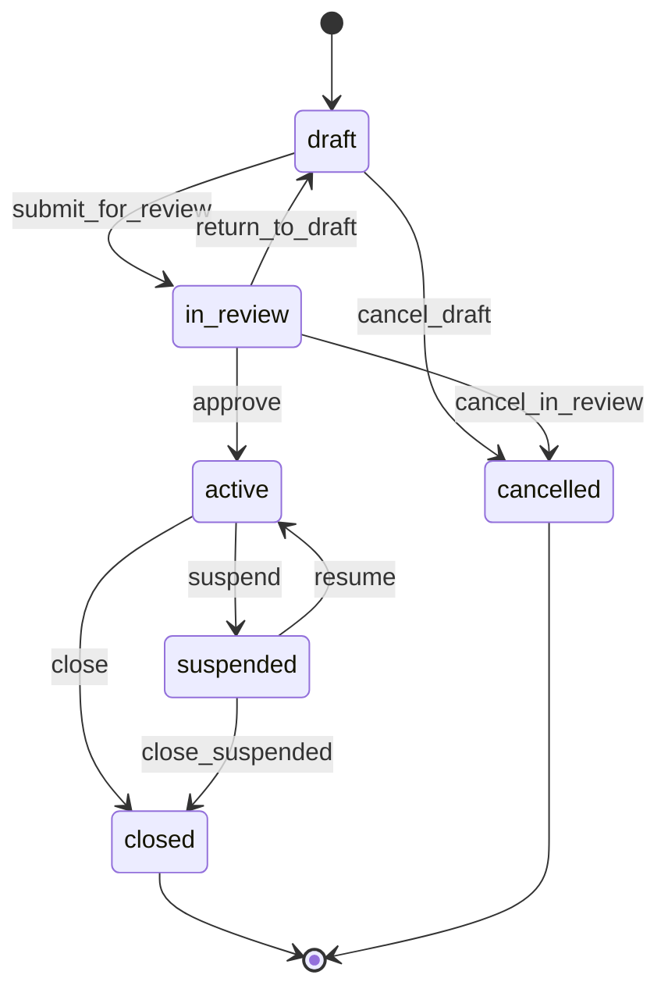

| Transición | De | A | Roles | Guarda | Motivo | Efectos | Validación vs fuentes |
|---|---|---|---|---|---|---|---|
| `submit_for_review` (Enviar a revisión) | `draft` | `in_review` | `PROJECT_MANAGER`, `PROJECT_ADMIN` | — | Opcional | Aviso de aprobación pendiente | [PRM-01 §8] Draft → Review |
| `return_to_draft` (Devolver) | `in_review` | `draft` | `PROJECT_ADMIN` | — | Obligatorio (`TransitionReasonGuard`) | — | [PRM]; motivo por RQ-AUD-002 |
| `approve` (Aprobar) | `in_review` | `active` | `PROJECT_ADMIN` | `ProjectWriteGuard`: la acción declarada `APPROVE` (RF-WFL-002); `working_crs` informado y al menos una `project_party` CLIENTE u OPERADOR, salvo `policy_activation_preconditions` en falso (ASM-062) | Opcional | — | [PRM-01 §8] "Approval"; precondición de ASM-062 |
| `suspend` (Suspender) | `active` | `suspended` | `PROJECT_ADMIN`, `PROJECT_MANAGER` | — | Obligatorio (`TransitionReasonGuard`) | — | [PRM-01 §8] Suspended |
| `resume` (Reanudar) | `suspended` | `active` | `PROJECT_ADMIN`, `PROJECT_MANAGER` | `ProjectWriteGuard`: las mismas condiciones de llegar a `active` (ASM-062) | Opcional | — | [PRM] |
| `close` (Cerrar) | `active` | `closed` | `PROJECT_ADMIN` | — | Opcional | — | [PRM-01 §8] Closed |
| `close_suspended` (Cerrar) | `suspended` | `closed` | `PROJECT_ADMIN` | — | Opcional | — | [PRM] |
| `cancel_draft` (Anular) | `draft` | `cancelled` | `PROJECT_ADMIN` | — | Obligatorio (`TransitionReasonGuard`) | — | Estado `cancelled` del análisis §11 |
| `cancel_in_review` (Anular) | `in_review` | `cancelled` | `PROJECT_ADMIN` | — | Obligatorio (`TransitionReasonGuard`) | — | Ídem |

## WF-B · Grupo de interés

**Objeto:** `stakeholder`

- **Estados:** `identified` (Identificado, inicial), `profiled` (Caracterizado), `assessed` (Evaluado), `retired` (Retirado,
  reincorporable). No hay estado final: es la excepción documentada en los principios.
- **Fase:** F2. Sin `requiresReason`.
- **Requisitos:** RF-STK-003, RF-STK-005, RF-STK-010, RF-STK-013, RF-STK-014, CON-030, ASM-032.
- **Validación contra las fuentes:**
  - el prompt propone Identified → Profiled → Active relationship → Monitoring → Inactive [PRM-01 §8];
  - "Active relationship" e "Inactive" son valores de `relationship_status` (RELACION ACTIVA, INACTIVA), un campo separado
    del ciclo de vida (RF-STK-014, ASM-032); "Monitoring" chocaría con el grupo de influencia PARA MONITOREO (CON-030);
  - DOC-01 respalda incorporar y retirar grupos de interés con motivo [DOC-01 §6] y evaluarlos contra una línea base
    [DOC-01 §7.2, §9.3.1.1, Anexo 3].
- **Quién evalúa:** solo `STAKEHOLDER_MANAGER` y `SOCIAL_MANAGER`, con la transición `assess` y el endpoint de evaluaciones,
  porque evaluar escribe `stance`, un campo restringido a esos roles (GAP-024). `COMMUNITY_RELATIONS_OFFICER` caracteriza y
  aporta sus observaciones por las interacciones (WF-C).
- **Estado de la relación:** lo cambian una persona, con permiso de campo, o la regla de primer contacto de
  `StakeholderFollowUpJob` (JOB-03). Ninguna transición de WF-B lo toca (modelo de dominio §7.2).

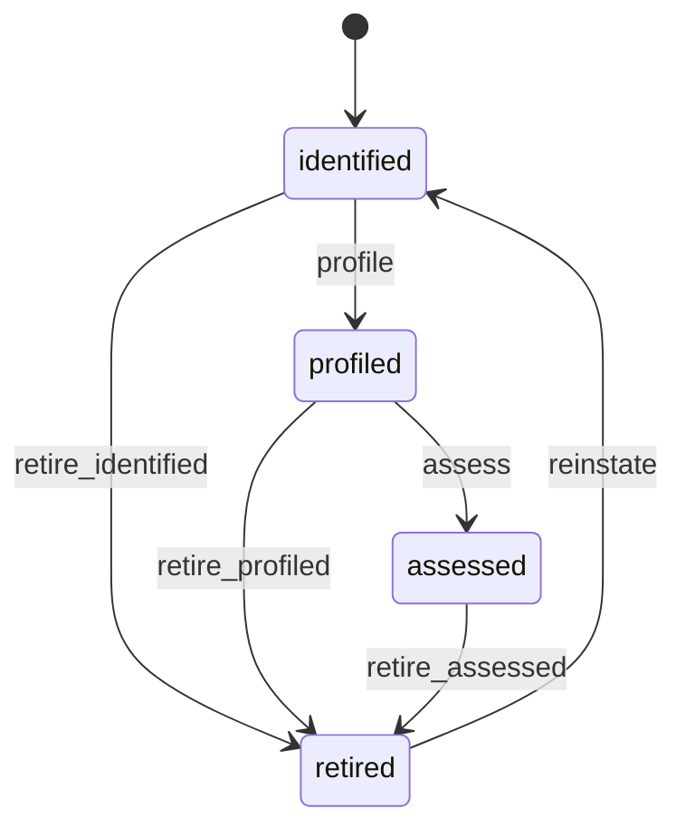

| Transición | De | A | Roles | Guarda | Motivo | Efectos | Validación vs fuentes |
|---|---|---|---|---|---|---|---|
| `profile` (Caracterizar) | `identified` | `profiled` | `STAKEHOLDER_MANAGER`, `COMMUNITY_RELATIONS_OFFICER`, `SOCIAL_MANAGER` | `StakeholderWriteGuard`: tipo, ámbito, motivo de inclusión y responsable informados (RF-STK-003) | Opcional | — | [PRM-01 §8] Profiled; caracterización de [DOC-01 Tablas 6.1–6.3] |
| `assess` (Evaluar) | `profiled` | `assessed` | `STAKEHOLDER_MANAGER`, `SOCIAL_MANAGER`: los que crean `stakeholder_assessment` y escriben `stance`, campo restringido (GAP-024) | `CommandTransitionGuard`: solo desde el endpoint de evaluaciones. Si el grupo de interés sigue en `identified`, el endpoint aplica antes `profile` con su guarda; si está en `retired`, rechaza la evaluación | Opcional; la evaluación lleva el suyo, porque `stakeholder_assessment` es `requiresReason` | El endpoint escribe en la misma transacción `stance`, `influence_group`, `information_priority`, `interest_index`, `power_index`, `trust_score` y `last_assessment_date`. Las evaluaciones siguientes no cambian el estado | [DOC-01 §7.2, §9.3.1.1, Anexo 3] (RF-STK-005, RF-STK-010) |
| `retire_identified` (Retirar) | `identified` | `retired` | `STAKEHOLDER_MANAGER`, `SOCIAL_MANAGER` | — | Obligatorio (`TransitionReasonGuard`) | Las evaluaciones se conservan (`appendOnly`) | [DOC-01 §6] (RF-STK-013) |
| `retire_profiled` (Retirar) | `profiled` | `retired` | `STAKEHOLDER_MANAGER`, `SOCIAL_MANAGER` | — | Obligatorio (`TransitionReasonGuard`) | Ídem | Ídem |
| `retire_assessed` (Retirar) | `assessed` | `retired` | `STAKEHOLDER_MANAGER`, `SOCIAL_MANAGER` | — | Obligatorio (`TransitionReasonGuard`) | Ídem | Ídem |
| `reinstate` (Reincorporar) | `retired` | `identified` | `STAKEHOLDER_MANAGER`, `SOCIAL_MANAGER` | — | Obligatorio (`TransitionReasonGuard`) | Vuelve a caracterizarse y a evaluarse; su historia de evaluaciones sigue disponible | [DOC-01 §6]: la lista es un punto de partida (RF-STK-013) |

## WF-C · Interacción

**Objeto:** `engagement`

- **Estados:** `planned` (Planificada, inicial), `scheduled` (Programada), `held` (Realizada), `minutes_drafted` (Acta en
  borrador), `minutes_in_review` (Acta en revisión), `minutes_approved` (Acta aprobada), `postponed` (Postergada),
  `closed` (Cerrada, final), `cancelled` (Cancelada, final).
- **Fase:** F2; sus automatizaciones, desde F3. Sin `requiresReason`.
- **Requisitos:** RF-ENG-001, RF-ENG-003, RF-ENG-004, RF-ENG-005, RF-ENG-006, RN-ENG-004, RN-ENG-005, CON-032, ASM-033.
- **Tipos formales y ligeros:** los tipos formales de RN-ENG-004 (REUNION, REUNION INFORMATIVA, TALLER, ASAMBLEA y MESA DE
  DIALOGO) cierran con acta aprobada; los demás pueden cerrar desde `held` (ASM-033). Con `policy_minutes_only_formal_types`
  en falso, todos los tipos exigen acta.
- **Equipo de relacionamiento:** `COMMUNITY_RELATIONS_OFFICER`, `STAKEHOLDER_MANAGER`, `SOCIAL_MANAGER` y `FIELD_AGENT`. Este
  último no tiene `EDIT_ANY`: puede agregar participantes a cualquier interacción que pueda leer, pero `EditAnyGuard` solo le
  deja cambiar o mover las interacciones que creó (RQ-SEC-008, ASM-069).
- **Validación contra las fuentes:**
  - el prompt propone Planned → Scheduled → Executed → Minutes drafted → Reviewed → Approved → Closed [PRM-01 §8]: Executed es
    `held`, Reviewed es `minutes_in_review` y Approved es `minutes_approved`;
  - DOC-02 exige cancelar una reunión con su motivo [DOC-02 p.2]; DOC-01 pide la minuta y el registro de todos los contactos
    [DOC-01 §9.1.1.1, Tabla 9.5];
  - el acta firmada por los asistentes es una `evidence` de tipo ACTA, no un estado (CON-032).

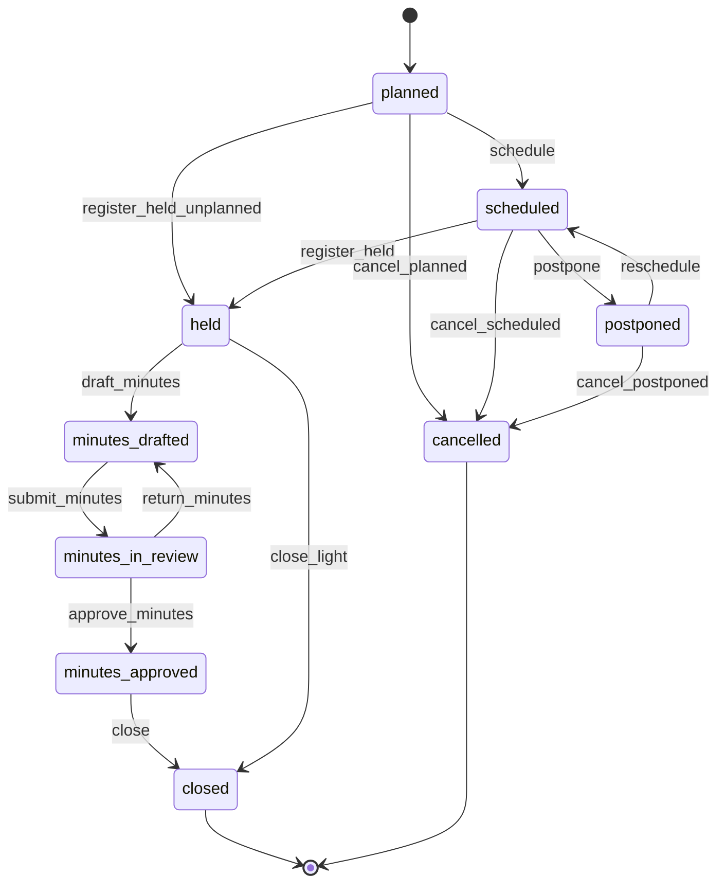

| Transición | De | A | Roles | Guarda | Motivo | Efectos | Validación vs fuentes |
|---|---|---|---|---|---|---|---|
| `schedule` (Programar) | `planned` | `scheduled` | `COMMUNITY_RELATIONS_OFFICER`, `STAKEHOLDER_MANAGER`, `SOCIAL_MANAGER`, `FIELD_AGENT` | `EngagementWriteGuard`: `scheduled_at` informado (RF-ENG-001) | Opcional | — | [PRM-01 §8] Scheduled; [DOC-01 §9.1.1.2] fecha y lugar acordados |
| `register_held` (Registrar realización) | `scheduled` | `held` | `COMMUNITY_RELATIONS_OFFICER`, `STAKEHOLDER_MANAGER`, `SOCIAL_MANAGER`, `FIELD_AGENT` | `EngagementWriteGuard`: `held_at` y al menos un participante con `attended` (RF-ENG-004) | Opcional | `StakeholderFollowUpJob` (JOB-03) actualiza `last_contact_date` y aplica la regla de primer contacto | [PRM-01 §8] Executed; [DOC-01 Tabla 9.5] |
| `register_held_unplanned` (Registrar realización) | `planned` | `held` | `COMMUNITY_RELATIONS_OFFICER`, `STAKEHOLDER_MANAGER`, `SOCIAL_MANAGER`, `FIELD_AGENT` | `EngagementWriteGuard`: la misma de `register_held` | Opcional | Ídem | [DOC-01 §9.1.1.1]: todo contacto, sobre todo el primero, se registra aunque no se haya programado |
| `postpone` (Postergar) | `scheduled` | `postponed` | `COMMUNITY_RELATIONS_OFFICER`, `STAKEHOLDER_MANAGER`, `SOCIAL_MANAGER`, `FIELD_AGENT` | — | Obligatorio (`TransitionReasonGuard`, RF-ENG-006) | — | [DOC-02 p.2] |
| `reschedule` (Reprogramar) | `postponed` | `scheduled` | `COMMUNITY_RELATIONS_OFFICER`, `STAKEHOLDER_MANAGER`, `SOCIAL_MANAGER`, `FIELD_AGENT` | `EngagementWriteGuard`: `scheduled_at` informado | Opcional | — | [DOC-02 p.2] (RF-ENG-006) |
| `draft_minutes` (Redactar acta) | `held` | `minutes_drafted` | `COMMUNITY_RELATIONS_OFFICER`, `STAKEHOLDER_MANAGER`, `SOCIAL_MANAGER`, `FIELD_AGENT` | `EngagementWriteGuard`: `minutes` no vacío | Opcional | — | [PRM-01 §8] Minutes drafted; [DOC-01 Tabla 9.5] |
| `submit_minutes` (Enviar acta a revisión) | `minutes_drafted` | `minutes_in_review` | `COMMUNITY_RELATIONS_OFFICER`, `STAKEHOLDER_MANAGER`, `SOCIAL_MANAGER`, `FIELD_AGENT` | `EngagementWriteGuard`: `minutes` no vacío | Opcional | Aviso de aprobación pendiente | [PRM-01 §8] Reviewed (RF-ENG-005) |
| `return_minutes` (Devolver acta) | `minutes_in_review` | `minutes_drafted` | `SOCIAL_MANAGER` | — | Obligatorio (`TransitionReasonGuard`) | — | RF-ENG-005 |
| `approve_minutes` (Aprobar acta) | `minutes_in_review` | `minutes_approved` | `SOCIAL_MANAGER` | — | Opcional | AUT-05: minuta y lista de asistentes como documentos emitidos (RQ-REP-029) | [PRM-01 §8] Approved (RF-ENG-005) |
| `close` (Cerrar) | `minutes_approved` | `closed` | `COMMUNITY_RELATIONS_OFFICER`, `STAKEHOLDER_MANAGER`, `SOCIAL_MANAGER`, `FIELD_AGENT` | `EngagementWriteGuard`: ninguna `engagement_question` sin respuesta ni derivación a una QCS (RN-ENG-005) | Opcional | — | [DOC-01 §9.1.1.2] |
| `close_light` (Cerrar sin acta) | `held` | `closed` | `COMMUNITY_RELATIONS_OFFICER`, `STAKEHOLDER_MANAGER`, `SOCIAL_MANAGER`, `FIELD_AGENT` | `EngagementWriteGuard`: el tipo no exige acta según `policy_minutes_only_formal_types` (RN-ENG-004, ASM-033), y la regla de preguntas de RN-ENG-005 | Opcional | — | [DOC-01 §9.1.1.1]; CON-032 |
| `cancel_planned` (Cancelar) | `planned` | `cancelled` | `COMMUNITY_RELATIONS_OFFICER`, `STAKEHOLDER_MANAGER`, `SOCIAL_MANAGER`, `FIELD_AGENT` | `EngagementWriteGuard`: `cancel_reason` informado, el dato que muestra el informe T2 | Obligatorio (`TransitionReasonGuard`, RF-ENG-006) | AUT-10: tarea para reprogramar o reemplazar la interacción | [DOC-02 p.2]: reunión cancelada por lluvia |
| `cancel_scheduled` (Cancelar) | `scheduled` | `cancelled` | Los mismos de `cancel_planned` | Ídem | Obligatorio (`TransitionReasonGuard`, RF-ENG-006) | AUT-10 | Ídem |
| `cancel_postponed` (Cancelar) | `postponed` | `cancelled` | Los mismos de `cancel_planned` | Ídem | Obligatorio (`TransitionReasonGuard`, RF-ENG-006) | AUT-10 | Ídem |

La derivación de una pregunta pendiente a una consulta, solicitud o queja no es una transición de WF-C: la hace el endpoint
`POST /api/sgspe/engagement-questions/{id}/referral` desde F4, y la QCS creada guarda `origin_question` (RF-ENG-003).

## WF-D · Compromiso

**Objeto:** `commitment`

- **Estados:** `draft` (Borrador, inicial), `pending_approval` (Pendiente de aprobación), `approved` (Aprobado),
  `in_progress` (En ejecución), `blocked` (Bloqueado), `fulfilled` (Cumplido), `verified` (Verificado), `closed` (Cerrado,
  final), `cancelled` (Cancelado, final).
- **Fase:** F3. `requiresReason`: toda transición lleva motivo.
- **Requisitos:** RF-COM-001, RF-COM-002, RF-COM-003, RF-COM-004, RF-COM-005, RF-COM-007, RF-COM-008, RN-COM-001, RN-COM-002,
  RN-COM-003, RN-COM-004, RN-COM-005, RN-ENG-001, RN-ENG-002, RN-INV-003, RN-GRV-001, RN-WFL-001, ASM-008, ASM-009, ASM-063.
- **Ejecutores:** `COMMITMENT_MANAGER`, que lleva la matriz [DOC-01 §9.3.1.2]; `COMMUNITY_RELATIONS_OFFICER` y
  `SOCIAL_MANAGER`. `FIELD_AGENT` no tiene transiciones en WF-D: no tiene permisos sobre `commitment`, y `register_fulfillment`
  y `close` disparan listeners que solo pueden aplicar roles con UPDATE sobre lo que escriben (modelo de dominio §7.5).
- **Entregas:** `POST /api/sgspe/commitments/{id}/deliveries` solo captura datos: crea la `delivery` y sus vínculos de
  evidencia en una transacción. El cambio de estado es la transición humana `register_fulfillment` (modelo de dominio §7.2).
- **Al crear (no es transición):** un compromiso que nace de un taller o de una reunión informativa exige
  `origin_justification` (RN-ENG-001, ASM-007), o se rechaza si el proyecto activa
  `policy_workshop_commitments_blocked`; el monto es obligatorio (RN-COM-004) y es un monto válido (ASM-092).
- **Al crear y al editar** (`CommitmentWriteGuard`, también por la API genérica):
  - desde `approved`, también en `cancelled`, `due_date` solo cambia con una reprogramación (RF-COM-003), que recalcula
    `deadline_status` en la misma transacción;
  - las relaciones hacia un objeto de proyecto (`exploration_campaign`, `origin_engagement`, `agreement`,
    `agreement_clause`) apuntan a registros del mismo proyecto del compromiso. **Límite conocido:** se juzga desde el
    compromiso, así que mover el destino a otro proyecto no se bloquea y deja el vínculo cruzado;
  - una dependencia no cierra un ciclo ni apunta al mismo compromiso (RF-COM-004). **Límite conocido:** la búsqueda
    recorre hasta 500 compromisos, lee como quien escribe (no ve las dependencias que no puede leer) y no se serializa:
    dos altas simultáneas `a → b` y `b → a` pueden pasar las dos;
  - la entrega de un compromiso en `fulfilled`, `verified`, `closed` o `cancelled` no se corrige ni gana o pierde
    evidencias: una entrega que sostiene un cumplimiento se corrige después de `reopen_execution`, y la de un compromiso
    cancelado ya no cambia.
- **Validación contra las fuentes:**
  - DOC-01 respalda el avance, la entrega con conformidad, acta y fotos, y el cierre [DOC-01 §9.3.1.2];
  - la aprobación interna y la verificación son [PRM] (ASM-008); la verificación va después de la conformidad (CON-027);
  - "Assigned" del prompt es el responsable, que se exige al enviar, no un estado; el vencimiento es `deadline_status`
    (CON-028).
- **ASSUMPTION (ASM-067):** el "nivel superior" de RN-ENG-002 es el rol `PROJECT_MANAGER`, que aprueba con su propia
  transición, `approve_senior`; `approve`, del rol `APPROVER`, rechaza los compromisos que exigen ese nivel. DOC-01 pide que
  esos espacios los conduzca alguien con respaldo para decidir [DOC-01 §9.1.1.3], y no hay matriz de autoridad (GAP-006).
  Se revierte cambiando el rol de `approve_senior`.
- **Tope de la campaña (D7):** superarlo es otra regla. Con la política que bloquea, solo lo permite la acción declarada
  `APPROVE_OVER_CAP` (RQ-SEC-004), que en `commitment` tiene `PROJECT_MANAGER`, el rol de `approve_senior`: quien la tenga
  necesita también una transición de aprobación de WF-D para usarla. Ningún rol de `approve` ni de `approve_direct` la
  tiene, y `PROJECT_MANAGER` no tiene transiciones desde `draft`. Por eso un compromiso que supera un tope que bloquea sigue
  siempre el camino con aprobación, `submit` y `approve_senior`, también con `policy_internal_approval` en falso.

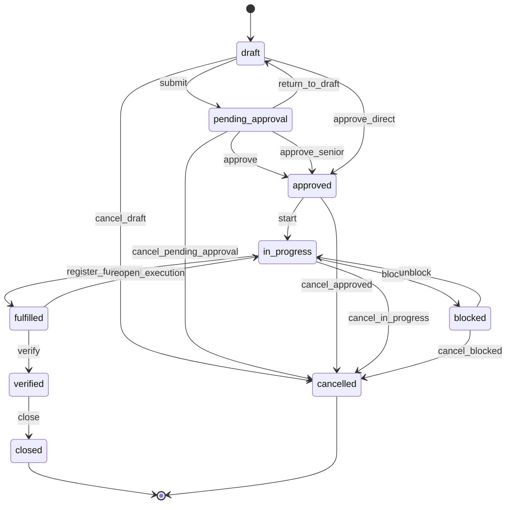

| Transición | De | A | Roles | Guarda | Motivo | Efectos | Validación vs fuentes |
|---|---|---|---|---|---|---|---|
| `submit` (Enviar a aprobación) | `draft` | `pending_approval` | `COMMITMENT_MANAGER`, `COMMUNITY_RELATIONS_OFFICER`, `SOCIAL_MANAGER` | `CommitmentWriteGuard`: D1 (campos mínimos de la matriz de DOC-01; ver la conciliación) y D2 (responsable) | Obligatorio (`requiresReason`) | Aviso de aprobación pendiente | [DOC-01 §9.3.1.2]; aprobación interna [PRM-01 §5] (ASM-008) |
| `return_to_draft` (Devolver) | `pending_approval` | `draft` | `APPROVER`, `PROJECT_MANAGER` | — | Obligatorio (`requiresReason`) | — | [PRM]; diagrama de WF-D en §11 del análisis |
| `approve` (Aprobar) | `pending_approval` | `approved` | `APPROVER` | `CommitmentWriteGuard`: D1 y D2 otra vez, porque `pending_approval` admite cambios y AUT-01 copia el responsable y la fecha; D3 (`APPROVE`); D4 (segregación); D5 (rechaza el nivel superior); D6 (empleo y servidumbres). `SupportPolicyGuard`: D7 (tope de la campaña) | Obligatorio (`requiresReason`) | AUT-01: tarea de ejecución. Desde aquí `due_date` solo cambia con una reprogramación (RF-COM-003) | [PRM-01 §5, §8] Approval (ASM-008, GAP-006) |
| `approve_senior` (Aprobar en nivel superior) | `pending_approval` | `approved` | `PROJECT_MANAGER` | Las de `approve` salvo D5. `SupportPolicyGuard`: D7; `PROJECT_MANAGER` tiene `APPROVE_OVER_CAP`, así que este es el camino de un compromiso que supera un tope que bloquea | Obligatorio (`requiresReason`) | AUT-01 | [DOC-01 §9.1.1.3] (RN-ENG-002, ASM-067) |
| `approve_direct` (Aprobar sin revisión interna) | `draft` | `approved` | `COMMITMENT_MANAGER`, `SOCIAL_MANAGER` | `CommitmentWriteGuard`: D8 (sin aprobación interna), D1, D2, D5 y D6; sin D3 ni D4, porque la aprobación interna está desactivada. `SupportPolicyGuard`: D7; ninguno de sus roles tiene `APPROVE_OVER_CAP`, así que un compromiso que supera un tope que bloquea va por `submit` y `approve_senior` | Obligatorio (`requiresReason`) | AUT-01 | ASM-008: la aprobación interna se desactiva por proyecto |
| `start` (Iniciar ejecución) | `approved` | `in_progress` | `COMMITMENT_MANAGER`, `COMMUNITY_RELATIONS_OFFICER`, `SOCIAL_MANAGER` | — | Obligatorio (`requiresReason`) | — | [PRM-01 §8] In Progress; [DOC-01 §9.3.1.2] estatus de avance |
| `block` (Bloquear) | `in_progress` | `blocked` | `COMMITMENT_MANAGER`, `COMMUNITY_RELATIONS_OFFICER`, `SOCIAL_MANAGER` | — | Obligatorio (`requiresReason`) | Cuenta como bloqueado en el tablero (RQ-DSH-018) | [PRM-01 §5, §8] bloqueo |
| `unblock` (Desbloquear) | `blocked` | `in_progress` | `COMMITMENT_MANAGER`, `COMMUNITY_RELATIONS_OFFICER`, `SOCIAL_MANAGER` | — | Obligatorio (`requiresReason`) | — | Ídem |
| `register_fulfillment` (Registrar cumplimiento) | `in_progress` | `fulfilled` | `COMMITMENT_MANAGER`, `COMMUNITY_RELATIONS_OFFICER`, `SOCIAL_MANAGER` | `CommitmentWriteGuard`: D9 (entrega con conformidad y la evidencia de su tipo de recurso) y D10 (dependencias) | Obligatorio (`requiresReason`) | Es la transición humana que sigue a la captura de la entrega, que no cambia el estado; `CommitmentDerivationsListener` escribe `fulfilled_date` en la transacción, y si falla, la transición se revierte | [DOC-01 §9.3.1.2] entrega con conformidad, acta y fotos; CON-027 |
| `reopen_execution` (Devolver a ejecución) | `fulfilled` | `in_progress` | `COMMITMENT_MANAGER`, `SOCIAL_MANAGER` | — | Obligatorio (`requiresReason`) | `CommitmentDerivationsListener` vacía `fulfilled_date` en la transacción, y si falla, la transición se revierte: el compromiso deja de contar como cumplido hasta su nuevo cumplimiento, y JOB-01 vuelve a calcular su `deadline_status` | Diagrama de WF-D en §11 del análisis: la verificación puede encontrar la entrega incompleta |
| `verify` (Verificar) | `fulfilled` | `verified` | `COMMITMENT_MANAGER`, `SOCIAL_MANAGER` | `CommitmentWriteGuard`: D11 (`VERIFY`; quien verifica no es el responsable) | Obligatorio (`requiresReason`) | — | [PRM-01 §5] VERIFIED; CON-027 |
| `close` (Cerrar) | `verified` | `closed` | `COMMITMENT_MANAGER`, `SOCIAL_MANAGER` | — | Obligatorio (`requiresReason`) | `CommitmentDerivationsListener` escribe `closed_date`; `RequestClosureListener` aplica `close_accepted` a la solicitud aceptada que originó el compromiso (RN-GRV-001); ambos en la transacción, y si alguno falla, el cierre se revierte | [DOC-01 §9.3.1.2] "Cierre" |
| `cancel_draft` (Cancelar) | `draft` | `cancelled` | `COMMITMENT_MANAGER`, `COMMUNITY_RELATIONS_OFFICER`, `SOCIAL_MANAGER` | — | Obligatorio (`requiresReason`) | `CommitmentDerivationsListener` escribe `cancelled_date` en la transacción | [PRM-01 §5] CANCELLED |
| `cancel_pending_approval` (Cancelar) | `pending_approval` | `cancelled` | `APPROVER`, `PROJECT_MANAGER` | — | Obligatorio (`requiresReason`) | `cancelled_date`, como en `cancel_draft` | [PRM-01 §5] CANCELLED: rechazo en la aprobación |
| `cancel_approved` (Cancelar) | `approved` | `cancelled` | `APPROVER`, `PROJECT_MANAGER` | — | Obligatorio (`requiresReason`) | `cancelled_date`, como en `cancel_draft`; la solicitud que lo originó sigue en `accepted` hasta `close_unfulfilled` (WF-E3, ASM-068) | [PRM-01 §5] CANCELLED |
| `cancel_in_progress` (Cancelar) | `in_progress` | `cancelled` | `APPROVER`, `PROJECT_MANAGER` | — | Obligatorio (`requiresReason`) | Ídem | Ídem |
| `cancel_blocked` (Cancelar) | `blocked` | `cancelled` | `APPROVER`, `PROJECT_MANAGER` | — | Obligatorio (`requiresReason`) | Ídem | Ídem |

Reglas de las guardas de WF-D, citadas por número en la tabla y en las pruebas:

- **D1. Campos mínimos de la matriz** (RF-COM-001; ver la conciliación): `description`, `objective`, `resource_type`,
  `quantity`, `unit`, `request_medium`, `agreed_date`, `due_date`, `beneficiaries_count` y `currency` informados, y al menos
  un grupo de interés solicitante (`commitment_stakeholder`). `amount` ya es obligatorio desde el alta (RN-COM-004).
  `execution_time` es opcional, porque DOC-01 pide el tiempo "si es necesario" [DOC-01 §9.3.1.2].
- **D2. Responsable:** `owner_user_id` y `owner_user_email` informados (RF-COM-005, ASM-023).
- **D3. Doble llave:** la acción declarada `APPROVE` sobre `commitment` (RF-WFL-002).
- **D4. Segregación:** quien aprueba no registró el compromiso (`created_by`, RN-COM-005).
- **D5. Nivel superior:** rechaza el compromiso que exige aprobación de nivel superior; evalúa la regla en el momento,
  sin leer `requires_senior_approval` (RN-ENG-002, ASM-067). El rechazo nombra la causa: el origen (una mesa de diálogo)
  o los solicitantes (un grupo de interés POLITICO).
- **D6. Políticas de empleo y servidumbres** (RN-COM-002, RN-COM-003): no se verifica en F3, porque el modelo no guarda
  si un compromiso ofrece puestos (ASM-089); la tabla la conserva para cuando exista el dato.
- **D7. Tope de la campaña** (`SupportPolicyGuard`): la suma de los montos aprobados de la campaña en su moneda, más el que
  se aprueba, contra el tope. Bloquea o advierte según `policy_cap_blocks_approval`; con la política que bloquea, solo lo
  supera quien tiene `APPROVE_OVER_CAP`, la acción que prevé GAP-006 (RN-INV-003, RQ-SEC-004, ASM-063). Desde F5, lo
  comprometido de la campaña (`CampaignCommitted`, `dashboards.md` §3.2) suma también los aportes en `approved`,
  `procured`, `delivered` o `closed` (ASM-110).
  - La aprobación toma el candado de la campaña en su transacción: dos aprobaciones simultáneas de la misma campaña no
    pasan el tope juntas.
  - Un monto en otra moneda que la de la campaña no se suma y se advierte. Una campaña sin moneda nunca bloquea: el tope
    no se compara y solo se advierte, porque una moneda que falta no se supone PEN (`currency` tiene PEN por defecto,
    así que solo ocurre si alguien la vació).
  - Un monto guardado que no es válido (el tope o el de otro compromiso de la campaña, de antes de que se validaran
    los montos, ASM-092) se omite de la suma y se informa: bloquea como el tope, y quien tiene `APPROVE_OVER_CAP` lo
    pasa, porque decide sin el total.
- **D8. Sin aprobación interna:** solo con `policy_internal_approval` en falso (ASM-008).
- **D9. Entrega con conformidad y evidencia** (RN-COM-001, ASM-009): una `delivery` del compromiso con `conformity_given`
  verdadero y `conformity_by` informado, vinculada (`evidence_delivery`) a evidencias según el tipo de recurso:
  - MATERIAL: al menos una ACTA DE ENTREGA y una FOTO;
  - NO MATERIAL: al menos una ACTA, CARTA u OTRO, sin un tipo de evidencia propio.

  Solo cuenta la evidencia del mismo proyecto del compromiso; sin `resource_type` no se sabe qué evidencia pedir y la
  transición se rechaza. Quien la aplica tiene que leer `conformity_by`, un campo restringido. `register_fulfillment` y
  las `cancel_*` toman el candado del compromiso, el mismo de las entregas y de la reprogramación, así que una entrega o
  un vínculo de evidencia no se cruzan con el cumplimiento.
- **D10. Dependencias:** ninguna dependencia bloqueante abierta (RF-COM-004): una lo está mientras el compromiso del que
  depende no esté en `fulfilled`, `verified`, `closed` o `cancelled`.
- **D11. Verificación:** la acción declarada `VERIFY`, y quien verifica no es el responsable (`owner_user_id`, RN-COM-005).

**Orden de las reglas.** `CommitmentWriteGuard` corre sus reglas en un orden fijo: las de alta y edición; en una
aprobación, primero D8, después D1 y D2, D3 y D4, D5 y al final D7, la única que toma un candado; en el cumplimiento, el
candado, D9, D10 y D11. La escritura se detiene en el primer bloqueo; la consulta en seco (`transition-checks`) las
junta todas, en ese orden. Una regla que no puede leer lo que necesita rechaza la transición: nunca deja pasar.

### Conciliación con la matriz de compromisos de DOC-01 §9.3.1.2

DOC-01 pide que la matriz contenga "por lo menos" estos campos [DOC-01 §9.3.1.2]. Cada uno se cumple con un estado o una
transición de WF-D, campos de `commitment` o de sus hijos y, cuando aplica, una evidencia (RF-COM-001).

| Campo de la matriz | Estado o transición de WF-D | Campos | Evidencia | Requisitos |
|---|---|---|---|---|
| Descripción: objetivo, tipo de recurso, unidades y tiempo (si es necesario) | Se exige al salir de `draft` y se vuelve a verificar al aprobar (D1) | `description`, `objective`, `resource_type`, `quantity`, `unit`; `execution_time`, opcional | — | RF-COM-001 |
| Grupo de interés solicitante: personas, cargos y documentos de identidad | Al salir de `draft`: al menos un solicitante (D1) | M2M `commitment_stakeholder`; `person` y `position` del solicitante, con el documento de identidad restringido (CON-014) | La carta de solicitud, si la hubo (`evidence` CARTA) | RF-COM-001, RQ-SEC-010 |
| Beneficiarios: número, nombre, sexo y edad | Al salir de `draft`: el número de beneficiarios (D1) | `beneficiaries_count`, `beneficiaries_female_count`, `beneficiaries_male_count`; detalle en `beneficiaries_detail` (restringido) | — | RF-COM-001 |
| Medio de solicitud: carta o acuerdo firmado en reunión | Al salir de `draft` (D1) | `request_medium`; `origin_engagement`, `agreement` o `agreement_clause`, o la solicitud que lo originó (`stakeholder_request.created_commitment`) | La carta (CARTA) o el acta de la reunión (ACTA) | RF-COM-001, RF-COM-005 |
| Plazo de entrega: fecha de acuerdo, fechas parciales y fecha final | Al salir de `draft` (D1); desde `approved`, la fecha final solo cambia con una reprogramación | `agreed_date`, `due_date`; `commitment_milestone`, si hay fechas parciales; `commitment_reschedule` | — | RF-COM-003, RF-COM-006 |
| Monto | Obligatorio desde el alta, con su moneda al salir de `draft` (D1); el tope de la campaña (D7) se verifica en `approve`, `approve_senior` y `approve_direct` | `amount`, `currency`; `executed_amount` (derivado) | — | RN-COM-004, RN-INV-003, ASM-063 |
| Estatus de avance: gestiones internas y aviso oportuno de retrasos | `approved`, `in_progress` y `blocked`; el atraso es `deadline_status`, nunca un estado | `commitment_action`; `delay_risk_reported`, `delay_risk_note`; `deadline_status` (derivado) | — | RF-COM-006, RF-COM-007, RN-WFL-001 |
| Entrega: fecha, quienes dan conformidad, acta de entrega y registro fotográfico | El endpoint de entregas captura los datos; la transición humana `register_fulfillment` → `fulfilled` (D9) | `delivery`: `delivery_date`, `place`, `recipients`, `conformity_given`, `conformity_by` | ACTA DE ENTREGA y FOTO si el recurso es MATERIAL; ACTA, CARTA u OTRO si es NO MATERIAL, con la conformidad registrada en la entrega; documento emitido «Acta de entrega» (AUT-03, tras UPS-23) | RF-COM-008, RN-COM-001, ASM-009, RQ-REP-029 |
| Cierre: "consignar el cierre de la solicitud, al final del proceso" | `verify` y `close` → `closed`; la solicitud aceptada pasa a `closed` | `closed_date` (derivado); estado de `stakeholder_request` | — | RN-GRV-001 |

Lo que el prompt agrega y DOC-01 no pide: la aprobación interna (ASM-008), la verificación (CON-027), el bloqueo, la
cancelación, el responsable y las dependencias [PRM-01 §5, §8]. Cómo se cumple cada exigencia de WF-D del prompt:

| Exigencia [PRM-01 §8] | Cómo se cumple |
|---|---|
| Vencimiento | `deadline_status`, que mantiene JOB-01; nunca un estado (RN-WFL-001, CON-028) |
| Escalamiento | JOB-01: un aviso y una tarea por nivel, a los `escalation_first_days` (7) y `escalation_second_days` (15) días de atraso, para los asignados al proyecto con un rol de `verify` y luego de `approve_senior` (RF-WFL-004, ASM-030, ASM-070; ver "Destinatarios por rol") |
| Bloqueo | `block` y `unblock`, con motivo |
| Reprogramación | `POST /api/sgspe/commitments/{id}/reschedules` crea `commitment_reschedule` y actualiza `due_date`, sin cambiar el estado (RF-COM-003) |
| Dependencia | `register_fulfillment` se rechaza con dependencias bloqueantes abiertas (D10, RF-COM-004) |
| Evidencia | `register_fulfillment` exige la entrega con la conformidad y la evidencia de su tipo de recurso (D9, RN-COM-001) |
| Aprobación | `approve`, `approve_senior` o `approve_direct`, con segregación de funciones (RN-COM-005) |

## WF-E · Quejas, consultas y solicitudes (QCS)

Tres objetos con un workflow cada uno y un reporte unificado (ASM-011, CON-033): `grievance` (WF-E1), `inquiry` (WF-E2) y
`stakeholder_request` (WF-E3). Reglas comunes:

- Los tres son `requiresReason`: toda transición lleva motivo. Fase F4.
- Los plazos de acuse, respuesta y resolución se calculan al recibir (`QcsDueDatesListener`, RF-GRV-006, ASM-005) y su
  situación es `deadline_status`, que mantiene JOB-01. Ningún estado representa un plazo vencido (RN-WFL-001).
- Las fechas de las transiciones son derivadas: `QcsTransitionDatesListener` escribe `resolved_date` (queja) en cada
  transición a `resolved` y `closed_date` (las tres) en cada transición a un estado final: `closed` y, en la queja, también
  `rejected` (`reject_*`) y `withdrawn` (`withdraw_*`). La reapertura de una queja vacía `resolved_date`. Si no puede
  escribir, la transición se revierte (modelo de dominio §7.4, §7.5).
- Una QCS anónima no lleva `person` ni `stakeholder` (`AttentionWriteGuard`, RF-GRV-001, GAP-005).
- **Registro (ASM-104).** Solo el equipo social registra QCS (`COMMUNITY_RELATIONS_OFFICER` y `GRIEVANCE_MANAGER`), por
  el canal en que llegaron; no hay canal público ni avisos a quien plantea en el MVP (UPS-25, UPS-26).
- **Confidencial (ASM-095).** Una QCS con `confidential` verdadero solo la leen `ADMIN`, quien tiene `READ_CONFIDENTIAL`
  sobre el objeto (`GRIEVANCE_MANAGER`), su responsable, quien la recibió y, en una queja ALTA o CRITICA, quien tiene
  `APPROVE` sobre `grievance` (`ConfidentialAttentionScope`, `security.md` §9.6). Quien no la lee tampoco la cambia ni
  la transiciona. `AttentionWriteGuard` exige que el alta de una QCS confidencial lleve `received_by_user_id` igual a
  quien escribe, salvo con `READ_CONFIDENTIAL` (`400 CONFIDENTIAL_RECEIVER_REQUIRED`), y esa acción para quitar la marca
  o cambiar `owner_user_id` o `received_by_user_id` de una confidencial (`403 ACTION_REQUIRED`). La reclasificación no
  elige receptor: el registro nuevo conserva el del original, y esa alta del comando no exige que sea quien escribe.
- **Días hábiles (ASM-096).** El acuse de una queja cuenta días hábiles con `BusinessDays` (`sgspe.common`): lunes a
  viernes menos los feriados nacionales configurados por año; la respuesta y la resolución, días calendario. El día de
  recepción no cuenta.
- **Documentos (ASM-098).** «Cargo de queja» y «Carta de respuesta» esperan a UPS-23 (AUT-06 a AUT-08): mientras tanto
  se imprimen fuera de SGSPE, se entregan en papel y, firmados, se suben como evidencia FORMULARIO (cargo) o CARTA
  (carta) vinculada a la QCS.
- **Reclasificación** (RF-GRV-007): `POST /api/sgspe/grievances/{id}/reclassify` y sus pares crean la QCS del otro tipo con
  el vínculo `reclassified_from_*` y llevan el original a `closed` con una transición de comando `close_reclassified_*`. El
  registro nuevo copia el `received_at` del primer registro de la cadena, así que `QcsDueDatesListener` calcula sus plazos
  desde esa fecha (ASM-072).
- El original se cierra, como fija el modelo de dominio (§6.7, §7.2): el planteamiento sigue vivo en el registro nuevo, y
  RF-GRV-007 no fija su estado final. `dashboards.md` (§3.3) cuenta el planteamiento una sola vez, como el registro nuevo:
  los originales a los que apunta un vínculo `reclassified_from_*` no cuentan como recibidos, cerrados ni atendidos.
  Por eso `reclassified_from_*` y `created_commitment` son de solo comando (`AttentionCommandFieldsGuard`, `api.md` §3.3):
  una persona que los fija, cambia o vacía por la API genérica recibe `403 COMMAND_ONLY` sobre el campo, y la derivación y
  la reclasificación no los admiten en `attributes` (`400`).
- **Absuelta** (glosario, RQ-DSH-023): una QCS con `responded_at`, en cualquier estado; cerrarla no la vuelve absuelta. Exigen
  `responded_at` las transiciones que comunican una respuesta: `close_resolved`, `close` y `reject_*` de WF-E1; `answer` y
  `close_referred` de WF-E2; `accept` y `close_declined` de WF-E3.
- **Roles:** `GRIEVANCE_MANAGER` lleva las QCS; `COMMUNITY_RELATIONS_OFFICER` acusa, responde y registra desistimientos en
  terreno; `APPROVER` resuelve las quejas graves (RN-GRV-002) y recibe `approval_pending` de una queja ALTA o CRITICA en
  `in_action` (ASM-102).
- **Validación contra las fuentes:** DOC-01 nombra quejas, consultas y solicitudes y pide el porcentaje absuelto y el
  reporte [DOC-01 Tabla 9.5]; los pasos de cada flujo son [PRM] (CON-029), salvo el cierre de la solicitud
  [DOC-01 §9.3.1.2].

### WF-E1 · Queja

**Objeto:** `grievance`

- **Estados:** `received` (Recibida, inicial), `acknowledged` (Acusada), `in_assessment` (En evaluación), `in_investigation`
  (En investigación, opcional), `in_action` (En atención), `resolved` (Resuelta), `verified` (Verificada, opcional), `closed`
  (Cerrada, final), `rejected` (Rechazada, final), `withdrawn` (Desistida, final).
- **Requisitos:** RF-GRV-001, RF-GRV-002, RF-GRV-006, RF-GRV-007, RN-GRV-002, ASM-005, ASM-036, CON-029.
- **Validación contra las fuentes:** une las dos listas del prompt (CON-029): RECEIVED y ACKNOWLEDGED son `received` y
  `acknowledged`; UNDER_REVIEW y Assessment son `in_assessment`; INVESTIGATION es `in_investigation`; ACTION_REQUIRED y Action son `in_action`; RESOLVED y
  Resolution son `resolved`; Verification es `verified`; REJECTED es `rejected` [PRM-01 §5, §8]. El desistimiento
  (`withdrawn`) y la reapertura salen de RF-GRV-002.

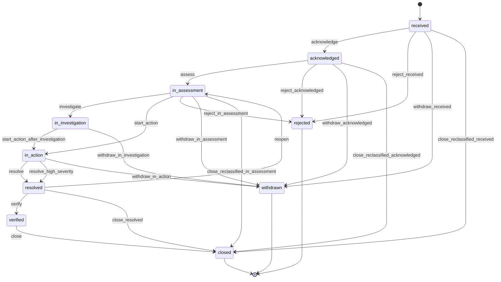

| Transición | De | A | Roles | Guarda | Motivo | Efectos | Validación vs fuentes |
|---|---|---|---|---|---|---|---|
| `acknowledge` (Acusar recibo) | `received` | `acknowledged` | `GRIEVANCE_MANAGER`, `COMMUNITY_RELATIONS_OFFICER` | — | Obligatorio (`requiresReason`) | AUT-06 (tras UPS-23): «Cargo de queja» como documento emitido; hasta entonces, el cargo firmado se sube como evidencia FORMULARIO (ASM-098); `deadline_status` pasa a medir `resolution_due_date` | [PRM-01 §5, §8] ACKNOWLEDGED; plazo de ASM-005 |
| `assess` (Evaluar) | `acknowledged` | `in_assessment` | `GRIEVANCE_MANAGER` | — | Obligatorio (`requiresReason`) | — | [PRM-01 §5, §8] UNDER_REVIEW y Assessment |
| `investigate` (Investigar) | `in_assessment` | `in_investigation` | `GRIEVANCE_MANAGER` | `AttentionWriteGuard`: `category` y `severity` informadas | Obligatorio (`requiresReason`) | — | [PRM-01 §5, §8] INVESTIGATION, opcional |
| `start_action` (Atender) | `in_assessment` | `in_action` | `GRIEVANCE_MANAGER` | `AttentionWriteGuard`: `category` y `severity` informadas | Obligatorio (`requiresReason`) | `GraveGrievanceNoticeListener`: `approval_pending` a los roles de `resolve_high_severity` si la queja es ALTA o CRITICA y `policy_high_severity_requires_approver` está activo (ASM-102) | [PRM-01 §5, §8] ACTION_REQUIRED y Action |
| `start_action_after_investigation` (Atender) | `in_investigation` | `in_action` | `GRIEVANCE_MANAGER` | `AttentionWriteGuard`: `category` y `severity` informadas | Obligatorio (`requiresReason`) | Como `start_action` | Ídem |
| `resolve` (Resolver) | `in_action` | `resolved` | `GRIEVANCE_MANAGER` | `AttentionWriteGuard`: `resolution` y `response` informadas; rechaza la severidad ALTA o CRITICA si `policy_high_severity_requires_approver` está activo (RN-GRV-002, ASM-036) | Obligatorio (`requiresReason`) | `QcsTransitionDatesListener` escribe `resolved_date` | [PRM-01 §5, §8] RESOLVED |
| `resolve_high_severity` (Resolver con aprobación) | `in_action` | `resolved` | `APPROVER` | `AttentionWriteGuard`: la acción declarada `APPROVE` sobre `grievance`; `resolution` y `response` informadas | Obligatorio (`requiresReason`) | `QcsTransitionDatesListener` escribe `resolved_date` | RN-GRV-002 (ASM-036) |
| `reopen` (Reabrir) | `resolved` | `in_assessment` | `GRIEVANCE_MANAGER` | `AttentionWriteGuard`: el reclamante no dio conformidad (`complainant_conformity_given` no es verdadero) | Obligatorio (`requiresReason`) | `QcsTransitionDatesListener` vacía `resolved_date`; `deadline_status` vuelve a medir `resolution_due_date` | RF-GRV-002 |
| `verify` (Verificar) | `resolved` | `verified` | `GRIEVANCE_MANAGER`, `SOCIAL_MANAGER` | — | Obligatorio (`requiresReason`) | — | [PRM-01 §8] Verification, opcional |
| `close_resolved` (Cerrar) | `resolved` | `closed` | `GRIEVANCE_MANAGER` | `AttentionWriteGuard`: respuesta comunicada (`responded_at` informado) | Obligatorio (`requiresReason`) | `closed_date` | [DOC-01 Tabla 9.5] |
| `close` (Cerrar) | `verified` | `closed` | `GRIEVANCE_MANAGER` | `AttentionWriteGuard`: `responded_at` informado | Obligatorio (`requiresReason`) | `closed_date` | [PRM-01 §5, §8] CLOSED |
| `reject_received` (Rechazar) | `received` | `rejected` | `GRIEVANCE_MANAGER` | `AttentionWriteGuard`: `response` y `responded_at` informados, porque el rechazo se comunica; un duplicado lleva `duplicate_of`, que no puede ser la misma queja (`400 INVALID_LINK`) | Obligatorio (`requiresReason`) | `closed_date`; con `responded_at`, cuenta como absuelta | [PRM-01 §5] REJECTED |
| `reject_acknowledged` (Rechazar) | `acknowledged` | `rejected` | `GRIEVANCE_MANAGER` | Ídem | Obligatorio (`requiresReason`) | Ídem | Ídem |
| `reject_in_assessment` (Rechazar) | `in_assessment` | `rejected` | `GRIEVANCE_MANAGER` | Ídem | Obligatorio (`requiresReason`) | Ídem | Ídem |
| `withdraw_received` (Registrar desistimiento) | `received` | `withdrawn` | `GRIEVANCE_MANAGER`, `COMMUNITY_RELATIONS_OFFICER` | — | Obligatorio (`requiresReason`) | `closed_date` | RF-GRV-002 |
| `withdraw_acknowledged` (Registrar desistimiento) | `acknowledged` | `withdrawn` | `GRIEVANCE_MANAGER`, `COMMUNITY_RELATIONS_OFFICER` | — | Obligatorio (`requiresReason`) | `closed_date` | Ídem |
| `withdraw_in_assessment` (Registrar desistimiento) | `in_assessment` | `withdrawn` | `GRIEVANCE_MANAGER`, `COMMUNITY_RELATIONS_OFFICER` | — | Obligatorio (`requiresReason`) | `closed_date` | Ídem |
| `withdraw_in_investigation` (Registrar desistimiento) | `in_investigation` | `withdrawn` | `GRIEVANCE_MANAGER`, `COMMUNITY_RELATIONS_OFFICER` | — | Obligatorio (`requiresReason`) | `closed_date` | Ídem |
| `withdraw_in_action` (Registrar desistimiento) | `in_action` | `withdrawn` | `GRIEVANCE_MANAGER`, `COMMUNITY_RELATIONS_OFFICER` | — | Obligatorio (`requiresReason`) | `closed_date` | Ídem |
| `close_reclassified_received` (Cerrar por reclasificación) | `received` | `closed` | `GRIEVANCE_MANAGER` | `CommandTransitionGuard`: solo desde el endpoint de reclasificación | Obligatorio (`requiresReason`) | Crea la consulta o la solicitud con `reclassified_from_grievance`; `closed_date` | RF-GRV-007 [DOC-01 Tabla 9.5] |
| `close_reclassified_acknowledged` (Cerrar por reclasificación) | `acknowledged` | `closed` | `GRIEVANCE_MANAGER` | Ídem | Obligatorio (`requiresReason`) | Ídem | Ídem |
| `close_reclassified_in_assessment` (Cerrar por reclasificación) | `in_assessment` | `closed` | `GRIEVANCE_MANAGER` | Ídem | Obligatorio (`requiresReason`) | Ídem | Ídem |

Al recibir una queja (alta, no transición) corren `QcsDueDatesListener` (plazos) y AUT-02 (tarea de acuse); en una queja
confidencial AUT-02 no corre y la tarea de acuse genérica la crea `ConfidentialTasksListener` («Listeners», D-1). La
situación de plazo y las tareas de escalamiento las escribe JOB-01, y los avisos los publica `DeadlineNotices`.

### WF-E2 · Consulta

**Objeto:** `inquiry`

- **Estados:** `received` (Recibida, inicial), `answered` (Respondida), `referred` (Derivada), `closed` (Cerrada, final).
- **Requisitos:** RF-GRV-001, RF-GRV-003, RF-GRV-007, ASM-005.
- **Validación contra las fuentes:** DOC-01 pide el porcentaje de consultas absueltas [DOC-01 Tabla 9.5] (RQ-DSH-023). El
  prompt no tiene un workflow de consultas [PRM-01 §8]: este es nuevo y mínimo.

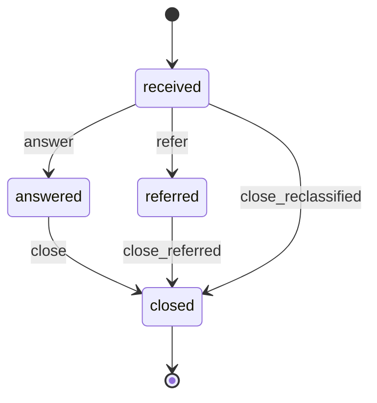

| Transición | De | A | Roles | Guarda | Motivo | Efectos | Validación vs fuentes |
|---|---|---|---|---|---|---|---|
| `answer` (Responder) | `received` | `answered` | `GRIEVANCE_MANAGER`, `COMMUNITY_RELATIONS_OFFICER` | `AttentionWriteGuard`: `response` y `responded_at` informados | Obligatorio (`requiresReason`) | AUT-07 (tras UPS-23): «Carta de respuesta» si llegó por CARTA; hasta entonces, la carta firmada se sube como evidencia CARTA (ASM-098); con `responded_at`, cuenta como absuelta (RQ-DSH-023) | [DOC-01 Tabla 9.5] consultas absueltas |
| `refer` (Derivar) | `received` | `referred` | `GRIEVANCE_MANAGER` | `AttentionWriteGuard`: `response` informada, con la entidad a la que se deriva | Obligatorio (`requiresReason`) | — | Estado `referred` del análisis §11 |
| `close` (Cerrar) | `answered` | `closed` | `GRIEVANCE_MANAGER`, `COMMUNITY_RELATIONS_OFFICER` | — | Obligatorio (`requiresReason`) | `closed_date` | [DOC-01 Tabla 9.5] |
| `close_referred` (Cerrar) | `referred` | `closed` | `GRIEVANCE_MANAGER` | `AttentionWriteGuard`: `responded_at` informado, porque la derivación se comunicó | Obligatorio (`requiresReason`) | `closed_date`; con `responded_at`, cuenta como absuelta | Ídem |
| `close_reclassified` (Cerrar por reclasificación) | `received` | `closed` | `GRIEVANCE_MANAGER` | `CommandTransitionGuard`: solo desde el endpoint de reclasificación | Obligatorio (`requiresReason`) | Crea la queja o la solicitud con `reclassified_from_inquiry`; `closed_date` | RF-GRV-007 |

### WF-E3 · Solicitud

**Objeto:** `stakeholder_request`

- **Estados:** `received` (Recibida, inicial), `under_evaluation` (En evaluación), `accepted` (Aceptada), `declined`
  (Declinada), `closed` (Cerrada, final).
- **Requisitos:** RF-GRV-001, RF-GRV-004, RF-GRV-007, RN-GRV-001, GAP-005.
- **Validación contra las fuentes:** DOC-01 trata el compromiso como respuesta a una solicitud, con su medio de solicitud, y
  pide "consignar el cierre de la solicitud, al final del proceso" [DOC-01 §9.3.1.2]. Las solicitudes no tienen plazo por
  defecto mientras GAP-005 siga abierto (modelo de dominio §6.1).
- **Cierre de la solicitud aceptada (RN-GRV-001, ASM-068).** `RequestClosureListener` corre en la transacción de `close` de
  WF-D (y, desde F5, de `close` de WF-P), como la persona que cierra el compromiso o el aporte, y aplica `close_accepted` a la
  solicitud con `created_commitment` o `created_contribution` igual a ese registro. Se usan las dos protecciones, como fija
  el modelo de dominio (§8.3):
  - **roles compatibles:** `close_accepted` tiene los roles de `close` de WF-D (`COMMITMENT_MANAGER` y `SOCIAL_MANAGER`) y
    de WF-P (`SOCIAL_INVESTMENT_MANAGER`, desde F5), porque `WorkflowService` comprueba el rol de quien aplica, también
    dentro del listener;
  - **marca de escritura:** `CommandTransitionGuard` solo admite `close_accepted` con la marca `SgspeWrite`, que el listener
    pone al llamar; así nadie cierra a mano una solicitud aceptada por la API genérica;
  - el listener pasa el motivo (`RN-GRV-001: compromiso <código> cerrado` o `RN-GRV-001: aporte <código> cerrado`),
    porque `stakeholder_request` es `requiresReason`;
  - `security.md` concede `READ` y `UPDATE` sobre `stakeholder_request` a los roles de `close` de WF-D y de WF-P. Si quien
    cierra el compromiso o el aporte no puede cerrar la solicitud, el listener falla y el cierre se revierte (modelo de
    dominio §7.5). `FIELD_AGENT` no tiene ninguna de esas transiciones.
- **ASSUMPTION (ASM-068):** desde F5, una solicitud aceptada también se cierra cuando se cierra su aporte, y la solicitud
  cuyo compromiso o aporte se cancela o se rechaza se cierra a mano con `close_unfulfilled`. RN-GRV-001 solo cubre el cierre
  por el compromiso, y DOC-01 pide consignar el cierre de toda solicitud [DOC-01 §9.3.1.2]:
  - `RequestClosureListener` también se dispara cuando el aporte creado (`created_contribution`) llega a `closed`, y
    `close_accepted` suma el rol `SOCIAL_INVESTMENT_MANAGER`, el de `close` de WF-P;
  - `close_unfulfilled` solo la admite `AttentionWriteGuard` cuando el compromiso creado está en `cancelled`, o el aporte en
    `rejected` o `cancelled`, y con `response` informada. Sin ella, la solicitud quedaría abierta para siempre.

  Se revierte cerrando solo por el compromiso, como dice RN-GRV-001, y dejando el resto a mano.
- **Fase de cada rol.** `SOCIAL_INVESTMENT_MANAGER` está en `accept` y `close_accepted` desde su fase, F5, cuando recibe
  permisos (`security.md` §7.1), como en WF-N: un tenant con el modelo de F4 no lo lleva en
  `model/workflows/stakeholder_request.json`.
- **Aceptar como aporte (ASM-117).** El endpoint de aceptación con `creates` igual a `social_contribution` exige además
  CREATE sobre `social_contribution`: `SOCIAL_MANAGER` y `SOCIAL_INVESTMENT_MANAGER` lo tienen y `COMMITMENT_MANAGER`
  no, así que este acepta solo como compromiso (`403`). El aporte nace en `requested` y lo «registró» quien aceptó, que
  no lo aprueba (P5 de WF-P).

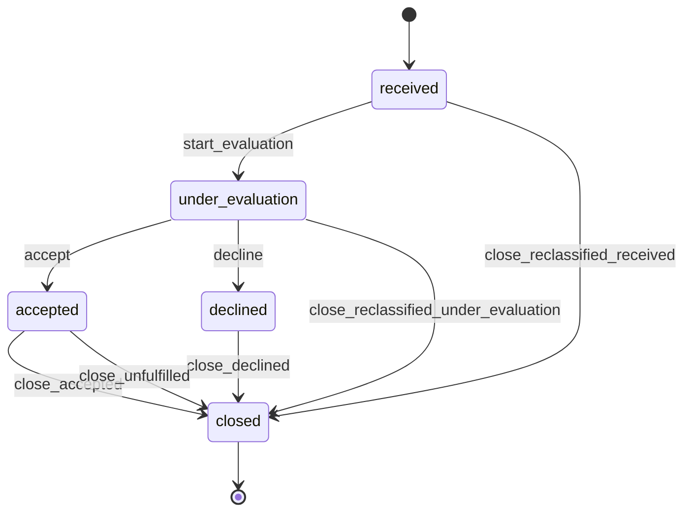

| Transición | De | A | Roles | Guarda | Motivo | Efectos | Validación vs fuentes |
|---|---|---|---|---|---|---|---|
| `start_evaluation` (Evaluar) | `received` | `under_evaluation` | `GRIEVANCE_MANAGER`, `SOCIAL_MANAGER` | — | Obligatorio (`requiresReason`) | — | RF-GRV-004 |
| `accept` (Aceptar) | `under_evaluation` | `accepted` | `SOCIAL_MANAGER`, `COMMITMENT_MANAGER`, `SOCIAL_INVESTMENT_MANAGER` | `CommandTransitionGuard`: solo desde el endpoint de aceptación, que crea el compromiso en `draft` o el aporte en `requested` (con CREATE sobre `social_contribution`, ASM-117) y guarda `created_commitment` o `created_contribution`; ninguno de los dos se escribe por otra vía (`AttentionCommandFieldsGuard`, `403 COMMAND_ONLY`, `api.md` §3.3). `AttentionWriteGuard`: `response` y `responded_at` de la solicitud informados, porque la aceptación es la respuesta y el cierre que sigue es automático | Obligatorio (`requiresReason`) | El compromiso nuevo sigue WF-D, con su aprobación; el aporte, WF-P, con el aviso de aprobación del alta. Con `responded_at`, la solicitud cuenta como absuelta | [DOC-01 §9.3.1.2] medio de solicitud (RF-GRV-004) |
| `decline` (Declinar) | `under_evaluation` | `declined` | `GRIEVANCE_MANAGER`, `SOCIAL_MANAGER` | `AttentionWriteGuard`: `response` informada (RF-GRV-004), p. ej. por RN-INV-001 | Obligatorio (`requiresReason`) | AUT-08 (tras UPS-23): «Carta de respuesta» si llegó por CARTA DE SOLICITUD; hasta entonces, la carta firmada se sube como evidencia CARTA (ASM-098) | RF-GRV-004 |
| `close_declined` (Cerrar) | `declined` | `closed` | `GRIEVANCE_MANAGER`, `SOCIAL_MANAGER` | `AttentionWriteGuard`: `responded_at` informado | Obligatorio (`requiresReason`) | `closed_date` | [DOC-01 §9.3.1.2] cierre de la solicitud |
| `close_accepted` (Cerrar por cierre del compromiso o del aporte) | `accepted` | `closed` | `COMMITMENT_MANAGER`, `SOCIAL_MANAGER`, `SOCIAL_INVESTMENT_MANAGER` | `CommandTransitionGuard`: solo desde `RequestClosureListener` | Obligatorio (`requiresReason`); lo pasa el listener | `closed_date` | [DOC-01 §9.3.1.2] (RN-GRV-001, ASM-068) |
| `close_unfulfilled` (Cerrar sin ejecución) | `accepted` | `closed` | `GRIEVANCE_MANAGER`, `SOCIAL_MANAGER` | `AttentionWriteGuard`: el compromiso creado está en `cancelled`, o el aporte en `rejected` o `cancelled`; si no, `409 STATE_MISMATCH` sobre `created_commitment` o `created_contribution`; `response` informada | Obligatorio (`requiresReason`) | `closed_date` | [DOC-01 §9.3.1.2] (ASM-068) |
| `close_reclassified_received` (Cerrar por reclasificación) | `received` | `closed` | `GRIEVANCE_MANAGER` | `CommandTransitionGuard`: solo desde el endpoint de reclasificación | Obligatorio (`requiresReason`) | Crea la queja o la consulta con `reclassified_from_request`; `closed_date` | RF-GRV-007 |
| `close_reclassified_under_evaluation` (Cerrar por reclasificación) | `under_evaluation` | `closed` | `GRIEVANCE_MANAGER` | Ídem | Obligatorio (`requiresReason`) | Ídem | Ídem |

## WF-F · Riesgo social

**Objeto:** `social_risk`

- **Estados:** `identified` (Identificado, inicial), `assessed` (Evaluado), `mitigating` (En mitigación), `monitoring` (En
  monitoreo), `closed` (Cerrado, final).
- **Fase:** F4. `requiresReason`: toda transición lleva motivo.
- **Requisitos:** RF-RSK-001, RF-RSK-002, RF-RSK-003, RN-RSK-001, RN-RSK-002, RN-RSK-003, ASM-004, CON-011.
- **Revisiones (ASM-099):** `POST /api/sgspe/social-risks/{id}/assessments` crea la `risk_assessment` (`appendOnly` y
  `apiOnly`: una revisión se corrige con otra), recalcula los valores vigentes o los residuales y el nivel con los
  umbrales del proyecto (RN-RSK-002, ASM-004), fija `next_review_date` en la fecha de la revisión más
  `review_every_days` (o `risk_review_days`) y aplica `assess` en la primera revisión, que no puede ser residual. Las
  revisiones de un tipo, residual o no, van en orden de fecha. Una revisión residual lleva `residual` en verdadero.
- **Validación contra las fuentes:**
  - el prompt propone Identified → Assessed → Mitigation → Monitoring → Closed [PRM-01 §8];
  - DOC-01 respalda evaluar la fuente, la probabilidad y el impacto, decidir qué riesgos mitigar, monitorear y reconsiderar
    después de las medidas [DOC-01 §9.3.2.1, §9.3.2.2]. Mitigar o monitorear son caminos según la decisión de tratamiento,
    no pasos obligatorios;
  - la revisión semanal es un trabajo y una tarea, no un estado (RN-RSK-001); su situación es `review_status`.

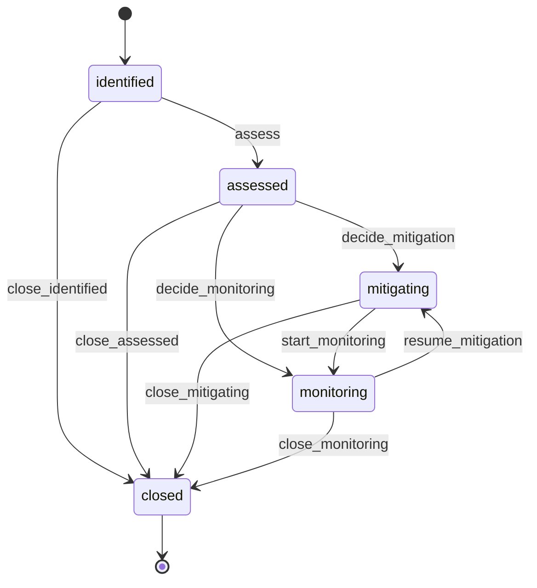

| Transición | De | A | Roles | Guarda | Motivo | Efectos | Validación vs fuentes |
|---|---|---|---|---|---|---|---|
| `assess` (Evaluar) | `identified` | `assessed` | `SOCIAL_RISK_MANAGER` | `CommandTransitionGuard`: solo desde el endpoint de revisiones, en la primera revisión (ASM-099). `RiskWriteGuard`: probabilidad, impacto y responsable informados (RF-RSK-001) | Obligatorio (`requiresReason`) | La aplica el endpoint de revisiones; `RiskNoticeListener` publica `risk_escalated` si el nivel es ALTO o CRITICO; AUT-11 si es CRITICO | [DOC-01 §9.3.2.1] evaluación |
| `decide_mitigation` (Decidir mitigar) | `assessed` | `mitigating` | `SOCIAL_RISK_MANAGER`, `SOCIAL_MANAGER` | `RiskWriteGuard`: `treatment_decision` MITIGAR y al menos una `mitigation_measure` con responsable (RN-RSK-003) | Obligatorio (`requiresReason`) | — | [DOC-01 §9.3.2.2] decisión de mitigar |
| `decide_monitoring` (Decidir monitorear) | `assessed` | `monitoring` | `SOCIAL_RISK_MANAGER`, `SOCIAL_MANAGER` | `RiskWriteGuard`: `treatment_decision` MONITOREAR o ACEPTAR y una revisión residual (RN-RSK-003) | Obligatorio (`requiresReason`) | — | [DOC-01 §9.3.2.2] |
| `start_monitoring` (Pasar a monitoreo) | `mitigating` | `monitoring` | `SOCIAL_RISK_MANAGER`, `SOCIAL_MANAGER` | `RiskWriteGuard`: una revisión residual (RN-RSK-003) | Obligatorio (`requiresReason`) | — | [DOC-01 §9.3.2.2] riesgo residual |
| `resume_mitigation` (Volver a mitigar) | `monitoring` | `mitigating` | `SOCIAL_RISK_MANAGER`, `SOCIAL_MANAGER` | `RiskWriteGuard`: al menos una medida con responsable | Obligatorio (`requiresReason`) | — | [DOC-01 §9.3.2.2] reconsideración (RF-RSK-003) |
| `close_identified` (Cerrar) | `identified` | `closed` | `SOCIAL_RISK_MANAGER`, `SOCIAL_MANAGER` | `RiskWriteGuard`: `close_reason` informado (RN-RSK-003) | Obligatorio (`requiresReason`) | — | [DOC-01 §9.3.2.2] |
| `close_assessed` (Cerrar) | `assessed` | `closed` | `SOCIAL_RISK_MANAGER`, `SOCIAL_MANAGER` | Ídem | Obligatorio (`requiresReason`) | — | Ídem |
| `close_mitigating` (Cerrar) | `mitigating` | `closed` | `SOCIAL_RISK_MANAGER`, `SOCIAL_MANAGER` | Ídem | Obligatorio (`requiresReason`) | — | Ídem |
| `close_monitoring` (Cerrar) | `monitoring` | `closed` | `SOCIAL_RISK_MANAGER`, `SOCIAL_MANAGER` | Ídem | Obligatorio (`requiresReason`) | — | Ídem |

Las revisiones siguientes no cambian el estado: actualizan los valores vigentes, `next_review_date` y la tendencia. Si
el nivel sube a ALTO o CRITICO, `RiskNoticeListener` (`sgspe.notification`) publica `risk_escalated` en la transacción
del endpoint (F4).

## WF-G · Programa social

**Objeto:** `social_program`

- **Estados:** `draft` (Borrador, inicial), `pending_approval` (Pendiente de aprobación), `planned` (Planificado),
  `executing` (En ejecución), `monitoring` (En monitoreo), `evaluation` (En evaluación), `suspended` (Suspendido), `closed`
  (Cerrado, final), `cancelled` (Cancelado, final).
- **Fase:** F5. Sin `requiresReason`.
- **Requisitos:** RF-INV-003, RN-INV-004, ASM-008, ASM-113, ASM-115, ASM-118, GAP-007, GAP-032.
- **Validación contra las fuentes:**
  - ciclo del prompt Draft → Approval → Planned → Executing → Monitoring → Evaluation → Closed [PRM-01 §8]; "Approval" es
    `pending_approval` más la transición `approve`;
  - DOC-01 solo respalda la guarda del acuerdo con el socio (RN-INV-004) [DOC-01 §9.3.1.2]; la estructura de los programas
    sigue abierta (GAP-007) y su evaluación de impacto también (GAP-032);
  - `suspended` y `cancelled` vienen del análisis §11. La suspensión solo pausa la ejecución, para que reanudar tenga un
    destino único.

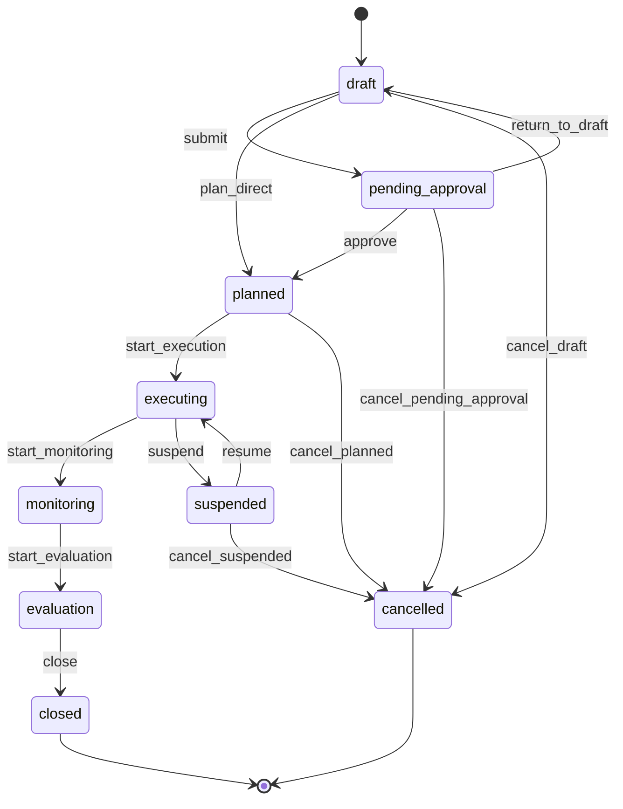

| Transición | De | A | Roles | Guarda | Motivo | Efectos | Validación vs fuentes |
|---|---|---|---|---|---|---|---|
| `submit` (Enviar a aprobación) | `draft` | `pending_approval` | `SOCIAL_INVESTMENT_MANAGER` | — | Opcional | Aviso `approval_pending` a los roles de `approve` (`ApprovalNoticeListener`), que se resuelve al salir de `pending_approval` | [PRM-01 §8] Approval |
| `return_to_draft` (Devolver) | `pending_approval` | `draft` | `APPROVER` | — | Obligatorio (`TransitionReasonGuard`) | — | [PRM] |
| `approve` (Aprobar) | `pending_approval` | `planned` | `APPROVER` | `InvestmentWriteGuard`: G1 (`APPROVE`), G2 (segregación) y G3 (sinergia) | Opcional | — | [DOC-01 §9.3.1.2] sinergias en un acuerdo formal |
| `plan_direct` (Planificar sin aprobación interna) | `draft` | `planned` | `SOCIAL_INVESTMENT_MANAGER` | `InvestmentWriteGuard`: G4 (sin aprobación interna) y G3; sin G1 ni G2 | Opcional | — | ASM-008 |
| `start_execution` (Iniciar ejecución) | `planned` | `executing` | `SOCIAL_INVESTMENT_MANAGER` | — | Opcional | — | [PRM-01 §8] Executing |
| `start_monitoring` (Pasar a monitoreo) | `executing` | `monitoring` | `SOCIAL_INVESTMENT_MANAGER` | — | Opcional | — | [PRM-01 §8] Monitoring |
| `start_evaluation` (Evaluar) | `monitoring` | `evaluation` | `SOCIAL_INVESTMENT_MANAGER`, `SOCIAL_MANAGER` | — | Opcional | — | [PRM-01 §8] Evaluation (GAP-032) |
| `close` (Cerrar) | `evaluation` | `closed` | `SOCIAL_MANAGER` | — | Opcional | — | [PRM-01 §8] Closed |
| `suspend` (Suspender) | `executing` | `suspended` | `SOCIAL_MANAGER`, `APPROVER` | — | Obligatorio (`TransitionReasonGuard`) | — | Estado `suspended` del análisis §11 |
| `resume` (Reanudar) | `suspended` | `executing` | `SOCIAL_MANAGER`, `APPROVER` | — | Opcional | — | Ídem |
| `cancel_draft` (Cancelar) | `draft` | `cancelled` | `SOCIAL_INVESTMENT_MANAGER`, `SOCIAL_MANAGER`, `APPROVER` | — | Obligatorio (`TransitionReasonGuard`) | — | Estado `cancelled` del análisis §11 |
| `cancel_pending_approval` (Cancelar) | `pending_approval` | `cancelled` | `SOCIAL_MANAGER`, `APPROVER` | — | Obligatorio (`TransitionReasonGuard`) | — | Ídem |
| `cancel_planned` (Cancelar) | `planned` | `cancelled` | `SOCIAL_MANAGER`, `APPROVER` | — | Obligatorio (`TransitionReasonGuard`) | — | Ídem |
| `cancel_suspended` (Cancelar) | `suspended` | `cancelled` | `SOCIAL_MANAGER`, `APPROVER` | — | Obligatorio (`TransitionReasonGuard`) | — | Ídem |

Reglas de las guardas de WF-G, citadas por número en la tabla y en las pruebas (`InvestmentWriteGuard`,
`sgspe.investment`):

- **G1. Doble llave:** la acción declarada `APPROVE` sobre `social_program` (RF-WFL-002); sin ella,
  `403 ACTION_REQUIRED` sobre `record`.
- **G2. Segregación:** quien aprueba no registró el programa (`created_by`, ASM-008); si no,
  `403 SEGREGATION_OF_DUTIES` sobre `record`.
- **G3. Sinergia** (RN-INV-004, ASM-115): con `partner_organization` informado y `policy_synergy_requires_agreement`
  activa, `agreement` informado, en `active`, con `validity_status` distinto de VENCIDO y con un `agreement_party` cuya
  `organization` es el socio; si no, `409 SYNERGY_AGREEMENT_REQUIRED` sobre `agreement`. El acuerdo es del mismo
  proyecto (`ProjectLinkGuard`).
- **G4. Sin aprobación interna:** solo con `policy_internal_approval` en falso (ASM-008); si no,
  `409 INTERNAL_APPROVAL_REQUIRED` sobre `project`.

**Reglas de los hijos del programa**, en la misma guarda: `beneficiary_group.social_initiative` es del mismo programa
(`409 PROGRAM_MISMATCH` sobre `social_initiative`); la fecha final de una medición, un programa o una iniciativa no es
anterior a la inicial, `budget_year` va de 2000 a 2100 y `target_count` y `reached_count` son enteros no negativos
(`400 OUT_OF_RANGE`, ASM-118). `SOCIAL_INVESTMENT_MANAGER` borra iniciativas, grupos, indicadores e hitos; un indicador
con mediciones no se borra (`409` de wasichai sin código, `AppendOnlyReferences`), y una medición (`appendOnly`) no se
corrige: se registra otra de otro periodo. `ProgramTotalsListener` mantiene `total_budget` en la moneda del programa
(ASM-113); el ejecutado se registra a mano en cada presupuesto. Los hitos no tienen plazo ni escalamiento: JOB-01 no los mide.

## WF-H · Entregable

**Objeto:** `deliverable`

- **Estados:** `draft` (Borrador, inicial), `in_review` (En revisión), `observed` (Observado), `approved` (Aprobado),
  `issued` (Emitido; una revisión nueva vuelve a `draft`), `voided` (Anulado, final).
- **Fase:** F8. `requiresReason`: toda transición lleva motivo.
- **Requisitos:** RQ-REP-015, RQ-REP-017, RQ-REP-021, RQ-REP-026, RQ-REP-027, RQ-AI-012, ASM-061, ASM-133.
- **Generar un borrador no es una transición:** `POST /api/sgspe/deliverables/{id}/drafts`, con la acción declarada
  `GENERATE`, solo en `draft` u `observed` y con los parámetros del tipo, escribe `generation_requested_at`, y el
  trabajador de generación (JOB-05) escribe los `draft_*`, con sus siete archivos, como la plataforma (ASM-061,
  ASM-133). Así nadie puede marcar un borrador como LISTO por la API genérica.
- **Preparan y revisan:** solo los roles que leen los campos sensibles que un entregable incluye (GAP-024),
  `SOCIAL_MANAGER` y `STAKEHOLDER_MANAGER`: preparan, observan, aprueban y emiten; anular queda en `SOCIAL_MANAGER`.
  `GENERATE`, `APPROVE` e `ISSUE` sobre `deliverable` se conceden solo a esos roles (RQ-SEC-004). RQ-REP-015 no pide que
  apruebe una persona distinta de la que envía. Las secciones (`deliverable_section`) no tienen workflow: sus permisos están
  en `security.md`.
- **Validación contra las fuentes:** el usuario pide entregables como DOC-01 y DOC-02 [USR-01]; un entregable para terceros
  se revisa y se aprueba antes de emitirse (RQ-REP-015, inferido) y lo emitido es el modelo congelado del borrador aprobado
  (RQ-REP-026) [WAS-ADR-0023].

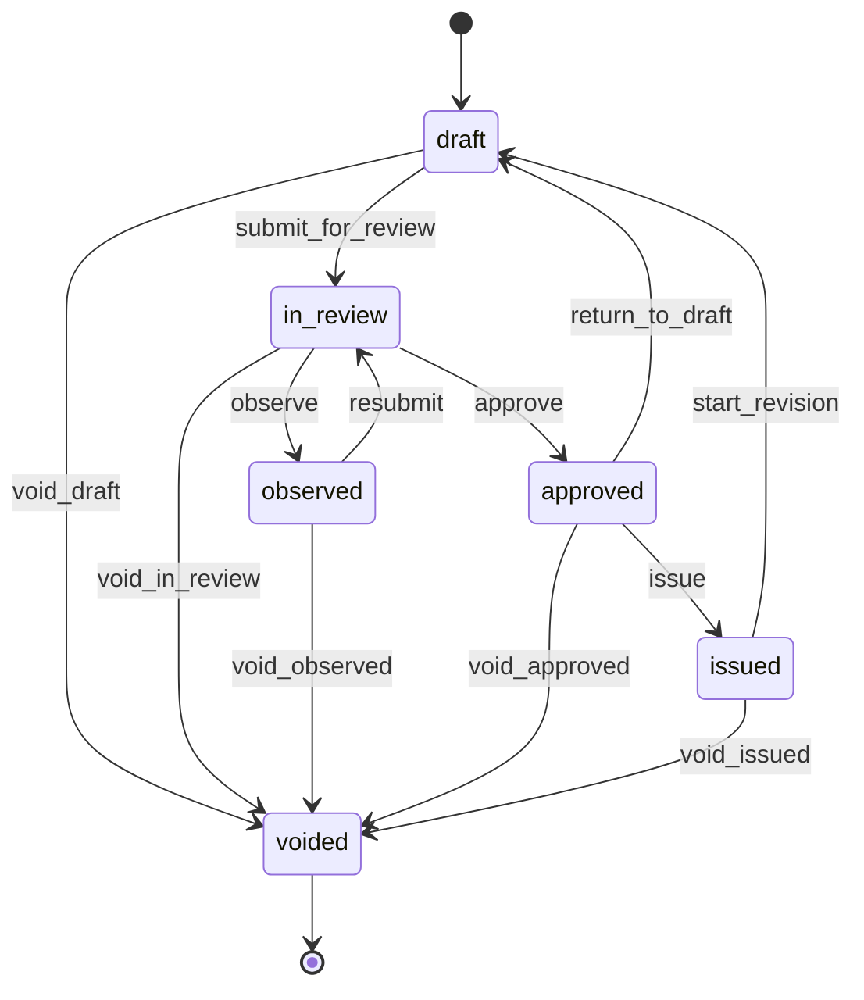

| Transición | De | A | Roles | Guarda | Motivo | Efectos | Validación vs fuentes |
|---|---|---|---|---|---|---|---|
| `submit_for_review` (Enviar a revisión) | `draft` | `in_review` | `SOCIAL_MANAGER`, `STAKEHOLDER_MANAGER` | `DeliverableWriteGuard`: el último borrador está LISTO y no se emitió (`409 STATE_MISMATCH`; tras `start_revision` se pide uno nuevo) y ninguna `deliverable_section` cambió después de `draft_generated_at` (`409 SECTIONS_CHANGED`) | Obligatorio (`requiresReason`) | Aviso de aprobación pendiente | RQ-REP-015, RQ-REP-021 |
| `observe` (Observar) | `in_review` | `observed` | `SOCIAL_MANAGER`, `STAKEHOLDER_MANAGER` | — | Obligatorio (`requiresReason`); el motivo es la observación | — | RQ-REP-015 |
| `resubmit` (Reenviar a revisión) | `observed` | `in_review` | `SOCIAL_MANAGER`, `STAKEHOLDER_MANAGER` | `DeliverableWriteGuard`: la misma de `submit_for_review`, que obliga a regenerar después de corregir | Obligatorio (`requiresReason`) | Aviso de aprobación pendiente | Ídem |
| `approve` (Aprobar) | `in_review` | `approved` | `SOCIAL_MANAGER`, `STAKEHOLDER_MANAGER` | `DeliverableWriteGuard`: la acción declarada `APPROVE` (RF-WFL-002); borrador LISTO y ninguna sección cambiada después de congelar el modelo (RQ-REP-026, ASM-061) | Obligatorio (`requiresReason`) | — | RQ-REP-015, RQ-REP-026 |
| `return_to_draft` (Devolver a borrador) | `approved` | `draft` | `SOCIAL_MANAGER`, `STAKEHOLDER_MANAGER` | — | Obligatorio (`requiresReason`) | — | RQ-REP-015 |
| `issue` (Emitir) | `approved` | `issued` | `SOCIAL_MANAGER`, `STAKEHOLDER_MANAGER` | `CommandTransitionGuard`: solo desde el endpoint de emisión, que además exige la acción declarada `ISSUE`, el mismo `draft_model_sha256` (`409 MODEL_MISMATCH`), ningún mapa fallido (`409 MAP_FAILED`) y, si el tipo prepara EXTERNO, la lista de verificación (`400 CHECKLIST_REQUIRED`), y repite el control de secciones de `approve`: si alguna `deliverable_section` cambió después de `draft_generated_at`, responde `409 SECTIONS_CHANGED` con las secciones cambiadas, y la persona aplica `return_to_draft` (`deliverables.md` §8.4) | Obligatorio (`requiresReason`) | En la misma transacción, antes de la transición: las `deliverable_version` INTERNO y EXTERNO (inmutables, con sus archivos y SHA-256), `current_version`, `current_revision` y `export_log` (RQ-REP-017, RQ-AUD-011); la transición va al final y dispara AUT-12, la constancia de emisión con su correlativo | RQ-REP-026 [WAS-ADR-0023] |
| `start_revision` (Nueva revisión) | `issued` | `draft` | `SOCIAL_MANAGER`, `STAKEHOLDER_MANAGER` | — | Obligatorio (`requiresReason`) | Las versiones emitidas se conservan en `deliverable_version` | RQ-REP-016, RQ-REP-027 |
| `void_draft` (Anular) | `draft` | `voided` | `SOCIAL_MANAGER` | — | Obligatorio (`requiresReason`) | — | Estado `voided` del análisis §11 |
| `void_in_review` (Anular) | `in_review` | `voided` | `SOCIAL_MANAGER` | — | Obligatorio (`requiresReason`) | — | Ídem |
| `void_observed` (Anular) | `observed` | `voided` | `SOCIAL_MANAGER` | — | Obligatorio (`requiresReason`) | — | Ídem |
| `void_approved` (Anular) | `approved` | `voided` | `SOCIAL_MANAGER` | — | Obligatorio (`requiresReason`) | — | Ídem |
| `void_issued` (Anular) | `issued` | `voided` | `SOCIAL_MANAGER` | — | Obligatorio (`requiresReason`) | Las versiones emitidas se conservan y quedan como historia | Ídem |

## WF-I · Acuerdo

**Objeto:** `agreement`

- **Estados:** `draft` (Borrador, inicial), `in_negotiation` (En negociación), `active` (Vigente), `suspended` (Suspendido),
  `concluded` (Concluido, final), `terminated` (Resuelto, final), `cancelled` (Anulado, final).
- **Fase:** F3. `requiresReason`: toda transición lleva motivo.
- **Requisitos:** RF-AGR-001, RF-AGR-002, RF-AGR-003, RN-WFL-001.
- **Vigencia:** vencido y por vencer son `validity_status`, que mantiene JOB-01; vencer no lleva el acuerdo a `concluded`, lo
  decide una persona.
- **Validación contra las fuentes:** el prompt describe el acuerdo con vigencia y estado [PRM-01 §5]; DOC-02 recomienda obtener
  el permiso de uso de tierras [DOC-02 p.6]; DOC-01 describe las autorizaciones de asamblea y las mesas de diálogo
  [DOC-01 §6.1.1.7, §9.1.1.3]. Muchos acuerdos se registran ya firmados, sin negociación que seguir, y por eso existe
  `activate_from_draft`.

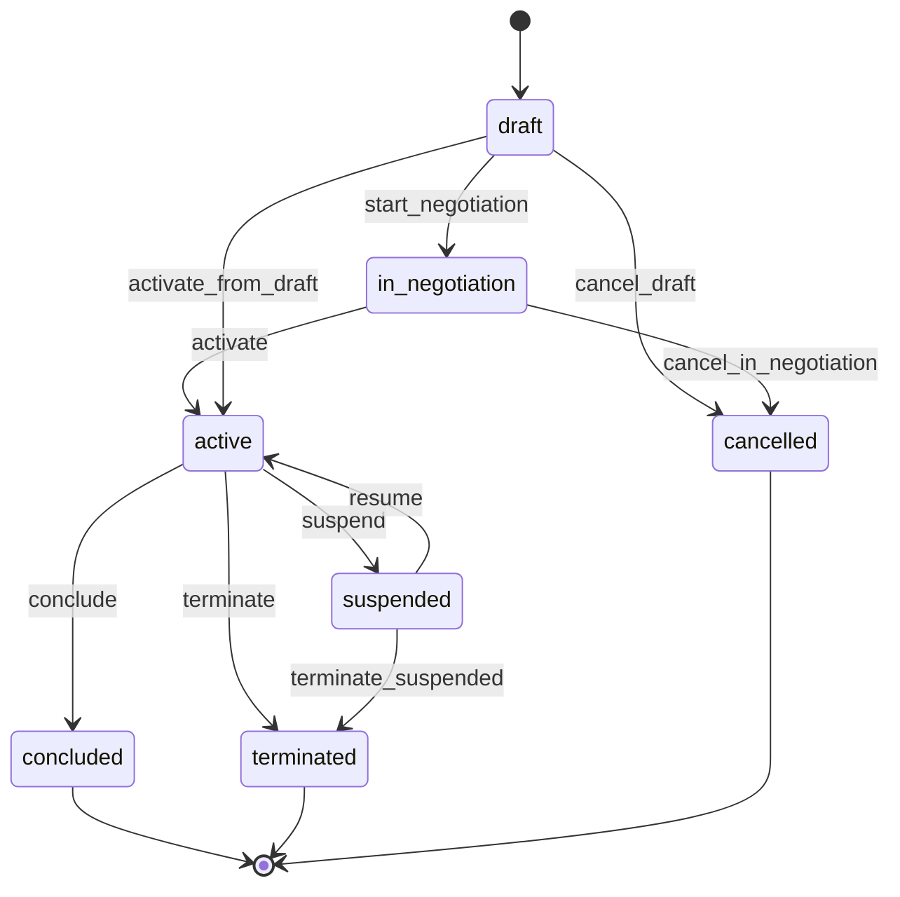

| Transición | De | A | Roles | Guarda | Motivo | Efectos | Validación vs fuentes |
|---|---|---|---|---|---|---|---|
| `start_negotiation` (Iniciar negociación) | `draft` | `in_negotiation` | `SOCIAL_MANAGER`, `COMMUNITY_RELATIONS_OFFICER` | — | Obligatorio (`requiresReason`) | — | [DOC-01 §9.1.1.3] |
| `activate` (Registrar vigencia) | `in_negotiation` | `active` | `SOCIAL_MANAGER`, `PROJECT_MANAGER` | `AgreementWriteGuard`: un permiso de uso de terreno o una servidumbre tiene al menos un vínculo `agreement_land_parcel` y la comunidad titular (RF-AGR-002); una autorización de asamblea apunta a la interacción de tipo ASAMBLEA (`assembly_engagement`, RF-AGR-003); `signed_date` y `effective_date` informadas | Obligatorio (`requiresReason`) | JOB-02 recalcula `strategic_alliance.formalized` | [DOC-02 p.6] [DOC-01 §6.1.1.7] |
| `activate_from_draft` (Registrar vigencia) | `draft` | `active` | `SOCIAL_MANAGER`, `PROJECT_MANAGER` | `AgreementWriteGuard`: la misma de `activate` | Obligatorio (`requiresReason`) | Ídem | Ídem |
| `suspend` (Suspender) | `active` | `suspended` | `SOCIAL_MANAGER`, `PROJECT_MANAGER` | — | Obligatorio (`requiresReason`) | — | Estado `suspended` del análisis §11 |
| `resume` (Reanudar) | `suspended` | `active` | `SOCIAL_MANAGER`, `PROJECT_MANAGER` | `AgreementWriteGuard`: la de llegar a `active` | Obligatorio (`requiresReason`) | — | Ídem |
| `conclude` (Concluir) | `active` | `concluded` | `SOCIAL_MANAGER`, `PROJECT_MANAGER` | — | Obligatorio (`requiresReason`) | — | [PRM-01 §5] expiryDate |
| `terminate` (Resolver) | `active` | `terminated` | `PROJECT_MANAGER` | — | Obligatorio (`requiresReason`) | — | Estado `terminated` del análisis §11 |
| `terminate_suspended` (Resolver) | `suspended` | `terminated` | `PROJECT_MANAGER` | — | Obligatorio (`requiresReason`) | — | Ídem |
| `cancel_draft` (Anular) | `draft` | `cancelled` | `SOCIAL_MANAGER`, `PROJECT_MANAGER` | — | Obligatorio (`requiresReason`) | — | Estado `cancelled` del análisis §11 |
| `cancel_in_negotiation` (Anular) | `in_negotiation` | `cancelled` | `SOCIAL_MANAGER`, `PROJECT_MANAGER` | — | Obligatorio (`requiresReason`) | — | Ídem |

## WF-J · Alerta temprana

**Objeto:** `early_warning`

- **Estados:** `detected` (Detectada, inicial), `in_triage` (En triaje), `confirmed` (Confirmada), `dismissed` (Descartada,
  final), `responding` (En respuesta), `resolved` (Resuelta), `closed` (Cerrada, final).
- **Fase:** F4. Sin `requiresReason`.
- **Requisitos:** RF-EWS-003, RF-EWS-004, RN-EWS-001, RQ-SEC-014.
- **Origen de las alertas:** las crea en `detected` `WarningRulesJob` (JOB-04, con los «Tipos de regla de JOB-04») o una
  persona. `ai_detected` indica que la señal la detectó la IA, pero la IA no escribe la alerta ni aplica transiciones:
  la registra una persona (RQ-AI-001, RQ-AI-003). Ningún tipo de sugerencia de IA crea alertas.
- **Campos de la plataforma:** `early_warning_rule`, `detected_at` y `generator_key` solo los escribe la plataforma
  (`GeneratorKeyGuard`): una persona que los fija, cambia o vacía, también con un `PUT` que los omite, recibe `403
  PLATFORM_ONLY` (`GENERATOR_KEY_PLATFORM_ONLY` en la clave), y reenviarlos tal como se leyeron pasa. Una alerta manual
  nace sin regla y SGSPE le pone `detected_at` con la hora de su alta (`WarningDetectedAt`, como quien la crea y con la
  marca): así nadie silencia una regla de JOB-04 ni la libera de `HAS_DEPENDENTS` con una alerta propia. La respuesta
  del alta no trae esa hora y su `ETag` ya quedó superado: el portal relee la alerta antes de editarla (`api.md` §3.3).
- **Decisión humana (RN-EWS-001):** `WarningWriteGuard` rechaza `confirm` y `dismiss` sin usuario (plataforma o automatización)
  o con una cuenta de servicio, aunque tenga el rol. `WorkflowService` ya exige un usuario; la guarda cierra el paso a las
  cuentas de servicio (RQ-SEC-014) [WAS-ADR-0043]. Como doble llave, la guarda exige además la acción declarada
  `CONFIRM_ALERT` (RQ-SEC-004), que tienen los roles de esas dos transiciones.
- **Validación contra las fuentes:** el prompt pide alertas con decisión humana [PRM-01 §5]; DOC-01 lista las fuentes de
  monitoreo de los riesgos [DOC-01 §9.3.2.2].

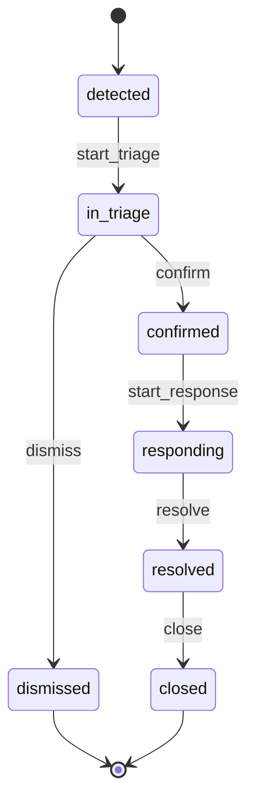

| Transición | De | A | Roles | Guarda | Motivo | Efectos | Validación vs fuentes |
|---|---|---|---|---|---|---|---|
| `start_triage` (Iniciar triaje) | `detected` | `in_triage` | `SOCIAL_RISK_MANAGER`, `SOCIAL_MANAGER`, `COMMUNITY_RELATIONS_OFFICER` | — | Opcional | — | [PRM-01 §5] triaje (RF-EWS-004) |
| `confirm` (Confirmar) | `in_triage` | `confirmed` | `SOCIAL_RISK_MANAGER`, `SOCIAL_MANAGER` | `WarningWriteGuard`: la acción declarada `CONFIRM_ALERT`, y una persona, nunca la plataforma ni una cuenta de servicio (RN-EWS-001) | Opcional | Puede vincular el riesgo al que alimenta (`social_risk`) | [PRM-01 §5] (RN-EWS-001) |
| `dismiss` (Descartar) | `in_triage` | `dismissed` | `SOCIAL_RISK_MANAGER`, `SOCIAL_MANAGER` | `WarningWriteGuard`: la misma de `confirm` | Obligatorio (`TransitionReasonGuard`) | — | Ídem |
| `start_response` (Iniciar respuesta) | `confirmed` | `responding` | `SOCIAL_RISK_MANAGER`, `SOCIAL_MANAGER`, `COMMUNITY_RELATIONS_OFFICER` | — | Opcional | — | [PRM-01 §5] |
| `resolve` (Resolver) | `responding` | `resolved` | `SOCIAL_RISK_MANAGER`, `SOCIAL_MANAGER` | — | Opcional | — | Ídem |
| `close` (Cerrar) | `resolved` | `closed` | `SOCIAL_RISK_MANAGER`, `SOCIAL_MANAGER` | — | Opcional | — | Ídem |

Al crear una alerta (alta, no transición) corren AUT-09 (tarea de triaje) y `WarningNoticeListener`, que publica
`warning_new`, también cuando la crea JOB-04 como la plataforma.

## WF-K · Candidatos a compromiso y sugerencias de IA

Dos workflows con la misma forma, uno por objeto (modelo de dominio §7.3). Reglas comunes:

- `proposed` es el estado inicial; `accepted`, `rejected` y `duplicate` son finales.
- Solo una persona decide (RQ-AI-001, RQ-AI-003): aceptar es una transición de comando que ejecuta el endpoint de aceptación
  con la autorización de quien acepta, y ese endpoint rechaza las cuentas de servicio. Rechazar y marcar como duplicado son
  rechazos con motivo (`TransitionReasonGuard`).
- Marcar como duplicado es una decisión humana; ninguna fusión ocurre sola (RQ-AI-015, ASM-053). En un candidato, el
  duplicado apunta al compromiso que ya existe (`duplicate_of`). Una sugerencia no tiene ese campo: `duplicate` significa
  que repite otra sugerencia o un valor que el registro destino ya tiene, y el motivo obligatorio dice cuál.
- Cada decisión queda en la auditoría con la persona y el comando ejecutado (RQ-AUD-012); el resultado de la validación humana
  que pide `ai_interaction` se lee de este estado (modelo de dominio §6.18).

### WF-K para candidatos a compromiso

**Objeto:** `commitment_candidate`

- **Estados:** `proposed` (Propuesto, inicial), `accepted` (Aceptado, final), `rejected` (Rechazado, final), `duplicate`
  (Duplicado, final).
- **Fase:** F3 (alta humana con `POST /api/sgspe/commitment-candidates`); F7 (candidatos de IA).
- **Requisitos:** RF-COM-010, RF-AIK-003, RQ-AI-001, RQ-AI-003, RQ-AI-004.
- **Validación contra las fuentes:** el boceto del usuario lleva el acta a la IA, al candidato con evidencia y confianza y a la
  revisión humana antes del compromiso [ARQ-02] [PRM-01 §9].
- **Decide una persona:** aceptar y marcar como duplicado los aplica una persona con el rol; una cuenta de servicio
  recibe `403` aunque tenga el rol (RQ-AI-003). Al aceptar, el compromiso hereda el proyecto y, si no se manda otra, la
  interacción de origen del candidato; mandarla vacía quita el origen. Los vínculos del candidato son de su proyecto.
- **Consulta en seco:** `mark_duplicate` sobre un candidato sin `duplicate_of` siempre informa el bloqueo, porque la
  transición real la aplica el comando de duplicado, que escribe antes `duplicate_of`.

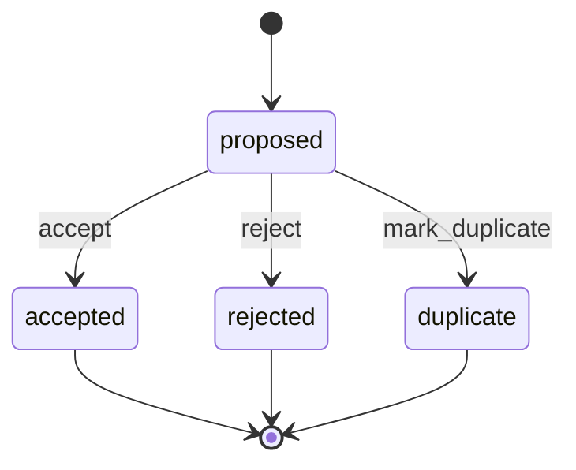

| Transición | De | A | Roles | Guarda | Motivo | Efectos | Validación vs fuentes |
|---|---|---|---|---|---|---|---|
| `accept` (Aceptar) | `proposed` | `accepted` | `COMMITMENT_MANAGER`, `SOCIAL_MANAGER`, `COMMUNITY_RELATIONS_OFFICER` | `CommandTransitionGuard`: solo desde `POST /api/sgspe/commitment-candidates/{id}/accept`, que crea el compromiso en `draft` y guarda `created_commitment` | Opcional | El compromiso nuevo sigue WF-D | [ARQ-02] (RF-COM-010, RQ-AI-003) |
| `reject` (Rechazar) | `proposed` | `rejected` | `COMMITMENT_MANAGER`, `SOCIAL_MANAGER`, `COMMUNITY_RELATIONS_OFFICER` | — | Obligatorio (`TransitionReasonGuard`) | — | [ARQ-02] |
| `mark_duplicate` (Marcar como duplicado) | `proposed` | `duplicate` | `COMMITMENT_MANAGER`, `SOCIAL_MANAGER`, `COMMUNITY_RELATIONS_OFFICER` | `CommitmentWriteGuard`: `duplicate_of` informado, que solo escribe `POST /api/sgspe/commitment-candidates/{id}/duplicate` | Obligatorio (`TransitionReasonGuard`) | — | RQ-AI-015 |

### WF-K para sugerencias de IA

**Objeto:** `ai_suggestion`

- **Estados:** los mismos de `commitment_candidate`.
- **Fase:** F7.
- **Requisitos:** RF-AIK-001, RF-AIK-002, RF-AIK-004, RF-AIK-007, RF-AIK-008, RQ-AI-001, RQ-AI-003, RQ-AI-012, RQ-AI-015,
  RQ-AUD-012.
- **Decide una persona:** una cuenta de servicio recibe `403 PERSON_REQUIRED` en las tres transiciones, aunque tenga el rol
  (`SuggestionDecisionGuard`, plan 7.2b).
- **Roles:** la sugerencia apunta a un registro de cualquier contexto (`target_object`, `target_record_id`), así que los roles
  son la unión de los roles de dominio. El endpoint de aceptación verifica además que la persona pueda leer y escribir el
  registro destino (modelo de dominio §6.18).
- **Validación contra las fuentes:** el prompt pide que la IA sugiera y la persona decida [PRM-01 §9] [ARQ-01].


| Transición | De | A | Roles | Guarda | Motivo | Efectos | Validación vs fuentes |
|---|---|---|---|---|---|---|---|
| `accept` (Aceptar) | `proposed` | `accepted` | `SOCIAL_MANAGER`, `COMMUNITY_RELATIONS_OFFICER`, `STAKEHOLDER_MANAGER`, `COMMITMENT_MANAGER`, `GRIEVANCE_MANAGER`, `SOCIAL_RISK_MANAGER` | `CommandTransitionGuard`: solo desde `POST /api/sgspe/ai-suggestions/{id}/accept`, que ejecuta el comando de dominio con la autorización de quien acepta; el registro destino existe y la persona puede leerlo | Opcional | El comando de dominio; un texto de entregable solo entra a la sección si la persona lo copia o lo edita con motivo (RQ-AI-012) | [PRM-01 §9] (RQ-AI-003) |
| `reject` (Rechazar) | `proposed` | `rejected` | Los mismos de `accept` | — | Obligatorio (`TransitionReasonGuard`) | — | [PRM-01 §9] |
| `mark_duplicate` (Marcar como duplicado) | `proposed` | `duplicate` | Los mismos de `accept` | — (sin `duplicate_of`: el motivo nombra la sugerencia o el valor que repite) | Obligatorio (`TransitionReasonGuard`) | El registro destino no cambia | RQ-AI-015 (ASM-053) |

## WF-L · Visita de campo

**Objeto:** `field_visit`

- **Estados:** `planned` (Planificada, inicial), `in_progress` (En curso), `completed` (Concluida, final), `partial` (Parcial,
  final), `cancelled` (Cancelada, final).
- **Fase:** F2. Sin `requiresReason`.
- **Requisitos:** RF-FLD-001, ASM-045, ASM-021.
- **Validación contra las fuentes:** DOC-02 describe una visita con una reunión cancelada por la lluvia pero con contactos
  logrados, que es una visita `partial` [DOC-02 p.2–p.3]; DOC-01 describe el trabajo de campo [DOC-01 §3.3]. Las
  interacciones de la visita siguen su propio WF-C. `FIELD_AGENT` no tiene `EDIT_ANY`, así que `EditAnyGuard` solo le deja
  mover las visitas que creó (RQ-SEC-008, ASM-069).

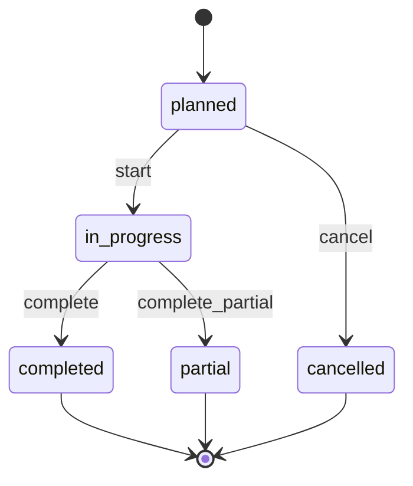

| Transición | De | A | Roles | Guarda | Motivo | Efectos | Validación vs fuentes |
|---|---|---|---|---|---|---|---|
| `start` (Iniciar) | `planned` | `in_progress` | `COMMUNITY_RELATIONS_OFFICER`, `FIELD_AGENT`, `SOCIAL_MANAGER` | — | Opcional | — | [DOC-01 §3.3] |
| `complete` (Concluir) | `in_progress` | `completed` | `COMMUNITY_RELATIONS_OFFICER`, `FIELD_AGENT`, `SOCIAL_MANAGER` | — | Opcional | El informe T2 lee `outcome_summary` | [DOC-02 p.2–p.3] |
| `complete_partial` (Concluir parcialmente) | `in_progress` | `partial` | `COMMUNITY_RELATIONS_OFFICER`, `FIELD_AGENT`, `SOCIAL_MANAGER` | — | Opcional | Ídem | [DOC-02 p.2]: reunión cancelada, contactos logrados |
| `cancel` (Cancelar) | `planned` | `cancelled` | `COMMUNITY_RELATIONS_OFFICER`, `FIELD_AGENT`, `SOCIAL_MANAGER` | — | Obligatorio (`TransitionReasonGuard`) | — | Estado `cancelled` del análisis §11 |

## WF-M · Incidente

**Objeto:** `incident`

- **Estados:** `reported` (Reportado, inicial), `under_review` (En revisión), `responding` (En respuesta), `closed` (Cerrado,
  final).
- **Fase:** F4. Sin `requiresReason`.
- **Sin severidad ni escalamiento (ASM-103):** un incidente no tiene `severity`, motivo obligatorio ni plazo; escalan
  las QCS y los riesgos que origina.
- **Requisitos:** RF-EWS-001.
- **Validación contra las fuentes:** DOC-02 relata una expulsión con retención del vehículo y la respuesta inmediata del
  equipo social [DOC-02 p.2]. Un incidente puede alimentar una señal (`early_warning_signal.incident`), que una regla de tipo
  INCIDENTES convierte en alerta, y originar un riesgo (`social_risk.origin_incident`).

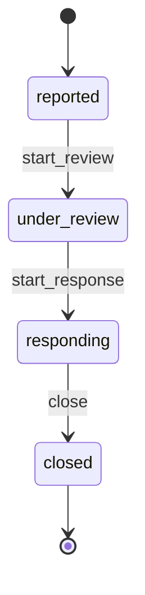

| Transición | De | A | Roles | Guarda | Motivo | Efectos | Validación vs fuentes |
|---|---|---|---|---|---|---|---|
| `start_review` (Revisar) | `reported` | `under_review` | `SOCIAL_MANAGER`, `SOCIAL_RISK_MANAGER`, `COMMUNITY_RELATIONS_OFFICER` | — | Opcional | — | [DOC-02 p.2] |
| `start_response` (Responder) | `under_review` | `responding` | `SOCIAL_MANAGER`, `SOCIAL_RISK_MANAGER`, `COMMUNITY_RELATIONS_OFFICER` | — | Opcional | — | [DOC-02 p.2] respuesta inmediata |
| `close` (Cerrar) | `responding` | `closed` | `SOCIAL_MANAGER`, `SOCIAL_RISK_MANAGER` | `WarningWriteGuard`: `immediate_response` y `consequences` informadas (RF-EWS-001) | Opcional | — | [DOC-02 p.2] (RF-EWS-001) |

## WF-N · Tarea

**Objeto:** `task`

- **Estados:** `open` (Abierta, inicial), `in_progress` (En curso), `blocked` (Bloqueada), `done` (Hecha, final), `cancelled`
  (Cancelada, final).
- **Fase:** F3. Sin `requiresReason`.
- **Requisitos:** RF-WFL-001, RF-WFL-004, RN-WFL-001.
- **Roles operativos:** `PROJECT_ADMIN`, `PROJECT_MANAGER`, `SOCIAL_MANAGER`, `COMMUNITY_RELATIONS_OFFICER`,
  `STAKEHOLDER_MANAGER`, `COMMITMENT_MANAGER`, `GRIEVANCE_MANAGER`, `SOCIAL_RISK_MANAGER`, `SOCIAL_INVESTMENT_MANAGER`,
  `GIS_ANALYST`, `FIELD_AGENT` y `APPROVER`: todos los roles declarados salvo los de solo lectura.
- **Fase de cada rol:** un rol operativo entra en las transiciones de `model/workflows/task.json` desde la fase en que
  recibe permisos (`security.md` §7.1): los de quejas y riesgos en F4 y el de inversión social en F5.
- **Tareas automáticas:** las crean automatizaciones (`AUT-NN`) y trabajos (`JOB-NN`); los trabajos usan `generator_key` para
  no duplicarlas. Ninguno las mueve: las cierra la persona.
  - `generator_key` solo lo escribe un trabajo: una persona que lo fija, lo cambia o lo vacía, también con un `PUT` que
    lo omite, recibe `403` (`GeneratorKeyGuard`); reenviarlo tal como se leyó no es cambiarlo. Una clave escrita por una
    persona suprimiría en silencio la tarea que el trabajo debe crear.
  - Una tarea de un trabajo que una persona borra vuelve a crearse en la corrida siguiente mientras dure su condición
    (el seguimiento vencido, el atraso de ese nivel): la obligación persiste, y cerrarla es completarla o cancelarla,
    no borrarla.
- **Validación contra las fuentes:** el prompt pide tareas [PRM-01 §5]; la tarea vencida es `deadline_status`, nunca un estado
  (RN-WFL-001).

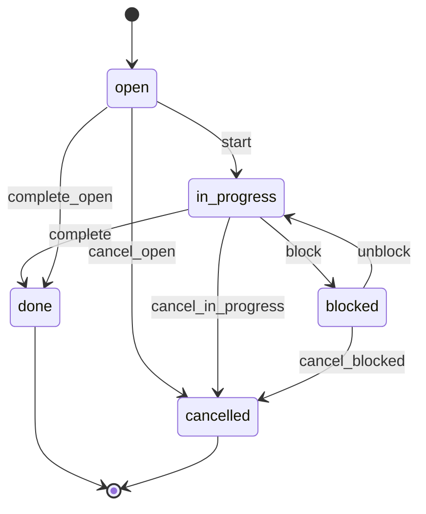

| Transición | De | A | Roles | Guarda | Motivo | Efectos | Validación vs fuentes |
|---|---|---|---|---|---|---|---|
| `start` (Iniciar) | `open` | `in_progress` | Roles operativos | — | Opcional | — | [PRM-01 §5] |
| `block` (Bloquear) | `in_progress` | `blocked` | Roles operativos | — | Opcional | — | [PRM-01 §5] |
| `unblock` (Desbloquear) | `blocked` | `in_progress` | Roles operativos | — | Opcional | — | Ídem |
| `complete` (Completar) | `in_progress` | `done` | Roles operativos | — | Opcional | JOB-01 deja `deadline_status` vacío | Ídem |
| `complete_open` (Completar) | `open` | `done` | Roles operativos | — | Opcional | Ídem | Ídem |
| `cancel_open` (Cancelar) | `open` | `cancelled` | Roles operativos | — | Obligatorio (`TransitionReasonGuard`) | — | Ídem |
| `cancel_in_progress` (Cancelar) | `in_progress` | `cancelled` | Roles operativos | — | Obligatorio (`TransitionReasonGuard`) | — | Ídem |
| `cancel_blocked` (Cancelar) | `blocked` | `cancelled` | Roles operativos | — | Obligatorio (`TransitionReasonGuard`) | — | Ídem |

## WF-O · Área de influencia

**Objeto:** `area_of_influence`

- **Estados:** `draft` (Borrador, inicial), `approved` (Aprobada), `superseded` (Reemplazada, final).
- **Fase:** F2. Sin `requiresReason`: el motivo lo exige el comando de aprobación (marca `CR` de `api.md` §4.2), no el
  objeto; la transición genérica está bloqueada de todos modos (`CommandTransitionGuard`).
- **Requisitos:** RF-TER-005, RN-TER-003, RN-TER-004, CON-025.
- **Una sola versión aprobada por proyecto y tipo (RN-TER-003):** `POST /api/sgspe/areas-of-influence/{id}/approve` lleva la
  versión nueva a `approved` y la anterior del mismo proyecto y tipo a `superseded` en una transacción; por eso las dos
  transiciones son de comando. Una versión `approved` o `superseded` no se edita: `TerritoryWriteGuard` rechaza con 409 los
  cambios de sus miembros (`FROZEN_MEMBERS`) y de su proyecto, tipo y número de versión (`FROZEN_AREA`), porque cada cambio
  es una versión nueva (RN-TER-003); sus derivados, sus criterios y las transiciones siguen permitidos. La geometría
  `boundary` no se congela en F2: las guardas no ven geometrías (`architecture.md` §6.3) y solo sugiere miembros (RN-TER-004).
  La guarda y la aprobación toman el mismo candado `area_of_influence:<id>`, pero la API genérica no abre una transacción
  por petición, así que queda una ventana residual en las dos direcciones, un miembro que entra en una versión recién
  aprobada y uno que sale de una aprobada, y también un cambio de la identidad de un borrador (proyecto, tipo o número de
  versión) que se confirma justo después de la aprobación (`architecture.md` §14, riesgo 16, UPS-22). Editar `boundary`
  de una versión aprobada recalcula su área oficial y KPI-TER-02 sin una versión nueva (`architecture.md` §14, riesgo 17).
- **La pertenencia la decide una persona (RN-TER-004):** el cálculo espacial solo sugiere miembros
  (`GET /api/sgspe/areas-of-influence/{id}/member-suggestions`).
- **Validación contra las fuentes:** la composición del AIDS cambia en DOC-01 (un sector en proceso de separación y una
  comunidad incorporada) [DOC-01 §4.1]; cada cambio es una versión nueva que se conserva.

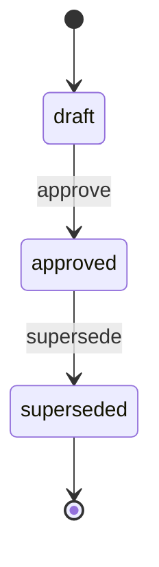

| Transición | De | A | Roles | Guarda | Motivo | Efectos | Validación vs fuentes |
|---|---|---|---|---|---|---|---|
| `approve` (Aprobar) | `draft` | `approved` | `SOCIAL_MANAGER`, `PROJECT_MANAGER` | `CommandTransitionGuard`: solo desde el endpoint de aprobación, que exige la acción declarada `APPROVE` y al menos un miembro (`area_of_influence_member`) | Obligatorio en el comando (`CR`); la genérica no la aplica | `supersede` de la versión aprobada anterior, en la misma transacción | [DOC-01 §4, §4.1] (RN-TER-003) |
| `supersede` (Reemplazar) | `approved` | `superseded` | `SOCIAL_MANAGER`, `PROJECT_MANAGER` | `CommandTransitionGuard`: solo desde el mismo endpoint | El de la aprobación | La versión reemplazada se conserva | Ídem |

## WF-P · Aporte social

**Objeto:** `social_contribution`

- **Estados:** `requested` (Solicitado, inicial), `approved` (Aprobado), `procured` (Adquirido), `delivered` (Entregado),
  `closed` (Cerrado, final), `rejected` (Rechazado, final), `cancelled` (Anulado, final).
- **Fase:** F5; el tope por campaña y los lineamientos existen desde F3 (RF-INV-002). `requiresReason`.
- **Requisitos:** RF-INV-001, RN-INV-001, RN-INV-002, RN-INV-003, RN-INV-004, RN-INV-005, RN-INV-006, ASM-008, ASM-063,
  ASM-110, ASM-111, ASM-112, ASM-116, ASM-117, ASM-118, ASM-119, CON-021, CON-022, GAP-033.
- **Monto que se aprueba:** la suma de `line_amount` de los ítems, que se cargan en `requested`; tras aprobar, los ítems
  y los términos aprobados quedan congelados y un cambio es otro aporte (ASM-110).
- **Monto ejecutado:** el `total_amount` de un aporte cuenta como ejecutado desde `delivered`, también en `closed` (ASM-063);
  lo suma JOB-02 en la campaña.
- **Validación contra las fuentes:** DOC-02 registra la compra, la entrega con acta de recepción, la foto y el comprobante
  [DOC-02 p.3–p.4]; DOC-01 fija los lineamientos de apoyo [DOC-01 §9.3.1.2].

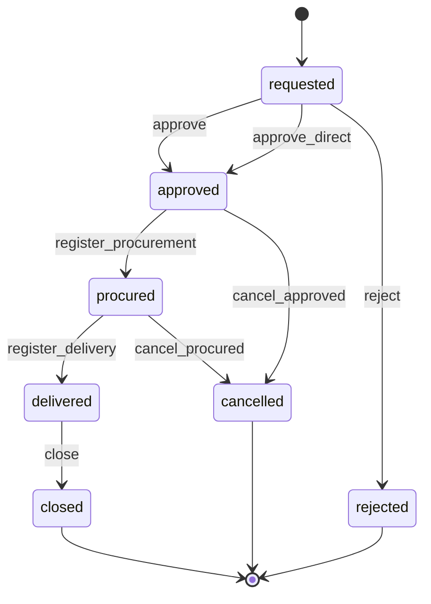

| Transición | De | A | Roles | Guarda | Motivo | Efectos | Validación vs fuentes |
|---|---|---|---|---|---|---|---|
| `approve` (Aprobar) | `requested` | `approved` | `APPROVER`, `SOCIAL_MANAGER` | `InvestmentWriteGuard`: P9 (ítems y tipo de aporte), P4 (`APPROVE`), P5 (segregación), P6 (sinergia), P2 y P3 (lineamientos, `ContributionGuidelines`) y P1 (tope de la campaña, `ContributionCapRule`) | Obligatorio (`requiresReason`) | `ContributionTotalsListener` escribe el `total_amount` aprobado; se resuelve el aviso `approval_pending` del alta | [DOC-01 §9.3.1.2] lineamientos; [DOC-02 p.3–p.4] |
| `approve_direct` (Aprobar sin revisión interna) | `requested` | `approved` | `SOCIAL_INVESTMENT_MANAGER` | `InvestmentWriteGuard`: P7 (sin aprobación interna), P9, P6, P2 y P3 y P1; sin P4 ni P5. `SOCIAL_INVESTMENT_MANAGER` no tiene `APPROVE_OVER_CAP`, así que un aporte que supera un tope que bloquea lo aprueba `approve`, por `SOCIAL_MANAGER` (ASM-119) | Obligatorio (`requiresReason`) | Como `approve` | ASM-008 |
| `reject` (Rechazar) | `requested` | `rejected` | `APPROVER`, `SOCIAL_MANAGER` | — | Obligatorio (`requiresReason`) | Se resuelve el aviso `approval_pending` del alta | [DOC-01 §9.3.1.2] |
| `register_procurement` (Registrar adquisición) | `approved` | `procured` | `SOCIAL_INVESTMENT_MANAGER` | — (los ítems los exigió la aprobación, P9, y quedaron congelados, ASM-110) | Obligatorio (`requiresReason`) | — | [DOC-02 p.4] compra |
| `register_delivery` (Registrar entrega) | `procured` | `delivered` | `SOCIAL_INVESTMENT_MANAGER`, `COMMUNITY_RELATIONS_OFFICER` | `InvestmentWriteGuard`: P8 (la única entrega, con conformidad y las evidencias ACTA DE RECEPCION, FOTO y COMPROBANTE), con el candado del aporte | Obligatorio (`requiresReason`) | Es la transición humana que sigue a la captura de la entrega, que no cambia el estado; el aporte cuenta como ejecutado (ASM-063) y la entrega queda congelada (ASM-111) | [DOC-02 p.4] (RF-INV-001) |
| `close` (Cerrar) | `delivered` | `closed` | `SOCIAL_INVESTMENT_MANAGER`, `SOCIAL_MANAGER` | — | Obligatorio (`requiresReason`) | `RequestClosureListener` aplica `close_accepted` a la solicitud que lo originó, en la transacción (ASM-068, ASM-117) | [DOC-02 p.4] |
| `cancel_approved` (Anular) | `approved` | `cancelled` | `APPROVER`, `SOCIAL_MANAGER` | — | Obligatorio (`requiresReason`) | — | Estado `cancelled` del análisis §11 |
| `cancel_procured` (Anular) | `procured` | `cancelled` | `APPROVER`, `SOCIAL_MANAGER` | — | Obligatorio (`requiresReason`) | — | Ídem |

Reglas de las guardas de WF-P, citadas por número en la tabla y en las pruebas. Todas son de `InvestmentWriteGuard`
(`sgspe.investment`), que usa dos piezas del mismo paquete: `ContributionCapRule` (P1), con `SupportCap` y
`CampaignCommitted`, como `SupportPolicyGuard` en los compromisos, y la función pura `ContributionGuidelines` (P2 y P3).

- **P1. Tope de la campaña** (`ContributionCapRule`, ASM-110, ASM-119): la regla D7 de WF-D sobre el aporte. El
  candidato es la suma de `line_amount` de sus ítems, leída en la transacción y nunca del `total_amount` guardado, en la
  moneda del aporte; lo comprometido de la campaña (`CampaignCommitted`) suma los compromisos en `approved`,
  `in_progress`, `blocked`, `fulfilled`, `verified` o `closed` y los aportes en `approved`, `procured`, `delivered` o
  `closed`, sin el que se aprueba. Con `policy_cap_blocks_approval` activa, superarlo es `409 SUPPORT_CAP_EXCEEDED` (o
  `CAP_DATA_INVALID` si un monto guardado no es válido) sobre `exploration_campaign`, salvo para quien tiene
  `APPROVE_OVER_CAP` sobre `social_contribution` (`SOCIAL_MANAGER`), que recibe la advertencia; con la política en
  falso, siempre advertencia. Un monto en otra moneda o una campaña sin moneda dan `CAP_OTHER_CURRENCY`, siempre
  advertencia. Un aporte sin campaña o una campaña sin tope no se juzgan (RN-INV-003, GAP-006, RQ-SEC-004, ASM-063).
- **P2 y P3. Lineamientos** (`ContributionGuidelines`, ASM-112), con cada política activa del proyecto: `PAID_LABOR`
  (`policy_no_paid_labor`: algún ítem MANO DE OBRA) y `MONETARY_DONATION` (`policy_non_monetary_donations`: una
  DONACION con algún ítem DINERO), sobre `contribution_item`, y `PRIORITY_NOT_MET` (`policy_priority_warning`: el
  proyecto tiene temas priorizados y el aporte no tiene `topic` o su tema no es priorizado ni desciende de uno), sobre
  `topic`. Cada incumplimiento es `409` si `guideline_deviation_justification` está vacía y advertencia si está
  informada: la justificación cubre todos a la vez (RN-INV-006). Un proyecto sin temas priorizados no evalúa la
  prioridad y advierte `PRIORITIES_NOT_CONFIGURED` (`topic`), que nunca exige justificación. «Caseríos sin beneficio
  laboral» no se evalúa (GAP-033). Una política apagada no se evalúa (RN-INV-001, RN-INV-002, RN-INV-005).
- **P4. Doble llave:** la acción declarada `APPROVE` sobre `social_contribution` (RF-WFL-002); sin ella,
  `403 ACTION_REQUIRED` sobre `record`.
- **P5. Segregación:** quien aprueba no es `created_by` del aporte, quien lo registró o quien aceptó la solicitud que lo
  creó (ASM-008, ASM-117), como D4; si no, `403 SEGREGATION_OF_DUTIES` sobre `record`.
- **P6. Sinergia** (RN-INV-004, ASM-112): con `has_institutional_synergy` verdadero y
  `policy_synergy_requires_agreement` activa, un `agreement` en `active` y con `validity_status` distinto de VENCIDO;
  si no, `409 SYNERGY_AGREEMENT_REQUIRED` sobre `agreement`, también con justificación. No es un lineamiento que se
  justifique, y el aporte no tiene socio que deba ser parte (G3 de WF-G sí lo exige). El acuerdo es del mismo proyecto
  (`ProjectLinkGuard`).
- **P7. Sin aprobación interna:** solo con `policy_internal_approval` en falso (ASM-008); si no,
  `409 INTERNAL_APPROVAL_REQUIRED` sobre `project`.
- **P8. Entrega con conformidad y evidencia** [DOC-02 p.4] (ASM-111, ASM-116): la única `delivery` del aporte, con
  `conformity_given` verdadero y `conformity_by` informado, vinculada a al menos una evidencia ACTA DE RECEPCION, una
  FOTO y un COMPROBANTE del proyecto del aporte. Sin la entrega o sin la conformidad, `409 DELIVERY_REQUIRED` sobre
  `delivery`; si quien la aplica no lee `conformity_by`, `403 FIELD_NOT_READABLE` sobre `delivery.conformity_by`
  (como D9 de WF-D); sin las evidencias, `409 EVIDENCE_REQUIRED` sobre `evidence_delivery`. Toma el candado del aporte.
- **P9. Ítems al aprobar** (ASM-110, ASM-112): al menos un `contribution_item` (`409 ITEMS_REQUIRED` sobre
  `contribution_item`) y `contribution_type` informado (`400 FIELD_REQUIRED`).

**Orden y candados.** Una aprobación toma primero el candado del aporte (`social_contribution:<id>`), el mismo de las
escrituras de sus ítems y de su entrega, así un ítem no se cuela entre la suma y la transición; después corren P7
(`approve_direct`), P9, P4 y P5 (`approve`), P6, P2 y P3 y al final P1, la única que toma el candado de la campaña
(`exploration_campaign:<id>`). El orden de los candados es siempre aporte y después campaña. La escritura se detiene en
el primer bloqueo; la consulta en seco (`transition-checks`) los junta todos, en ese orden y sin tomar candados. Una
regla que no puede leer lo que necesita rechaza (`403 OBJECT_NOT_READABLE`): nunca deja pasar.

**Otras reglas de `InvestmentWriteGuard` sobre el aporte:**

- **Ítems congelados (ASM-110):** el alta, el cambio o la baja de un `contribution_item` cuyo aporte no está en
  `requested`, o el cambio del `social_contribution` de un ítem en cualquier estado, es `409 ITEMS_FROZEN` sobre
  `social_contribution`; la regla toma el candado del aporte.
- **Términos aprobados (ASM-110):** fuera de `requested`, un cambio de `currency`, `contribution_type`, `topic`,
  `exploration_campaign`, `has_institutional_synergy`, `agreement`, `guideline_deviation_justification` o `project` es
  `409 CONTRIBUTION_FROZEN` sobre el campo.
- **Conteos (ASM-118):** `beneficiaries_count` negativo o no entero es `400 OUT_OF_RANGE`.
- **Entrega (ASM-111):** una segunda entrega del aporte es `409 DELIVERY_EXISTS` sobre `social_contribution` (la guarda
  toma el candado del aporte; el único del modelo es la última barrera); con el aporte fuera de `procured`, un cambio de
  la entrega o el alta o la baja de un vínculo `evidence_delivery` es `409 DELIVERY_FROZEN` sobre `social_contribution`;
  `delivered_amount` informado es `400 FIELD_NOT_ALLOWED` sobre `delivered_amount` (el endpoint de captura lo da sobre
  `attributes.delivered_amount`). La regla de compromisos (`DELIVERY_FROZEN` sobre `commitment`, `sgspe.commitment`)
  solo mira las entregas con `commitment`.
- **Comprobante congelado (decisión del usuario del 2026-10-11):** el `receipt` también se congela desde `delivered`: su
  alta, su cambio o su baja con el aporte en `delivered`, `closed`, `rejected` o `cancelled` es `409 DELIVERY_FROZEN`
  sobre `social_contribution`; un cambio que lo mueve a otro aporte se juzga contra los dos. La regla toma el candado
  del aporte, y antes de la entrega (`requested`, `approved`, `procured`) el comprobante cambia libremente.

`POST /api/sgspe/social-contributions/{id}/deliveries` solo captura datos, con el aporte en `procured` (si no, `409
STATE_MISMATCH` sobre `record`): crea la única `delivery` y sus vínculos de evidencia en una transacción, sin cambiar el
estado. El cambio de estado es la transición humana `register_delivery` (modelo de dominio §7.2). El «Acta de recepción»
(AUT-04) espera a UPS-23: el acta se imprime fuera de SGSPE, se firma en la entrega y se sube como evidencia ACTA DE
RECEPCION (ASM-116).

## Automatizaciones

Las automatizaciones son metadata de wasichai: un disparador, condiciones y acciones [WAS-DOC api/rest.md]
[WAS-DOC modules/automation.md] [WAS-ADR-0016].

- **Disparadores:** `RECORD_CREATED`, `RECORD_UPDATED`, `RECORD_DELETED`, `TRANSITION_APPLIED` (con o sin nombre de
  transición) y `STATE_ENTERED` (con un estado). `STATE_ENTERED` solo se dispara con una transición: el estado inicial de un
  alta no cuenta como "entrar" (código de wasichai 0.3.2). No hay disparadores temporales (CON-043).
- **Condiciones:** `EQUALS`, `NOT_EQUALS`, `GREATER_THAN`, `LESS_THAN`, `CONTAINS`, `IS_EMPTY`, `IS_NOT_EMPTY` y `CHANGED`,
  sobre un campo o sobre `state`; todas deben cumplirse.
- **Acciones:** `UPDATE_FIELD`, `CREATE_RECORD`, `WEBHOOK` y `GENERATE_DOCUMENT`. Los textos aceptan `{{campo}}` del registro y
  `{{id}}`, `{{state}}`, `{{user}}`, `{{today}}` y `{{now}}`, sin aritmética de fechas.
- **Ejecución:** la coincidencia se evalúa en la transacción de quien escribe; las acciones corren después, fuera de la
  petición, como la plataforma. Sus escrituras llevan el motivo `automation '<nombre>'`, que satisface `requiresReason`, y
  pasan por todas las guardas [WAS-ADR-0016] [WAS-ADR-0041]. Cada coincidencia deja una ejecución consultable
  (`GET /api/objects/{object}/automations/{name}/runs`).

Reglas de SGSPE:

- Ninguna automatización aplica transiciones (no existe esa acción) ni escribe campos derivados: `DerivedFieldsGuard` rechaza
  toda escritura sin la marca `SgspeWrite`, y las automatizaciones no la llevan [WAS-ADR-0040].
- Sin `WEBHOOK` en el MVP: las integraciones dependen de GAP-020.
- Un valor vacío en un campo UUID, fecha o ENUM hace fallar la acción, porque wasichai no lo convierte en nulo. Por eso las
  tareas solo copian el responsable o la fecha cuando el estado de origen garantiza que existen.
- Un registro creado por `CREATE_RECORD` solo se anuncia a otras automatizaciones, no a los listeners de SGSPE (código de
  wasichai 0.3.2): ninguna automatización crea registros cuyos derivados dependan de un listener.
- `ProjectScopeGuard` y `UserReferenceGuard` aceptan las escrituras sin usuario (plataforma y automatizaciones), que no tienen
  asignación a un proyecto.
- Las tareas creadas por automatizaciones dejan `generator_key` vacío; esa clave es para los trabajos.
- Sin `NOTIFY` (D2, ASM-070): un aviso a `role:<NOMBRE>` llegaría a todos los titulares del rol en el tenant, sin mirar las
  asignaciones del proyecto; los avisos los decide `sgspe.notification`. `apply.py` rechaza `WEBHOOK` y `NOTIFY`.
- Se versionan junto al modelo (`model/automations/<objeto>.json`) y `apply.py` las aplica; escribir una regla exige
  `MANAGE_METADATA` [WAS-DOC api/rest.md].
- Llegan en F3, con el starter de automatización, el objeto `task` y el starter de documentos.

| ID | Nombre técnico | Objeto | Disparador | Condiciones | Acciones | Fase | Fuente |
|---|---|---|---|---|---|---|---|
| AUT-01 | `aut-01-commitment-execution-task` | `commitment` | `STATE_ENTERED` `approved` | — | `CREATE_RECORD` `task`: "Ejecutar compromiso {{code}}", `commitment` = `{{id}}`, `project` = `{{project}}`, responsable `{{owner_user_id}}` y `{{owner_user_email}}`, `due_date` = `{{due_date}}`; el responsable y la fecha existen porque las tres transiciones de aprobación los vuelven a exigir al entrar en `approved` (D1, D2), aunque `pending_approval` admita cambios | F3 | Modelo de dominio §7.3; RF-WFL-001 |
| AUT-02 | `aut-02-grievance-ack-task` | `grievance` | `RECORD_CREATED` | `confidential` `NOT_EQUALS` `true` (D-1: una queja confidencial no lleva esta tarea, con su código y su vínculo; la ejecución queda `SKIPPED` y la tarea de acuse genérica la crea `ConfidentialTasksListener`) | `CREATE_RECORD` `task`: "Acusar recibo de la queja {{code}}", `grievance` = `{{id}}`, `project` = `{{project}}`; sin responsable ni fecha: el plazo vive en `ack_due_date` de la queja | F4 | Modelo de dominio §7.3; RF-GRV-006 |
| AUT-03 | `aut-03-delivery-certificate` | `delivery` | `RECORD_CREATED` | `commitment` `IS_NOT_EMPTY` | `GENERATE_DOCUMENT` tipo «Acta de entrega» (`delivery-certificate`) | F3, tras UPS-23 | Modelo de dominio §7.3; RQ-REP-029 |
| AUT-04 | `aut-04-receipt-certificate` | `delivery` | `RECORD_CREATED` | `social_contribution` `IS_NOT_EMPTY` | `GENERATE_DOCUMENT` tipo «Acta de recepción» | F5, tras UPS-23 | RQ-REP-029 [DOC-02 p.4] |
| AUT-05 | `aut-05-meeting-minutes` | `engagement` | `STATE_ENTERED` `minutes_approved` | — | `GENERATE_DOCUMENT` tipo «Minuta de reunión» (`meeting-minutes`); `GENERATE_DOCUMENT` tipo «Lista de asistentes» (`attendance-list`) | F3 | RQ-REP-029, RF-ENG-005 |
| AUT-06 | `aut-06-grievance-receipt` | `grievance` | `STATE_ENTERED` `acknowledged` | — | `GENERATE_DOCUMENT` tipo «Cargo de queja» (`grievance-receipt`) | F4, tras UPS-23 | RQ-REP-029, ASM-098 |
| AUT-07 | `aut-07-inquiry-answer-letter` | `inquiry` | `STATE_ENTERED` `answered` | `channel` `EQUALS` CARTA | `GENERATE_DOCUMENT` tipo «Carta de respuesta» (`inquiry-answer-letter`) | F4, tras UPS-23 | RQ-REP-029, ASM-098 |
| AUT-08 | `aut-08-request-decline-letter` | `stakeholder_request` | `STATE_ENTERED` `declined` | `request_medium` `EQUALS` CARTA DE SOLICITUD | `GENERATE_DOCUMENT` tipo «Carta de respuesta» (`request-answer-letter`) | F4, tras UPS-23 | RQ-REP-029, RF-GRV-004, ASM-098 |
| AUT-09 | `aut-09-warning-triage-task` | `early_warning` | `RECORD_CREATED` | — | `CREATE_RECORD` `task`: "Triaje de la alerta {{title}}", `early_warning` = `{{id}}`, `project` = `{{project}}` | F4 | RF-EWS-004 |
| AUT-10 | `aut-10-engagement-reschedule-task` | `engagement` | `STATE_ENTERED` `cancelled` | — | `CREATE_RECORD` `task`: "Reprogramar o reemplazar la interacción {{title}}", `engagement` = `{{id}}`, `project` = `{{project}}` | F3 | RF-ENG-006 [DOC-02 p.2] |
| AUT-11 | `aut-11-critical-risk-task` | `social_risk` | `RECORD_UPDATED` | `risk_level` `CHANGED`; `risk_level` `EQUALS` CRITICO | `CREATE_RECORD` `task`: "Revisar el riesgo crítico {{code}}", `social_risk` = `{{id}}`, `project` = `{{project}}`, responsable `{{owner_user_id}}` y `{{owner_user_email}}` (exigido en `assess`) | F4 | RF-RSK-003 |
| AUT-12 | `aut-12-issue-certificate` | `deliverable` | `STATE_ENTERED` `issued` | — | `GENERATE_DOCUMENT` tipo «Constancia de emisión» (`deliverable-issue-certificate`), con su correlativo; activa (decisión del usuario del 2026-10-13) | F8 | RQ-REP-029 [WAS-ADR-0023] |

AUT-11 es la primera automatización condicionada a un campo derivado. El `PUT` de wasichai deja vacío lo que el cuerpo
no trae y `DerivedFieldsKeeper` repone los derivados; esa reposición no es un cambio para las automatizaciones
(`RestoreAwareAutomationDispatcher` no evalúa su eco), así que un `PUT` de un riesgo ya CRITICO no crea otra tarea
(ronda branchfix de 4.2b).

Los tipos de documento («Acta de entrega», «Minuta de reunión»…) son los del catálogo "Tipo de documento administrativo" de
§10 del análisis. Se versionan en `model/document-types/<objeto>.json` (una lista con los tipos del objeto: `name`,
`label`, `prefix` y `template`, el árbol de nodos del editor de wasichai-documents) y `apply.py --workflows` los aplica
antes que las automatizaciones que los nombran (`database-model.md` §24). Un documento emitido por una automatización dice
que lo emitió la plataforma [WAS-DOC api/rest.md].

Un documento emitido no se filtra por permisos de campo, y su copia congelada lleva todos los campos del registro y
todas las columnas de cada tabla relacionada que nombra la plantilla, aunque la plantilla no las imprima (código de
wasichai-documents 0.6.0, UPS-23). Por eso un tipo de documento solo se declara sobre un objeto sin campos restringidos
y sin tablas relacionadas de objetos con campos restringidos (`security.md` §11.4); `test_model.py` lo comprueba. El
acta de entrega espera a UPS-23, porque `delivery` restringe `recipients` y `conformity_by`; hasta entonces el acta
firmada se sube como evidencia ACTA DE ENTREGA, que D9 ya exige. Por la misma regla esperan el «Cargo de queja» y las
dos «Carta de respuesta» (ASM-098): las tres QCS restringen `person`, así que el cargo y la carta se imprimen fuera de
SGSPE, se entregan en papel y, firmados, se suben como evidencia FORMULARIO o CARTA vinculada a la QCS.

| Tipo de documento | Nombre técnico | Prefijo | Objeto | Fase | Lo que imprime |
|---|---|---|---|---|---|
| Acta de entrega | `delivery-certificate` | `AE` | `delivery` | F3, tras UPS-23 | Fecha, lugar y lo entregado; espacios para los nombres y las firmas de quienes reciben y dan conformidad |
| Minuta de reunión | `meeting-minutes` | `MR` | `engagement` | F3 | Título, tipo, fecha, lugar, objetivo, minuta, resultados y conteos de asistentes |
| Lista de asistentes | `attendance-list` | `LA` | `engagement` | F3 | Título, tipo, fecha, lugar y total de asistentes; quince filas en blanco para el nombre, el cargo u organización y la firma de cada asistente, que se llenan a mano |
| Cargo de queja | `grievance-receipt` | `CQ` | `grievance` | F4, tras UPS-23 | Código, fecha y hora de recepción, canal, categoría y plazo de acuse; espacios para el nombre y la firma de quien plantea y de quien recibe |
| Carta de respuesta | `inquiry-answer-letter` | `CC` | `inquiry` | F4, tras UPS-23 | Código, fecha de recepción, respuesta y fecha de respuesta; espacio para el nombre y la firma de quien recibe |
| Carta de respuesta | `request-answer-letter` | `CS` | `stakeholder_request` | F4, tras UPS-23 | Código, fecha de recepción, recurso pedido, respuesta y fecha de respuesta; espacio para el nombre y la firma de quien recibe |
| Constancia de emisión | `deliverable-issue-certificate` | `CE` | `deliverable` | F8 | Código, título, tipo y revisión vigente, y la tabla de todas las versiones del entregable (`relatedTable` de `deliverable_version_deliverable`: wasichai-documents imprime todas sus columnas; desde wasichai 1.3.0, que congela filas con campos nulos, UPS-32), cada una con su revisión, nivel, momento, correo de quien emitió y sus SHA-256; desde la segunda revisión lista también las anteriores; `deliverable` y `deliverable_version` no tienen campos restringidos, así que cumple la regla de UPS-23 |

`model/automations/<objeto>.json` es una lista con las automatizaciones del objeto, cada una en el formato de wasichai.
Ejemplo: AUT-01 (`POST /api/objects/commitment/automations`).

```json
{
  "name": "aut-01-commitment-execution-task",
  "label": "Tarea de ejecución del compromiso aprobado",
  "enabled": true,
  "definition": {
    "trigger": { "type": "STATE_ENTERED", "state": "approved" },
    "conditions": [],
    "actions": [
      {
        "type": "CREATE_RECORD",
        "targetObject": "task",
        "values": {
          "title": "Ejecutar compromiso {{code}}",
          "commitment": "{{id}}",
          "project": "{{project}}",
          "assignee_user_id": "{{owner_user_id}}",
          "assignee_user_email": "{{owner_user_email}}",
          "due_date": "{{due_date}}"
        }
      }
    ]
  }
}
```

## Trabajos programados

Patrón común [WAS-ADR-0039] (modelo de dominio §8.3):

- **Una sola réplica:** `ClusterLock.tryLock` con una clave del paquete (`sgspe.deadline`), con `@Scheduled` o con un
  sondeo continuo (JOB-05). JOB-05 toma además, al procesar cada pedido, un candado por entregable
  (`sgspe.deliverable-generation:<id>`, otra clave que la de los comandos), para que dos réplicas nunca generen el mismo
  borrador (`deliverables.md` §8.2).
- **Registros de wasichai como la plataforma:** JOB-01 a JOB-05 y JOB-07 los leen o los escriben con
  `RecordService.asPlatform(organizationId)`, una organización por vez. Para recorrer las organizaciones usan
  `Organizations` (`sgspe.common`), que envuelve `TenantDirectory` (UPS-17, [WAS-ADR-0057]); desde F4, JOB-01 y JOB-04
  recorren solo las organizaciones que tienen el objeto que miden (`Organizations.having`), así un tenant que todavía no
  tiene el modelo de F4 sigue con F3; JOB-05 recorre del mismo modo `Organizations.having("deliverable")`, y un tenant
  sin el modelo de F8 sigue con F7. JOB-01, JOB-02, JOB-03 y JOB-04 escriben con `asPlatform(organización, source =
  "job:…")` (UPS-03). JOB-07 solo recorre la lista de organizaciones con la IA activada (`ai-architecture.md` §12.1).
- **Tablas fijas con SQL propio, sin `asPlatform`:** JOB-07 escribe `knowledge_chunk`, y JOB-08 borra las claves
  vencidas de `idempotency_key` y los saltos vencidos de `derived_version`.
- **La fuente de avisos de plazo** (`DeadlineNotices`, `sgspe.deadline`) no es un trabajo propio: la llama cada hora el
  bucle de wasichai-notifications, en una réplica y como la plataforma de cada organización, y solo lee.
- **Motivo y origen:** el motivo nombra al trabajo (`DeadlineJob: situación de plazo`) y la fila de auditoría lleva
  `source = job:<nombre>` [WAS-ADR-0050]. Una escritura de la plataforma no tiene usuario: el origen la distingue en la
  auditoría y el motivo se lo dice a quien lee el historial [WAS-ADR-0041] (ASM-051).
- **Idempotencia:** recalculan desde cero, así que repetir una corrida no cambia el resultado; las tareas que crean llevan
  `generator_key`.
- **Nunca aplican transiciones ni vinculan registros:** solo escriben campos derivados y crean registros nuevos
  (RN-WFL-001, CON-043). JOB-08 no escribe registros de wasichai: solo borra claves vencidas de `idempotency_key` y
  saltos vencidos de `derived_version`; los archivos sin referencia los borra `StoredFileCleanup` de wasichai-files.

| ID | Trabajo (paquete) | Frecuencia | Qué escribe | Qué nunca hace | Fuente | Fase |
|---|---|---|---|---|---|---|
| JOB-01 | `DeadlineJob` (`sgspe.deadline`) | Cada hora (ASM-006) | `deadline_status` de `commitment`, QCS y `task`; `validity_status` de `agreement`; `review_status` de `social_risk`, y `next_review_date` si cambia su cadencia (`review_every_days` o, sin ella, `risk_review_days` del proyecto); tareas de escalamiento (`escalation:<objeto>:<id>:<fecha del plazo>:<nivel>`, de compromisos y, desde F4, de quejas y consultas, sin asignado ni fecha; la del nivel 2 de una QCS confidencial, `escalation:<objeto>:<huella>:<fecha del plazo>:2`, con título y descripción genéricos y vinculada solo al proyecto) y, desde F4, de revisión de riesgos (`risk_review:<id>:<next_review_date>`, asignada al responsable del riesgo, con fecha `next_review_date` y título «Revisar el riesgo <código>», al pasar a POR REVISAR o REVISION VENCIDA, ASM-099; no escala como tarea vencida, porque la revisión vencida ya avisa por `risk_escalated`, y la revisión registrada la deja hecha); los avisos de plazo los publica `DeadlineNotices`, una fuente de wasichai-notifications que lee lo que este trabajo escribe, así que llegan a lo sumo una hora después | Cambiar `workflow_state`: un compromiso vencido sigue en `in_progress` o en `blocked` | RN-WFL-001, RF-WFL-004, RN-RSK-001, ASM-006, ASM-030, ASM-070 | F3 (compromisos, acuerdos, tareas), F4 (QCS, riesgos) |
| JOB-02 | `DerivedFieldsJob` (`sgspe.common`) | Cada hora sobre los registros fuente cambiados desde la corrida anterior (por `updated_at`) y una vez al día sobre todos | Los campos derivados de §7.4 del modelo de dominio que mantienen listeners o que no tienen otro escritor: `executed_social_amount`, `other_currency_items_count`, `calculated_area_ha`, conteos de asistentes, `formalized`, `requires_senior_approval` (los vínculos de solicitantes no llegan a los listeners: la vuelta diaria los recoge), `total_amount`, `total_budget` y los plazos de QCS que falten | Escribir campos no derivados | Modelo de dominio §7.4, §7.5 | F2 |
| JOB-03 | `StakeholderFollowUpJob` (`sgspe.stakeholder`) | Una vez al día, configurable (ASM-022): sus parámetros se miden en días | `last_contact_date`; la regla de primer contacto de `relationship_status` (SIN CONTACTO → CONTACTO ESTABLECIDO); desde F3, tareas de evaluación periódica (`stakeholder_review_days`, clave `stakeholder_review:<id>:<fecha>`) y de inactividad (`inactivity_days`, clave `stakeholder_inactivity:<id>:<fecha de referencia>`, la del último contacto o, sin contacto, la del alta) | Mover WF-B o cambiar `relationship_status` fuera de la regla de primer contacto | RF-STK-010, RF-STK-014, ASM-022, ASM-032 | F2 |
| JOB-04 | `WarningRulesJob` (`sgspe.warning`) | Cada hora, configurable (ASM-006), como los plazos, para que una alerta no espere un día | `early_warning` en `detected` cuando una regla habilitada alcanza su umbral (`threshold`) en su ventana (`window_days`), según «Tipos de regla de JOB-04»: por proyecto en `active` o `suspended`, con las reglas del proyecto y, de cada tipo que el proyecto no tiene, las del tenant; sin otra alerta si hay una abierta (fuera de `dismissed` y `closed`) de la misma regla y proyecto (y riesgo, en NIVEL DE RIESGO) o una detectada (`detected_at`) dentro de la ventana de `window_days` días; con `generator_key` `warning_rule:<regla>:<proyecto>[:<riesgo>]:<fecha de Lima>`, único, y el motivo `alerta por regla (JOB-04 WarningRulesJob)` | Confirmar o descartar una alerta (RN-EWS-001); aplicar transiciones; escribir datos personales, texto libre de otros registros o valores de campos restringidos | RF-EWS-004, ASM-097 | F4 |
| JOB-05 | `DeliverableGenerationJob` (`sgspe.deliverable`): el trabajador de generación de entregables | Sondeo cada `sgspe.deliverable.generation.poll` (5 s): toma los pedidos pendientes de los entregables en `draft` u `observed` (`generation_requested_at` posterior a `draft_generated_at`, o este vacío) y retoma los que siguen EN COLA o EN PROCESO hace más de `sgspe.deliverable.generation.stale-after` (15 min) | `draft_generation_status` (EN COLA, EN PROCESO, LISTO o FALLIDO), `draft_generated_at` (al congelar el modelo; el intento queda en `draft_generated_at` también si termina FALLIDO: un pedido se atiende una vez), `draft_model_sha256`, `draft_revision`, `draft_warnings` y los siete campos `FILE` del borrador, adjuntos con LISTO en una sola escritura de la plataforma por un puerto (`DraftFiles`; UPS-31, resuelta en wasichai 1.3.0) (ASM-133). En 8.2b, sin conversor real, todo borrador real termina FALLIDO con `PDF_CONVERTER_UNAVAILABLE` | Aplicar `approve` o `issue`; escribir secciones; ser llamado desde una petición | RQ-REP-021, ASM-061, ASM-133 | F8 |
| JOB-07 | `KnowledgeIndexJob` (`sgspe.ai`, `ai-architecture.md` §13.2): indexación documental para RAG | Periódica y configurable (ASM-006): cada 30 minutos lo cambiado y a las 03:15 de Lima todo (`sgspe.jobs.knowledge-index.*`), solo en las organizaciones que activaron la IA (RQ-AI-009, ASM-015) | Fragmentos en la tabla fija `knowledge_chunk`, con SQL propio, de las `evidence` creadas o cambiadas desde la corrida anterior; copia su proyecto y su clasificación, borra los fragmentos de una evidencia reemplazada; en F7 no llama a un modelo, así que no deja `ai_interaction` (la `ai_interaction` por documento, como la plataforma, es de la etapa 2, `ai-architecture.md` §13.2) | Aplicar transiciones; indexar documentos sin texto (sin OCR en F7) | RF-AIK-006, RQ-AI-008 | F7 |
| JOB-08 | `RetentionJob` (`sgspe.common`): retención, con un paso por paquete | Una vez al día, configurable | Ningún registro de wasichai. Desde F3, borra con SQL propio, sin `asPlatform`, las filas de la tabla fija `idempotency_key` con `created_at` anterior al plazo configurable (ASM-065) y las de `derived_version` anteriores a `sgspe.concurrency.derived-versions-retention`, 7 días (ASM-091, ADR-0027). En F8 no gana un paso de entregables: los archivos reemplazados de un borrador y las subidas de una emisión fallida los borra `StoredFileCleanup` de wasichai-files (ASM-133, `deliverables.md` §11) | Escribir registros; aplicar transiciones | RNF-INT-002, RNF-INT-003, ASM-065, ASM-091 | F3 |

JOB-08 corre una vez al día, como fija `architecture.md`. No gana el paso de borradores del respaldo de ASM-133: UPS-31
se resolvió en wasichai 1.3.0 y JOB-05 adjunta el borrador como la plataforma.

### Tipos de regla de JOB-04

`WarningRulesJob` corre cada hora en una réplica (`ClusterLock` con la clave `sgspe.warning`), recorre
`Organizations.having("early_warning_rule")` y escribe como la plataforma de cada organización con
`source = job:warning-rules`; una organización que falla se registra y no detiene a las demás. Por organización:

1. lee las reglas con `enabled` verdadero y los proyectos en `active` o `suspended`;
2. para cada proyecto toma sus reglas y, de cada tipo que el proyecto no tiene, las del tenant (sin `project`): una
   regla del proyecto reemplaza a la del tenant del mismo tipo (ASM-097);
3. evalúa cada regla con su evaluador puro y con conteos (`Records.count`), sin cargar los registros, salvo CONTEO DE
   QCS, que lee los planteamientos de la ventana para contarlos con `AttentionCounting`, y NIVEL DE RIESGO, que lee los
   riesgos revisados del proyecto (los dos, con un tope de 20 000 filas: pasarlo falla la regla, nunca recorta);
4. si dispara, crea la alerta salvo que la regla esté en silencio: hay una alerta abierta (fuera de `dismissed` y
   `closed`) de la misma regla y proyecto (y riesgo, en NIVEL DE RIESGO), o una de ellas detectada (`detected_at`)
   dentro de la misma ventana de `window_days` días de Lima;
5. la alerta nace en `detected` con `title` «<nombre de la regla>: <rótulo del tipo>» («Conteo de señales»,
   `OptionLabels`), `trigger_description` con el conteo, el umbral y la ventana, `severity` de la regla (MEDIO si está
   vacía), `detected_at` ahora, `early_warning_rule`, `project`, `ai_detected` falso y `generator_key`
   `warning_rule:<regla>:<proyecto>[:<riesgo>]:<fecha de Lima>`, cuyo único frena una carrera entre réplicas, como en
   las tareas de los trabajos. `early_warning_rule`, `detected_at` y `generator_key` solo los escribe la plataforma
   (`GeneratorKeyGuard`, `403 PLATFORM_ONLY` y `GENERATOR_KEY_PLATFORM_ONLY`): el silencio y la protección de una regla
   con alertas confían en ellos, y una alerta manual nace sin regla y con la hora de su alta, que pone SGSPE;
6. una regla que falla en un proyecto se registra y no detiene a las demás reglas ni a los demás proyectos; al final de
   la vuelta, la organización se marca fallida.

Nunca aplica transiciones ni confirma (RN-EWS-001), y ningún texto que escribe lleva datos personales, texto libre de
otros registros ni valores de campos restringidos.

Reglas comunes:

- `threshold` es un número entero; un valor vacío o con parte fraccionaria se rechaza (`WarningWriteGuard`,
  `400 OUT_OF_RANGE`), igual que `window_days` fuera de 1 a 365. `window_days` vacío vale 7.
- La ventana de los tipos por eventos son los `window_days` días de Lima que terminan hoy: desde el inicio del día
  `hoy − window_days + 1` hasta ahora.
- En todos los tipos, `window_days` es también el silencio tras una alerta de la misma regla y proyecto (y riesgo, en
  NIVEL DE RIESGO).
- Dispara cuando el valor medido es mayor o igual que `threshold`.
- Una regla del tenant crea una alerta por cada proyecto que alcanza el umbral; una del proyecto, solo para el suyo.

| Tipo | Entrada (proyecto P) | `threshold` | Ventana | Deduplicación | Crea |
|---|---|---|---|---|---|
| CONTEO DE SEÑALES | `early_warning_signal` de P con `received_at` en la ventana, de cualquier fuente | Conteo, entero desde 1 | Sí | Regla y proyecto | Alerta con «<n> señales en <W> días (umbral <T>)» |
| CONTEO DE QCS | Planteamientos de P (las tres QCS contadas con `AttentionCounting`, confidenciales incluidas) con `received_at` en la ventana | Conteo, entero desde 1 | Sí | Regla y proyecto | Alerta con «<n> QCS recibidas en <W> días (umbral <T>)», sin desglose |
| COMPROMISOS VENCIDOS | `commitment` de P en `approved`, `in_progress` o `blocked` con `deadline_status` VENCIDO en el momento de la corrida | Conteo, entero desde 1 | No (solo silencio) | Regla y proyecto | Alerta con «<n> compromisos vencidos (umbral <T>)» |
| MENCIONES NEGATIVAS | `media_mention` de P con `tone` NEGATIVO y `published_date` en la ventana | Conteo, entero desde 1 | Sí | Regla y proyecto | Alerta con «<n> menciones negativas en <W> días (umbral <T>)» |
| INCIDENTES | `incident` de P con `occurred_at` en la ventana, de cualquier tipo y estado | Conteo, entero desde 1 | Sí | Regla y proyecto | Alerta con «<n> incidentes en <W> días (umbral <T>)» |
| NIVEL DE RIESGO | Cada `social_risk` de P en `assessed`, `mitigating` o `monitoring` con `score` vigente | Puntaje P × I mínimo, entero de 1 a 25 | No (solo silencio) | Regla, proyecto y riesgo | Una alerta por riesgo, con `social_risk`, su `locality` y su `community`, y «Riesgo <código> con puntaje <s> (umbral <T>)» |

**Por qué no CAMBIO DE POSTURA.** Esa regla leería `stakeholder.stance` o `stakeholder_assessment.stance`, campos
restringidos a `SOCIAL_MANAGER` y `STAKEHOLDER_MANAGER` (GAP-024). JOB-04 lee como la plataforma, sin permisos de campo,
y la alerta diría en su título o en `trigger_description` qué grupo de interés cambió de postura y hacia dónde.
`early_warning` lo leen todos los roles operativos y `warning_new` lo llevaría a la bandeja: la regla publicaría un dato
restringido. Queda fuera del MVP (ASM-097) y el valor sale del catálogo; vuelve cuando la alerta pueda llevar campos
restringidos o un alcance por registro propio.

## Listeners

Los listeners son los once de §7.5 del modelo de dominio, con `ApprovalNoticeListener` en lugar de
`NotificationListener` desde la decisión D2, `DeadlineStatusListener` desde F3 y `RiskNoticeListener` y
`WarningNoticeListener` desde F4, más `GraveGrievanceNoticeListener` (F4), que publica el aviso de aprobación pendiente de
una queja grave aparte de `ApprovalNoticeListener` porque no lo dispara un envío sino la severidad, y
`ConfidentialTasksListener` (F4, D-1), que mantiene genéricas las tareas automáticas de una QCS confidencial. Corren como quien
escribió y son atómicos con la escritura solo dentro de una transición o de un endpoint con transacción. Esta tabla agrega
su relación con los workflows.

| Listener (paquete) | Se dispara con | Transiciones que lo disparan | Escribe en | Atómico | Si no puede escribir | Consecuencia para los roles |
|---|---|---|---|---|---|---|
| `QcsDueDatesListener` (`sgspe.attention`) | Alta de `grievance`, `inquiry` o `stakeholder_request` | Ninguna | `ack_due_date` (días hábiles con `BusinessDays`, ASM-096) y `resolution_due_date` de la queja y `response_due_date` de la consulta, del mismo registro, con la marca; la solicitud no tiene plazo en el MVP (ASM-100) | Solo si el alta llega por un endpoint con transacción | No falla el alta; JOB-02 completa | Quien registra QCS necesita `UPDATE` sobre el objeto, con motivo |
| `AttendanceCountsListener` (`sgspe.engagement`) | Alta, cambio o baja de `engagement_participant` | Ninguna | Conteos de asistentes de la `engagement` | Ídem | No falla; JOB-02 recalcula | `UPDATE` sobre `engagement`. `FIELD_AGENT` puede agregar participantes a cualquier interacción que pueda leer y solo cambia o borra los que creó (`EditAnyGuard`, ASM-069); la escritura derivada de los conteos lleva la marca `SgspeWrite`, así que `EditAnyGuard` no la frena, tampoco en una interacción ajena |
| `AreaListener` (`sgspe.territory`) | Cambio por la API genérica de `area_of_influence`, `community`, `land_parcel` o `mining_concession` | Ninguna | `calculated_area_ha` del mismo registro | Ídem | No falla; JOB-02 recalcula | `UPDATE` sobre ese objeto |
| `ContributionTotalsListener` (`sgspe.investment`) | Alta, cambio o baja de `contribution_item`; `approve` y `approve_direct` de WF-P (ASM-110) | `approve` y `approve_direct`, en las que escribe el total aprobado | `total_amount` de la `social_contribution`, con la marca y solo si cambia | En las transiciones, sí; en un ítem, solo si llega por un endpoint con transacción | No falla; JOB-02 recalcula | `UPDATE` sobre `social_contribution`, con motivo: lo tienen quienes cargan ítems (`SOCIAL_INVESTMENT_MANAGER`, `SOCIAL_MANAGER`, `COMMUNITY_RELATIONS_OFFICER`) y quienes aprueban (`APPROVER`, con `u`) |
| `ProgramTotalsListener` (`sgspe.investment`, F5) | Alta, cambio o baja de `program_budget` | Ninguna | `total_budget` del `social_program`: suma de `allocated_amount` en la moneda del programa (ASM-113), con la marca y solo si cambia | Solo si la escritura llega por un endpoint con transacción | No falla; JOB-02 recalcula | `UPDATE` sobre `social_program`, que tiene `SOCIAL_INVESTMENT_MANAGER`, el único que escribe presupuestos |
| `CommitmentDerivationsListener` (`sgspe.commitment`) | Alta o cambio del origen de un `commitment`; transiciones a `fulfilled`, `closed` y `cancelled`, y `reopen_execution` | `register_fulfillment`, `reopen_execution`, `close` y las `cancel_*` de WF-D | `requires_senior_approval`, `fulfilled_date`, `closed_date` y `cancelled_date` del mismo compromiso; en `reopen_execution` vacía `fulfilled_date` | Sí en las transiciones | En el alta o el cambio, no falla; en una transición, la revierte | Los roles de esas transiciones necesitan `UPDATE` con motivo sobre `commitment`; `FIELD_AGENT` no tiene esas transiciones |
| `GraveGrievanceNoticeListener` (`sgspe.notification`, F4) | Una queja ALTA o CRITICA que entra en `in_action` con `policy_high_severity_requires_approver` activo, un cambio de `severity` en `in_action` que la sube a ALTA o CRITICA (publica) o la pasa de ALTA o CRITICA a una severidad no grave (resuelve) y toda transición que sale de `in_action`, que también lo resuelve (ASM-102) | `start_action`, `start_action_after_investigation`, `resolve`, `resolve_high_severity` y `withdraw_in_action` de WF-E1 | El módulo wasichai-notifications, en la fuente `sgspe.approvals` con la clave `approval_pending:grievance:<id>`, en la transacción de la escritura | Sí | Como `ApprovalNoticeListener`; si quien escribe no lee el proyecto o las asignaciones, se registra y la escritura sigue | Lee el proyecto y `project_assignment` como quien escribe; los destinatarios de una queja confidencial se filtran por quien la vería (`ConfidentialReaders`, regla 7 de «Destinatarios por rol») |
| `ConfidentialTasksListener` (`sgspe.attention`, F4, D-1) | Alta de una `grievance` confidencial; cambio de una QCS de no confidencial a confidencial | Ninguna | `task`, como quien escribe y con la marca: en el alta, la tarea de acuse genérica `ack:grievance:<huella>` (sin vínculo, solo `project`); en la marca posterior, las tareas automáticas abiertas vinculadas a la QCS (escalamiento de JOB-01 y acuse de AUT-02) pasan a la clave de huella, el título y la descripción genéricos y sin vínculo; las cerradas no se tocan, y si la genérica de destino ya existe la vieja queda como está, con una advertencia sin datos de la QCS | Sí: corre en la transacción de la escritura | Lanza: el alta o la marca se revierten | Quien registra o marca una QCS tiene `READ`, `CREATE` y `UPDATE` sobre `task` (`model/roles.json`) |
| `QcsTransitionDatesListener` (`sgspe.attention`) | Transiciones de una QCS a `resolved` o a un estado final (`closed` y, en la queja, `rejected` y `withdrawn`), y la reapertura de una queja | `resolve`, `resolve_high_severity`, `reopen`, las de cierre de WF-E1, WF-E2 y WF-E3, y `reject_*` y `withdraw_*` de WF-E1 | `resolved_date` (queja) y `closed_date` del mismo registro, en todo estado final | Sí | La transición se revierte | Los roles de esas transiciones ya tienen `UPDATE` sobre el objeto, con motivo |
| `RequestClosureListener` (`sgspe.attention`) | Transición de un `commitment` a `closed` y, desde F5, de un `social_contribution` a `closed` (ASM-068) | `close` de WF-D y, desde F5, `close` de WF-P | Aplica `close_accepted` a la `stakeholder_request` que originó el registro, con la marca y con motivo, como acción del sistema: corre como quien cierra (wasichai no deja ser la plataforma en una petición ni aplicar una transición sin usuario), dentro de `ConfidentialRelease`, así que cierra también una solicitud confidencial que quien cierra no lee, y la auditoría lleva el origen `listener:request-closure` (plan 4.2a, decisión 4) | Sí | Revierte el cierre del compromiso o del aporte | Los roles de `close` de WF-D y de WF-P tienen `READ` y `UPDATE` sobre `stakeholder_request` y figuran en `close_accepted` |
| `DeadlineStatusListener` (`sgspe.deadline`) | Cambio de `due_date` de un `commitment` (desde `approved`, solo la reprogramación) | Ninguna | `deadline_status` del mismo compromiso, con la misma regla de JOB-01 y con la marca | Sí: corre en la transacción de la reprogramación | Una regla que rechaza la escritura se registra y la reprogramación sigue (JOB-01 corrige a la hora); un fallo de la base revierte la reprogramación | Quien reprograma ya tiene `UPDATE` sobre `commitment`, con motivo |
| `ApprovalNoticeListener` (`sgspe.notification`) | Envío a aprobación (`submit_for_review` de WF-A, `submit_minutes` de WF-C, `submit` de WF-D y, desde F5, `submit` de WF-G) y toda transición que sale del estado pendiente; desde F5, también el alta de un `social_contribution` (modo «al crear» de `ApprovalStep`), cuyo aviso se resuelve al salir de `requested` | Las mismas; el alta del aporte no es una transición | El módulo wasichai-notifications (`Notifications.publish` y `resolve`), en la transacción de la transición | Sí | Un aviso mal formado se registra y la transición sigue; un fallo de la base al guardarlo revierte la transición; sin asignaciones que coincidan, una advertencia en el log | Lee `project_assignment` como quien envió, así que todo rol que envía a aprobación tiene `READ` sobre ella (`security.md`). Si quien envía un compromiso no puede leer lo que decide el nivel (D5), el aviso va a los roles de `approve` y de `approve_senior` |
| `RiskNoticeListener` (`sgspe.notification`) | Revisión no residual que sube `risk_level` a ALTO o CRITICO (de un nivel menor, o de ALTO a CRITICO), en la transacción del endpoint de revisiones | Ninguna (la primera revisión aplica `assess` en la misma transacción) | El módulo wasichai-notifications: publica `risk_escalated` del nivel y resuelve el anterior del mismo riesgo | Sí: corre en la transacción del endpoint | Un aviso mal formado se registra y la revisión sigue; un fallo de la base al guardarlo revierte la revisión; sin asignaciones que coincidan, una advertencia en el log | Lee `project_assignment` como quien revisa, que tiene `READ` sobre ella |
| `WarningNoticeListener` (`sgspe.notification`) | Alta de `early_warning`, por una persona o por JOB-04 como la plataforma; `start_triage` resuelve el aviso | `start_triage` | El módulo wasichai-notifications: publica `warning_new` y lo resuelve | Solo si el alta llega por un endpoint con transacción o por JOB-04, que crea la alerta en la suya | Un aviso mal formado se registra y el alta sigue | Lee `project_assignment` como quien crea la alerta; en las de JOB-04, como la plataforma |

El alta que JOB-04 hace como la plataforma llega a `WarningNoticeListener` y a AUT-09: wasichai 0.6.0 avisa a los
listeners y a wasichai-automation de toda escritura de `RecordService`, también de la plataforma, así que JOB-04 no
publica el aviso ni crea la tarea de triaje por su cuenta. `WarningRulesJobApiTest` lo vigila; si una versión de la
plataforma dejara de hacerlo, JOB-04 publicaría `warning_new` con la misma clave y crearía la tarea con la clave
`warning_triage:<id>` (plan 4.2b).

## Avisos

Los avisos salen de eventos, nunca de las entidades (RN-NTF-001): `ApprovalNoticeListener` al enviar a aprobación,
`DeadlineNotices` (`sgspe.deadline`), una fuente de wasichai-notifications que cada hora devuelve todos los avisos de
plazo vigentes según lo que escribió JOB-01, y, desde F4, `RiskNoticeListener` al subir el nivel de un riesgo y
`WarningNoticeListener` al crear una alerta y `GraveGrievanceNoticeListener` cuando una queja grave espera a su
aprobador. Los guarda y los entrega el módulo (bandeja, SSE y correo, ADR-0018,
ASM-012). Cada aviso tiene una clave estable dentro de su fuente (`sgspe.approvals` o `sgspe.deadlines` y, desde F4,
`sgspe.risks` y `sgspe.warnings`): publicarla
otra vez no duplica (RF-NTF-001), y un aviso que deja de ser cierto se resuelve (el envío deja el estado pendiente; el
compromiso deja de estar vencido). Un aviso de aprobación es `ACTION`; uno por vencer, `WARNING`; uno vencido o de
escalamiento, `ACTION`. Quién recibe cada aviso lo fija «Destinatarios por rol».

En F3 llegan `approval_pending` (WF-A, WF-C y WF-D), `commitment_due_soon`, `commitment_overdue` y `task_overdue`; los
de QCS, riesgos y alertas llegan en F4 con sus objetos, y los de aprobación de programas y aportes, en F5, en la fuente
`sgspe.approvals`. La columna `notification_type` de la tabla siguiente es el
prefijo de la clave de cada aviso.

| Aviso | `notification_type` | Origen | Disparador | Destinatarios | Clave |
|---|---|---|---|---|---|
| Aprobación pendiente (RF-NTF-001) | `approval_pending` | `ApprovalNoticeListener` (WF-G y el alta de `social_contribution` suman su paso a `ApprovalNoticeListener.STEPS` en F5, este con el modo «al crear» de `ApprovalStep`; WF-H, en F8); el de una queja grave, `GraveGrievanceNoticeListener` (F4) | WF-A `submit_for_review`; WF-C `submit_minutes`; WF-D `submit`; WF-G `submit`; WF-H `submit_for_review` y `resubmit`; alta de `social_contribution` en `requested`; desde F4, `start_action` o `start_action_after_investigation` de una queja ALTA o CRITICA con `policy_high_severity_requires_approver` activo, o un cambio de `severity` a ALTA o CRITICA en `in_action` (ASM-102) | Los roles de la transición de aprobación que sigue; en la queja, los de `resolve_high_severity` | `approval_pending:<objeto>:<id>`: volver a enviar reabre el mismo aviso; el de una queja se resuelve al salir de `in_action` o si la severidad deja de ser ALTA o CRITICA; el de un aporte, al salir de `requested` (llega al alta, antes de los ítems: quien aprueba ve el total al abrirlo, y la aprobación sin ítems responde `409 ITEMS_REQUIRED`) |
| Compromiso por vencer (RF-NTF-001) | `commitment_due_soon` | `DeadlineNotices` | `deadline_status` pasa a POR VENCER (`due_soon_days`, ASM-006) | El responsable (`owner_user_id`) | `commitment_due_soon:<id>:<due_date>` |
| Compromiso vencido (RF-NTF-001, RF-WFL-004) | `commitment_overdue` | `DeadlineNotices` | `deadline_status` pasa a VENCIDO (nivel 0); luego, a los `escalation_first_days` (nivel 1) y `escalation_second_days` (nivel 2) días de atraso | Nivel 0: el responsable; nivel 1: los roles de `verify`; nivel 2: los de `approve_senior` (ASM-030, ASM-070). Una tarea de escalamiento en los niveles 1 y 2 | `commitment_overdue:<id>:<due_date>:<nivel>`: un aviso por nivel alcanzado, todos abiertos mientras dure el atraso |
| Plazo de QCS próximo a incumplirse (queja: RF-NTF-001; consulta: RF-WFL-004) | `qcs_deadline` | `DeadlineNotices` | `deadline_status` de una queja o una consulta en POR VENCER o en VENCIDO (nivel 0: acuse, respuesta o resolución); luego, los niveles 1 y 2 de atraso | Nivel 0: el responsable o, sin responsable, los roles de la transición que sigue; nivel 1: los de `verify` de WF-E1; nivel 2: los de `approve_senior` de WF-D, porque WF-E no tiene aprobación superior; en una QCS confidencial, solo los que la verían (ASM-102). Una tarea de escalamiento en los niveles 1 y 2 | `qcs_deadline:<objeto>:<id>:<fecha del plazo>:<POR VENCER o nivel>`; se resuelve cuando la situación deja de ser cierta |
| Riesgo escalado por nivel (RF-NTF-001) | `risk_escalated` | `RiskNoticeListener` (F4) | Una revisión no residual sube `risk_level` a ALTO o CRITICO (de un nivel menor, o de ALTO a CRITICO) | El responsable del riesgo y los roles de la transición de tratamiento que sigue | `risk_escalated:<id>:<nivel de riesgo>:<assessment_date>`; se resuelve con la revisión siguiente o el cierre del riesgo |
| Riesgo con revisión vencida (RF-NTF-001, RF-WFL-004) | `risk_escalated` | `DeadlineNotices` (F4) | `review_status` REVISION VENCIDA (nivel 0); luego, a los `escalation_first_days` (nivel 1) y `escalation_second_days` (nivel 2) días de atraso | Nivel 0, el responsable; nivel 1, los roles de la transición de tratamiento que sigue; nivel 2, los de `approve_senior` de WF-D | `risk_escalated:<id>:<nivel>:<next_review_date>`; se resuelve con la revisión que mueve `next_review_date` |
| Tarea vencida (RF-NTF-001) | `task_overdue` | `DeadlineNotices` | `deadline_status` de una tarea pasa a VENCIDO (nivel 0); luego, a los `escalation_first_days` (nivel 1) y `escalation_second_days` (nivel 2) días de atraso | Nivel 0: el asignado; nivel 1, o una tarea sin asignado: los roles de la transición de verificación o de revisión del registro vinculado; nivel 2: los de `approve_senior` de WF-D. Sin asignado ni registro vinculado, nadie hasta el nivel 2 (ASM-094). La tarea de revisión de un riesgo (`risk_review:*`) no entra en ningún nivel: su atraso avisa por `risk_escalated`; las demás tareas vinculadas a un riesgo sí | `task_overdue:<id>:<due_date>:<nivel>`, como el compromiso |
| Alerta nueva (RF-NTF-001) | `warning_new` | `WarningNoticeListener` (F4) | Alta de `early_warning`, también la que crea JOB-04 como la plataforma | El responsable de la alerta, si lo tiene, y los roles de `start_triage` | `warning_new:<id>`; se resuelve con `start_triage` |
| QCS confidencial en el nivel 2 (RF-WFL-004) | `qcs_confidential_overdue` | `DeadlineNotices` (F4) | Nivel 2 de `qcs_deadline` de una QCS confidencial | Los asignados con un rol de `approve_senior` de WF-D que no la verían (los que sí la ven reciben `qcs_deadline`) (ASM-102) | `qcs_confidential_overdue:<proyecto>:<huella>`, donde `<huella>` son los 16 primeros dígitos hexadecimales del SHA-256 de `<objeto>:<id>:<fecha del plazo>`: un aviso por QCS y plazo sin su id, tipo ni fecha; se resuelve cuando la QCS deja el nivel 2 o el estado con plazo |

Los textos de los avisos (`NoticeTexts`) llevan el código, el tipo y la fecha; nunca descripción, persona ni texto
libre. El de un programa lleva su código y su nombre, y el de un aporte, su código y su tipo; nunca propósito,
condiciones ni receptor. F5 no agrega avisos de plazo: los hitos de programa no escalan. El de
`qcs_confidential_overdue` es fijo salvo el nombre del proyecto: «Una QCS confidencial del proyecto
<proyecto> superó su plazo. Pida el detalle al equipo de quejas.» No lleva código, título, tipo, fecha, nivel, categoría
ni enlace al registro, y es `ACTION`. Las tareas automáticas de una QCS confidencial tampoco la delatan, porque las leen
todos los lectores de `task` del proyecto (D-1): las de escalamiento de los niveles 1 y 2 llevan la clave
`escalation:<objeto>:<huella>:<fecha del plazo>:<nivel>`, con la misma huella del aviso genérico en lugar del id; su
título es «QCS confidencial vencida en <proyecto>» y su descripción, fija salvo el nivel: «Una QCS confidencial superó su
plazo (escalamiento de nivel <n>). Pida el detalle al equipo de quejas.»; y no llevan el campo `grievance` ni `inquiry`,
solo `project`. La de acuse de una queja confidencial no la crea AUT-02 sino `ConfidentialTasksListener`, con la clave
`ack:grievance:<huella>` (la fecha de recepción en Lima en lugar de la del plazo), el título «Acusar recibo de una QCS
confidencial en <proyecto>» y la descripción «Una QCS confidencial espera su acuse. Pida el detalle al equipo de
quejas.»; y al marcar confidencial una QCS existente, el mismo listener vuelve genéricas sus tareas automáticas abiertas
(«Listeners»). Son las únicas tareas sin origen: `ExactlyOneGuard` las admite porque su `generator_key` tiene una de esas
formas (`JobTasks.isConfidentialTask`), y esa clave la escribe la plataforma o, solo con esas formas, el código de sgspe
con la marca (`GeneratorKeyGuard`). Las de una QCS no confidencial llevan el id en la clave, el código en el título y el
vínculo con la QCS.

### Destinatarios por rol

Un aviso dirigido a un rol llega a personas concretas a través de las asignaciones del proyecto (ASM-070), porque
wasichai no le da al código una búsqueda de usuarios por rol y el código no compara nombres de rol (RQ-SEC-005).
`sgspe.notification` resuelve los destinatarios, y `DeadlineNotices` y los listeners le piden los avisos (modelo de
dominio §7.2):

1. **Asignación vigente.** Recibe cada usuario con una `project_assignment` del proyecto del registro con `active` verdadero
   y, si las tiene, la fecha de hoy entre `start_date` y `end_date`: la misma vigencia que usa `ProjectScopeGuard`.
   - `role_name`, obligatorio, es un rol declarado, que `AssignmentRoleGuard` valida contra `model/roles.json`, y es uno solo
     por persona y proyecto (único `project`, `member_user_id`).
   - El aviso va a `member_user_id`; el módulo toma el correo de la cuenta.
   - `ApprovalNoticeListener` lee las asignaciones como quien envió, que tiene `READ` sobre `project_assignment`
     (`security.md`), y `DeadlineNotices`, como la plataforma.
2. **Transición de referencia.** Cada aviso nombra una transición, nunca un rol, y lo recibe quien tiene un `role_name` de la
   lista `roles` de esa transición.
   - La lista sale de la definición versionada `model/workflows/<objeto>.json`, cargada como configuración, igual que
     `model/roles.json`. `WorkflowService` no sirve aquí, porque exige un usuario con `READ` y `DeadlineNotices` corre
     como la plataforma (código de wasichai 0.3.2).
   - Como `apply.py` aplica esa misma definición, los destinatarios tienen los roles que wasichai acepta en la transición, y
     cambiar esos roles cambia los destinatarios sin tocar el código.
3. **Exclusiones.**
   - Quien aplicó la transición que dispara el aviso no lo recibe.
   - `SUPER_ADMIN` y `ORGANIZATION_ADMIN` no reciben avisos por rol, porque no figuran en ninguna lista de transiciones.
   - Una cuenta de servicio no recibe avisos por rol aunque tenga una asignación (`security.md`). Se la reconoce por su
     `member_user_email`, la dirección de respaldo `<id>@service-accounts.invalid` que wasichai le da [WAS-ADR-0043].
4. **Sin coincidencias.** Si ninguna asignación vigente coincide, no se crea el aviso y quien lo pidió deja una
   advertencia en el log. La tarea de escalamiento, si la hay, la crea JOB-01 igual, con la clave
   `escalation:<objeto>:<id>:<fecha del plazo>:<nivel>` (con la huella en lugar del id en los dos niveles de una QCS
   confidencial, «Avisos»), y queda visible en las tareas del proyecto.
5. **El rol declarado no da permisos.** Quien recibe un aviso actúa con sus roles de wasichai: si su asignación nombra un rol
   que no tiene, recibe el aviso y la transición le responde 403 (`security.md`). Quien forma los equipos mantiene
   `role_name` al día con los roles de cada usuario.
6. **Tareas de escalamiento.** Un aviso va a varias personas y una tarea tiene un solo asignado. Por eso, en los niveles
   1 y 2 de un compromiso o de una QCS, JOB-01 crea la tarea vinculada al registro vencido, sin asignado ni fecha y con
   `generator_key` `escalation:<objeto>:<id>:<fecha del plazo>:<nivel>`; la toma uno de los destinatarios. Las de una
   QCS confidencial, en los dos niveles, son genéricas y no se vinculan a ella (punto 7 y «Avisos»). Una tarea vencida y una revisión
   de riesgo vencida escalan solo con avisos: la tarea ya existe, y el riesgo ya tiene su tarea de revisión.
7. **QCS confidenciales (ASM-102).** Un aviso sobre una QCS confidencial (`qcs_deadline`, `approval_pending` de una
   queja grave y `task_overdue` de una tarea vinculada a ella) solo llega a quien la vería por `security.md` §9.6: su
   responsable, quien la recibió, los asignados cuyo `role_name` tiene `READ_CONFIDENTIAL` sobre ese objeto en
   `model/roles.json` y, en una queja ALTA o CRITICA, los que tienen `APPROVE` sobre `grievance`. `ModelCatalog` da las
   concesiones de cada rol, así que el filtro no compara nombres de rol. En el nivel 2, los roles de `approve_senior` de
   WF-D que no la verían reciben `qcs_confidential_overdue`, sin datos del registro, y las tareas de escalamiento de los
   dos niveles no llevan el id, el código ni el vínculo con la QCS («Avisos»).

| `notification_type` | Nivel o caso | Destinatarios |
|---|---|---|
| `approval_pending` | WF-A `submit_for_review` | Roles de `approve` de WF-A |
| `approval_pending` | WF-C `submit_minutes` | Roles de `approve_minutes` |
| `approval_pending` | WF-D `submit` | Roles de `approve` y de `approve_senior`, porque los dos salen de `pending_approval` y solo `approve_senior` supera un tope que bloquea (D7). Si el compromiso exige nivel superior, solo los de `approve_senior`, porque `approve` lo rechazaría: `sgspe.commitment` evalúa la regla D5 en el momento, como la guarda, y no lee el campo `requires_senior_approval`. Si quien envía no puede leer lo que decide el nivel, los de los dos: un aviso de más que la guarda deja sin efecto, antes que un compromiso sin aprobador que lo sepa |
| `approval_pending` | WF-G `submit` | Roles de `approve` de WF-G |
| `approval_pending` | WF-H `submit_for_review` y `resubmit` | Roles de `approve` de WF-H |
| `approval_pending` | Alta de `social_contribution` | Roles de `approve` de WF-P; con `policy_internal_approval` en falso, también los de `approve_direct`. Siempre los de `approve`, porque un aporte que supera un tope que bloquea solo pasa por `approve` (P1) |
| `commitment_due_soon` | — | El responsable (`owner_user_id`) |
| `commitment_overdue` | Nivel 0 | El responsable |
| `commitment_overdue` | Nivel 1 | Roles de `verify` de WF-D, la transición de verificación del compromiso (ASM-030) |
| `commitment_overdue` | Nivel 2 | Roles de `approve_senior` de WF-D, la aprobación superior (ASM-030, ASM-067) |
| `qcs_deadline` | Nivel 0 | El responsable de la QCS (`owner_user_id`). Sin responsable, los roles de la transición que sigue en su estado: en una queja, `acknowledge` (`received`), `assess` (`acknowledged`), `start_action` (`in_assessment`), `start_action_after_investigation` (`in_investigation`) o `resolve` (`in_action`), y en `in_action` también los de `resolve_high_severity` si la severidad es ALTA o CRITICA y `policy_high_severity_requires_approver` está activo; en una consulta, `answer` |
| `qcs_deadline` | Nivel 1 | Roles de `verify` de WF-E1, la transición de verificación de las QCS, también para las consultas, que comparten equipo y reporte (ASM-011) |
| `qcs_deadline` | Nivel 2 | Roles de `approve_senior` de WF-D, porque WF-E no tiene aprobación superior; en una QCS confidencial, solo los que la verían |
| `qcs_confidential_overdue` | Nivel 2 de una QCS confidencial | Los roles de `approve_senior` de WF-D que no la verían (regla 7) |
| `approval_pending` | Queja ALTA o CRITICA en `in_action` con `policy_high_severity_requires_approver` activo | Roles de `resolve_high_severity`; en una queja confidencial, quienes tienen `APPROVE` sobre `grievance` la leen (regla 7) |
| `risk_escalated` | Nivel de riesgo ALTO o CRITICO | El responsable del riesgo y los roles de la transición de tratamiento que sigue, su transición de revisión: `decide_mitigation` en `assessed`, `start_monitoring` en `mitigating` y `resume_mitigation` en `monitoring` |
| `risk_escalated` | Revisión vencida, nivel 0 | El responsable del riesgo |
| `risk_escalated` | Revisión vencida, nivel 1 | Roles de la transición de tratamiento que sigue, como en la primera fila |
| `risk_escalated` | Revisión vencida, nivel 2 | Roles de `approve_senior` de WF-D, porque WF-F no tiene aprobación superior |
| `task_overdue` | Nivel 0 | El asignado (`assignee_user_id`); sin asignado, directamente el nivel 1 y, si tampoco tiene registro vinculado, nadie hasta el nivel 2 (ASM-094) |
| `task_overdue` | Nivel 1 | Roles de la transición de verificación o de revisión del registro vinculado a la tarea (tabla siguiente) |
| `task_overdue` | Nivel 2 | Roles de `approve_senior` de WF-D |
| `warning_new` | — | El responsable de la alerta, si lo tiene, y los roles de `start_triage`, la transición que sigue a `detected` |

| Registro vinculado a la tarea | Transición de verificación o de revisión | Sus roles en esta versión |
|---|---|---|
| `commitment` | `verify` (WF-D) | `COMMITMENT_MANAGER`, `SOCIAL_MANAGER` |
| `grievance`, `inquiry` | `verify` (WF-E1) | `GRIEVANCE_MANAGER`, `SOCIAL_MANAGER` |
| `stakeholder_request` | `start_evaluation` (WF-E3) | `GRIEVANCE_MANAGER`, `SOCIAL_MANAGER` |
| `social_risk` | `decide_mitigation` (WF-F); no la tarea de revisión `risk_review:*`, que no escala como tarea vencida | `SOCIAL_RISK_MANAGER`, `SOCIAL_MANAGER` |
| `early_warning` | `confirm` (WF-J) | `SOCIAL_RISK_MANAGER`, `SOCIAL_MANAGER` |
| `engagement` | `approve_minutes` (WF-C) | `SOCIAL_MANAGER` |
| `agreement` | `activate` (WF-I) | `SOCIAL_MANAGER`, `PROJECT_MANAGER` |
| `social_program` | `close` (WF-G) | `SOCIAL_MANAGER` |
| `stakeholder` | `assess` (WF-B) | `STAKEHOLDER_MANAGER`, `SOCIAL_MANAGER` |
| `deliverable` | `approve` (WF-H) | `SOCIAL_MANAGER`, `STAKEHOLDER_MANAGER` |

**Escalamiento (ASM-030, ASM-070).** El nivel 1 son los roles de la transición de verificación o de revisión del objeto, y el
nivel 2, los de su aprobación de nivel superior, `approve_senior`, sin nombres de rol fijos. Un compromiso vencido usa
`verify` y `approve_senior` de WF-D. Las QCS, los riesgos y las tareas no tienen aprobación superior, así que su nivel 2 es
`approve_senior` de WF-D.

**Transición de referencia de los objetos sin `verify` propio (ASM-030):** las consultas usan `verify` de WF-E1; los
riesgos, la transición de tratamiento que sigue; y las tareas, la de su registro vinculado según la tabla anterior.

## Plazos y escalamiento

Los plazos son campos derivados que mantiene JOB-01 y nunca estados (RN-WFL-001). JOB-01 los calcula solo en los estados de
la columna "Se calcula en" y los deja vacíos en los demás, así VENCIDO siempre significa "abierto y atrasado":

- `deadline_status` toma AL DIA, POR VENCER o VENCIDO (catálogo "Situación de plazo" de §10 del análisis); POR VENCER usa
  `due_soon_days` (ASM-006).
- Un compromiso en `draft` o en `pending_approval` no tiene plazo en curso, aunque ya tenga `due_date`: todavía no está
  aprobado. Los conjuntos de estados de `dashboards.md` (§3.2) son estos mismos, y todo indicador de plazo filtra por estado.
- Los indicadores de cumplimiento a tiempo usan las fechas de la transición (`fulfilled_date` frente a `due_date`,
  RQ-DSH-020); `reopen_execution` vacía `fulfilled_date`.
- **QCS (ASM-100).** Los plazos se calculan al recibir, desde la fecha de recepción en Lima: el acuse en días hábiles
  con el calendario de feriados (ASM-096), la respuesta y la resolución en días calendario; no se recalculan si después
  cambia la lista de feriados o un parámetro, y no se pausan en `in_investigation`. Una queja mide `ack_due_date` en
  `received` y `resolution_due_date` después; su `response_due_date` queda siempre vacío, porque el campo común solo lo
  usan las consultas. POR VENCER empieza `min(due_soon_days, ⌊d / 2⌋)` días antes del plazo, donde `d` son los días
  calendario entre la fecha de recepción y el plazo: con los valores por defecto, el acuse de 5 días hábiles no nace POR
  VENCER.
- **Riesgos (ASM-099).** `review_status` es AL DIA; POR REVISAR desde el día anterior a `next_review_date` y ese día; y
  REVISION VENCIDA desde el día siguiente. Sus niveles 1 y 2 cuentan los días de atraso desde `next_review_date`.
- **Incidentes (ASM-103).** No tienen plazo ni escalamiento.

| Objeto | Campo derivado | Fecha que mide | Se calcula en | Vacío en | Parámetros del proyecto | Escalamiento |
|---|---|---|---|---|---|---|
| `commitment` | `deadline_status` | `due_date` | `approved`, `in_progress`, `blocked` | `draft`, `pending_approval`, `fulfilled`, `verified`, `closed`, `cancelled` | `due_soon_days`, `escalation_first_days`, `escalation_second_days` | Nivel 1: roles de `verify`; nivel 2: roles de `approve_senior` (RF-WFL-004, ASM-030, ASM-070) |
| `grievance` | `deadline_status` | `ack_due_date` en `received`; `resolution_due_date` después; `response_due_date` siempre vacío | `received`, `acknowledged`, `in_assessment`, `in_investigation`, `in_action` | `resolved`, `verified`, `closed`, `rejected`, `withdrawn` | `grievance_ack_days`, `grievance_resolution_days`, `due_soon_days`, `escalation_first_days`, `escalation_second_days` | Nivel 1: roles de `verify` de WF-E1; nivel 2: roles de `approve_senior` de WF-D (RF-WFL-004, ASM-030, ASM-070). En una confidencial, las tareas de los dos niveles son genéricas y solo se vinculan al proyecto («Avisos», ASM-102, D-1) |
| `inquiry` | `deadline_status` | `response_due_date` | `received` | `answered`, `referred`, `closed` | `inquiry_response_days`, `due_soon_days`, `escalation_first_days`, `escalation_second_days` | Como la queja |
| `stakeholder_request` | `deadline_status` | Ninguna en el MVP: `response_due_date` y `deadline_status` quedan vacíos mientras GAP-005 no fije un plazo de solicitudes (ASM-100) | Ninguno | Todos | — | — |
| `task` | `deadline_status` | `due_date` | `open`, `in_progress`, `blocked` | `done`, `cancelled` | `due_soon_days`, `escalation_first_days`, `escalation_second_days` | Nivel 1: roles de la transición de verificación o de revisión del registro vinculado; nivel 2: roles de `approve_senior` de WF-D (ASM-030, ASM-070) |
| `agreement` | `validity_status` | `expiry_date` | `active`, `suspended` | `draft`, `in_negotiation`, `concluded`, `terminated`, `cancelled` | `due_soon_days`, como umbral de POR VENCER | — |
| `social_risk` | `review_status` | `next_review_date` | `assessed`, `mitigating`, `monitoring` | `identified`, `closed` | `risk_review_days` (RN-RSK-001), `escalation_first_days`, `escalation_second_days` | Tarea de revisión `risk_review:<id>:<next_review_date>` para el responsable, con fecha `next_review_date` (ASM-099), que no escala como tarea vencida y que la revisión registrada deja hecha, y aviso de riesgo escalado; nivel 1: roles de la transición de tratamiento que sigue; nivel 2: roles de `approve_senior` de WF-D (ASM-030, ASM-070) |

## Pruebas

Las pruebas de workflow son de dos niveles: del modelo, sin servidor, y de integración por transición permitida y denegada
(RNF-TST-001) [PRM-01 §21]. Las de integración corren en CI con Testcontainers `postgis/postgis:18-3.6`, o contra una base
externa por túnel, porque Docker es remoto.

### Pruebas del modelo

`test_model.py` (Python, solo la biblioteca estándar) revisa cada `model/workflows/*.json` y cada automatización:

- un solo estado `INITIAL`; ningún `FINAL` con salidas; nombres válidos y únicos;
- los estados son exactamente los de §7.3 del modelo de dominio para su objeto, y ninguno representa un plazo;
- los roles existen en `model/roles.json`, ninguna lista está vacía y no aparecen `SUPER_ADMIN`, `ORGANIZATION_ADMIN`,
  `AUDITOR`, `ANALYST` ni `READ_ONLY`;
- todo estado es alcanzable desde el inicial y todo estado que no es final tiene salida;
- ningún objeto con workflow es `appendOnly`;
- las transiciones que nombran las guardas, los listeners y los endpoints existen (por ejemplo, `close_accepted` y `issue`);
- las automatizaciones nombran estados y transiciones que existen, sus `CREATE_RECORD` apuntan a objetos que existen y ninguna
  escribe un campo derivado; una tarea que crea lleva su proyecto y un solo origen; desde F4, cada condición compara su
  campo con un valor que el campo admite (una opción de su ENUM, `true` o `false`, un número o un estado del workflow),
  porque wasichai compara el texto tal cual y una automatización con otro valor se saltaría siempre (`apply.py`);
- las automatizaciones y los tipos de documento son los de la tabla de su fase, salvo los que esperan una brecha («F3,
  tras UPS-23», «F4, tras UPS-23» o «F5, tras UPS-23», como AUT-04), y ningún tipo de documento se declara sobre un
  objeto con campos restringidos ni
  nombra una tabla relacionada de uno (`security.md` §11.4);
- un campo derivado se reconoce por la clave `"derived": true` de su definición en `model/model.json`, que solo leen las
  herramientas de SGSPE. Nunca se marca con `editable: false`, porque el almacén de wasichai omite esos campos en toda
  escritura, también en las de la plataforma, y ningún trabajo ni listener podría mantenerlo (código de wasichai 0.3.2).

### Pruebas de integración por workflow

Base común (`SgspeApiTest`, que aplica el modelo y los roles). Para cada transición:

- **permitida:** rol, estado y guarda correctos → 200, el estado nuevo y una entrada de auditoría con el motivo;
- **denegada:** sin rol → 403; desde otro estado → 409; sin motivo cuando es obligatorio → 400 en `reason`; guarda
  incumplida → 400 o 409 con `problem+json`; transición de comando por la API genérica → rechazada;
- **listado:** `GET …/transitions` informa `allowed` y `reason` para cada rol;
- **doble llave:** en cada aprobación y verificación, un rol de la transición sin la acción declarada (`APPROVE`,
  `VERIFY`) → rechazada.

| WF | Clase de prueba | Casos propios |
|---|---|---|
| WF-A | `ProjectWorkflowApiTest` | `approve` sin `working_crs` o sin parte CLIENTE u OPERADOR → rechazada; con `policy_activation_preconditions` en falso → permitida; `resume` vuelve a verificar; cambiar `stage` sin motivo → 400 |
| WF-B | `StakeholderWorkflowApiTest` | `assess` por la API genérica → rechazada; el endpoint de evaluaciones lleva a `assessed` y aplica `profile` antes si hace falta; `retire_*` sin motivo → 400; `reinstate` vuelve a `identified`; `COMMUNITY_RELATIONS_OFFICER` no evalúa (ni `assess` ni el endpoint); wasichai acepta el workflow sin estado final |
| WF-C | `EngagementWorkflowApiTest` | `register_held` sin participante con `attended` → rechazada; `close_light` de una REUNION o de una REUNION INFORMATIVA con la política activa → rechazada; `close` con una pregunta pendiente → rechazada; cancelar sin `cancel_reason` → rechazada; `FIELD_AGENT`, sin `EDIT_ANY`, mueve la suya y `EditAnyGuard` rechaza la ajena; `FIELD_AGENT` agrega un participante a una interacción ajena → permitido, con los conteos actualizados; cambiar o borrar un participante que no creó → rechazado |
| WF-D | `CommitmentWorkflowApiTest` | `submit` sin cada campo de D1 o sin responsable (D2) → rechazada; sin `execution_time` → permitida; vaciar `due_date` u `owner_user_id` en `pending_approval` y aplicar `approve` → rechazada (D1, D2); `approve` por quien registró (D4) → rechazada; compromiso de MESA DE DIALOGO: `approve` rechazada (D5), `approve_senior` permitida; tope superado según la política (D7); con un tope que bloquea, `approve_direct` → rechazada, y el mismo compromiso por `submit` y `approve_senior` → permitido; `approve_direct` con la aprobación interna activa (D8) → rechazada; registrar la entrega no cambia el estado; `register_fulfillment` (D9): MATERIAL sin FOTO → rechazada, NO MATERIAL con conformidad, `conformity_by` y una CARTA → permitida, NO MATERIAL sin `conformity_by` → rechazada; con una dependencia bloqueante (D10) → rechazada; `reopen_execution` vacía `fulfilled_date`; cada `cancel_*` escribe `cancelled_date`; `verify` por el responsable (D11) → rechazada; `close` cierra la solicitud en la misma transacción; si el rol no puede cerrar la solicitud, el compromiso sigue en `verified` |
| WF-E1 | `GrievanceWorkflowApiTest` | `resolve` de una queja ALTA por `GRIEVANCE_MANAGER` → rechazada y `resolve_high_severity` por `APPROVER` → permitida; `resolve` escribe `resolved_date` y `reopen` lo vacía; `reopen` con conformidad → rechazada; `reject_*` sin `responded_at` → rechazada; `reject_*` y `withdraw_*` escriben `closed_date`; la reclasificación cierra el original, con `closed_date` y sin `responded_at`, y crea el registro nuevo con su vínculo y el `received_at` del primer registro de la cadena, del que salen sus plazos (ASM-072) |
| WF-E2 | `InquiryWorkflowApiTest` | `answer` sin respuesta → rechazada; `close_referred` sin `responded_at` → rechazada; AUT-07 solo con CARTA |
| WF-E3 | `StakeholderRequestWorkflowApiTest` | `accept` por la API genérica → rechazada; `accept` sin `response` o sin `responded_at` → rechazada; el endpoint crea el compromiso en `draft`; `close_accepted` por la API genérica → rechazada; el listener la cierra con motivo; `close_unfulfilled` solo con el compromiso cancelado. Desde F5 (ASM-117): aceptar como aporte por `SOCIAL_INVESTMENT_MANAGER` crea el aporte en `requested` con `created_contribution`; por `COMMITMENT_MANAGER` → `403`; `created_contribution` por la API genérica → `403 COMMAND_ONLY`; cerrar el aporte cierra la solicitud en la misma transacción, también una confidencial; `close_unfulfilled` con el aporte rechazado → permitida, con el aporte aprobado → `409` |
| WF-F | `SocialRiskWorkflowApiTest` | La primera revisión aplica `assess`; `decide_mitigation` sin medida con responsable → rechazada; pasar a monitoreo sin revisión residual → rechazada; cerrar sin `close_reason` → rechazada |
| WF-G | `SocialProgramWorkflowApiTest` | `approve` sin acuerdo de sinergia con socio (política activa, G3) → `409`; con acuerdo vencido o sin el socio como parte → `409`; por quien registró (G2) → `403`; `plan_direct` con la política de aprobación interna activa (G4) → `409`; `suspend` y los `cancel_*` sin motivo → `400`; `total_budget` solo suma la moneda del programa; un grupo de beneficiarios con una iniciativa de otro programa → `409 PROGRAM_MISMATCH` |
| WF-H | `DeliverableWorkflowApiTest` | `approve` con borrador que no está LISTO o con una sección cambiada después → rechazada; `issue` por la API genérica → rechazada; una sección cambiada después de `approve` → el endpoint de emisión responde `409 SECTIONS_CHANGED` y `return_to_draft` devuelve el entregable; `issue` con otro `draftModelSha256` → `409 MODEL_MISMATCH`, con un mapa fallido → `409 MAP_FAILED` y sin la lista de verificación EXTERNO → `400 CHECKLIST_REQUIRED`; el endpoint crea las dos versiones, que responden 409 a todo cambio, y AUT-12 la constancia de emisión con su correlativo; `start_revision` conserva las versiones; solo los roles con `GENERATE`, `APPROVE` o `ISSUE` piden borradores, aprueban o emiten |
| WF-I | `AgreementWorkflowApiTest` | Activar una SERVIDUMBRE sin predios o una AUTORIZACION DE ASAMBLEA sin la interacción de asamblea → rechazada; vencer no cambia el estado, solo `validity_status` |
| WF-J | `EarlyWarningWorkflowApiTest` | Una cuenta de servicio con el rol no confirma ni descarta; una persona sin `CONFIRM_ALERT` tampoco; una persona con la acción sí; JOB-04 solo crea alertas en `detected` |
| WF-K (candidatos) | `CommitmentCandidateWorkflowApiTest` | `accept` por la API genérica → rechazada; el endpoint, por una persona, crea el compromiso; una cuenta de servicio → rechazada; `mark_duplicate` sin `duplicate_of` → rechazada |
| WF-K (sugerencias) | `AiSuggestionWorkflowApiTest` | `accept` por la API genérica → rechazada; el endpoint, por una persona, ejecuta el comando; una cuenta de servicio → rechazada, también en `reject` y `mark_duplicate`; `mark_duplicate` sin motivo → 400; con motivo → `duplicate`, sin cambios en el registro destino |
| WF-L | `FieldVisitWorkflowApiTest` | `FIELD_AGENT`, sin `EDIT_ANY`, solo mueve sus visitas (`EditAnyGuard`); `cancel` sin motivo → 400 |
| WF-M | `IncidentWorkflowApiTest` | `close` sin respuesta inmediata o sin consecuencias → rechazada |
| WF-N | `TaskWorkflowApiTest` | Cancelar sin motivo → 400; las tareas de un trabajo no se duplican; una persona no fija, cambia ni vacía `generator_key` → 403 |
| WF-O | `AreaOfInfluenceWorkflowApiTest` | `approve` por la API genérica → rechazada; el endpoint aprueba la nueva y reemplaza la anterior en una transacción; los miembros de una versión aprobada no cambian |
| WF-P | `SocialContributionWorkflowApiTest` | `approve` por `APPROVER` y por `SOCIAL_MANAGER`; sin ítems (P9) → `409`; sin `contribution_type` → `400`; ítem nuevo o cambiado después de aprobar → `409 ITEMS_FROZEN`; cambiar la moneda o la campaña después de aprobar → `409 CONTRIBUTION_FROZEN`; con un tope que bloquea (P1): `approve` por `APPROVER` → `409`, por `SOCIAL_MANAGER` → permitido, `approve_direct` → `409`; el tope cuenta un compromiso comprometido y otro aporte aprobado de la misma campaña; MANO DE OBRA, DINERO en DONACION y tema no priorizado: sin justificación → `409` con el código de cada uno, con justificación → permitido con advertencias; aporte con sinergia sin acuerdo, con acuerdo fuera de `active` o VENCIDO (P6) → `409 SYNERGY_AGREEMENT_REQUIRED` también con justificación, y con acuerdo vigente → permitido; aprobar por quien registró (P5) → `403`; `approve_direct` con la aprobación interna activa (P7) → `409`; capturar la entrega fuera de `procured` → `409`; una segunda entrega → `409 DELIVERY_EXISTS`; `delivered_amount` informado → `400`; registrar la entrega no cambia el estado; `register_delivery` sin conformidad, sin acta, sin foto o sin comprobante (P8) → `409`; la entrega y sus vínculos de evidencia no cambian desde `delivered`; `close` cierra la solicitud de origen |

Las de F5 parten de la base `F5ApiTest` (sobre `F4ApiTest`): aportes con ítems, una campaña con tope, un acuerdo
vigente, una entrega con sus tres evidencias y programas con presupuesto, listos para las guardas. Además:
`InvestmentDashboardApiTest` (KPI-INV-01 a 04 con montos en dos monedas; un proyecto ajeno da conjuntos vacíos);
`ProjectReadScopeApiTest` con los casos de ASM-114 (la entrega del compromiso y la del aporte, y las mediciones, se leen
por su proyecto; una entrega huérfana no la lee nadie salvo `ADMIN` y `READ_ALL_PROJECTS`); las columnas «otro
proyecto» y «no asignado» de `PermissionMatrixApiTest` y `WorkflowMatrixApiTest` con los diez objetos de BC-10; y las
unitarias `ContributionGuidelinesTest`, `SupportCapTest` con aportes, `CampaignCommittedTest`,
`ProjectReadConditionTest`, `ProjectResolverTest` y `AmountFieldsGuardTest`.

### Pruebas de trabajos, listeners y automatizaciones

- **Trabajos:** después de cada corrida de JOB-01 a JOB-05, JOB-07 y JOB-08, ningún `workflow_state` cambió (se compara
  antes y después); los derivados son los esperados con fixtures ficticios; repetir la corrida no crea tareas nuevas; el
  motivo nombra al trabajo; las tareas de seguimiento de JOB-03 tienen las claves `stakeholder_review:<id>:<fecha>` y
  `stakeholder_inactivity:<id>:<fecha de referencia>`. JOB-08 borra solo las claves de `idempotency_key` y los saltos de
  `derived_version` más antiguos que su plazo. JOB-05 deja LISTO con los siete archivos o FALLIDO con su código, retoma
  un pedido viejo y nunca corre en una petición (`DeliverableDraftsApiTest`).
- **JOB-04 (ASM-097):** cada tipo de regla dispara con el valor medido igual al umbral y no con uno menos; la regla del
  proyecto reemplaza a la del tenant del mismo tipo; una alerta abierta, o creada dentro de `window_days`, silencia la
  regla; una regla del tenant crea una alerta por proyecto; ningún texto de la alerta lleva datos personales ni valores
  restringidos; la alerta creada por JOB-04 dispara AUT-09 y `warning_new`.
- **Revisiones de riesgo (ASM-099):** JOB-01 crea una sola tarea `risk_review:<id>:<next_review_date>` por fecha,
  asignada al responsable; la revisión siguiente la deja hecha y, vencida, no suma `task_overdue` a `risk_escalated`;
  la escritura de `risk_level` del endpoint de revisiones dispara AUT-11, y un `PUT` que omite los derivados de un
  riesgo ya CRITICO no la vuelve a disparar (la reposición de `DerivedFieldsKeeper` no es un cambio).
- **Listeners:** un fallo de `CommitmentDerivationsListener`, también en `reopen_execution`, o de
  `RequestClosureListener` revierte la transición; un aviso mal formado de `ApprovalNoticeListener` no aborta la
  transición; un alta por la API genérica con un listener de derivados que falla queda guardada y JOB-02 la corrige.
- **Destinatarios (ASM-070):**
  - con asignaciones de prueba, cada aviso llega a quien tiene un `role_name` de su transición de referencia y a nadie más;
  - una asignación inactiva o fuera de sus fechas no recibe, ni la de una cuenta de servicio, ni quien aplicó la transición;
  - una queja ALTA en `in_action`, sin responsable y con la política activa, avisa también a los roles de
    `resolve_high_severity`;
  - un compromiso de MESA DE DIALOGO avisa solo a los roles de `approve_senior`, aunque `requires_senior_approval` esté
    desactualizado;
  - cambiar los roles de la transición en la definición cambia los destinatarios sin tocar el código;
  - `ArchitectureTest` no encuentra nombres de rol en `sgspe.notification`.
- **Automatizaciones:** cada `AUT-NN` deja una ejecución SUCCEEDED con el registro o el documento esperado y el motivo
  `automation '<nombre>'`; ninguna escribe un campo derivado.
- **Decisión humana:** RN-EWS-001 (alertas) y RQ-AI-003 (sugerencias) se prueban con una persona, con una cuenta de servicio
  que tiene el rol y con la plataforma.

## Dependencias con otros documentos

- **`security.md`:** su matriz da `UPDATE` (o `u`) sobre el objeto a todo rol de una transición, también a `FIELD_AGENT`
  sobre `task` (WF-N), y concede las acciones del catálogo de RQ-SEC-004 exactamente a los roles de las transiciones que las
  exigen: `APPROVE`, `VERIFY` y `CONFIRM_ALERT`; `APPROVE_OVER_CAP`, en `commitment` a `PROJECT_MANAGER` (rol de
  `approve_senior`) y en `social_contribution` a `SOCIAL_MANAGER`; `GENERATE`, `APPROVE` e `ISSUE` de `deliverable` solo a
  roles que leen los campos sensibles. Además: `READ` y `UPDATE` sobre `stakeholder_request` a los roles de `close` de WF-D
  y de WF-P; `READ` sobre `project_assignment` a todo rol que aplica transiciones, para resolver los destinatarios
  (ASM-070); ningún rol de WF-J ni de WF-K a cuentas de servicio; `ProjectScopeGuard` acepta las escrituras sin usuario.
  `FIELD_AGENT` no usa `own_records_only` (ASM-069): agrega participantes u observaciones a lo que puede leer, y
  `EditAnyGuard` limita a lo propio sus cambios, sus bajas y sus transiciones en esos objetos.
- **`api.md`:** los endpoints de comando de "Transiciones de comando", el de duplicados de candidatos, el de reprogramación,
  los de entregas, el de derivación de preguntas y la verificación en seco de transiciones. Los endpoints de entrega del
  compromiso y del aporte solo capturan datos; el cambio de estado es una transición humana (`register_fulfillment`,
  `register_delivery`) (modelo de dominio §7.2).
- **`database-model.md`:** los flags `requiresReason` de los nueve objetos (los ocho con workflow más
  `stakeholder_assessment`) y `project_assignment.role_name` (ASM-070). Los tipos de aviso son prefijos de la clave de
  cada aviso de wasichai-notifications («Avisos»), no una columna.
- **`dashboards.md`:** las QCS originales de una reclasificación no cuentan (su §3.3); una QCS es absuelta cuando tiene
  `responded_at`, que exigen las transiciones que comunican una respuesta; `reopen_execution` vacía `fulfilled_date`, que solo
  existe en `fulfilled`, `verified` y `closed`; `deadline_status` se calcula solo en los estados de "Plazos y escalamiento";
  `resolved_date` y `closed_date` de QCS y `cancelled_date` de `commitment` salen de las transiciones.
- **`deliverables.md`:** WF-H, el trabajador de generación (JOB-05), la emisión con AUT-12 y el almacenamiento en
  wasichai-files, sin paso de borradores en JOB-08 (ASM-133).
